# Sesión 02 — Señales y espectro en SDR

## Objetivos de aprendizaje

Al finalizar esta sesión, el estudiante será capaz de:

1. Calcular el intervalo entre muestras y la duración de un bloque a partir de la tasa de muestreo y del número de muestras.
2. Interpretar las componentes I/Q de una señal, calcular su magnitud y fase, y explicar la diferencia entre una senoide real y una senoide compleja.
3. Relacionar las representaciones en tiempo y frecuencia, y predecir el espectro de un tono real, un tono complejo y una suma de tonos.
4. Interpretar el eje de frecuencias de una FFT y explicar cómo el número de muestras y la ventana afectan el espectro observado.
5. Distinguir aliasing y spectral leakage, y comprobar sus efectos con señales conocidas.
6. Relacionar el eje de una captura con RF e interpretar bandas, líneas y cambios temporales mediante el promedio y el waterfall.
7. Explicar cómo el giro entre muestras permite demodular FM y qué procesamiento adicional entrega audio mono.

## Teoría

### 1. De las muestras a una señal

En la sesión 1, el receptor entregó una secuencia de muestras I/Q. Cada muestra corresponde a un instante de la señal. Para interpretar esa secuencia hace falta conocer sus valores, su orden y la tasa de muestreo con la que se obtuvo.

El RTL-SDR entrega muestras complejas I/Q: cada muestra contiene dos valores reales, I y Q, que se interpretan conjuntamente como $I+jQ$. La señal física recibida es un voltaje real; la salida I/Q es su representación compleja en baseband.

Para estudiar primero la relación entre muestras y tiempo, esta subsección utiliza una senoide real de ejemplo, representada por $x[n]$. Este ejemplo no reproduce todavía la salida I/Q del receptor. Las relaciones entre índice, tasa de muestreo y tiempo también se aplican a una secuencia compleja.

#### 1.1. Un valor de la señal en cada instante

Una señal continua, como el voltaje a la entrada de un ADC, se representa mediante $x(t)$. La variable $t$ indica tiempo, por ejemplo en segundos.

Al tomar valores de esa señal en instantes separados, se obtiene una secuencia:

$$
x[0],\;x[1],\;x[2],\;\ldots
$$

La notación $x[n]$ indica el valor de la muestra de índice $n$. El índice comienza en cero: $x[0]$ es la primera muestra, $x[1]$ es la segunda y así sucesivamente.

El índice indica una posición en la secuencia. Por sí solo, $n=4$ no significa cuatro segundos ni cuatro milisegundos. El tiempo depende de la tasa de muestreo.

#### 1.2. Muestreo y cuantización

El ADC realiza dos operaciones que conviene distinguir:

| Operación | Qué limita | Resultado |
|---|---|---|
| Muestreo | Los instantes en los que se toma un valor | Una secuencia en tiempo discreto. |
| Cuantización | Los valores de amplitud que pueden representarse | Cada muestra se asigna a uno de los niveles disponibles. |

Por ejemplo, si un valor ideal fuera $0.7071$ y los niveles disponibles estuvieran separados por $0.25$, el redondeo al nivel más cercano daría $0.75$. El instante de la muestra sería el mismo; cambiaría la amplitud representada. Es un ejemplo de cuantización, no un modelo del ADC del RTL-SDR.

Esta distinción entre discretizar el tiempo y discretizar la amplitud se desarrolla en las [notas de muestreo y cuantización del MIT](https://ocw.mit.edu/courses/6-003-signals-and-systems-fall-2011/95b4b245722073e5d0c4ea95b384446e_MIT6_003F11_lec22.pdf).

Los ejemplos siguientes calculan muestras de un tono con NumPy. Por ahora no simulan la cuantización del ADC; permiten estudiar la relación entre valores y tiempo.

#### 1.3. La tasa de muestreo construye el eje temporal

La tasa de muestreo $f_s$ indica cuántas muestras se toman por segundo. El intervalo entre muestras consecutivas es

$$
T_s=\frac{1}{f_s}.
$$

Si se asigna $t=0$ a la primera muestra, el instante de la muestra $n$ es

$$
t_n=nT_s=\frac{n}{f_s}.
$$

En el modelo de muestreo ideal, el valor se obtiene evaluando la señal en ese instante:

$$
x[n]=x(t_n).
$$

Estas relaciones suponen muestras uniformemente espaciadas. La descripción matemática se puede consultar en el material de [muestreo de senoides de TU Eindhoven](https://spseducation.tue.nl/disciplines/discrete/discretesignalprocessing_sampling_sampling/).

Para una tasa de $f_s=8000$ S/s, también escrita como 8 kS/s:

$$
T_s=\frac{1}{8000}\;\text{s}=125\;\mu\text{s}=0.125\;\text{ms}.
$$

| Índice $n$ | Posición en la secuencia | Instante $t_n$ |
|---:|---|---:|
| 0 | Primera muestra | 0 ms |
| 1 | Segunda muestra | 0.125 ms |
| 2 | Tercera muestra | 0.250 ms |
| 4 | Quinta muestra | 0.500 ms |
| 8 | Novena muestra | 1.000 ms |

La muestra de índice 8 aparece a 1 ms del inicio. Su valor todavía depende de la señal que se esté muestreando.

#### 1.4. Un tono que se puede contar

Una senoide real permite reconocer los parámetros básicos de una señal:

$$
x(t)=A\cos(2\pi f_0t+\phi).
$$

| Parámetro | Significado | Valor del ejemplo |
|---|---|---:|
| $A$ | Amplitud: distancia desde cero hasta un máximo de la senoide. | 1 |
| $f_0$ | Frecuencia del tono: ciclos por segundo. | 1000 Hz |
| $\phi$ | Fase: posición dentro del ciclo en el origen temporal. | 0 rad |

Las amplitudes del ejemplo no representan voltios medidos por el receptor. Son valores elegidos para la simulación.

El período del tono, $T_0$, es el tiempo que dura un ciclo:

$$
T_0=\frac{1}{f_0}=\frac{1}{1000}\;\text{s}=1\;\text{ms}.
$$

Con $f_s=8000$ S/s se toman ocho muestras por ciclo de este tono. $f_0$ y $f_s$ describen cosas diferentes: la primera indica ciclos de la señal por segundo; la segunda, muestras por segundo.

Al sustituir $t=n/f_s$ en la senoide se obtiene

$$
x[n]=A\cos\left(2\pi f_0\frac{n}{f_s}+\phi\right).
$$

**Colab — Celda 1: generar las muestras.** Las cuatro celdas de esta subsección se ejecutan en orden dentro del mismo notebook.

```python
import numpy as np
import matplotlib.pyplot as plt

fs = 8000       # Tasa de muestreo, en S/s.
f0 = 1000       # Frecuencia del tono, en Hz.
A = 1.0        # Amplitud.
phi = 0.0      # Fase, en radianes.
N = 16         # Número de muestras del bloque.

n = np.arange(N)                 # Índices: 0, 1, ..., N-1.
t = n / fs                      # Instantes, en segundos.
x = A * np.cos(2 * np.pi * f0 * t + phi)

print(" n    tiempo (ms)    x[n]")
for k in range(8):
    print(f"{n[k]:2d}      {t[k]*1000:6.3f}     {x[k]:7.4f}")
```

`np.arange(N)` genera exactamente $N$ índices, desde 0 hasta $N-1$. Dividirlos entre `fs` construye los instantes de muestreo. Este uso sigue la definición de [arange en NumPy](https://numpy.org/doc/stable/reference/generated/numpy.arange.html).

Los primeros valores son aproximadamente $1$, $0.7071$, $0$, $-0.7071$, $-1$, $-0.7071$, $0$ y $0.7071$. La muestra $x[8]$ vuelve a valer 1: ha transcurrido un período. Algunos ceros pueden aparecer como números muy pequeños o como `-0.0000` por la precisión de los cálculos.

**Colab — Celda 2: observar índice y tiempo.**

```python
# Muchos puntos permiten dibujar la función conocida como referencia.
t_ref = np.linspace(0, N / fs, 1000)
x_ref = A * np.cos(2 * np.pi * f0 * t_ref + phi)

fig, axes = plt.subplots(2, 1, figsize=(10, 6), layout="constrained")

axes[0].stem(n, x, basefmt=" ")
axes[0].set(xlabel="Índice de muestra n", ylabel="Amplitud", title="Valores de la secuencia", xticks=n)

axes[1].plot(t_ref * 1000, x_ref, color="0.7", label="Función conocida del ejemplo")
axes[1].stem(t * 1000, x, basefmt=" ", label="Muestras")
axes[1].axvline(N / fs * 1000, color="tab:orange", linestyle="--", label="Fin del bloque (sin muestra)")
axes[1].set(xlabel="Tiempo (ms)", ylabel="Amplitud", title="Las mismas muestras con su eje temporal")
axes[1].legend(loc="upper center", bbox_to_anchor=(0.5, -0.2))

for ax in axes:
    ax.grid(alpha=0.2)
plt.show()
```

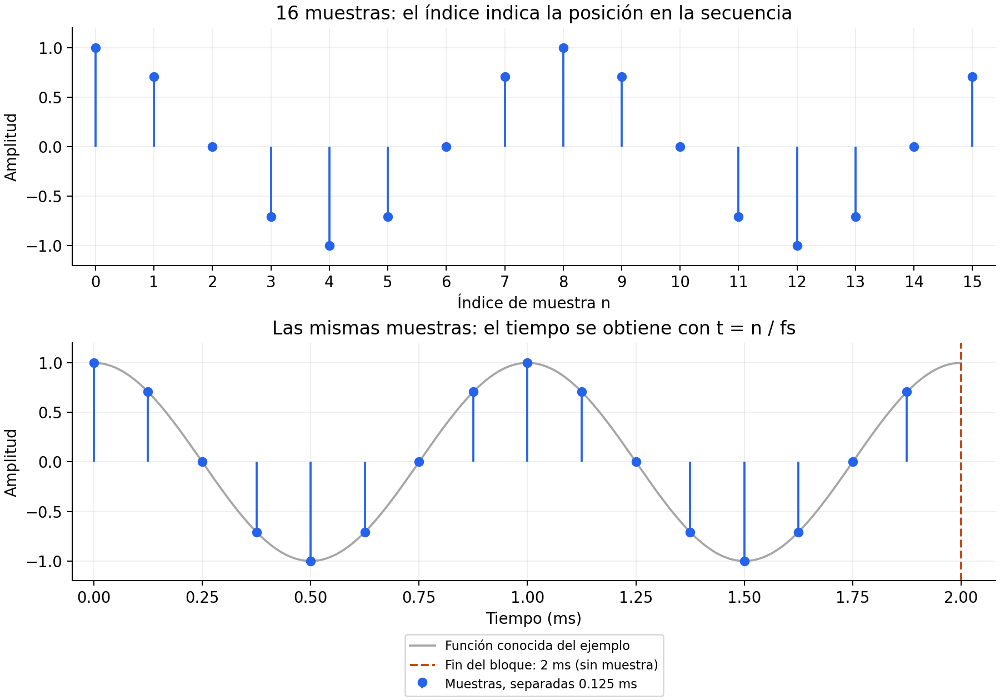

**Figura 1.** Las mismas 16 muestras representadas por índice y por tiempo, con una tasa de muestreo de 8 kS/s.

En el gráfico superior se cuentan posiciones de la secuencia. En el inferior se leen instantes: los máximos en $n=0$ y $n=8$ corresponden a 0 y 1 ms. Cada punto azul representa una muestra. La curva gris representa la función conocida utilizada para generar el ejemplo; no es una reconstrucción obtenida de una captura. Los tallos verticales ayudan a leer las amplitudes y no representan pulsos físicos.

#### 1.5. Cuánto tiempo representa un bloque

Un bloque de $N$ muestras contiene los índices de 0 a $N-1$. Su duración nominal es

$$
T_{\mathrm{bloque}}=NT_s=\frac{N}{f_s}.
$$

Con 16 muestras a 8000 S/s:

$$
T_{\mathrm{bloque}}=\frac{16}{8000}\;\text{s}=2\;\text{ms}.
$$

La última muestra es $x[15]$, cuyo instante es

$$
t_{15}=\frac{15}{8000}\;\text{s}=1.875\;\text{ms}.
$$

No hay contradicción: entre la primera y la última muestra existen 15 intervalos. Para contar la duración nominal del bloque se consideran 16 intervalos de muestreo. La siguiente muestra de una secuencia que continúa, $x[16]$, llegaría a los 2 ms, ya fuera de este bloque. En la Figura 1, la línea naranja marca ese límite.

**Colab — Celda 3: comprobar los tiempos.**

```python
print(f"Intervalo entre muestras: {1e6 / fs:.1f} us")
print(f"Duración del bloque:      {1000 * N / fs:.3f} ms")
print(f"Instante de la última:    {1000 * t[-1]:.3f} ms")
print(f"Muestras por ciclo:       {fs / f0:g}")
```

La salida es 125.0 us, 2.000 ms, 1.875 ms y 8 muestras por ciclo. En Python, `t[-1]` selecciona el último elemento del arreglo.

??? example "Comprobación: el mismo bloque con otra tasa declarada"
    Si los mismos 16 valores se interpretan con una tasa de 4000 S/s, el intervalo pasa a 0.25 ms y la duración nominal a 4 ms. Los valores no cambian; cambia el tiempo asignado a cada uno. Por eso una captura necesita conservar su tasa de muestreo como metadato.

#### 1.6. Qué cambia al modificar el tono

Una vez fijado el eje temporal, se puede cambiar un parámetro del tono y observar su efecto:

| Cambio respecto al ejemplo | Predicción |
|---|---|
| Amplitud $A=0.5$ | Los valores se reducen a la mitad; el período sigue siendo 1 ms. |
| Frecuencia $f_0=2000$ Hz | El período pasa a 0.5 ms; hay cuatro ciclos en el intervalo de 2 ms y cuatro muestras por ciclo. |
| Fase $\phi=\pi/2$ | El valor inicial pasa de 1 a 0; la amplitud y el período se mantienen. |

**Colab — Celda 4: comparar un cambio a la vez.** Esta celda utiliza los arreglos de referencia de las celdas anteriores y mantiene la tasa de muestreo y el tamaño del bloque.

```python
cambios = [
    (0.5, 1000, 0.0, "Amplitud: A = 0.5"),
    (1.0, 2000, 0.0, "Frecuencia: f0 = 2 kHz"),
    (1.0, 1000, np.pi / 2, "Fase: phi = pi/2 rad"),
]

fig, axes = plt.subplots(3, 1, figsize=(10, 7), sharex=True, sharey=True, layout="constrained")
for ax, (amp, freq, fase, titulo) in zip(axes, cambios):
    y_ref = amp * np.cos(2 * np.pi * freq * t_ref + fase)
    y = amp * np.cos(2 * np.pi * freq * t + fase)
    ax.plot(t_ref * 1000, x_ref, "--", color="0.7", label="Referencia")
    ax.plot(t_ref * 1000, y_ref, color="tab:blue", label="Cambio")
    ax.plot(t * 1000, y, "o", color="tab:blue", label="Muestras")
    ax.set(title=titulo, ylabel="Amplitud", ylim=(-1.2, 1.2))
    ax.grid(alpha=0.2)
axes[0].legend(loc="upper center", bbox_to_anchor=(0.5, 1.5), ncol=3)
axes[-1].set_xlabel("Tiempo (ms)")
plt.show()
```

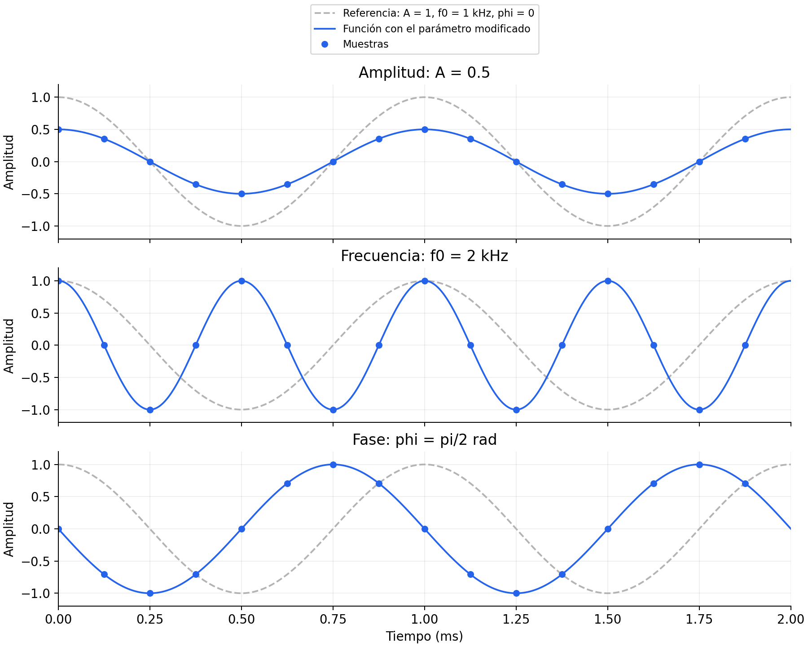

**Figura 2.** Efectos de cambiar por separado la amplitud, la frecuencia y la fase de un tono.

La curva gris conserva el tono original en los tres paneles. En el primero, la curva azul alcanza la mitad de amplitud y repite el ciclo en los mismos instantes. En el segundo, completa los ciclos en la mitad de tiempo. En el tercero, comienza en otra posición del ciclo: cruza por cero en lugar de empezar en un máximo. Los puntos mantienen los mismos instantes de muestreo en todos los casos.

Para experimentar, el estudiante puede cambiar una fila de `cambios`, anotar primero qué espera observar y ejecutar de nuevo la celda 4. Por ejemplo, $A=0.25$, $f_0=500$ Hz o $\phi=\pi$ permiten comparar una amplitud menor, un período mayor o un inicio en el mínimo. Cada prueba cambia un solo parámetro respecto al tono original.

??? example "Comprobación: frecuencia del tono y tasa de muestreo"
    Un tono de 500 Hz tiene un período de 2 ms. A 8000 S/s se toman 16 muestras por ciclo. La señal cambia más lentamente que el tono de 1 kHz, aunque la separación temporal entre muestras sigue siendo 0.125 ms.

??? example "Comprobación: índice, tiempo y fase"
    Con los parámetros originales, la muestra de índice 4 corresponde a 0.5 ms y vale aproximadamente $-1$. Si solo cambia la fase a $\pi/2$, ese índice sigue correspondiendo a 0.5 ms, pero su valor pasa a ser aproximadamente 0.

Al finalizar esta subsección, la secuencia ya tiene una interpretación temporal: el índice identifica una muestra, la tasa de muestreo determina su instante y el valor describe la señal en ese punto. La siguiente subsección utiliza esta base para interpretar las dos componentes de una muestra I/Q.

#### 1.7. Ejercicios de refuerzo

- **Forma de trabajo:** se plantea primero una respuesta con sus unidades y una justificación. La solución desplegable permite contrastar el resultado después de resolver el ejercicio.

##### Ejercicio 1A — construir el eje temporal

Se dispone de un bloque de 400 muestras con $f_s=20000$ S/s.

- Calcular el intervalo entre muestras, la duración nominal del bloque y el instante de la última muestra.
- Indicar a qué tiempo corresponde la muestra de índice $n=50$.

??? example "Solución del ejercicio 1A"

    - **Punto de partida:** el apartado 1.3 relaciona el sample rate con el tiempo mediante $T_s=1/f_s$ y $t_n=n/f_s$. El apartado 1.5 añade la duración nominal $T_{\mathrm{bloque}}=N/f_s$. En este ejercicio, $N=400$ y $f_s=20000$ S/s; se asigna $t=0$ a la primera muestra.
    - **Paso 1 — intervalo entre muestras:** $T_s=1/20000=0.00005$ s. Como $1$ s contiene $10^6$ µs, se obtiene $0.00005\times10^6=50$ µs. Esta cantidad separa cualquier pareja de muestras consecutivas; no es la duración del bloque completo.
    - **Paso 2 — duración nominal:** $T_{\mathrm{bloque}}=400/20000=0.020$ s, es decir, 20 ms. Se cuentan 400 intervalos de muestreo para describir el bloque; la muestra siguiente de una secuencia que continúa llegaría justo a ese límite.
    - **Paso 3 — índice de la última muestra:** al comenzar en cero, los índices son $0,1,\ldots,399$. Por eso se utiliza $N-1=399$, no 400, en la fórmula del instante: $t_{399}=399/20000=0.01995$ s, es decir, 19.95 ms.
    - **Paso 4 — muestra de índice 50:** $t_{50}=50/20000=0.0025$ s, es decir, 2.5 ms. Es la muestra número 51 al contar desde la primera; el número 50 es su índice, no un tiempo expresado directamente en milisegundos.
    - **Comprobación e interpretación:** la diferencia entre el límite nominal y la última muestra es $20-19.95=0.05$ ms, exactamente $T_s=50$ µs. Así se comprueba que 20 ms de duración nominal y 19.95 ms para la última muestra son resultados compatibles, no contradictorios.

##### Ejercicio 1B — calcular valores de una senoide

Se considera $x[n]=0.8\cos(2\pi\,1000\,n/8000+\pi/2)$.

- Identificar amplitud, frecuencia, fase inicial y sample rate.
- Calcular el período, la cantidad de muestras por ciclo y los valores $x[0]$ y $x[2]$.

??? example "Solución del ejercicio 1B"

    - **Punto de partida:** el apartado 1.4 define $x[n]=A\cos(2\pi f_0n/f_s+\phi)$. Se compara cada término de esa expresión con el enunciado: $A=0.8$, $f_0=1000$ Hz, $f_s=8000$ S/s y $\phi=\pi/2$ rad, equivalente a 90°. La amplitud es la del ejemplo matemático; no se le asigna una unidad de voltios que el enunciado no proporciona.
    - **Paso 1 — período:** el tono completa 1000 ciclos por segundo. Por tanto, $T_0=1/f_0=1/1000=0.001$ s, es decir, 1 ms por ciclo. No se utiliza $1/f_s$ para este cálculo: esa inversa daría el intervalo entre muestras, no el período del tono.
    - **Paso 2 — muestras por ciclo:** en el tiempo $T_0$ se toman $f_sT_0=f_s/f_0=8000/1000=8$ muestras. Equivalentemente, $T_s=1/8000=0.125$ ms y ocho intervalos de ese tamaño completan 1 ms.
    - **Paso 3 — primera muestra:** al sustituir $n=0$, el término que depende del tiempo vale cero. Queda $x[0]=0.8\cos(\pi/2)=0$. La amplitud del tono sigue siendo 0.8, aunque esta muestra particular sea cero: amplitud y valor instantáneo son conceptos diferentes.
    - **Paso 4 — muestra de índice 2:** el ángulo debido al tiempo es $2\pi(1000)(2)/8000=\pi/2$. Se suma la fase inicial, de modo que el ángulo total es $\pi/2+\pi/2=\pi$ rad. Como $\cos\pi=-1$, se obtiene $x[2]=-0.8$.
    - **Ubicación temporal del resultado:** usando el apartado 1.3, $t_2=2/8000=0.00025$ s, es decir, 0.25 ms. Entre $n=0$ y $n=2$ transcurre un cuarto del período; el tono avanza desde el cruce por cero de fase 90° hasta el mínimo de fase 180°.

##### Ejercicio 1C — cambiar una etiqueta no adquiere otras muestras

Un bloque de 32 muestras contiene un tono conocido de 1 kHz, adquirido a 8 kS/s. Por error, el mismo arreglo se interpreta como si su tasa fuera 16 kS/s.

- Calcular la duración y el intervalo entre muestras con cada tasa declarada.
- Indicar qué frecuencia se atribuiría al tono y si cambió la señal originalmente adquirida.

??? example "Solución del ejercicio 1C"

    - **Punto de partida:** los apartados 1.3 y 1.5 utilizan $T_s=1/f_s$ y $T_{\mathrm{bloque}}=N/f_s$. La comprobación del apartado 1.5 muestra que cambiar la tasa declarada cambia el tiempo asignado al arreglo, no sus valores. Aquí se mantienen las mismas $N=32$ muestras.
    - **Paso 1 — tasa real de adquisición:** con $f_s=8000$ S/s, $T_s=1/8000=0.125$ ms y $T_{\mathrm{bloque}}=32/8000=4$ ms. Estos tiempos describen cómo se obtuvieron realmente las muestras.
    - **Paso 2 — interpretación errónea:** al declarar 16000 S/s, se asigna $T_s'=1/16000=0.0625$ ms y $T_{\mathrm{bloque}}'=32/16000=2$ ms. Todos los índices reciben tiempos iguales a la mitad de los correctos: $t_n'=n/16000=t_n/2$.
    - **Paso 3 — conservar el ciclo de la secuencia:** el tono adquirido a 1 kHz tenía $8000/1000=8$ muestras por ciclo, según el apartado 1.4. Cambiar una etiqueta no inserta ni elimina muestras; ese patrón de ocho muestras por ciclo permanece en el arreglo.
    - **Paso 4 — frecuencia atribuida:** con la tasa errónea, ocho intervalos se interpretan como $8/16000=0.0005$ s por ciclo. Su inversa es 2000 Hz; también se obtiene directamente $16000/8=2000$ Hz. La mitad del tiempo asignado hace que los mismos ciclos parezcan ocurrir al doble de frecuencia.
    - **Conclusión:** no se adquirió una señal nueva ni se cambió físicamente el tono de 1 kHz. Se construyó un eje temporal incorrecto para los mismos datos. La interpretación de la captura debe recuperar el metadato de 8 kS/s, no aceptar los 2 kHz como una nueva medición de la señal original.

##### Ejercicio 1D — explicar los tres cambios de la Figura 2

Se toma como referencia el tono de amplitud 1, frecuencia 1 kHz y fase inicial cero de la Figura 2.

- Explicar qué cambia al usar amplitud 0.5, frecuencia 2 kHz o fase inicial $\pi/2$, modificando un parámetro a la vez.
- Indicar si cambia la separación temporal de los puntos cuando se conservan $f_s$ y $N$.

??? example "Solución del ejercicio 1D"

    - **Punto de partida:** los apartados 1.4 y 1.6 separan los parámetros de $x[n]=A\cos(2\pi f_0n/f_s+\phi)$. La Figura 2 conserva $f_s=8000$ S/s y $N=16$; cada panel modifica un solo parámetro respecto a $x_{\mathrm{ref}}[n]=\cos(2\pi\,1000\,n/8000)$.
    - **Panel de amplitud — sustitución:** al elegir $A=0.5$, queda $x_A[n]=0.5\cos(2\pi\,1000\,n/8000)=0.5x_{\mathrm{ref}}[n]$. Cada valor se reduce a la mitad: por ejemplo, la primera muestra pasa de 1 a 0.5 y el mínimo de −1 a −0.5.
    - **Panel de amplitud — qué se conserva:** no cambia el argumento del coseno. Los máximos, mínimos y cruces por cero ocurren en los mismos instantes; el período continúa siendo $1/1000=1$ ms. El cambio es vertical, no temporal.
    - **Panel de frecuencia — sustitución y efecto:** con $f_0=2000$ Hz, $T_0=1/2000=0.5$ ms y hay $f_s/f_0=8000/2000=4$ muestras por ciclo. En los 2 ms nominales del bloque caben cuatro ciclos en lugar de dos. La amplitud sigue siendo 1 y la fase inicial sigue siendo cero.
    - **Panel de fase — sustitución y efecto:** con $\phi=\pi/2$, $x_\phi[n]=\cos(2\pi\,1000\,n/8000+\pi/2)$. En $n=0$ se obtiene $\cos(\pi/2)=0$, en lugar de 1. Cambia la posición dentro del ciclo en cada instante, pero $A=1$ y $T_0=1$ ms se mantienen.
    - **Eje temporal común:** en los tres paneles, el apartado 1.3 da $t_n=n/8000$ y $T_s=0.125$ ms. Los marcadores no se separan más ni menos en el tiempo; cambian sus valores. Incluso cuando hay menos muestras por ciclo, siguen estando espaciadas igual: es el ciclo el que dura menos.

### 2. Señales reales y señales complejas I/Q

En el ejemplo anterior, cada muestra $x[n]$ era un número real. En la salida I/Q del RTL-SDR, cada muestra contiene una pareja de valores reales. Esa pareja se representa como un número complejo:

$$
z[n]=I[n]+jQ[n].
$$

I y Q corresponden al mismo índice de muestra y al mismo instante. La pareja completa constituye una muestra compleja; no son dos muestras tomadas en instantes consecutivos. A 8 kS/s de muestras complejas se obtienen 8000 valores I y 8000 valores Q por segundo.

#### 2.1. Qué significa una muestra compleja

Los nombres I y Q provienen de *in-phase* y *quadrature*. Se asocian con las dos referencias de mezcla, separadas 90°, utilizadas para obtener la representación en baseband. La asignación de I a la parte real y Q a la parte imaginaria se describe en las [convenciones de señales en baseband de MathWorks](https://www.mathworks.com/help/phased/gs/standards-and-conventions.html).

En la expresión $I+jQ$, $j$ es la unidad imaginaria y cumple $j^2=-1$. Permite representar y operar con las dos componentes de forma conjunta. No significa que Q sea una cantidad ficticia: I y Q son valores reales producidos por el procesamiento del receptor.

Por ejemplo, una muestra con $I=3$ y $Q=4$ se escribe como

$$
z=3+j4.
$$

En el plano I/Q, el eje horizontal representa I y el vertical representa Q. La muestra se ubica en el punto $(3,4)$. Este plano tiene dos ejes de amplitud; ninguno de ellos es un eje temporal.

#### 2.2. Magnitud y fase: distancia y ángulo

La misma muestra puede describirse por su distancia al origen y por el ángulo que forma con el eje I positivo:

$$
|z|=\sqrt{I^2+Q^2},
\qquad
\theta=\operatorname{atan2}(Q,I).
$$

La distancia es la magnitud y el ángulo es la fase. `atan2` utiliza ambas componentes para identificar el cuadrante del punto. Para $z=3+j4$:

$$
|z|=5,
\qquad
\theta\approx 0.9273\;\text{rad}\approx 53.13^\circ.
$$

La fase se mide desde el eje I positivo, con ángulos positivos en sentido antihorario. La representación polar reúne estas dos cantidades:

$$
z=|z|e^{j\theta}.
$$

**Colab — Celda 1: leer una muestra y ubicarla en el plano.** Las cinco celdas de esta subsección se ejecutan en orden. Esta primera celda incluye los imports para que la subsección también pueda ejecutarse en un notebook nuevo.

```python
import numpy as np
import matplotlib.pyplot as plt

muestra = 3 + 4j
print(f"I = {muestra.real:g}; Q = {muestra.imag:g}")
print(f"Magnitud = {np.abs(muestra):.2f}")
print(f"Fase = {np.angle(muestra):.4f} rad = {np.angle(muestra, deg=True):.2f} grados")

fig, ax = plt.subplots(figsize=(6, 6), layout="constrained")
ax.axhline(0, color="0.7")
ax.axvline(0, color="0.7")
ax.annotate("", xy=(muestra.real, muestra.imag), xytext=(0, 0), arrowprops={"arrowstyle": "->", "color": "tab:blue", "lw": 2})
ax.plot([muestra.real, muestra.real], [0, muestra.imag], "--", color="0.5")
ax.plot([0, muestra.real], [muestra.imag, muestra.imag], "--", color="0.5")
ax.plot(muestra.real, muestra.imag, "o", color="tab:blue", label=f"z = {muestra}")
arco = np.linspace(0, np.angle(muestra), 100)
ax.plot(np.cos(arco), np.sin(arco), color="tab:red")
ax.text(1.3 * np.cos(np.angle(muestra) / 2), 1.3 * np.sin(np.angle(muestra) / 2), f"{np.angle(muestra, deg=True):.2f}°", color="tab:red")
ax.set(xlabel="I (parte real)", ylabel="Q (parte imaginaria)", xlim=(-6, 6), ylim=(-6, 6), title="Una muestra en el plano I/Q")
ax.set_aspect("equal")
ax.grid(alpha=0.2)
ax.legend()
plt.show()
```

En Python se escribe `1j` para la unidad imaginaria, y `3 + 4j` para esta muestra. Los atributos `.real` y `.imag` permiten recuperar las componentes. NumPy calcula la [magnitud con `np.abs`](https://numpy.org/doc/stable/reference/generated/numpy.absolute.html) y la [fase con `np.angle`](https://numpy.org/doc/stable/reference/generated/numpy.angle.html). Esta última devuelve radianes, o grados si se indica `deg=True`.

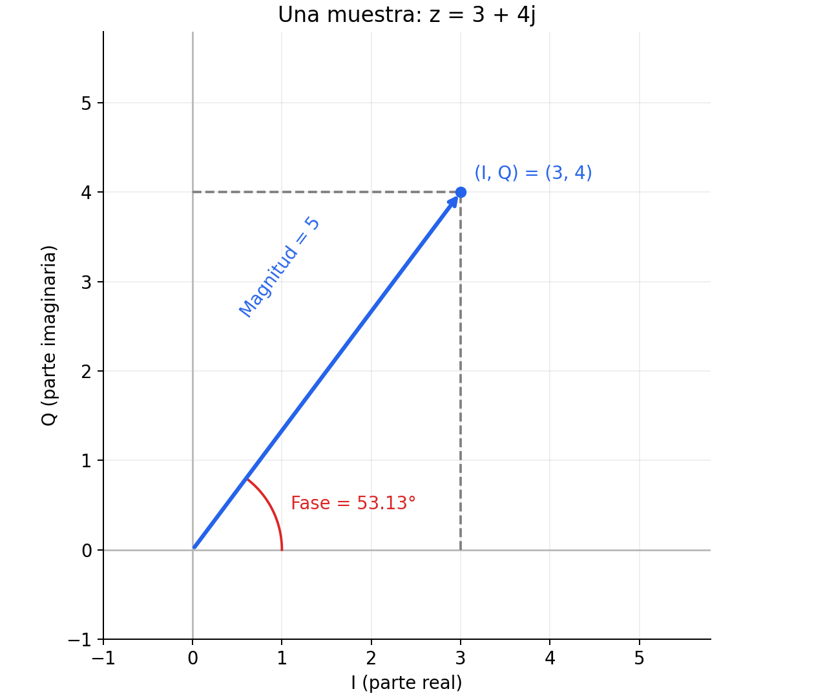

**Figura 3.** Una muestra compleja descrita por sus componentes I/Q, su magnitud y su fase.

- **Componentes:** las líneas grises permiten leer I = 3 y Q = 4 en sus ejes.
- **Magnitud:** la flecha azul une el origen con la muestra. Su longitud es 5.
- **Fase:** el arco rojo indica 53.13°, medidos desde el eje I positivo.
- **Relación:** las componentes I/Q y la pareja magnitud-fase describen el mismo punto.

??? example "Comprobación: igual magnitud, distinta fase"
    La muestra $-3+j4$ también tiene magnitud 5, pero se encuentra en el segundo cuadrante. Su fase es aproximadamente 126.87°. Cambiar `muestra` a `-3 + 4j` en la celda 1 permite comprobarlo. Si ambas componentes son cero, la magnitud es cero y no existe una dirección que defina la fase; el valor que devuelva el software en ese caso es una convención.

#### 2.3. Una senoide compleja es una rotación

Una secuencia de muestras complejas puede describir un punto que gira alrededor del origen. El tono complejo de amplitud $A$, frecuencia $f_0$ y fase inicial $\phi$ es

$$
z[n]=Ae^{j\theta[n]},
\qquad
\theta[n]=2\pi f_0\frac{n}{f_s}+\phi.
$$

La identidad de Euler permite leer sus componentes:

$$
e^{j\theta}=\cos\theta+j\sin\theta.
$$

Por tanto,

$$
I[n]=A\cos\theta[n],
\qquad
Q[n]=A\sin\theta[n].
$$

En el ejemplo de 1 kHz, I y Q son muestras de senoides separadas un cuarto de ciclo. Cada pareja corresponde a un punto del círculo de radio $A$.

La magnitud del tono complejo es constante:

$$
|z[n]|=\sqrt{A^2\cos^2\theta[n]+A^2\sin^2\theta[n]}=A,
\qquad A>0.
$$

Así, I puede pasar por cero mientras Q alcanza un máximo. La magnitud conjunta se mantiene, aunque cambien las dos componentes.

**Colab — Celda 2: generar un tono complejo.** Se conservan la frecuencia de 1 kHz, la tasa de 8 kS/s y las 16 muestras del ejemplo anterior.

```python
fs = 8000
f0 = 1000
A = 1.0
phi = 0.0
N = 16

n = np.arange(N)
t = n / fs
theta = 2 * np.pi * f0 * t + phi
I = A * np.cos(theta)
Q = A * np.sin(theta)
z = I + 1j * Q

print(" n      I        Q      magnitud   fase (grados)")
for k in range(8):
    print(f"{k:2d}  {I[k]:7.4f}  {Q[k]:7.4f}    {np.abs(z[k]):.4f}       {np.angle(z[k], deg=True):7.2f}")
print("Las dos formas coinciden:", np.allclose(z, A * np.exp(1j * theta)))
```

La primera muestra es aproximadamente $1+j0$; la de índice 2 es $0+j1$; la de índice 4 es $-1+j0$. Todas tienen magnitud 1. La amplitud del ejemplo sigue siendo una cantidad elegida para la simulación, sin calibración en voltios.

Entre muestras consecutivas, el ángulo avanza

$$
\Delta\theta=2\pi\frac{f_0}{f_s}=\frac{\pi}{4}=45^\circ.
$$

Ocho avances de 45° completan una vuelta. La muestra de índice 8 vuelve a la posición inicial, 1 ms después de la primera.

`np.angle(..., deg=True)` expresa el ángulo principal entre −180° y +180°. Por eso puede mostrar 180° y después −135°: −135° y 225° indican la misma dirección. Ese cambio de representación no significa que el punto haya invertido su giro. En el eje I negativo puede devolver +180° o −180°, según el signo numérico de Q; ambos representan la misma dirección. La [documentación de NumPy](https://numpy.org/doc/stable/reference/generated/numpy.angle.html) incluye los casos de cero con signo.

**Colab — Celda 3: observar las componentes y la rotación.**

```python
t_ref = np.linspace(0, N / fs, 1000)
z_ref = A * np.exp(1j * (2 * np.pi * f0 * t_ref + phi))

fig, axes = plt.subplots(1, 2, figsize=(12, 5), layout="constrained")
axes[0].plot(t_ref * 1000, z_ref.real, color="tab:blue", label="I")
axes[0].plot(t * 1000, I, "o", color="tab:blue")
axes[0].plot(t_ref * 1000, z_ref.imag, color="tab:red", label="Q")
axes[0].plot(t * 1000, Q, "s", color="tab:red", markerfacecolor="white")
axes[0].set(xlabel="Tiempo (ms)", ylabel="Amplitud", title="I y Q del mismo tono")
axes[0].legend()

axes[1].plot(z_ref.real, z_ref.imag, color="0.7")
axes[1].plot(z[:8].real, z[:8].imag, "o", color="tab:blue")
for k in (0, 1, 2, 4, 6):
    axes[1].text(1.12 * I[k], 1.12 * Q[k], f"n={k}", ha="center", va="center")
axes[1].annotate("", xy=(I[1], Q[1]), xytext=(I[0], Q[0]), arrowprops={"arrowstyle": "->", "color": "tab:blue", "lw": 2})
axes[1].axhline(0, color="0.7")
axes[1].axvline(0, color="0.7")
axes[1].set(xlabel="I", ylabel="Q", xlim=(-1.4, 1.4), ylim=(-1.4, 1.4), title="Una vuelta cada 1 ms")
axes[1].set_aspect("equal")
for ax in axes:
    ax.grid(alpha=0.2)
plt.show()
```

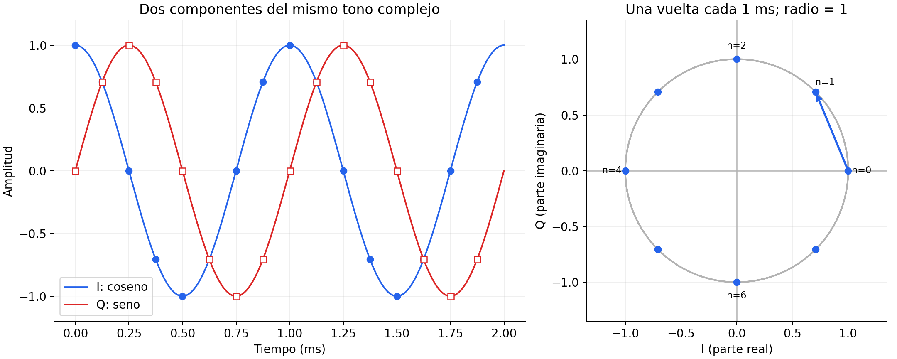

**Figura 4.** Un tono complejo observado como dos componentes temporales y como una rotación en el plano I/Q.

En el panel izquierdo, cada instante tiene un valor azul I y un valor rojo Q. El panel derecho combina cada pareja en un punto. La flecha muestra el avance de $n=0$ a $n=1$. Los ocho puntos visibles se repiten durante el segundo ciclo del bloque, por lo que no aparecen 16 posiciones diferentes. Las curvas representan el tono conocido del ejemplo, no una reconstrucción de datos recibidos.

- **Experimento de amplitud:** se cambia $A$ a 0.5 y se mantiene $\phi=0$. Se ejecutan de nuevo las celdas 2 y 3. El radio pasa a 0.5.
- **Experimento de fase:** primero se restablece $A=1$. Después se cambia $\phi$ a $\pi/2$ y se ejecutan las mismas celdas. La primera muestra pasa a $0+j1$.
- **Parámetros fijos:** ambos experimentos conservan $f_0=1$ kHz y $f_s=8$ kS/s. El tiempo por vuelta sigue siendo 1 ms.

!!! note "Una captura I/Q no tiene que formar un círculo"
    El círculo corresponde a un tono complejo ideal de amplitud constante. Una captura puede contener varias señales, cambios de amplitud y ruido. Además, I y Q no tienen que ser siempre dos senoides separadas 90°: sus nombres se refieren a las referencias de mezcla. La relación de seno y coseno usada aquí corresponde al tono elegido.

#### 2.4. El signo de la frecuencia indica el sentido del giro

Con la convención $z=I+jQ$, un tono $e^{j2\pi f_0t}$ con $f_0>0$ gira en sentido antihorario. Al cambiar el signo de $f_0$, gira en sentido horario. En el ejemplo muestreado de esta subsección, los tonos de +1 kHz y −1 kHz avanzan +45° y −45° por muestra, respectivamente.

Sus componentes son

$$
z_+[n]=\cos\theta[n]+j\sin\theta[n],
\qquad
z_-[n]=\cos\theta[n]-j\sin\theta[n],
$$

donde ahora $\theta[n]=2\pi\,1000\,n/8000$, sin fase inicial.

Ambos tonos tienen la misma componente I y la misma magnitud. La componente Q cambia de signo. Al conservar solo I, estos dos tonos se vuelven indistinguibles; al conservar I y Q se puede distinguir el sentido del giro.

Una frecuencia negativa en esta representación no indica una frecuencia RF físicamente negativa. La relación con la frecuencia central de la captura se desarrollará en la subsección 6.

**Colab — Celda 4: comparar los dos sentidos.** Esta celda fija explícitamente los tonos de ±1 kHz, independientemente de los cambios de amplitud y fase que se hayan probado antes.

```python
theta_giro = 2 * np.pi * 1000 * t
z_pos = np.exp(1j * theta_giro)
z_neg = np.exp(-1j * theta_giro)
print("Las componentes I coinciden:", np.allclose(z_pos.real, z_neg.real))
print("Las componentes Q son opuestas:", np.allclose(z_pos.imag, -z_neg.imag))

fig, axes = plt.subplots(1, 2, figsize=(10, 5), layout="constrained")
circulo = np.exp(1j * np.linspace(0, 2 * np.pi, 200))
casos = [(z_pos, "+1 kHz: giro antihorario", "tab:blue"), (z_neg, "-1 kHz: giro horario", "tab:red")]
for ax, (tono, titulo, color) in zip(axes, casos):
    ax.plot(circulo.real, circulo.imag, color="0.7")
    ax.plot(tono[:8].real, tono[:8].imag, "o", color=color)
    for k in (0, 1, 2, 4, 6):
        ax.text(1.12 * tono[k].real, 1.12 * tono[k].imag, f"n={k}", ha="center", va="center")
    ax.annotate("", xy=(tono[1].real, tono[1].imag), xytext=(tono[0].real, tono[0].imag), arrowprops={"arrowstyle": "->", "color": color, "lw": 2})
    ax.axhline(0, color="0.7")
    ax.axvline(0, color="0.7")
    ax.set(xlabel="I", ylabel="Q", title=titulo, xlim=(-1.4, 1.4), ylim=(-1.4, 1.4))
    ax.set_aspect("equal")
    ax.grid(alpha=0.2)
plt.show()
```

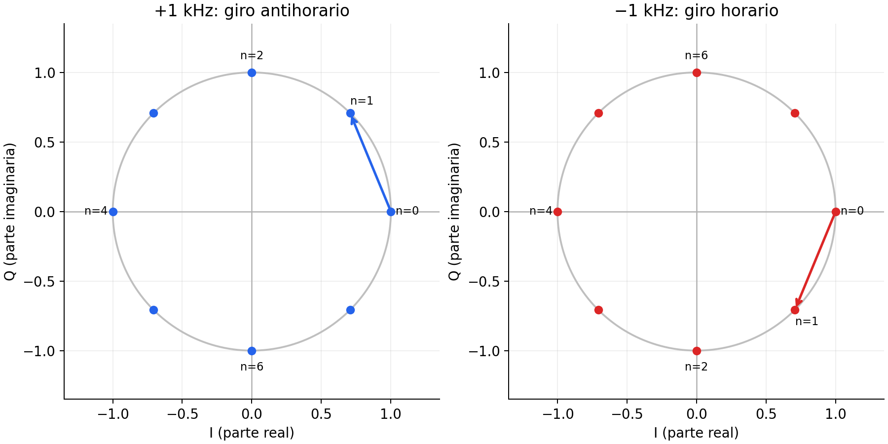

**Figura 5.** El signo de la frecuencia distingue dos sentidos de rotación en el plano I/Q.

Ambos recorridos comienzan en $(1,0)$. En el panel izquierdo, la muestra $n=1$ tiene Q positiva; en el derecho, Q negativa. Los círculos y los puntos ocupan las mismas posiciones, pero las etiquetas muestran un orden diferente. La dirección se identifica observando la secuencia, no una muestra aislada ni una nube de puntos sin orden temporal.

!!! note "El sentido observado depende de las muestras"
    - Los ejemplos de ±1 kHz están dentro de $(-f_s/2,f_s/2)$. En ese intervalo, el signo distingue el sentido del avance entre muestras.
    - Las muestras no identifican por sí solas la frecuencia continua original. Se comparan tonos con igual amplitud y fase inicial. Producen muestras iguales si sus frecuencias difieren en un múltiplo entero de $f_s$.
    - En DC (0 Hz), el punto permanece fijo. En Nyquist, el tono alterna entre dos posiciones opuestas y no permite distinguir $+f_s/2$ de $-f_s/2$.
    - La subsección 4 desarrolla estas equivalencias mediante el aliasing.

#### 2.5. Una senoide real reúne dos giros opuestos

La identidad de Euler también permite escribir una senoide real como suma de dos tonos complejos:

$$
A\cos\theta[n]=\frac{A}{2}e^{j\theta[n]}+\frac{A}{2}e^{-j\theta[n]}.
$$

Cada término tiene amplitud $A/2$. En el ejemplo de ±1 kHz, los tonos giran en sentidos opuestos. Sus partes imaginarias se cancelan y sus partes reales se suman:

$$
\frac{A}{2}(\cos\theta+j\sin\theta)+\frac{A}{2}(\cos\theta-j\sin\theta)=A\cos\theta.
$$

El resultado se mueve sobre el eje real. Esta descomposición prepara la explicación de las componentes positivas y negativas del espectro de una senoide real, que se verá en la subsección 3. También aparece en el material de [senoides en tiempo discreto de TU Eindhoven](https://spseducation.tue.nl/disciplines/discrete/discretesignalprocessing_sampling_sampling/).

**Colab — Celda 5: sumar los giros.** La comprobación utiliza los tonos de amplitud 1 y frecuencias ±1 kHz de la celda 4.

```python
suma = 0.5 * z_pos + 0.5 * z_neg
tono_real = np.cos(theta_giro)

print("La parte real coincide con el coseno:", np.allclose(suma.real, tono_real))
print("La parte imaginaria es cero:", np.allclose(suma.imag, 0))
print("Magnitudes del tono complejo:", np.round(np.abs(z_pos[:8]), 4))
print("Valores absolutos del tono real:", np.round(np.abs(tono_real[:8]), 4))
```

Las dos primeras comparaciones producen `True`. El tono complejo tiene magnitud 1 en todas las muestras; el valor absoluto de la senoide real cambia entre 0 y 1. La amplitud de una senoide real es un parámetro de toda la onda, no el valor absoluto de cada muestra.

Una secuencia real puede escribirse formalmente como $x[n]+j0$. Sin embargo, añadir una Q nula no recupera la información de una captura I/Q de la que se descartó Q. Tampoco es lo mismo sumar dos giros de amplitud $A/2$ que conservar el tono complejo completo de amplitud $A$.

??? example "Comprobación: dos tonos y una sola componente"
    Si se guarda únicamente I de los tonos de ±1 kHz del ejemplo, se obtiene el mismo coseno. No se puede decidir cuál de los dos tonos originó esos valores. Con Q se distingue: en $n=2$, Q vale aproximadamente +1 para el tono positivo y −1 para el negativo.

??? example "Comprobación: qué cambia en el plano I/Q"
    En un tono complejo, reducir la amplitud reduce el radio. Cambiar la fase inicial cambia la posición de inicio. Cambiar el signo de la frecuencia invierte el sentido de giro. Con los demás parámetros fijos, cambiar la magnitud de la frecuencia cambia el tiempo necesario para completar una vuelta.

La salida del RTL-SDR sigue esta organización de muestras complejas, aunque una captura real sea más complicada que un tono ideal. Las componentes I y Q permiten describir conjuntamente magnitud y fase. La siguiente subsección utiliza estos tonos como punto de partida para relacionar las representaciones en tiempo y frecuencia.

#### 2.6. Ejercicios de refuerzo

##### Ejercicio 2A — ubicar una muestra y calcular su fase

Una muestra tiene $I=-3$ y $Q=4$.

- Escribirla como número complejo, ubicar su cuadrante y calcular su magnitud y fase en grados.
- Explicar por qué la fase no debe calcularse ignorando el signo de I.

??? example "Solución del ejercicio 2A"

    - **Punto de partida:** el apartado 2.1 representa una muestra como $z=I+jQ$ y el apartado 2.2 calcula $|z|=\sqrt{I^2+Q^2}$ y $\theta=\operatorname{atan2}(Q,I)$. Se utilizan ambas coordenadas de una misma muestra; no se trata de dos instantes distintos.
    - **Paso 1 — número complejo y posición:** al sustituir $I=-3$ y $Q=4$, queda $z=-3+j4$. El punto está tres unidades a la izquierda del origen y cuatro hacia arriba. Como $I<0$ y $Q>0$, pertenece al segundo cuadrante; su fase debe estar entre 90° y 180°.
    - **Paso 2 — magnitud:** $|z|=\sqrt{(-3)^2+4^2}=\sqrt{9+16}=\sqrt{25}=5$. El signo negativo de I se eleva al cuadrado; la distancia al origen no puede ser negativa.
    - **Paso 3 — fase:** $\theta=\operatorname{atan2}(4,-3)\approx2.2143$ rad. Para pasar a grados se multiplica por $180/\pi$, obteniendo aproximadamente 126.87°. El ángulo se mide desde el eje I positivo en sentido antihorario y coincide con el cuadrante identificado.
    - **Por qué no basta el cociente:** $Q/I=-4/3$ y el valor principal de $\arctan(-4/3)$ es aproximadamente −53.13°. Ese ángulo señalaría el cuarto cuadrante, no el punto $(-3,4)$. El cociente también sería −4/3 para $(3,-4)$, por lo que perdió la información que distingue ambos puntos.
    - **Comprobación geométrica:** con $z=5e^{j\theta}$, Euler da $I=5\cos\theta\approx-3$ y $Q=5\sin\theta\approx4$. Esta sustitución comprueba simultáneamente magnitud, fase y signos. `atan2` evita tener que corregir el cuadrante manualmente.

##### Ejercicio 2B — reconocer el giro a partir de dos muestras

Se genera $z[n]=0.5e^{j(-2\pi\,1000\,n/8000+\pi/4)}$.

- Calcular $z[0]$, $z[1]$ y el cambio de fase entre esas muestras.
- Indicar el sentido de giro y qué representa el radio del recorrido.

??? example "Solución del ejercicio 2B"

    - **Punto de partida:** el apartado 2.3 define $z[n]=Ae^{j\theta[n]}$ con $\theta[n]=2\pi f_0n/f_s+\phi$, y Euler permite calcular $I=A\cos\theta$ y $Q=A\sin\theta$. El apartado 2.4 relaciona el signo del avance de fase con el sentido de giro. Aquí $A=0.5$, $f_0=-1000$ Hz y $\phi=\pi/4$.
    - **Paso 1 — fase en la primera muestra:** con $n=0$, $\theta[0]=\pi/4=45^\circ$. Por tanto, $z[0]=0.5[\cos(\pi/4)+j\sin(\pi/4)]=0.5(\sqrt{2}/2+j\sqrt{2}/2)\approx0.3536+j0.3536$.
    - **Paso 2 — fase en la segunda muestra:** con $n=1$, $\theta[1]=-2\pi(1000/8000)+\pi/4=-\pi/4+\pi/4=0$. Así, $z[1]=0.5(\cos0+j\sin0)=0.5+j0$. El punto se mueve desde el primer cuadrante hasta el eje I positivo.
    - **Paso 3 — avance entre muestras:** $\Delta\theta=\theta[1]-\theta[0]=-\pi/4=-45^\circ$. Es un avance negativo, por lo que el giro es horario con la convención de esta sesión. La fase inicial positiva de 45° no contradice ese giro: señala dónde empieza el punto, no hacia dónde se mueve.
    - **Paso 4 — relación con el tiempo:** las muestras están separadas $T_s=1/8000=0.125$ ms. Ocho avances de −45° completan una vuelta en 1 ms, coherente con la magnitud de frecuencia de 1 kHz. El signo negativo indica el sentido, no una duración negativa.
    - **Interpretación del radio:** $|z[n]|=0.5|e^{j\theta[n]}|=0.5$ para todo $n$, porque $|e^{j\theta}|=1$. El radio no mide tiempo ni frecuencia; es la magnitud de la muestra. I y Q cambian durante el giro, aunque esa magnitud permanezca constante.

##### Ejercicio 2C — contar muestras I/Q sin duplicar el tiempo

Un bloque contiene 40 parejas I/Q y su sample rate es 8 kS/s de muestras complejas.

- Indicar cuántas muestras complejas, valores I y valores Q contiene.
- Calcular su duración y explicar por qué no corresponde a 80 muestras temporales.

??? example "Solución del ejercicio 2C"

    - **Punto de partida:** al inicio de la subsección 2 se establece $z[n]=I[n]+jQ[n]$: una pareja I/Q constituye una muestra compleja. La duración sigue calculándose con $T_{\mathrm{bloque}}=N/f_s$, como en el apartado 1.5, pero $N$ cuenta parejas completas cuando la tasa corresponde a muestras complejas.
    - **Paso 1 — contar por tipo de valor:** 40 parejas contienen 40 muestras complejas. Cada pareja aporta un valor I y uno Q; hay, por tanto, 40 valores I y 40 valores Q, o $40+40=80$ valores reales almacenados.
    - **Paso 2 — identificar el número de instantes:** las parejas corresponden a los índices $n=0,1,\ldots,39$. En cada índice están disponibles I y Q conjuntamente. Hay 40 instantes de muestreo, no 80, aunque el almacenamiento requiera dos componentes por instante.
    - **Paso 3 — duración nominal:** con $N=40$ y $f_s=8000$ muestras complejas por segundo, $T_{\mathrm{bloque}}=40/8000=5$ ms. Entre instantes consecutivos hay $T_s=1/8000=0.125$ ms, y la última pareja está en $t_{39}=39/8000=4.875$ ms.
    - **Comprobación del error de conteo:** utilizar $80/8000=10$ ms trataría I y Q como muestras consecutivas de una sola secuencia real. Eso asignaría tiempos diferentes a componentes que pertenecen al mismo instante y duplicaría incorrectamente la duración.
    - **Conclusión:** el número de valores almacenados y el número de muestras temporales no son intercambiables. Antes de aplicar $N/f_s$, se identifica qué constituye una muestra en el formato utilizado y a qué tipo de muestra se refiere el sample rate.

##### Ejercicio 2D — descomponer un coseno sin perder de vista I/Q

Se considera $x[n]=1.2\cos(2\pi\,500\,n/8000)$.

- Escribirlo como suma de dos tonos complejos e indicar sus frecuencias y magnitudes.
- Explicar si observar únicamente I permitiría distinguir un tono complejo de +500 Hz de otro de −500 Hz, ambos con fase inicial cero.

??? example "Solución del ejercicio 2D"

    - **Punto de partida:** el apartado 2.5 utiliza $A\cos\theta=(A/2)e^{j\theta}+(A/2)e^{-j\theta}$. En este ejercicio, $A=1.2$ y $\theta[n]=2\pi\,500\,n/8000$; por eso cada término recibe amplitud $A/2=0.6$, no 1.2.
    - **Paso 1 — escribir los dos términos:** $x[n]=0.6e^{j2\pi\,500\,n/8000}+0.6e^{-j2\pi\,500\,n/8000}$. El primero tiene frecuencia +500 Hz y el segundo −500 Hz. Ambos tienen magnitud constante 0.6 y fase inicial cero.
    - **Paso 2 — comprobar la suma con Euler:** el primer término es $0.6\cos\theta+j0.6\sin\theta$ y el segundo es $0.6\cos\theta-j0.6\sin\theta$. Al sumarlos, Q vale cero y las partes reales dan $0.6\cos\theta+0.6\cos\theta=1.2\cos\theta$. El resultado real no conserva un solo giro: reúne los dos giros opuestos.
    - **Paso 3 — observar únicamente I:** para tonos complejos de igual magnitud $B$, $\operatorname{Re}\{Be^{j\theta}\}=B\cos\theta$ y $\operatorname{Re}\{Be^{-j\theta}\}=B\cos\theta$, porque el coseno es par. Así, los valores I son idénticos y no permiten decidir entre +500 y −500 Hz.
    - **Paso 4 — identificar la información de Q:** en cambio, $Q_+[n]=B\sin\theta[n]$ y $Q_-[n]=-B\sin\theta[n]$. Por ejemplo, en $n=4$ se tiene $\theta=\pi/2$: ambos tonos dan I igual a cero, pero sus Q son $+B$ y $-B$. La pareja I/Q permite distinguir el sentido de giro que I por sí sola no muestra.
    - **Qué no resuelve añadir ceros:** escribir los datos reales como $x[n]+j0$ solo crea una secuencia con Q nula. No reconstruye los valores $\pm B\sin\theta[n]$ que se descartaron. Por eso un coseno real de amplitud 1.2 y un tono complejo de magnitud 1.2 no son la misma señal.

### 3. Una señal, dos representaciones: tiempo y frecuencia

Las subsecciones anteriores describieron cómo cambian las muestras de un tono. Ahora se considera otra pregunta: ¿qué tonos contribuyen a una señal?

La representación temporal muestra los valores en cada instante. La representación frecuencial describe las componentes que forman la señal. Ambas se refieren a la misma señal y permiten responder preguntas diferentes.

#### 3.1. Qué revela cada representación

| Representación | Pregunta que responde | Ejemplo de lectura |
|---|---|---|
| Tiempo | ¿Qué valor toma la señal y cuándo cambia? | Reconocer un período, un cambio de amplitud o la posición inicial dentro de un ciclo. |
| Frecuencia | ¿Qué componentes frecuenciales contiene? | Identificar tonos, comparar sus magnitudes y distinguir frecuencias positivas y negativas. |

En un tono sencillo se puede reconocer la frecuencia contando ciclos. Cuando se suman varios tonos, la forma temporal resulta más complicada. La representación en frecuencia permite identificar las componentes por separado.

El análisis de Fourier proporciona esta relación entre representaciones. Para un bloque de muestras, una FFT calcula coeficientes complejos asociados con determinadas frecuencias. Cada coeficiente tiene magnitud y fase. La idea de descomponer una señal y recuperarla a partir de sus componentes se presenta en el [tutorial de Fourier de SciPy](https://docs.scipy.org/doc/scipy/tutorial/fft.html).

En esta subsección, la FFT se utiliza como herramienta de visualización. El significado detallado de sus puntos de frecuencia, del tamaño del bloque y de las ventanas se desarrollará en la subsección 5.

#### 3.2. Qué componentes corresponden a cada tono

La descomposición de la subsección 2 permite predecir tres espectros:

| Señal de amplitud 1 | Componentes esperadas | Magnitud de cada componente |
|---|---|---:|
| $\cos(2\pi\,1000\,t)$ | −1 kHz y +1 kHz | 0.5 y 0.5 |
| $e^{j2\pi\,1000\,t}$ | +1 kHz | 1 |
| $e^{-j2\pi\,1000\,t}$ | −1 kHz | 1 |

El coseno real reúne dos giros de amplitud 0.5. El tono complejo conserva un solo sentido de giro. Por eso el espectro completo del coseno tiene dos componentes y el de cada tono complejo tiene una.

!!! note "Excepciones: DC y Nyquist"
    - Las dos componentes distintas corresponden al coseno de 1 kHz del ejemplo.
    - En DC, las frecuencias positiva y negativa coinciden en 0 Hz. Sus coeficientes se suman.
    - En Nyquist, $+f_s/2$ y $-f_s/2$ producen la misma secuencia. También se suman sus coeficientes; no aparecen dos picos separados.
    - Por ejemplo, con $f_s=8$ kS/s, $\cos(2\pi\,4000\,n/8000)=(-1)^n$. El espectro tiene una sola componente de magnitud 1.
    - La subsección 4.6 explica por qué ambos extremos representan la misma frecuencia discreta.

Las dos componentes del coseno describen una sola senoide real. No significan que existan dos emisoras. En general, un pico representa una componente frecuencial; identificar su origen requiere más información.

**Colab — Celda 1: preparar las señales y el visor de frecuencia.** Las cinco celdas de esta subsección se ejecutan en orden y pueden comenzar en un notebook nuevo.

```python
import numpy as np
import matplotlib.pyplot as plt

fs = 8000
f0 = 1000
N = 64
t = np.arange(N) / fs
theta = 2 * np.pi * f0 * t
x_real = np.cos(theta)
z_pos = np.exp(1j * theta)
z_neg = np.exp(-1j * theta)
visible = t < 0.002              # Primeros 2 ms para el gráfico temporal.

def espectro(y, fs):
    frecuencias = np.fft.fftshift(np.fft.fftfreq(len(y), d=1 / fs))
    coeficientes = np.fft.fftshift(np.fft.fft(y)) / len(y)
    return frecuencias, coeficientes

print(f"Duración del bloque: {1000 * N / fs:g} ms")
```

La función `espectro` devuelve las frecuencias en Hz y sus coeficientes complejos. `fftfreq` construye el eje usando el intervalo entre muestras; `fftshift` ordena ambos arreglos para colocar las frecuencias negativas a la izquierda y las positivas a la derecha. La división entre el número de muestras fija la escala usada en estos ejemplos. Estas operaciones se documentan en NumPy: [fftfreq](https://numpy.org/doc/stable/reference/generated/numpy.fft.fftfreq.html), [fftshift](https://numpy.org/doc/stable/reference/generated/numpy.fft.fftshift.html) y [convenciones de FFT](https://numpy.org/doc/stable/reference/routines.fft.html).

Los tonos elegidos completan un número entero de ciclos en el bloque. Así sus componentes se observan en puntos de frecuencia concretos y sus alturas coinciden con la tabla. Otras elecciones pueden distribuir un tono entre varios puntos; ese efecto se estudiará en la subsección 5.

**Colab — Celda 2: comparar el tiempo y la frecuencia.**

```python
casos = [(x_real, "Coseno real", False), (z_pos, "Tono complejo de +1 kHz", True), (z_neg, "Tono complejo de -1 kHz", True)]
fig, axes = plt.subplots(3, 2, figsize=(12, 9), layout="constrained")

for fila, (y, titulo, complejo) in enumerate(casos):
    axes[fila, 0].plot(t[visible] * 1000, y.real[visible], ".-", label="I" if complejo else "x[n]")
    if complejo:
        axes[fila, 0].plot(t[visible] * 1000, y.imag[visible], "s-", label="Q", markerfacecolor="white")
    axes[fila, 0].set(title=titulo, xlabel="Tiempo (ms)", ylabel="Amplitud", ylim=(-1.2, 1.2))
    axes[fila, 0].legend()
    f, C = espectro(y, fs)
    axes[fila, 1].stem(f / 1000, np.abs(C), basefmt=" ")
    axes[fila, 1].set(title="Componentes en frecuencia", xlabel="Frecuencia (kHz)", ylabel="Magnitud por componente", xlim=(-3, 3), ylim=(-0.04, 1.15))
    for ax in axes[fila]:
        ax.grid(alpha=0.2)
plt.show()
```

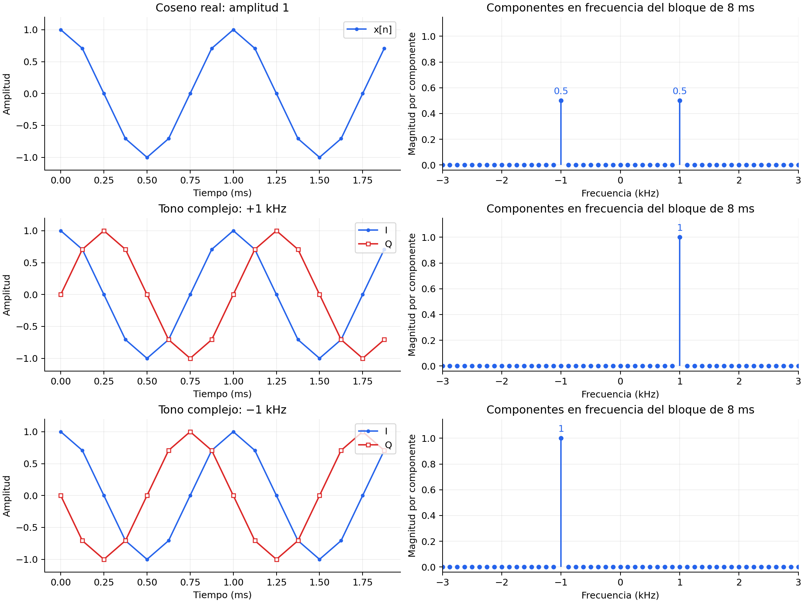

**Figura 6.** Representaciones temporal y frecuencial de un coseno real y de dos tonos complejos con sentidos de giro opuestos.

La primera fila muestra un coseno con dos componentes de magnitud 0.5. Las otras filas tienen la misma componente I, pero Q cambia de signo y el pico aparece en un lado diferente del eje de frecuencias. Cada espectro utiliza las 64 muestras del bloque de 8 ms. Los gráficos temporales muestran solo las primeras 16 muestras, dentro de los primeros 2 ms; las líneas entre puntos guían la lectura y no son una reconstrucción de la señal.

La magnitud se presenta en escala lineal, sin convertirla a potencia ni a dBm. Se muestra el espectro completo, con ambos signos de frecuencia; no se duplica la altura del pico positivo del coseno para formar un espectro de un solo lado.

#### 3.3. Una señal puede contener varios tonos

Si se suman dos señales en el tiempo, también se suman sus representaciones en frecuencia. Esta propiedad se llama linealidad y se estudia entre las [propiedades de Fourier del MIT](https://ocw.mit.edu/courses/res-6-007-signals-and-systems-spring-2011/resources/lecture-9-fourier-transform-properties/).

En el ejemplo siguiente se suman un tono complejo de +1 kHz con amplitud 1 y otro de −2 kHz con amplitud 0.5:

$$
z_{\mathrm{suma}}[n]=e^{j2\pi\,1000\,n/f_s}+0.5e^{-j2\pi\,2000\,n/f_s}.
$$

Cada muestra de la suma contiene la contribución de ambos tonos. Su forma temporal cambia, pero el espectro permite reconocer las dos componentes:

- Una componente en +1 kHz, de magnitud 1.
- Una componente en −2 kHz, de magnitud 0.5.

El espectro de una señal compleja no tiene que presentar la misma magnitud en frecuencias positivas y negativas. La simetría de magnitud que se observó en el coseno se debe a que esa señal es real.

**Colab — Celda 3: sumar dos tonos y comprobar sus componentes.**

```python
z1 = z_pos
z2 = 0.5 * np.exp(-1j * 2 * np.pi * 2000 * t)
z_suma = z1 + z2
f, C1 = espectro(z1, fs)
_, C2 = espectro(z2, fs)
_, C_suma = espectro(z_suma, fs)
print("Los coeficientes se suman:", np.allclose(C_suma, C1 + C2))

fig, axes = plt.subplots(2, 2, figsize=(12, 7), layout="constrained")
axes[0, 0].plot(t[visible] * 1000, z1.real[visible], "o-", label="I del tono de +1 kHz")
axes[0, 0].plot(t[visible] * 1000, z2.real[visible], "s-", label="I del tono de -2 kHz")
axes[0, 0].set(title="Antes de sumar", xlabel="Tiempo (ms)", ylabel="Amplitud")
axes[0, 0].legend()
axes[1, 0].plot(t[visible] * 1000, z_suma.real[visible], "o-", label="I de la suma")
axes[1, 0].plot(t[visible] * 1000, z_suma.imag[visible], "s-", label="Q de la suma", markerfacecolor="white")
axes[1, 0].set(title="Una sola secuencia", xlabel="Tiempo (ms)", ylabel="Amplitud")
axes[1, 0].legend()
axes[0, 1].stem(f / 1000, np.abs(C1), linefmt="C0-", markerfmt="C0o", basefmt=" ", label="Tono de +1 kHz")
axes[0, 1].stem(f / 1000, np.abs(C2), linefmt="C1-", markerfmt="C1s", basefmt=" ", label="Tono de -2 kHz")
axes[0, 1].legend()
axes[1, 1].stem(f / 1000, np.abs(C_suma), basefmt=" ")
axes[1, 1].set_title("Espectro de la suma")
for ax in axes[:, 1]:
    ax.set(xlabel="Frecuencia (kHz)", ylabel="Magnitud por componente", xlim=(-3, 3), ylim=(-0.04, 1.15))
for ax in axes.flat:
    ax.grid(alpha=0.2)
plt.show()
```

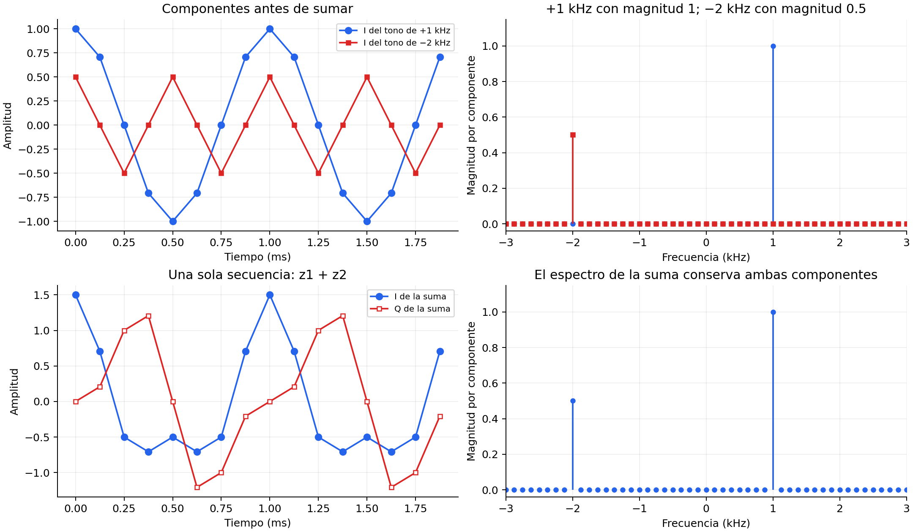

**Figura 7.** La suma de dos tonos produce una secuencia temporal que conserva ambas componentes en frecuencia.

El panel superior izquierdo compara las componentes I antes de sumar. El inferior izquierdo muestra I y Q de la señal resultante. A la derecha, los picos conservan sus posiciones y magnitudes. En $t=0$, I de la suma vale 1.5 porque coinciden las contribuciones 1 y 0.5; ese valor no significa que exista un tono de amplitud 1.5 en otra frecuencia.

La linealidad se aplica a los coeficientes complejos, no a una suma general de sus magnitudes. Si dos contribuciones ocupan la misma frecuencia, sus fases también intervienen y pueden reforzarse o cancelarse.

??? example "Comprobación: dos tonos en la misma frecuencia"
    Dos tonos complejos de la misma amplitud y frecuencia, con fases iniciales 0 y $\pi$, tienen valores opuestos en cada muestra. Su suma es cero. Por tanto, no se obtendría un pico con el doble de magnitud. La fase determina cómo se combinan las contribuciones.

#### 3.4. La magnitud no muestra toda la información

Cada coeficiente espectral es complejo. Su magnitud indica cuánto contribuye la componente; su fase indica su posición dentro del ciclo respecto al origen temporal.

Dos señales pueden presentar la misma magnitud espectral y tener valores diferentes en el tiempo. Por ejemplo:

$$
x_0[n]=\cos\theta[n],
\qquad
x_{90}[n]=\cos\left(\theta[n]+\frac{\pi}{2}\right).
$$

Ambas tienen frecuencia de 1 kHz y amplitud 1. La primera comienza en un máximo y la segunda en un cruce por cero. Sus componentes en ±1 kHz mantienen magnitud 0.5, pero tienen fases distintas:

| Fase inicial del coseno | Fase de la componente en +1 kHz | Fase de la componente en −1 kHz |
|---|---:|---:|
| 0° | 0° | 0° |
| 90° | +90° | −90° |

- **Símbolos:** $\omega=2\pi f_0$ es la frecuencia angular, en rad/s. El tiempo $t$ se expresa en segundos y $\phi$ en radianes.
- **Descomposición:** se conserva la fase inicial del coseno en cada componente:

$$
\cos(\omega t+\phi)=\frac{1}{2}e^{j\phi}e^{j\omega t}+\frac{1}{2}e^{-j\phi}e^{-j\omega t},
\qquad \omega=2\pi f_0.
$$

- **Paso a muestras:** al sustituir $t=n/f_s$, se obtiene la descomposición del coseno de esta subsección.

Una pantalla que presenta únicamente magnitud no distingue estos dos casos. La transformada completa sí los distingue porque conserva la fase.

**Colab — Celda 4: comparar magnitud y fase espectral.**

```python
x0 = np.cos(theta)
x90 = np.cos(theta + np.pi / 2)
f, C0 = espectro(x0, fs)
_, C90 = espectro(x90, fs)
presentes = np.abs(C0) > 1e-9
print("Las magnitudes coinciden:", np.allclose(np.abs(C0), np.abs(C90)))
print("Las muestras coinciden:", np.allclose(x0, x90))

fig, axes = plt.subplots(3, 1, figsize=(10, 9), layout="constrained")
axes[0].plot(t[visible] * 1000, x0[visible], "o-", label="Fase inicial 0°")
axes[0].plot(t[visible] * 1000, x90[visible], "s-", label="Fase inicial 90°", markerfacecolor="white")
axes[0].set(title="Distintos valores en el tiempo", xlabel="Tiempo (ms)", ylabel="Amplitud")
axes[1].stem(f / 1000, np.abs(C0), basefmt=" ", label="Fase inicial 0°")
axes[1].plot(f / 1000, np.abs(C90), "s", color="tab:orange", markerfacecolor="white", label="Fase inicial 90°")
axes[1].set(title="Igual magnitud espectral", xlabel="Frecuencia (kHz)", ylabel="Magnitud por componente", xlim=(-2, 2), ylim=(-0.03, 0.6))
axes[2].plot(f[presentes] / 1000, np.angle(C0[presentes], deg=True), "o", label="Fase inicial 0°")
axes[2].plot(f[presentes] / 1000, np.angle(C90[presentes], deg=True), "s", label="Fase inicial 90°", markerfacecolor="white")
axes[2].set(title="Distinta fase espectral", xlabel="Frecuencia (kHz)", ylabel="Fase (grados)", xlim=(-2, 2), ylim=(-115, 115), yticks=[-90, 0, 90])
for ax in axes:
    ax.grid(alpha=0.2)
    ax.legend()
plt.show()
```

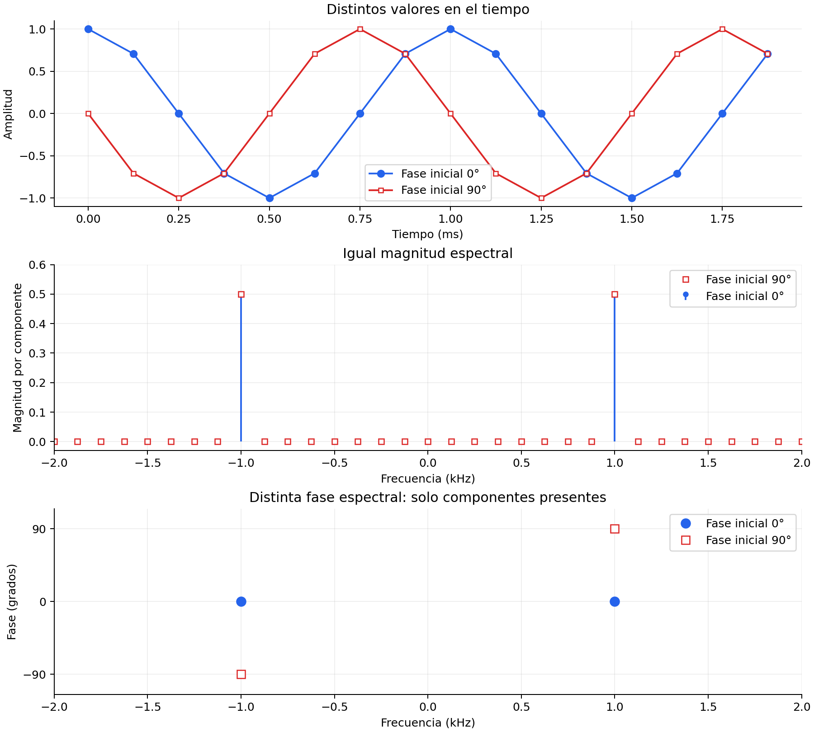

**Figura 8.** Dos señales distintas en el tiempo pueden tener la misma magnitud espectral y diferente fase espectral.

El primer panel muestra que las muestras cambian. En el segundo, los marcadores de magnitud se superponen. El tercero distingue las señales por las fases de sus componentes en ±1 kHz. Se muestran fases únicamente donde hay componentes presentes: los coeficientes que deberían ser cero pueden contener pequeños errores numéricos, cuya fase no aporta información sobre un tono del ejemplo.

El umbral `1e-9` solo evita mostrar esas fases numéricas en esta simulación sin ruido. No es un criterio de detección para una captura real.

#### 3.5. La transformada completa permite recuperar las muestras

Cambiar de representación no elimina información por sí mismo. La DFT completa de un bloque y su inversa permiten pasar entre las muestras y los coeficientes. La correspondencia entre ambas secuencias se describe en el [tutorial de SciPy](https://docs.scipy.org/doc/scipy/tutorial/fft.html).

Conservar únicamente las magnitudes descarta las fases originales. En general, esas magnitudes no bastan para recuperar las mismas muestras. Esto se puede comprobar con el coseno de fase inicial 90°:

**Colab — Celda 5: volver al tiempo con y sin la fase original.** Esta celda usa directamente la salida de `fft`, sin el reordenamiento ni la escala del visor anterior.

```python
X_completo = np.fft.fft(x90)
x_recuperado = np.fft.ifft(X_completo)
x_sin_fase = np.fft.ifft(np.abs(X_completo))

print("La transformada completa recupera las muestras:", np.allclose(x_recuperado, x90))
print("Solo la magnitud recupera las mismas muestras:", np.allclose(x_sin_fase, x90))
print("Error máximo con la transformada completa:", np.max(np.abs(x_recuperado - x90)))
```

La primera comparación produce `True` y la segunda, `False`. El error de recuperación con la transformada completa es muy pequeño y corresponde a la precisión numérica. Usar `np.abs(X_completo)` como entrada de la inversa asigna fase cero a todos sus coeficientes; no conserva las fases del coseno original.

Este resultado explica por qué una gráfica habitual de magnitud espectral muestra solo una parte de la representación en frecuencia. La FFT devuelve coeficientes complejos; la elección de mostrar únicamente su magnitud corresponde al visor.

??? example "Comprobación: otro tono real"
    Un coseno real de 500 Hz y amplitud 0.8 se descompone en componentes de −500 Hz y +500 Hz, de magnitud 0.4 cada una. En estos ejemplos el bloque contiene un número entero de ciclos. Un tono complejo positivo de 500 Hz y magnitud 0.8 tendría una sola componente, en +500 Hz.

??? example "Comprobación: interpretar una pantalla de magnitud"
    Si dos gráficos de magnitud coinciden, no se puede concluir que las muestras sean iguales. Los cosenos con fases iniciales 0° y 90° de esta subsección son un contraejemplo. Para comparar la representación completa también hacen falta las fases.

La lectura en tiempo y la lectura en frecuencia se complementan: una permite observar cómo cambia la secuencia y la otra identificar sus componentes. En una captura I/Q se analizan ambas partes conjuntamente como una señal compleja. Antes de interpretar cualquier eje de frecuencia, también hay que entender qué efectos introduce el muestreo; ese es el tema de la subsección 4.

#### 3.6. Ejercicios de refuerzo

- **Condición de los ejemplos:** se utilizan bloques con ciclos enteros de los tonos y la escala de magnitud por componente de esta subsección. Los detalles de bins y ventanas se reservan para la subsección 5.

##### Ejercicio 3A — predecir el espectro de una suma compleja

Se considera $z[n]=0.8e^{j2\pi\,1000\,n/8000}+0.3e^{-j2\pi\,2000\,n/8000}$, en un bloque de 64 muestras.

- Indicar las posiciones y magnitudes de sus componentes.
- Explicar si debe haber una copia de igual magnitud en el signo opuesto de cada frecuencia.

??? example "Solución del ejercicio 3A"

    - **Punto de partida:** el apartado 3.2 asocia un tono $Ae^{j2\pi f_0n/f_s}$ con una componente de frecuencia $f_0$ y magnitud $A$. El apartado 3.3 muestra que, al sumar tonos de frecuencias distintas, sus contribuciones aparecen en sus posiciones respectivas. Se utiliza la escala por componente del visor, no la suma sin normalizar de una FFT.
    - **Paso 1 — primer término:** $0.8e^{j2\pi\,1000\,n/8000}$ tiene $f_0=+1000$ Hz y magnitud 0.8. Su componente se ubica en +1 kHz; el signo positivo del exponente corresponde al giro antihorario de la subsección 2.
    - **Paso 2 — segundo término:** $0.3e^{-j2\pi\,2000\,n/8000}$ equivale a utilizar $f_0=-2000$ Hz. Su componente se ubica en −2 kHz con magnitud 0.3. No se elimina el signo negativo al leer la frecuencia de una señal compleja.
    - **Paso 3 — comprobar el bloque elegido:** las 64 muestras representan $64/8000=0.008$ s. En ese intervalo los tonos completan 8 ciclos y 16 ciclos en sentido opuesto, respectivamente. Se cumple la condición de ciclos enteros indicada antes del ejercicio; las magnitudes se leen como 0.8 y 0.3 en estos ejemplos ideales.
    - **Por qué no aparecen copias obligatorias:** cada término ya es un tono complejo completo, no un coseno real. La descomposición en dos componentes de magnitud $A/2$ del apartado 2.5 se aplica al coseno; no obliga a añadir −1 kHz ni +2 kHz a esta suma. Una señal compleja no tiene que ser simétrica entre ambos signos de frecuencia.
    - **Interpretación temporal:** las contribuciones se suman en cada índice. Por ejemplo, $z[0]=0.8+0.3=1.1$, aunque no haya una componente espectral de magnitud 1.1. Ese valor es una muestra de la suma, no un tercer tono ni la magnitud individual de uno de los dos tonos.

##### Ejercicio 3B — sumar coeficientes, no solo magnitudes

Dos tonos ocupan la misma frecuencia de +1 kHz. El primero tiene magnitud 2 y fase cero; el segundo tiene magnitud 1 y fase $\pi$.

- Determinar la magnitud y fase de la componente resultante.
- Indicar qué ocurriría si ambos tuvieran magnitud 1, manteniendo las fases indicadas.

??? example "Solución del ejercicio 3B"

    - **Punto de partida:** el apartado 3.4 explica que cada componente tiene un coeficiente complejo, no solo una magnitud. Un tono puede escribirse $Ae^{j\phi}e^{j2\pi f_0n/f_s}$: $Ae^{j\phi}$ contiene su magnitud y fase inicial. Como ambos tonos tienen el mismo $f_0$, se suman esos coeficientes.
    - **Paso 1 — factor común:** la señal total es $z[n]=(2e^{j0}+1e^{j\pi})e^{j2\pi\,1000\,n/f_s}$. Ambos términos comparten el mismo giro; no aparecen dos frecuencias diferentes por haber dos términos en la expresión.
    - **Paso 2 — evaluar las fases:** Euler da $e^{j0}=1$ y $e^{j\pi}=\cos\pi+j\sin\pi=-1$. Por tanto, el coeficiente resultante es $C=2-1=1$, un número real positivo. Las contribuciones están separadas 180° y apuntan en sentidos opuestos en el plano complejo.
    - **Paso 3 — magnitud y fase del resultado:** $|C|=|1|=1$ y $\arg C=0$. Queda un tono de +1 kHz con magnitud 1 y fase cero. Sumar $2+1=3$ ignoraría la orientación de los coeficientes; 3 sería el resultado si los dos estuvieran en fase, no en este caso.
    - **Paso 4 — caso de magnitudes iguales:** si la primera magnitud también fuera 1, $C=1e^{j0}+1e^{j\pi}=1-1=0$. La señal total sería cero en todos los índices del modelo ideal. No se trata de dos picos visibles de magnitud 1: la suma se cancela antes de calcular la transformada.
    - **Fase de la componente nula:** el punto cero no tiene una dirección en el plano complejo. Aunque una función de software devuelva algún valor para su ángulo, no representa una fase física determinada de un tono presente. La conclusión útil es magnitud cero y ausencia de esa componente en la suma ideal.

##### Ejercicio 3C — reconocer lo que una pantalla de magnitud omite

Se comparan los cosenos $x_0[n]=\cos(2\pi\,1000\,n/8000)$ y $x_{90}[n]=\cos(2\pi\,1000\,n/8000+\pi/2)$, en bloques de 64 muestras.

- Indicar si sus magnitudes espectrales y sus muestras son iguales.
- Comparar las fases de las componentes y explicar qué se necesita para recuperar las muestras con la inversa.

??? example "Solución del ejercicio 3C"

    - **Punto de partida:** el apartado 3.4 conserva la fase al descomponer el coseno: $\cos(\theta+\phi)=(1/2)e^{j\phi}e^{j\theta}+(1/2)e^{-j\phi}e^{-j\theta}$. El apartado 3.5 distingue guardar la transformada compleja completa de guardar únicamente su magnitud. Aquí $\theta[n]=2\pi\,1000\,n/8000$.
    - **Paso 1 — coseno de fase cero:** al poner $\phi=0$, los coeficientes en +1 kHz y −1 kHz son $C_+=0.5$ y $C_-=0.5$. Ambos tienen magnitud 0.5 y fase cero.
    - **Paso 2 — coseno de fase 90°:** al poner $\phi=\pi/2$, $C_+=0.5e^{j\pi/2}=j0.5$ y $C_-=0.5e^{-j\pi/2}=-j0.5$. Sus magnitudes siguen siendo 0.5, pero sus fases son $+\pi/2$ y $-\pi/2$, respectivamente. El cambio no mueve las componentes a otras frecuencias.
    - **Paso 3 — comparar las muestras:** en $n=0$, $x_0[0]=\cos0=1$, mientras que $x_{90}[0]=\cos(\pi/2)=0$. También se comprueba con los coeficientes: $0.5+0.5=1$ y $j0.5-j0.5=0$. Las magnitudes espectrales coinciden, pero las fases permiten construir valores temporales diferentes.
    - **Condición de la comparación:** los bloques de 64 muestras a 8 kS/s contienen $1000(64/8000)=8$ ciclos completos. Con la escala de esta subsección, las dos componentes se observan en ±1 kHz con magnitud 0.5 en ambos casos; una pantalla de magnitud no distingue cuál de los dos cosenos se analizó.
    - **Paso 4 — recuperar con la inversa:** se conservan todos los coeficientes complejos de la DFT en su orden original y con la escala correspondiente a la inversa. Si se sustituyen por sus valores absolutos, $j0.5$ y $-j0.5$ se convierten ambos en $0.5$: se borran las fases y, en este ejemplo, se reconstruye el coseno de fase cero en lugar del de 90°. Si antes se reordenó o normalizó la salida para el visor, también se deshacen esas operaciones antes de usar la inversa como en el apartado 3.5.

##### Ejercicio 3D — interpretar la Figura 7 sin inventar otro tono

En la Figura 7, la suma de un tono de +1 kHz y magnitud 1 con otro de −2 kHz y magnitud 0.5 tiene $I=1.5$ en $t=0$.

- Explicar si ese valor implica un tono nuevo de magnitud 1.5.
- Indicar qué paneles permiten reconocer los tonos y qué cambia si se modifica solo la fase de uno de ellos.

??? example "Solución del ejercicio 3D"

    - **Punto de partida:** el apartado 3.3 y la Figura 7 comparan $z[n]=e^{j2\pi\,1000\,n/f_s}+0.5e^{-j2\pi\,2000\,n/f_s}$ en tiempo y frecuencia. El apartado 3.1 indica que una representación responde por los valores instantáneos y la otra, por las componentes que contribuyen a esos valores.
    - **Paso 1 — evaluar el instante inicial:** en $n=0$, ambos exponentes valen cero y $e^{j0}=1$. Así, $z[0]=1+0.5=1.5+j0$; su componente I es 1.5 y su componente Q es cero. Las dos contribuciones están alineadas en ese instante.
    - **Paso 2 — evitar confundir suma y componente:** para otros índices, los tonos giran a velocidades y en sentidos distintos. El valor total no conserva necesariamente magnitud 1.5. La expresión sigue teniendo dos frecuencias, +1 y −2 kHz; sumar sus valores en un instante no añade un término de una frecuencia nueva.
    - **Paneles izquierdos — lectura temporal:** el panel superior compara solo las componentes I de los dos tonos; el inferior muestra I y Q de la suma. El valor 1.5 se explica como una coincidencia instantánea de las partes reales. No se interpreta como la altura de un pico del espectro, ni se atribuyen al panel superior curvas Q que no aparecen allí.
    - **Paneles derechos — lectura frecuencial:** permiten reconocer una componente en +1 kHz de magnitud 1 y otra en −2 kHz de magnitud 0.5. La fila de la suma reúne esas dos contribuciones en el mismo espectro; no muestra una tercera componente de magnitud 1.5.
    - **Paso 3 — cambiar solo una fase:** si al segundo tono se le añade $\phi$, su coeficiente pasa de $0.5$ a $0.5e^{j\phi}$. Su magnitud sigue siendo 0.5 y su frecuencia sigue siendo −2 kHz, pero las muestras de la suma cambian. Por ejemplo, con $\phi=\pi$, la primera muestra pasa a $z[0]=1-0.5=0.5$.
    - **Alcance de la conclusión:** en los bloques con ciclos enteros utilizados aquí, el cambio de fase conserva las magnitudes de las dos componentes separadas. No significa que la transformada completa sea idéntica: cambia la fase del coeficiente correspondiente, información que la pantalla de magnitud del apartado 3.4 omite.

### 4. Muestreo y aliasing

La subsección anterior identificó tonos mediante sus muestras y su espectro. Ahora aparece una pregunta importante: **¿pueden dos señales de frecuencias diferentes producir exactamente las mismas muestras?**

La respuesta es sí. El muestreo conserva valores en instantes separados, no todo lo que ocurrió entre ellos. El aliasing es la ambigüedad que permite que una componente se confunda con otra al muestrear. No es un error de la FFT: puede comprobarse antes de calcular cualquier transformada.

Los experimentos empiezan con señales sintéticas de frecuencia conocida. No simulan todos los bloques del RTL2832U. Primero se utiliza un coseno real para observar el problema y después un tono complejo para conservar el signo de la frecuencia.

#### 4.1. Frecuencia en Hz y avance entre muestras

En un tono complejo,

$$
z[n]=A e^{j(2\pi f_0 n/f_s+\phi)},
$$

la frecuencia $f_0$ indica ciclos por segundo. Pero el avance entre dos muestras depende de la relación entre $f_0$ y $f_s$:

$$
\nu=\frac{f_0}{f_s}\quad\text{ciclos por muestra},
\qquad
\Delta\theta=2\pi\nu\quad\text{radianes por muestra}.
$$

Esta frecuencia normalizada relaciona el tiempo físico con el índice de muestra. La [TU Eindhoven](https://spseducation.tue.nl/disciplines/discrete/discretesignalprocessing_sampling_sampling/) desarrolla esa relación y la equivalencia de frecuencias de una secuencia.

Con $f_s=8000$ S/s y $f_0=1000$ Hz, el avance es $1/8$ de ciclo, es decir, 45° por muestra. Con $f_0=9000$ Hz, el avance es $9/8$ de ciclo: una vuelta completa más 45°. Un punto del plano I/Q termina en el mismo lugar después de cualquiera de esos dos avances.

La vuelta adicional ocurre entre los instantes observados. Las muestras por sí solas no informan cuántas vueltas completas se dieron entre ellas.

**Colab — Celda 1: preparar los experimentos.** Las siete celdas de esta subsección se ejecutan en orden. Esta preparación permite comenzar en un notebook nuevo, sin depender de las subsecciones anteriores.

```python
import numpy as np
import matplotlib.pyplot as plt

fs = 8000
N = 64
n = np.arange(N)
t = n / fs

def espectro(y, sample_rate):
    f = np.fft.fftshift(np.fft.fftfreq(len(y), d=1 / sample_rate))
    C = np.fft.fftshift(np.fft.fft(y)) / len(y)
    return f, C

def frecuencia_alias(f0, sample_rate):
    return (np.asarray(f0) + sample_rate / 2) % sample_rate - sample_rate / 2

for f0 in [1000, 9000]:
    print(f"{f0} Hz: {f0 / fs:.3f} ciclos/muestra; {360 * f0 / fs:.1f} grados/muestra")
```

La salida muestra 0.125 y 1.125 ciclos por muestra, equivalentes a 45° y 405°. La función `frecuencia_alias` se explicará en el apartado 4.4.

#### 4.2. Experimento A: dos señales distintas, las mismas muestras

Se comparan estos cosenos:

$$
x_1(t)=\cos(2\pi\,1000\,t),
\qquad
x_9(t)=\cos(2\pi\,9000\,t).
$$

Son distintos en tiempo continuo: en 1 ms el primero completa un ciclo y el segundo, nueve. Sin embargo, al evaluarlos en $t_n=n/8000$:

$$
x_9[n]=\cos\left(2\pi\frac{1000}{8000}n+2\pi n\right)=x_1[n].
$$

El término $2\pi n$ añade un número entero de vueltas y no cambia el valor del coseno.

**Qué se varía:** la frecuencia del coseno, de 1 a 9 kHz. **Qué permanece fijo:** sample rate de 8 kS/s, amplitud 1, fase inicial 0 y bloque de 64 muestras. **Qué se debe notar:** las curvas difieren entre muestras, pero todos los valores muestreados coinciden.

**Colab — Celda 2: observar lo que se conserva y lo que queda entre muestras.**

```python
x1 = np.cos(2 * np.pi * 1000 * t)
x9 = np.cos(2 * np.pi * 9000 * t)
td = np.linspace(0, 0.001, 2001)
visible = t <= 0.001
print("Las muestras coinciden:", np.allclose(x1, x9))
print("Error máximo:", np.max(np.abs(x1 - x9)))

fig, axes = plt.subplots(3, 1, figsize=(11, 9), layout="constrained")
for ax, frecuencia, muestras in zip(axes[:2], [1000, 9000], [x1, x9]):
    ax.plot(td * 1000, np.cos(2 * np.pi * frecuencia * td), color="tab:gray", label="Referencia continua conocida")
    ax.plot(t[visible] * 1000, muestras[visible], "o", color="tab:blue", label="Muestras a 8 kS/s")
    ax.set(title=f"Señal original: {frecuencia / 1000:g} kHz", xlabel="Tiempo (ms)", ylabel="Amplitud", ylim=(-1.2, 1.2))
    ax.legend(loc="upper right")
axes[2].plot(n[:17], x1[:17], "o", markersize=8, label="Muestras del coseno de 1 kHz")
axes[2].plot(n[:17], x9[:17], "s", markerfacecolor="none", markersize=10, label="Muestras del coseno de 9 kHz")
axes[2].set(title="Solo se conservan estas secuencias: los marcadores se superponen", xlabel="Índice n", ylabel="Valor de la muestra", xticks=np.arange(0, 17, 2), ylim=(-1.2, 1.2))
axes[2].legend(loc="upper right")
for ax in axes:
    ax.grid(alpha=0.2)
plt.show()
```

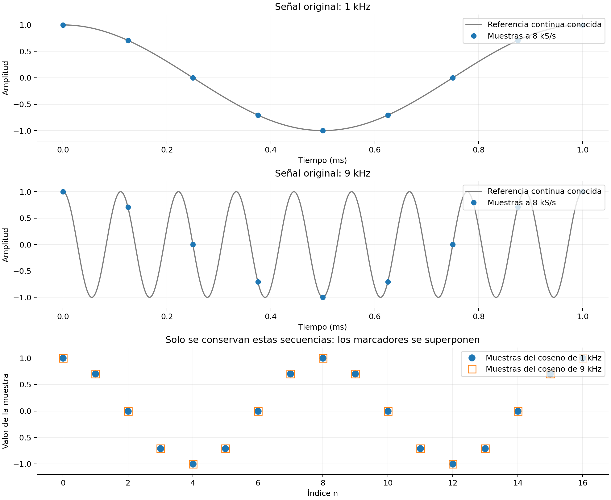

**Figura 9.** Dos cosenos distintos en tiempo continuo producen las mismas muestras a 8 kS/s.

- **Panel superior — coseno de 1 kHz:** los puntos muestran los valores de la señal en los instantes de muestreo. La curva gris permite observar lo que ocurre entre esos instantes.
- **Panel central — coseno de 9 kHz:** la curva oscila más veces entre las muestras, pero los puntos tienen los mismos tiempos y alturas que en el panel superior.
- **Panel inferior — comparación de muestras:** los círculos y cuadrados se superponen muestra por muestra. `np.allclose` devuelve `True`; la pequeña diferencia numérica se debe al cálculo en punto flotante.
- **Qué representan las curvas grises:** son referencias calculadas con las fórmulas originales. **No fueron reconstruidas a partir de las muestras.**
- **Qué no permite decidir la secuencia:** si solo se recibieran las muestras del panel inferior, no sería posible elegir entre los dos cosenos sin información adicional sobre la banda de entrada.
- **Qué ocurre al obtener más muestras:** mantener el mismo sample rate no resuelve la equivalencia, porque la igualdad se cumple para cualquier índice entero $n$. Aumentar el sample rate durante una nueva adquisición es una operación diferente.

??? example "Comprobación: ¿el aliasing depende de la FFT?"
    No. Las dos secuencias ya coinciden antes de calcular una FFT. Cualquier cálculo que utilice únicamente esas muestras recibe la misma información en ambos casos. La FFT muestra el resultado del muestreo; no origina esta ambigüedad.

#### 4.3. Experimento B: el aliasing también ocurre en I/Q

La representación compleja distingue frecuencias positivas y negativas dentro de un intervalo apropiado, pero no elimina el aliasing. Para un tono complejo se cumple:

$$
e^{j2\pi(f_0+\ell f_s)n/f_s}=e^{j2\pi f_0n/f_s}\underbrace{e^{j2\pi\ell n}}_{1},
\qquad \ell\in\mathbb{Z}.
$$

El entero $\ell$ cuenta múltiplos del sampling rate. No identifica un bin de FFT; ese índice se denotará con $k$.

Por tanto, frecuencias separadas por un múltiplo entero de $f_s$ producen la misma secuencia compleja, con igual amplitud y fase inicial.

La equivalencia entre +5 kHz y −3 kHz a $f_s=8$ kS/s se puede obtener paso a paso con las fórmulas anteriores. En la subsección 2 se escribió el tono complejo como:

$$
z[n]=A e^{j\theta[n]},
\qquad
\theta[n]=2\pi\frac{f_0}{f_s}n+\phi.
$$

El avance de fase del modelo es la diferencia entre los valores de $\theta[n]$, sin reducirlos a una vuelta:

$$
\Delta\theta=\theta[n+1]-\theta[n]=2\pi\frac{f_0}{f_s}.
$$

Es la fórmula del apartado 4.1. Para expresarla en grados se multiplica por $180^\circ/\pi$:

$$
\Delta\theta_{\mathrm{grados}}=360^\circ\frac{f_0}{f_s}.
$$

- **Fase del modelo:** puede acumular tantas vueltas como indique la frecuencia elegida.
- **Ángulo obtenido de una muestra:** `np.angle` entrega un representante entre $-\pi$ y $\pi$. No conserva el número de vueltas completas.
- **Ejemplo:** un avance de +225° y otro de −135° producen el mismo ángulo de llegada. Las muestras no permiten distinguir esos recorridos.

Al sustituir cada frecuencia:

$$
\begin{aligned}
f_0=+5000\ \text{Hz}:&\quad \Delta\theta_{\mathrm{grados}}=360^\circ\frac{5000}{8000}=+225^\circ,\\
f_0=-3000\ \text{Hz}:&\quad \Delta\theta_{\mathrm{grados}}=360^\circ\frac{-3000}{8000}=-135^\circ.
\end{aligned}
$$

El signo positivo indica un avance antihorario; el negativo, un avance horario, con la convención $z=I+jQ$. Por eso se dice que el primer tono avanza 225° y el segundo retrocede 135° entre muestras.

Para comprobar que ambos llegan al mismo punto, se toman $A=1$ y $\phi=0$. En $n=0$, ambos empiezan en $z[0]=1+j0$. En $n=1$, la fórmula de Euler de la subsección 2 da:

$$
\begin{aligned}
z_5[1]&=e^{j5\pi/4}=\cos225^\circ+j\sin225^\circ=-\frac{\sqrt{2}}{2}-j\frac{\sqrt{2}}{2},\\
z_{-3}[1]&=e^{-j3\pi/4}=\cos(-135^\circ)+j\sin(-135^\circ)=-\frac{\sqrt{2}}{2}-j\frac{\sqrt{2}}{2}.
\end{aligned}
$$

Los recorridos son distintos, pero las coordenadas I y Q coinciden porque $225^\circ=-135^\circ+360^\circ$. La equivalencia no se limita a la primera muestra: para cualquier índice entero $n$,

$$
z_5[n]=e^{j5\pi n/4}=e^{-j3\pi n/4}e^{j2\pi n}=z_{-3}[n],
$$

ya que $e^{j2\pi n}=1$. La diferencia de una vuelta completa por intervalo de muestreo queda invisible en toda la secuencia. En Hz, esa misma diferencia es $5000-(-3000)=8000=f_s$.

**Qué se varía:** la frecuencia del tono complejo, de +5 a −3 kHz. **Qué permanece fijo:** sample rate de 8 kS/s, magnitud 1, fase inicial 0 y los mismos instantes de muestreo. **Qué se debe notar:** coinciden I y Q, no solo la parte real.

**Colab — Celda 3: comparar ambas componentes y los avances de fase.**

```python
z5 = np.exp(1j * 2 * np.pi * 5000 * t)
z_m3 = np.exp(-1j * 2 * np.pi * 3000 * t)
print("Coincide toda la secuencia I/Q:", np.allclose(z5, z_m3))
print("Coincide I:", np.allclose(z5.real, z_m3.real))
print("Coincide Q:", np.allclose(z5.imag, z_m3.imag))
ang_pos = np.linspace(0, 2 * np.pi * 5000 / fs, 301)
ang_neg = np.linspace(0, -2 * np.pi * 3000 / fs, 301)

fig, axes = plt.subplots(1, 3, figsize=(15, 4.5), layout="constrained")
for ax, angulo, titulo in zip(axes[:2], [ang_pos, ang_neg], ["+5 kHz: avance de +225°", "-3 kHz: avance de -135°"]):
    ax.plot(np.cos(angulo), np.sin(angulo), color="tab:blue")
    ax.annotate("", xy=(np.cos(angulo[-1]), np.sin(angulo[-1])), xytext=(np.cos(angulo[-25]), np.sin(angulo[-25])), arrowprops={"arrowstyle": "->", "color": "tab:blue"})
    ax.plot([1, z5[1].real], [0, z5[1].imag], "o", color="tab:orange")
    ax.text(1, 0.12, "n=0", ha="center")
    ax.text(z5[1].real, z5[1].imag - 0.16, "n=1", ha="center")
    ax.set(title=titulo, xlabel="I", ylabel="Q", xlim=(-1.3, 1.3), ylim=(-1.3, 1.3), aspect="equal")
axes[2].plot(n[:9], z5.real[:9], "o-", label="I de +5 kHz")
axes[2].plot(n[:9], z_m3.real[:9], "s", markersize=9, markerfacecolor="none", label="I de -3 kHz")
axes[2].plot(n[:9], z5.imag[:9], "o-", label="Q de +5 kHz")
axes[2].plot(n[:9], z_m3.imag[:9], "s", markersize=9, markerfacecolor="none", label="Q de -3 kHz")
axes[2].set(title="I y Q coinciden en cada muestra", xlabel="Índice n", ylabel="Amplitud", ylim=(-1.3, 1.3))
axes[2].legend(fontsize=8)
for ax in axes:
    ax.grid(alpha=0.2)
plt.show()
```

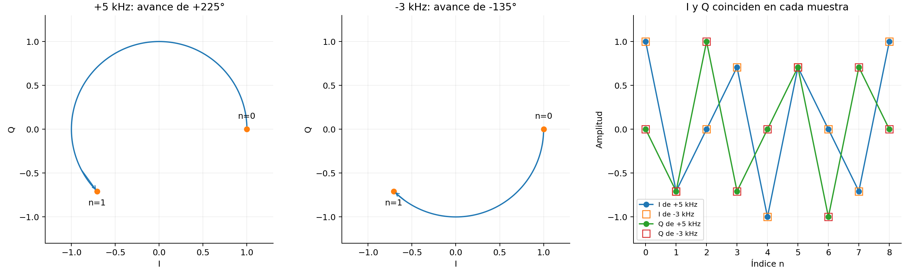

**Figura 10.** Los tonos complejos de +5 kHz y −3 kHz llegan a los mismos puntos I/Q al muestrear a 8 kS/s.

- **Panel izquierdo — tono de +5 kHz:** entre $n=0$ y $n=1$, el recorrido conocido gira en sentido antihorario.
- **Panel central — tono de −3 kHz:** durante el mismo intervalo, el recorrido gira en sentido horario. Aunque el camino es distinto, comparte los extremos con el del panel izquierdo.
- **Panel derecho — muestras I/Q:** los cuadrados de −3 kHz coinciden con los círculos de +5 kHz tanto en I como en Q. Las líneas entre muestras solo guían la lectura; no describen el recorrido continuo original.
- **Qué significa el signo negativo:** describe la rotación de la secuencia representativa. No significa que exista una RF física negativa ni que el tono continuo de +5 kHz haya cambiado realmente su sentido de giro.
- **Qué se debe concluir:** el muestreo dejó de distinguir los dos recorridos, porque solo conserva sus valores en los instantes de muestreo.

#### 4.4. Experimento C: ¿en qué frecuencia aparece el alias?

Como las frecuencias $f_0+\ell f_s$, con $\ell$ entero, son equivalentes, el espectro de tiempo discreto se repite cada $f_s$ en Hz. Basta mostrar un intervalo de ancho $f_s$. En esta sesión se utiliza:

$$
-\frac{f_s}{2}\leq f<\frac{f_s}{2}.
$$

Con 8 kS/s, corresponde a $[-4,4)$ kHz. El extremo izquierdo se incluye y el derecho no, porque −4 y +4 kHz son equivalentes. Esta convención coincide con el eje de [`fftfreq`](https://numpy.org/doc/stable/reference/generated/numpy.fft.fftfreq.html) para un número par de muestras, después de aplicar `fftshift`.

La frecuencia representativa se obtiene sumando o restando múltiplos de $f_s$ hasta entrar en ese intervalo. La expresión usada en la celda 1 hace esa operación:

$$
f_a=\left((f_0+f_s/2)\bmod f_s\right)-f_s/2.
$$

| Frecuencia del tono complejo conocido | Operación con $f_s=8$ kS/s | Frecuencia representativa |
|---|---|---:|
| +1 kHz | Ya está dentro del intervalo | +1 kHz |
| +5 kHz | $5-8$ | −3 kHz |
| +7 kHz | $7-8$ | −1 kHz |
| +9 kHz | $9-8$ | +1 kHz |
| −5 kHz | $-5+8$ | +3 kHz |

Para un coseno real hay dos componentes, en $+f_0$ y $-f_0$, y cada una se lleva al intervalo. Por ejemplo, un coseno de 7 kHz presenta componentes representativas en −1 y +1 kHz. Su magnitud espectral no permite distinguirlo del coseno de 1 kHz de igual amplitud y fase inicial cero.

**Qué se varía:** la frecuencia original del tono complejo, manteniendo 8 kS/s. **Qué se debe notar:** la frecuencia representativa crece hasta el borde y luego reaparece en el lado negativo. No crece indefinidamente en la pantalla.

**Colab — Celda 4: visualizar la periodicidad y el desplazamiento al intervalo.**

```python
originales = np.arange(-12000, 12001, 500)
aliases = frecuencia_alias(originales, fs)
equivalentes = 1000 + fs * np.arange(-2, 3)
fig, axes = plt.subplots(2, 1, figsize=(11, 8), layout="constrained")
axes[0].stem(equivalentes / 1000, np.ones(len(equivalentes)), basefmt=" ")
axes[0].axvspan(-fs / 2000, fs / 2000, color="tab:green", alpha=0.12, label="Intervalo mostrado: [-4, 4) kHz")
axes[0].set(title="Un tono discreto de +1 kHz: posiciones equivalentes cada 8 kHz", xlabel="Frecuencia (kHz)", ylabel="Peso del tono ideal", xticks=equivalentes / 1000, ylim=(-0.05, 1.3))
axes[0].legend(loc="upper right")
axes[1].plot(originales / 1000, aliases / 1000, ".", color="tab:blue")
axes[1].plot([1, 5, 7, 9], frecuencia_alias(np.array([1000, 5000, 7000, 9000]), fs) / 1000, "s", color="tab:orange", markersize=8)
axes[1].axhline(fs / 2000, color="tab:gray", linestyle="--")
axes[1].axhline(-fs / 2000, color="tab:gray", linestyle="--")
axes[1].set(title="De la frecuencia original a su representante", xlabel="Frecuencia original del tono complejo (kHz)", ylabel="Frecuencia representativa (kHz)", yticks=np.arange(-4, 5), ylim=(-4.5, 4.5))
for ax in axes:
    ax.grid(alpha=0.2)
plt.show()
```

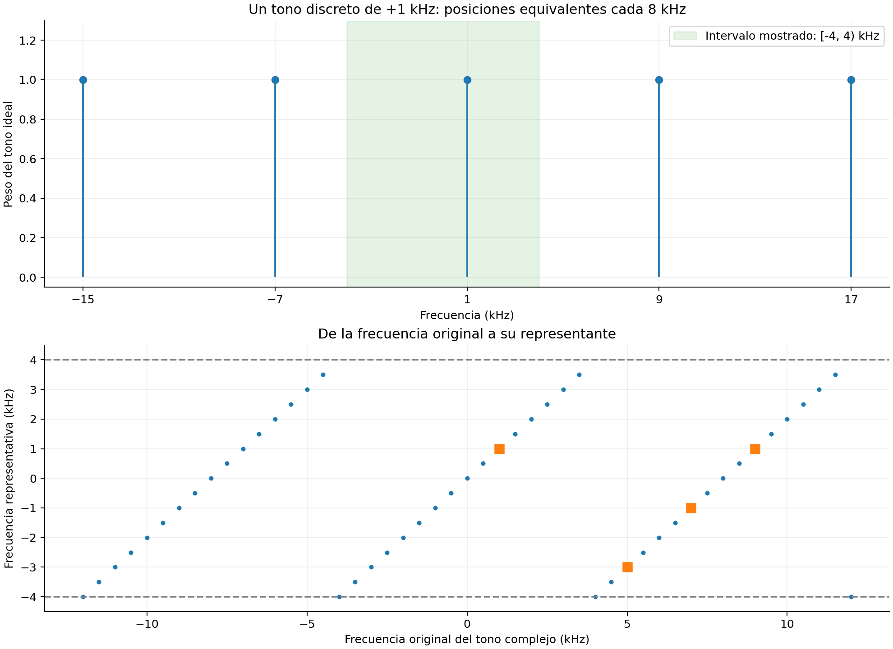

**Figura 11.** Periodicidad de las posiciones de un tono discreto y mapa hacia un intervalo representativo de ancho 8 kHz.

- **Panel superior — posiciones equivalentes:** −15, −7, +1, +9 y +17 kHz representan la misma componente discreta. Es un esquema del tono ideal, no una FFT del bloque ni cinco transmisores distintos.
- **Banda verde:** selecciona una sola representación dentro del intervalo centrado en cero.
- **Panel inferior — lectura de los ejes:** el eje horizontal indica la frecuencia original del experimento y el vertical indica su representante. Así, +5 kHz termina en −3 kHz y +9 kHz termina en +1 kHz.
- **Por qué los puntos no se unen:** unirlos podría dibujar una transición continua falsa entre +4 y −4 kHz.
- **Qué permite la expresión con módulo:** selecciona un representante dentro del intervalo. No recupera la frecuencia original a partir de muestras ambiguas.

#### 4.5. Experimento D: la señal queda fija y cambia el sample rate

Hasta aquí cambió la frecuencia de la señal. Ahora se mantiene un tono complejo de **+3 kHz** y se realizan tres adquisiciones ideales con tasas diferentes:

| Sample rate | Avance por muestra | Intervalo representativo | Pico esperado |
|---|---:|---|---:|
| 12 kS/s | 90° | $[-6,6)$ kHz | +3 kHz |
| 8 kS/s | 135° | $[-4,4)$ kHz | +3 kHz |
| 4 kS/s | 270°, equivalente a −90° | $[-2,2)$ kHz | −1 kHz |

- **Qué se varía:** el sample rate con el que se generan nuevas muestras.
- **Qué permanece fijo:** tono de +3 kHz, magnitud 1, fase inicial 0 y duración del bloque de 8 ms.
- **Qué cambia como consecuencia:** el intervalo entre muestras, su cantidad y el ancho del eje de frecuencia. Se obtienen 96, 64 y 32 muestras respectivamente.

Esto no consiste en tomar un archivo y cambiar la etiqueta de su sample rate. Cada fila calcula la señal original en nuevos instantes de muestreo.

**Colab — Celda 5: comparar las adquisiciones en tiempo y frecuencia.**

```python
f_tono = 3000
duracion = 0.008
tasas = [12000, 8000, 4000]
td = np.linspace(0, 0.001, 1201)
fig, axes = plt.subplots(3, 2, figsize=(12, 10), layout="constrained")
for fila, tasa in enumerate(tasas):
    cantidad = int(round(duracion * tasa))
    tk = np.arange(cantidad) / tasa
    zk = np.exp(1j * 2 * np.pi * f_tono * tk)
    fa = float(frecuencia_alias(f_tono, tasa))
    fk, Ck = espectro(zk, tasa)
    visible_k = tk <= 0.001
    print(f"fs={tasa} S/s; N={cantidad}; alias={fa:g} Hz; pico FFT={fk[np.argmax(np.abs(Ck))]:g} Hz")
    axes[fila, 0].plot(td * 1000, np.cos(2 * np.pi * f_tono * td), color="tab:gray", label="I continua original: +3 kHz")
    axes[fila, 0].plot(td * 1000, np.cos(2 * np.pi * fa * td), "--", color="tab:orange", label=f"I del representante: {fa / 1000:+g} kHz")
    axes[fila, 0].plot(tk[visible_k] * 1000, zk.real[visible_k], "o", color="tab:blue", label="Muestras I")
    axes[fila, 0].set(title=f"fs = {tasa / 1000:g} kS/s; {cantidad} muestras en 8 ms", xlabel="Tiempo (ms)", ylabel="I", ylim=(-1.2, 1.2))
    axes[fila, 0].legend(fontsize=8, loc="upper right")
    axes[fila, 1].stem(fk / 1000, np.abs(Ck), basefmt=" ")
    axes[fila, 1].set(title=f"FFT de I + jQ: pico en {fa / 1000:+g} kHz", xlabel="Frecuencia (kHz)", ylabel="Magnitud por componente", xlim=(-6.2, 6.2), ylim=(-0.03, 1.2))
    axes[fila, 1].axvline(-tasa / 2000, color="tab:gray", linestyle="--")
    axes[fila, 1].axvline(tasa / 2000, color="tab:gray", linestyle="--")
    axes[fila, 1].axvspan(-tasa / 2000, tasa / 2000, color="tab:green", alpha=0.08)
for ax in axes.flat:
    ax.grid(alpha=0.2)
plt.show()
```

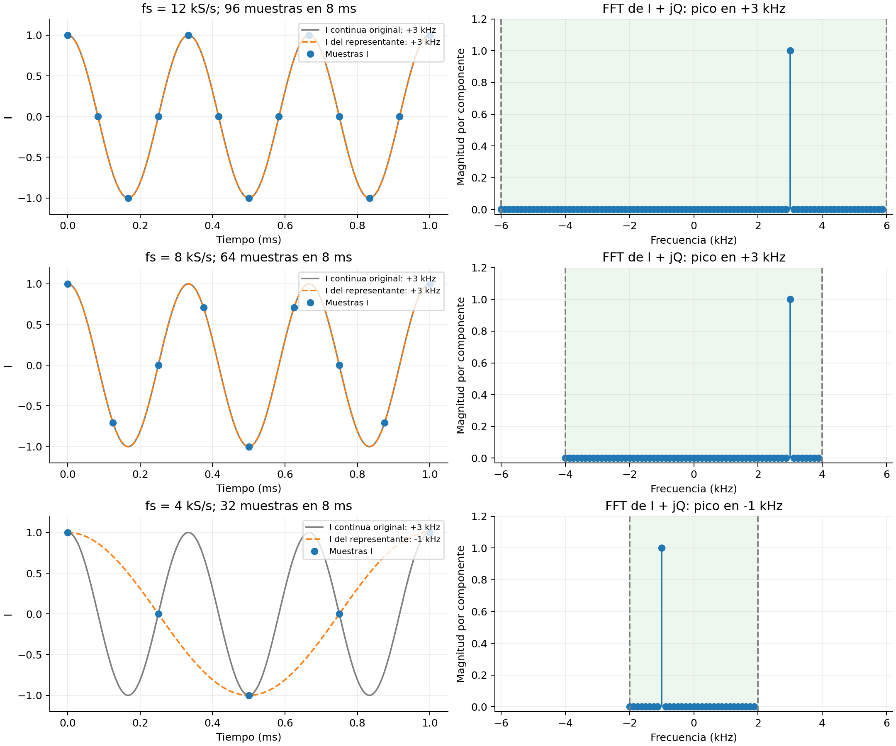

**Figura 12.** Reducir el sample rate puede hacer que un mismo tono aparezca en otra frecuencia representativa.

- **Columna izquierda — muestras I:** la curva original gris permanece fija. Al reducir el sample rate, los puntos quedan más separados en el tiempo.
- **Fila superior — 12 kS/s:** la referencia original y la del representante coinciden a la izquierda. A la derecha, el pico aparece en +3 kHz.
- **Fila central — 8 kS/s:** las dos referencias también coinciden y el pico permanece en +3 kHz. El intervalo disponible es más estrecho que en la primera fila.
- **Fila inferior — 4 kS/s:** las referencias son distintas entre los puntos, pero ambas pasan por las muestras I. La FFT de la derecha muestra el representante en −1 kHz.
- **Columna derecha — FFT compleja:** se utilizan I y Q conjuntamente, no solo I. Observar únicamente el coseno de I no permitiría distinguir +1 de −1 kHz.
- **Banda verde y líneas verticales:** indican el intervalo disponible y sus bordes, $\pm f_s/2$. La escala horizontal es la misma en las tres filas para comparar sus anchos.
- **Zonas exteriores a la banda:** no contienen bins de esa FFT. No son mediciones que demuestren ausencia de señal.
- **Curva naranja:** es otra referencia calculada, no una reconstrucción que demuestre cuál fue el tono original.

#### 4.6. Experimento E: por qué el borde de Nyquist requiere cuidado

Para una señal real limitada a una banda low-pass, con frecuencia máxima $f_{\max}$, se utiliza la condición:

$$f_s>2f_{\max}.$$

La mitad del sample rate, $f_s/2$, es la frecuencia de Nyquist. La condición supone que la banda de entrada está limitada: las muestras por sí solas no garantizan que no hubiera componentes fuera de ella. El [teorema de muestreo del DSP Guide](https://www.dspguide.com/ch3/2.htm) explica esa relación entre la banda analógica y su representación discreta.

En la práctica también hace falta margen para el filtro. La condición no significa que dos puntos dibujen una curva suave ni que unir puntos reconstruya la señal; establece cuándo el muestreo ideal permite una recuperación bajo las hipótesis de banda limitada.

El caso exacto $f_0=f_s/2$ muestra por qué no conviene diseñar sobre el borde. Con un coseno de 4 kHz a 8 kS/s:

$$
x[n]=\cos(\pi n+\phi)=(-1)^n\cos\phi.
$$

Con fase 0°, las muestras alternan +1 y −1. Con fase 90°, todas son cero. La señal continua no es cero, pero el muestreo coincide con sus cruces por cero.

- **Qué se varía:** solo la fase inicial, de 0° a 90°.
- **Qué permanece fijo:** frecuencia de 4 kHz, sample rate de 8 kS/s y amplitud 1.
- **Qué se debe notar:** una señal no nula puede quedar completamente invisible en sus muestras reales en este caso límite.

**Colab — Celda 6: observar las dos fases en el borde.**

```python
td = np.linspace(0, 0.001, 2001)
tn = np.arange(9) / fs
fig, axes = plt.subplots(2, 1, figsize=(11, 6), layout="constrained")
for ax, fase, etiqueta in zip(axes, [0, np.pi / 2], ["0°", "90°"]):
    valores = np.cos(2 * np.pi * (fs / 2) * tn + fase)
    ax.plot(td * 1000, np.cos(2 * np.pi * (fs / 2) * td + fase), color="tab:gray", label="Coseno continuo conocido")
    ax.plot(tn * 1000, valores, "o", color="tab:blue", label="Muestras")
    ax.set(title=f"4 kHz a 8 kS/s; fase inicial {etiqueta}", xlabel="Tiempo (ms)", ylabel="Amplitud", ylim=(-1.2, 1.2))
    ax.grid(alpha=0.2)
    ax.legend(loc="upper right")
    print(f"Fase {etiqueta}: {np.round(valores, 6)}")
plt.show()
```

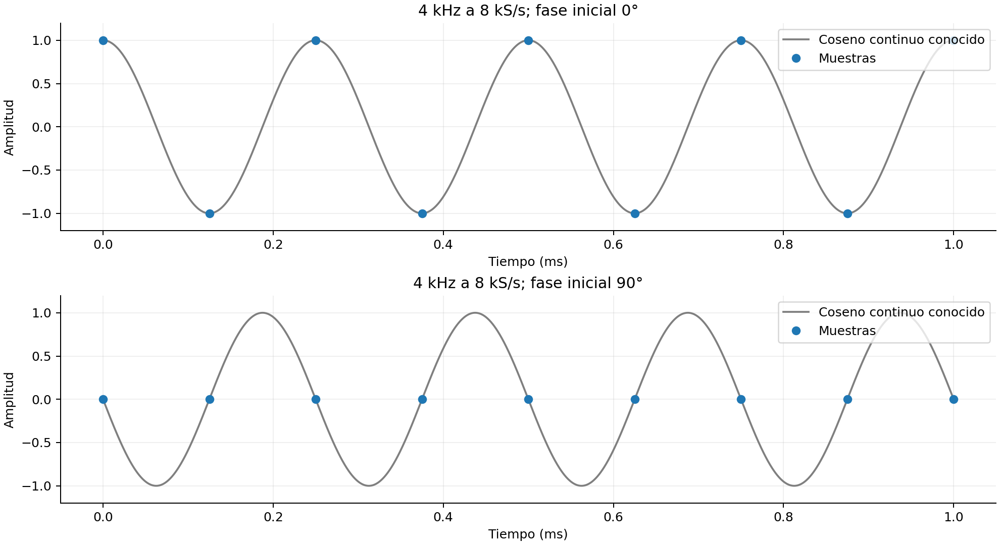

**Figura 13.** En el borde de Nyquist, cambiar la fase de un coseno real puede hacer que todas sus muestras sean cero.

- **Panel superior — muestras en máximos y mínimos:** los valores alternan entre los extremos del coseno real.
- **Panel inferior — muestras en cruces por cero:** los instantes de muestreo son los mismos, pero el cambio de fase hace que todas las muestras coincidan con cruces por cero. La curva gris sigue oscilando entre ellas.
- **Precisión numérica:** los valores calculados del segundo panel pueden ser muy cercanos a cero, sin ser exactamente cero, por el cálculo en punto flotante.
- **Diferencia con un tono complejo:** la figura utiliza un coseno **real**. Un tono complejo en ese borde conserva su magnitud, porque $e^{j(\pi n+\phi)}=(-1)^n e^{j\phi}$.
- **Equivalencia de los extremos:** +$f_s/2$ y −$f_s/2$ producen la misma secuencia compleja. No son posiciones independientes.
- **Ancho del intervalo I/Q:** para baseband centrado en cero, el ancho total es $f_s$, repartido entre frecuencias negativas y positivas. No se limita toda señal compleja a una banda total de $f_s/2$.
- **Condición que interesa preservar:** las componentes distintas de la banda que se desea conservar no deben superponerse al muestrear. Estos ejemplos seleccionan la banda centrada en cero; otros esquemas de muestreo quedan fuera de la sesión.

#### 4.7. Experimento F: el filtro debe actuar antes de perder la distinción

El filtrado anti-aliasing atenúa las componentes que se confundirían con la banda de interés. Debe actuar **antes** del muestreo que genera la superposición. El [MIT, en su lección sobre muestreo](https://ocw.mit.edu/courses/6-003-signals-and-systems-fall-2011/resources/mit6_003f11_lec22/), muestra ese orden tanto para muestreo continuo como para cambios de tasa en tiempo discreto.

Si la operación es un ADC, el filtrado previo es analógico. Si se reduce el sample rate de una secuencia ya adquirida, el filtrado previo puede ser digital: se aplica antes de descartar muestras. Diseñar esos filtros corresponde a la siguiente sesión; aquí se observa por qué hacen falta.

El ejemplo genera una señal compleja a 24 kS/s con dos componentes conocidas:

$$z_{\mathrm{entrada}}(t)=e^{j2\pi\,1000\,t}+0.6e^{j2\pi\,9000\,t}.$$

Después se conserva una de cada tres muestras, para obtener 8 kS/s. En esa nueva tasa, +9 kHz y +1 kHz coinciden. Con las fases elegidas, ambas contribuciones se suman en +1 kHz y la magnitud pasa de 1 a 1.6.

Se compara con un segundo camino: un filtro ideal previo conserva el tono de +1 kHz y elimina el de +9 kHz. Para aislar la idea, su salida se escribe directamente usando el tono conocido. **No se implementa un filtro real ni se calcula su respuesta en este snippet.**

**Qué se varía:** la presencia o ausencia de filtrado antes de reducir la tasa. **Qué permanece fijo:** señal de entrada, tasa inicial de 24 kS/s, tasa final de 8 kS/s y duración de 8 ms. **Qué se debe notar:** después de la superposición ya no hay dos picos que un filtro pueda separar.

**Colab — Celda 7: comparar ambos caminos.**

```python
fs_alta = 24000
fs_baja = 8000
factor = fs_alta // fs_baja
th = np.arange(192) / fs_alta
deseada = np.exp(1j * 2 * np.pi * 1000 * th)
interferente = 0.6 * np.exp(1j * 2 * np.pi * 9000 * th)
entrada = deseada + interferente
salida_filtro_ideal = deseada  # Modelo: elimina por completo el tono de 9 kHz.
sin_filtro = entrada[::factor]
con_filtro = salida_filtro_ideal[::factor]
tb = np.arange(len(sin_filtro)) / fs_baja
print("Sin filtro, se obtiene 1.6 veces el tono deseado:", np.allclose(sin_filtro, 1.6 * con_filtro))

fig, axes = plt.subplots(2, 2, figsize=(12, 8), layout="constrained")
casos = [(entrada, fs_alta, "Entrada: dos tonos a 24 kS/s"), (salida_filtro_ideal, fs_alta, "Después del filtro ideal, antes de reducir la tasa"), (sin_filtro, fs_baja, "Reducir a 8 kS/s SIN filtro: los tonos se suman")]
for ax, (y, tasa, titulo) in zip([axes[0, 0], axes[0, 1], axes[1, 0]], casos):
    f, C = espectro(y, tasa)
    ax.stem(f / 1000, np.abs(C), basefmt=" ")
    ax.set(title=titulo, xlabel="Frecuencia (kHz)", ylabel="Magnitud por componente", xlim=(-12.2, 12.2), ylim=(-0.03, 1.85))
    ax.axvspan(-4, 4, color="tab:green", alpha=0.08, label="Banda representativa de la tasa final")
    ax.legend(fontsize=8, loc="upper left")
axes[1, 1].plot(tb[:17] * 1000, sin_filtro.real[:17], "o-", label="I sin filtro: amplitud 1.6")
axes[1, 1].plot(tb[:17] * 1000, con_filtro.real[:17], "s-", label="I con filtro previo: amplitud 1", markerfacecolor="white")
axes[1, 1].set(title="Salidas a 8 kS/s: misma frecuencia, distinto resultado", xlabel="Tiempo (ms)", ylabel="I", ylim=(-1.85, 1.85))
axes[1, 1].legend(fontsize=8)
for ax in axes.flat:
    ax.grid(alpha=0.2)
plt.show()
```

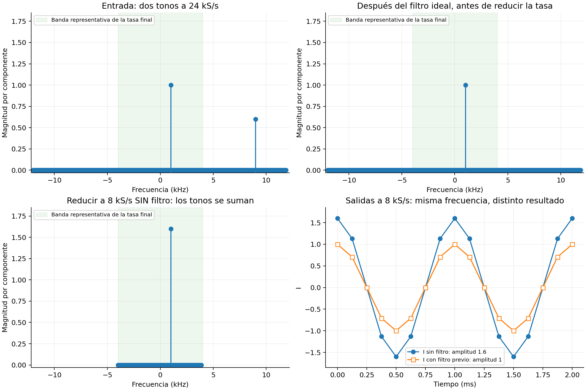

**Figura 14.** El filtrado previo evita que una componente fuera de la banda se superponga al tono que se desea conservar al reducir el sample rate.

- **Panel superior izquierdo — entrada a la tasa inicial:** +1 y +9 kHz se distinguen porque ambos están dentro del intervalo disponible.
- **Panel superior derecho — filtrado previo ideal:** solo queda +1 kHz. Esta eliminación ocurre **antes** de reducir la tasa a 8 kS/s.
- **Panel inferior izquierdo — reducción sin filtro:** aparece una sola componente de magnitud 1.6 en +1 kHz. El tono de +9 kHz ya se superpuso al de +1 kHz.
- **Eje del panel inferior izquierdo:** solo hay bins entre −4 y +4 kHz. El resto del eje se mantiene para comparar las posiciones con la entrada.
- **Panel inferior derecho — comparación de las salidas:** ambas secuencias tienen la misma tasa final. Con filtrado previo, I conserva el tono de magnitud 1; sin filtrado, muestra el resultado de la superposición.
- **FFT de la salida filtrada:** tendría un pico de magnitud 1 en +1 kHz. La diferencia con la salida sin filtro se debe al procesamiento previo, no a la tasa final, que es igual en ambos casos.
- **Por qué un filtro posterior no separa los tonos:** si deja pasar +1 kHz, también deja pasar la contribución aliased. Ambas ocupan la misma frecuencia.
- **Por qué la magnitud es 1.6:** depende de las amplitudes y fases elegidas. En otro caso, las contribuciones podrían reforzarse menos o cancelarse.
- **Qué no constituye una solución general:** dividir por 1.6 funciona para esta simulación conocida, pero no permite deshacer aliasing en una captura desconocida de forma general.

#### 4.8. Qué conclusiones se aplican a una captura SDR

La tasa de la secuencia I/Q determina el intervalo representativo de **esa etapa**. No significa que la RF de la antena se muestree directamente a la tasa del archivo: el receptor incluye conversión de frecuencia, filtrado y cambios de tasa, como se presentó en la sesión 1. La relación entre baseband y RF se retomará en la subsección 6.

Para interpretar los experimentos conviene distinguir tres operaciones:

- **Adquirir de nuevo con otro sample rate:** cambia los instantes en los que se observa la señal. Puede evitar aliasing si la banda de entrada y el filtrado son apropiados.
- **Reducir la tasa descartando muestras:** puede crear aliasing nuevo. Requiere filtrado previo respecto a la tasa de salida.
- **Cambiar solo la etiqueta de sample rate de un archivo:** cambia la interpretación de sus ejes, pero no obtiene información nueva ni revierte aliasing.

??? example "Comprobación: predecir un alias complejo"
    Un tono complejo de +11 kHz muestreado a 8 kS/s tiene representante en +3 kHz, porque $11-8=3$. Un tono de −6 kHz tiene representante en +2 kHz, porque $-6+8=2$. En ambos casos se conserva el signo del representante; no se toma su valor absoluto.

??? example "Comprobación: ¿más puntos en la FFT recuperan la frecuencia original?"
    No. Si las muestras de +1 y +9 kHz coinciden a 8 kS/s, una FFT más larga no puede decidir cuál fue la frecuencia original. Cambiar la longitud de la FFT afecta la lectura del bloque, no la información que se perdió al muestrear.

??? example "Comprobación: escoger una tasa para una señal real low-pass"
    Si la banda real que se desea conservar llega hasta 3 kHz, la condición ideal es $f_s>6$ kS/s. Una tasa de 8 kS/s permite margen entre 3 y 4 kHz para una transición de filtrado, pero que sea suficiente en un equipo concreto depende del filtro y de la atenuación requerida. No basta con seleccionar la tasa y omitir el filtrado de componentes exteriores.

La idea central es que una secuencia no identifica por sí sola todas las posibles frecuencias de la señal original. El sample rate, la banda seleccionada y el filtrado previo forman parte de su interpretación. El aliasing se origina al muestrear o reducir la tasa; el efecto de observar solo un bloque finito, llamado spectral leakage, se estudiará por separado en la subsección 5.

#### 4.9. Ejercicios de refuerzo

##### Ejercicio 4A — ubicar frecuencias equivalentes con su signo

Se utiliza $f_s=8000$ S/s y el intervalo representativo $[-4,+4)$ kHz.

- Determinar los representantes de +13 kHz, −10 kHz y +4 kHz.
- Explicar por qué no se toman los valores absolutos de los resultados ni se incluyen ambos extremos como frecuencias independientes.

??? example "Solución del ejercicio 4A"

    - **Punto de partida:** el apartado 4.3 demuestra que $f_0+\ell f_s$, con $\ell$ entero, produce las mismas muestras de un tono complejo con igual magnitud y fase inicial. El apartado 4.4 elige un único representante en $[-f_s/2,f_s/2)$ y da $f_a=((f_0+f_s/2)\bmod f_s)-f_s/2$. Aquí la repetición es cada 8 kHz y el intervalo es $[-4,+4)$ kHz.
    - **Paso 1 — representar +13 kHz:** restar una tasa da $13-8=5$ kHz, todavía fuera del intervalo. Restar otra da $13-2(8)=-3$ kHz, que sí pertenece a él. Así, +13, +5 y −3 kHz son posiciones equivalentes para esa secuencia; se muestra −3 kHz por la convención elegida.
    - **Paso 2 — representar −10 kHz:** se suma una tasa: $-10+8=-2$ kHz. Como $-4\leq-2<4$, no hace falta otra operación. La diferencia respecto a la frecuencia original es exactamente un múltiplo de $f_s$.
    - **Paso 3 — tratar el extremo +4 kHz:** el intervalo excluye +4 kHz, por lo que se resta una tasa: $4-8=-4$ kHz. El extremo izquierdo sí se incluye. Esta decisión evita dibujar dos veces la misma posición discreta; no significa que se haya eliminado una componente diferente.
    - **Por qué se conserva el signo:** −3 kHz y +3 kHz no son representantes equivalentes a 8 kS/s: difieren en 6 kHz, no en un múltiplo de 8 kHz. Tomar el valor absoluto cambiaría la secuencia compleja y perdería el sentido de giro que se estudió en la subsección 2. La equivalencia con +13 kHz es con −3 kHz, no con +3 kHz.
    - **Comprobación del borde:** $e^{j2\pi\,4000\,n/8000}=e^{j\pi n}=(-1)^n$ y $e^{-j2\pi\,4000\,n/8000}=e^{-j\pi n}=(-1)^n$ para todo índice entero. En ese borde particular, los signos opuestos no se distinguen por las muestras; se utiliza una sola posición, −4 kHz, como representante.

##### Ejercicio 4B — demostrar una equivalencia muestra por muestra

Se comparan $z_7[n]=e^{j2\pi\,7000\,n/8000}$ y $z_{-1}[n]=e^{-j2\pi\,1000\,n/8000}$.

- Separar el exponente de $z_7[n]$ usando $7000=-1000+8000$ y comprobar la igualdad para cualquier $n$ entero.
- Calcular el valor de ambas secuencias en $n=1$ y explicar si obtener más muestras a la misma tasa elimina la equivalencia.

??? example "Solución del ejercicio 4B"

    - **Punto de partida:** los apartados 4.1 y 4.3 relacionan frecuencia y avance de fase, $\Delta\theta=2\pi f_0/f_s$, y explican la periodicidad de $e^{j\theta}$. La demostración se hace sobre las muestras, antes de calcular una FFT; no depende de la apariencia de un gráfico.
    - **Paso 1 — separar la frecuencia:** como $7000=-1000+8000$, se escribe $z_7[n]=e^{j2\pi(-1000+8000)n/8000}$. La propiedad $e^{a+b}=e^ae^b$ permite separar $z_7[n]=e^{-j2\pi\,1000\,n/8000}e^{j2\pi n}$.
    - **Paso 2 — evaluar la vuelta adicional:** el índice $n$ es entero. Por Euler, $e^{j2\pi n}=\cos(2\pi n)+j\sin(2\pi n)=1+j0$. Por tanto, $z_7[n]=z_{-1}[n]$ para $n=0,1,2,\ldots$. La igualdad incluye tanto I como Q, no solo sus magnitudes.
    - **Paso 3 — comprobar la muestra 1:** para +7 kHz, el ángulo es $2\pi(7000/8000)=7\pi/4=315^\circ$; para −1 kHz es $-2\pi(1000/8000)=-\pi/4=-45^\circ$. Difieren en 360° y llegan al mismo punto: $\cos(-\pi/4)+j\sin(-\pi/4)\approx0.7071-j0.7071$.
    - **Interpretación entre instantes:** el tono de +7 kHz avanza una vuelta completa más que el de −1 kHz entre muestras. Esa vuelta no deja una marca adicional en los valores observados: las muestras indican dónde terminó el giro, no cuántas vueltas completas ocurrieron entre ellas.
    - **Por qué más muestras no resuelven el problema:** la demostración vale para cualquier $n$ entero, no solo para un bloque corto. Un bloque más largo a 8 kS/s y cualquier FFT de ese bloque reciben secuencias idénticas. Para decidir sobre la frecuencia original hace falta información adicional sobre la banda seleccionada o una adquisición diferente que evite esa ambigüedad; aumentar solo la longitud de análisis no la elimina.

##### Ejercicio 4C — predecir la superposición antes de reducir la tasa

A 24 kS/s se tiene $z[n]=e^{j2\pi\,1000\,n/24000}+0.4e^{j2\pi\,9000\,n/24000}$. Se conserva una de cada tres muestras, empezando por $n=0$, sin filtrado previo.

- Determinar la tasa final, las frecuencias representativas y la magnitud resultante.
- Explicar dónde debe actuar el filtrado si se desea conservar solo el tono de +1 kHz.

??? example "Solución del ejercicio 4C"

    - **Punto de partida:** el apartado 4.7 conserva una de cada tres muestras y muestra que el filtrado debe preceder a la reducción. El apartado 4.4 permite llevar cada frecuencia al intervalo de la tasa final. Se llama $m$ al índice de salida para no confundirlo con el índice $n$ de la entrada.
    - **Paso 1 — calcular la tasa final:** las muestras elegidas son $n=0,3,6,\ldots$, de modo que $n=3m$. Su separación temporal es $3/24000$ s y la tasa correspondiente es $f_s'=24000/3=8000$ S/s. El nuevo intervalo representativo es $[-4,+4)$ kHz.
    - **Paso 2 — sustituir los índices:** la salida es $y[m]=z[3m]=e^{j2\pi\,1000\,(3m)/24000}+0.4e^{j2\pi\,9000\,(3m)/24000}$. Simplificando $3/24000=1/8000$, ambos términos quedan expresados con la tasa final: $y[m]=e^{j2\pi\,1000\,m/8000}+0.4e^{j2\pi\,9000\,m/8000}$.
    - **Paso 3 — obtener las frecuencias representativas:** +1 kHz ya está dentro del intervalo. Para +9 kHz se resta 8 kHz y se obtiene $9-8=1$ kHz. Algebraicamente, $e^{j2\pi\,9000\,m/8000}=e^{j2\pi\,1000\,m/8000}e^{j2\pi m}=e^{j2\pi\,1000\,m/8000}$ para cualquier $m$ entero.
    - **Paso 4 — sumar los coeficientes:** queda $y[m]=(1+0.4)e^{j2\pi\,1000\,m/8000}=1.4e^{j2\pi\,1000\,m/8000}$. La salida tiene una componente de +1 kHz con magnitud 1.4. Ambas fases iniciales son cero y la selección comienza en $n=0$; por eso las contribuciones se suman en fase en este ejemplo.
    - **Dónde actúa el filtro:** antes de conservar una de cada tres muestras, cuando +1 y +9 kHz aún son posiciones separadas a 24 kS/s. Un filtro que deje pasar el tono deseado y atenúe el de +9 kHz evita o reduce su contribución aliased. En el modelo ideal del apartado 4.7, retirar completamente el segundo tono deja magnitud 1 en la salida.
    - **Por qué después es demasiado tarde:** una vez reducida la tasa, ambas contribuciones ocupan +1 kHz. Un filtro de salida que conserve esa frecuencia conserva su suma; no identifica qué parte provenía de +9 kHz. Tampoco existe una regla general de restar 0.4: con otras fases, el coeficiente sería $e^{j\phi_1}+0.4e^{j\phi_9}$ y su magnitud no sería necesariamente 1.4.

##### Ejercicio 4D — explicar el caso límite de la Figura 13

Se muestrea un coseno real de 4 kHz a 8 kS/s, primero con fase inicial cero y después con fase $\pi/2$.

- Escribir las dos secuencias y explicar si «dos muestras por ciclo» garantiza conservar este coseno real para cualquier fase.
- Indicar si un tono complejo en el mismo borde pierde su magnitud de la misma manera.

??? example "Solución del ejercicio 4D"

    - **Punto de partida:** el apartado 4.6 estudia el borde de Nyquist mediante $x[n]=\cos(2\pi f_0n/f_s+\phi)$. Con $f_0=4000$ Hz y $f_s=8000$ S/s, el avance es $2\pi(4000/8000)=\pi$ rad, o 180°, entre muestras. Dos intervalos de muestreo completan un ciclo.
    - **Paso 1 — coseno de fase cero:** $x_0[n]=\cos(\pi n)=(-1)^n$. En los índices pares vale +1 y en los impares −1. Las muestras caen alternativamente en un máximo y un mínimo del coseno continuo.
    - **Paso 2 — coseno de fase 90°:** $x_{90}[n]=\cos(\pi n+\pi/2)=-\sin(\pi n)=0$ para todo $n$ entero. Las muestras caen ahora en cruces por cero; el coseno continuo sigue teniendo amplitud 1, pero la secuencia no la muestra.
    - **Paso 3 — identificar lo que se pierde:** para una fase cualquiera, $\cos(\pi n+\phi)=(-1)^n\cos\phi$, porque $\sin(\pi n)=0$. La secuencia depende de $\cos\phi$ y no conserva toda la información de fase del coseno. La frase «dos muestras por ciclo» por sí sola no garantiza recuperar cualquier fase en ese borde.
    - **Condición usada para una señal real low-pass:** el apartado 4.6 utiliza $f_s>2f_{\max}$, además de limitar adecuadamente la banda de entrada. La desigualdad es estricta en la regla empleada aquí; elegir exactamente $f_s=2f_0$ deja el caso límite que acaba de demostrarse. No basta comprobar solo el número de muestras por ciclo sin revisar la banda y el borde.
    - **Paso 4 — tono complejo en el borde:** Euler permite escribir $z[n]=e^{j(\pi n+\phi)}=e^{j\pi n}e^{j\phi}=(-1)^ne^{j\phi}$. Su magnitud es $|z[n]|=1$ para cualquier fase. Si $\phi=\pi/2$, la secuencia es $j(-1)^n$: I es cero, pero Q alterna entre +1 y −1, por lo que la muestra compleja no desaparece.
    - **Precaución que sigue siendo necesaria:** $e^{j\pi n}=e^{-j\pi n}$ para índices enteros. Con la misma fase inicial, +4 y −4 kHz siguen produciendo las mismas muestras complejas. Conservar magnitud en I/Q no convierte ambos bordes en frecuencias independientes ni elimina la ambigüedad de su signo.

### 5. Qué calcula una FFT de un bloque finito

- Una gráfica de espectro suele representar un bloque de muestras, no toda la captura.
- La FFT calcula la DFT de ese bloque. Las figuras siguientes muestran la magnitud de sus coeficientes complejos.
- El tiempo observado y la ventana afectan la forma de los picos. El zero padding cambia cuántos puntos se calculan.
- **Pregunta conductora:** ¿qué muestra la señal y qué efecto introduce la forma de analizarla?

#### 5.1. La FFT recibe un bloque, no una señal de duración infinita

- **Propósito:** identificar las muestras que se analizan y el tiempo que representan.
- **Bloque:** se toman $N$ muestras consecutivas, desde $x[0]$ hasta $x[N-1]$. Cada pareja I/Q cuenta como una muestra compleja.
- **Sampling rate:** $f_s$ indica las muestras por segundo, como `samp_rate` en GNU Radio. No es la Nyquist frequency, que vale $f_s/2$.
- **Duración nominal:** se calcula con las muestras adquiridas:

$$T_{\mathrm{obs}}=\frac{N}{f_s}.$$

- **Ejemplo:** 64 muestras a 8000 S/s representan $64/8000=0.008$ s, es decir, **8 ms**.
- **Precisión temporal:** la última muestra está en $(N-1)/f_s=7.875$ ms. La siguiente muestra correspondería a 8 ms.
- **DFT y FFT:** la DFT es la transformación matemática. La FFT es un algoritmo eficiente para calcularla, como `np.fft.fft`.

#### 5.2. Cada bin prueba una frecuencia: girar hacia atrás y sumar

- **Propósito:** ver cómo las muestras producen una barra del espectro.
- Cada muestra compleja es una flecha en el plano I/Q, como en 2.3.
- Un **bin** es una posición de salida asociada a una frecuencia de prueba.
- Para probarla, el cálculo gira cada flecha en sentido contrario al giro de prueba. Después suma las flechas **punta con cola**.
- La flecha desde el inicio hasta el final del recorrido representa la suma. La barra muestra su longitud dividida entre las muestras utilizadas.
- **Datos fijos:** ocho muestras, $f_s=8000$ S/s, amplitud 1 y fase inicial 0. Primero se mantiene el tono de entrada en 1 kHz.

**La misma entrada se prueba a dos frecuencias. A 1 kHz, las flechas se suman en línea; a 2 kHz, el recorrido se cierra.**

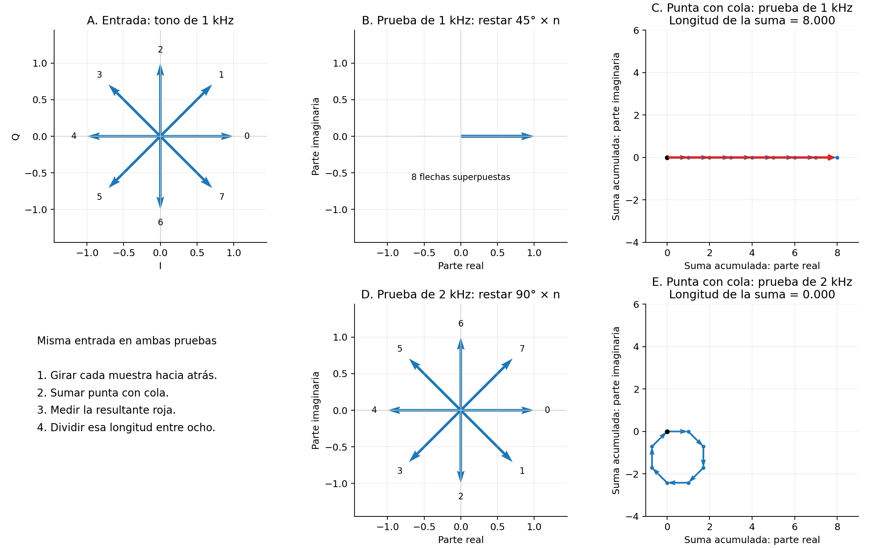

**Figura 15.** Las mismas ocho muestras producen una suma de longitud 8 al probar 1 kHz y una suma cero al probar 2 kHz.

- **A — Entrada:** cada flecha azul representa una muestra. El eje horizontal muestra I; el vertical muestra Q.
    - Los números indican el orden de las muestras. Cada flecha avanza 45° respecto a la anterior.
- **B — Prueba de 1 kHz:** se resta $45^\circ n$ a la dirección de la muestra $n$. Las ocho flechas quedan superpuestas hacia la derecha.
    - En la muestra 0 se resta 0°. En la muestra 1 se resta 45°; en la muestra 2, 90°.
- **C — Suma de la prueba de 1 kHz:** cada flecha empieza donde termina la anterior. Ninguna cambia de longitud al trasladarla.
    - La resultante roja une 0 con 8. Su longitud dividida entre ocho produce una barra de altura 1.
- **D — Prueba de 2 kHz:** ahora se resta $90^\circ n$. Las flechas resultantes retroceden 45° entre muestras.
    - Las flechas opuestas se cancelan al sumarlas.
- **E — Suma de la prueba de 2 kHz:** el recorrido vuelve al inicio. La suma vale cero y la barra también.
    - C y E usan la misma escala. Los ejes representan la parte real e imaginaria de la suma acumulada, no tiempo.

**El espectro reúne todas las pruebas. Cada barra indica cuánto mide la suma correspondiente, dividida entre ocho.**

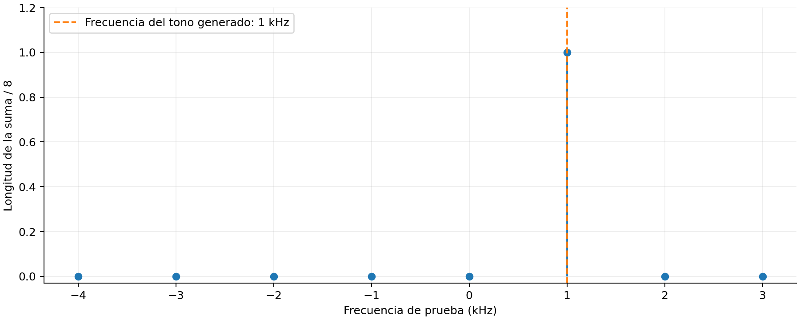

**Figura 16.** Las ocho pruebas del tono de 1 kHz dan una barra de altura 1 y siete resultados cero.

- El eje horizontal muestra las frecuencias de prueba. El vertical muestra la longitud de cada suma dividida entre ocho.
- La línea naranja marca el tono generado. La barra coincidente vale 1; las demás sumas se cancelan.
- Las frecuencias negativas indican el sentido contrario de giro. El apartado 5.3 explica cómo se ordena este eje.

**Ahora cambia solo la entrada, a 1.5 kHz. La prueba de 1 kHz deja flechas que todavía giran; su suma ya no mide ocho.**

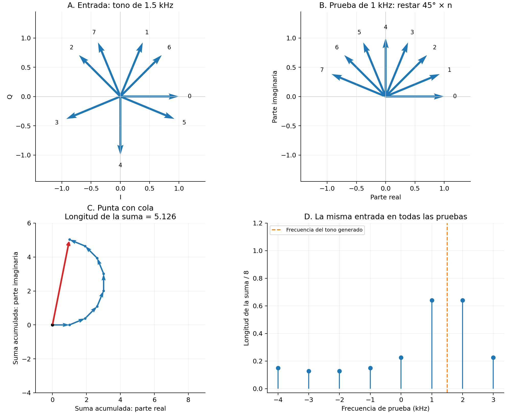

**Figura 17.** Un tono de 1.5 kHz produce una suma de longitud aproximada 5.126 al probar 1 kHz; su barra mide aproximadamente 0.641.

- **A — Nueva entrada:** las ocho flechas azules avanzan 67.5° entre muestras. Los ejes siguen siendo I y Q.
- **B — Prueba de 1 kHz:** se resta $45^\circ n$. Las flechas resultantes avanzan 22.5° entre muestras.
- **C — Suma:** el recorrido no se cierra. La resultante roja mide aproximadamente 5.126; al dividir entre ocho, queda 0.641.
    - Se mide la resultante, no el recorrido azul. El recorrido sigue formado por ocho flechas de longitud 1.
- **D — Espectro:** las pruebas de 1 y 2 kHz dan barras de aproximadamente 0.641. Otras pruebas también producen sumas distintas de cero.
    - La entrada sigue teniendo un solo tono. El apartado 5.4 explica por qué aparecen varias barras.

??? note "Para profundizar"

    - «Girar hacia atrás» significa girar en sentido contrario a la frecuencia de prueba. No significa invertir el tiempo ni reproducir muestras al revés.
    - Para una frecuencia de prueba negativa, el giro aplicado es positivo.
    - La cancelación exacta entre bins diferentes requiere el caso alineado y pesos iguales. No ocurre para cualquier frecuencia de entrada.
    - Las sumas teóricas cero pueden dejar residuos pequeños por redondeo numérico.
    - La suma es compleja: conserva longitud y dirección. Una gráfica de magnitud no muestra su dirección.
    - Con amplitud $A\geq0$ y fase inicial $\phi$, una prueba coincidente produce $NAe^{j\phi}$. La magnitud dividida entre $N$ vale $A$.
    - Por eso, una coincidencia no exige que la resultante apunte hacia la derecha. Esa dirección corresponde a la fase inicial elegida aquí.

**La misma operación escrita con símbolos**

- $n$ identifica la muestra y $k$ identifica el bin. Ambos recorren desde $0$ hasta $N-1$, sin zero padding.
- La referencia del bin es $r_k[n]=e^{+j2\pi kn/N}$. Su conjugado, $r_k^*[n]=e^{-j2\pi kn/N}$, aplica el giro contrario.
- El símbolo $^*$ cambia el signo de la parte imaginaria: $(a+jb)^*=a-jb$.
- La [convención de NumPy](https://numpy.org/doc/stable/reference/routines.fft.html) escribe la suma así:

$$
X[k]=\underbrace{\sum_{n=0}^{N-1}}_{\text{sumar punta con cola}}
\underbrace{x[n]r_k^*[n]}_{\text{girar cada muestra}}
=\sum_{n=0}^{N-1}x[n]e^{-j2\pi kn/N}.
$$

- La figura muestra $|X[k]|/N$. El código comprueba que sumar los productos y ejecutar la FFT da el mismo resultado.

**Colab — Celda 1: entrada, pruebas y sumas. Se puede ejecutar en un notebook nuevo.**

```python
import numpy as np
import matplotlib.pyplot as plt

fs = 8000
n8 = np.arange(8)
tono8 = np.exp(1j * 2 * np.pi * 1000 * n8 / fs)
referencias = {k: np.exp(1j * 2 * np.pi * k * n8 / 8) for k in [1, 2]}
productos_bin1 = tono8 * np.conj(referencias[1])
productos_bin2 = tono8 * np.conj(referencias[2])

def flechas(ax, valores, titulo):
    origen = np.zeros(len(valores))
    ax.quiver(origen, origen, valores.real, valores.imag, angles="xy", scale_units="xy", scale=1, color="tab:blue", width=0.012)
    for n, z in enumerate(valores):
        if np.allclose(valores, valores[0]):
            break
        ax.text(1.18 * z.real, 1.18 * z.imag, str(n), ha="center", va="center", fontsize=9)
    if np.allclose(valores, valores[0]):
        ax.text(0, -0.6, f"{len(valores)} flechas superpuestas", ha="center", fontsize=9)
    ax.set(title=titulo, xlabel="Parte real", ylabel="Parte imaginaria", xlim=(-1.45, 1.45), ylim=(-1.45, 1.45))
    ax.set_aspect("equal")
    ax.axhline(0, color="0.8", linewidth=0.7)
    ax.axvline(0, color="0.8", linewidth=0.7)
    ax.grid(alpha=0.2)

def suma_flechas(ax, valores, titulo):
    camino = np.r_[0j, np.cumsum(valores)]
    ax.quiver(camino[:-1].real, camino[:-1].imag, valores.real, valores.imag, angles="xy", scale_units="xy", scale=1, color="tab:blue", width=0.008)
    ax.plot(camino.real, camino.imag, ".", color="tab:blue")
    ax.annotate("", xy=(camino[-1].real, camino[-1].imag), xytext=(0, 0), arrowprops={"arrowstyle": "->", "color": "tab:red", "lw": 2.5})
    ax.plot(0, 0, "ko", markersize=4)
    ax.set(title=f"{titulo}\nLongitud de la suma = {abs(camino[-1]):.3f}", xlabel="Suma acumulada: parte real", ylabel="Suma acumulada: parte imaginaria", xlim=(-1, 9), ylim=(-4, 6))
    ax.set_aspect("equal")
    ax.grid(alpha=0.2)
    return camino

fig = plt.figure(figsize=(13, 8), layout="constrained")
gs = fig.add_gridspec(2, 3)
ax_entrada = fig.add_subplot(gs[0, 0])
flechas(ax_entrada, tono8, "A. Entrada: tono de 1 kHz")
ax_entrada.set(xlabel="I", ylabel="Q")
ax_instruccion = fig.add_subplot(gs[1, 0])
ax_instruccion.axis("off")
ax_instruccion.text(0.05, 0.85, "Misma entrada en ambas pruebas\n\n1. Girar cada muestra hacia atrás.\n2. Sumar punta con cola.\n3. Medir la resultante roja.\n4. Dividir esa longitud entre ocho.", va="top", fontsize=11, linespacing=1.8)
flechas(fig.add_subplot(gs[0, 1]), productos_bin1, "B. Prueba de 1 kHz: restar 45° × n")
camino_bin1 = suma_flechas(fig.add_subplot(gs[0, 2]), productos_bin1, "C. Punta con cola: prueba de 1 kHz")
flechas(fig.add_subplot(gs[1, 1]), productos_bin2, "D. Prueba de 2 kHz: restar 90° × n")
camino_bin2 = suma_flechas(fig.add_subplot(gs[1, 2]), productos_bin2, "E. Punta con cola: prueba de 2 kHz")
plt.show()

frecuencias8 = np.fft.fftshift(np.fft.fftfreq(8, d=1 / fs))
C_bin_alineado = np.fft.fft(tono8) / 8
sumas_directas = np.array([np.sum(tono8 * np.exp(-1j * 2 * np.pi * f * n8 / fs)) for f in frecuencias8])
np.testing.assert_allclose(sumas_directas, np.fft.fftshift(np.fft.fft(tono8)), atol=1e-12)
fig, ax = plt.subplots(figsize=(10, 4), layout="constrained")
ax.stem(frecuencias8 / 1000, np.abs(sumas_directas) / 8, basefmt=" ")
ax.axvline(1, color="tab:orange", linestyle="--", label="Frecuencia del tono generado: 1 kHz")
ax.set(xlabel="Frecuencia de prueba (kHz)", ylabel="Longitud de la suma / 8", xticks=np.arange(-4, 4), ylim=(-0.03, 1.2))
ax.legend()
ax.grid(alpha=0.2)
plt.show()

tono_entre_bins = np.exp(1j * 2 * np.pi * 1500 * n8 / fs)
productos_intermedio = tono_entre_bins * np.conj(referencias[1])
C_bin_intermedio = np.fft.fft(tono_entre_bins) / 8
fig, axes = plt.subplots(2, 2, figsize=(11, 9), layout="constrained")
flechas(axes[0, 0], tono_entre_bins, "A. Entrada: tono de 1.5 kHz")
axes[0, 0].set(xlabel="I", ylabel="Q")
flechas(axes[0, 1], productos_intermedio, "B. Prueba de 1 kHz: restar 45° × n")
camino_intermedio = suma_flechas(axes[1, 0], productos_intermedio, "C. Punta con cola")
axes[1, 1].stem(frecuencias8 / 1000, np.abs(np.fft.fftshift(C_bin_intermedio)), basefmt=" ")
axes[1, 1].axvline(1.5, color="tab:orange", linestyle="--", label="Frecuencia del tono generado")
axes[1, 1].set(title="D. La misma entrada en todas las pruebas", xlabel="Frecuencia de prueba (kHz)", ylabel="Longitud de la suma / 8", xticks=np.arange(-4, 4), ylim=(-0.03, 1.2))
axes[1, 1].legend(fontsize=8)
axes[1, 1].grid(alpha=0.2)
plt.show()

for etiqueta, productos in [("1 kHz / prueba 1 kHz", productos_bin1), ("1 kHz / prueba 2 kHz", productos_bin2), ("1.5 kHz / prueba 1 kHz", productos_intermedio)]:
    print(f"{etiqueta}: longitud={abs(np.sum(productos)):.6f}; barra={abs(np.sum(productos)) / 8:.6f}")
```

#### 5.3. Experimento A: poner la frecuencia correcta en cada barra

- **Propósito:** relacionar cada bin con su frecuencia y ordenar las barras sin modificar las muestras.
- Se llaman **vueltas sobrantes** a las vueltas del tono menos las vueltas de prueba durante la duración nominal del bloque:

$$
\text{vueltas sobrantes}=(f_{\mathrm{tono}}-f_{\mathrm{prueba}})T_{\mathrm{obs}}.
$$

- Las frecuencias se expresan en Hz y $T_{\mathrm{obs}}$ en segundos. El signo indica el sentido del giro que queda.
- **Ejemplo:** tono de 1.5 kHz y prueba de 1 kHz durante 1 ms: $(1500-1000)(0.001)=0.5$ vueltas sobrantes.
- **Datos de esta figura:** un tono de −2 kHz, ocho muestras a 8000 S/s, amplitud 1 y fase inicial 0.
- Las pruebas están separadas por $\Delta f=f_s/N=1000$ Hz. Solo cambia el orden de presentación.

**Avanzar 270° deja la flecha donde quedaría al retroceder 90°. Por eso el bin 6 aparece en −2 kHz.**

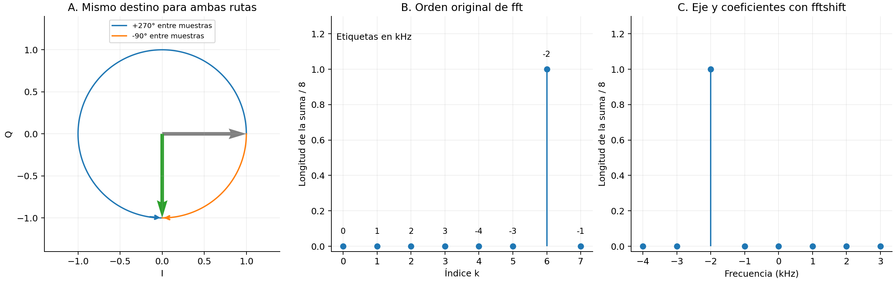

**Figura 18.** El bin 6 representa −2 kHz en este ejemplo; ordenar las barras no cambia las muestras ni la altura del pico.

- **A — Giros equivalentes:** los ejes son I y Q. Ambas rutas llevan la flecha desde la derecha hasta abajo.
    - $6(1000)=6000$ Hz y $6000-8000=-2000$ Hz producen las mismas muestras, como en la sección 4.
    - A 6000 Hz, cada muestra avanza $360^\circ(6000/8000)=270^\circ$. A −2000 Hz, retrocede 90°.
- **B — Orden por índice:** la FFT coloca el pico en $k=6$. Las etiquetas indican la frecuencia de cada bin.
    - La función [`fftfreq`](https://numpy.org/doc/stable/reference/generated/numpy.fft.fftfreq.html) entrega esas frecuencias en el mismo orden que la FFT.
- **C — Orden por frecuencia:** el mismo pico aparece en −2 kHz, con altura 1. El eje crece de izquierda a derecha.
    - [`fftshift`](https://numpy.org/doc/stable/reference/generated/numpy.fft.fftshift.html) reordena las frecuencias y sus coeficientes. No desplaza la señal.

??? note "Para profundizar"

    - Sin padding, la referencia del bin $k$ tiene frecuencia $kf_s/N$, interpretada módulo $f_s$.
    - Con $N=8$, el eje original es $[0,1,2,3,-4,-3,-2,-1]$ kHz.
    - DC significa frecuencia cero. Al ordenar un eje de longitud par, DC queda en el centro.
    - +4 kHz y −4 kHz representan el mismo tono discreto. No se añaden como dos puntos independientes.
    - El mismo índice no siempre significa la misma frecuencia. Con $N=64$, el bin 8 representa +1 kHz a este sampling rate.
    - Las ocho muestras facilitan leer cada bin. No son un tamaño recomendado para analizar cualquier captura.
    - Una captura I/Q genérica necesita la FFT compleja de ambos lados. `rfft` corresponde a entradas reales.
    - Las vueltas sobrantes utilizan $T_{\mathrm{obs}}=N/f_s$, no el intervalo entre la primera y la última muestra.
    - Para ocho muestras, ese intervalo contiene siete pasos. En el ejemplo de 0.5 vueltas sobrantes, sus direcciones abarcan 157.5°, no 180°.

**Colab — Celda 2: un tono, dos órdenes. Se puede ejecutar por separado.**

```python
import numpy as np
import matplotlib.pyplot as plt

fs = 8000
n8 = np.arange(8)
z8 = np.exp(-1j * 2 * np.pi * 2000 * n8 / fs)
f_sin_ordenar = np.fft.fftfreq(len(z8), d=1 / fs)
C_sin_ordenar = np.fft.fft(z8) / len(z8)
f_ordenado = np.fft.fftshift(f_sin_ordenar)
C_ordenado = np.fft.fftshift(C_sin_ordenar)

fig, axes = plt.subplots(1, 3, figsize=(14, 4.4), layout="constrained")
for grados, radio, color in [(270, 1.0, "tab:blue"), (-90, 1.0, "tab:orange")]:
    angulos = np.linspace(0, np.deg2rad(grados), 200)
    axes[0].plot(radio * np.cos(angulos), radio * np.sin(angulos), color=color, label=f"{grados:+d}° entre muestras")
    axes[0].annotate("", xy=(radio * np.cos(angulos[-1]), radio * np.sin(angulos[-1])), xytext=(radio * np.cos(angulos[-8]), radio * np.sin(angulos[-8])), arrowprops={"arrowstyle": "->", "color": color, "lw": 2})
axes[0].quiver([0, 0], [0, 0], [1, 0], [0, -1], angles="xy", scale_units="xy", scale=1, color=["0.5", "tab:green"], width=0.015)
axes[0].set(title="A. Mismo destino para ambas rutas", xlabel="I", ylabel="Q", xlim=(-1.4, 1.4), ylim=(-1.4, 1.4))
axes[0].set_aspect("equal")
axes[0].legend(fontsize=8, loc="upper center")
axes[1].stem(np.arange(8), np.abs(C_sin_ordenar), basefmt=" ")
axes[1].set(title="B. Orden original de fft", xlabel="Índice k", ylabel="Longitud de la suma / 8", xticks=np.arange(8), ylim=(-0.03, 1.3))
for k, frecuencia in enumerate(f_sin_ordenar):
    axes[1].text(k, abs(C_sin_ordenar[k]) + 0.07, f"{frecuencia / 1000:g}", ha="center", fontsize=9)
axes[1].text(0.02, 0.9, "Etiquetas en kHz", transform=axes[1].transAxes)
axes[2].stem(f_ordenado / 1000, np.abs(C_ordenado), basefmt=" ")
axes[2].set(title="C. Eje y coeficientes con fftshift", xlabel="Frecuencia (kHz)", ylabel="Longitud de la suma / 8", xticks=np.arange(-4, 4), ylim=(-0.03, 1.3))
for ax in axes:
    ax.grid(alpha=0.2)
plt.show()
print("Frecuencias originales (Hz):", f_sin_ordenar)
print("Frecuencias ordenadas (Hz):", f_ordenado)
np.testing.assert_allclose(z8, np.exp(1j * 2 * np.pi * 6000 * n8 / fs), atol=1e-12)
```

#### 5.4. Experimento B: un tono puede producir varias barras

- **Propósito:** explicar las barras del tono intermedio mediante las vueltas sobrantes.
- **Spectral leakage**, o dispersión espectral por observar un bloque finito, permite que un tono contribuya a varios bins.
- **Datos fijos:** tono de 1062.5 Hz, $N=64$, $f_s=8000$ S/s, amplitud 1 y fase inicial 0.
- La **ventana rectangular** asigna peso 1 a cada muestra. Se observan 8 ms y las pruebas están separadas por 125 Hz.

**Regla de lectura: con ventana rectangular y $|\text{vueltas}|<N$.** La barra representa la longitud de la suma dividida entre $N$, para un tono de amplitud 1.

| Vueltas sobrantes | Altura de la barra |
|---|---|
| 0 | 1 |
| Enteras distintas de cero | 0 |
| 0.5 | ≈0.64, con las cantidades de muestras usadas aquí |

**La entrada no cambia. Cada prueba deja distintas vueltas sobrantes y produce otra suma; los colores relacionan esas sumas con sus barras.**

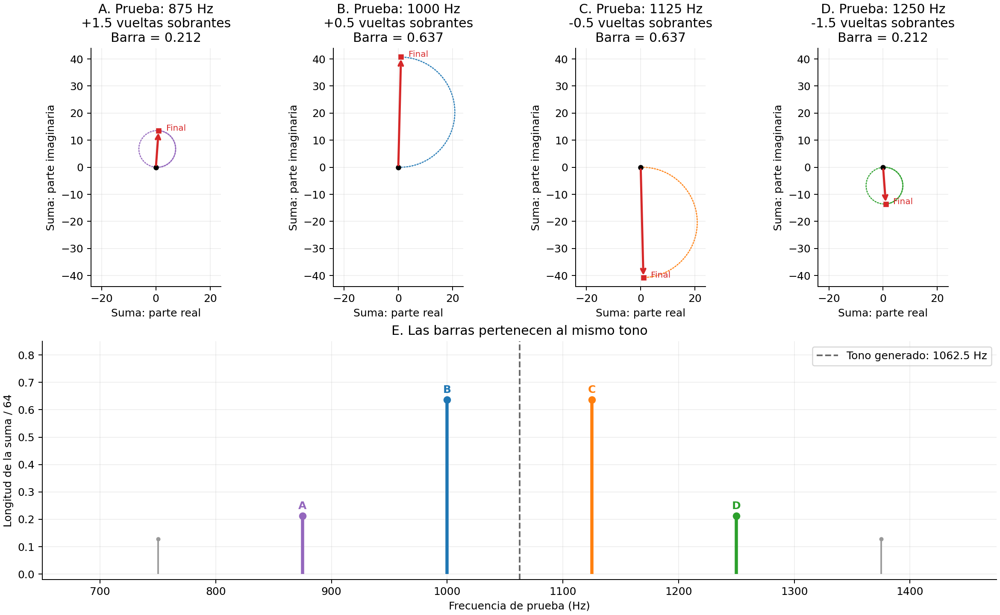

**Figura 19.** Cuatro pruebas del mismo tono producen cuatro sumas distintas de cero; varias barras no significan varios transmisores.

- **A — Prueba de 875 Hz:** deja +1.5 vueltas sobrantes. La resultante roja mide 13.594; su barra mide aproximadamente 0.212.
- **B — Prueba de 1000 Hz:** deja +0.5 vueltas sobrantes. La resultante mide 40.748; su barra mide aproximadamente 0.637.
- **C — Prueba de 1125 Hz:** deja −0.5 vueltas sobrantes. Cambia el sentido del giro, pero la barra también mide aproximadamente 0.637.
- **D — Prueba de 1250 Hz:** deja −1.5 vueltas sobrantes. La barra vuelve a medir aproximadamente 0.212.
- **En A–D**, cada segmento representa una muestra después del giro de prueba. Los ejes muestran la suma acumulada y conservan la misma escala.
    - El punto negro marca el inicio; el cuadrado rojo marca el final. Con 1.5 vueltas sobrantes, parte del recorrido se superpone.
- **E — Espectro:** la línea gris indica 1062.5 Hz. Ninguna prueba coincide con esa frecuencia; las barras coloreadas corresponden a A–D.
    - Las otras barras también provienen del mismo tono. No representan tonos adicionales generados en la entrada.
- Con 64 flechas, media vuelta da 0.637. Con las ocho flechas de 5.2, da 0.641; ambos valores se redondean a 0.64.

??? note "Para profundizar"

    - La tabla requiere pesos iguales. Con Hann, una ventana de pesos diferentes, las mismas vueltas sobrantes pueden producir otras alturas.
    - Con $N=64$, una vuelta sobrante da cero con rectangular. Con Hann periódica, da 0.5 después de normalizar por la suma de pesos.
    - Más vueltas sobrantes no garantizan una barra menor. Una vuelta da cero, pero 1.5 vueltas dan aproximadamente 0.212 con rectangular.
    - La condición $|\text{vueltas}|<N$ excluye diferencias equivalentes por aliasing.
    - Por ejemplo, con $N=64$, 64 vueltas sobrantes producen magnitud normalizada 1, no cero.
    - El valor para 0.5 vueltas depende de $N$. La aproximación 0.64 corresponde a los bloques usados aquí, no a cualquier bloque pequeño.
    - Si $v$ representa las vueltas sobrantes, la magnitud rectangular normalizada es:

    $$
    B(v)=\frac{|\sin(\pi v)|}{N|\sin(\pi v/N)|}.
    $$

    - En $v=0$, se utiliza el límite $B(0)=1$. En los demás casos indicados, la fórmula permite comprobar la tabla.
    - Aquí $f_0$ indica la frecuencia del tono. Sustituir ese tono de amplitud 1 en la DFT de 5.2 da:

    $$
    X[k]=\sum_{n=0}^{N-1}e^{j2\pi(f_0/f_s-k/N)n}.
    $$

    - Para 1000 Hz y $k=8$, el exponente es cero. La suma vale 64 y la barra vale 1.
    - Para 1062.5 Hz, ninguna prueba de esta rejilla deja cero vueltas sobrantes. Sus sumas no se cancelan por completo.
    - Un tono alineado también tiene una forma espectral entre bins. El apartado 5.5 muestra esos puntos intermedios.
    - Con Hann, incluso un tono alineado puede ocupar varios bins. «Ninguna prueba coincide» no define todos los casos de leakage.
    - La DFT completa conserva las 64 muestras. Mostrar solo magnitudes sí oculta la fase.
    - Otra interpretación consiste en repetir el bloque. No significa que el receptor repita físicamente el archivo.
    - El tono de 1000 Hz completa ocho ciclos en 8 ms. Repetir el bloque coincide con continuar ese tono.
    - El tono de 1062.5 Hz completa 8.5 ciclos. Al repetir el bloque, I vuelve a +1; la continuación del tono llega a −1.
    - Esa comparación utiliza la siguiente muestra, $n=64$, frente al reinicio, $n=0$. No compara directamente la primera muestra con la última.
    - Las líneas entre muestras facilitan la lectura. No representan una reconstrucción continua.
    - El [análisis espectral de SciPy](https://docs.scipy.org/doc/scipy/tutorial/signal.html#spectral-analysis) describe el efecto de observar un bloque finito.

**Colab — Celda 3: cuatro pruebas del mismo tono. Se puede ejecutar por separado.**

```python
import numpy as np
import matplotlib.pyplot as plt

fs = 8000
N = 64
n = np.arange(N)
t = n / fs
T_obs = N / fs
f0 = 1062.5
tono = np.exp(1j * 2 * np.pi * f0 * t)
pruebas = np.array([875, 1000, 1125, 1250])
vueltas_sobrantes = (f0 - pruebas) * T_obs
productos_pruebas = tono[None, :] * np.exp(-1j * 2 * np.pi * pruebas[:, None] * t)
sumas_pruebas = np.sum(productos_pruebas, axis=1)
barras_pruebas = np.abs(sumas_pruebas) / N
frecuencias = np.fft.fftshift(np.fft.fftfreq(N, d=1 / fs))
C_leakage = np.fft.fftshift(np.fft.fft(tono)) / N
colores = ["tab:purple", "tab:blue", "tab:orange", "tab:green"]

fig = plt.figure(figsize=(13, 8), layout="constrained")
gs = fig.add_gridspec(2, 4)
for i, (prueba, productos, vueltas, color) in enumerate(zip(pruebas, productos_pruebas, vueltas_sobrantes, colores)):
    ax = fig.add_subplot(gs[0, i])
    camino = np.r_[0j, np.cumsum(productos)]
    ax.quiver(camino[:-1].real, camino[:-1].imag, productos.real, productos.imag, angles="xy", scale_units="xy", scale=1, color=color, width=0.008)
    ax.annotate("", xy=(camino[-1].real, camino[-1].imag), xytext=(0, 0), arrowprops={"arrowstyle": "->", "color": "tab:red", "lw": 2})
    ax.plot(0, 0, "ko", markersize=4)
    ax.plot(camino[-1].real, camino[-1].imag, "s", color="tab:red", markersize=4)
    ax.annotate("Final", xy=(camino[-1].real, camino[-1].imag), xytext=(7, 0), textcoords="offset points", color="tab:red", fontsize=8)
    ax.set(title=f"{'ABCD'[i]}. Prueba: {prueba:g} Hz\n{vueltas:+g} vueltas sobrantes\nBarra = {barras_pruebas[i]:.3f}", xlabel="Suma: parte real", ylabel="Suma: parte imaginaria", xlim=(-24, 24), ylim=(-44, 44))
    ax.set_aspect("equal")
    ax.grid(alpha=0.2)
ax = fig.add_subplot(gs[1, :])
ax.stem(frecuencias, np.abs(C_leakage), linefmt="0.6", markerfmt=".", basefmt=" ")
for prueba, barra, color, letra in zip(pruebas, barras_pruebas, colores, "ABCD"):
    ax.vlines(prueba, 0, barra, color=color, linewidth=3)
    ax.plot(prueba, barra, "o", color=color)
    ax.text(prueba, barra + 0.025, letra, ha="center", color=color, weight="bold")
ax.axvline(f0, color="0.4", linestyle="--", label="Tono generado: 1062.5 Hz")
ax.set(title="E. Las barras pertenecen al mismo tono", xlabel="Frecuencia de prueba (Hz)", ylabel="Longitud de la suma / 64", xlim=(650, 1475), ylim=(-0.02, 0.85))
ax.legend(loc="upper right")
ax.grid(alpha=0.2)
plt.show()
for prueba, vueltas, barra in zip(pruebas, vueltas_sobrantes, barras_pruebas):
    print(f"Prueba {prueba:g} Hz: {vueltas:+g} vueltas sobrantes; barra={barra:.6f}")
```

#### 5.5. Zero padding: más pruebas, las mismas muestras

- **Zero padding:** añadir ceros al bloque para calcular más puntos de FFT, sin adquirir muestras nuevas.
- **Qué cambia:** la longitud de FFT, $M$, pasa de 64 a 512.
- **Qué permanece fijo:** 64 muestras del tono de 1062.5 Hz, ventana rectangular y $f_s=8000$ S/s.

El zero padding añade pruebas entre las anteriores. Con las mismas muestras, ahora se puede probar exactamente la frecuencia del tono.

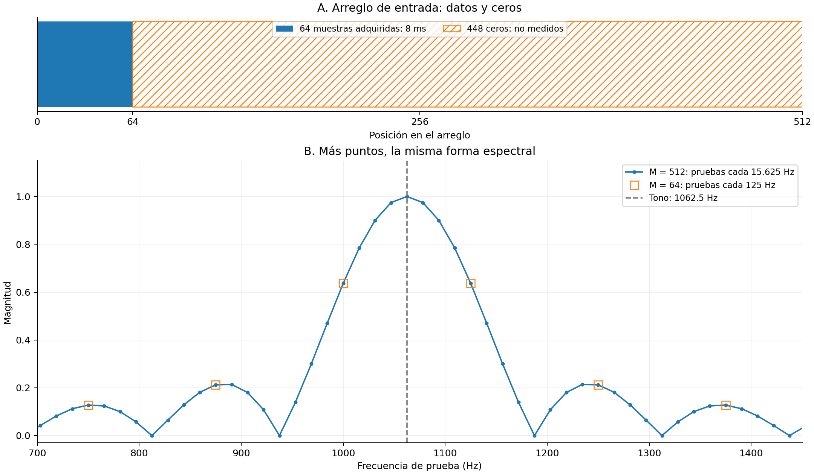

**Figura 20.** Los ceros completan el arreglo de cálculo; los puntos nuevos describen la misma forma espectral sin aumentar los 8 ms observados.

**Panel A — entrada al cálculo:**

- La barra azul representa 64 muestras adquiridas. La zona rayada representa 448 ceros añadidos, no mediciones posteriores.
- El eje cuenta posiciones del arreglo. No representa 512 instantes observados de la señal física.

**Panel B — resultado:**

- Los cuadrados naranjas muestran las pruebas originales, separadas 125 Hz. Los puntos azules añaden pruebas cada 15.625 Hz.
- Los cuadrados coinciden con puntos azules. Las muestras originales y su contribución no cambiaron.
- La prueba de 1062.5 Hz deja cero vueltas sobrantes y alcanza magnitud 1. Leer mejor ese máximo no estrecha la curva.

!!! info "Idea clave"

    El padding ayuda a leer el máximo. No añade tiempo observado, no estrecha la forma espectral y no elimina el leakage.

??? note "Para profundizar"

    - $N$ cuenta muestras adquiridas; $M$ cuenta puntos de FFT. Aquí $T_{\mathrm{obs}}=N/f_s=8$ ms y $M-N=448$.
    - La separación de pruebas es $f_s/M$: 125 Hz sin padding y 15.625 Hz con padding.
    - Los ceros no contribuyen a la suma. Para $M\geq N$:

    $$X_M[k]=\sum_{n=0}^{N-1}x[n]e^{-j2\pi kn/M},\qquad 0\leq k<M.$$

    - La referencia es $r_{k,M}[n]=e^{+j2\pi kn/M}$. La suma multiplica por su conjugado, con exponente negativo.
    - La normalización rectangular divide por $N$, no por $M$. La suma exacta del tono es 64; $64/64=1$.
    - Dividir por 512 daría 0.125 e introduciría una reducción artificial de escala.
    - Incluso un tono alineado tiene valores entre los bins originales. Un único bin no nulo no implica una forma infinitamente estrecha.
    - [`np.fft.fft(x, n=M)`](https://numpy.org/doc/stable/reference/generated/numpy.fft.fft.html) añade ceros cuando $M>N$. El ejemplo rechaza $M<N$ para no recortar datos.

**Colab — padding:** esta celda define su propio visor y sus datos.

```python
import numpy as np
import matplotlib.pyplot as plt

def espectro_bloque(x, sample_rate, ventana=None, nfft=None):
    cantidad = len(x)
    w = np.ones(cantidad) if ventana is None else np.asarray(ventana)
    longitud_fft = cantidad if nfft is None else nfft
    if len(w) != cantidad or longitud_fft < cantidad or w.sum() == 0:
        raise ValueError("La ventana debe tener N pesos de suma no nula; la FFT no debe recortar muestras")
    f = np.fft.fftshift(np.fft.fftfreq(longitud_fft, d=1 / sample_rate))
    C = np.fft.fftshift(np.fft.fft(x * w, n=longitud_fft)) / w.sum()
    return f, C

fs, N, M = 8000, 64, 512
z_off = np.exp(1j * 2 * np.pi * 1062.5 * np.arange(N) / fs)
entrada_padded = np.pad(z_off, (0, M - N))
f64, C64 = espectro_bloque(z_off, fs)
f512, C512 = espectro_bloque(z_off, fs, nfft=M)
fig, axes = plt.subplots(2, 1, figsize=(12, 7), layout="constrained", gridspec_kw={"height_ratios": [1, 3]})
axes[0].barh(0, N, height=0.5, color="tab:blue", label="64 muestras adquiridas: 8 ms")
axes[0].barh(0, M - N, left=N, height=0.5, color="white", edgecolor="tab:orange", hatch="///", label="448 ceros: no medidos")
axes[0].set(title="A. Arreglo de entrada: datos y ceros", xlabel="Posición en el arreglo", xlim=(0, M), yticks=[], xticks=[0, 64, 256, 512])
axes[0].legend(loc="upper center", ncol=2, fontsize=9)
axes[1].plot(f512, np.abs(C512), ".-", label="M = 512: pruebas cada 15.625 Hz")
axes[1].plot(f64, np.abs(C64), "s", color="tab:orange", markerfacecolor="none", markersize=9, label="M = 64: pruebas cada 125 Hz")
axes[1].axvline(1062.5, color="gray", linestyle="--", label="Tono: 1062.5 Hz")
axes[1].set(title="B. Más puntos, la misma forma espectral", xlabel="Frecuencia de prueba (Hz)", ylabel="Magnitud", xlim=(700, 1450), ylim=(-0.03, 1.15))
axes[1].grid(alpha=0.2)
axes[1].legend(fontsize=9)
print("Muestras adquiridas:", N, "; ceros:", M - N, "; tiempo observado (ms):", N / fs * 1000)
print("Los puntos originales coinciden:", np.allclose(C512[::8], C64))
plt.show()
```

#### 5.6. El problema: un tono débil junto a uno fuerte

- **Qué cambia:** se añade al tono fuerte otro tono con amplitud 100 veces menor.
- **Qué permanece fijo:** ventana rectangular, 256 muestras, $f_s=8000$ S/s y FFT de 8192 puntos. No se añade ruido.
- El fuerte está en 1007.8125 Hz y tiene amplitud 1. El débil está en 1203.125 Hz y tiene amplitud 0.01.
- **dB:** escala logarítmica. Para una magnitud $a$ respecto a 1, se calcula $20\log_{10}(a)$.

| Magnitud respecto a 1 | Valor en dB |
|---:|---:|
| 1 | 0 |
| 0.1 | −20 |
| 0.01 | −40 |
| 0.001 | −60 |

El tono fuerte aporta valores donde está el débil. Esa contribución puede impedir reconocer al débil en el espectro combinado.

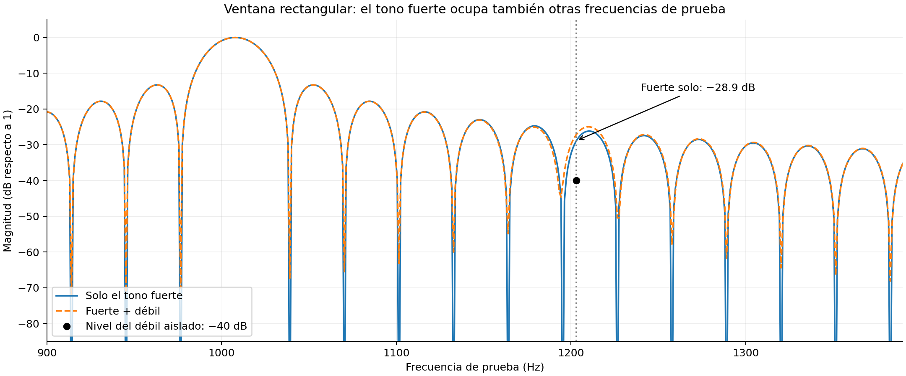

**Figura 21.** En la frecuencia del tono débil, la contribución del fuerte supera el nivel del débil aislado, aunque no se añadió ruido.

- **Ejes y curvas:** frecuencia en Hz y magnitud en dB respecto a 1. Azul: fuerte solo; naranja discontinua: ambos tonos.
- **En la línea vertical:** el fuerte aporta unos −28.9 dB. El débil aislado tendría −40 dB, marcado por el punto negro.
- **Lectura:** añadir el débil cambia la curva, pero no produce un pico aislado fácil de reconocer. Se necesita controlar la contribución del fuerte.

??? note "Para profundizar"

    - Las frecuencias están separadas $1203.125-1007.8125=195.3125$ Hz. El bloque representa $256/8000=32$ ms.
    - La contribución del fuerte aparece por el análisis de un bloque finito. No es ruido añadido ni otra señal transmitida.
    - Se mantienen fases iniciales cero. La FFT suma contribuciones complejas, no magnitudes independientes.
    - En la frecuencia marcada, ambos tonos juntos producen aproximadamente −27.1 dB, no la suma aritmética de sus valores en dB.
    - El piso de −120 dB del código evita el logaritmo de cero. No representa un piso de ruido medido.

**Colab — reconocer el problema:**

```python
import numpy as np
import matplotlib.pyplot as plt

fs, N_debil, M = 8000, 256, 8192
f_fuerte, f_debil = 1007.8125, 1203.125
t_debil = np.arange(N_debil) / fs
fuerte = np.exp(1j * 2 * np.pi * f_fuerte * t_debil)
debil = 0.01 * np.exp(1j * 2 * np.pi * f_debil * t_debil)
f = np.fft.fftshift(np.fft.fftfreq(M, 1 / fs))
C_fuerte = np.fft.fftshift(np.fft.fft(fuerte, M)) / N_debil
C_ambos = np.fft.fftshift(np.fft.fft(fuerte + debil, M)) / N_debil
def magnitud_db(C):
    return 20 * np.log10(np.maximum(np.abs(C), 1e-6))
indice_debil = np.argmin(np.abs(f - f_debil))
fig, ax = plt.subplots(figsize=(12, 5), layout="constrained")
ax.plot(f, magnitud_db(C_fuerte), label="Solo el tono fuerte")
ax.plot(f, magnitud_db(C_ambos), "--", label="Fuerte + débil")
ax.axvline(f_debil, color="gray", linestyle=":")
ax.plot([f_debil], [-40], "ko", label="Nivel del débil aislado: −40 dB")
ax.annotate("Fuerte solo: −28.9 dB", xy=(f_debil, magnitud_db(C_fuerte)[indice_debil]), xytext=(1240, -15), arrowprops={"arrowstyle": "->"})
ax.set(title="Ventana rectangular: el tono fuerte ocupa también otras frecuencias de prueba", xlabel="Frecuencia de prueba (Hz)", ylabel="Magnitud (dB respecto a 1)", xlim=(900, 1390), ylim=(-85, 5))
ax.grid(alpha=0.2)
ax.legend(loc="lower left")
print("Fuerte en la frecuencia del débil:", magnitud_db(C_fuerte)[indice_debil], "dB")
plt.show()
```

#### 5.7. La herramienta: una ventana Hann

- **Ventana:** secuencia de pesos $w[n]$ que multiplica las muestras antes del análisis: $x_w[n]=x[n]w[n]$.
- Rectangular asigna peso 1 a todas las muestras. Hann reduce principalmente los pesos próximos a los extremos del bloque.
- **Qué cambia:** los pesos. Las muestras adquiridas, sus instantes y la frecuencia del tono permanecen fijos.

Hann cambia las longitudes de las flechas antes de sumarlas. Algunas sumas lejanas se cierran mejor, pero las cercanas pueden quedar más largas.

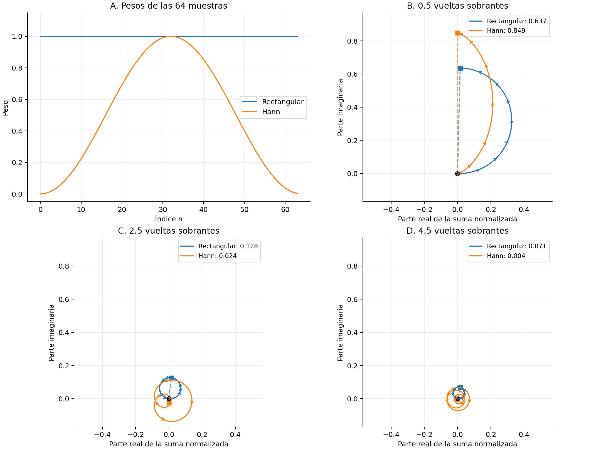

**Figura 22.** Hann cambia los pesos y las sumas: reduce estas contribuciones lejanas, pero aumenta la contribución de la prueba cercana.

**Panel A — pesos:**

- El eje horizontal indica la muestra; el vertical indica su peso. Azul: rectangular; naranja: Hann.
- Hann reduce las flechas de los extremos antes de sumar. No cambia cuándo se adquirieron las muestras.

**Panel B — 0.5 vueltas sobrantes:**

- Los recorridos suman flechas punta con cola. Cada recorrido se divide por la suma de sus pesos para comparar magnitudes.
- El punto negro marca el inicio; el cuadrado marca el final. La magnitud normalizada pasa de aproximadamente 0.637 a 0.849.

**Panel C — 2.5 vueltas sobrantes:**

- Los ejes y colores son los mismos que en B. La suma con Hann termina más cerca del inicio.
- La magnitud pasa de aproximadamente 0.128 a 0.024. La contribución de esta prueba disminuye.

**Panel D — 4.5 vueltas sobrantes:**

- La suma con Hann termina aún más cerca del inicio. Los ejes mantienen la misma escala, aunque los recorridos ocupan menos espacio.
- La magnitud pasa de aproximadamente 0.071 a 0.004. No se propone una regla de disminución para cualquier frecuencia.

**Colab — pesos y sumas:** las rectas discontinuas unen el inicio con el final de cada suma.

```python
import numpy as np
import matplotlib.pyplot as plt

N = 64
n = np.arange(N)
w_rect = np.ones(N)
w_hann = 0.5 - 0.5 * np.cos(2 * np.pi * n / N)
recorridos = {}
fig, axes = plt.subplots(2, 2, figsize=(12, 9), layout="constrained")
axes[0, 0].plot(n, w_rect, label="Rectangular")
axes[0, 0].plot(n, w_hann, label="Hann")
axes[0, 0].set(title="A. Pesos de las 64 muestras", xlabel="Índice n", ylabel="Peso", ylim=(-0.05, 1.15))
axes[0, 0].legend()
for ax, letra, vueltas in zip([axes[0, 1], axes[1, 0], axes[1, 1]], "BCD", [0.5, 2.5, 4.5]):
    for nombre, w, color in [("Rectangular", w_rect, "tab:blue"), ("Hann", w_hann, "tab:orange")]:
        flechas = w * np.exp(1j * 2 * np.pi * vueltas * n / N) / w.sum()
        p = np.r_[0j, np.cumsum(flechas)]
        recorridos[(vueltas, nombre)] = p
        ax.plot(p.real, p.imag, color=color, label=f"{nombre}: {abs(p[-1]):.3f}")
        ax.plot([0, p[-1].real], [0, p[-1].imag], "--", color=color, alpha=0.7)
        ax.plot(p[-1].real, p[-1].imag, "s", color=color)
        for k in range(0, N, 8):
            ax.annotate("", xy=(p[k + 1].real, p[k + 1].imag), xytext=(p[k].real, p[k].imag), arrowprops={"arrowstyle": "->", "color": color})
    ax.plot(0, 0, "ko")
    ax.set(title=f"{letra}. {vueltas:g} vueltas sobrantes", xlabel="Parte real de la suma normalizada", ylabel="Parte imaginaria", aspect="equal", xlim=(-0.57, 0.57), ylim=(-0.17, 0.97))
    ax.legend(fontsize=9, loc="upper right")
for ax in axes.flat:
    ax.grid(alpha=0.2)
plt.show()
```

- **Main lobe:** lóbulo principal alrededor de la frecuencia del tono. **Sidelobes:** lóbulos laterales, más alejados.
- **Qué cambia ahora:** rectangular frente a Hann sobre los mismos tonos de 5.6. Permanecen fijos bloque, FFT, amplitudes y fases.

Con Hann, la contribución del fuerte baja en la frecuencia del débil. El costo es un lóbulo principal más ancho.

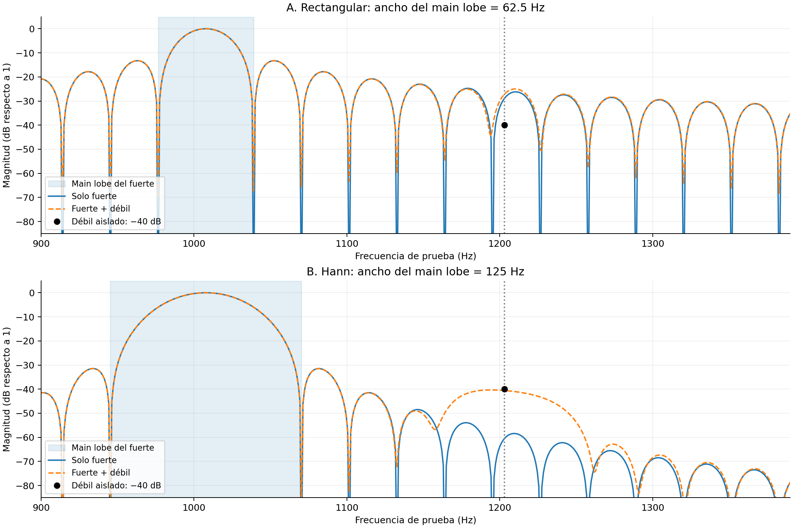

**Figura 23.** Hann permite reconocer el tono débil de este ejemplo; también ensancha el lóbulo principal del tono fuerte.

**Panel A — rectangular:**

- Los ejes muestran frecuencia y magnitud en dB. Azul: fuerte solo; naranja discontinua: ambos tonos.
- La franja azul marca el main lobe del fuerte. Los máximos menores fuera de ella son sidelobes.
- En la frecuencia del débil, el fuerte solo aporta −28.9 dB, por encima del nivel de −40 dB del débil aislado.

**Panel B — Hann:**

- Se utilizan las mismas muestras y escalas. La franja del main lobe es más ancha.
- El fuerte solo aporta aproximadamente −60.5 dB en la frecuencia del débil. La curva combinada permite reconocer su contribución.
- La curva combinada vale aproximadamente −40.6 dB en esa frecuencia. No coincide exactamente con −40 dB porque las contribuciones son complejas.

??? note "Para profundizar"

    - Hann periódica usa $w[n]=0.5-0.5\cos(2\pi n/N)$ para $0\leq n<N$.
    - Hann simétrica utiliza $N-1$ en el denominador. Son convenciones diferentes; este apartado utiliza la periódica.
    - Referencia: [ventana Hann en SciPy](https://docs.scipy.org/doc/scipy/reference/generated/scipy.signal.windows.hann.html).
    - Una evaluación en una frecuencia $f$, expresada en Hz, se escribe:

    $$S_w(f)=\sum_{n=0}^{N-1}x[n]w[n]e^{-j2\pi f n/f_s}.$$

    - La FFT evalúa esa suma en $f_k=kf_s/M$. Así, $X_w[k]=S_w(f_k)$; el eje centrado usa representantes módulo $f_s$.
    - Para un tono $x[n]=Ae^{j(2\pi f_0n/f_s+\phi)}$, la prueba exacta cancela su giro:

    $$S_w(f_0)=Ae^{j\phi}\sum_{n=0}^{N-1}w[n].$$

    - Dividir por $\sum w[n]$ conserva la magnitud $A$ en esa prueba. No deshace los pesos individuales.
    - Para $N=64$, las sumas de pesos son 64 y 32. Los anchos entre primeros ceros son 250 y 500 Hz.
    - La Figura 23 usa $N=256$: sus anchos son 62.5 Hz y 125 Hz. Las franjas corresponden a esa configuración.
    - Las frecuencias del tono no se trasladan. Si ningún punto coincide con el tono, la normalización no garantiza un máximo igual a su amplitud.
    - Las caídas profundas son ceros de la forma espectral; no demuestran canales físicos vacíos.
    - La escala compara magnitudes de tonos. No es power spectral density (PSD, densidad espectral de potencia) ni potencia calibrada en dBm.
    - Hann no evita aliasing previo ni selecciona por sí sola un canal RF. El main lobe ancho puede dificultar separar tonos muy próximos.
    - El resultado depende de separación, amplitudes, fases y ruido. Los ejemplos no añaden ruido y conservan los datos originales por separado.

**Colab — comparar ventanas en el problema del tono débil:**

```python
import numpy as np
import matplotlib.pyplot as plt

fs, N_debil, M = 8000, 256, 8192
f_fuerte, f_debil = 1007.8125, 1203.125
t_debil = np.arange(N_debil) / fs
fuerte = np.exp(1j * 2 * np.pi * f_fuerte * t_debil)
debil = 0.01 * np.exp(1j * 2 * np.pi * f_debil * t_debil)
f = np.fft.fftshift(np.fft.fftfreq(M, 1 / fs))
ventanas = [np.ones(N_debil), np.hanning(N_debil + 1)[:-1]]
def magnitud_db(C):
    return 20 * np.log10(np.maximum(np.abs(C), 1e-6))
resultados_debil = {}
fig, axes = plt.subplots(2, 1, figsize=(12, 8), layout="constrained")
for ax, letra, nombre, w, semiancho in zip(axes, "AB", ["Rectangular", "Hann"], ventanas, [fs / N_debil, 2 * fs / N_debil]):
    C_fuerte = np.fft.fftshift(np.fft.fft(fuerte * w, M)) / w.sum()
    C_ambos = np.fft.fftshift(np.fft.fft((fuerte + debil) * w, M)) / w.sum()
    resultados_debil[nombre] = (f, C_fuerte, C_ambos)
    ax.axvspan(f_fuerte - semiancho, f_fuerte + semiancho, color="tab:blue", alpha=0.12, label="Main lobe del fuerte")
    ax.plot(f, magnitud_db(C_fuerte), label="Solo fuerte")
    ax.plot(f, magnitud_db(C_ambos), "--", label="Fuerte + débil")
    ax.axvline(f_debil, color="gray", linestyle=":")
    ax.plot([f_debil], [-40], "ko", label="Débil aislado: −40 dB")
    ax.set(title=f"{letra}. {nombre}: ancho del main lobe = {2 * semiancho:g} Hz", xlabel="Frecuencia de prueba (Hz)", ylabel="Magnitud (dB respecto a 1)", xlim=(900, 1390), ylim=(-85, 5))
    ax.grid(alpha=0.2)
    ax.legend(fontsize=9, loc="lower left")
    k = np.argmin(abs(f - f_debil))
    print(nombre, ": fuerte solo / ambos (dB):", magnitud_db(C_fuerte)[k], magnitud_db(C_ambos)[k])
plt.show()
```

#### 5.8. Dos tonos cercanos: observar más tiempo

- **Qué cambia:** el bloque contiene 64, 256, 512 o 1024 muestras adquiridas, no ceros añadidos.
- **Qué permanece fijo:** tonos de 1000 y 1062.5 Hz, amplitudes 1, fases iniciales cero, $f_s=8000$ S/s, Hann y $M=16384$.
- **Qué se observa:** aumentan las vueltas sobrantes entre ambos tonos durante el bloque; sus contribuciones espectrales se estrechan.

Observar más tiempo permite separar estos tonos estables. Más puntos de FFT, por sí solos, no producen ese cambio.

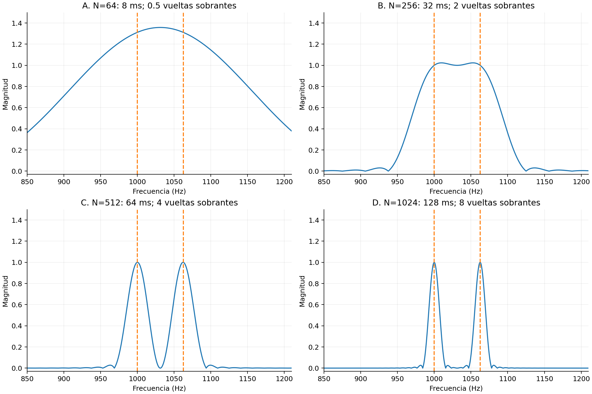

**Figura 24.** Al aumentar las muestras adquiridas, los máximos de este par se separan y se aproximan a las frecuencias conocidas.

**Panel A — 8 ms:**

- La curva azul combina ambos tonos; las líneas naranjas marcan sus frecuencias conocidas. Los ejes muestran Hz y magnitud normalizada.
- Solo aparecen 0.5 vueltas sobrantes entre tonos. El máximo combinado está en 1031.25 Hz, donde no se generó ningún tono.

**Panel B — 32 ms:**

- Hay dos vueltas sobrantes. La curva forma una meseta con una pequeña muesca central.
- Sus máximos todavía están desplazados. Contar dos máximos no basta para medir correctamente dos tonos.

**Panel C — 64 ms:**

- Hay cuatro vueltas sobrantes. Los máximos aparecen en 1000 y 1062.5 Hz en la rejilla utilizada.
- Los puntos FFT tienen la misma separación que en A y B. La diferencia procede del bloque adquirido.

**Panel D — 128 ms:**

- Hay ocho vueltas sobrantes. Los máximos permanecen en las frecuencias conocidas y sus contribuciones son más estrechas.
- Esta comparación supone tonos estables. Una señal cambiante puede requerir bloques más cortos para observar sus cambios.

??? note "Para profundizar"

    - La separación física es $\Delta f=62.5$ Hz. Las vueltas sobrantes se calculan como $\Delta f\,N/f_s$.
    - Todas las FFT utilizan $M=16384$ y separación $8000/16384=0.48828125$ Hz.
    - Para Hann y un tono aislado, el ancho entre primeros ceros es $4f_s/N$.
    - Ese ancho pasa por 500, 125, 62.5 y 31.25 Hz. No es una garantía universal de separación.
    - Resolución significa aquí capacidad de distinguir componentes próximas. También depende de amplitudes, fases, ruido, ventana y criterio de separación.
    - En B, los máximos de esta rejilla están en 1009.765625 y 1052.734375 Hz. No coinciden con los tonos originales.
    - Las contribuciones se suman como números complejos. Las fases pueden desplazar máximos sin cambiar las frecuencias generadas.
    - El ejemplo no necesita una envolvente temporal: un tramo sin puntos no significaría que la señal se apaga.

**Colab — cuatro duraciones con la misma rejilla:**

```python
import numpy as np
import matplotlib.pyplot as plt

fs, M = 8000, 16384
frecuencias_par = [1000, 1062.5]
resultados_duracion = {}
fig, axes = plt.subplots(2, 2, figsize=(12, 8), layout="constrained")
for ax, letra, cantidad in zip(axes.flat, "ABCD", [64, 256, 512, 1024]):
    tk = np.arange(cantidad) / fs
    zk = np.exp(1j * 2 * np.pi * frecuencias_par[0] * tk) + np.exp(1j * 2 * np.pi * frecuencias_par[1] * tk)
    wk = np.hanning(cantidad + 1)[:-1]
    fk = np.fft.fftshift(np.fft.fftfreq(M, 1 / fs))
    Ck = np.fft.fftshift(np.fft.fft(zk * wk, M)) / wk.sum()
    resultados_duracion[cantidad] = (fk, Ck)
    vueltas = (frecuencias_par[1] - frecuencias_par[0]) * cantidad / fs
    ax.plot(fk, np.abs(Ck), label="Suma de ambos tonos")
    for frecuencia in frecuencias_par:
        ax.axvline(frecuencia, color="tab:orange", linestyle="--")
    ax.set(title=f"{letra}. N={cantidad}: {1000 * cantidad / fs:g} ms; {vueltas:g} vueltas sobrantes", xlabel="Frecuencia (Hz)", ylabel="Magnitud", xlim=(850, 1210), ylim=(-0.03, 1.5))
    ax.grid(alpha=0.2)
    print("N:", cantidad, "; vueltas sobrantes:", vueltas)
plt.show()
```

#### 5.9. Un pico limpio también puede ser un alias

- **Qué se compara:** dos tonos originales, +5 y −3 kHz, muestreados a 8 kS/s.
- **Qué permanece fijo:** 64 muestras, amplitud 1, fase inicial cero y ventana rectangular.
- **Qué se observa:** producen la misma secuencia y la misma FFT, aunque sus frecuencias originales sean distintas.

Una FFT con un pico limpio no demuestra que la adquisición esté libre de aliasing.

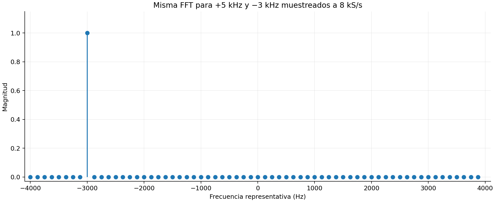

**Figura 25.** Los tonos de +5 y −3 kHz producen este mismo pico al muestrear a 8 kS/s; la FFT no distingue su origen.

- **Ejes:** frecuencia representativa en Hz y magnitud. El pico está en −3 kHz, alineado con un bin.
- **Equivalencia:** $5000-8000=-3000$ Hz. Las muestras coinciden, como en la sección 4.
- **Límite:** añadir ceros o cambiar la ventana no permite elegir entre ambos orígenes.

| Situación | Qué puede ocurrir | Acción útil |
|---|---|---|
| Un pico limpio | Puede ser un alias. | Revisar banda de entrada, filtrado y sampling rate de adquisición. |
| Varias barras de un tono conocido | Puede ser leakage, como en la Figura 19. | Revisar duración, rejilla y ventana. |

??? note "Para profundizar"

    - Aliasing y leakage pueden coexistir. La forma de una captura desconocida no permite separarlos automáticamente.
    - El aliasing se previene antes de perder la distinción entre componentes: banda, filtrado previo y tasa adecuados.
    - El padding muestra más puntos del leakage. La ventana y el tiempo observado cambian su forma, con los compromisos anteriores.
    - Varios bins no cuentan transmisores; un único pico tampoco certifica una adquisición correcta.

**Colab — comprobar ambas secuencias:**

```python
import numpy as np
import matplotlib.pyplot as plt

fs, N = 8000, 64
n = np.arange(N)
z5 = np.exp(1j * 2 * np.pi * 5000 * n / fs)
zm3 = np.exp(-1j * 2 * np.pi * 3000 * n / fs)
f = np.fft.fftshift(np.fft.fftfreq(N, 1 / fs))
C_alias = np.fft.fftshift(np.fft.fft(z5)) / N
fig, ax = plt.subplots(figsize=(11, 4.5), layout="constrained")
ax.stem(f, np.abs(C_alias), basefmt=" ")
ax.set(title="Misma FFT para +5 kHz y −3 kHz muestreados a 8 kS/s", xlabel="Frecuencia representativa (Hz)", ylabel="Magnitud", xlim=(-4100, 4100), ylim=(-0.03, 1.15))
ax.grid(alpha=0.2)
print("Mismas muestras:", np.allclose(z5, zm3))
plt.show()
```

#### 5.10. Guía para leer un espectro

| Control | Qué cambia | Qué no cambia | Figura |
|---|---|---|---|
| $M$: puntos de FFT | Densidad de pruebas. | Muestras adquiridas y tiempo observado. | [20](figures/fft-zero-padding.png) |
| Ventana | Pesos y forma espectral. | Instantes adquiridos. | [22](figures/fft-ventanas.png) y [23](figures/fft-tono-debil.png) |
| $N$: muestras adquiridas | Tiempo observado, con $f_s$ fijo. | Frecuencias de los tonos estables del ejemplo. | [24](figures/fft-duracion-resolucion.png) |

1. ¿Qué sampling rate corresponde a las muestras analizadas?
2. ¿Cuánto tiempo se observó realmente: $N/f_s$?
3. ¿Cuál es la separación de pruebas: $f_s/M$?
4. ¿Qué ventana y referencia utiliza la escala vertical?
5. ¿Los máximos pueden combinar contribuciones, como en la Figura 24?
6. ¿Qué se conoce de la adquisición para descartar aliasing, como en la Figura 25?

- **Ejemplo SDR:** 4096 muestras a 2.4 MS/s representan aproximadamente 1.707 ms. Con $M=4096$, las pruebas están separadas 585.9375 Hz.
- La FFT describe el bloque recibido. La sección 6 añadirá los metadatos RF, el promedio y los cambios temporales de una captura real.

??? note "Para profundizar"

    - La Nyquist frequency de ese ejemplo SDR es $f_s/2=1.2$ MHz. No es la separación de bins.
    - Un máximo de 0 dB respecto a 1 no significa 0 dBm. La referencia debe indicarse antes de comparar alturas.
    - Los índices de salida no son frecuencias en Hz. La Figura 18 muestra cómo ordenar y etiquetar los mismos coeficientes.
    - Las Figuras 19 y 24 muestran por qué contar barras o máximos no siempre permite contar tonos.
    - Los experimentos de sección 5 usan señales sintéticas sin ruido añadido. No incluyen calibración de potencia RF.

#### 5.11. Ejercicios de refuerzo

- Cada ejercicio utiliza los conceptos y las figuras del apartado correspondiente.
- Las soluciones separan los datos, el cálculo y la interpretación.

##### Ejercicio 5A — Separar datos adquiridos y puntos de FFT

- Un bloque contiene $N=960$ muestras a $f_s=48000$ S/s. Se comparan FFT de $M=960$ y $M=3840$ puntos.
- Calcular tiempo observado, ceros añadidos, separación entre puntos y Nyquist frequency.
- ¿La segunda FFT representa una observación de 80 ms? ¿Cómo cambiaría la Figura 20?

??? example "Solución del ejercicio 5A"

    - **Punto de partida:** el apartado 5.5 distingue $N$ de $M$. Las fórmulas son $T_{\mathrm{obs}}=N/f_s$, ceros $=M-N$ y $\Delta f_{\mathrm{FFT}}=f_s/M$.
    - **Datos:** $N=960$, $f_s=48000$ S/s y longitudes de FFT de 960 y 3840. Las muestras adquiridas son las mismas.
    - **Paso 1 — duración:** $T_{\mathrm{obs}}=960/48000=0.020$ s, equivalentes a 20 ms. El tiempo observado permanece fijo.
    - **Paso 2 — ceros:** la primera FFT no añade ceros. La segunda añade $3840-960=2880$ ceros.
    - **Interpretación de los ceros:** son posiciones de cálculo, no mediciones posteriores. Tampoco demuestran que la señal desapareciera después de 20 ms.
    - **Paso 3 — separación:** sin padding, $48000/960=50$ Hz. Con padding, $48000/3840=12.5$ Hz.
    - **Paso 4 — descartar 80 ms:** $3840/48000=0.080$ s requeriría 3840 muestras adquiridas. Aquí solo se adquirieron 960.
    - **Paso 5 — Nyquist:** $f_s/2=24000$ Hz, es decir, 24 kHz. El intervalo nominal centrado sigue siendo $[-24,+24)$ kHz.
    - **Lectura de la figura:** el panel A mostraría 960 datos y 2880 ceros. El panel B compararía puntos separados 50 y 12.5 Hz.
    - **Conclusión:** los puntos quedan cuatro veces más juntos. No aumentan los 20 ms observados ni se estrecha la forma espectral.

##### Ejercicio 5B — Distinguir un tono alineado de otro entre bins

- Se analizan por separado tonos de 1125 y 1100 Hz, con magnitud 1 y fase inicial cero.
- Se utilizan 64 muestras a 8 kS/s, ventana rectangular y FFT sin padding.
- ¿Cuál coincide con un bin? Para el tono de 1100 Hz, calcular las vueltas sobrantes al probar 1125 y 1000 Hz.
- Comparar con las Figuras 16 y 19. ¿El máximo de la FFT cambia la frecuencia generada?

??? example "Solución del ejercicio 5B"

    - **Punto de partida:** los apartados 5.3 y 5.4 usan $f_k=kf_s/N$ y vueltas sobrantes $=(f_0-f_k)N/f_s$.
    - **Datos:** $N=64$, $f_s=8000$ S/s, rectangular y amplitud 1. La normalización divide la suma entre 64.
    - **Paso 1 — duración y rejilla:** $T=64/8000=0.008$ s. Las pruebas están separadas $8000/64=125$ Hz.
    - **Paso 2 — tono alineado:** $1125/125=9$. La prueba del bin 9 deja cero vueltas sobrantes y suma 64 flechas iguales.
    - **Resultado alineado:** su barra mide $64/64=1$; las otras se cancelan, salvo redondeo numérico. Es el comportamiento de la Figura 16.
    - **Paso 3 — tono intermedio:** $1100/125=8.8$ no es entero. No hay una prueba exactamente en 1100 Hz, como ocurre en la Figura 19.
    - **Paso 4 — probar 1125 Hz:** $(1100-1125)(0.008)=-0.2$ vueltas sobrantes. La magnitud normalizada de la suma es aproximadamente 0.936.
    - **Paso 5 — probar 1000 Hz:** $(1100-1000)(0.008)=+0.8$ vueltas sobrantes. La magnitud es aproximadamente 0.234.
    - **Interpretación:** en este caso gana la prueba de 1125 Hz. El tono generado sigue siendo de 1100 Hz.
    - **Límite:** no existe una regla universal de altura basada solo en cercanía. La ventana, los lóbulos y otras componentes también influyen.

##### Ejercicio 5C — Elegir una modificación del análisis

- Comparar las Figuras 20, 23 y 24.
- ¿Qué modificación dibuja más puntos? ¿Cuál reduce la contribución lejana del fuerte? ¿Cuál permite separar el par estable del ejemplo?
- Indicar qué cambia, qué permanece fijo y qué límite conserva cada elección.

??? example "Solución del ejercicio 5C"

    - **Punto de partida:** los apartados 5.5, 5.7 y 5.8 distinguen puntos $M$, pesos $w[n]$ y muestras adquiridas $N$.
    - **Paso 1 — más puntos:** la Figura 20 cambia $M$ de 64 a 512. Conserva $N=64$, $f_s=8000$ S/s y rectangular.
    - **Cálculo del padding:** el tiempo sigue siendo $64/8000=8$ ms. La separación pasa de 125 a 15.625 Hz.
    - **Límite del padding:** el panel B añade puntos sobre la misma forma. No adquiere datos ni estrecha sus lóbulos.
    - **Paso 2 — contribuciones lejanas:** la Figura 23 cambia rectangular por Hann. Conserva los dos tonos, $N=256$, $f_s=8000$ S/s y $M=8192$.
    - **Operación:** se analiza $x[n]w[n]$ y se divide la FFT entre $\sum w[n]$ para comparar magnitudes.
    - **Límite de Hann:** baja la contribución del fuerte en la frecuencia del débil, pero ensancha el main lobe. No garantiza separar tonos más próximos.
    - **Paso 3 — más observación:** la Figura 24 cambia $N$ entre 64, 256, 512 y 1024. Conserva tonos, Hann, sampling rate y $M=16384$.
    - **Cálculo temporal:** los bloques representan 8, 32, 64 y 128 ms. Todos los espectros tienen separación $8000/16384=0.48828125$ Hz.
    - **Lectura:** los paneles C y D sitúan los máximos en las frecuencias conocidas. La mejora no procede del número de puntos, que permanece fijo.
    - **Límite temporal:** una observación larga puede combinar estados diferentes si la señal cambia. La elección depende de la pregunta del análisis.

##### Ejercicio 5D — Desafío opcional: recuperar el bloque analizado

- Se conserva $x[n]$ y se calcula $X_w[k]=\operatorname{DFT}\{x[n]w[n]\}$ con Hann, sin normalización ni reordenamiento.
- ¿Qué recupera su inversa? ¿Basta guardar $|X_w[k]|$? ¿Corregir la normalización deshace la ventana?
- La Figura 22 muestra los pesos. La Figura 8 compara señales con iguales magnitudes espectrales y distintas fases.

??? example "Solución del ejercicio 5D"

    - **Punto de partida:** el apartado 5.7 define $x_w[n]=x[n]w[n]$. El apartado 3.5 explica que la inversa recupera el bloque entregado a la DFT.
    - **Datos:** $X_w[k]$ contiene coeficientes complejos completos, en orden original y sin normalización adicional.
    - **Paso 1 — entrada:** la transformada recibió $x_w[n]$, no $x[n]$. Por tanto, $\operatorname{IDFT}\{X_w[k]\}=x[n]w[n]$.
    - **Resultado:** la inversa recupera $x[n]w[n]$. La multiplicación por la ventana ya modificó los valores originales.
    - **Paso 2 — fase:** $X_w[k]=|X_w[k]|e^{j\psi_k}$. Guardar solo magnitudes elimina $\psi_k$ y no permite determinar el bloque original.
    - **Ejemplo:** la Figura 8 muestra señales distintas con iguales magnitudes. Una inversa de magnitudes asignaría fase cero a los coeficientes.
    - **Paso 3 — escala:** si $C_w[k]=X_w[k]/\sum w[n]$, multiplicar por $\sum w[n]$ recupera $X_w[k]$, no $x[n]$.
    - **Comprobación:** la inversa de $C_w[k]$ es $x[n]w[n]/\sum w[n]$. Corregir esa escala deja los pesos individuales presentes.
    - **Paso 4 — orden:** si el visor aplicó `fftshift`, primero se aplica `np.fft.ifftshift(C)`. La inversa espera el orden original.
    - **Paso 5 — muestra perdida:** Hann tiene $w[0]=0$. El producto $x[0]w[0]=0$ no permite conocer qué valor tenía $x[0]$.
    - **Límite:** dividir por cero no recupera esa muestra. Dividir por pesos pequeños también puede amplificar errores numéricos.
    - **Conclusión:** se conservan las muestras originales y sus metadatos. La transformada completa conserva el bloque con ventana, no deshace la ventana previa.

##### Ejercicio 5E — Ordenar tres pruebas mediante vueltas sobrantes

- Un tono de 2030 Hz tiene amplitud 1 y fase inicial cero. Se toman 100 muestras a 10 kS/s con ventana rectangular.
- Calcular las vueltas sobrantes para pruebas de 2000, 2100 y 2500 Hz.
- Ordenar las tres barras y comprobar sus magnitudes con una suma compleja.

??? example "Solución del ejercicio 5E"

    - **Punto de partida:** el apartado 5.4 relaciona las barras con $|\sum x[n]e^{-j2\pi f_{\mathrm{prueba}}n/f_s}|/N$ y las vueltas sobrantes.
    - **Datos:** $f_0=2030$ Hz, $N=100$, $f_s=10000$ S/s y rectangular. El tiempo observado es $100/10000=0.01$ s.
    - **Paso 1 — prueba de 2000 Hz:** $(2030-2000)(0.01)=+0.3$ vueltas sobrantes.
    - **Paso 2 — prueba de 2100 Hz:** $(2030-2100)(0.01)=-0.7$ vueltas sobrantes.
    - **Paso 3 — prueba de 2500 Hz:** $(2030-2500)(0.01)=-4.7$ vueltas sobrantes.
    - **Paso 4 — verificar las sumas:** las magnitudes normalizadas son aproximadamente 0.858406, 0.367913 y 0.054991, respectivamente.
    - **Resultado:** la barra de 2000 Hz supera a la de 2100 Hz; ambas superan a la de 2500 Hz.
    - **Interpretación:** esos valores describen estas tres pruebas. No convierten la cercanía en una regla universal para cualquier ventana o conjunto de tonos.

??? note "Comprobar el ejercicio 5E con Python"

    ```python
    import numpy as np
    fs, N, f0 = 10000, 100, 2030
    n = np.arange(N)
    x = np.exp(1j * 2 * np.pi * f0 * n / fs)
    for prueba in [2000, 2100, 2500]:
        suma = np.sum(x * np.exp(-1j * 2 * np.pi * prueba * n / fs))
        print(prueba, (f0 - prueba) * N / fs, abs(suma) / N)
    ```

### 6. Leer una captura SDR real

- La grabación oficial contiene muestras I/Q de una banda de radio, no una lista de emisoras.
- Esta sección relaciona las muestras con RF, observa sus cambios y prepara la demodulación FM del laboratorio.
- Los ejemplos usan `fm_99p1MHz_2p4Msps_g30.cu8`. La demostración del giro usa una señal sintética conocida.

#### 6.1. ¿Qué frecuencia de radio representa cada punto?

- **Referencia:** $f_c=99.1$ MHz identifica la frecuencia RF que corresponde al cero de baseband.
- **Sampling rate:** $f_s=2.4$ MS/s indica cuántas muestras complejas se adquirieron por segundo.
- **Formato CU8:** cada muestra ocupa dos bytes sin signo: primero I y después Q.
- **Metadatos:** CU8 no guarda por sí solo $f_s$, $f_c$ ni el orden I/Q. Esos datos acompañan al archivo.

El cero de este eje representa 99.1 MHz de radio, no 0 Hz de radio.

$$
f_{\mathrm{RF}}=f_c+f_{\mathrm{BB}},\qquad f_{\mathrm{BB}}=f_{\mathrm{RF}}-f_c.
$$

| Posición en baseband | Cálculo | Etiqueta RF |
|---:|---|---:|
| −1 MHz | $99.1-1$ MHz | 98.1 MHz |
| 0 Hz | $99.1+0$ MHz | 99.1 MHz |
| +1 MHz | $99.1+1$ MHz | 100.1 MHz |

- Una frecuencia negativa indica una posición a la izquierda del centro. No indica una RF física negativa.
- El intervalo nominal es $[-f_s/2,+f_s/2)$: aquí, $[-1.2,+1.2)$ MHz en baseband y $[97.9,100.3)$ MHz en RF.
- El extremo derecho no se incluye. El intervalo nominal no garantiza una respuesta plana del receptor.
- Cambiar `Center Frequency` del visor cambia etiquetas; no transforma las muestras del archivo ni sintoniza el receptor.

??? note "Para profundizar"

    - Los 2.4 MS/s corresponden a las muestras I/Q de salida del receptor, después de la conversión de frecuencia.
    - La FFT no puede descubrir $f_c$ sin información adicional.
    - La interpretación supone una captura sin inversión espectral y una banda correctamente seleccionada, sin superposición por aliasing.
    - Los errores de sintonía y calibración pueden desplazar las posiciones medidas respecto a las nominales.
    - Una conexión de control al hardware sería una acción adicional; no es el efecto de reetiquetar el visor.
    - Referencias: [I/Q en GNU Radio](https://wiki.gnuradio.org/index.php/IQ_Complex_Tutorial) y [Frequency Sink](https://wiki.gnuradio.org/index.php/QT_GUI_Frequency_Sink).

#### 6.2. ¿Por qué cambia el espectro entre bloques?

- **Qué cambia:** se compara un bloque con el promedio de 200 bloques consecutivos.
- **Qué permanece fijo:** captura, ventana Hann, 4096 muestras por bloque y escalas de los paneles.
- **Qué se observa:** el promedio reduce la variación entre bloques; no estrecha los detalles que cada bloque puede distinguir.
- Cada bloque representa unos 1.707 ms. Los 200 bloques representan unos 341.333 ms.
- Se promedia la potencia lineal: primero $|X[k]|^2$, después el promedio y finalmente la conversión a dB.

Un bloque muestra un instante breve. El promedio permite comparar la potencia observada durante varios bloques.

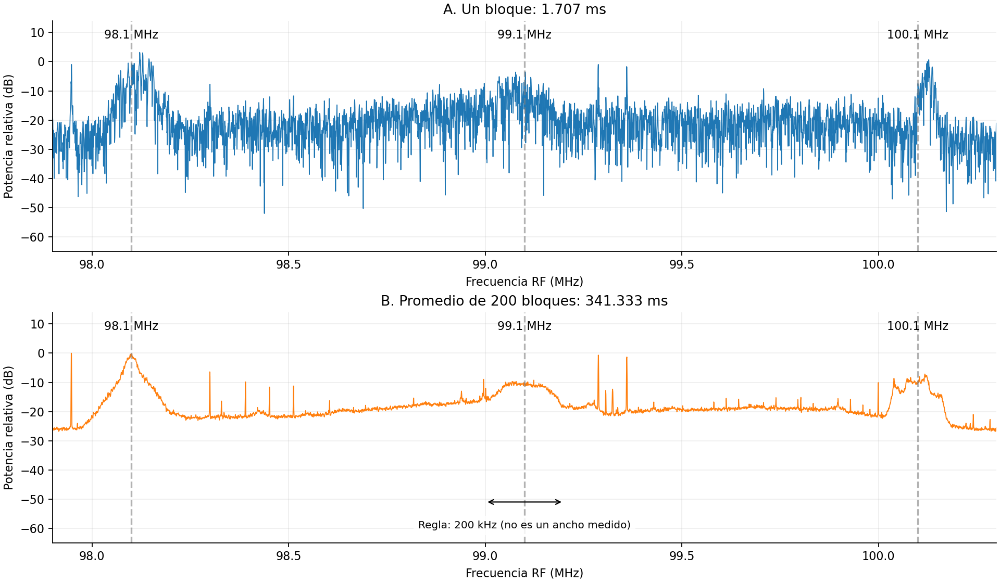

**Figura 26.** El promedio muestra con menos variación las bandas de la captura; ambos paneles usan bloques del mismo tamaño.

**Panel A — un bloque:**

- El eje horizontal muestra RF en MHz. El eje vertical muestra potencia relativa en dB, sin calibración en dBm.
- La curva azul corresponde a las primeras 4096 muestras. Sus irregularidades no significan que cada pico sea una emisora distinta.
- Las líneas señalan 98.1, 99.1 y 100.1 MHz. Esas referencias no cambian entre paneles.

**Panel B — promedio:**

- La curva naranja promedia 200 estimaciones de potencia. Los paneles comparten referencia y límites verticales.
- Se observan bandas alrededor de las tres referencias. La marca negra de 200 kHz sirve como regla visual, no como ancho medido.
- La separación entre bins sigue siendo $2400000/4096=585.9375$ Hz. Promediar no añade muestras a cada bloque.

??? note "Para profundizar"

    - La potencia relativa se calcula como $10\log_{10}(P/P_{\mathrm{ref}})$, con una referencia común a los dos paneles.
    - Aquí $P_{\mathrm{ref}}$ es el máximo del promedio. Un bloque individual puede superar 0 dB respecto a esa referencia.
    - La escala no es potencia calibrada en dBm ni una densidad espectral expresada por Hz.
    - Promediar coeficientes complejos puede cancelar fases. Promediar dB tampoco equivale a promediar potencia lineal.
    - El promedio puede ocultar señales breves. El waterfall del apartado siguiente conserva información sobre cuándo aparece la potencia.
    - La normalización es fija: $|\mathrm{FFT}(xw)|^2/(\sum w)^2$. No se normaliza cada bloque por su propio máximo.
    - Referencia: [estimación mediante periodogramas promediados, SciPy](https://docs.scipy.org/doc/scipy/reference/generated/scipy.signal.welch.html).

**Colab:** el archivo se sube al directorio del notebook. Esta celda funciona sin ejecutar los apartados anteriores.

```python
from pathlib import Path
import numpy as np
import matplotlib.pyplot as plt

ruta = Path(globals().get("ruta_captura", "fm_99p1MHz_2p4Msps_g30.cu8"))
fs, fc, N, bloques = 2400000, 99100000, 4096, 200
if not ruta.is_file():
    raise FileNotFoundError(f"Falta la grabación: {ruta}")
if ruta.stat().st_size % 2:
    raise ValueError("El archivo CU8 debe contener pares completos I/Q")
raw = np.fromfile(ruta, dtype=np.uint8, count=2 * N * bloques)
if raw.size != 2 * N * bloques:
    raise ValueError("Se necesitan 200 bloques completos de 4096 muestras I/Q")
v = (raw.astype(np.float32) - 127.5) / 127.5
z = (v[0::2] + 1j * v[1::2]).reshape(bloques, N)
w = 0.5 - 0.5 * np.cos(2 * np.pi * np.arange(N) / N)
P = np.abs(np.fft.fftshift(np.fft.fft(z * w, axis=1), axes=1)) ** 2 / w.sum() ** 2
promedio = P.mean(axis=0)
referencia = max(promedio.max(), np.finfo(float).tiny)
db = 10 * np.log10(np.maximum(np.vstack([P[0], promedio]) / referencia, 1e-12))
f_rf = (fc + np.fft.fftshift(np.fft.fftfreq(N, 1 / fs))) / 1e6
fig, axes = plt.subplots(2, 1, figsize=(12, 7), layout="constrained")
for ax, valores, color, titulo in zip(axes, db, ["tab:blue", "tab:orange"], ["A. Un bloque: 1.707 ms", "B. Promedio de 200 bloques: 341.333 ms"]):
    ax.plot(f_rf, valores, color=color, linewidth=0.8)
    for frecuencia in [98.1, 99.1, 100.1]:
        ax.axvline(frecuencia, color="gray", linestyle="--", alpha=0.6)
        ax.text(frecuencia, 8, f"{frecuencia:.1f} MHz", ha="center")
    ax.set(title=titulo, xlabel="Frecuencia RF (MHz)", ylabel="Potencia relativa (dB)", xlim=(97.9, 100.3), ylim=(-65, 14))
    ax.grid(alpha=0.2)
axes[1].annotate("", xy=(99.2, -51), xytext=(99.0, -51), arrowprops={"arrowstyle": "<->", "color": "black"})
axes[1].text(99.1, -60, "Regla: 200 kHz (no es un ancho medido)", ha="center", fontsize=9, bbox={"facecolor": "white", "alpha": 0.85, "edgecolor": "none"})
print("Duración por bloque (ms):", 1000 * N / fs, "; separación de bins (Hz):", fs / N)
plt.show()
```

#### 6.3. ¿Qué cambia y qué permanece durante la captura?

- **Waterfall:** vista que apila espectros en el tiempo. El color indica la potencia en cada posición.
- **Qué cambia:** el tramo temporal de la grabación que representa cada fila.
- **Qué permanece fijo:** ventana Hann, 4096 muestras por bloque y escala de color.
- Cada fila promedia diez bloques consecutivos. Se muestran 585 filas, que cubren 9.984 s.

El waterfall muestra dónde aparece potencia y cómo cambia durante la grabación.

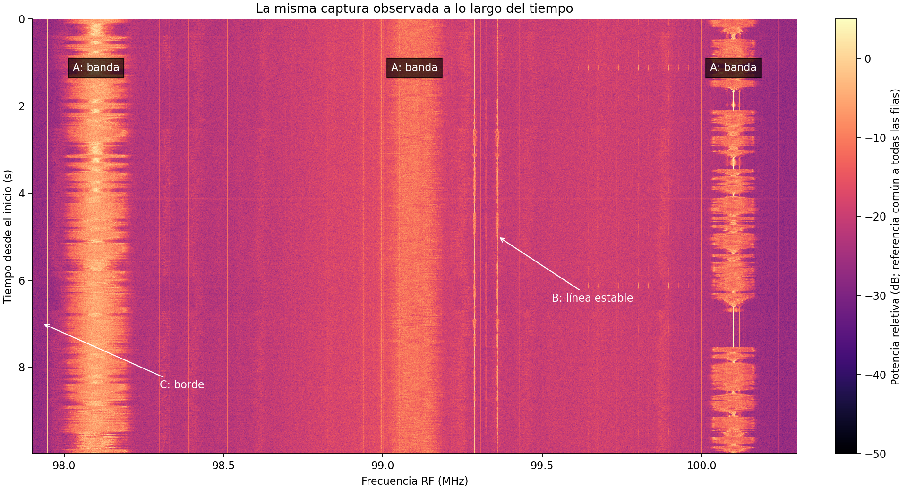

**Figura 27.** El waterfall separa los cambios temporales de las bandas, las líneas estrechas estables y la atenuación observada en los bordes.

- **Ejes y color:** RF aumenta hacia la derecha; el tiempo avanza hacia abajo. El color claro representa mayor potencia según la barra lateral.
- **Marcas A y B:** A señala bandas anchas; B señala una línea estrecha estable. La forma de B no basta para identificar su origen.
- **Marca C:** el borde tiene menor potencia en esta vista. La figura no demuestra qué etapa del receptor produce esa diferencia.

??? note "Para profundizar"

    - Una línea estrecha puede corresponder a una portadora, una interferencia o un artefacto del receptor.
    - Una banda ancha tampoco demuestra por sí sola qué modulación utiliza.
    - Una prueba adicional de demodulación detectó un componente próximo a 19 kHz en las tres bandas señaladas.
    - Ese resultado respalda la presencia de un piloto estéreo. No identifica nombres de emisoras ni demuestra una decodificación estéreo completa.
    - Referencia del piloto: [ITU-R BS.450-3, apartado 2.2.2.3](https://www.itu.int/dms_pubrec/itu-r/rec/bs/R-REC-BS.450-3-200111-S%21%21PDF-E.pdf).
    - Cada fila cubre $10(4096)/2400000\approx17.067$ ms. No hay huecos entre las filas utilizadas.
    - Se omiten los últimos 0.016 s, porque no completan otra fila. El eje termina en 9.984 s.
    - La actualización de una pantalla GNU Radio no equivale necesariamente a este agrupamiento temporal calculado desde el archivo.

**Colab — waterfall independiente:** la celda lee bloques pequeños para no transformar toda la captura de una sola vez.

```python
from pathlib import Path
import numpy as np
import matplotlib.pyplot as plt

ruta = Path(globals().get("ruta_captura", "fm_99p1MHz_2p4Msps_g30.cu8"))
fs, fc, N, por_fila = 2400000, 99100000, 4096, 10
if not ruta.is_file():
    raise FileNotFoundError(f"Falta la grabación: {ruta}")
if ruta.stat().st_size % 2:
    raise ValueError("El archivo CU8 debe contener pares completos I/Q")
filas = min(ruta.stat().st_size // (2 * N * por_fila), 585)
if filas < 1:
    raise ValueError("Se necesitan diez bloques completos de 4096 muestras I/Q")
w = 0.5 - 0.5 * np.cos(2 * np.pi * np.arange(N) / N)
potencia = np.empty((filas, N))
with ruta.open("rb") as archivo:
    for fila in range(filas):
        raw = np.fromfile(archivo, dtype=np.uint8, count=2 * N * por_fila)
        v = (raw.astype(np.float32) - 127.5) / 127.5
        z = (v[0::2] + 1j * v[1::2]).reshape(por_fila, N)
        P = np.abs(np.fft.fftshift(np.fft.fft(z * w, axis=1), axes=1)) ** 2 / w.sum() ** 2
        potencia[fila] = P.mean(axis=0)
referencia = max(potencia.mean(axis=0).max(), np.finfo(float).tiny)
db = 10 * np.log10(np.maximum(potencia / referencia, 1e-12))
f_rf = (fc + np.fft.fftshift(np.fft.fftfreq(N, 1 / fs))) / 1e6
paso_f = fs / N / 1e6
tiempo_bordes = np.arange(filas + 1) * por_fila * N / fs
frecuencia_bordes = np.r_[f_rf - paso_f / 2, f_rf[-1] + paso_f / 2]
fig, ax = plt.subplots(figsize=(12, 6.5), layout="constrained")
imagen = ax.pcolormesh(frecuencia_bordes, tiempo_bordes, db, cmap="magma", vmin=-50, vmax=5, shading="flat", rasterized=True)
ax.set(title="La misma captura observada a lo largo del tiempo", xlabel="Frecuencia RF (MHz)", ylabel="Tiempo desde el inicio (s)", xlim=(97.9, 100.3), ylim=(tiempo_bordes[-1], 0))
for frecuencia in [98.1, 99.1, 100.1]:
    ax.text(frecuencia, tiempo_bordes[-1] * 0.12, "A: banda", color="white", ha="center", bbox={"facecolor": "black", "alpha": 0.65})
ax.annotate("B: línea estable", xy=(99.36, tiempo_bordes[-1] * 0.5), xytext=(99.53, tiempo_bordes[-1] * 0.65), color="white", arrowprops={"arrowstyle": "->", "color": "white"})
ax.annotate("C: borde", xy=(97.93, tiempo_bordes[-1] * 0.7), xytext=(98.3, tiempo_bordes[-1] * 0.85), color="white", arrowprops={"arrowstyle": "->", "color": "white"})
fig.colorbar(imagen, ax=ax, label="Potencia relativa (dB; referencia común a todas las filas)")
print("Filas:", filas, "; segundos mostrados:", tiempo_bordes[-1])
plt.show()
```

#### 6.4. ¿Cuánta banda necesita conservar el receptor?

- La Figura 26 muestra bandas, no tonos aislados. La marca de 200 kHz permite comparar tamaños, pero no mide automáticamente su ancho.
- El ancho observado depende del contenido transmitido, el ruido y el criterio elegido para marcar sus límites.
- El laboratorio filtra la banda central antes de reducir el sampling rate. Así evita superponer las otras bandas al canal deseado.

$$
f_{s,\mathrm{canal}}=2400000\frac{2}{25}=192000\ \mathrm{S/s}.
$$

- Las muestras complejas resultantes representan el intervalo nominal $[-96,+96)$ kHz.
- Esta cadena didáctica permite escuchar audio mono. No garantiza conservar toda emisión FM completa y sin distorsión.
- El diseño del filtro y la selección de una banda fuera del centro se estudiarán en S03 y S04.

??? note "Para profundizar"

    - El Rational Resampler combina filtrado y cambio de tasa; no se limita a retirar muestras.
    - Con los parámetros predeterminados utilizados, el diseño nominal conserva aproximadamente hasta ±76.8 kHz antes de la transición hacia ±96 kHz.
    - Esos límites describen el diseño, no un filtro ideal con un salto abrupto.
    - Los 192 kHz nominales no contienen necesariamente toda la energía de una emisión cuyo ancho sea mayor.
    - Dividir 2.4 MHz entre 200 kHz no predice cuántas emisoras se recibirán. También importan separaciones, filtros y señales presentes.
    - Referencia: [diseño del Rational Resampler](https://raw.githubusercontent.com/gnuradio/gnuradio/v3.10.12.0/gr-filter/lib/rational_resampler_impl.cc).

#### 6.5. ¿Cómo permite FM recuperar el audio?

- **FM, frequency modulation:** el mensaje modifica la frecuencia instantánea; en el plano I/Q, modifica el avance de fase entre muestras.
- **Qué cambia:** un mensaje sinusoidal controla el giro de una señal sintética.
- **Qué permanece fijo:** amplitud 1, sampling rate de 48 kS/s y desviación máxima de 6 kHz.
- **Qué se observa:** medir el giro y aplicar la escala conocida recupera el mensaje utilizado para generar las muestras.

En FM, el mensaje cambia el giro entre muestras. El demodulador mide ese cambio para recuperar el mensaje.

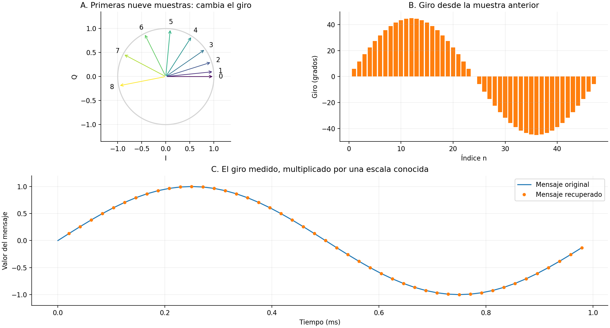

**Figura 28.** En esta simulación, el giro entre muestras sigue el mensaje; una escala conocida permite recuperar sus valores desde la segunda muestra.

**Panel A — muestras I/Q:**

- Los ejes son I y Q. Cada flecha representa una muestra; las etiquetas indican su orden.
- Las flechas tienen la misma longitud. Cambia el ángulo que separa una muestra de la siguiente.
- Las primeras muestras avanzan cada vez más porque el mensaje aumenta durante ese tramo.

**Panel B — giro medido:**

- El eje horizontal identifica la muestra que termina cada intervalo. Las barras muestran el giro en grados.
- Un giro positivo indica avance en sentido antihorario; uno negativo indica avance en sentido horario.
- El máximo es 45°. No aparece un valor para la primera muestra, porque no tiene una muestra anterior en el bloque.

**Panel C — mensaje recuperado:**

- El eje horizontal muestra tiempo. La curva azul es el mensaje original; los puntos naranjas son el resultado de medir y escalar el giro.
- Los puntos coinciden con el mensaje desde la segunda muestra. Las muestras I/Q no se convirtieron en una componente constante.
- Esta comparación usa una simulación conocida, no el audio original de una emisora real.

**La operación después de verla:**

- $z[n]$ es una muestra del canal seleccionado y centrado. El asterisco indica conjugado.
- $\arg$ obtiene el ángulo principal, en radianes. El producto permite comparar la fase actual con la anterior.

$$
\Delta\theta[n]=\arg\left(z[n]z^*[n-1]\right),\qquad n\geq1.
$$

- $\Delta f$ es la desviación máxima usada para generar esta FM. $\widehat m[n]$ es el mensaje estimado.

$$
\widehat m[n]=\frac{f_s}{2\pi\Delta f}\Delta\theta[n].
$$

- En el laboratorio, primero se selecciona el canal. Después del giro se aplican filtrado, decimación y de-emphasis.
- **De-emphasis:** compensación del realce de altas frecuencias aplicado en la transmisión. Esa cadena entrega audio mono, no dos canales estéreo.

??? note "Para profundizar"

    - La simulación define $\theta[n]=\theta[n-1]+2\pi\Delta f\,m[n]/f_s$ y $z[n]=e^{j\theta[n]}$.
    - Por ello, $z[n]z^*[n-1]=e^{j2\pi\Delta f\,m[n]/f_s}$.
    - Si el giro verdadero cumple $|\Delta\theta|<\pi$, el argumento principal conserva ese giro sin ambigüedad.
    - La fase no está definida cuando la amplitud es cero. El ruido también afecta la estimación.
    - Una frecuencia residual produce un término adicional. Centrar el canal no equivale a eliminar su modulación.
    - Para una FM continua, el giro mide la frecuencia media entre dos muestras, no necesariamente su valor en el instante final.
    - En WBFM Receive, la tasa usada para escalar el giro es 192 kS/s, no la tasa inicial de 2.4 MS/s.
    - Su desviación nominal es 75 kHz. La simulación emplea 6 kHz para observar giros pequeños con pocos puntos.
    - Referencias: [Quadrature Demod](https://raw.githubusercontent.com/gnuradio/gnuradio/v3.10.12.0/gr-analog/lib/quadrature_demod_cf_impl.cc) y [WFM Receive](https://raw.githubusercontent.com/gnuradio/gnuradio/v3.10.12.0/gr-analog/python/analog/wfm_rcv.py).

**Colab — mensaje conocido:** esta celda es independiente y no necesita la captura ni produce WAV.

```python
import numpy as np
import matplotlib.pyplot as plt

fs, desviacion, frecuencia_mensaje, N = 48000, 6000, 1000, 48
n = np.arange(N)
t = n / fs
mensaje = np.sin(2 * np.pi * frecuencia_mensaje * t)
fase = 2 * np.pi * desviacion / fs * np.cumsum(mensaje)
z = np.exp(1j * fase)
giro = np.angle(z[1:] * np.conj(z[:-1]))
recuperado = fs / (2 * np.pi * desviacion) * giro
fig = plt.figure(figsize=(13, 7), layout="constrained")
rejilla = fig.add_gridspec(2, 2)
a = fig.add_subplot(rejilla[0, 0])
b = fig.add_subplot(rejilla[0, 1])
c = fig.add_subplot(rejilla[1, :])
angulos = np.linspace(0, 2 * np.pi, 300)
a.plot(np.cos(angulos), np.sin(angulos), color="lightgray")
for k in range(9):
    a.annotate("", xy=(z[k].real, z[k].imag), xytext=(0, 0), arrowprops={"arrowstyle": "->", "color": plt.cm.viridis(k / 8)})
    a.text(1.14 * z[k].real, 1.14 * z[k].imag, str(k), ha="center", va="center")
a.set(title="A. Primeras nueve muestras: cambia el giro", xlabel="I", ylabel="Q", aspect="equal", xlim=(-1.35, 1.35), ylim=(-1.35, 1.35))
b.bar(n[1:], np.rad2deg(giro), color="tab:orange")
b.set(title="B. Giro desde la muestra anterior", xlabel="Índice n", ylabel="Giro (grados)", ylim=(-50, 50))
c.plot(t * 1000, mensaje, color="tab:blue", label="Mensaje original")
c.plot(t[1:] * 1000, recuperado, "o", color="tab:orange", markersize=4, label="Mensaje recuperado")
c.set(title="C. El giro medido, multiplicado por una escala conocida", xlabel="Tiempo (ms)", ylabel="Valor del mensaje", ylim=(-1.2, 1.2))
c.legend()
for ax in [a, b, c]:
    ax.grid(alpha=0.2)
print("Error máximo:", np.max(np.abs(recuperado - mensaje[1:])))
plt.show()
```

#### 6.6. ¿Y si interesa la banda situada fuera del centro?

La banda de 98.1 MHz está fuera del centro. S04 explicará cómo centrarla, filtrarla y reducir la tasa.

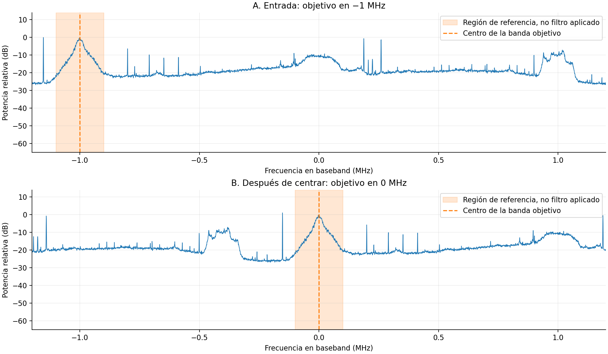

**Figura 29.** Centrar la banda deseada mueve todas las componentes; el filtrado posterior selecciona el canal que llegará al demodulador.

- **Panel A:** la banda objetivo está en −1 MHz; la franja naranja es una referencia visual, no un ancho medido ni un filtro aplicado.
- **Panel B:** la banda objetivo queda en cero, pero conserva su ancho y sus cambios; no se convierte en una constante.
- **Comparación:** las otras bandas también se desplazan y permanecen presentes; S04 explicará el desplazamiento, sus bordes y el filtrado posterior.

??? note "Ampliación opcional hacia S04"

    - La [demostración interactiva de mezcla compleja](mezcla-interactiva.md) permite explorar este desplazamiento con tonos conocidos.
    - No es necesaria para resolver los ejercicios de S02.
    - El archivo `figures/gen_captura_sdr.py`, incluido en el proyecto, conserva el cálculo reproducible sobre la captura real.

#### 6.7. Comprobaciones y Ejercicios de refuerzo

- **Metadatos:** sin $f_c$, la FFT entrega posiciones relativas; no permite asignar una RF a cada punto.
- **Etiquetas:** escribir otra frecuencia central en el visor no cambia las muestras de la captura.
- **Giro:** con $f_s=48$ kS/s y $\Delta f=6$ kHz, un giro de $\pi/4$ produce $\widehat m=1$.

##### Ejercicio 6A — De baseband a RF

- Una captura tiene $f_c=433.92$ MHz y $f_s=2$ MS/s.
- Dos componentes aparecen en −350 kHz y +125 kHz. ¿Qué RF corresponde a cada una?
- ¿Cuál es el intervalo RF nominal de la captura?

??? example "Solución del ejercicio 6A"

    - **Punto de partida:** el apartado 6.1 establece $f_{\mathrm{RF}}=f_c+f_{\mathrm{BB}}$. La frecuencia central y el desplazamiento cumplen funciones distintas.
    - **Datos:** $f_c=433.92$ MHz, $f_s=2$ MS/s y desplazamientos de −0.350 MHz y +0.125 MHz.
    - **Paso 1 — componente izquierda:** $433.92-0.350=433.57$ MHz. El signo negativo indica una posición por debajo de la referencia.
    - **Paso 2 — componente derecha:** $433.92+0.125=434.045$ MHz. El signo positivo indica una posición por encima de la referencia.
    - **Paso 3 — límites:** $f_s/2=1$ MHz. Los extremos son $433.92-1=432.92$ MHz y $433.92+1=434.92$ MHz.
    - **Interpretación:** el intervalo nominal es $[432.92,434.92)$ MHz. Su ancho no garantiza que el receptor responda igual en toda la banda.

##### Ejercicio 6B — Bytes, muestras y tiempo

- Un fragmento de la captura oficial contiene 48 000 bytes CU8.
- ¿Cuántas muestras complejas contiene y cuánto tiempo representa a 2.4 MS/s?
- Una banda está en −1 MHz de baseband. ¿Cuál es su RF si $f_c=99.1$ MHz?

??? example "Solución del ejercicio 6B"

    - **Punto de partida:** el apartado 6.1 define dos bytes por muestra CU8. El apartado 1.5 relaciona duración y muestras mediante $T=N/f_s$.
    - **Datos:** 48 000 bytes, $f_s=2400000$ S/s y $f_c=99.1$ MHz. Cada par contiene I y Q del mismo instante.
    - **Paso 1 — contar muestras:** $N=48000/2=24000$ muestras complejas. No son 48 000 instantes de la señal.
    - **Paso 2 — duración:** $T=24000/2400000=0.01$ s, equivalentes a 10 ms.
    - **Paso 3 — frecuencia:** $f_{\mathrm{RF}}=99.1-1=98.1$ MHz.
    - **Interpretación:** el tamaño del archivo permite contar muestras. Para obtener tiempo y RF también se necesitan los metadatos.

##### Ejercicio 6C — Localizar las bandas

- Las marcas A del waterfall señalan bandas alrededor de 98.1, 99.1 y 100.1 MHz.
- ¿Dónde están en baseband si $f_c=99.1$ MHz?
- ¿Una línea estrecha estable basta para afirmar que no proviene de un transmisor?

??? example "Solución del ejercicio 6C"

    - **Punto de partida:** el apartado 6.1 establece $f_{\mathrm{BB}}=f_{\mathrm{RF}}-f_c$. El apartado 6.3 distingue observación e identificación.
    - **Datos:** la referencia común es $f_c=99.1$ MHz. Las tres posiciones se leen en la Figura 27.
    - **Paso 1 — banda izquierda:** $98.1-99.1=-1$ MHz. Está por debajo de la referencia.
    - **Paso 2 — banda central:** $99.1-99.1=0$ MHz. Ya está centrada para el laboratorio.
    - **Paso 3 — banda derecha:** $100.1-99.1=+1$ MHz. Está por encima de la referencia.
    - **Interpretación:** una línea estable describe un comportamiento, no una causa. Se necesitan otras pruebas para identificar su origen.

##### Ejercicio 6D — Comparar la cobertura nominal

- Se mantiene $f_c=99.1$ MHz. Se comparan capturas a 2.4 y 2.048 MS/s.
- ¿Cuáles son sus intervalos RF nominales?
- En la segunda captura, ¿a qué distancia del borde exterior quedan los centros de 98.1 y 100.1 MHz?

??? example "Solución del ejercicio 6D"

    - **Punto de partida:** el apartado 6.1 utiliza el intervalo $[f_c-f_s/2,f_c+f_s/2)$. Su ancho nominal es $f_s$.
    - **Datos:** $f_c=99.1$ MHz. Las semianchuras son 1.2 MHz y 1.024 MHz.
    - **Paso 1 — 2.4 MS/s:** $99.1\pm1.2$ produce $[97.9,100.3)$ MHz.
    - **Paso 2 — 2.048 MS/s:** $99.1\pm1.024$ produce $[98.076,100.124)$ MHz.
    - **Paso 3 — márgenes:** $98.1-98.076=0.024$ MHz y $100.124-100.1=0.024$ MHz. Ambos márgenes exteriores son 24 kHz.
    - **Interpretación:** un centro dentro del intervalo no garantiza contener toda su banda. Tampoco permite atribuir diferencias de contraste solo al sampling rate.

## Síntesis visual — de las muestras al análisis y al audio

### Una señal, cuatro vistas

Las muestras, el plano I/Q y el espectro describen aspectos distintos de la señal.

[Abrir la imagen en otra pestaña](figures/sintesis-muestras-representaciones.png){ target="_blank" }

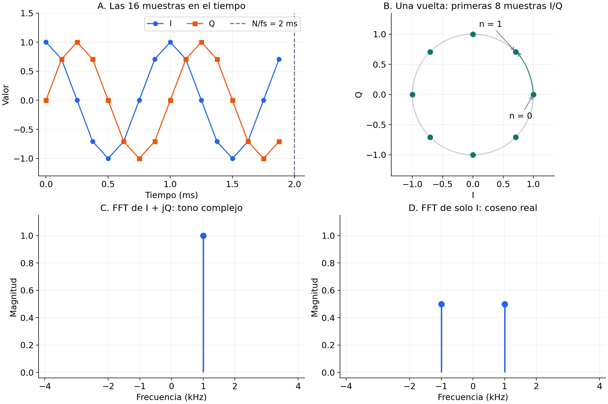

**Figura 30.** Las cuatro vistas relacionan las muestras y el espectro; usar solo I cambia la señal analizada.

**Panel A — tiempo:**

- I y Q corresponden a las mismas 16 muestras. El sampling rate de 8 kS/s sitúa cada muestra en el tiempo.
- El bloque representa $16/8000=2$ ms. La última muestra está en 1.875 ms, antes del final nominal.

**Panel B — plano I/Q:**

- Cada punto reúne I y Q del mismo instante. Las primeras ocho muestras completan las posiciones de una vuelta.
- El orden muestra el giro positivo del tono de +1 kHz; cada avance es de 45°.

**Panel C — FFT compleja:**

- La entrada es $I+jQ$. Aparece una componente en +1 kHz, con magnitud 1.
- El ejemplo está alineado con un bin y usa ventana rectangular. Un tono entre bins produciría leakage.

**Panel D — FFT de solo I:**

- La entrada es otra: solo I, un coseno real. Aparecen componentes en −1 y +1 kHz, con magnitud 0.5 cada una.
- Omitir Q no equivale a cambiar el visor. Cambia la secuencia entregada a la FFT.

### Dos caminos desde las mismas muestras

Las muestras permiten observar el espectro o recuperar audio. El demodulador no recibe la curva dibujada por la FFT.

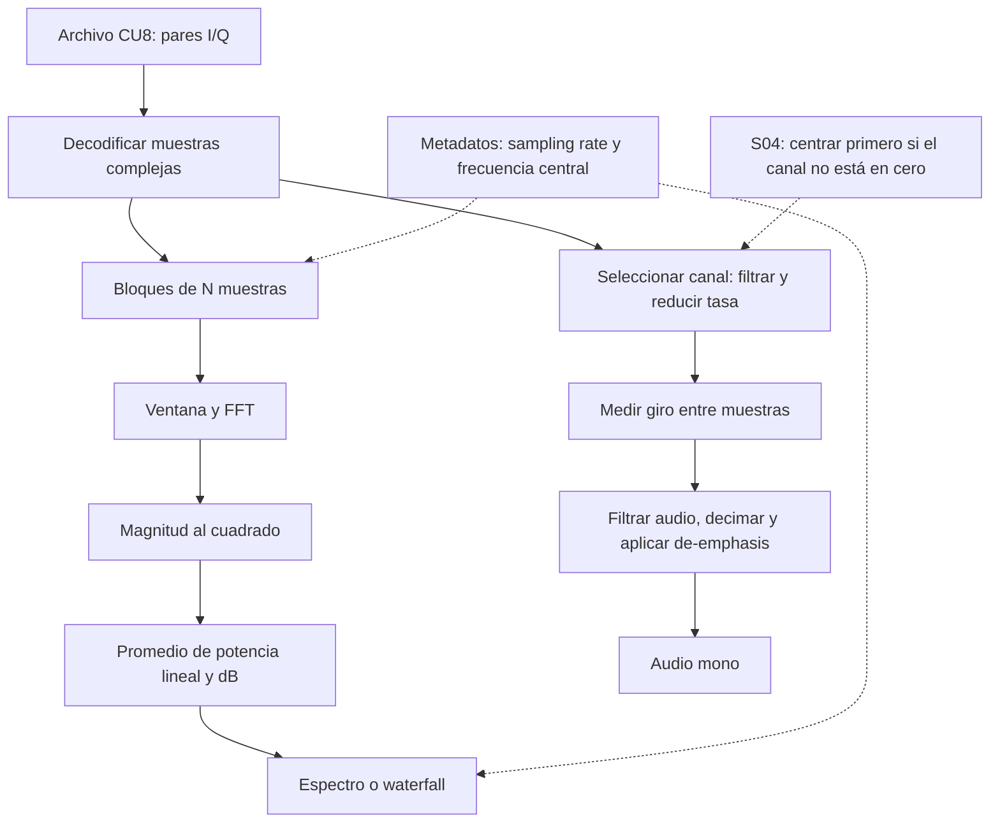

**Figura 31.** El análisis y la demodulación parten de las muestras I/Q; observar un espectro no equivale a recuperar audio.

- **Rama de análisis:** los bloques producen estimaciones de potencia. Los metadatos permiten expresar sus ejes en tiempo y RF.
- **Rama de audio:** el receptor selecciona un canal antes de medir el giro. El procesamiento posterior entrega audio mono.
- **Avance a S04:** un canal fuera del centro necesita primero un desplazamiento. En este laboratorio se utiliza la banda central.

### Siete preguntas de cierre

1. [¿Qué representan I y Q en una misma muestra?](#21-que-significa-una-muestra-compleja)
2. [¿Qué indican el sampling rate y la frecuencia central?](#61-que-frecuencia-de-radio-representa-cada-punto)
3. [¿Cómo se convierte una posición en baseband a una frecuencia RF?](#61-que-frecuencia-de-radio-representa-cada-punto)
4. [¿Qué cambia al añadir muestras adquiridas, ceros o una ventana distinta?](#510-guia-para-leer-un-espectro)
5. [¿Por qué aliasing y leakage no significan lo mismo?](#59-un-pico-limpio-tambien-puede-ser-un-alias)
6. [¿Qué muestran el promedio y el waterfall sobre la captura?](#62-por-que-cambia-el-espectro-entre-bloques)
7. [¿Qué mide el giro entre muestras y qué falta para entregar audio mono?](#65-como-permite-fm-recuperar-el-audio)

## Laboratorio #2 — demodulador FM en GNU Radio

La [guía del laboratorio #2](laboratorio-receptor-fm.md) implementa un receptor FM desde un archivo I/Q. También incluye una entrada RTL-SDR opcional.

- **Conexión con la teoría:** el estudiante sigue las tasas y compara el espectro RF, el waterfall y el espectro del canal seleccionado.
- **Archivo principal:** `fm_99p1MHz_2p4Msps_g30.cu8`, a **2.4 MS/s**. Es la misma captura de la sección 6.
- **Cadena de audio:** el resampler convierte 2.4 MS/s en 192 kS/s con la razón 2/25. `WBFM Receive` entrega audio mono a 48 kS/s.
- **Alcance:** se justifican los parámetros y se relaciona la demodulación con el giro entre muestras de 6.5. El diseño de filtros queda para sesiones posteriores.

## Lecturas y referencias

- [MIT — Sampling and quantization](https://ocw.mit.edu/courses/6-003-signals-and-systems-fall-2011/95b4b245722073e5d0c4ea95b384446e_MIT6_003F11_lec22.pdf): distinción entre tiempo discreto y niveles de amplitud; relación entre tasa y muestreo.
- [TU Eindhoven — Sampling of sinusoidal signals](https://spseducation.tue.nl/disciplines/discrete/discretesignalprocessing_sampling_sampling/): muestreo de senoides y frecuencias que producen las mismas muestras.
- [NumPy — Discrete Fourier Transform](https://numpy.org/doc/stable/reference/routines.fft.html): definición de DFT, orden de bins, inversa y simetría para entradas reales.
- [SciPy — Spectral Analysis](https://docs.scipy.org/doc/scipy/tutorial/signal.html#spectral-analysis): bloques finitos, leakage, padding, ventanas y diferencia entre escalas espectrales.
- [MathWorks — Standards and Conventions](https://www.mathworks.com/help/phased/gs/standards-and-conventions.html): convención de señal compleja I/Q y relación con una señal física real.
- Las fuentes primarias de los bloques GNU Radio se indican en la [guía del laboratorio](laboratorio-receptor-fm.md#lecturas-y-referencias).
