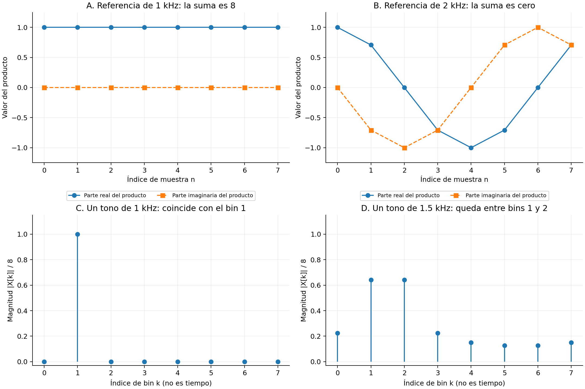
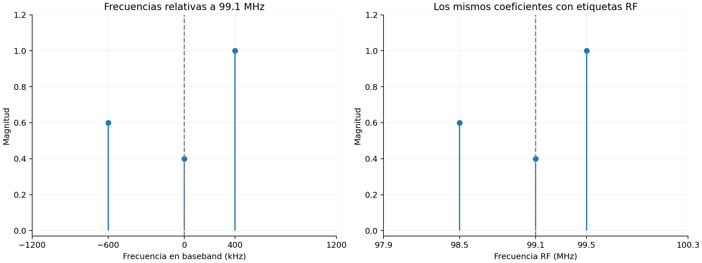
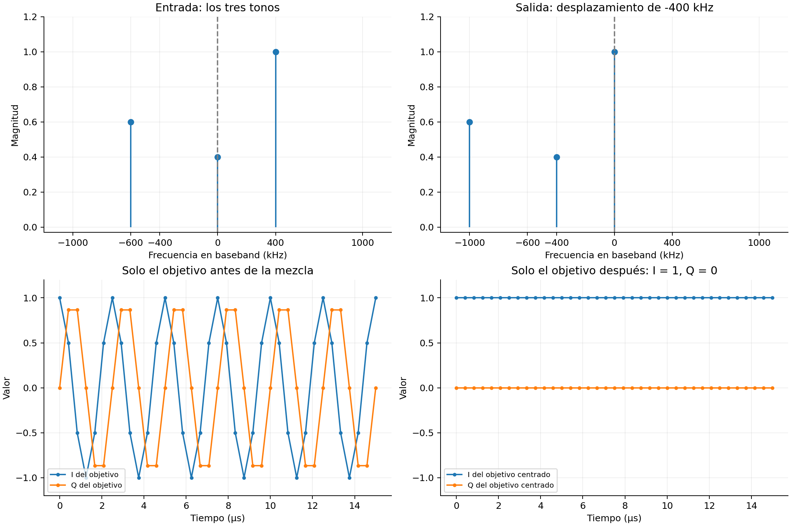
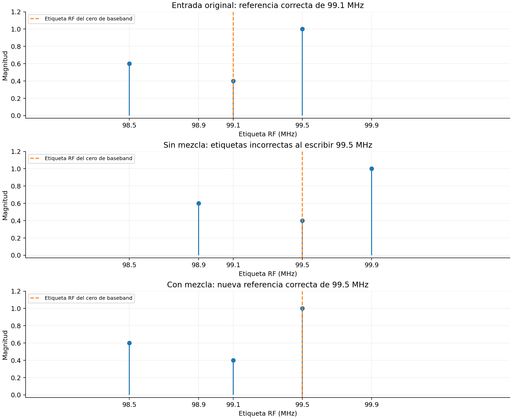
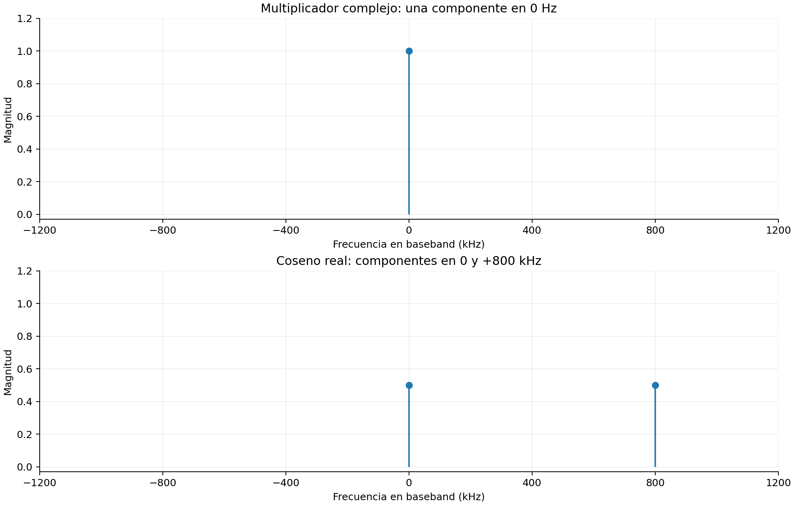
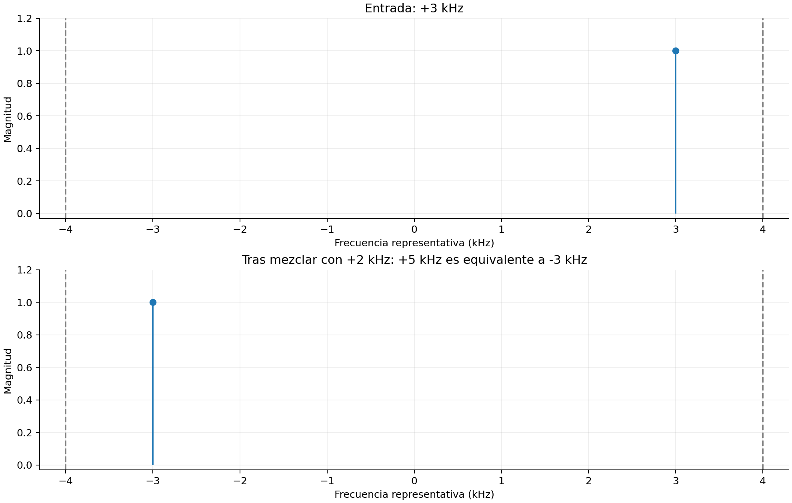
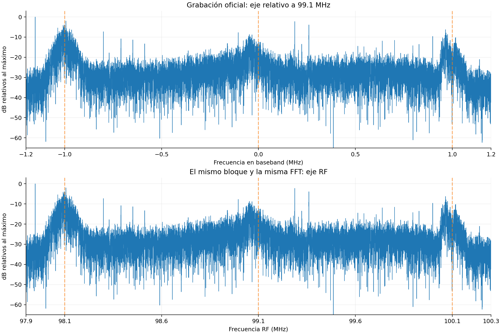
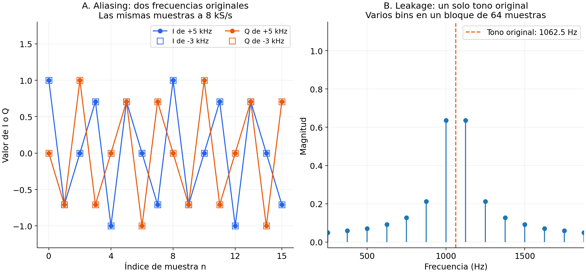
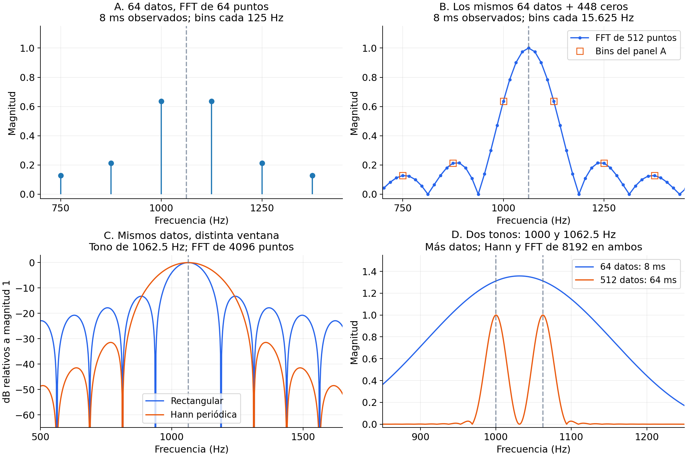
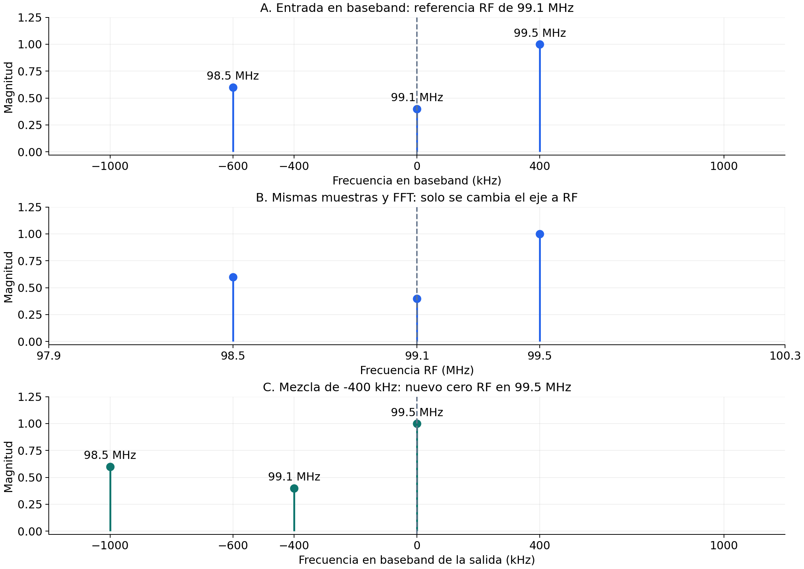

# Sesión 02 — Señales y espectro en SDR

## Objetivos de aprendizaje

Al finalizar esta sesión, el estudiante será capaz de:

1. Calcular el intervalo entre muestras y la duración de un bloque a partir de la tasa de muestreo y del número de muestras.
2. Interpretar las componentes I/Q de una señal, calcular su magnitud y fase, y explicar la diferencia entre una senoide real y una senoide compleja.
3. Relacionar las representaciones en tiempo y frecuencia, y predecir el espectro de un tono real, un tono complejo y una suma de tonos.
4. Interpretar el eje de frecuencias de una FFT y explicar cómo el número de muestras y la ventana afectan el espectro observado.
5. Distinguir aliasing y spectral leakage, y comprobar sus efectos con señales conocidas.
6. Relacionar las frecuencias en baseband con las frecuencias RF de una captura SDR y predecir el desplazamiento producido por una mezcla compleja.

## Teoría

### 1. De las muestras a una señal

En la sesión 1, el receptor entregó una secuencia de muestras I/Q. Cada muestra corresponde a un instante de la señal. Para interpretar esa secuencia hace falta conocer sus valores, su orden y la tasa de muestreo con la que se obtuvo.

El RTL-SDR entrega muestras complejas I/Q: cada muestra contiene dos valores reales, I y Q, que se interpretan conjuntamente como $I+jQ$. La señal física recibida es un voltaje real; la salida I/Q es su representación compleja en baseband.

Para estudiar primero la relación entre muestras y tiempo, esta subsección utiliza una senoide real de ejemplo, representada por $x[n]$. Este ejemplo no reproduce todavía la salida I/Q del receptor. Las relaciones entre índice, tasa de muestreo y tiempo también se aplican a una secuencia compleja.

#### 1.1. Un valor de la señal en cada instante

Una señal continua, como el voltaje a la entrada de un ADC, se representa mediante $x(t)$. La variable $t$ indica tiempo, por ejemplo en segundos.

Al tomar valores de esa señal en instantes separados, se obtiene una secuencia:

$$
x[0],\;x[1],\;x[2],\;\ldots
$$

La notación $x[n]$ indica el valor de la muestra de índice $n$. El índice comienza en cero: $x[0]$ es la primera muestra, $x[1]$ es la segunda y así sucesivamente.

El índice indica una posición en la secuencia. Por sí solo, $n=4$ no significa cuatro segundos ni cuatro milisegundos. El tiempo depende de la tasa de muestreo.

#### 1.2. Muestreo y cuantización

El ADC realiza dos operaciones que conviene distinguir:

| Operación | Qué limita | Resultado |
|---|---|---|
| Muestreo | Los instantes en los que se toma un valor | Una secuencia en tiempo discreto. |
| Cuantización | Los valores de amplitud que pueden representarse | Cada muestra se asigna a uno de los niveles disponibles. |

Por ejemplo, si un valor ideal fuera $0.7071$ y los niveles disponibles estuvieran separados por $0.25$, el redondeo al nivel más cercano daría $0.75$. El instante de la muestra sería el mismo; cambiaría la amplitud representada. Es un ejemplo de cuantización, no un modelo del ADC del RTL-SDR.

Esta distinción entre discretizar el tiempo y discretizar la amplitud se desarrolla en las [notas de muestreo y cuantización del MIT](https://ocw.mit.edu/courses/6-003-signals-and-systems-fall-2011/95b4b245722073e5d0c4ea95b384446e_MIT6_003F11_lec22.pdf).

Los ejemplos siguientes calculan muestras de un tono con NumPy. Por ahora no simulan la cuantización del ADC; permiten estudiar la relación entre valores y tiempo.

#### 1.3. La tasa de muestreo construye el eje temporal

La tasa de muestreo $f_s$ indica cuántas muestras se toman por segundo. El intervalo entre muestras consecutivas es

$$
T_s=\frac{1}{f_s}.
$$

Si se asigna $t=0$ a la primera muestra, el instante de la muestra $n$ es

$$
t_n=nT_s=\frac{n}{f_s}.
$$

En el modelo de muestreo ideal, el valor se obtiene evaluando la señal en ese instante:

$$
x[n]=x(t_n).
$$

Estas relaciones suponen muestras uniformemente espaciadas. La descripción matemática se puede consultar en el material de [muestreo de senoides de TU Eindhoven](https://spseducation.tue.nl/disciplines/discrete/discretesignalprocessing_sampling_sampling/).

Para una tasa de $f_s=8000$ S/s, también escrita como 8 kS/s:

$$
T_s=\frac{1}{8000}\;\text{s}=125\;\mu\text{s}=0.125\;\text{ms}.
$$

| Índice $n$ | Posición en la secuencia | Instante $t_n$ |
|---:|---|---:|
| 0 | Primera muestra | 0 ms |
| 1 | Segunda muestra | 0.125 ms |
| 2 | Tercera muestra | 0.250 ms |
| 4 | Quinta muestra | 0.500 ms |
| 8 | Novena muestra | 1.000 ms |

La muestra de índice 8 aparece a 1 ms del inicio. Su valor todavía depende de la señal que se esté muestreando.

#### 1.4. Un tono que se puede contar

Una senoide real permite reconocer los parámetros básicos de una señal:

$$
x(t)=A\cos(2\pi f_0t+\phi).
$$

| Parámetro | Significado | Valor del ejemplo |
|---|---|---:|
| $A$ | Amplitud: distancia desde cero hasta un máximo de la senoide. | 1 |
| $f_0$ | Frecuencia del tono: ciclos por segundo. | 1000 Hz |
| $\phi$ | Fase: posición dentro del ciclo en el origen temporal. | 0 rad |

Las amplitudes del ejemplo no representan voltios medidos por el receptor. Son valores elegidos para la simulación.

El período del tono, $T_0$, es el tiempo que dura un ciclo:

$$
T_0=\frac{1}{f_0}=\frac{1}{1000}\;\text{s}=1\;\text{ms}.
$$

Con $f_s=8000$ S/s se toman ocho muestras por ciclo de este tono. $f_0$ y $f_s$ describen cosas diferentes: la primera indica ciclos de la señal por segundo; la segunda, muestras por segundo.

Al sustituir $t=n/f_s$ en la senoide se obtiene

$$
x[n]=A\cos\left(2\pi f_0\frac{n}{f_s}+\phi\right).
$$

**Colab — Celda 1: generar las muestras.** Las cuatro celdas de esta subsección se ejecutan en orden dentro del mismo notebook.

```python
import numpy as np
import matplotlib.pyplot as plt

fs = 8000       # Tasa de muestreo, en S/s.
f0 = 1000       # Frecuencia del tono, en Hz.
A = 1.0        # Amplitud.
phi = 0.0      # Fase, en radianes.
N = 16         # Número de muestras del bloque.

n = np.arange(N)                 # Índices: 0, 1, ..., N-1.
t = n / fs                      # Instantes, en segundos.
x = A * np.cos(2 * np.pi * f0 * t + phi)

print(" n    tiempo (ms)    x[n]")
for k in range(8):
    print(f"{n[k]:2d}      {t[k]*1000:6.3f}     {x[k]:7.4f}")
```

`np.arange(N)` genera exactamente $N$ índices, desde 0 hasta $N-1$. Dividirlos entre `fs` construye los instantes de muestreo. Este uso sigue la definición de [arange en NumPy](https://numpy.org/doc/stable/reference/generated/numpy.arange.html).

Los primeros valores son aproximadamente $1$, $0.7071$, $0$, $-0.7071$, $-1$, $-0.7071$, $0$ y $0.7071$. La muestra $x[8]$ vuelve a valer 1: ha transcurrido un período. Algunos ceros pueden aparecer como números muy pequeños o como `-0.0000` por la precisión de los cálculos.

**Colab — Celda 2: observar índice y tiempo.**

```python
# Muchos puntos permiten dibujar la función conocida como referencia.
t_ref = np.linspace(0, N / fs, 1000)
x_ref = A * np.cos(2 * np.pi * f0 * t_ref + phi)

fig, axes = plt.subplots(2, 1, figsize=(10, 6), layout="constrained")

axes[0].stem(n, x, basefmt=" ")
axes[0].set(xlabel="Índice de muestra n", ylabel="Amplitud", title="Valores de la secuencia", xticks=n)

axes[1].plot(t_ref * 1000, x_ref, color="0.7", label="Función conocida del ejemplo")
axes[1].stem(t * 1000, x, basefmt=" ", label="Muestras")
axes[1].axvline(N / fs * 1000, color="tab:orange", linestyle="--", label="Fin del bloque (sin muestra)")
axes[1].set(xlabel="Tiempo (ms)", ylabel="Amplitud", title="Las mismas muestras con su eje temporal")
axes[1].legend(loc="upper center", bbox_to_anchor=(0.5, -0.2))

for ax in axes:
    ax.grid(alpha=0.2)
plt.show()
```


**Figura 1.** Las mismas 16 muestras representadas por índice y por tiempo, con una tasa de muestreo de 8 kS/s.

En el gráfico superior se cuentan posiciones de la secuencia. En el inferior se leen instantes: los máximos en $n=0$ y $n=8$ corresponden a 0 y 1 ms. Cada punto azul representa una muestra. La curva gris representa la función conocida utilizada para generar el ejemplo; no es una reconstrucción obtenida de una captura. Los tallos verticales ayudan a leer las amplitudes y no representan pulsos físicos.

#### 1.5. Cuánto tiempo representa un bloque

Un bloque de $N$ muestras contiene los índices de 0 a $N-1$. Su duración nominal es

$$
T_{\mathrm{bloque}}=NT_s=\frac{N}{f_s}.
$$

Con 16 muestras a 8000 S/s:

$$
T_{\mathrm{bloque}}=\frac{16}{8000}\;\text{s}=2\;\text{ms}.
$$

La última muestra es $x[15]$, cuyo instante es

$$
t_{15}=\frac{15}{8000}\;\text{s}=1.875\;\text{ms}.
$$

No hay contradicción: entre la primera y la última muestra existen 15 intervalos. Para contar la duración nominal del bloque se consideran 16 intervalos de muestreo. La siguiente muestra de una secuencia que continúa, $x[16]$, llegaría a los 2 ms, ya fuera de este bloque. En la Figura 1, la línea naranja marca ese límite.

**Colab — Celda 3: comprobar los tiempos.**

```python
print(f"Intervalo entre muestras: {1e6 / fs:.1f} us")
print(f"Duración del bloque:      {1000 * N / fs:.3f} ms")
print(f"Instante de la última:    {1000 * t[-1]:.3f} ms")
print(f"Muestras por ciclo:       {fs / f0:g}")
```

La salida es 125.0 us, 2.000 ms, 1.875 ms y 8 muestras por ciclo. En Python, `t[-1]` selecciona el último elemento del arreglo.

??? example "Comprobación: el mismo bloque con otra tasa declarada"
    Si los mismos 16 valores se interpretan con una tasa de 4000 S/s, el intervalo pasa a 0.25 ms y la duración nominal a 4 ms. Los valores no cambian; cambia el tiempo asignado a cada uno. Por eso una captura necesita conservar su tasa de muestreo como metadato.

#### 1.6. Qué cambia al modificar el tono

Una vez fijado el eje temporal, se puede cambiar un parámetro del tono y observar su efecto:

| Cambio respecto al ejemplo | Predicción |
|---|---|
| Amplitud $A=0.5$ | Los valores se reducen a la mitad; el período sigue siendo 1 ms. |
| Frecuencia $f_0=2000$ Hz | El período pasa a 0.5 ms; hay cuatro ciclos en el intervalo de 2 ms y cuatro muestras por ciclo. |
| Fase $\phi=\pi/2$ | El valor inicial pasa de 1 a 0; la amplitud y el período se mantienen. |

**Colab — Celda 4: comparar un cambio a la vez.** Esta celda utiliza los arreglos de referencia de las celdas anteriores y mantiene la tasa de muestreo y el tamaño del bloque.

```python
cambios = [
    (0.5, 1000, 0.0, "Amplitud: A = 0.5"),
    (1.0, 2000, 0.0, "Frecuencia: f0 = 2 kHz"),
    (1.0, 1000, np.pi / 2, "Fase: phi = pi/2 rad"),
]

fig, axes = plt.subplots(3, 1, figsize=(10, 7), sharex=True, sharey=True, layout="constrained")
for ax, (amp, freq, fase, titulo) in zip(axes, cambios):
    y_ref = amp * np.cos(2 * np.pi * freq * t_ref + fase)
    y = amp * np.cos(2 * np.pi * freq * t + fase)
    ax.plot(t_ref * 1000, x_ref, "--", color="0.7", label="Referencia")
    ax.plot(t_ref * 1000, y_ref, color="tab:blue", label="Cambio")
    ax.plot(t * 1000, y, "o", color="tab:blue", label="Muestras")
    ax.set(title=titulo, ylabel="Amplitud", ylim=(-1.2, 1.2))
    ax.grid(alpha=0.2)
axes[0].legend(loc="upper center", bbox_to_anchor=(0.5, 1.5), ncol=3)
axes[-1].set_xlabel("Tiempo (ms)")
plt.show()
```


**Figura 2.** Efectos de cambiar por separado la amplitud, la frecuencia y la fase de un tono.

La curva gris conserva el tono original en los tres paneles. En el primero, la curva azul alcanza la mitad de amplitud y repite el ciclo en los mismos instantes. En el segundo, completa los ciclos en la mitad de tiempo. En el tercero, comienza en otra posición del ciclo: cruza por cero en lugar de empezar en un máximo. Los puntos mantienen los mismos instantes de muestreo en todos los casos.

Para experimentar, el estudiante puede cambiar una fila de `cambios`, anotar primero qué espera observar y ejecutar de nuevo la celda 4. Por ejemplo, $A=0.25$, $f_0=500$ Hz o $\phi=\pi$ permiten comparar una amplitud menor, un período mayor o un inicio en el mínimo. Cada prueba cambia un solo parámetro respecto al tono original.

??? example "Comprobación: frecuencia del tono y tasa de muestreo"
    Un tono de 500 Hz tiene un período de 2 ms. A 8000 S/s se toman 16 muestras por ciclo. La señal cambia más lentamente que el tono de 1 kHz, aunque la separación temporal entre muestras sigue siendo 0.125 ms.

??? example "Comprobación: índice, tiempo y fase"
    Con los parámetros originales, la muestra de índice 4 corresponde a 0.5 ms y vale aproximadamente $-1$. Si solo cambia la fase a $\pi/2$, ese índice sigue correspondiendo a 0.5 ms, pero su valor pasa a ser aproximadamente 0.

Al finalizar esta subsección, la secuencia ya tiene una interpretación temporal: el índice identifica una muestra, la tasa de muestreo determina su instante y el valor describe la señal en ese punto. La siguiente subsección utiliza esta base para interpretar las dos componentes de una muestra I/Q.

#### 1.7. Ejercicios de refuerzo

- **Forma de trabajo:** se plantea primero una respuesta con sus unidades y una justificación. La solución desplegable permite contrastar el resultado después de resolver el ejercicio.

##### Ejercicio 1A — construir el eje temporal

Se dispone de un bloque de 400 muestras con $f_s=20000$ S/s.

- Calcular el intervalo entre muestras, la duración nominal del bloque y el instante de la última muestra.
- Indicar a qué tiempo corresponde la muestra de índice $n=50$.

??? example "Solución del ejercicio 1A"

    - **Punto de partida:** el apartado 1.3 relaciona el sample rate con el tiempo mediante $T_s=1/f_s$ y $t_n=n/f_s$. El apartado 1.5 añade la duración nominal $T_{\mathrm{bloque}}=N/f_s$. En este ejercicio, $N=400$ y $f_s=20000$ S/s; se asigna $t=0$ a la primera muestra.
    - **Paso 1 — intervalo entre muestras:** $T_s=1/20000=0.00005$ s. Como $1$ s contiene $10^6$ µs, se obtiene $0.00005\times10^6=50$ µs. Esta cantidad separa cualquier pareja de muestras consecutivas; no es la duración del bloque completo.
    - **Paso 2 — duración nominal:** $T_{\mathrm{bloque}}=400/20000=0.020$ s, es decir, 20 ms. Se cuentan 400 intervalos de muestreo para describir el bloque; la muestra siguiente de una secuencia que continúa llegaría justo a ese límite.
    - **Paso 3 — índice de la última muestra:** al comenzar en cero, los índices son $0,1,\ldots,399$. Por eso se utiliza $N-1=399$, no 400, en la fórmula del instante: $t_{399}=399/20000=0.01995$ s, es decir, 19.95 ms.
    - **Paso 4 — muestra de índice 50:** $t_{50}=50/20000=0.0025$ s, es decir, 2.5 ms. Es la muestra número 51 al contar desde la primera; el número 50 es su índice, no un tiempo expresado directamente en milisegundos.
    - **Comprobación e interpretación:** la diferencia entre el límite nominal y la última muestra es $20-19.95=0.05$ ms, exactamente $T_s=50$ µs. Así se comprueba que 20 ms de duración nominal y 19.95 ms para la última muestra son resultados compatibles, no contradictorios.

##### Ejercicio 1B — calcular valores de una senoide

Se considera $x[n]=0.8\cos(2\pi\,1000\,n/8000+\pi/2)$.

- Identificar amplitud, frecuencia, fase inicial y sample rate.
- Calcular el período, la cantidad de muestras por ciclo y los valores $x[0]$ y $x[2]$.

??? example "Solución del ejercicio 1B"

    - **Punto de partida:** el apartado 1.4 define $x[n]=A\cos(2\pi f_0n/f_s+\phi)$. Se compara cada término de esa expresión con el enunciado: $A=0.8$, $f_0=1000$ Hz, $f_s=8000$ S/s y $\phi=\pi/2$ rad, equivalente a 90°. La amplitud es la del ejemplo matemático; no se le asigna una unidad de voltios que el enunciado no proporciona.
    - **Paso 1 — período:** el tono completa 1000 ciclos por segundo. Por tanto, $T_0=1/f_0=1/1000=0.001$ s, es decir, 1 ms por ciclo. No se utiliza $1/f_s$ para este cálculo: esa inversa daría el intervalo entre muestras, no el período del tono.
    - **Paso 2 — muestras por ciclo:** en el tiempo $T_0$ se toman $f_sT_0=f_s/f_0=8000/1000=8$ muestras. Equivalentemente, $T_s=1/8000=0.125$ ms y ocho intervalos de ese tamaño completan 1 ms.
    - **Paso 3 — primera muestra:** al sustituir $n=0$, el término que depende del tiempo vale cero. Queda $x[0]=0.8\cos(\pi/2)=0$. La amplitud del tono sigue siendo 0.8, aunque esta muestra particular sea cero: amplitud y valor instantáneo son conceptos diferentes.
    - **Paso 4 — muestra de índice 2:** el ángulo debido al tiempo es $2\pi(1000)(2)/8000=\pi/2$. Se suma la fase inicial, de modo que el ángulo total es $\pi/2+\pi/2=\pi$ rad. Como $\cos\pi=-1$, se obtiene $x[2]=-0.8$.
    - **Ubicación temporal del resultado:** usando el apartado 1.3, $t_2=2/8000=0.00025$ s, es decir, 0.25 ms. Entre $n=0$ y $n=2$ transcurre un cuarto del período; el tono avanza desde el cruce por cero de fase 90° hasta el mínimo de fase 180°.

##### Ejercicio 1C — cambiar una etiqueta no adquiere otras muestras

Un bloque de 32 muestras contiene un tono conocido de 1 kHz, adquirido a 8 kS/s. Por error, el mismo arreglo se interpreta como si su tasa fuera 16 kS/s.

- Calcular la duración y el intervalo entre muestras con cada tasa declarada.
- Indicar qué frecuencia se atribuiría al tono y si cambió la señal originalmente adquirida.

??? example "Solución del ejercicio 1C"

    - **Punto de partida:** los apartados 1.3 y 1.5 utilizan $T_s=1/f_s$ y $T_{\mathrm{bloque}}=N/f_s$. La comprobación del apartado 1.5 muestra que cambiar la tasa declarada cambia el tiempo asignado al arreglo, no sus valores. Aquí se mantienen las mismas $N=32$ muestras.
    - **Paso 1 — tasa real de adquisición:** con $f_s=8000$ S/s, $T_s=1/8000=0.125$ ms y $T_{\mathrm{bloque}}=32/8000=4$ ms. Estos tiempos describen cómo se obtuvieron realmente las muestras.
    - **Paso 2 — interpretación errónea:** al declarar 16000 S/s, se asigna $T_s'=1/16000=0.0625$ ms y $T_{\mathrm{bloque}}'=32/16000=2$ ms. Todos los índices reciben tiempos iguales a la mitad de los correctos: $t_n'=n/16000=t_n/2$.
    - **Paso 3 — conservar el ciclo de la secuencia:** el tono adquirido a 1 kHz tenía $8000/1000=8$ muestras por ciclo, según el apartado 1.4. Cambiar una etiqueta no inserta ni elimina muestras; ese patrón de ocho muestras por ciclo permanece en el arreglo.
    - **Paso 4 — frecuencia atribuida:** con la tasa errónea, ocho intervalos se interpretan como $8/16000=0.0005$ s por ciclo. Su inversa es 2000 Hz; también se obtiene directamente $16000/8=2000$ Hz. La mitad del tiempo asignado hace que los mismos ciclos parezcan ocurrir al doble de frecuencia.
    - **Conclusión:** no se adquirió una señal nueva ni se cambió físicamente el tono de 1 kHz. Se construyó un eje temporal incorrecto para los mismos datos. La interpretación de la captura debe recuperar el metadato de 8 kS/s, no aceptar los 2 kHz como una nueva medición de la señal original.

##### Ejercicio 1D — explicar los tres cambios de la Figura 2

Se toma como referencia el tono de amplitud 1, frecuencia 1 kHz y fase inicial cero de la Figura 2.

- Explicar qué cambia al usar amplitud 0.5, frecuencia 2 kHz o fase inicial $\pi/2$, modificando un parámetro a la vez.
- Indicar si cambia la separación temporal de los puntos cuando se conservan $f_s$ y $N$.

??? example "Solución del ejercicio 1D"

    - **Punto de partida:** los apartados 1.4 y 1.6 separan los parámetros de $x[n]=A\cos(2\pi f_0n/f_s+\phi)$. La Figura 2 conserva $f_s=8000$ S/s y $N=16$; cada panel modifica un solo parámetro respecto a $x_{\mathrm{ref}}[n]=\cos(2\pi\,1000\,n/8000)$.
    - **Panel de amplitud — sustitución:** al elegir $A=0.5$, queda $x_A[n]=0.5\cos(2\pi\,1000\,n/8000)=0.5x_{\mathrm{ref}}[n]$. Cada valor se reduce a la mitad: por ejemplo, la primera muestra pasa de 1 a 0.5 y el mínimo de −1 a −0.5.
    - **Panel de amplitud — qué se conserva:** no cambia el argumento del coseno. Los máximos, mínimos y cruces por cero ocurren en los mismos instantes; el período continúa siendo $1/1000=1$ ms. El cambio es vertical, no temporal.
    - **Panel de frecuencia — sustitución y efecto:** con $f_0=2000$ Hz, $T_0=1/2000=0.5$ ms y hay $f_s/f_0=8000/2000=4$ muestras por ciclo. En los 2 ms nominales del bloque caben cuatro ciclos en lugar de dos. La amplitud sigue siendo 1 y la fase inicial sigue siendo cero.
    - **Panel de fase — sustitución y efecto:** con $\phi=\pi/2$, $x_\phi[n]=\cos(2\pi\,1000\,n/8000+\pi/2)$. En $n=0$ se obtiene $\cos(\pi/2)=0$, en lugar de 1. Cambia la posición dentro del ciclo en cada instante, pero $A=1$ y $T_0=1$ ms se mantienen.
    - **Eje temporal común:** en los tres paneles, el apartado 1.3 da $t_n=n/8000$ y $T_s=0.125$ ms. Los marcadores no se separan más ni menos en el tiempo; cambian sus valores. Incluso cuando hay menos muestras por ciclo, siguen estando espaciadas igual: es el ciclo el que dura menos.

### 2. Señales reales y señales complejas I/Q

En el ejemplo anterior, cada muestra $x[n]$ era un número real. En la salida I/Q del RTL-SDR, cada muestra contiene una pareja de valores reales. Esa pareja se representa como un número complejo:

$$
z[n]=I[n]+jQ[n].
$$

I y Q corresponden al mismo índice de muestra y al mismo instante. La pareja completa constituye una muestra compleja; no son dos muestras tomadas en instantes consecutivos. A 8 kS/s de muestras complejas se obtienen 8000 valores I y 8000 valores Q por segundo.

#### 2.1. Qué significa una muestra compleja

Los nombres I y Q provienen de *in-phase* y *quadrature*. Se asocian con las dos referencias de mezcla, separadas 90°, utilizadas para obtener la representación en baseband. La asignación de I a la parte real y Q a la parte imaginaria se describe en las [convenciones de señales en baseband de MathWorks](https://www.mathworks.com/help/phased/gs/standards-and-conventions.html).

En la expresión $I+jQ$, $j$ es la unidad imaginaria y cumple $j^2=-1$. Permite representar y operar con las dos componentes de forma conjunta. No significa que Q sea una cantidad ficticia: I y Q son valores reales producidos por el procesamiento del receptor.

Por ejemplo, una muestra con $I=3$ y $Q=4$ se escribe como

$$
z=3+j4.
$$

En el plano I/Q, el eje horizontal representa I y el vertical representa Q. La muestra se ubica en el punto $(3,4)$. Este plano tiene dos ejes de amplitud; ninguno de ellos es un eje temporal.

#### 2.2. Magnitud y fase: distancia y ángulo

La misma muestra puede describirse por su distancia al origen y por el ángulo que forma con el eje I positivo:

$$
|z|=\sqrt{I^2+Q^2},
\qquad
\theta=\operatorname{atan2}(Q,I).
$$

La distancia es la magnitud y el ángulo es la fase. `atan2` utiliza ambas componentes para identificar el cuadrante del punto. Para $z=3+j4$:

$$
|z|=5,
\qquad
\theta\approx 0.9273\;\text{rad}\approx 53.13^\circ.
$$

La fase se mide desde el eje I positivo, con ángulos positivos en sentido antihorario. La representación polar reúne estas dos cantidades:

$$
z=|z|e^{j\theta}.
$$

**Colab — Celda 1: leer una muestra y ubicarla en el plano.** Las cinco celdas de esta subsección se ejecutan en orden. Esta primera celda incluye los imports para que la subsección también pueda ejecutarse en un notebook nuevo.

```python
import numpy as np
import matplotlib.pyplot as plt

muestra = 3 + 4j
print(f"I = {muestra.real:g}; Q = {muestra.imag:g}")
print(f"Magnitud = {np.abs(muestra):.2f}")
print(f"Fase = {np.angle(muestra):.4f} rad = {np.angle(muestra, deg=True):.2f} grados")

fig, ax = plt.subplots(figsize=(6, 6), layout="constrained")
ax.axhline(0, color="0.7")
ax.axvline(0, color="0.7")
ax.annotate("", xy=(muestra.real, muestra.imag), xytext=(0, 0), arrowprops={"arrowstyle": "->", "color": "tab:blue", "lw": 2})
ax.plot([muestra.real, muestra.real], [0, muestra.imag], "--", color="0.5")
ax.plot([0, muestra.real], [muestra.imag, muestra.imag], "--", color="0.5")
ax.plot(muestra.real, muestra.imag, "o", color="tab:blue", label=f"z = {muestra}")
arco = np.linspace(0, np.angle(muestra), 100)
ax.plot(np.cos(arco), np.sin(arco), color="tab:red")
ax.text(1.3 * np.cos(np.angle(muestra) / 2), 1.3 * np.sin(np.angle(muestra) / 2), f"{np.angle(muestra, deg=True):.2f}°", color="tab:red")
ax.set(xlabel="I (parte real)", ylabel="Q (parte imaginaria)", xlim=(-6, 6), ylim=(-6, 6), title="Una muestra en el plano I/Q")
ax.set_aspect("equal")
ax.grid(alpha=0.2)
ax.legend()
plt.show()
```

En Python se escribe `1j` para la unidad imaginaria, y `3 + 4j` para esta muestra. Los atributos `.real` y `.imag` permiten recuperar las componentes. NumPy calcula la [magnitud con `np.abs`](https://numpy.org/doc/stable/reference/generated/numpy.absolute.html) y la [fase con `np.angle`](https://numpy.org/doc/stable/reference/generated/numpy.angle.html). Esta última devuelve radianes, o grados si se indica `deg=True`.


**Figura 3.** Una muestra compleja descrita por sus componentes I/Q, su magnitud y su fase.

- **Componentes:** las líneas grises permiten leer I = 3 y Q = 4 en sus ejes.
- **Magnitud:** la flecha azul une el origen con la muestra. Su longitud es 5.
- **Fase:** el arco rojo indica 53.13°, medidos desde el eje I positivo.
- **Relación:** las componentes I/Q y la pareja magnitud-fase describen el mismo punto.

??? example "Comprobación: igual magnitud, distinta fase"
    La muestra $-3+j4$ también tiene magnitud 5, pero se encuentra en el segundo cuadrante. Su fase es aproximadamente 126.87°. Cambiar `muestra` a `-3 + 4j` en la celda 1 permite comprobarlo. Si ambas componentes son cero, la magnitud es cero y no existe una dirección que defina la fase; el valor que devuelva el software en ese caso es una convención.

#### 2.3. Una senoide compleja es una rotación

Una secuencia de muestras complejas puede describir un punto que gira alrededor del origen. El tono complejo de amplitud $A$, frecuencia $f_0$ y fase inicial $\phi$ es

$$
z[n]=Ae^{j\theta[n]},
\qquad
\theta[n]=2\pi f_0\frac{n}{f_s}+\phi.
$$

La identidad de Euler permite leer sus componentes:

$$
e^{j\theta}=\cos\theta+j\sin\theta.
$$

Por tanto,

$$
I[n]=A\cos\theta[n],
\qquad
Q[n]=A\sin\theta[n].
$$

En el ejemplo de 1 kHz, I y Q son muestras de senoides separadas un cuarto de ciclo. Cada pareja corresponde a un punto del círculo de radio $A$.

La magnitud del tono complejo es constante:

$$
|z[n]|=\sqrt{A^2\cos^2\theta[n]+A^2\sin^2\theta[n]}=A,
\qquad A>0.
$$

Así, I puede pasar por cero mientras Q alcanza un máximo. La magnitud conjunta se mantiene, aunque cambien las dos componentes.

**Colab — Celda 2: generar un tono complejo.** Se conservan la frecuencia de 1 kHz, la tasa de 8 kS/s y las 16 muestras del ejemplo anterior.

```python
fs = 8000
f0 = 1000
A = 1.0
phi = 0.0
N = 16

n = np.arange(N)
t = n / fs
theta = 2 * np.pi * f0 * t + phi
I = A * np.cos(theta)
Q = A * np.sin(theta)
z = I + 1j * Q

print(" n      I        Q      magnitud   fase (grados)")
for k in range(8):
    print(f"{k:2d}  {I[k]:7.4f}  {Q[k]:7.4f}    {np.abs(z[k]):.4f}       {np.angle(z[k], deg=True):7.2f}")
print("Las dos formas coinciden:", np.allclose(z, A * np.exp(1j * theta)))
```

La primera muestra es aproximadamente $1+j0$; la de índice 2 es $0+j1$; la de índice 4 es $-1+j0$. Todas tienen magnitud 1. La amplitud del ejemplo sigue siendo una cantidad elegida para la simulación, sin calibración en voltios.

Entre muestras consecutivas, el ángulo avanza

$$
\Delta\theta=2\pi\frac{f_0}{f_s}=\frac{\pi}{4}=45^\circ.
$$

Ocho avances de 45° completan una vuelta. La muestra de índice 8 vuelve a la posición inicial, 1 ms después de la primera.

`np.angle(..., deg=True)` expresa el ángulo principal entre −180° y +180°. Por eso puede mostrar 180° y después −135°: −135° y 225° indican la misma dirección. Ese cambio de representación no significa que el punto haya invertido su giro. En el eje I negativo puede devolver +180° o −180°, según el signo numérico de Q; ambos representan la misma dirección. La [documentación de NumPy](https://numpy.org/doc/stable/reference/generated/numpy.angle.html) incluye los casos de cero con signo.

**Colab — Celda 3: observar las componentes y la rotación.**

```python
t_ref = np.linspace(0, N / fs, 1000)
z_ref = A * np.exp(1j * (2 * np.pi * f0 * t_ref + phi))

fig, axes = plt.subplots(1, 2, figsize=(12, 5), layout="constrained")
axes[0].plot(t_ref * 1000, z_ref.real, color="tab:blue", label="I")
axes[0].plot(t * 1000, I, "o", color="tab:blue")
axes[0].plot(t_ref * 1000, z_ref.imag, color="tab:red", label="Q")
axes[0].plot(t * 1000, Q, "s", color="tab:red", markerfacecolor="white")
axes[0].set(xlabel="Tiempo (ms)", ylabel="Amplitud", title="I y Q del mismo tono")
axes[0].legend()

axes[1].plot(z_ref.real, z_ref.imag, color="0.7")
axes[1].plot(z[:8].real, z[:8].imag, "o", color="tab:blue")
for k in (0, 1, 2, 4, 6):
    axes[1].text(1.12 * I[k], 1.12 * Q[k], f"n={k}", ha="center", va="center")
axes[1].annotate("", xy=(I[1], Q[1]), xytext=(I[0], Q[0]), arrowprops={"arrowstyle": "->", "color": "tab:blue", "lw": 2})
axes[1].axhline(0, color="0.7")
axes[1].axvline(0, color="0.7")
axes[1].set(xlabel="I", ylabel="Q", xlim=(-1.4, 1.4), ylim=(-1.4, 1.4), title="Una vuelta cada 1 ms")
axes[1].set_aspect("equal")
for ax in axes:
    ax.grid(alpha=0.2)
plt.show()
```


**Figura 4.** Un tono complejo observado como dos componentes temporales y como una rotación en el plano I/Q.

En el panel izquierdo, cada instante tiene un valor azul I y un valor rojo Q. El panel derecho combina cada pareja en un punto. La flecha muestra el avance de $n=0$ a $n=1$. Los ocho puntos visibles se repiten durante el segundo ciclo del bloque, por lo que no aparecen 16 posiciones diferentes. Las curvas representan el tono conocido del ejemplo, no una reconstrucción de datos recibidos.

- **Experimento de amplitud:** se cambia $A$ a 0.5 y se mantiene $\phi=0$. Se ejecutan de nuevo las celdas 2 y 3. El radio pasa a 0.5.
- **Experimento de fase:** primero se restablece $A=1$. Después se cambia $\phi$ a $\pi/2$ y se ejecutan las mismas celdas. La primera muestra pasa a $0+j1$.
- **Parámetros fijos:** ambos experimentos conservan $f_0=1$ kHz y $f_s=8$ kS/s. El tiempo por vuelta sigue siendo 1 ms.

!!! note "Una captura I/Q no tiene que formar un círculo"
    El círculo corresponde a un tono complejo ideal de amplitud constante. Una captura puede contener varias señales, cambios de amplitud y ruido. Además, I y Q no tienen que ser siempre dos senoides separadas 90°: sus nombres se refieren a las referencias de mezcla. La relación de seno y coseno usada aquí corresponde al tono elegido.

#### 2.4. El signo de la frecuencia indica el sentido del giro

Con la convención $z=I+jQ$, un tono $e^{j2\pi f_0t}$ con $f_0>0$ gira en sentido antihorario. Al cambiar el signo de $f_0$, gira en sentido horario. En el ejemplo muestreado de esta subsección, los tonos de +1 kHz y −1 kHz avanzan +45° y −45° por muestra, respectivamente.

Sus componentes son

$$
z_+[n]=\cos\theta[n]+j\sin\theta[n],
\qquad
z_-[n]=\cos\theta[n]-j\sin\theta[n],
$$

donde ahora $\theta[n]=2\pi\,1000\,n/8000$, sin fase inicial.

Ambos tonos tienen la misma componente I y la misma magnitud. La componente Q cambia de signo. Al conservar solo I, estos dos tonos se vuelven indistinguibles; al conservar I y Q se puede distinguir el sentido del giro.

Una frecuencia negativa en esta representación no indica una frecuencia RF físicamente negativa. La relación con la frecuencia central de la captura se desarrollará en la subsección 6.

**Colab — Celda 4: comparar los dos sentidos.** Esta celda fija explícitamente los tonos de ±1 kHz, independientemente de los cambios de amplitud y fase que se hayan probado antes.

```python
theta_giro = 2 * np.pi * 1000 * t
z_pos = np.exp(1j * theta_giro)
z_neg = np.exp(-1j * theta_giro)
print("Las componentes I coinciden:", np.allclose(z_pos.real, z_neg.real))
print("Las componentes Q son opuestas:", np.allclose(z_pos.imag, -z_neg.imag))

fig, axes = plt.subplots(1, 2, figsize=(10, 5), layout="constrained")
circulo = np.exp(1j * np.linspace(0, 2 * np.pi, 200))
casos = [(z_pos, "+1 kHz: giro antihorario", "tab:blue"), (z_neg, "-1 kHz: giro horario", "tab:red")]
for ax, (tono, titulo, color) in zip(axes, casos):
    ax.plot(circulo.real, circulo.imag, color="0.7")
    ax.plot(tono[:8].real, tono[:8].imag, "o", color=color)
    for k in (0, 1, 2, 4, 6):
        ax.text(1.12 * tono[k].real, 1.12 * tono[k].imag, f"n={k}", ha="center", va="center")
    ax.annotate("", xy=(tono[1].real, tono[1].imag), xytext=(tono[0].real, tono[0].imag), arrowprops={"arrowstyle": "->", "color": color, "lw": 2})
    ax.axhline(0, color="0.7")
    ax.axvline(0, color="0.7")
    ax.set(xlabel="I", ylabel="Q", title=titulo, xlim=(-1.4, 1.4), ylim=(-1.4, 1.4))
    ax.set_aspect("equal")
    ax.grid(alpha=0.2)
plt.show()
```


**Figura 5.** El signo de la frecuencia distingue dos sentidos de rotación en el plano I/Q.

Ambos recorridos comienzan en $(1,0)$. En el panel izquierdo, la muestra $n=1$ tiene Q positiva; en el derecho, Q negativa. Los círculos y los puntos ocupan las mismas posiciones, pero las etiquetas muestran un orden diferente. La dirección se identifica observando la secuencia, no una muestra aislada ni una nube de puntos sin orden temporal.

!!! note "El sentido observado depende de las muestras"
    - Los ejemplos de ±1 kHz están dentro de $(-f_s/2,f_s/2)$. En ese intervalo, el signo distingue el sentido del avance entre muestras.
    - Las muestras no identifican por sí solas la frecuencia continua original. Se comparan tonos con igual amplitud y fase inicial. Producen muestras iguales si sus frecuencias difieren en un múltiplo entero de $f_s$.
    - En DC (0 Hz), el punto permanece fijo. En Nyquist, el tono alterna entre dos posiciones opuestas y no permite distinguir $+f_s/2$ de $-f_s/2$.
    - La subsección 4 desarrolla estas equivalencias mediante el aliasing.

#### 2.5. Una senoide real reúne dos giros opuestos

La identidad de Euler también permite escribir una senoide real como suma de dos tonos complejos:

$$
A\cos\theta[n]=\frac{A}{2}e^{j\theta[n]}+\frac{A}{2}e^{-j\theta[n]}.
$$

Cada término tiene amplitud $A/2$. En el ejemplo de ±1 kHz, los tonos giran en sentidos opuestos. Sus partes imaginarias se cancelan y sus partes reales se suman:

$$
\frac{A}{2}(\cos\theta+j\sin\theta)+\frac{A}{2}(\cos\theta-j\sin\theta)=A\cos\theta.
$$

El resultado se mueve sobre el eje real. Esta descomposición prepara la explicación de las componentes positivas y negativas del espectro de una senoide real, que se verá en la subsección 3. También aparece en el material de [senoides en tiempo discreto de TU Eindhoven](https://spseducation.tue.nl/disciplines/discrete/discretesignalprocessing_sampling_sampling/).

**Colab — Celda 5: sumar los giros.** La comprobación utiliza los tonos de amplitud 1 y frecuencias ±1 kHz de la celda 4.

```python
suma = 0.5 * z_pos + 0.5 * z_neg
tono_real = np.cos(theta_giro)

print("La parte real coincide con el coseno:", np.allclose(suma.real, tono_real))
print("La parte imaginaria es cero:", np.allclose(suma.imag, 0))
print("Magnitudes del tono complejo:", np.round(np.abs(z_pos[:8]), 4))
print("Valores absolutos del tono real:", np.round(np.abs(tono_real[:8]), 4))
```

Las dos primeras comparaciones producen `True`. El tono complejo tiene magnitud 1 en todas las muestras; el valor absoluto de la senoide real cambia entre 0 y 1. La amplitud de una senoide real es un parámetro de toda la onda, no el valor absoluto de cada muestra.

Una secuencia real puede escribirse formalmente como $x[n]+j0$. Sin embargo, añadir una Q nula no recupera la información de una captura I/Q de la que se descartó Q. Tampoco es lo mismo sumar dos giros de amplitud $A/2$ que conservar el tono complejo completo de amplitud $A$.

??? example "Comprobación: dos tonos y una sola componente"
    Si se guarda únicamente I de los tonos de ±1 kHz del ejemplo, se obtiene el mismo coseno. No se puede decidir cuál de los dos tonos originó esos valores. Con Q se distingue: en $n=2$, Q vale aproximadamente +1 para el tono positivo y −1 para el negativo.

??? example "Comprobación: qué cambia en el plano I/Q"
    En un tono complejo, reducir la amplitud reduce el radio. Cambiar la fase inicial cambia la posición de inicio. Cambiar el signo de la frecuencia invierte el sentido de giro. Con los demás parámetros fijos, cambiar la magnitud de la frecuencia cambia el tiempo necesario para completar una vuelta.

La salida del RTL-SDR sigue esta organización de muestras complejas, aunque una captura real sea más complicada que un tono ideal. Las componentes I y Q permiten describir conjuntamente magnitud y fase. La siguiente subsección utiliza estos tonos como punto de partida para relacionar las representaciones en tiempo y frecuencia.

#### 2.6. Ejercicios de refuerzo

##### Ejercicio 2A — ubicar una muestra y calcular su fase

Una muestra tiene $I=-3$ y $Q=4$.

- Escribirla como número complejo, ubicar su cuadrante y calcular su magnitud y fase en grados.
- Explicar por qué la fase no debe calcularse ignorando el signo de I.

??? example "Solución del ejercicio 2A"

    - **Punto de partida:** el apartado 2.1 representa una muestra como $z=I+jQ$ y el apartado 2.2 calcula $|z|=\sqrt{I^2+Q^2}$ y $\theta=\operatorname{atan2}(Q,I)$. Se utilizan ambas coordenadas de una misma muestra; no se trata de dos instantes distintos.
    - **Paso 1 — número complejo y posición:** al sustituir $I=-3$ y $Q=4$, queda $z=-3+j4$. El punto está tres unidades a la izquierda del origen y cuatro hacia arriba. Como $I<0$ y $Q>0$, pertenece al segundo cuadrante; su fase debe estar entre 90° y 180°.
    - **Paso 2 — magnitud:** $|z|=\sqrt{(-3)^2+4^2}=\sqrt{9+16}=\sqrt{25}=5$. El signo negativo de I se eleva al cuadrado; la distancia al origen no puede ser negativa.
    - **Paso 3 — fase:** $\theta=\operatorname{atan2}(4,-3)\approx2.2143$ rad. Para pasar a grados se multiplica por $180/\pi$, obteniendo aproximadamente 126.87°. El ángulo se mide desde el eje I positivo en sentido antihorario y coincide con el cuadrante identificado.
    - **Por qué no basta el cociente:** $Q/I=-4/3$ y el valor principal de $\arctan(-4/3)$ es aproximadamente −53.13°. Ese ángulo señalaría el cuarto cuadrante, no el punto $(-3,4)$. El cociente también sería −4/3 para $(3,-4)$, por lo que perdió la información que distingue ambos puntos.
    - **Comprobación geométrica:** con $z=5e^{j\theta}$, Euler da $I=5\cos\theta\approx-3$ y $Q=5\sin\theta\approx4$. Esta sustitución comprueba simultáneamente magnitud, fase y signos. `atan2` evita tener que corregir el cuadrante manualmente.

##### Ejercicio 2B — reconocer el giro a partir de dos muestras

Se genera $z[n]=0.5e^{j(-2\pi\,1000\,n/8000+\pi/4)}$.

- Calcular $z[0]$, $z[1]$ y el cambio de fase entre esas muestras.
- Indicar el sentido de giro y qué representa el radio del recorrido.

??? example "Solución del ejercicio 2B"

    - **Punto de partida:** el apartado 2.3 define $z[n]=Ae^{j\theta[n]}$ con $\theta[n]=2\pi f_0n/f_s+\phi$, y Euler permite calcular $I=A\cos\theta$ y $Q=A\sin\theta$. El apartado 2.4 relaciona el signo del avance de fase con el sentido de giro. Aquí $A=0.5$, $f_0=-1000$ Hz y $\phi=\pi/4$.
    - **Paso 1 — fase en la primera muestra:** con $n=0$, $\theta[0]=\pi/4=45^\circ$. Por tanto, $z[0]=0.5[\cos(\pi/4)+j\sin(\pi/4)]=0.5(\sqrt{2}/2+j\sqrt{2}/2)\approx0.3536+j0.3536$.
    - **Paso 2 — fase en la segunda muestra:** con $n=1$, $\theta[1]=-2\pi(1000/8000)+\pi/4=-\pi/4+\pi/4=0$. Así, $z[1]=0.5(\cos0+j\sin0)=0.5+j0$. El punto se mueve desde el primer cuadrante hasta el eje I positivo.
    - **Paso 3 — avance entre muestras:** $\Delta\theta=\theta[1]-\theta[0]=-\pi/4=-45^\circ$. Es un avance negativo, por lo que el giro es horario con la convención de esta sesión. La fase inicial positiva de 45° no contradice ese giro: señala dónde empieza el punto, no hacia dónde se mueve.
    - **Paso 4 — relación con el tiempo:** las muestras están separadas $T_s=1/8000=0.125$ ms. Ocho avances de −45° completan una vuelta en 1 ms, coherente con la magnitud de frecuencia de 1 kHz. El signo negativo indica el sentido, no una duración negativa.
    - **Interpretación del radio:** $|z[n]|=0.5|e^{j\theta[n]}|=0.5$ para todo $n$, porque $|e^{j\theta}|=1$. El radio no mide tiempo ni frecuencia; es la magnitud de la muestra. I y Q cambian durante el giro, aunque esa magnitud permanezca constante.

##### Ejercicio 2C — contar muestras I/Q sin duplicar el tiempo

Un bloque contiene 40 parejas I/Q y su sample rate es 8 kS/s de muestras complejas.

- Indicar cuántas muestras complejas, valores I y valores Q contiene.
- Calcular su duración y explicar por qué no corresponde a 80 muestras temporales.

??? example "Solución del ejercicio 2C"

    - **Punto de partida:** al inicio de la subsección 2 se establece $z[n]=I[n]+jQ[n]$: una pareja I/Q constituye una muestra compleja. La duración sigue calculándose con $T_{\mathrm{bloque}}=N/f_s$, como en el apartado 1.5, pero $N$ cuenta parejas completas cuando la tasa corresponde a muestras complejas.
    - **Paso 1 — contar por tipo de valor:** 40 parejas contienen 40 muestras complejas. Cada pareja aporta un valor I y uno Q; hay, por tanto, 40 valores I y 40 valores Q, o $40+40=80$ valores reales almacenados.
    - **Paso 2 — identificar el número de instantes:** las parejas corresponden a los índices $n=0,1,\ldots,39$. En cada índice están disponibles I y Q conjuntamente. Hay 40 instantes de muestreo, no 80, aunque el almacenamiento requiera dos componentes por instante.
    - **Paso 3 — duración nominal:** con $N=40$ y $f_s=8000$ muestras complejas por segundo, $T_{\mathrm{bloque}}=40/8000=5$ ms. Entre instantes consecutivos hay $T_s=1/8000=0.125$ ms, y la última pareja está en $t_{39}=39/8000=4.875$ ms.
    - **Comprobación del error de conteo:** utilizar $80/8000=10$ ms trataría I y Q como muestras consecutivas de una sola secuencia real. Eso asignaría tiempos diferentes a componentes que pertenecen al mismo instante y duplicaría incorrectamente la duración.
    - **Conclusión:** el número de valores almacenados y el número de muestras temporales no son intercambiables. Antes de aplicar $N/f_s$, se identifica qué constituye una muestra en el formato utilizado y a qué tipo de muestra se refiere el sample rate.

##### Ejercicio 2D — descomponer un coseno sin perder de vista I/Q

Se considera $x[n]=1.2\cos(2\pi\,500\,n/8000)$.

- Escribirlo como suma de dos tonos complejos e indicar sus frecuencias y magnitudes.
- Explicar si observar únicamente I permitiría distinguir un tono complejo de +500 Hz de otro de −500 Hz, ambos con fase inicial cero.

??? example "Solución del ejercicio 2D"

    - **Punto de partida:** el apartado 2.5 utiliza $A\cos\theta=(A/2)e^{j\theta}+(A/2)e^{-j\theta}$. En este ejercicio, $A=1.2$ y $\theta[n]=2\pi\,500\,n/8000$; por eso cada término recibe amplitud $A/2=0.6$, no 1.2.
    - **Paso 1 — escribir los dos términos:** $x[n]=0.6e^{j2\pi\,500\,n/8000}+0.6e^{-j2\pi\,500\,n/8000}$. El primero tiene frecuencia +500 Hz y el segundo −500 Hz. Ambos tienen magnitud constante 0.6 y fase inicial cero.
    - **Paso 2 — comprobar la suma con Euler:** el primer término es $0.6\cos\theta+j0.6\sin\theta$ y el segundo es $0.6\cos\theta-j0.6\sin\theta$. Al sumarlos, Q vale cero y las partes reales dan $0.6\cos\theta+0.6\cos\theta=1.2\cos\theta$. El resultado real no conserva un solo giro: reúne los dos giros opuestos.
    - **Paso 3 — observar únicamente I:** para tonos complejos de igual magnitud $B$, $\operatorname{Re}\{Be^{j\theta}\}=B\cos\theta$ y $\operatorname{Re}\{Be^{-j\theta}\}=B\cos\theta$, porque el coseno es par. Así, los valores I son idénticos y no permiten decidir entre +500 y −500 Hz.
    - **Paso 4 — identificar la información de Q:** en cambio, $Q_+[n]=B\sin\theta[n]$ y $Q_-[n]=-B\sin\theta[n]$. Por ejemplo, en $n=4$ se tiene $\theta=\pi/2$: ambos tonos dan I igual a cero, pero sus Q son $+B$ y $-B$. La pareja I/Q permite distinguir el sentido de giro que I por sí sola no muestra.
    - **Qué no resuelve añadir ceros:** escribir los datos reales como $x[n]+j0$ solo crea una secuencia con Q nula. No reconstruye los valores $\pm B\sin\theta[n]$ que se descartaron. Por eso un coseno real de amplitud 1.2 y un tono complejo de magnitud 1.2 no son la misma señal.

### 3. Una señal, dos representaciones: tiempo y frecuencia

Las subsecciones anteriores describieron cómo cambian las muestras de un tono. Ahora se considera otra pregunta: ¿qué tonos contribuyen a una señal?

La representación temporal muestra los valores en cada instante. La representación frecuencial describe las componentes que forman la señal. Ambas se refieren a la misma señal y permiten responder preguntas diferentes.

#### 3.1. Qué revela cada representación

| Representación | Pregunta que responde | Ejemplo de lectura |
|---|---|---|
| Tiempo | ¿Qué valor toma la señal y cuándo cambia? | Reconocer un período, un cambio de amplitud o la posición inicial dentro de un ciclo. |
| Frecuencia | ¿Qué componentes frecuenciales contiene? | Identificar tonos, comparar sus magnitudes y distinguir frecuencias positivas y negativas. |

En un tono sencillo se puede reconocer la frecuencia contando ciclos. Cuando se suman varios tonos, la forma temporal resulta más complicada. La representación en frecuencia permite identificar las componentes por separado.

El análisis de Fourier proporciona esta relación entre representaciones. Para un bloque de muestras, una FFT calcula coeficientes complejos asociados con determinadas frecuencias. Cada coeficiente tiene magnitud y fase. La idea de descomponer una señal y recuperarla a partir de sus componentes se presenta en el [tutorial de Fourier de SciPy](https://docs.scipy.org/doc/scipy/tutorial/fft.html).

En esta subsección, la FFT se utiliza como herramienta de visualización. El significado detallado de sus puntos de frecuencia, del tamaño del bloque y de las ventanas se desarrollará en la subsección 5.

#### 3.2. Qué componentes corresponden a cada tono

La descomposición de la subsección 2 permite predecir tres espectros:

| Señal de amplitud 1 | Componentes esperadas | Magnitud de cada componente |
|---|---|---:|
| $\cos(2\pi\,1000\,t)$ | −1 kHz y +1 kHz | 0.5 y 0.5 |
| $e^{j2\pi\,1000\,t}$ | +1 kHz | 1 |
| $e^{-j2\pi\,1000\,t}$ | −1 kHz | 1 |

El coseno real reúne dos giros de amplitud 0.5. El tono complejo conserva un solo sentido de giro. Por eso el espectro completo del coseno tiene dos componentes y el de cada tono complejo tiene una.

!!! note "Excepciones: DC y Nyquist"
    - Las dos componentes distintas corresponden al coseno de 1 kHz del ejemplo.
    - En DC, las frecuencias positiva y negativa coinciden en 0 Hz. Sus coeficientes se suman.
    - En Nyquist, $+f_s/2$ y $-f_s/2$ producen la misma secuencia. También se suman sus coeficientes; no aparecen dos picos separados.
    - Por ejemplo, con $f_s=8$ kS/s, $\cos(2\pi\,4000\,n/8000)=(-1)^n$. El espectro tiene una sola componente de magnitud 1.
    - La subsección 4.6 explica por qué ambos extremos representan la misma frecuencia discreta.

Las dos componentes del coseno describen una sola senoide real. No significan que existan dos emisoras. En general, un pico representa una componente frecuencial; identificar su origen requiere más información.

**Colab — Celda 1: preparar las señales y el visor de frecuencia.** Las cinco celdas de esta subsección se ejecutan en orden y pueden comenzar en un notebook nuevo.

```python
import numpy as np
import matplotlib.pyplot as plt

fs = 8000
f0 = 1000
N = 64
t = np.arange(N) / fs
theta = 2 * np.pi * f0 * t
x_real = np.cos(theta)
z_pos = np.exp(1j * theta)
z_neg = np.exp(-1j * theta)
visible = t < 0.002              # Primeros 2 ms para el gráfico temporal.

def espectro(y, fs):
    frecuencias = np.fft.fftshift(np.fft.fftfreq(len(y), d=1 / fs))
    coeficientes = np.fft.fftshift(np.fft.fft(y)) / len(y)
    return frecuencias, coeficientes

print(f"Duración del bloque: {1000 * N / fs:g} ms")
```

La función `espectro` devuelve las frecuencias en Hz y sus coeficientes complejos. `fftfreq` construye el eje usando el intervalo entre muestras; `fftshift` ordena ambos arreglos para colocar las frecuencias negativas a la izquierda y las positivas a la derecha. La división entre el número de muestras fija la escala usada en estos ejemplos. Estas operaciones se documentan en NumPy: [fftfreq](https://numpy.org/doc/stable/reference/generated/numpy.fft.fftfreq.html), [fftshift](https://numpy.org/doc/stable/reference/generated/numpy.fft.fftshift.html) y [convenciones de FFT](https://numpy.org/doc/stable/reference/routines.fft.html).

Los tonos elegidos completan un número entero de ciclos en el bloque. Así sus componentes se observan en puntos de frecuencia concretos y sus alturas coinciden con la tabla. Otras elecciones pueden distribuir un tono entre varios puntos; ese efecto se estudiará en la subsección 5.

**Colab — Celda 2: comparar el tiempo y la frecuencia.**

```python
casos = [(x_real, "Coseno real", False), (z_pos, "Tono complejo de +1 kHz", True), (z_neg, "Tono complejo de -1 kHz", True)]
fig, axes = plt.subplots(3, 2, figsize=(12, 9), layout="constrained")

for fila, (y, titulo, complejo) in enumerate(casos):
    axes[fila, 0].plot(t[visible] * 1000, y.real[visible], ".-", label="I" if complejo else "x[n]")
    if complejo:
        axes[fila, 0].plot(t[visible] * 1000, y.imag[visible], "s-", label="Q", markerfacecolor="white")
    axes[fila, 0].set(title=titulo, xlabel="Tiempo (ms)", ylabel="Amplitud", ylim=(-1.2, 1.2))
    axes[fila, 0].legend()
    f, C = espectro(y, fs)
    axes[fila, 1].stem(f / 1000, np.abs(C), basefmt=" ")
    axes[fila, 1].set(title="Componentes en frecuencia", xlabel="Frecuencia (kHz)", ylabel="Magnitud por componente", xlim=(-3, 3), ylim=(-0.04, 1.15))
    for ax in axes[fila]:
        ax.grid(alpha=0.2)
plt.show()
```


**Figura 6.** Representaciones temporal y frecuencial de un coseno real y de dos tonos complejos con sentidos de giro opuestos.

La primera fila muestra un coseno con dos componentes de magnitud 0.5. Las otras filas tienen la misma componente I, pero Q cambia de signo y el pico aparece en un lado diferente del eje de frecuencias. Cada espectro utiliza las 64 muestras del bloque de 8 ms. Los gráficos temporales muestran solo las primeras 16 muestras, dentro de los primeros 2 ms; las líneas entre puntos guían la lectura y no son una reconstrucción de la señal.

La magnitud se presenta en escala lineal, sin convertirla a potencia ni a dBm. Se muestra el espectro completo, con ambos signos de frecuencia; no se duplica la altura del pico positivo del coseno para formar un espectro de un solo lado.

#### 3.3. Una señal puede contener varios tonos

Si se suman dos señales en el tiempo, también se suman sus representaciones en frecuencia. Esta propiedad se llama linealidad y se estudia entre las [propiedades de Fourier del MIT](https://ocw.mit.edu/courses/res-6-007-signals-and-systems-spring-2011/resources/lecture-9-fourier-transform-properties/).

En el ejemplo siguiente se suman un tono complejo de +1 kHz con amplitud 1 y otro de −2 kHz con amplitud 0.5:

$$
z_{\mathrm{suma}}[n]=e^{j2\pi\,1000\,n/f_s}+0.5e^{-j2\pi\,2000\,n/f_s}.
$$

Cada muestra de la suma contiene la contribución de ambos tonos. Su forma temporal cambia, pero el espectro permite reconocer las dos componentes:

- Una componente en +1 kHz, de magnitud 1.
- Una componente en −2 kHz, de magnitud 0.5.

El espectro de una señal compleja no tiene que presentar la misma magnitud en frecuencias positivas y negativas. La simetría de magnitud que se observó en el coseno se debe a que esa señal es real.

**Colab — Celda 3: sumar dos tonos y comprobar sus componentes.**

```python
z1 = z_pos
z2 = 0.5 * np.exp(-1j * 2 * np.pi * 2000 * t)
z_suma = z1 + z2
f, C1 = espectro(z1, fs)
_, C2 = espectro(z2, fs)
_, C_suma = espectro(z_suma, fs)
print("Los coeficientes se suman:", np.allclose(C_suma, C1 + C2))

fig, axes = plt.subplots(2, 2, figsize=(12, 7), layout="constrained")
axes[0, 0].plot(t[visible] * 1000, z1.real[visible], "o-", label="I del tono de +1 kHz")
axes[0, 0].plot(t[visible] * 1000, z2.real[visible], "s-", label="I del tono de -2 kHz")
axes[0, 0].set(title="Antes de sumar", xlabel="Tiempo (ms)", ylabel="Amplitud")
axes[0, 0].legend()
axes[1, 0].plot(t[visible] * 1000, z_suma.real[visible], "o-", label="I de la suma")
axes[1, 0].plot(t[visible] * 1000, z_suma.imag[visible], "s-", label="Q de la suma", markerfacecolor="white")
axes[1, 0].set(title="Una sola secuencia", xlabel="Tiempo (ms)", ylabel="Amplitud")
axes[1, 0].legend()
axes[0, 1].stem(f / 1000, np.abs(C1), linefmt="C0-", markerfmt="C0o", basefmt=" ", label="Tono de +1 kHz")
axes[0, 1].stem(f / 1000, np.abs(C2), linefmt="C1-", markerfmt="C1s", basefmt=" ", label="Tono de -2 kHz")
axes[0, 1].legend()
axes[1, 1].stem(f / 1000, np.abs(C_suma), basefmt=" ")
axes[1, 1].set_title("Espectro de la suma")
for ax in axes[:, 1]:
    ax.set(xlabel="Frecuencia (kHz)", ylabel="Magnitud por componente", xlim=(-3, 3), ylim=(-0.04, 1.15))
for ax in axes.flat:
    ax.grid(alpha=0.2)
plt.show()
```


**Figura 7.** La suma de dos tonos produce una secuencia temporal que conserva ambas componentes en frecuencia.

El panel superior izquierdo compara las componentes I antes de sumar. El inferior izquierdo muestra I y Q de la señal resultante. A la derecha, los picos conservan sus posiciones y magnitudes. En $t=0$, I de la suma vale 1.5 porque coinciden las contribuciones 1 y 0.5; ese valor no significa que exista un tono de amplitud 1.5 en otra frecuencia.

La linealidad se aplica a los coeficientes complejos, no a una suma general de sus magnitudes. Si dos contribuciones ocupan la misma frecuencia, sus fases también intervienen y pueden reforzarse o cancelarse.

??? example "Comprobación: dos tonos en la misma frecuencia"
    Dos tonos complejos de la misma amplitud y frecuencia, con fases iniciales 0 y $\pi$, tienen valores opuestos en cada muestra. Su suma es cero. Por tanto, no se obtendría un pico con el doble de magnitud. La fase determina cómo se combinan las contribuciones.

#### 3.4. La magnitud no muestra toda la información

Cada coeficiente espectral es complejo. Su magnitud indica cuánto contribuye la componente; su fase indica su posición dentro del ciclo respecto al origen temporal.

Dos señales pueden presentar la misma magnitud espectral y tener valores diferentes en el tiempo. Por ejemplo:

$$
x_0[n]=\cos\theta[n],
\qquad
x_{90}[n]=\cos\left(\theta[n]+\frac{\pi}{2}\right).
$$

Ambas tienen frecuencia de 1 kHz y amplitud 1. La primera comienza en un máximo y la segunda en un cruce por cero. Sus componentes en ±1 kHz mantienen magnitud 0.5, pero tienen fases distintas:

| Fase inicial del coseno | Fase de la componente en +1 kHz | Fase de la componente en −1 kHz |
|---|---:|---:|
| 0° | 0° | 0° |
| 90° | +90° | −90° |

- **Símbolos:** $\omega=2\pi f_0$ es la frecuencia angular, en rad/s. El tiempo $t$ se expresa en segundos y $\phi$ en radianes.
- **Descomposición:** se conserva la fase inicial del coseno en cada componente:

$$
\cos(\omega t+\phi)=\frac{1}{2}e^{j\phi}e^{j\omega t}+\frac{1}{2}e^{-j\phi}e^{-j\omega t},
\qquad \omega=2\pi f_0.
$$

- **Paso a muestras:** al sustituir $t=n/f_s$, se obtiene la descomposición del coseno de esta subsección.

Una pantalla que presenta únicamente magnitud no distingue estos dos casos. La transformada completa sí los distingue porque conserva la fase.

**Colab — Celda 4: comparar magnitud y fase espectral.**

```python
x0 = np.cos(theta)
x90 = np.cos(theta + np.pi / 2)
f, C0 = espectro(x0, fs)
_, C90 = espectro(x90, fs)
presentes = np.abs(C0) > 1e-9
print("Las magnitudes coinciden:", np.allclose(np.abs(C0), np.abs(C90)))
print("Las muestras coinciden:", np.allclose(x0, x90))

fig, axes = plt.subplots(3, 1, figsize=(10, 9), layout="constrained")
axes[0].plot(t[visible] * 1000, x0[visible], "o-", label="Fase inicial 0°")
axes[0].plot(t[visible] * 1000, x90[visible], "s-", label="Fase inicial 90°", markerfacecolor="white")
axes[0].set(title="Distintos valores en el tiempo", xlabel="Tiempo (ms)", ylabel="Amplitud")
axes[1].stem(f / 1000, np.abs(C0), basefmt=" ", label="Fase inicial 0°")
axes[1].plot(f / 1000, np.abs(C90), "s", color="tab:orange", markerfacecolor="white", label="Fase inicial 90°")
axes[1].set(title="Igual magnitud espectral", xlabel="Frecuencia (kHz)", ylabel="Magnitud por componente", xlim=(-2, 2), ylim=(-0.03, 0.6))
axes[2].plot(f[presentes] / 1000, np.angle(C0[presentes], deg=True), "o", label="Fase inicial 0°")
axes[2].plot(f[presentes] / 1000, np.angle(C90[presentes], deg=True), "s", label="Fase inicial 90°", markerfacecolor="white")
axes[2].set(title="Distinta fase espectral", xlabel="Frecuencia (kHz)", ylabel="Fase (grados)", xlim=(-2, 2), ylim=(-115, 115), yticks=[-90, 0, 90])
for ax in axes:
    ax.grid(alpha=0.2)
    ax.legend()
plt.show()
```


**Figura 8.** Dos señales distintas en el tiempo pueden tener la misma magnitud espectral y diferente fase espectral.

El primer panel muestra que las muestras cambian. En el segundo, los marcadores de magnitud se superponen. El tercero distingue las señales por las fases de sus componentes en ±1 kHz. Se muestran fases únicamente donde hay componentes presentes: los coeficientes que deberían ser cero pueden contener pequeños errores numéricos, cuya fase no aporta información sobre un tono del ejemplo.

El umbral `1e-9` solo evita mostrar esas fases numéricas en esta simulación sin ruido. No es un criterio de detección para una captura real.

#### 3.5. La transformada completa permite recuperar las muestras

Cambiar de representación no elimina información por sí mismo. La DFT completa de un bloque y su inversa permiten pasar entre las muestras y los coeficientes. La correspondencia entre ambas secuencias se describe en el [tutorial de SciPy](https://docs.scipy.org/doc/scipy/tutorial/fft.html).

Conservar únicamente las magnitudes descarta las fases originales. En general, esas magnitudes no bastan para recuperar las mismas muestras. Esto se puede comprobar con el coseno de fase inicial 90°:

**Colab — Celda 5: volver al tiempo con y sin la fase original.** Esta celda usa directamente la salida de `fft`, sin el reordenamiento ni la escala del visor anterior.

```python
X_completo = np.fft.fft(x90)
x_recuperado = np.fft.ifft(X_completo)
x_sin_fase = np.fft.ifft(np.abs(X_completo))

print("La transformada completa recupera las muestras:", np.allclose(x_recuperado, x90))
print("Solo la magnitud recupera las mismas muestras:", np.allclose(x_sin_fase, x90))
print("Error máximo con la transformada completa:", np.max(np.abs(x_recuperado - x90)))
```

La primera comparación produce `True` y la segunda, `False`. El error de recuperación con la transformada completa es muy pequeño y corresponde a la precisión numérica. Usar `np.abs(X_completo)` como entrada de la inversa asigna fase cero a todos sus coeficientes; no conserva las fases del coseno original.

Este resultado explica por qué una gráfica habitual de magnitud espectral muestra solo una parte de la representación en frecuencia. La FFT devuelve coeficientes complejos; la elección de mostrar únicamente su magnitud corresponde al visor.

??? example "Comprobación: otro tono real"
    Un coseno real de 500 Hz y amplitud 0.8 se descompone en componentes de −500 Hz y +500 Hz, de magnitud 0.4 cada una. En estos ejemplos el bloque contiene un número entero de ciclos. Un tono complejo positivo de 500 Hz y magnitud 0.8 tendría una sola componente, en +500 Hz.

??? example "Comprobación: interpretar una pantalla de magnitud"
    Si dos gráficos de magnitud coinciden, no se puede concluir que las muestras sean iguales. Los cosenos con fases iniciales 0° y 90° de esta subsección son un contraejemplo. Para comparar la representación completa también hacen falta las fases.

La lectura en tiempo y la lectura en frecuencia se complementan: una permite observar cómo cambia la secuencia y la otra identificar sus componentes. En una captura I/Q se analizan ambas partes conjuntamente como una señal compleja. Antes de interpretar cualquier eje de frecuencia, también hay que entender qué efectos introduce el muestreo; ese es el tema de la subsección 4.

#### 3.6. Ejercicios de refuerzo

- **Condición de los ejemplos:** se utilizan bloques con ciclos enteros de los tonos y la escala de magnitud por componente de esta subsección. Los detalles de bins y ventanas se reservan para la subsección 5.

##### Ejercicio 3A — predecir el espectro de una suma compleja

Se considera $z[n]=0.8e^{j2\pi\,1000\,n/8000}+0.3e^{-j2\pi\,2000\,n/8000}$, en un bloque de 64 muestras.

- Indicar las posiciones y magnitudes de sus componentes.
- Explicar si debe haber una copia de igual magnitud en el signo opuesto de cada frecuencia.

??? example "Solución del ejercicio 3A"

    - **Punto de partida:** el apartado 3.2 asocia un tono $Ae^{j2\pi f_0n/f_s}$ con una componente de frecuencia $f_0$ y magnitud $A$. El apartado 3.3 muestra que, al sumar tonos de frecuencias distintas, sus contribuciones aparecen en sus posiciones respectivas. Se utiliza la escala por componente del visor, no la suma sin normalizar de una FFT.
    - **Paso 1 — primer término:** $0.8e^{j2\pi\,1000\,n/8000}$ tiene $f_0=+1000$ Hz y magnitud 0.8. Su componente se ubica en +1 kHz; el signo positivo del exponente corresponde al giro antihorario de la subsección 2.
    - **Paso 2 — segundo término:** $0.3e^{-j2\pi\,2000\,n/8000}$ equivale a utilizar $f_0=-2000$ Hz. Su componente se ubica en −2 kHz con magnitud 0.3. No se elimina el signo negativo al leer la frecuencia de una señal compleja.
    - **Paso 3 — comprobar el bloque elegido:** las 64 muestras representan $64/8000=0.008$ s. En ese intervalo los tonos completan 8 ciclos y 16 ciclos en sentido opuesto, respectivamente. Se cumple la condición de ciclos enteros indicada antes del ejercicio; las magnitudes se leen como 0.8 y 0.3 en estos ejemplos ideales.
    - **Por qué no aparecen copias obligatorias:** cada término ya es un tono complejo completo, no un coseno real. La descomposición en dos componentes de magnitud $A/2$ del apartado 2.5 se aplica al coseno; no obliga a añadir −1 kHz ni +2 kHz a esta suma. Una señal compleja no tiene que ser simétrica entre ambos signos de frecuencia.
    - **Interpretación temporal:** las contribuciones se suman en cada índice. Por ejemplo, $z[0]=0.8+0.3=1.1$, aunque no haya una componente espectral de magnitud 1.1. Ese valor es una muestra de la suma, no un tercer tono ni la magnitud individual de uno de los dos tonos.

##### Ejercicio 3B — sumar coeficientes, no solo magnitudes

Dos tonos ocupan la misma frecuencia de +1 kHz. El primero tiene magnitud 2 y fase cero; el segundo tiene magnitud 1 y fase $\pi$.

- Determinar la magnitud y fase de la componente resultante.
- Indicar qué ocurriría si ambos tuvieran magnitud 1, manteniendo las fases indicadas.

??? example "Solución del ejercicio 3B"

    - **Punto de partida:** el apartado 3.4 explica que cada componente tiene un coeficiente complejo, no solo una magnitud. Un tono puede escribirse $Ae^{j\phi}e^{j2\pi f_0n/f_s}$: $Ae^{j\phi}$ contiene su magnitud y fase inicial. Como ambos tonos tienen el mismo $f_0$, se suman esos coeficientes.
    - **Paso 1 — factor común:** la señal total es $z[n]=(2e^{j0}+1e^{j\pi})e^{j2\pi\,1000\,n/f_s}$. Ambos términos comparten el mismo giro; no aparecen dos frecuencias diferentes por haber dos términos en la expresión.
    - **Paso 2 — evaluar las fases:** Euler da $e^{j0}=1$ y $e^{j\pi}=\cos\pi+j\sin\pi=-1$. Por tanto, el coeficiente resultante es $C=2-1=1$, un número real positivo. Las contribuciones están separadas 180° y apuntan en sentidos opuestos en el plano complejo.
    - **Paso 3 — magnitud y fase del resultado:** $|C|=|1|=1$ y $\arg C=0$. Queda un tono de +1 kHz con magnitud 1 y fase cero. Sumar $2+1=3$ ignoraría la orientación de los coeficientes; 3 sería el resultado si los dos estuvieran en fase, no en este caso.
    - **Paso 4 — caso de magnitudes iguales:** si la primera magnitud también fuera 1, $C=1e^{j0}+1e^{j\pi}=1-1=0$. La señal total sería cero en todos los índices del modelo ideal. No se trata de dos picos visibles de magnitud 1: la suma se cancela antes de calcular la transformada.
    - **Fase de la componente nula:** el punto cero no tiene una dirección en el plano complejo. Aunque una función de software devuelva algún valor para su ángulo, no representa una fase física determinada de un tono presente. La conclusión útil es magnitud cero y ausencia de esa componente en la suma ideal.

##### Ejercicio 3C — reconocer lo que una pantalla de magnitud omite

Se comparan los cosenos $x_0[n]=\cos(2\pi\,1000\,n/8000)$ y $x_{90}[n]=\cos(2\pi\,1000\,n/8000+\pi/2)$, en bloques de 64 muestras.

- Indicar si sus magnitudes espectrales y sus muestras son iguales.
- Comparar las fases de las componentes y explicar qué se necesita para recuperar las muestras con la inversa.

??? example "Solución del ejercicio 3C"

    - **Punto de partida:** el apartado 3.4 conserva la fase al descomponer el coseno: $\cos(\theta+\phi)=(1/2)e^{j\phi}e^{j\theta}+(1/2)e^{-j\phi}e^{-j\theta}$. El apartado 3.5 distingue guardar la transformada compleja completa de guardar únicamente su magnitud. Aquí $\theta[n]=2\pi\,1000\,n/8000$.
    - **Paso 1 — coseno de fase cero:** al poner $\phi=0$, los coeficientes en +1 kHz y −1 kHz son $C_+=0.5$ y $C_-=0.5$. Ambos tienen magnitud 0.5 y fase cero.
    - **Paso 2 — coseno de fase 90°:** al poner $\phi=\pi/2$, $C_+=0.5e^{j\pi/2}=j0.5$ y $C_-=0.5e^{-j\pi/2}=-j0.5$. Sus magnitudes siguen siendo 0.5, pero sus fases son $+\pi/2$ y $-\pi/2$, respectivamente. El cambio no mueve las componentes a otras frecuencias.
    - **Paso 3 — comparar las muestras:** en $n=0$, $x_0[0]=\cos0=1$, mientras que $x_{90}[0]=\cos(\pi/2)=0$. También se comprueba con los coeficientes: $0.5+0.5=1$ y $j0.5-j0.5=0$. Las magnitudes espectrales coinciden, pero las fases permiten construir valores temporales diferentes.
    - **Condición de la comparación:** los bloques de 64 muestras a 8 kS/s contienen $1000(64/8000)=8$ ciclos completos. Con la escala de esta subsección, las dos componentes se observan en ±1 kHz con magnitud 0.5 en ambos casos; una pantalla de magnitud no distingue cuál de los dos cosenos se analizó.
    - **Paso 4 — recuperar con la inversa:** se conservan todos los coeficientes complejos de la DFT en su orden original y con la escala correspondiente a la inversa. Si se sustituyen por sus valores absolutos, $j0.5$ y $-j0.5$ se convierten ambos en $0.5$: se borran las fases y, en este ejemplo, se reconstruye el coseno de fase cero en lugar del de 90°. Si antes se reordenó o normalizó la salida para el visor, también se deshacen esas operaciones antes de usar la inversa como en el apartado 3.5.

##### Ejercicio 3D — interpretar la Figura 7 sin inventar otro tono

En la Figura 7, la suma de un tono de +1 kHz y magnitud 1 con otro de −2 kHz y magnitud 0.5 tiene $I=1.5$ en $t=0$.

- Explicar si ese valor implica un tono nuevo de magnitud 1.5.
- Indicar qué paneles permiten reconocer los tonos y qué cambia si se modifica solo la fase de uno de ellos.

??? example "Solución del ejercicio 3D"

    - **Punto de partida:** el apartado 3.3 y la Figura 7 comparan $z[n]=e^{j2\pi\,1000\,n/f_s}+0.5e^{-j2\pi\,2000\,n/f_s}$ en tiempo y frecuencia. El apartado 3.1 indica que una representación responde por los valores instantáneos y la otra, por las componentes que contribuyen a esos valores.
    - **Paso 1 — evaluar el instante inicial:** en $n=0$, ambos exponentes valen cero y $e^{j0}=1$. Así, $z[0]=1+0.5=1.5+j0$; su componente I es 1.5 y su componente Q es cero. Las dos contribuciones están alineadas en ese instante.
    - **Paso 2 — evitar confundir suma y componente:** para otros índices, los tonos giran a velocidades y en sentidos distintos. El valor total no conserva necesariamente magnitud 1.5. La expresión sigue teniendo dos frecuencias, +1 y −2 kHz; sumar sus valores en un instante no añade un término de una frecuencia nueva.
    - **Paneles izquierdos — lectura temporal:** el panel superior compara solo las componentes I de los dos tonos; el inferior muestra I y Q de la suma. El valor 1.5 se explica como una coincidencia instantánea de las partes reales. No se interpreta como la altura de un pico del espectro, ni se atribuyen al panel superior curvas Q que no aparecen allí.
    - **Paneles derechos — lectura frecuencial:** permiten reconocer una componente en +1 kHz de magnitud 1 y otra en −2 kHz de magnitud 0.5. La fila de la suma reúne esas dos contribuciones en el mismo espectro; no muestra una tercera componente de magnitud 1.5.
    - **Paso 3 — cambiar solo una fase:** si al segundo tono se le añade $\phi$, su coeficiente pasa de $0.5$ a $0.5e^{j\phi}$. Su magnitud sigue siendo 0.5 y su frecuencia sigue siendo −2 kHz, pero las muestras de la suma cambian. Por ejemplo, con $\phi=\pi$, la primera muestra pasa a $z[0]=1-0.5=0.5$.
    - **Alcance de la conclusión:** en los bloques con ciclos enteros utilizados aquí, el cambio de fase conserva las magnitudes de las dos componentes separadas. No significa que la transformada completa sea idéntica: cambia la fase del coeficiente correspondiente, información que la pantalla de magnitud del apartado 3.4 omite.

### 4. Muestreo y aliasing

La subsección anterior identificó tonos mediante sus muestras y su espectro. Ahora aparece una pregunta importante: **¿pueden dos señales de frecuencias diferentes producir exactamente las mismas muestras?**

La respuesta es sí. El muestreo conserva valores en instantes separados, no todo lo que ocurrió entre ellos. El aliasing es la ambigüedad que permite que una componente se confunda con otra al muestrear. No es un error de la FFT: puede comprobarse antes de calcular cualquier transformada.

Los experimentos empiezan con señales sintéticas de frecuencia conocida. No simulan todos los bloques del RTL2832U. Primero se utiliza un coseno real para observar el problema y después un tono complejo para conservar el signo de la frecuencia.

#### 4.1. Frecuencia en Hz y avance entre muestras

En un tono complejo,

$$
z[n]=A e^{j(2\pi f_0 n/f_s+\phi)},
$$

la frecuencia $f_0$ indica ciclos por segundo. Pero el avance entre dos muestras depende de la relación entre $f_0$ y $f_s$:

$$
\nu=\frac{f_0}{f_s}\quad\text{ciclos por muestra},
\qquad
\Delta\theta=2\pi\nu\quad\text{radianes por muestra}.
$$

Esta frecuencia normalizada relaciona el tiempo físico con el índice de muestra. La [TU Eindhoven](https://spseducation.tue.nl/disciplines/discrete/discretesignalprocessing_sampling_sampling/) desarrolla esa relación y la equivalencia de frecuencias de una secuencia.

Con $f_s=8000$ S/s y $f_0=1000$ Hz, el avance es $1/8$ de ciclo, es decir, 45° por muestra. Con $f_0=9000$ Hz, el avance es $9/8$ de ciclo: una vuelta completa más 45°. Un punto del plano I/Q termina en el mismo lugar después de cualquiera de esos dos avances.

La vuelta adicional ocurre entre los instantes observados. Las muestras por sí solas no informan cuántas vueltas completas se dieron entre ellas.

**Colab — Celda 1: preparar los experimentos.** Las siete celdas de esta subsección se ejecutan en orden. Esta preparación permite comenzar en un notebook nuevo, sin depender de las subsecciones anteriores.

```python
import numpy as np
import matplotlib.pyplot as plt

fs = 8000
N = 64
n = np.arange(N)
t = n / fs

def espectro(y, sample_rate):
    f = np.fft.fftshift(np.fft.fftfreq(len(y), d=1 / sample_rate))
    C = np.fft.fftshift(np.fft.fft(y)) / len(y)
    return f, C

def frecuencia_alias(f0, sample_rate):
    return (np.asarray(f0) + sample_rate / 2) % sample_rate - sample_rate / 2

for f0 in [1000, 9000]:
    print(f"{f0} Hz: {f0 / fs:.3f} ciclos/muestra; {360 * f0 / fs:.1f} grados/muestra")
```

La salida muestra 0.125 y 1.125 ciclos por muestra, equivalentes a 45° y 405°. La función `frecuencia_alias` se explicará en el apartado 4.4.

#### 4.2. Experimento A: dos señales distintas, las mismas muestras

Se comparan estos cosenos:

$$
x_1(t)=\cos(2\pi\,1000\,t),
\qquad
x_9(t)=\cos(2\pi\,9000\,t).
$$

Son distintos en tiempo continuo: en 1 ms el primero completa un ciclo y el segundo, nueve. Sin embargo, al evaluarlos en $t_n=n/8000$:

$$
x_9[n]=\cos\left(2\pi\frac{1000}{8000}n+2\pi n\right)=x_1[n].
$$

El término $2\pi n$ añade un número entero de vueltas y no cambia el valor del coseno.

**Qué se varía:** la frecuencia del coseno, de 1 a 9 kHz. **Qué permanece fijo:** sample rate de 8 kS/s, amplitud 1, fase inicial 0 y bloque de 64 muestras. **Qué se debe notar:** las curvas difieren entre muestras, pero todos los valores muestreados coinciden.

**Colab — Celda 2: observar lo que se conserva y lo que queda entre muestras.**

```python
x1 = np.cos(2 * np.pi * 1000 * t)
x9 = np.cos(2 * np.pi * 9000 * t)
td = np.linspace(0, 0.001, 2001)
visible = t <= 0.001
print("Las muestras coinciden:", np.allclose(x1, x9))
print("Error máximo:", np.max(np.abs(x1 - x9)))

fig, axes = plt.subplots(3, 1, figsize=(11, 9), layout="constrained")
for ax, frecuencia, muestras in zip(axes[:2], [1000, 9000], [x1, x9]):
    ax.plot(td * 1000, np.cos(2 * np.pi * frecuencia * td), color="tab:gray", label="Referencia continua conocida")
    ax.plot(t[visible] * 1000, muestras[visible], "o", color="tab:blue", label="Muestras a 8 kS/s")
    ax.set(title=f"Señal original: {frecuencia / 1000:g} kHz", xlabel="Tiempo (ms)", ylabel="Amplitud", ylim=(-1.2, 1.2))
    ax.legend(loc="upper right")
axes[2].plot(n[:17], x1[:17], "o", markersize=8, label="Muestras del coseno de 1 kHz")
axes[2].plot(n[:17], x9[:17], "s", markerfacecolor="none", markersize=10, label="Muestras del coseno de 9 kHz")
axes[2].set(title="Solo se conservan estas secuencias: los marcadores se superponen", xlabel="Índice n", ylabel="Valor de la muestra", xticks=np.arange(0, 17, 2), ylim=(-1.2, 1.2))
axes[2].legend(loc="upper right")
for ax in axes:
    ax.grid(alpha=0.2)
plt.show()
```


**Figura 9.** Dos cosenos distintos en tiempo continuo producen las mismas muestras a 8 kS/s.

- **Panel superior — coseno de 1 kHz:** los puntos muestran los valores de la señal en los instantes de muestreo. La curva gris permite observar lo que ocurre entre esos instantes.
- **Panel central — coseno de 9 kHz:** la curva oscila más veces entre las muestras, pero los puntos tienen los mismos tiempos y alturas que en el panel superior.
- **Panel inferior — comparación de muestras:** los círculos y cuadrados se superponen muestra por muestra. `np.allclose` devuelve `True`; la pequeña diferencia numérica se debe al cálculo en punto flotante.
- **Qué representan las curvas grises:** son referencias calculadas con las fórmulas originales. **No fueron reconstruidas a partir de las muestras.**
- **Qué no permite decidir la secuencia:** si solo se recibieran las muestras del panel inferior, no sería posible elegir entre los dos cosenos sin información adicional sobre la banda de entrada.
- **Qué ocurre al obtener más muestras:** mantener el mismo sample rate no resuelve la equivalencia, porque la igualdad se cumple para cualquier índice entero $n$. Aumentar el sample rate durante una nueva adquisición es una operación diferente.

??? example "Comprobación: ¿el aliasing depende de la FFT?"
    No. Las dos secuencias ya coinciden antes de calcular una FFT. Cualquier cálculo que utilice únicamente esas muestras recibe la misma información en ambos casos. La FFT muestra el resultado del muestreo; no origina esta ambigüedad.

#### 4.3. Experimento B: el aliasing también ocurre en I/Q

La representación compleja distingue frecuencias positivas y negativas dentro de un intervalo apropiado, pero no elimina el aliasing. Para un tono complejo se cumple:

$$
e^{j2\pi(f_0+\ell f_s)n/f_s}=e^{j2\pi f_0n/f_s}\underbrace{e^{j2\pi\ell n}}_{1},
\qquad \ell\in\mathbb{Z}.
$$

El entero $\ell$ cuenta múltiplos del sampling rate. No identifica un bin de FFT; ese índice se denotará con $k$.

Por tanto, frecuencias separadas por un múltiplo entero de $f_s$ producen la misma secuencia compleja, con igual amplitud y fase inicial.

La equivalencia entre +5 kHz y −3 kHz a $f_s=8$ kS/s se puede obtener paso a paso con las fórmulas anteriores. En la subsección 2 se escribió el tono complejo como:

$$
z[n]=A e^{j\theta[n]},
\qquad
\theta[n]=2\pi\frac{f_0}{f_s}n+\phi.
$$

El avance de fase del modelo es la diferencia entre los valores de $\theta[n]$, sin reducirlos a una vuelta:

$$
\Delta\theta=\theta[n+1]-\theta[n]=2\pi\frac{f_0}{f_s}.
$$

Es la fórmula del apartado 4.1. Para expresarla en grados se multiplica por $180^\circ/\pi$:

$$
\Delta\theta_{\mathrm{grados}}=360^\circ\frac{f_0}{f_s}.
$$

- **Fase del modelo:** puede acumular tantas vueltas como indique la frecuencia elegida.
- **Ángulo obtenido de una muestra:** `np.angle` entrega un representante entre $-\pi$ y $\pi$. No conserva el número de vueltas completas.
- **Ejemplo:** un avance de +225° y otro de −135° producen el mismo ángulo de llegada. Las muestras no permiten distinguir esos recorridos.

Al sustituir cada frecuencia:

$$
\begin{aligned}
f_0=+5000\ \text{Hz}:&\quad \Delta\theta_{\mathrm{grados}}=360^\circ\frac{5000}{8000}=+225^\circ,\\
f_0=-3000\ \text{Hz}:&\quad \Delta\theta_{\mathrm{grados}}=360^\circ\frac{-3000}{8000}=-135^\circ.
\end{aligned}
$$

El signo positivo indica un avance antihorario; el negativo, un avance horario, con la convención $z=I+jQ$. Por eso se dice que el primer tono avanza 225° y el segundo retrocede 135° entre muestras.

Para comprobar que ambos llegan al mismo punto, se toman $A=1$ y $\phi=0$. En $n=0$, ambos empiezan en $z[0]=1+j0$. En $n=1$, la fórmula de Euler de la subsección 2 da:

$$
\begin{aligned}
z_5[1]&=e^{j5\pi/4}=\cos225^\circ+j\sin225^\circ=-\frac{\sqrt{2}}{2}-j\frac{\sqrt{2}}{2},\\
z_{-3}[1]&=e^{-j3\pi/4}=\cos(-135^\circ)+j\sin(-135^\circ)=-\frac{\sqrt{2}}{2}-j\frac{\sqrt{2}}{2}.
\end{aligned}
$$

Los recorridos son distintos, pero las coordenadas I y Q coinciden porque $225^\circ=-135^\circ+360^\circ$. La equivalencia no se limita a la primera muestra: para cualquier índice entero $n$,

$$
z_5[n]=e^{j5\pi n/4}=e^{-j3\pi n/4}e^{j2\pi n}=z_{-3}[n],
$$

ya que $e^{j2\pi n}=1$. La diferencia de una vuelta completa por intervalo de muestreo queda invisible en toda la secuencia. En Hz, esa misma diferencia es $5000-(-3000)=8000=f_s$.

**Qué se varía:** la frecuencia del tono complejo, de +5 a −3 kHz. **Qué permanece fijo:** sample rate de 8 kS/s, magnitud 1, fase inicial 0 y los mismos instantes de muestreo. **Qué se debe notar:** coinciden I y Q, no solo la parte real.

**Colab — Celda 3: comparar ambas componentes y los avances de fase.**

```python
z5 = np.exp(1j * 2 * np.pi * 5000 * t)
z_m3 = np.exp(-1j * 2 * np.pi * 3000 * t)
print("Coincide toda la secuencia I/Q:", np.allclose(z5, z_m3))
print("Coincide I:", np.allclose(z5.real, z_m3.real))
print("Coincide Q:", np.allclose(z5.imag, z_m3.imag))
ang_pos = np.linspace(0, 2 * np.pi * 5000 / fs, 301)
ang_neg = np.linspace(0, -2 * np.pi * 3000 / fs, 301)

fig, axes = plt.subplots(1, 3, figsize=(15, 4.5), layout="constrained")
for ax, angulo, titulo in zip(axes[:2], [ang_pos, ang_neg], ["+5 kHz: avance de +225°", "-3 kHz: avance de -135°"]):
    ax.plot(np.cos(angulo), np.sin(angulo), color="tab:blue")
    ax.annotate("", xy=(np.cos(angulo[-1]), np.sin(angulo[-1])), xytext=(np.cos(angulo[-25]), np.sin(angulo[-25])), arrowprops={"arrowstyle": "->", "color": "tab:blue"})
    ax.plot([1, z5[1].real], [0, z5[1].imag], "o", color="tab:orange")
    ax.text(1, 0.12, "n=0", ha="center")
    ax.text(z5[1].real, z5[1].imag - 0.16, "n=1", ha="center")
    ax.set(title=titulo, xlabel="I", ylabel="Q", xlim=(-1.3, 1.3), ylim=(-1.3, 1.3), aspect="equal")
axes[2].plot(n[:9], z5.real[:9], "o-", label="I de +5 kHz")
axes[2].plot(n[:9], z_m3.real[:9], "s", markersize=9, markerfacecolor="none", label="I de -3 kHz")
axes[2].plot(n[:9], z5.imag[:9], "o-", label="Q de +5 kHz")
axes[2].plot(n[:9], z_m3.imag[:9], "s", markersize=9, markerfacecolor="none", label="Q de -3 kHz")
axes[2].set(title="I y Q coinciden en cada muestra", xlabel="Índice n", ylabel="Amplitud", ylim=(-1.3, 1.3))
axes[2].legend(fontsize=8)
for ax in axes:
    ax.grid(alpha=0.2)
plt.show()
```


**Figura 10.** Los tonos complejos de +5 kHz y −3 kHz llegan a los mismos puntos I/Q al muestrear a 8 kS/s.

- **Panel izquierdo — tono de +5 kHz:** entre $n=0$ y $n=1$, el recorrido conocido gira en sentido antihorario.
- **Panel central — tono de −3 kHz:** durante el mismo intervalo, el recorrido gira en sentido horario. Aunque el camino es distinto, comparte los extremos con el del panel izquierdo.
- **Panel derecho — muestras I/Q:** los cuadrados de −3 kHz coinciden con los círculos de +5 kHz tanto en I como en Q. Las líneas entre muestras solo guían la lectura; no describen el recorrido continuo original.
- **Qué significa el signo negativo:** describe la rotación de la secuencia representativa. No significa que exista una RF física negativa ni que el tono continuo de +5 kHz haya cambiado realmente su sentido de giro.
- **Qué se debe concluir:** el muestreo dejó de distinguir los dos recorridos, porque solo conserva sus valores en los instantes de muestreo.

#### 4.4. Experimento C: ¿en qué frecuencia aparece el alias?

Como las frecuencias $f_0+\ell f_s$, con $\ell$ entero, son equivalentes, el espectro de tiempo discreto se repite cada $f_s$ en Hz. Basta mostrar un intervalo de ancho $f_s$. En esta sesión se utiliza:

$$
-\frac{f_s}{2}\leq f<\frac{f_s}{2}.
$$

Con 8 kS/s, corresponde a $[-4,4)$ kHz. El extremo izquierdo se incluye y el derecho no, porque −4 y +4 kHz son equivalentes. Esta convención coincide con el eje de [`fftfreq`](https://numpy.org/doc/stable/reference/generated/numpy.fft.fftfreq.html) para un número par de muestras, después de aplicar `fftshift`.

La frecuencia representativa se obtiene sumando o restando múltiplos de $f_s$ hasta entrar en ese intervalo. La expresión usada en la celda 1 hace esa operación:

$$
f_a=\left((f_0+f_s/2)\bmod f_s\right)-f_s/2.
$$

| Frecuencia del tono complejo conocido | Operación con $f_s=8$ kS/s | Frecuencia representativa |
|---|---|---:|
| +1 kHz | Ya está dentro del intervalo | +1 kHz |
| +5 kHz | $5-8$ | −3 kHz |
| +7 kHz | $7-8$ | −1 kHz |
| +9 kHz | $9-8$ | +1 kHz |
| −5 kHz | $-5+8$ | +3 kHz |

Para un coseno real hay dos componentes, en $+f_0$ y $-f_0$, y cada una se lleva al intervalo. Por ejemplo, un coseno de 7 kHz presenta componentes representativas en −1 y +1 kHz. Su magnitud espectral no permite distinguirlo del coseno de 1 kHz de igual amplitud y fase inicial cero.

**Qué se varía:** la frecuencia original del tono complejo, manteniendo 8 kS/s. **Qué se debe notar:** la frecuencia representativa crece hasta el borde y luego reaparece en el lado negativo. No crece indefinidamente en la pantalla.

**Colab — Celda 4: visualizar la periodicidad y el desplazamiento al intervalo.**

```python
originales = np.arange(-12000, 12001, 500)
aliases = frecuencia_alias(originales, fs)
equivalentes = 1000 + fs * np.arange(-2, 3)
fig, axes = plt.subplots(2, 1, figsize=(11, 8), layout="constrained")
axes[0].stem(equivalentes / 1000, np.ones(len(equivalentes)), basefmt=" ")
axes[0].axvspan(-fs / 2000, fs / 2000, color="tab:green", alpha=0.12, label="Intervalo mostrado: [-4, 4) kHz")
axes[0].set(title="Un tono discreto de +1 kHz: posiciones equivalentes cada 8 kHz", xlabel="Frecuencia (kHz)", ylabel="Peso del tono ideal", xticks=equivalentes / 1000, ylim=(-0.05, 1.3))
axes[0].legend(loc="upper right")
axes[1].plot(originales / 1000, aliases / 1000, ".", color="tab:blue")
axes[1].plot([1, 5, 7, 9], frecuencia_alias(np.array([1000, 5000, 7000, 9000]), fs) / 1000, "s", color="tab:orange", markersize=8)
axes[1].axhline(fs / 2000, color="tab:gray", linestyle="--")
axes[1].axhline(-fs / 2000, color="tab:gray", linestyle="--")
axes[1].set(title="De la frecuencia original a su representante", xlabel="Frecuencia original del tono complejo (kHz)", ylabel="Frecuencia representativa (kHz)", yticks=np.arange(-4, 5), ylim=(-4.5, 4.5))
for ax in axes:
    ax.grid(alpha=0.2)
plt.show()
```


**Figura 11.** Periodicidad de las posiciones de un tono discreto y mapa hacia un intervalo representativo de ancho 8 kHz.

- **Panel superior — posiciones equivalentes:** −15, −7, +1, +9 y +17 kHz representan la misma componente discreta. Es un esquema del tono ideal, no una FFT del bloque ni cinco transmisores distintos.
- **Banda verde:** selecciona una sola representación dentro del intervalo centrado en cero.
- **Panel inferior — lectura de los ejes:** el eje horizontal indica la frecuencia original del experimento y el vertical indica su representante. Así, +5 kHz termina en −3 kHz y +9 kHz termina en +1 kHz.
- **Por qué los puntos no se unen:** unirlos podría dibujar una transición continua falsa entre +4 y −4 kHz.
- **Qué permite la expresión con módulo:** selecciona un representante dentro del intervalo. No recupera la frecuencia original a partir de muestras ambiguas.

#### 4.5. Experimento D: la señal queda fija y cambia el sample rate

Hasta aquí cambió la frecuencia de la señal. Ahora se mantiene un tono complejo de **+3 kHz** y se realizan tres adquisiciones ideales con tasas diferentes:

| Sample rate | Avance por muestra | Intervalo representativo | Pico esperado |
|---|---:|---|---:|
| 12 kS/s | 90° | $[-6,6)$ kHz | +3 kHz |
| 8 kS/s | 135° | $[-4,4)$ kHz | +3 kHz |
| 4 kS/s | 270°, equivalente a −90° | $[-2,2)$ kHz | −1 kHz |

- **Qué se varía:** el sample rate con el que se generan nuevas muestras.
- **Qué permanece fijo:** tono de +3 kHz, magnitud 1, fase inicial 0 y duración del bloque de 8 ms.
- **Qué cambia como consecuencia:** el intervalo entre muestras, su cantidad y el ancho del eje de frecuencia. Se obtienen 96, 64 y 32 muestras respectivamente.

Esto no consiste en tomar un archivo y cambiar la etiqueta de su sample rate. Cada fila calcula la señal original en nuevos instantes de muestreo.

**Colab — Celda 5: comparar las adquisiciones en tiempo y frecuencia.**

```python
f_tono = 3000
duracion = 0.008
tasas = [12000, 8000, 4000]
td = np.linspace(0, 0.001, 1201)
fig, axes = plt.subplots(3, 2, figsize=(12, 10), layout="constrained")
for fila, tasa in enumerate(tasas):
    cantidad = int(round(duracion * tasa))
    tk = np.arange(cantidad) / tasa
    zk = np.exp(1j * 2 * np.pi * f_tono * tk)
    fa = float(frecuencia_alias(f_tono, tasa))
    fk, Ck = espectro(zk, tasa)
    visible_k = tk <= 0.001
    print(f"fs={tasa} S/s; N={cantidad}; alias={fa:g} Hz; pico FFT={fk[np.argmax(np.abs(Ck))]:g} Hz")
    axes[fila, 0].plot(td * 1000, np.cos(2 * np.pi * f_tono * td), color="tab:gray", label="I continua original: +3 kHz")
    axes[fila, 0].plot(td * 1000, np.cos(2 * np.pi * fa * td), "--", color="tab:orange", label=f"I del representante: {fa / 1000:+g} kHz")
    axes[fila, 0].plot(tk[visible_k] * 1000, zk.real[visible_k], "o", color="tab:blue", label="Muestras I")
    axes[fila, 0].set(title=f"fs = {tasa / 1000:g} kS/s; {cantidad} muestras en 8 ms", xlabel="Tiempo (ms)", ylabel="I", ylim=(-1.2, 1.2))
    axes[fila, 0].legend(fontsize=8, loc="upper right")
    axes[fila, 1].stem(fk / 1000, np.abs(Ck), basefmt=" ")
    axes[fila, 1].set(title=f"FFT de I + jQ: pico en {fa / 1000:+g} kHz", xlabel="Frecuencia (kHz)", ylabel="Magnitud por componente", xlim=(-6.2, 6.2), ylim=(-0.03, 1.2))
    axes[fila, 1].axvline(-tasa / 2000, color="tab:gray", linestyle="--")
    axes[fila, 1].axvline(tasa / 2000, color="tab:gray", linestyle="--")
    axes[fila, 1].axvspan(-tasa / 2000, tasa / 2000, color="tab:green", alpha=0.08)
for ax in axes.flat:
    ax.grid(alpha=0.2)
plt.show()
```


**Figura 12.** Reducir el sample rate puede hacer que un mismo tono aparezca en otra frecuencia representativa.

- **Columna izquierda — muestras I:** la curva original gris permanece fija. Al reducir el sample rate, los puntos quedan más separados en el tiempo.
- **Fila superior — 12 kS/s:** la referencia original y la del representante coinciden a la izquierda. A la derecha, el pico aparece en +3 kHz.
- **Fila central — 8 kS/s:** las dos referencias también coinciden y el pico permanece en +3 kHz. El intervalo disponible es más estrecho que en la primera fila.
- **Fila inferior — 4 kS/s:** las referencias son distintas entre los puntos, pero ambas pasan por las muestras I. La FFT de la derecha muestra el representante en −1 kHz.
- **Columna derecha — FFT compleja:** se utilizan I y Q conjuntamente, no solo I. Observar únicamente el coseno de I no permitiría distinguir +1 de −1 kHz.
- **Banda verde y líneas verticales:** indican el intervalo disponible y sus bordes, $\pm f_s/2$. La escala horizontal es la misma en las tres filas para comparar sus anchos.
- **Zonas exteriores a la banda:** no contienen bins de esa FFT. No son mediciones que demuestren ausencia de señal.
- **Curva naranja:** es otra referencia calculada, no una reconstrucción que demuestre cuál fue el tono original.

#### 4.6. Experimento E: por qué el borde de Nyquist requiere cuidado

Para una señal real limitada a una banda low-pass, con frecuencia máxima $f_{\max}$, se utiliza la condición:

$$f_s>2f_{\max}.$$

La mitad del sample rate, $f_s/2$, es la frecuencia de Nyquist. La condición supone que la banda de entrada está limitada: las muestras por sí solas no garantizan que no hubiera componentes fuera de ella. El [teorema de muestreo del DSP Guide](https://www.dspguide.com/ch3/2.htm) explica esa relación entre la banda analógica y su representación discreta.

En la práctica también hace falta margen para el filtro. La condición no significa que dos puntos dibujen una curva suave ni que unir puntos reconstruya la señal; establece cuándo el muestreo ideal permite una recuperación bajo las hipótesis de banda limitada.

El caso exacto $f_0=f_s/2$ muestra por qué no conviene diseñar sobre el borde. Con un coseno de 4 kHz a 8 kS/s:

$$
x[n]=\cos(\pi n+\phi)=(-1)^n\cos\phi.
$$

Con fase 0°, las muestras alternan +1 y −1. Con fase 90°, todas son cero. La señal continua no es cero, pero el muestreo coincide con sus cruces por cero.

- **Qué se varía:** solo la fase inicial, de 0° a 90°.
- **Qué permanece fijo:** frecuencia de 4 kHz, sample rate de 8 kS/s y amplitud 1.
- **Qué se debe notar:** una señal no nula puede quedar completamente invisible en sus muestras reales en este caso límite.

**Colab — Celda 6: observar las dos fases en el borde.**

```python
td = np.linspace(0, 0.001, 2001)
tn = np.arange(9) / fs
fig, axes = plt.subplots(2, 1, figsize=(11, 6), layout="constrained")
for ax, fase, etiqueta in zip(axes, [0, np.pi / 2], ["0°", "90°"]):
    valores = np.cos(2 * np.pi * (fs / 2) * tn + fase)
    ax.plot(td * 1000, np.cos(2 * np.pi * (fs / 2) * td + fase), color="tab:gray", label="Coseno continuo conocido")
    ax.plot(tn * 1000, valores, "o", color="tab:blue", label="Muestras")
    ax.set(title=f"4 kHz a 8 kS/s; fase inicial {etiqueta}", xlabel="Tiempo (ms)", ylabel="Amplitud", ylim=(-1.2, 1.2))
    ax.grid(alpha=0.2)
    ax.legend(loc="upper right")
    print(f"Fase {etiqueta}: {np.round(valores, 6)}")
plt.show()
```


**Figura 13.** En el borde de Nyquist, cambiar la fase de un coseno real puede hacer que todas sus muestras sean cero.

- **Panel superior — muestras en máximos y mínimos:** los valores alternan entre los extremos del coseno real.
- **Panel inferior — muestras en cruces por cero:** los instantes de muestreo son los mismos, pero el cambio de fase hace que todas las muestras coincidan con cruces por cero. La curva gris sigue oscilando entre ellas.
- **Precisión numérica:** los valores calculados del segundo panel pueden ser muy cercanos a cero, sin ser exactamente cero, por el cálculo en punto flotante.
- **Diferencia con un tono complejo:** la figura utiliza un coseno **real**. Un tono complejo en ese borde conserva su magnitud, porque $e^{j(\pi n+\phi)}=(-1)^n e^{j\phi}$.
- **Equivalencia de los extremos:** +$f_s/2$ y −$f_s/2$ producen la misma secuencia compleja. No son posiciones independientes.
- **Ancho del intervalo I/Q:** para baseband centrado en cero, el ancho total es $f_s$, repartido entre frecuencias negativas y positivas. No se limita toda señal compleja a una banda total de $f_s/2$.
- **Condición que interesa preservar:** las componentes distintas de la banda que se desea conservar no deben superponerse al muestrear. Estos ejemplos seleccionan la banda centrada en cero; otros esquemas de muestreo quedan fuera de la sesión.

#### 4.7. Experimento F: el filtro debe actuar antes de perder la distinción

El filtrado anti-aliasing atenúa las componentes que se confundirían con la banda de interés. Debe actuar **antes** del muestreo que genera la superposición. El [MIT, en su lección sobre muestreo](https://ocw.mit.edu/courses/6-003-signals-and-systems-fall-2011/resources/mit6_003f11_lec22/), muestra ese orden tanto para muestreo continuo como para cambios de tasa en tiempo discreto.

Si la operación es un ADC, el filtrado previo es analógico. Si se reduce el sample rate de una secuencia ya adquirida, el filtrado previo puede ser digital: se aplica antes de descartar muestras. Diseñar esos filtros corresponde a la siguiente sesión; aquí se observa por qué hacen falta.

El ejemplo genera una señal compleja a 24 kS/s con dos componentes conocidas:

$$z_{\mathrm{entrada}}(t)=e^{j2\pi\,1000\,t}+0.6e^{j2\pi\,9000\,t}.$$

Después se conserva una de cada tres muestras, para obtener 8 kS/s. En esa nueva tasa, +9 kHz y +1 kHz coinciden. Con las fases elegidas, ambas contribuciones se suman en +1 kHz y la magnitud pasa de 1 a 1.6.

Se compara con un segundo camino: un filtro ideal previo conserva el tono de +1 kHz y elimina el de +9 kHz. Para aislar la idea, su salida se escribe directamente usando el tono conocido. **No se implementa un filtro real ni se calcula su respuesta en este snippet.**

**Qué se varía:** la presencia o ausencia de filtrado antes de reducir la tasa. **Qué permanece fijo:** señal de entrada, tasa inicial de 24 kS/s, tasa final de 8 kS/s y duración de 8 ms. **Qué se debe notar:** después de la superposición ya no hay dos picos que un filtro pueda separar.

**Colab — Celda 7: comparar ambos caminos.**

```python
fs_alta = 24000
fs_baja = 8000
factor = fs_alta // fs_baja
th = np.arange(192) / fs_alta
deseada = np.exp(1j * 2 * np.pi * 1000 * th)
interferente = 0.6 * np.exp(1j * 2 * np.pi * 9000 * th)
entrada = deseada + interferente
salida_filtro_ideal = deseada  # Modelo: elimina por completo el tono de 9 kHz.
sin_filtro = entrada[::factor]
con_filtro = salida_filtro_ideal[::factor]
tb = np.arange(len(sin_filtro)) / fs_baja
print("Sin filtro, se obtiene 1.6 veces el tono deseado:", np.allclose(sin_filtro, 1.6 * con_filtro))

fig, axes = plt.subplots(2, 2, figsize=(12, 8), layout="constrained")
casos = [(entrada, fs_alta, "Entrada: dos tonos a 24 kS/s"), (salida_filtro_ideal, fs_alta, "Después del filtro ideal, antes de reducir la tasa"), (sin_filtro, fs_baja, "Reducir a 8 kS/s SIN filtro: los tonos se suman")]
for ax, (y, tasa, titulo) in zip([axes[0, 0], axes[0, 1], axes[1, 0]], casos):
    f, C = espectro(y, tasa)
    ax.stem(f / 1000, np.abs(C), basefmt=" ")
    ax.set(title=titulo, xlabel="Frecuencia (kHz)", ylabel="Magnitud por componente", xlim=(-12.2, 12.2), ylim=(-0.03, 1.85))
    ax.axvspan(-4, 4, color="tab:green", alpha=0.08, label="Banda representativa de la tasa final")
    ax.legend(fontsize=8, loc="upper left")
axes[1, 1].plot(tb[:17] * 1000, sin_filtro.real[:17], "o-", label="I sin filtro: amplitud 1.6")
axes[1, 1].plot(tb[:17] * 1000, con_filtro.real[:17], "s-", label="I con filtro previo: amplitud 1", markerfacecolor="white")
axes[1, 1].set(title="Salidas a 8 kS/s: misma frecuencia, distinto resultado", xlabel="Tiempo (ms)", ylabel="I", ylim=(-1.85, 1.85))
axes[1, 1].legend(fontsize=8)
for ax in axes.flat:
    ax.grid(alpha=0.2)
plt.show()
```


**Figura 14.** El filtrado previo evita que una componente fuera de la banda se superponga al tono que se desea conservar al reducir el sample rate.

- **Panel superior izquierdo — entrada a la tasa inicial:** +1 y +9 kHz se distinguen porque ambos están dentro del intervalo disponible.
- **Panel superior derecho — filtrado previo ideal:** solo queda +1 kHz. Esta eliminación ocurre **antes** de reducir la tasa a 8 kS/s.
- **Panel inferior izquierdo — reducción sin filtro:** aparece una sola componente de magnitud 1.6 en +1 kHz. El tono de +9 kHz ya se superpuso al de +1 kHz.
- **Eje del panel inferior izquierdo:** solo hay bins entre −4 y +4 kHz. El resto del eje se mantiene para comparar las posiciones con la entrada.
- **Panel inferior derecho — comparación de las salidas:** ambas secuencias tienen la misma tasa final. Con filtrado previo, I conserva el tono de magnitud 1; sin filtrado, muestra el resultado de la superposición.
- **FFT de la salida filtrada:** tendría un pico de magnitud 1 en +1 kHz. La diferencia con la salida sin filtro se debe al procesamiento previo, no a la tasa final, que es igual en ambos casos.
- **Por qué un filtro posterior no separa los tonos:** si deja pasar +1 kHz, también deja pasar la contribución aliased. Ambas ocupan la misma frecuencia.
- **Por qué la magnitud es 1.6:** depende de las amplitudes y fases elegidas. En otro caso, las contribuciones podrían reforzarse menos o cancelarse.
- **Qué no constituye una solución general:** dividir por 1.6 funciona para esta simulación conocida, pero no permite deshacer aliasing en una captura desconocida de forma general.

#### 4.8. Qué conclusiones se aplican a una captura SDR

La tasa de la secuencia I/Q determina el intervalo representativo de **esa etapa**. No significa que la RF de la antena se muestree directamente a la tasa del archivo: el receptor incluye conversión de frecuencia, filtrado y cambios de tasa, como se presentó en la sesión 1. La relación entre baseband y RF se retomará en la subsección 6.

Para interpretar los experimentos conviene distinguir tres operaciones:

- **Adquirir de nuevo con otro sample rate:** cambia los instantes en los que se observa la señal. Puede evitar aliasing si la banda de entrada y el filtrado son apropiados.
- **Reducir la tasa descartando muestras:** puede crear aliasing nuevo. Requiere filtrado previo respecto a la tasa de salida.
- **Cambiar solo la etiqueta de sample rate de un archivo:** cambia la interpretación de sus ejes, pero no obtiene información nueva ni revierte aliasing.

??? example "Comprobación: predecir un alias complejo"
    Un tono complejo de +11 kHz muestreado a 8 kS/s tiene representante en +3 kHz, porque $11-8=3$. Un tono de −6 kHz tiene representante en +2 kHz, porque $-6+8=2$. En ambos casos se conserva el signo del representante; no se toma su valor absoluto.

??? example "Comprobación: ¿más puntos en la FFT recuperan la frecuencia original?"
    No. Si las muestras de +1 y +9 kHz coinciden a 8 kS/s, una FFT más larga no puede decidir cuál fue la frecuencia original. Cambiar la longitud de la FFT afecta la lectura del bloque, no la información que se perdió al muestrear.

??? example "Comprobación: escoger una tasa para una señal real low-pass"
    Si la banda real que se desea conservar llega hasta 3 kHz, la condición ideal es $f_s>6$ kS/s. Una tasa de 8 kS/s permite margen entre 3 y 4 kHz para una transición de filtrado, pero que sea suficiente en un equipo concreto depende del filtro y de la atenuación requerida. No basta con seleccionar la tasa y omitir el filtrado de componentes exteriores.

La idea central es que una secuencia no identifica por sí sola todas las posibles frecuencias de la señal original. El sample rate, la banda seleccionada y el filtrado previo forman parte de su interpretación. El aliasing se origina al muestrear o reducir la tasa; el efecto de observar solo un bloque finito, llamado spectral leakage, se estudiará por separado en la subsección 5.

#### 4.9. Ejercicios de refuerzo

##### Ejercicio 4A — ubicar frecuencias equivalentes con su signo

Se utiliza $f_s=8000$ S/s y el intervalo representativo $[-4,+4)$ kHz.

- Determinar los representantes de +13 kHz, −10 kHz y +4 kHz.
- Explicar por qué no se toman los valores absolutos de los resultados ni se incluyen ambos extremos como frecuencias independientes.

??? example "Solución del ejercicio 4A"

    - **Punto de partida:** el apartado 4.3 demuestra que $f_0+\ell f_s$, con $\ell$ entero, produce las mismas muestras de un tono complejo con igual magnitud y fase inicial. El apartado 4.4 elige un único representante en $[-f_s/2,f_s/2)$ y da $f_a=((f_0+f_s/2)\bmod f_s)-f_s/2$. Aquí la repetición es cada 8 kHz y el intervalo es $[-4,+4)$ kHz.
    - **Paso 1 — representar +13 kHz:** restar una tasa da $13-8=5$ kHz, todavía fuera del intervalo. Restar otra da $13-2(8)=-3$ kHz, que sí pertenece a él. Así, +13, +5 y −3 kHz son posiciones equivalentes para esa secuencia; se muestra −3 kHz por la convención elegida.
    - **Paso 2 — representar −10 kHz:** se suma una tasa: $-10+8=-2$ kHz. Como $-4\leq-2<4$, no hace falta otra operación. La diferencia respecto a la frecuencia original es exactamente un múltiplo de $f_s$.
    - **Paso 3 — tratar el extremo +4 kHz:** el intervalo excluye +4 kHz, por lo que se resta una tasa: $4-8=-4$ kHz. El extremo izquierdo sí se incluye. Esta decisión evita dibujar dos veces la misma posición discreta; no significa que se haya eliminado una componente diferente.
    - **Por qué se conserva el signo:** −3 kHz y +3 kHz no son representantes equivalentes a 8 kS/s: difieren en 6 kHz, no en un múltiplo de 8 kHz. Tomar el valor absoluto cambiaría la secuencia compleja y perdería el sentido de giro que se estudió en la subsección 2. La equivalencia con +13 kHz es con −3 kHz, no con +3 kHz.
    - **Comprobación del borde:** $e^{j2\pi\,4000\,n/8000}=e^{j\pi n}=(-1)^n$ y $e^{-j2\pi\,4000\,n/8000}=e^{-j\pi n}=(-1)^n$ para todo índice entero. En ese borde particular, los signos opuestos no se distinguen por las muestras; se utiliza una sola posición, −4 kHz, como representante.

##### Ejercicio 4B — demostrar una equivalencia muestra por muestra

Se comparan $z_7[n]=e^{j2\pi\,7000\,n/8000}$ y $z_{-1}[n]=e^{-j2\pi\,1000\,n/8000}$.

- Separar el exponente de $z_7[n]$ usando $7000=-1000+8000$ y comprobar la igualdad para cualquier $n$ entero.
- Calcular el valor de ambas secuencias en $n=1$ y explicar si obtener más muestras a la misma tasa elimina la equivalencia.

??? example "Solución del ejercicio 4B"

    - **Punto de partida:** los apartados 4.1 y 4.3 relacionan frecuencia y avance de fase, $\Delta\theta=2\pi f_0/f_s$, y explican la periodicidad de $e^{j\theta}$. La demostración se hace sobre las muestras, antes de calcular una FFT; no depende de la apariencia de un gráfico.
    - **Paso 1 — separar la frecuencia:** como $7000=-1000+8000$, se escribe $z_7[n]=e^{j2\pi(-1000+8000)n/8000}$. La propiedad $e^{a+b}=e^ae^b$ permite separar $z_7[n]=e^{-j2\pi\,1000\,n/8000}e^{j2\pi n}$.
    - **Paso 2 — evaluar la vuelta adicional:** el índice $n$ es entero. Por Euler, $e^{j2\pi n}=\cos(2\pi n)+j\sin(2\pi n)=1+j0$. Por tanto, $z_7[n]=z_{-1}[n]$ para $n=0,1,2,\ldots$. La igualdad incluye tanto I como Q, no solo sus magnitudes.
    - **Paso 3 — comprobar la muestra 1:** para +7 kHz, el ángulo es $2\pi(7000/8000)=7\pi/4=315^\circ$; para −1 kHz es $-2\pi(1000/8000)=-\pi/4=-45^\circ$. Difieren en 360° y llegan al mismo punto: $\cos(-\pi/4)+j\sin(-\pi/4)\approx0.7071-j0.7071$.
    - **Interpretación entre instantes:** el tono de +7 kHz avanza una vuelta completa más que el de −1 kHz entre muestras. Esa vuelta no deja una marca adicional en los valores observados: las muestras indican dónde terminó el giro, no cuántas vueltas completas ocurrieron entre ellas.
    - **Por qué más muestras no resuelven el problema:** la demostración vale para cualquier $n$ entero, no solo para un bloque corto. Un bloque más largo a 8 kS/s y cualquier FFT de ese bloque reciben secuencias idénticas. Para decidir sobre la frecuencia original hace falta información adicional sobre la banda seleccionada o una adquisición diferente que evite esa ambigüedad; aumentar solo la longitud de análisis no la elimina.

##### Ejercicio 4C — predecir la superposición antes de reducir la tasa

A 24 kS/s se tiene $z[n]=e^{j2\pi\,1000\,n/24000}+0.4e^{j2\pi\,9000\,n/24000}$. Se conserva una de cada tres muestras, empezando por $n=0$, sin filtrado previo.

- Determinar la tasa final, las frecuencias representativas y la magnitud resultante.
- Explicar dónde debe actuar el filtrado si se desea conservar solo el tono de +1 kHz.

??? example "Solución del ejercicio 4C"

    - **Punto de partida:** el apartado 4.7 conserva una de cada tres muestras y muestra que el filtrado debe preceder a la reducción. El apartado 4.4 permite llevar cada frecuencia al intervalo de la tasa final. Se llama $m$ al índice de salida para no confundirlo con el índice $n$ de la entrada.
    - **Paso 1 — calcular la tasa final:** las muestras elegidas son $n=0,3,6,\ldots$, de modo que $n=3m$. Su separación temporal es $3/24000$ s y la tasa correspondiente es $f_s'=24000/3=8000$ S/s. El nuevo intervalo representativo es $[-4,+4)$ kHz.
    - **Paso 2 — sustituir los índices:** la salida es $y[m]=z[3m]=e^{j2\pi\,1000\,(3m)/24000}+0.4e^{j2\pi\,9000\,(3m)/24000}$. Simplificando $3/24000=1/8000$, ambos términos quedan expresados con la tasa final: $y[m]=e^{j2\pi\,1000\,m/8000}+0.4e^{j2\pi\,9000\,m/8000}$.
    - **Paso 3 — obtener las frecuencias representativas:** +1 kHz ya está dentro del intervalo. Para +9 kHz se resta 8 kHz y se obtiene $9-8=1$ kHz. Algebraicamente, $e^{j2\pi\,9000\,m/8000}=e^{j2\pi\,1000\,m/8000}e^{j2\pi m}=e^{j2\pi\,1000\,m/8000}$ para cualquier $m$ entero.
    - **Paso 4 — sumar los coeficientes:** queda $y[m]=(1+0.4)e^{j2\pi\,1000\,m/8000}=1.4e^{j2\pi\,1000\,m/8000}$. La salida tiene una componente de +1 kHz con magnitud 1.4. Ambas fases iniciales son cero y la selección comienza en $n=0$; por eso las contribuciones se suman en fase en este ejemplo.
    - **Dónde actúa el filtro:** antes de conservar una de cada tres muestras, cuando +1 y +9 kHz aún son posiciones separadas a 24 kS/s. Un filtro que deje pasar el tono deseado y atenúe el de +9 kHz evita o reduce su contribución aliased. En el modelo ideal del apartado 4.7, retirar completamente el segundo tono deja magnitud 1 en la salida.
    - **Por qué después es demasiado tarde:** una vez reducida la tasa, ambas contribuciones ocupan +1 kHz. Un filtro de salida que conserve esa frecuencia conserva su suma; no identifica qué parte provenía de +9 kHz. Tampoco existe una regla general de restar 0.4: con otras fases, el coeficiente sería $e^{j\phi_1}+0.4e^{j\phi_9}$ y su magnitud no sería necesariamente 1.4.

##### Ejercicio 4D — explicar el caso límite de la Figura 13

Se muestrea un coseno real de 4 kHz a 8 kS/s, primero con fase inicial cero y después con fase $\pi/2$.

- Escribir las dos secuencias y explicar si «dos muestras por ciclo» garantiza conservar este coseno real para cualquier fase.
- Indicar si un tono complejo en el mismo borde pierde su magnitud de la misma manera.

??? example "Solución del ejercicio 4D"

    - **Punto de partida:** el apartado 4.6 estudia el borde de Nyquist mediante $x[n]=\cos(2\pi f_0n/f_s+\phi)$. Con $f_0=4000$ Hz y $f_s=8000$ S/s, el avance es $2\pi(4000/8000)=\pi$ rad, o 180°, entre muestras. Dos intervalos de muestreo completan un ciclo.
    - **Paso 1 — coseno de fase cero:** $x_0[n]=\cos(\pi n)=(-1)^n$. En los índices pares vale +1 y en los impares −1. Las muestras caen alternativamente en un máximo y un mínimo del coseno continuo.
    - **Paso 2 — coseno de fase 90°:** $x_{90}[n]=\cos(\pi n+\pi/2)=-\sin(\pi n)=0$ para todo $n$ entero. Las muestras caen ahora en cruces por cero; el coseno continuo sigue teniendo amplitud 1, pero la secuencia no la muestra.
    - **Paso 3 — identificar lo que se pierde:** para una fase cualquiera, $\cos(\pi n+\phi)=(-1)^n\cos\phi$, porque $\sin(\pi n)=0$. La secuencia depende de $\cos\phi$ y no conserva toda la información de fase del coseno. La frase «dos muestras por ciclo» por sí sola no garantiza recuperar cualquier fase en ese borde.
    - **Condición usada para una señal real low-pass:** el apartado 4.6 utiliza $f_s>2f_{\max}$, además de limitar adecuadamente la banda de entrada. La desigualdad es estricta en la regla empleada aquí; elegir exactamente $f_s=2f_0$ deja el caso límite que acaba de demostrarse. No basta comprobar solo el número de muestras por ciclo sin revisar la banda y el borde.
    - **Paso 4 — tono complejo en el borde:** Euler permite escribir $z[n]=e^{j(\pi n+\phi)}=e^{j\pi n}e^{j\phi}=(-1)^ne^{j\phi}$. Su magnitud es $|z[n]|=1$ para cualquier fase. Si $\phi=\pi/2$, la secuencia es $j(-1)^n$: I es cero, pero Q alterna entre +1 y −1, por lo que la muestra compleja no desaparece.
    - **Precaución que sigue siendo necesaria:** $e^{j\pi n}=e^{-j\pi n}$ para índices enteros. Con la misma fase inicial, +4 y −4 kHz siguen produciendo las mismas muestras complejas. Conservar magnitud en I/Q no convierte ambos bordes en frecuencias independientes ni elimina la ambigüedad de su signo.

### 5. Qué calcula una FFT de un bloque finito

- Una gráfica de espectro suele representar un bloque de muestras, no toda la captura.
- La FFT calcula la DFT de ese bloque. Las figuras siguientes muestran la magnitud de sus coeficientes complejos.
- El tiempo observado y la ventana afectan la forma de los picos. El zero padding cambia cuántos puntos se calculan.
- **Pregunta conductora:** ¿qué muestra la señal y qué efecto introduce la forma de analizarla?

#### 5.1. La FFT recibe un bloque, no una señal de duración infinita

- **Propósito:** identificar las muestras que se analizan y el tiempo que representan.
- **Bloque:** se toman $N$ muestras consecutivas, desde $x[0]$ hasta $x[N-1]$. Cada pareja I/Q cuenta como una muestra compleja.
- **Sampling rate:** $f_s$ indica las muestras por segundo, como `samp_rate` en GNU Radio. No es la Nyquist frequency, que vale $f_s/2$.
- **Duración nominal:** se calcula con las muestras adquiridas:

$$T_{\mathrm{obs}}=\frac{N}{f_s}.$$

- **Ejemplo:** 64 muestras a 8000 S/s representan $64/8000=0.008$ s, es decir, **8 ms**.
- **Precisión temporal:** la última muestra está en $(N-1)/f_s=7.875$ ms. La siguiente muestra correspondería a 8 ms.
- **DFT y FFT:** la DFT es la transformación matemática. La FFT es un algoritmo eficiente para calcularla, como `np.fft.fft`.

#### 5.2. Cada bin compara las muestras con un tono conocido

- **Propósito:** entender qué calcula cada coeficiente de la DFT.
- **Bin:** es una posición $k$ de la salida. Cada bin evalúa la relación entre el bloque completo y una frecuencia de referencia.
- **Índices:** $n$ identifica una muestra de entrada. $k$ identifica un bin de salida. Ambos recorren $0,1,\ldots,N-1$ en esta FFT sin padding.
- **Tono de referencia:** se llama $r_k[n]$ al tono complejo asociado al bin $k$:

$$
r_k[n]=e^{+j2\pi kn/N}.
$$

- Su frecuencia es $f_k=kf_s/N$, interpretada módulo $f_s$. El apartado 5.3 explica cómo se presenta en un eje centrado.
- **Conjugado de la referencia:** el símbolo $^{*}$ cambia el signo de la parte imaginaria: si $z=a+jb$, entonces $z^*=a-jb$.
- En esta exponencial, la conjugación cambia el signo del exponente:

$$
r_k^*[n]=e^{-j2\pi kn/N}.
$$

- **Factor usado en la DFT:** la entrada se multiplica por $r_k^*[n]$, no por $r_k[n]$.
- **Fórmula:** el coeficiente complejo $X[k]$ es la suma de esos productos, con la convención de [NumPy](https://numpy.org/doc/stable/reference/routines.fft.html):

$$
X[k]=\sum_{n=0}^{N-1}x[n]r_k^*[n]
=\sum_{n=0}^{N-1}x[n]e^{-j2\pi kn/N}.
$$

- **Por qué aparecen signos opuestos:** si la entrada coincide con la referencia, $x[n]=r_k[n]$, cada producto vale $r_k[n]r_k^*[n]=1$.
- La suma vale entonces $X[k]=N$. La referencia y su conjugado son objetos distintos, no dos versiones contradictorias de la fórmula.
- El cálculo sigue tres pasos:

1. Elegir el bin $k$ y construir su tono de referencia $r_k[n]$.
2. Multiplicar **todas** las muestras por el conjugado $r_k^*[n]$.
3. Sumar los productos complejos para obtener $X[k]$.

- **Coeficiente y magnitud no son lo mismo:** $X[k]$ conserva magnitud y fase. La figura muestra $|X[k]|/N$, no el coeficiente complejo completo.
- **Ejemplo con otra fase:** si $x[n]=A e^{j\phi}r_k[n]$, entonces $X[k]=NAe^{j\phi}$. Su magnitud normalizada es $|X[k]|/N=A$ para $A\geq0$.

- **Qué cambia en la figura:** arriba cambia la referencia del bin; abajo cambia la frecuencia del tono de entrada.
- **Qué permanece fijo:** ocho muestras a 8 kS/s, amplitud 1, fase inicial 0 y ningún peso adicional.
- **Qué se observa:** coincidencia, cancelación y contribución de un solo tono a varios bins.
- **Lectura de los paneles superiores:** muestran los productos usados en la suma, no las muestras originales de entrada.



**Figura 15.** Cada bin suma productos de todas las muestras; un solo tono puede producir varios coeficientes distintos de cero.

- **1. Una referencia coincidente produce una suma grande.**
    - **Concepto:** para el tono $x[n]=e^{j2\pi n/8}$, el bin 1 multiplica por $e^{-j2\pi n/8}$. Cada producto vale $1+j0$.
    - **Ejemplo:** $X[1]=1+1+\cdots+1=8$. Al dividir entre $N=8$, la magnitud mostrada es 1.
    - **Panel A — qué mirar:** el eje horizontal es el índice $n$. La parte real azul vale 1 en las ocho muestras.
    - **Panel A — qué concluir:** la parte imaginaria naranja vale 0. Se suman ocho productos iguales, no una sola muestra.
    - **Panel C — resultado:** el eje horizontal ahora es el bin $k$. La barra en $k=1$ tiene magnitud $8/8=1$.

- **2. Una referencia distinta puede producir cancelación.**
    - **Concepto:** para el mismo tono de 1 kHz, el bin 2 usa la referencia de 2 kHz. Los productos ya no son constantes.
    - **Ejemplo:** los productos en $n=0$ y $n=4$ son $+1$ y $-1$. Los productos en $n=2$ y $n=6$ son $-j$ y $+j$.
    - **Panel B — qué mirar:** las partes reales e imaginarias toman valores positivos y negativos. Cada contribución tiene otra opuesta en este ejemplo.
    - **Panel B — qué concluir:** la suma completa vale cero, salvo redondeo numérico. Por eso el panel C no presenta una barra apreciable en $k=2$.
    - **Límite:** esta cancelación exacta corresponde a tonos de la rejilla y a bins diferentes. No se debe suponer para cualquier frecuencia.

- **3. Un bin no es un canal de radio ni un transmisor.**
    - **Concepto:** un coeficiente distinto de cero indica una contribución a esa evaluación. No demuestra que exista un transmisor en esa frecuencia.
    - **Ejemplo:** un tono de 1500 Hz requeriría $k=1500/(8000/8)=1.5$. Ese índice no existe entre los bins enteros.
    - **Panel D — qué mirar:** las barras mayores aparecen en $k=1$ y $k=2$, con magnitud aproximada de 0.641. También hay barras menores.
    - **Panel D — qué concluir:** la entrada contiene **un solo tono**. El apartado 5.4 explica esta distribución mediante spectral leakage.

- **Uso del código:** las ocho celdas de la sección se ejecutan en orden. Se puede comenzar en un notebook nuevo.
- La función `espectro_bloque` prepara el eje y los coeficientes de los siguientes experimentos.
- Sin ventana explícita, divide entre $N$. Los argumentos `ventana` y `nfft` se explican en 5.6 y 5.5.
- La función `magnitud_db` permite mostrar valores pequeños en una escala logarítmica. Su escala se explica en 5.6.

**Colab — Celda 1: comparar un tono con las referencias de dos bins.**

```python
import numpy as np
import matplotlib.pyplot as plt

fs = 8000
n8 = np.arange(8)
tono8 = np.exp(1j * 2 * np.pi * 1000 * n8 / fs)
referencias = {k: np.exp(1j * 2 * np.pi * k * n8 / 8) for k in [1, 2]}
for k in [1, 2]:
    productos = tono8 * np.conj(referencias[k])
    print(f"Bin k={k}; frecuencia={k * fs / 8:g} Hz; suma={np.sum(productos):.6f}")
print("La FFT devuelve las mismas sumas:", np.round(np.fft.fft(tono8)[[1, 2]], 6))

def espectro_bloque(x, sample_rate, ventana=None, nfft=None):
    cantidad = len(x)
    w = np.ones(cantidad) if ventana is None else np.asarray(ventana)
    longitud_fft = cantidad if nfft is None else nfft
    if len(w) != cantidad or longitud_fft < cantidad:
        raise ValueError("La ventana debe tener N valores y la FFT no debe recortar las muestras")
    f = np.fft.fftshift(np.fft.fftfreq(longitud_fft, d=1 / sample_rate))
    C = np.fft.fftshift(np.fft.fft(x * w, n=longitud_fft)) / np.sum(w)
    return f, C

def magnitud_db(C):
    return 20 * np.log10(np.maximum(np.abs(C), 1e-6))

productos_bin1 = tono8 * np.conj(referencias[1])
productos_bin2 = tono8 * np.conj(referencias[2])
tono_entre_bins = np.exp(1j * 2 * np.pi * 1500 * n8 / fs)
C_bin_alineado = np.fft.fft(tono8) / 8
C_bin_intermedio = np.fft.fft(tono_entre_bins) / 8
fig, axes = plt.subplots(2, 2, figsize=(12, 8), layout="constrained")
for ax, productos, titulo in zip(axes[0], [productos_bin1, productos_bin2], ["A. Referencia de 1 kHz: la suma es 8", "B. Referencia de 2 kHz: la suma es cero"]):
    ax.plot(n8, productos.real, "o-", label="Parte real del producto")
    ax.plot(n8, productos.imag, "s--", label="Parte imaginaria del producto")
    ax.set(title=titulo, xlabel="Índice de muestra n", ylabel="Valor del producto", xticks=n8, ylim=(-1.25, 1.25))
    ax.legend(fontsize=8, loc="upper center", bbox_to_anchor=(0.5, -0.17), ncol=2)
for ax, C, titulo in zip(axes[1], [C_bin_alineado, C_bin_intermedio], ["C. Un tono de 1 kHz: coincide con el bin 1", "D. Un tono de 1.5 kHz: queda entre bins 1 y 2"]):
    ax.stem(n8, np.abs(C), basefmt=" ")
    ax.set(title=titulo, xlabel="Índice de bin k (no es tiempo)", ylabel="Magnitud |X[k]| / 8", xticks=n8, ylim=(-0.03, 1.15))
for ax in axes.flat:
    ax.grid(alpha=0.2)
plt.show()
```

#### 5.3. Experimento A: construir y ordenar el eje de frecuencias

- **Propósito:** asignar una frecuencia a cada coeficiente y mostrar el espectro en un orden fácil de leer.
- **Separación sin padding:** si la FFT tiene $N$ puntos, $\Delta f=f_s/N=1/T_{\mathrm{obs}}$.
- **Qué cambia:** solo el orden de presentación.
- **Qué permanece fijo:** ocho muestras a 8 kS/s. La entrada suma un tono de +1 kHz, magnitud 1, y otro de −2 kHz, magnitud 0.5.
- **Qué se observa:** los mismos coeficientes antes y después de reordenarlos.


**Figura 16.** El índice de un coeficiente y su frecuencia son datos diferentes; el eje permite relacionarlos.

- **1. Asignar una frecuencia a cada bin.**
    - **Concepto:** la posición $k$ no indica por sí sola una frecuencia en Hz. Se necesitan $f_s$ y $N$.
    - **Ejemplo:** $\Delta f=8000/8=1000$ Hz. El bin $k=1$ corresponde a +1000 Hz.
    - **Panel izquierdo — qué mirar:** el eje horizontal muestra índices. La barra de $k=1$ lleva la etiqueta +1 kHz y tiene magnitud 1.
    - **Qué concluir:** cambiar el tamaño del bloque cambia la correspondencia entre índice y frecuencia. Con 64 muestras, +1 kHz correspondería a $k=8$.

- **2. Construir el eje con `fftfreq`.**
    - **Concepto:** [`fftfreq`](https://numpy.org/doc/stable/reference/generated/numpy.fft.fftfreq.html) asigna frecuencias a los coeficientes en el orden que entrega `fft`.
    - **Ejemplo:** el eje de ocho puntos es $[0,1,2,3,-4,-3,-2,-1]$ kHz. DC significa frecuencia cero.
    - **Panel izquierdo — qué mirar:** el segundo pico está en $k=6$, pero su etiqueta es −2 kHz.
    - **Por qué:** $6(1000)=6000$ Hz y $6000-8000=-2000$ Hz representan el mismo tono discreto.
    - **Qué concluir:** los últimos índices no implican frecuencias positivas cada vez mayores. La mitad final contiene representantes negativos.

- **3. Reordenar con `fftshift` no desplaza la señal.**
    - **Concepto:** [`fftshift`](https://numpy.org/doc/stable/reference/generated/numpy.fft.fftshift.html) reordena los elementos y sitúa DC en el centro. Se aplica al eje **y** a los coeficientes.
    - **Ejemplo:** el pico de −2 kHz pasa a mostrarse a la izquierda de cero. Conserva su magnitud de 0.5.
    - **Panel derecho — qué mirar:** el eje aumenta desde −4 hasta +3 kHz. Los picos siguen en −2 y +1 kHz.
    - **Qué concluir:** no hubo mezcla ni modificación de las muestras. Solo cambió la presentación.
    - **Extremo del eje:** +4 kHz no se añade como punto independiente porque es equivalente a −4 kHz.

- **Alcance del ejemplo:** ocho muestras permiten leer cada bin. No se propone ese tamaño como regla para analizar una captura.
- Se utiliza una FFT compleja de ambos lados. `rfft`, destinada a entradas reales, no corresponde a una captura I/Q genérica.

**Colab — Celda 2: relacionar cada índice con su frecuencia.**

```python
z8 = np.exp(1j * 2 * np.pi * 1000 * n8 / fs) + 0.5 * np.exp(-1j * 2 * np.pi * 2000 * n8 / fs)
f_sin_ordenar = np.fft.fftfreq(len(z8), d=1 / fs)
C_sin_ordenar = np.fft.fft(z8) / len(z8)
f_ordenado = np.fft.fftshift(f_sin_ordenar)
C_ordenado = np.fft.fftshift(C_sin_ordenar)
print("k | frecuencia (Hz) | magnitud")
for k, (frecuencia, coeficiente) in enumerate(zip(f_sin_ordenar, C_sin_ordenar)):
    print(f"{k} | {frecuencia:7.0f} | {abs(coeficiente):.3f}")

fig, axes = plt.subplots(1, 2, figsize=(12, 4.5), layout="constrained")
axes[0].stem(np.arange(8), np.abs(C_sin_ordenar), basefmt=" ")
axes[0].set(title="Orden original de fft", xlabel="Índice k de la salida", ylabel="Magnitud", xticks=np.arange(8), ylim=(-0.03, 1.2))
for k, frecuencia in enumerate(f_sin_ordenar):
    axes[0].text(k, abs(C_sin_ordenar[k]) + 0.07, f"{frecuencia / 1000:g} kHz", ha="center", fontsize=8)
axes[1].stem(f_ordenado / 1000, np.abs(C_ordenado), basefmt=" ")
axes[1].set(title="Eje y coeficientes después de fftshift", xlabel="Frecuencia (kHz)", ylabel="Magnitud", xticks=np.arange(-4, 4), ylim=(-0.03, 1.2))
for ax in axes:
    ax.grid(alpha=0.2)
plt.show()
```

#### 5.4. Experimento B: un tono alineado y otro entre bins

- **Propósito:** reconocer por qué un solo tono puede contribuir a varios bins.
- **Spectral leakage:** al analizar un bloque finito, la contribución de un tono se extiende alrededor de su frecuencia.
- **Qué cambia:** la frecuencia del tono, de 1000 a 1062.5 Hz.
- **Qué permanece fijo:** $N=64$, $f_s=8000$ S/s, magnitud 1, fase inicial 0 y FFT sin padding.
- Se usa una **ventana rectangular**: todas las muestras del bloque tienen peso 1.
- **Datos del análisis:** $T_{\mathrm{obs}}=64/8000=8$ ms y $\Delta f=8000/64=125$ Hz.


**Figura 17.** Un tono alineado concentra su contribución en un bin de esta rejilla; un tono intermedio contribuye a varios bins.

- **1. Reconocer un tono alineado con la rejilla.**
    - **Concepto:** el tono coincide con un bin si $f_0/\Delta f$ es entero.
    - **Ejemplo:** $1000/125=8$. El tono completa $1000(0.008)=8$ ciclos durante el bloque.
    - **Panel superior izquierdo — qué mirar:** el eje horizontal es tiempo y el vertical es I. La línea azul marca el reinicio en 8 ms.
    - La repetición naranja de las muestras coincide con la continuación gris del tono. En 8 ms, ambas vuelven a +1.
    - **Panel superior derecho — qué mirar:** el eje horizontal es frecuencia y el vertical es magnitud normalizada. El bin de 1000 Hz tiene magnitud 1.
    - **Qué concluir:** los demás bins de esta FFT tienen valores cero, salvo residuos numéricos.

- **2. Reconocer un tono situado entre bins.**
    - **Concepto:** si $f_0/\Delta f$ no es entero, ninguna referencia de esta rejilla coincide exactamente con el tono.
    - **Ejemplo:** $1062.5/125=8.5$. La frecuencia queda entre los bins de 1000 y 1125 Hz.
    - **Panel inferior izquierdo — qué mirar:** en 8 ms, la continuación gris llega a −1. La repetición naranja vuelve a +1.
    - **Qué significa el reinicio:** repetir las 64 muestras ya no reproduce la continuación del tono original.
    - **Panel inferior derecho — qué mirar:** la línea naranja indica 1062.5 Hz. No hay un bin sobre esa línea.
    - Los bins de 1000 y 1125 Hz alcanzan aproximadamente 0.637. También aparecen contribuciones en los demás bins.

- **3. Explicar la distribución sin inventar señales adicionales.**
    - **Concepto:** todos los bins comparan el mismo bloque con referencias diferentes. Sus contribuciones pueden no cancelarse.
    - **Ejemplo con la fórmula:** al sustituir el tono en la DFT de 5.2, se obtiene:

$$
X[k]=\sum_{n=0}^{N-1}e^{j2\pi(f_0/f_s-k/N)n}.
$$

- **Lectura de la fórmula y la figura:**
    - Para $f_0=1000$ Hz y $k=8$, el exponente es cero. La suma vale 64 y la magnitud normalizada vale 1.
    - Para $f_0=1062.5$ Hz, ningún $k$ entero anula el exponente. Las sumas de los bins cercanos son parciales.
    - **Panel inferior derecho — qué concluir:** varias barras no significan varios transmisores. La señal generada sigue teniendo un solo tono.
    - La DFT completa conserva la información de las 64 muestras. Leakage no significa que la DFT haya borrado muestras.

- **Precisión sobre la columna izquierda:** se compara la continuación en $n=64$ con el reinicio en $n=0$, no la primera muestra con la última.
- Las líneas entre puntos facilitan la lectura. No representan una reconstrucción continua.
- La repetición es una propiedad de la representación mediante la DFT. No exige que el receptor repita físicamente el archivo.
- El [análisis espectral de SciPy](https://docs.scipy.org/doc/scipy/tutorial/signal.html#spectral-analysis) desarrolla el efecto de observar un bloque finito.

**Colab — Celda 3: comparar un tono alineado y otro entre bins.**

```python
N = 64
n = np.arange(N)
t = n / fs
T_obs = N / fs
tonos = {f0: np.exp(1j * 2 * np.pi * f0 * t) for f0 in [1000, 1062.5]}
t_dos_bloques = np.arange(2 * N) / fs
td = np.linspace(0, 2 * T_obs, 4001)
fig, axes = plt.subplots(2, 2, figsize=(12, 8), layout="constrained")
for fila, (f0, z) in enumerate(tonos.items()):
    f, C = espectro_bloque(z, fs)
    repeticion = np.tile(z, 2)
    print(f"f0={f0:g} Hz; ciclos={f0 * T_obs:g}; máximo en bins={np.max(np.abs(C)):.4f}")
    axes[fila, 0].plot(td * 1000, np.cos(2 * np.pi * f0 * td), color="tab:gray", label="Continuación original conocida")
    axes[fila, 0].plot(t_dos_bloques * 1000, repeticion.real, ".--", color="tab:orange", label="Repetición de las 64 muestras I")
    axes[fila, 0].axvline(T_obs * 1000, color="tab:blue", linestyle=":", label="Reinicio del bloque")
    axes[fila, 0].set(title=f"{f0:g} Hz: reinicio tras {f0 * T_obs:g} ciclos", xlabel="Tiempo (ms)", ylabel="I", xlim=((T_obs - 0.001) * 1000, (T_obs + 0.001) * 1000), ylim=(-1.3, 1.3))
    axes[fila, 0].legend(fontsize=8, loc="lower left")
    axes[fila, 1].stem(f, np.abs(C), basefmt=" ")
    axes[fila, 1].axvline(f0, color="tab:orange", linestyle="--", label="Frecuencia del tono original")
    axes[fila, 1].set(title="FFT compleja del primer bloque, sin padding", xlabel="Frecuencia (Hz)", ylabel="Magnitud", xlim=(250, 1875), ylim=(-0.03, 1.15))
    axes[fila, 1].legend(fontsize=8)
for ax in axes.flat:
    ax.grid(alpha=0.2)
plt.show()
```

#### 5.5. Experimento C: más puntos en la FFT no significa más muestras adquiridas

- **Propósito:** distinguir una rejilla más densa de una observación más larga.
- **Zero padding:** consiste en añadir ceros al final del bloque antes de calcular la FFT.
- $N$ es el número de muestras adquiridas. $M$ es la longitud de la FFT, incluidos los ceros añadidos.
- **Qué cambia:** $M$ pasa de 64 a 512.
- **Qué permanece fijo:** las mismas 64 muestras del tono de 1062.5 Hz, $f_s=8000$ S/s y ventana rectangular.
- **Qué se observa:** la FFT evalúa más puntos, pero el bloque adquirido sigue representando 8 ms.


**Figura 18.** Zero padding añade puntos de evaluación sin añadir muestras adquiridas ni aumentar el tiempo observado.

- **1. Identificar qué recibe la FFT.**
    - **Concepto:** el arreglo de entrada puede contener muestras adquiridas y ceros añadidos por software.
    - **Ejemplo:** $M-N=512-64=448$ ceros. Las primeras 64 posiciones conservan sus valores.
    - **Panel superior izquierdo — qué mirar:** el eje horizontal identifica las muestras originales. El eje vertical muestra I.
    - **Panel superior derecho — qué mirar:** la zona naranja identifica las 448 posiciones añadidas. El eje horizontal ahora recorre todo el arreglo.
    - **Qué concluir:** los ceros no prueban que la señal física desapareciera después de 8 ms. No corresponden a nuevas mediciones.

- **2. Calcular la nueva separación entre puntos.**
    - **Concepto:** con padding, la separación de los puntos de salida depende de $M$, no solo de $N$.
    - **Ejemplo sin padding:** $\Delta f_{\mathrm{FFT}}=8000/64=125$ Hz.
    - **Ejemplo con padding:** $\Delta f_{\mathrm{FFT}}=8000/512=15.625$ Hz.
    - **Panel inferior izquierdo — qué mirar:** solo aparecen los puntos originales de la FFT de 64 posiciones.
    - **Panel inferior derecho — qué mirar:** los puntos azules son más numerosos. Los cuadrados naranjas señalan los puntos originales y coinciden con la curva azul.
    - **Qué concluir:** se evalúa con más detalle la misma forma espectral. Los resultados originales no se sustituyen por otra señal.

- **3. Leer mejor el máximo no equivale a observar más tiempo.**
    - **Concepto:** el tiempo observado se calcula con las muestras adquiridas: $T_{\mathrm{obs}}=N/f_s$.
    - **Ejemplo:** ambas gráficas usan $64/8000=8$ ms. No se observaron $512/8000=64$ ms.
    - **Panel inferior derecho — qué mirar:** ahora existe un punto en 1062.5 Hz, porque $1062.5/15.625=68$.
    - El máximo alcanza 1. Antes, la rejilla no pasaba por esa frecuencia; eso no significaba que el tono tuviera menor amplitud.
    - **Qué concluir:** el padding ayuda a leer el máximo. No estrecha la forma espectral ni elimina el leakage.

- **4. Mantener la escala de magnitud.**
    - **Concepto:** en este caso rectangular, la normalización usa las $N=64$ muestras originales.
    - **Ejemplo:** en la frecuencia exacta del tono, la suma vale 64. La magnitud normalizada es $64/64=1$, no $64/512=0.125$.
    - **Panel inferior derecho — qué mirar:** los cuadrados naranjas conservan su altura. El cambio de $M$ no reduce todas las magnitudes.
    - **Qué concluir:** dividir entre $M$ sin corregir la escala introduciría una reducción artificial.

- **Relación con la DFT:** para $M\geq N$, los ceros añadidos no contribuyen a la suma:

$$
X_M[k]=\sum_{n=0}^{N-1}x[n]e^{-j2\pi kn/M},\qquad
k=0,1,\ldots,M-1.
$$

- **Qué cambia en la fórmula:** $n$ recorre las $N$ muestras adquiridas; $k$ recorre las $M$ evaluaciones de salida.
- La referencia ahora es $r_{k,M}[n]=e^{+j2\pi kn/M}$. La DFT sigue multiplicando por su conjugado, $e^{-j2\pi kn/M}$.
- Los términos añadidos desde $n=N$ hasta $M-1$ valen cero y no se incluyen en la suma escrita.
- La separación de la nueva rejilla es $\Delta f_{\mathrm{FFT}}=f_s/M$.

- **Tres cantidades diferentes:** $N/f_s$ es tiempo observado, $f_s/M$ es separación de puntos y $M-N$ cuenta los ceros.
- [`np.fft.fft(x, n=M)`](https://numpy.org/doc/stable/reference/generated/numpy.fft.fft.html) añade los ceros cuando $M>N$. La función auxiliar rechaza $M<N$ para no recortar el bloque.
- **Incluso para un tono alineado:** el padding muestra valores entre los bins originales. Un único bin no nulo no implica una línea infinitamente estrecha.

**Colab — Celda 4: comparar las muestras adquiridas con los ceros añadidos.**

```python
z_off = tonos[1062.5]
M = 512
entrada_padded = np.pad(z_off, (0, M - len(z_off)))
f64, C64 = espectro_bloque(z_off, fs)
f512, C512 = espectro_bloque(z_off, fs, nfft=M)
print("Muestras adquiridas:", len(z_off), "; longitud FFT:", M)
print("Los bins originales están incluidos:", np.allclose(C512[::8], C64))
print("Máximo con padding:", np.max(np.abs(C512)))

fig, axes = plt.subplots(2, 2, figsize=(12, 8), layout="constrained")
axes[0, 0].plot(np.arange(N), z_off.real, ".-", label="64 muestras I adquiridas")
axes[0, 0].set(title="Entrada original", xlabel="Índice de muestra", ylabel="I", ylim=(-1.2, 1.2))
axes[0, 1].plot(np.arange(M), entrada_padded.real, ".-", label="Entrada con padding")
axes[0, 1].axvspan(N, M - 1, color="tab:orange", alpha=0.12, label="448 ceros, no nuevas observaciones")
axes[0, 1].set(title="La entrada se completa con ceros", xlabel="Índice en el arreglo de entrada", ylabel="I", ylim=(-1.2, 1.2))
axes[1, 0].stem(f64, np.abs(C64), basefmt=" ")
axes[1, 0].set(title="M = 64: bins cada 125 Hz", xlabel="Frecuencia (Hz)", ylabel="Magnitud", xlim=(700, 1450), ylim=(-0.03, 1.15))
axes[1, 1].plot(f512, np.abs(C512), ".-", label="M = 512: bins cada 15.625 Hz")
axes[1, 1].plot(f64, np.abs(C64), "s", color="tab:orange", markerfacecolor="none", markersize=8, label="Los bins de M = 64")
axes[1, 1].set(title="Más puntos sobre la misma forma espectral", xlabel="Frecuencia (Hz)", ylabel="Magnitud", xlim=(700, 1450), ylim=(-0.03, 1.15))
for ax in axes[1]:
    ax.axvline(1062.5, color="tab:gray", linestyle="--")
for ax in axes.flat:
    ax.grid(alpha=0.2)
for ax in [axes[0, 0], axes[0, 1], axes[1, 1]]:
    ax.legend(fontsize=8)
plt.show()
```

#### 5.6. Experimento D: qué cambia al aplicar una ventana

- **Propósito:** entender cómo los pesos de las muestras cambian la forma del espectro.
- **Ventana:** es una secuencia de pesos $w[n]$. La FFT recibe $x_w[n]=x[n]w[n]$.
- **Main lobe:** lóbulo principal alrededor de la frecuencia del tono.
- **Sidelobes:** lóbulos secundarios, más alejados de esa frecuencia.
- **Coeficiente con ventana:** $X_w[k]$ es la DFT sin normalizar del bloque $x_w[n]$, con ceros añadidos si $M>N$.
- Antes de reordenar el eje, el visor usa $C_w[k]=X_w[k]/\sum_{n=0}^{N-1}w[n]$. La variable `C` del código contiene estos coeficientes normalizados y reordenados.
- **Qué cambia:** ventana rectangular frente a Hann.
- **Qué permanece fijo:** las 64 muestras del tono de 1062.5 Hz, $f_s=8000$ S/s y $M=4096$.
- **Qué se observa:** Hann reduce los sidelobes, pero ensancha el main lobe.


**Figura 19.** La ventana cambia los pesos del bloque y modifica su espectro; reducir sidelobes tiene un costo en el ancho del main lobe.

- **1. Aplicar pesos antes de calcular la FFT.**
    - **Concepto:** la ventana rectangular conserva todas las muestras del bloque con peso 1. Hann reduce principalmente los pesos próximos a los bordes.
    - **Ejemplo:** con $N=64$, Hann asigna $w[0]=0$, $w[16]=0.5$ y $w[32]=1$.
    - **Panel superior izquierdo — qué mirar:** el eje horizontal es el índice $n$. La curva azul vale 1; la naranja muestra los pesos de Hann.
    - **Panel superior derecho — qué mirar:** el eje horizontal ahora es tiempo. La curva naranja muestra I después de multiplicarla por Hann.
    - **Qué concluir:** cambian los valores, no los instantes de muestreo. No se adquieren más muestras ni se cambia $f_s$.
    - Se conservan las muestras originales por separado. La ventana prepara otra entrada para el análisis.

- **2. Comparar el ancho del main lobe.**
    - **Concepto:** una ventana puede reducir las contribuciones alejadas y, a la vez, ampliar la zona central.
    - **Ejemplo rectangular:** los primeros ceros están en 937.5 y 1187.5 Hz. El ancho entre ellos es 250 Hz.
    - **Ejemplo Hann:** los primeros ceros están en 812.5 y 1312.5 Hz. El ancho entre ellos es 500 Hz.
    - **Panel inferior izquierdo — qué mirar:** el eje horizontal es frecuencia y el vertical es magnitud en dB respecto a 1.
    - La curva naranja ocupa una zona central más ancha. La frecuencia del tono sigue en 1062.5 Hz, marcada por la línea gris.
    - **Qué concluir:** Hann no traslada el tono ni lo convierte en un tono alineado. Cambia la forma de su contribución espectral.

- **3. Comparar los sidelobes con una escala adecuada.**
    - **Concepto:** una escala en dB permite leer contribuciones pequeñas. Aquí se usa $L[k]=20\log_{10}(|C_w[k]|/1)$, con referencia de magnitud 1.
    - **Ejemplo:** magnitud 0.1 equivale a −20 dB. Magnitud 0.01 equivale a −40 dB.
    - **Panel inferior derecho — qué mirar:** lejos del máximo, los picos secundarios de Hann quedan por debajo de los de rectangular.
    - **Qué concluir:** la contribución alejada de un tono fuerte puede disminuir. El apartado 5.8 muestra cómo eso ayuda a observar otro tono débil.
    - Las caídas profundas corresponden a ceros de las formas espectrales. No prueban que existan canales físicos vacíos.
    - El código limita las magnitudes a $10^{-6}$ antes del logaritmo. El piso de −120 dB evita $\log(0)$; no representa ruido medido.

- **4. Comparar alturas sin confundir ventana con amplitud.**
    - **Concepto:** el visor divide la FFT entre la suma de los pesos. Esta normalización permite comparar magnitudes de tonos.
    - **Ejemplo:** con 64 muestras, rectangular tiene $\sum w[n]=64$ y Hann tiene $\sum w[n]=32$.
    - Para un tono de amplitud 1 evaluado en su frecuencia, las sumas son 64 y 32. Los cocientes $64/64$ y $32/32$ valen 1.
    - **Paneles inferiores — qué mirar:** ambos máximos alcanzan 0 dB. La rejilla densa incluye la frecuencia del tono.
    - **Qué concluir:** normalizar la altura no deshace los pesos aplicados a cada muestra.
    - Esta escala no es power spectral density (PSD, densidad espectral de potencia). Tampoco es potencia calibrada en dBm.
    - Si ningún punto coincide con la frecuencia del tono, esta normalización no garantiza un máximo de magnitud 1.

- **Fórmula de la ventana usada:** se elige Hann periódica, con denominador $N$, no $N-1$:

$$
w[n]=\frac{1}{2}-\frac{1}{2}\cos\left(\frac{2\pi n}{N}\right),\qquad 0\leq n<N.
$$

- La [documentación de SciPy](https://docs.scipy.org/doc/scipy/reference/generated/scipy.signal.windows.hann.html) distingue Hann periódica y simétrica.
- **Evaluación en una frecuencia elegida:** se llama $S_w(f)$ a la suma calculada a una frecuencia $f$ expresada en Hz:

$$
S_w(f)=\sum_{n=0}^{N-1}x[n]w[n]e^{-j2\pi f n/f_s}.
$$

- Aquí $f$ no es un índice. Puede tomar valores entre los bins.
- La FFT evalúa esa suma en $f_k=kf_s/M$: $X_w[k]=S_w(f_k)$. El eje centrado usa frecuencias equivalentes módulo $f_s$.
- **Por qué se divide entre la suma de pesos:** para $x[n]=Ae^{j(2\pi f_0n/f_s+\phi)}$, al evaluar exactamente en $f=f_0$:

$$
\begin{aligned}
S_w(f_0)
&=\sum_{n=0}^{N-1}Ae^{j(2\pi f_0n/f_s+\phi)}w[n]e^{-j2\pi f_0n/f_s}\\
&=Ae^{j\phi}\sum_{n=0}^{N-1}w[n].
\end{aligned}
$$

- Al dividir por la suma de los pesos rectangular o Hann, queda $Ae^{j\phi}$. La magnitud es $A$ para $A\geq0$.

- **Límite de la elección:** menos sidelobes no garantiza separar tonos más próximos. El main lobe más ancho puede dificultar esa separación.
- Una ventana de análisis no corrige aliasing previo ni selecciona por sí sola un canal RF.

**Colab — Celda 5: observar los pesos, el bloque modificado y sus lóbulos.**

```python
def hann_periodica(cantidad):
    return 0.5 - 0.5 * np.cos(2 * np.pi * np.arange(cantidad) / cantidad)

w_rect = np.ones(N)
w_hann = hann_periodica(N)
f_win, C_rect = espectro_bloque(z_off, fs, ventana=w_rect, nfft=4096)
_, C_hann = espectro_bloque(z_off, fs, ventana=w_hann, nfft=4096)
print("Suma de pesos rectangular:", np.sum(w_rect))
print("Suma de pesos Hann:", np.sum(w_hann))
print("Máximos con escala corregida:", np.max(np.abs(C_rect)), np.max(np.abs(C_hann)))

fig, axes = plt.subplots(2, 2, figsize=(12, 8), layout="constrained")
axes[0, 0].plot(n, w_rect, label="Rectangular")
axes[0, 0].plot(n, w_hann, label="Hann periódica")
axes[0, 0].set(title="Pesos aplicados a cada muestra", xlabel="Índice n", ylabel="Peso w[n]", ylim=(-0.05, 1.15))
axes[0, 1].plot(t * 1000, z_off.real, ".-", label="I original: rectangular")
axes[0, 1].plot(t * 1000, (z_off * w_hann).real, ".-", label="I multiplicada por Hann")
axes[0, 1].set(title="Cambian las amplitudes del bloque, no sus instantes", xlabel="Tiempo (ms)", ylabel="I", ylim=(-1.2, 1.2))
for ax in axes[1]:
    ax.plot(f_win, magnitud_db(C_rect), label="Rectangular")
    ax.plot(f_win, magnitud_db(C_hann), label="Hann periódica")
    ax.axvline(1062.5, color="tab:gray", linestyle="--")
    ax.set(xlabel="Frecuencia (Hz)", ylabel="Magnitud (dB respecto a 1)", ylim=(-85, 5))
axes[1, 0].set(title="Main lobe: Hann es más ancha", xlim=(650, 1475))
axes[1, 1].set(title="Sidelobes: Hann reduce los valores alejados", xlim=(0, 2500))
for ax in axes.flat:
    ax.grid(alpha=0.2)
    ax.legend(fontsize=8)
plt.show()
```

#### 5.7. Experimento E: observar durante más tiempo sí cambia la separación de tonos

- **Propósito:** distinguir el efecto de adquirir más muestras del efecto de añadir ceros.
- **Qué cambia:** $N$ pasa de 64 a 512 muestras realmente adquiridas.
- **Qué permanece fijo:** $f_s=8000$ S/s y dos tonos de 1000 y 1062.5 Hz, ambos de amplitud 1 y fase inicial 0.
- Ambos análisis usan Hann y una FFT de $M=8192$ puntos.
- **Qué se observa:** solo el bloque largo muestra dos máximos separados en este experimento.


**Figura 20.** Más muestras adquiridas permiten observar los tonos estables durante más tiempo y estrechar sus contribuciones espectrales.

- **1. Reconocer una adquisición más larga.**
    - **Concepto:** aumentar $N$ manteniendo $f_s$ aumenta $T_{\mathrm{obs}}=N/f_s$.
    - **Ejemplo corto:** $64/8000=8$ ms. **Ejemplo largo:** $512/8000=64$ ms.
    - **Panel superior izquierdo — qué mirar:** el eje horizontal es tiempo y el vertical es $|z[n]|$, antes de aplicar Hann.
    - Los puntos terminan antes de la línea de 8 ms. El espacio vacío no significa que la señal desapareció.
    - **Panel inferior izquierdo — qué mirar:** ahora hay muestras hasta el final del bloque de 64 ms. Las nuevas posiciones contienen datos, no ceros.
    - **Qué concluir:** a diferencia de 5.5, aquí aumentó el tiempo observado.

- **2. Relacionar duración con separación visible.**
    - **Concepto:** para estos tonos estables y la misma familia de ventana, una observación más larga estrecha sus lóbulos.
    - **Ejemplo:** la separación física permanece en $1062.5-1000=62.5$ Hz.
    - **Panel superior derecho — qué mirar:** aparece un máximo combinado cerca de 1031.25 Hz. Las líneas naranjas indican los dos tonos conocidos.
    - Ese máximo no prueba que exista un tono original en 1031.25 Hz. Es el resultado de combinar contribuciones complejas.
    - **Panel inferior derecho — qué mirar:** se distinguen máximos en 1000 y 1062.5 Hz.
    - **Qué concluir:** el bloque largo permite distinguir ambos tonos en este ejemplo.

- **3. Evitar atribuir el cambio a una rejilla más densa.**
    - **Concepto:** más puntos de FFT y mayor capacidad de separación no son lo mismo.
    - **Ejemplo:** ambos espectros tienen $\Delta f_{\mathrm{FFT}}=8000/8192=0.9765625$ Hz.
    - **Paneles derechos — qué mirar:** los puntos de ambas curvas usan la misma rejilla. Sin embargo, una curva muestra un máximo combinado y la otra muestra dos.
    - **Comprobación adicional:** para un tono aislado, Hann periódica tiene ancho $4f_s/N$ entre los primeros ceros del main lobe.
    - Ese ancho pasa de $4(8000)/64=500$ Hz a $4(8000)/512=62.5$ Hz.
    - **Qué concluir:** el cambio proviene del tiempo observado. El padding común permite dibujar las dos formas con detalle.

- **4. Elegir la duración según la señal.**
    - **Concepto:** aquí, resolución significa capacidad de distinguir componentes próximas. También depende de ventana, amplitudes, fases, ruido y criterio de separación.
    - **Ejemplo visual:** la figura mantiene dos tonos estables durante 64 ms. Esa condición permite comparar los bloques corto y largo.
    - **Panel inferior izquierdo — qué recordar:** la observación larga incluye más instantes. Si la señal cambiara durante ese intervalo, el espectro combinaría esos estados.
    - **Qué concluir:** $1/T_{\mathrm{obs}}$ orienta la escala de frecuencia, pero no garantiza que cualquier par de tonos resulte distinguible.

**Colab — Celda 6: comparar dos duraciones con la misma rejilla de salida.**

```python
frecuencias_par = [1000, 1062.5]
resultados_duracion = {}
fig, axes = plt.subplots(2, 2, figsize=(12, 8), layout="constrained")
for fila, cantidad in enumerate([64, 512]):
    tk = np.arange(cantidad) / fs
    zk = np.exp(1j * 2 * np.pi * frecuencias_par[0] * tk) + np.exp(1j * 2 * np.pi * frecuencias_par[1] * tk)
    wk = hann_periodica(cantidad)
    fk, Ck = espectro_bloque(zk, fs, ventana=wk, nfft=8192)
    resultados_duracion[cantidad] = (fk, Ck)
    print(f"N={cantidad}; tiempo={1000 * cantidad / fs:g} ms; fs/N={fs / cantidad:g} Hz; fs/M={fs / 8192:g} Hz")
    axes[fila, 0].plot(tk * 1000, np.abs(zk), ".-", label="Magnitud de las muestras originales")
    axes[fila, 0].axvline(1000 * cantidad / fs, color="tab:orange", linestyle="--", label="Fin del tiempo observado")
    axes[fila, 0].set(title=f"N = {cantidad}: se observan {1000 * cantidad / fs:g} ms", xlabel="Tiempo (ms)", ylabel="Magnitud de z[n]", xlim=(0, 65), ylim=(-0.05, 2.2))
    axes[fila, 0].legend(fontsize=8)
    axes[fila, 1].plot(fk, np.abs(Ck), label="Hann; misma FFT de 8192 puntos")
    for frecuencia in frecuencias_par:
        axes[fila, 1].axvline(frecuencia, color="tab:orange", linestyle="--")
    axes[fila, 1].set(title="¿Se distinguen los dos tonos?", xlabel="Frecuencia (Hz)", ylabel="Magnitud", xlim=(700, 1350), ylim=(-0.03, 1.5))
    axes[fila, 1].legend(fontsize=8)
for ax in axes.flat:
    ax.grid(alpha=0.2)
plt.show()
```

#### 5.8. Experimento F: un tono débil junto a uno fuerte

- **Propósito:** observar un caso práctico donde reducir sidelobes permite reconocer una componente débil.
- **Señal conocida:** un tono de 1007.8125 Hz tiene magnitud 1. Otro de 1203.125 Hz tiene magnitud 0.01.
- **Diferencia:** $20\log_{10}(0.01/1)=-40$ dB. No se añade ruido.
- **Qué cambia:** rectangular frente a Hann; dentro de cada panel, tono fuerte solo frente a fuerte más débil.
- **Qué permanece fijo:** frecuencias, amplitudes, fases iniciales 0, $f_s=8000$ S/s, $N=256$ y $M=8192$.
- **Tiempo observado:** $256/8000=32$ ms.


**Figura 21.** Los sidelobes de un tono fuerte pueden ocultar la contribución de otro débil; Hann facilita su lectura en este ejemplo.

- **1. Identificar lo que ya aporta el tono fuerte.**
    - **Concepto:** una contribución cerca del tono débil puede proceder del leakage del tono fuerte.
    - **Ejemplo:** con rectangular, el tono fuerte solo aporta aproximadamente −28.9 dB en 1203.125 Hz.
    - **Panel superior — qué mirar:** el eje horizontal es frecuencia. El eje vertical es magnitud en dB respecto a 1.
    - La curva azul corresponde al fuerte solo. La naranja discontinua corresponde a la suma de ambos tonos.
    - **En la línea vertical:** la contribución azul de −28.9 dB supera la magnitud de −40 dB del tono débil aislado.
    - **Qué concluir:** la gráfica combinada no presenta allí un pico aislado fácil de atribuir al tono débil.

- **2. Ver el efecto de reducir sidelobes.**
    - **Concepto:** una ventana puede reducir la contribución del fuerte en la frecuencia del débil.
    - **Ejemplo:** con Hann, el fuerte solo aporta aproximadamente −60.5 dB en 1203.125 Hz.
    - **Panel inferior — qué mirar:** la curva azul queda por debajo de la naranja cerca de la línea vertical.
    - La curva combinada presenta un máximo próximo al tono débil. En la frecuencia marcada, su valor es aproximadamente −40.6 dB.
    - **Por qué no vale exactamente −40 dB:** la FFT suma contribuciones complejas. Todavía interviene una contribución del tono fuerte.
    - **Qué concluir:** Hann facilita reconocer el tono débil de esta señal conocida.

- **3. Mantener los límites de la conclusión.**
    - **Concepto:** esta mejora no convierte a Hann en una solución universal para detectar señales.
    - **Ejemplo visual:** los dos tonos están separados $1203.125-1007.8125=195.3125$ Hz. No se añade ruido y ambos permanecen estables.
    - **Panel inferior — qué mirar:** la componente débil está fuera del main lobe del tono fuerte en esta configuración.
    - **Contraste con la Figura 19:** Hann tiene un main lobe más ancho. Si los tonos estuvieran mucho más próximos, ese ancho podría dificultar separarlos.
    - **Qué concluir:** se elige la ventana según la separación, las amplitudes y el ruido. El resultado de esta figura tiene condiciones concretas.

- **Señal usada en el código:**

$$
z[n]=e^{j2\pi\,1007.8125\,n/f_s}+0.01e^{j2\pi\,1203.125\,n/f_s}.
$$

**Colab — Celda 7: comparar el tono fuerte solo con la suma de ambos.**

```python
N_debil = 256
t_debil = np.arange(N_debil) / fs
f_fuerte = 1007.8125
f_debil = 1203.125
fuerte = np.exp(1j * 2 * np.pi * f_fuerte * t_debil)
debil = 0.01 * np.exp(1j * 2 * np.pi * f_debil * t_debil)
resultados_debil = {}
fig, axes = plt.subplots(2, 1, figsize=(11, 8), layout="constrained")
for ax, nombre, w in zip(axes, ["Rectangular", "Hann"], [np.ones(N_debil), hann_periodica(N_debil)]):
    f, C_fuerte = espectro_bloque(fuerte, fs, ventana=w, nfft=8192)
    _, C_ambos = espectro_bloque(fuerte + debil, fs, ventana=w, nfft=8192)
    resultados_debil[nombre] = (f, C_fuerte, C_ambos)
    indice_debil = np.argmin(np.abs(f - f_debil))
    print(f"{nombre}: solo fuerte en f_debil={magnitud_db(C_fuerte)[indice_debil]:.1f} dB; ambos={magnitud_db(C_ambos)[indice_debil]:.1f} dB")
    ax.plot(f, magnitud_db(C_fuerte), label="Solo el tono fuerte")
    ax.plot(f, magnitud_db(C_ambos), "--", label="Tono fuerte + tono débil")
    ax.axvline(f_debil, color="tab:gray", linestyle=":", label="Frecuencia conocida del tono débil")
    ax.set(title=f"Ventana {nombre}: mismos datos y misma escala", xlabel="Frecuencia (Hz)", ylabel="Magnitud (dB respecto a 1)", xlim=(900, 1350), ylim=(-85, 5))
    ax.grid(alpha=0.2)
    ax.legend(fontsize=8, loc="lower left")
plt.show()
```

#### 5.9. Experimento G: separar aliasing de spectral leakage

- **Propósito:** distinguir una ambigüedad del muestreo de un efecto del análisis de un bloque.
- **Qué cambia:** la frecuencia del tono original, de +5 kHz a 1062.5 Hz.
- **Qué permanece fijo:** $N=64$, $f_s=8000$ S/s, amplitud 1, fase inicial 0, ventana rectangular y FFT sin padding.
- **Qué se observa:** un alias puede producir un pico limpio. Un tono dentro de la banda centrada puede contribuir a varios bins.


**Figura 22.** Un pico limpio no descarta aliasing; varias barras no demuestran que existan varios tonos originales.

- **1. Identificar aliasing.**
    - **Concepto:** frecuencias originales distintas pueden producir las mismas muestras a un sampling rate dado.
    - **Ejemplo:** con $f_s=8000$ S/s, $5000-8000=-3000$ Hz. Los tonos de +5 y −3 kHz producen las mismas muestras.
    - **Panel superior — qué mirar:** el eje horizontal muestra frecuencia representativa. Hay un pico de magnitud 1 en −3 kHz.
    - **Qué concluir:** el pico es limpio porque −3 kHz coincide con un bin. La FFT no permite determinar si el tono original era +5 o −3 kHz.

- **2. Identificar spectral leakage.**
    - **Concepto:** al analizar un bloque finito, un solo tono puede contribuir a varios bins.
    - **Ejemplo:** 1062.5 Hz está dentro de $[-4000,4000)$ Hz, pero no coincide con la rejilla de 125 Hz.
    - **Panel inferior — qué mirar:** aparecen varias barras, aunque se generó un único tono.
    - **Qué concluir:** este ejemplo muestra leakage sin trasladar el tono por aliasing hacia otra frecuencia representativa.
    - En una señal desconocida pueden coexistir ambos efectos. La forma de una gráfica no basta para separarlos.

- **3. Elegir una acción según el origen del problema.**
    - **Concepto:** el padding, la ventana y el filtrado previo actúan en etapas diferentes.
    - **Ejemplo superior:** añadir ceros no permite decidir entre +5 y −3 kHz. Se necesitan datos sobre la banda de entrada y la adquisición.
    - **Ejemplo inferior:** el padding muestra más puntos del leakage. Cambiar ventana o tiempo observado modifica su forma, con los compromisos anteriores.
    - **Qué mirar al comparar paneles:** un máximo único no certifica una adquisición sin aliasing. Varios valores no cuentan transmisores.
    - **Qué concluir:** el aliasing se previene con banda, filtrado previo y sampling rate apropiados. Una ventana posterior no elimina una ambigüedad ya presente.

**Colab — Celda 8: contrastar un alias limpio con un tono entre bins.**

```python
fig, axes = plt.subplots(2, 1, figsize=(11, 7), layout="constrained")
for ax, f0, titulo in zip(axes, [5000, 1062.5], ["Original: +5 kHz; representante: -3 kHz, alineado con un bin", "Original: 1062.5 Hz; entre bins, dentro de la banda centrada"]):
    z = np.exp(1j * 2 * np.pi * f0 * np.arange(64) / fs)
    f, C = espectro_bloque(z, fs)
    ax.stem(f, np.abs(C), basefmt=" ")
    ax.set(title=titulo, xlabel="Frecuencia representativa (Hz)", ylabel="Magnitud", xlim=(-4100, 4100), ylim=(-0.03, 1.15))
    ax.grid(alpha=0.2)
plt.show()
```

#### 5.10. Comprobaciones y guía para interpretar un espectro

- **Propósito:** reunir las decisiones anteriores en un orden de lectura.
- **Datos necesarios:** sampling rate $f_s$, muestras adquiridas $N$, longitud de FFT $M$, ventana y escala.
- Los siguientes pasos utilizan figuras ya estudiadas. Cada enlace permite abrir la imagen para compararla con la explicación.

1. **Comprobar el sampling rate y el eje.**
    - **Concepto:** el eje corresponde a la tasa de las muestras analizadas, no necesariamente a la tasa inicial del receptor.
    - **Ejemplo:** en la [Figura 16](figures/fft-orden-bins.png), $f_s=8000$ S/s y $N=M=8$.
    - **Qué mirar:** el panel izquierdo coloca −2 kHz en el índice 6. El derecho conserva esa frecuencia después de reordenar.
    - **Comprobación:** si el índice se leyera como Hz, la interpretación sería incorrecta.

2. **Calcular el tiempo realmente observado.**
    - **Concepto:** se usa $T_{\mathrm{obs}}=N/f_s$, sin contar los ceros añadidos.
    - **Ejemplo:** en la [Figura 18](figures/fft-zero-padding.png), ambas entradas contienen 64 muestras adquiridas a 8 kS/s: 8 ms.
    - **Qué mirar:** los 448 ceros del panel superior derecho son posiciones de cálculo, no observaciones adicionales.
    - **Aplicación SDR:** 4096 muestras a 2.4 MS/s representan $4096/2400000\approx1.707$ ms.

3. **Comprobar la separación de los puntos de FFT.**
    - **Concepto:** la separación es $\Delta f_{\mathrm{FFT}}=f_s/M$. No es la Nyquist frequency ni una garantía de resolución.
    - **Ejemplo:** en la [Figura 18](figures/fft-zero-padding.png), los puntos pasan de 125 a 15.625 Hz de separación.
    - **Qué mirar:** la curva inferior derecha tiene más puntos, pero conserva los valores originales marcados en naranja.
    - **Aplicación SDR:** con $f_s=2.4$ MS/s y $M=4096$, la separación es 585.9375 Hz. La Nyquist frequency es 1.2 MHz.

4. **Identificar la ventana y la escala vertical.**
    - **Concepto:** la ventana cambia los pesos del bloque. La normalización determina cómo se interpretan las alturas.
    - **Ejemplo:** en la [Figura 19](figures/fft-ventanas.png), ambas curvas alcanzan 0 dB tras dividir por sus respectivas sumas de pesos.
    - **Qué mirar:** los paneles superiores muestran pesos diferentes. Los inferiores no representan potencia calibrada, aunque usan dB.
    - **Comprobación:** un máximo de 0 dB respecto a 1 no significa 0 dBm.

5. **Interpretar lóbulos antes de contar señales.**
    - **Concepto:** ni el número de bins distintos de cero ni el número de máximos determina siempre cuántos tonos hay.
    - **Ejemplo de un tono:** la [Figura 17](figures/fft-bloque-leakage.png), panel inferior derecho, presenta varias barras para 1062.5 Hz.
    - **Ejemplo de dos tonos:** la [Figura 20](figures/fft-duracion-resolucion.png), panel superior derecho, presenta un máximo combinado.
    - **Comprobación:** se compara la forma con la ventana, el tiempo observado y la señal que se conoce o se pretende analizar.

6. **Revisar la adquisición antes de descartar aliasing.**
    - **Concepto:** la FFT solo dispone de las muestras que recibió.
    - **Ejemplo:** en la [Figura 22](figures/fft-aliasing-vs-leakage.png), el pico limpio de −3 kHz procede de un tono generado en +5 kHz.
    - **Qué mirar:** nada en la limpieza de ese pico permite recuperar por sí solo la frecuencia original.
    - **Comprobación:** se consultan la banda seleccionada, el filtrado y los cambios previos de sampling rate.

- **Alcance:** estos experimentos usan tonos sintéticos sin ruido añadido. No implementan PSD, promediado de espectros ni calibración de potencia.
- **Idea final:** la FFT describe su bloque de entrada. El eje, los lóbulos y las alturas se interpretan con los parámetros del análisis.
- La sección 6 añadirá la referencia RF para interpretar las frecuencias de una captura SDR.

#### 5.11. Ejercicios de refuerzo

- **Propósito:** practicar las distinciones anteriores mediante cálculos y lectura de figuras.
- Cada ejercicio indica una figura de apoyo. Primero se identifica el cambio visual; después se calcula su efecto.

##### Ejercicio 5A — separar datos adquiridos y puntos de FFT

- **Concepto que se practica:** más puntos de FFT no significan más tiempo observado.
- **Ejemplo visual:** en la [Figura 18](figures/fft-zero-padding.png), el panel superior derecho conserva las muestras y añade ceros.
- **Datos nuevos:** un bloque contiene $N=960$ muestras a $f_s=48000$ S/s. Se comparan $M=960$ y $M=3840$ puntos.
- Calcular la duración observada, los ceros añadidos y la separación entre bins en ambos casos.
- Indicar si la segunda FFT representa una observación de 80 ms. Calcular también la Nyquist frequency.
- Explicar qué cambiaría en los paneles de la figura si se usaran estos datos.

??? example "Solución del ejercicio 5A"

    - **Punto de partida:** el apartado 5.5 distingue $N$, muestras adquiridas, de $M$, puntos de FFT. Se usan $T_{\mathrm{obs}}=N/f_s$, $M-N$ y $\Delta f_{\mathrm{FFT}}=f_s/M$. El apartado 5.1 define la Nyquist frequency como $f_s/2$.
    - **Datos:** $N=960$, $f_s=48000$ S/s y dos longitudes de FFT: 960 y 3840. Las muestras adquiridas son las mismas.
    - **Paso 1 — duración:** $T_{\mathrm{obs}}=960/48000=0.020$ s, es decir, 20 ms. El tiempo observado no cambia porque $N$ y $f_s$ permanecen fijos.
    - **Paso 2 — ceros:** la primera FFT no necesita ceros. La segunda añade $3840-960=2880$ ceros.
    - **Interpretación de los ceros:** completan el arreglo de cálculo. No son mediciones posteriores ni prueban que la señal desapareciera después de 20 ms.
    - **Paso 3 — bins:** sin padding, $\Delta f_{\mathrm{FFT}}=48000/960=50$ Hz. Con padding, $\Delta f_{\mathrm{FFT}}=48000/3840=12.5$ Hz.
    - **Paso 4 — descartar 80 ms:** $3840/48000=0.080$ s correspondería a 3840 muestras adquiridas. Aquí solo se adquirieron 960; las otras posiciones contienen ceros.
    - **Paso 5 — Nyquist:** $f_s/2=48000/2=24000$ Hz, es decir, 24 kHz. El intervalo nominal centrado permanece en $[-24,+24)$ kHz.
    - **Lectura de la figura:** los paneles superiores mostrarían 960 datos y 2880 ceros añadidos. Los inferiores usarían rejillas de 50 y 12.5 Hz.
    - **Conclusión:** los puntos quedarían cuatro veces más juntos. El padding no aumentaría los 20 ms observados ni estrecharía por sí solo el main lobe.

##### Ejercicio 5B — distinguir un tono alineado de otro entre bins

- **Concepto que se practica:** un bin de magnitud máxima no siempre coincide con la frecuencia verdadera del tono.
- **Ejemplo visual:** la [Figura 17](figures/fft-bloque-leakage.png) compara un tono alineado y otro intermedio. Sus paneles derechos muestran resultados diferentes.
- **Datos nuevos:** se analizan por separado tonos de 1125 y 1100 Hz, ambos de magnitud 1 y fase inicial 0.
- Se usan 64 muestras a 8 kS/s, ventana rectangular y FFT sin padding.
- Calcular los ciclos de cada tono dentro del bloque. Determinar cuál coincide con un bin.
- Explicar si un máximo cerca de 1125 Hz cambia la frecuencia del tono de 1100 Hz.
- Indicar qué tono se parecería a cada fila de la figura.

??? example "Solución del ejercicio 5B"

    - **Punto de partida:** el apartado 5.2 define $f_k=kf_s/N$. El apartado 5.4 relaciona la coincidencia con un bin y los ciclos $f_0T_{\mathrm{obs}}$. Aquí $M=N=64$.
    - **Paso 1 — duración y rejilla:** $T_{\mathrm{obs}}=64/8000=0.008$ s y $\Delta f=8000/64=125$ Hz. Los bins cercanos son $f_8=1000$ Hz y $f_9=1125$ Hz.
    - **Paso 2 — tono de 1125 Hz:** completa $1125(0.008)=9$ ciclos. Además, $1125/125=9$ es entero: coincide con el bin 9.
    - **Paso 3 — suma coincidente:** en ese bin, $e^{j2\pi9n/64}e^{-j2\pi9n/64}=1$. La DFT suma 64 unos y produce $X[9]=64$.
    - **Lectura de magnitud:** la normalización divide entre 64. Por tanto, el bin 9 muestra $64/64=1$. Los demás bins se cancelan, salvo residuos numéricos.
    - **Paso 4 — tono de 1100 Hz:** completa $1100(0.008)=8.8$ ciclos. El índice requerido sería $1100/125=8.8$, que no es entero.
    - **Interpretación del tono intermedio:** ningún bin coincide exactamente con 1100 Hz. El tono contribuye a varios bins, como la fila inferior de la Figura 17.
    - **Paso 5 — máximo de la rejilla:** 1125 Hz está a 25 Hz del tono. El bin de 1000 Hz está a 100 Hz. En este ejemplo, el mayor bin es el de 1125 Hz.
    - **Conclusión:** el tono sigue siendo de 1100 Hz. El máximo disponible no cambia la frecuencia de generación ni demuestra una medición exacta.
    - **Lectura visual:** el tono de 1125 Hz produciría una barra aislada, como la fila superior. El de 1100 Hz produciría varias contribuciones.

##### Ejercicio 5C — elegir una modificación de análisis con un propósito

- **Concepto que se practica:** escoger entre padding, ventana y una adquisición más larga.
- **Ejemplos visuales:** se comparan la [Figura 18](figures/fft-zero-padding.png), la [Figura 19](figures/fft-ventanas.png) y la [Figura 20](figures/fft-duracion-resolucion.png).
- Indicar qué modificación dibuja más puntos del mismo bloque, cuál reduce sidelobes y cuál permitió distinguir los dos tonos estables.
- Para cada decisión, nombrar qué parámetro cambia y qué permanece fijo.
- Explicar por qué ninguna decisión constituye una mejora universal.

??? example "Solución del ejercicio 5C"

    - **Punto de partida:** los apartados 5.5, 5.6 y 5.7 distinguen longitud $M$, pesos $w[n]$ y muestras adquiridas $N$. Las Figuras 18 y 19 usan un tono; la Figura 20 usa dos.
    - **Paso 1 — dibujar más puntos:** en la Figura 18, $M$ pasa de 64 a 512. Permanecen fijos $N=64$, $f_s=8000$ S/s y la ventana rectangular.
    - **Cálculo del padding:** $T_{\mathrm{obs}}=64/8000=8$ ms permanece fijo. La separación pasa de $8000/64=125$ Hz a $8000/512=15.625$ Hz.
    - **Resultado visual del padding:** el panel inferior derecho muestra más puntos y conserva los originales. No aparece una observación más larga ni se estrecha el main lobe.
    - **Paso 2 — reducir sidelobes:** en la Figura 19, se cambia rectangular por Hann periódica. Se conservan las 64 muestras, el sampling rate y $M=4096$.
    - **Operación de ventana:** la nueva entrada es $x_w[n]=x[n]w[n]$. La normalización divide entre $\sum w[n]$ para comparar alturas.
    - **Resultado visual de Hann:** el panel inferior derecho muestra sidelobes menores. El inferior izquierdo muestra el costo: un main lobe más ancho.
    - **Paso 3 — distinguir los tonos del ejemplo:** en la Figura 20, $N$ pasa de 64 a 512. Se mantienen los tonos de 1000 y 1062.5 Hz, $f_s=8000$ S/s, Hann y $M=8192$.
    - **Cálculo del tiempo:** la duración pasa de $64/8000=8$ ms a $512/8000=64$ ms. Ambas rejillas tienen separación $8000/8192=0.9765625$ Hz.
    - **Resultado visual de más datos:** el panel superior derecho tiene un máximo combinado. El inferior derecho distingue dos máximos. La diferencia no proviene de $M$, que permanece fijo.
    - **Límites:** padding no añade observaciones. Hann puede dificultar separar tonos muy próximos. Un bloque largo puede combinar distintos estados si la señal cambia.
    - **Conclusión:** se elige la modificación según el propósito. Más puntos, menos sidelobes y más tiempo observado resuelven necesidades diferentes.

##### Ejercicio 5D — recuperar el bloque que recibió la transformada

- **Concepto que se practica:** distinguir las muestras originales, las muestras con ventana y la magnitud de la FFT.
- **Ejemplo visual de ventana:** la [Figura 19](figures/fft-ventanas.png), panel superior derecho, muestra I original y su versión multiplicada por Hann.
- **Ejemplo visual de fase:** la [Figura 8](figures/magnitud-fase-espectral.png) muestra señales con la misma magnitud espectral, pero diferentes fases.
- **Datos:** se conserva $x[n]$ y se calcula $X_w[k]=\operatorname{DFT}\{x[n]w[n]\}$ con Hann, sin normalización adicional ni reordenamiento.
- Indicar qué bloque recupera la inversa de $X_w[k]$.
- Explicar si guardar solo $|X_w[k]|$ basta para recuperar ese bloque.
- Explicar si corregir la escala de magnitud deshace la ventana.

??? example "Solución del ejercicio 5D"

    - **Punto de partida:** el apartado 5.6 define $x_w[n]=x[n]w[n]$. El apartado 3.5 explica que la DFT completa y su inversa recuperan el bloque entregado a la transformada.
    - **Paso 1 — identificar la entrada:** la DFT recibió $x_w[n]$, no las muestras originales sin modificar. Por tanto, $\operatorname{IDFT}\{X_w[k]\}=x_w[n]$.
    - **Resultado:** la inversa recupera $x[n]w[n]$. En el panel superior derecho de la Figura 19, su componente I corresponde a la curva naranja.
    - **Paso 2 — conservar la fase:** cada coeficiente es $X_w[k]=|X_w[k]|e^{j\psi_k}$. Guardar solo la magnitud elimina la fase $\psi_k$.
    - **Ejemplo visual de la pérdida:** la Figura 8 muestra magnitudes iguales para señales temporales diferentes. La magnitud sola no permite decidir cuál de esos bloques era la entrada.
    - **Paso 3 — interpretar una inversa de magnitudes:** introducir únicamente $|X_w[k]|$ equivale a asignar fase cero a los coeficientes. En general, la secuencia resultante es diferente.
    - **Paso 4 — deshacer la normalización:** el visor usa $C_w[k]=X_w[k]/\sum w[n]$. Multiplicar por $\sum w[n]$ recupera $X_w[k]$, no las muestras originales sin ventana.
    - **Comprobación temporal:** la inversa de $C_w[k]$ es $x[n]w[n]/\sum w[n]$. Multiplicarla por $\sum w[n]$ devuelve $x[n]w[n]$: los pesos individuales siguen presentes.
    - **Orden de los coeficientes:** estas igualdades usan el orden original de la DFT. Si se utiliza `C` del visor, primero se aplica `np.fft.ifftshift(C)`. La inversa no debe recibir directamente el arreglo reordenado por `fftshift`.
    - **Paso 5 — examinar Hann:** con la fórmula de 5.6, $w[0]=0.5-0.5\cos0=0$. Por tanto, $x_w[0]=x[0](0)=0$, cualquiera que fuera $x[0]$.
    - **Por qué no se divide por la ventana:** el valor original de esa muestra no puede recuperarse dividiendo por cero. Dividir por pesos pequeños también amplificaría errores numéricos.
    - **Conclusión:** se conservan $x[n]$ y sus metadatos por separado. La DFT completa conserva el bloque con ventana; la ventana previa ya modificó las muestras originales.

### 6. De baseband a RF: interpretar una captura SDR

Hasta aquí se generaron tonos con frecuencias como +1 kHz o −3 kHz. En una captura SDR, esas frecuencias son **relativas a una referencia RF**, no necesariamente las frecuencias de los transmisores en la antena.

La pregunta de esta subsección es: **si una componente aparece a la izquierda o a la derecha del cero de baseband, ¿a qué frecuencia RF corresponde y cómo puede trasladarse al cero?**

El desarrollo empieza con tonos conocidos y termina leyendo un bloque de la grabación de la sesión 1. No se diseña todavía un filtro ni se recupera el audio de una emisora.

#### 6.1. La frecuencia central es la referencia, no el sample rate

Se distinguen tres frecuencias:

- **$f_c$, frecuencia central:** referencia RF de la captura. En la grabación oficial es 99.1 MHz.
- **$f_s$, sample rate:** tasa de las muestras complejas. En esa grabación es 2.4 MS/s.
- **$f_{\mathrm{BB}}$, frecuencia en baseband:** desplazamiento de una componente respecto a $f_c$. Puede ser positivo, negativo o cero.

Con la convención I/Q utilizada en esta sesión, las relaciones son:

$$
f_{\mathrm{BB}}=f_{\mathrm{RF}}-f_c,
\qquad
f_{\mathrm{RF}}=f_c+f_{\mathrm{BB}}.
$$

Esta interpretación supone una banda correctamente seleccionada, sin componentes aliased que se confundan con ella, y una captura sin inversión del espectro. La referencia es la frecuencia central documentada para la grabación; los errores de sintonía y calibración del receptor no se estudian aquí. El [tutorial I/Q de GNU Radio](https://wiki.gnuradio.org/index.php/IQ_Complex_Tutorial) explica la representación compleja equivalente en baseband.

Por ejemplo, si $f_c=99.1$ MHz:

| Frecuencia RF | Cálculo del desplazamiento | Frecuencia en baseband | Posición respecto al cero |
|---|---|---|---|
| 98.5 MHz | $98.5-99.1=-0.6$ MHz | −600 kHz | A la izquierda |
| 99.1 MHz | $99.1-99.1=0$ | 0 Hz | En el centro |
| 99.5 MHz | $99.5-99.1=+0.4$ MHz | +400 kHz | A la derecha |

La frecuencia negativa de la primera fila **no es una RF física negativa**. Indica que 98.5 MHz está por debajo de la referencia de 99.1 MHz.

¿Por qué no se genera una senoide de 99.5 MHz usando directamente $f_s=2.4$ MS/s? Porque las muestras que entrega esta etapa del receptor ya representan la banda convertida a baseband. El tono que corresponde a 99.5 MHz se modela con su desplazamiento de +400 kHz:

$$
x[n]=A e^{j(2\pi\,400000\,n/2400000+\phi)}.
$$

Los 2.4 MS/s corresponden a las muestras I/Q de salida del receptor. Su FFT muestra frecuencias relativas al centro de la captura; para convertirlas a RF, debe conocerse por separado la frecuencia central $f_c$.

Para el intervalo centrado utilizado en la sesión:

$$
-\frac{f_s}{2}\leq f_{\mathrm{BB}}<\frac{f_s}{2}
\quad\Longrightarrow\quad
f_c-\frac{f_s}{2}\leq f_{\mathrm{RF}}<f_c+\frac{f_s}{2}.
$$

Con los datos de la grabación, el intervalo nominal es $[-1.2,+1.2)$ MHz en baseband y $[97.9,100.3)$ MHz en RF. **Es un intervalo de representación:** no garantiza una respuesta plana ni que toda su anchura sea utilizable en un receptor real.

#### 6.2. Experimento A: el mismo espectro con dos ejes

Se generan tres tonos complejos para representar las tres posiciones de la tabla. Son señales sintéticas: **no son mediciones de emisoras reales ni una simulación de su modulación FM**.

- **Qué se varía:** el eje horizontal, entre frecuencia relativa y frecuencia RF.
- **Qué permanece fijo:** las muestras, la FFT y sus magnitudes; $f_s=2.4$ MS/s, $N=2400$ y $f_c=99.1$ MHz.
- **Qué se debe notar:** cambiar el eje no cambia los coeficientes ni las muestras.

Las celdas de esta subsección se ejecutan en orden y no necesitan las variables de las anteriores.

**Colab — Celda 1: preparar las señales y el visor.**

```python
import numpy as np
import matplotlib.pyplot as plt
from pathlib import Path

fs = 2.4e6
fc = 99.1e6
N = 2400
n = np.arange(N)
t = n / fs
frecuencias_bb = np.array([-600e3, 0, 400e3])
amplitudes = np.array([0.6, 0.4, 1.0])
x = sum(A * np.exp(1j * 2 * np.pi * f0 * t) for A, f0 in zip(amplitudes, frecuencias_bb))

def espectro_iq(z, sample_rate, ventana=None):
    w = np.ones(len(z)) if ventana is None else np.asarray(ventana)
    if len(w) != len(z) or np.sum(w) == 0:
        raise ValueError("La ventana debe tener un peso por muestra y suma no nula")
    f = np.fft.fftshift(np.fft.fftfreq(len(z), d=1 / sample_rate))
    C = np.fft.fftshift(np.fft.fft(z * w)) / np.sum(w)
    return f, C

def dibujar_tonos(ax, f, C, escala=1000, referencia=0):
    presentes = np.abs(C) > 1e-10
    ax.stem((referencia + f[presentes]) / escala, np.abs(C[presentes]), basefmt=" ")
    ax.grid(alpha=0.2)

f_bb, C_entrada = espectro_iq(x, fs)
print("Duración del bloque (ms):", N / fs * 1000)
print("Separación entre bins (Hz):", fs / N)
print("Frecuencias RF de los tonos (MHz):", (fc + frecuencias_bb) / 1e6)
```

La función `dibujar_tonos` omite únicamente los residuos numéricos menores que $10^{-10}$ de estos tonos alineados con bins. Ese umbral **no se propone como detector de señales en una captura real**. En el ejemplo con la grabación se dibujarán todos los bins.

**Colab — Celda 2: cambiar el eje sin cambiar las muestras.**

```python
fig, axes = plt.subplots(1, 2, figsize=(12, 4.5), layout="constrained")
dibujar_tonos(axes[0], f_bb, C_entrada)
axes[0].axvline(0, color="tab:gray", linestyle="--")
axes[0].set(title="Frecuencias relativas a 99.1 MHz", xlabel="Frecuencia en baseband (kHz)", ylabel="Magnitud", xlim=(-1200, 1200), ylim=(-0.03, 1.2), xticks=[-1200, -600, 0, 400, 1200])
dibujar_tonos(axes[1], f_bb, C_entrada, escala=1e6, referencia=fc)
axes[1].axvline(fc / 1e6, color="tab:gray", linestyle="--")
axes[1].set(title="Los mismos coeficientes con etiquetas RF", xlabel="Frecuencia RF (MHz)", ylabel="Magnitud", xlim=(97.9, 100.3), ylim=(-0.03, 1.2), xticks=[97.9, 98.5, 99.1, 99.5, 100.3])
plt.show()
```



**Figura 23.** Una misma FFT puede leerse en frecuencia relativa o en RF si se conoce la referencia de la captura.

- **Panel izquierdo — baseband:** los tonos aparecen en −600, 0 y +400 kHz. La línea discontinua marca el cero relativo.
- **Panel derecho — RF:** aparecen en 98.5, 99.1 y 99.5 MHz. La línea discontinua marca la referencia de 99.1 MHz.
- **Correspondencia entre paneles:** el tono de −600 kHz no cambió de frecuencia física; su etiqueta RF es $99.1-0.6=98.5$ MHz. Lo mismo ocurre con los otros dos.
- **Magnitudes:** permanecen en 0.6, 0.4 y 1. Se dibujan los mismos coeficientes, sin calcular otra FFT.
- **Bordes del eje:** marcan el intervalo nominal. Para este bloque par, el último bin queda ligeramente antes del extremo derecho, que no se incluye como un bin adicional.

#### 6.3. Experimento B: trasladar una componente al cero mediante mezcla compleja

Ahora se desea que el tono de +400 kHz quede en 0 Hz. No basta con escribir otra etiqueta: se deben transformar las muestras.

La **mezcla compleja** consiste en multiplicar cada muestra por un tono complejo. Se define $f_{\mathrm{mix}}$ como la frecuencia del tono multiplicador:

$$
y[n]=x[n]e^{j2\pi f_{\mathrm{mix}}n/f_s}.
$$

Para comprobar el resultado, primero se considera una sola componente de la entrada:

$$
x_0[n]=A e^{j(2\pi f_0 n/f_s+\phi)}.
$$

Primero se escribe la mezcla aplicada a $x_0[n]$. Después se sustituye esa componente por su expresión y se suman los exponentes:

$$
\begin{aligned}
y_0[n]
&=x_0[n]e^{j2\pi f_{\mathrm{mix}}n/f_s}\\
&=A e^{j(2\pi f_0 n/f_s+\phi)}e^{j2\pi f_{\mathrm{mix}}n/f_s}\\
&=A e^{j[2\pi(f_0+f_{\mathrm{mix}})n/f_s+\phi]}.
\end{aligned}
$$

- **Primera igualdad:** se multiplica la componente de entrada $x_0[n]$ por el tono de mezcla.
- **Segunda igualdad:** $x_0[n]$ no desaparece; se escribe como $A e^{j(2\pi f_0 n/f_s+\phi)}$. El factor $A$ es su amplitud, no un reemplazo de toda la señal.

Por tanto, la frecuencia de salida es $f_0+f_{\mathrm{mix}}$, interpretada módulo $f_s$ si cruza el borde del intervalo. Para centrar $f_0=+400$ kHz se elige **$f_{\mathrm{mix}}=-400$ kHz**.

- **Multiplicador con frecuencia negativa:** desplaza hacia frecuencias menores, a la izquierda.
- **Multiplicador con frecuencia positiva:** desplaza hacia frecuencias mayores, a la derecha.
- **Para centrar una componente:** se utiliza la frecuencia opuesta a su desplazamiento actual.

La operación afecta a **toda la entrada**, no solo al tono elegido:

| Componente | Antes de la mezcla | Frecuencia del multiplicador | Después de la mezcla |
|---|---:|---:|---:|
| A | −600 kHz | −400 kHz | −1000 kHz |
| B | 0 kHz | −400 kHz | −400 kHz |
| C, objetivo | +400 kHz | −400 kHz | 0 kHz |

En este ejemplo ninguna componente cruza los bordes de ±1.2 MHz. El multiplicador tiene magnitud 1; por ello $|y[n]|=|x[n]|$ muestra por muestra, aunque cambien I, Q y la evolución de fase. **Conservar la magnitud no significa conservar la secuencia compleja.**

- **Qué se varía:** las muestras, al multiplicarlas por un tono de −400 kHz.
- **Qué permanece fijo:** sample rate, cantidad de muestras, duración y magnitud del multiplicador.
- **Qué se debe notar:** todos los tonos se desplazan −400 kHz; el objetivo deja de girar respecto al nuevo cero.

**Colab — Celda 3: mezclar y comprobar el signo.**

```python
f_objetivo = 400e3
f_mix = -f_objetivo
oscilador = np.exp(1j * 2 * np.pi * f_mix * t)
y = x * oscilador
f_salida, C_salida = espectro_iq(y, fs)
objetivo = np.exp(1j * 2 * np.pi * f_objetivo * t)
objetivo_centrado = objetivo * oscilador
print("Misma magnitud por muestra:", np.allclose(np.abs(y), np.abs(x)))
print("Muestras complejas iguales:", np.allclose(y, x))
print("Objetivo convertido en 1+j0:", np.allclose(objetivo_centrado, 1))

fig, axes = plt.subplots(2, 2, figsize=(12, 8), layout="constrained")
dibujar_tonos(axes[0, 0], f_bb, C_entrada)
axes[0, 0].set(title="Entrada: los tres tonos", xlabel="Frecuencia en baseband (kHz)", ylabel="Magnitud", xlim=(-1200, 1200), ylim=(-0.03, 1.2), xticks=[-1000, -600, -400, 0, 400, 1000])
dibujar_tonos(axes[0, 1], f_salida, C_salida)
axes[0, 1].set(title="Salida: desplazamiento de -400 kHz", xlabel="Frecuencia en baseband (kHz)", ylabel="Magnitud", xlim=(-1200, 1200), ylim=(-0.03, 1.2), xticks=[-1000, -600, -400, 0, 400, 1000])
axes[1, 0].plot(t[:37] * 1e6, objetivo[:37].real, ".-", label="I del objetivo")
axes[1, 0].plot(t[:37] * 1e6, objetivo[:37].imag, ".-", label="Q del objetivo")
axes[1, 0].set(title="Solo el objetivo antes de la mezcla", xlabel="Tiempo (µs)", ylabel="Valor", ylim=(-1.2, 1.2))
axes[1, 1].plot(t[:37] * 1e6, objetivo_centrado[:37].real, ".-", label="I del objetivo centrado")
axes[1, 1].plot(t[:37] * 1e6, objetivo_centrado[:37].imag, ".-", label="Q del objetivo centrado")
axes[1, 1].set(title="Solo el objetivo después: I = 1, Q = 0", xlabel="Tiempo (µs)", ylabel="Valor", ylim=(-1.2, 1.2))
for ax in axes.flat:
    ax.grid(alpha=0.2)
for ax in axes[0]:
    ax.axvline(0, color="tab:gray", linestyle="--")
for ax in axes[1]:
    ax.legend(fontsize=8)
plt.show()
```



**Figura 24.** La mezcla compleja desplaza todos los tonos y convierte el tono objetivo ideal en una constante cuando cancela exactamente su frecuencia.

- **Panel superior izquierdo — espectro de entrada:** se observan los tonos de −600, 0 y +400 kHz.
- **Panel superior derecho — espectro de salida:** aparecen en −1000, −400 y 0 kHz. El desplazamiento es hacia la izquierda, de −400 kHz para todos.
- **Panel inferior izquierdo — objetivo aislado:** I y Q oscilan porque el tono tiene frecuencia relativa de +400 kHz.
- **Panel inferior derecho — objetivo centrado:** I queda en 1 y Q en 0, porque se canceló el avance de fase y la fase inicial era cero. **Solo se grafica el objetivo aislado**, no la suma completa de los tres tonos.
- **Otra fase inicial:** un tono centrado con fase $\phi$ sería la constante $A e^{j\phi}$; no necesariamente tendría Q igual a cero.
- **Una señal modulada:** centrarla no la convierte en una constante. Se elimina el desplazamiento de su centro, pero permanece la variación que transporta información.
- **Qué no hizo la mezcla:** no eliminó los otros tonos ni cambió la tasa. Centrar no equivale a filtrar, decimar ni demodular.

El [bloque Rotator de GNU Radio](https://wiki.gnuradio.org/index.php/Rotator) implementa una rotación equivalente a multiplicar por un tono complejo. Su incremento de fase se expresa en radianes por muestra: $\Delta\phi_{\mathrm{mix}}=2\pi f_{\mathrm{mix}}/f_s$. Aquí se usa NumPy para observar la operación sin construir todavía un flowgraph.

#### 6.4. Experimento C: reetiquetar el visor no es volver a sintonizar

Después de centrar el objetivo, el nuevo cero representa 99.5 MHz para las componentes del ejemplo. La nueva referencia es:

$$
f_c'=f_c-f_{\mathrm{mix}}=99.1\text{ MHz}-(-0.4\text{ MHz})=99.5\text{ MHz}.
$$

Para una componente que no cruza los bordes, se comprueba que la frecuencia RF sigue siendo la misma:

$$
\underbrace{f_c'+f_{\mathrm{salida}}}_{\text{RF después}}
=(f_c-f_{\mathrm{mix}})+(f_{\mathrm{BB}}+f_{\mathrm{mix}})
=\underbrace{f_c+f_{\mathrm{BB}}}_{\text{RF antes}}.
$$

Hay dos operaciones distintas:

- **Reetiquetar sin mezclar:** se cambia el número que se suma al eje, pero se conservan las muestras. Si se coloca 99.5 MHz como referencia de la entrada original, sus etiquetas RF dejan de corresponder a la captura.
- **Mezclar y actualizar la referencia:** se trasladan las muestras −400 kHz y se usa 99.5 MHz como nueva referencia. Las componentes del ejemplo conservan sus etiquetas RF correctas, pero el objetivo queda en el nuevo cero de baseband.

- **Qué se varía:** la combinación de muestras de entrada o salida y referencia del eje.
- **Qué permanece fijo:** el sample rate y las frecuencias RF originales de los tonos del experimento.
- **Qué se debe notar:** una etiqueta incorrecta puede mover el dibujo sin haber trasladado la señal respecto al cero.

**Colab — Celda 4: comparar una etiqueta falsa con una mezcla real.**

```python
fc_nuevo = fc - f_mix
casos_eje = [
    (f_bb, C_entrada, fc, "Entrada original: referencia correcta de 99.1 MHz"),
    (f_bb, C_entrada, fc_nuevo, "Sin mezcla: etiquetas incorrectas al escribir 99.5 MHz"),
    (f_salida, C_salida, fc_nuevo, "Con mezcla: nueva referencia correcta de 99.5 MHz"),
]
fig, axes = plt.subplots(3, 1, figsize=(11, 9), layout="constrained")
for ax, (f, C, referencia, titulo) in zip(axes, casos_eje):
    dibujar_tonos(ax, f, C, escala=1e6, referencia=referencia)
    ax.axvline(referencia / 1e6, color="tab:orange", linestyle="--", label="Etiqueta RF del cero de baseband")
    ax.set(title=titulo, xlabel="Etiqueta RF (MHz)", ylabel="Magnitud", xlim=(97.9, 100.7), ylim=(-0.03, 1.2), xticks=[98.5, 98.9, 99.1, 99.5, 99.9])
    ax.legend(fontsize=8, loc="upper left")
print("RF original (MHz):", (fc + frecuencias_bb) / 1e6)
print("RF después de mezclar (MHz):", (fc_nuevo + frecuencias_bb + f_mix) / 1e6)
plt.show()
```



**Figura 25.** Cambiar las etiquetas sin transformar las muestras puede producir una interpretación RF falsa; la mezcla y la referencia deben ser coherentes.

- **Panel superior — entrada correcta:** los tonos tienen etiquetas 98.5, 99.1 y 99.5 MHz. El cero de baseband está etiquetado como 99.1 MHz.
- **Panel central — referencia falsa:** los mismos coeficientes se dibujan en 98.9, 99.5 y 99.9 MHz. Nada se mezcló; solo se sumó una referencia incorrecta al eje.
- **Panel inferior — mezcla y referencia correctas:** se recuperan las etiquetas 98.5, 99.1 y 99.5 MHz, pero ahora el cero de baseband corresponde al objetivo de 99.5 MHz.
- **Comparación superior e inferior:** las frecuencias RF coinciden porque los transmisores representados no cambiaron. Lo que cambió es la referencia respecto a la cual giran las muestras.
- **Escala horizontal común:** facilita comparar las etiquetas; las zonas sin tallos no significan que se haya adquirido una banda RF nueva.
- **Límite de esta equivalencia RF:** las tres componentes no cruzaron el borde. No se debe interpretar todo el intervalo posterior como una nueva captura continua alrededor de 99.5 MHz; la mezcla digital no obtiene lo que quedó fuera de la adquisición original.

En el [QT GUI Frequency Sink](https://wiki.gnuradio.org/index.php/QT_GUI_Frequency_Sink), **Center Frequency** se utiliza para las etiquetas del eje. Cambiar ese parámetro, por sí solo, no mezcla las muestras ni cambia la sintonía del hardware. Una conexión de control que envíe órdenes a un receptor sería una acción adicional, no el efecto de reetiquetar el visor.

| Acción | ¿Cambia las muestras? | ¿Qué cambia? |
|---|---|---|
| Cambiar Center Frequency del visor, sin control del receptor | No | Las etiquetas del eje |
| Multiplicar por un tono complejo | Sí | La referencia frecuencial de las muestras ya adquiridas |
| Volver a sintonizar el receptor y adquirir | Sí, se obtienen otras muestras | La banda RF observada por el equipo |

#### 6.5. Experimento D: por qué se usa un multiplicador complejo

Puede parecer equivalente multiplicar por un coseno de 400 kHz. Sin embargo, en la subsección 2 se comprobó que un coseno real contiene dos tonos complejos:

$$
\cos(2\pi f_m n/f_s)=\frac{1}{2}e^{j2\pi f_m n/f_s}+\frac{1}{2}e^{-j2\pi f_m n/f_s}.
$$

Por ello, al multiplicar el objetivo de +400 kHz por un coseno de 400 kHz se obtienen **dos componentes**:

$$
e^{j2\pi\,400000\,n/f_s}\cos(2\pi\,400000\,n/f_s)
=\frac{1}{2}e^{j2\pi\,800000\,n/f_s}+\frac{1}{2}.
$$

- **Multiplicador complejo de −400 kHz:** produce una sola traslación y lleva el tono a 0 Hz, con magnitud 1.
- **Coseno real de 400 kHz:** produce dos copias desplazadas, en 0 y +800 kHz, con magnitud 0.5 cada una.
- **Para una entrada con varios tonos:** cada componente participa en ambas copias; si se superponen, sus contribuciones complejas se suman.

Esto compara dos operaciones **sobre una entrada I/Q compleja**. No pretende describir ni descartar las arquitecturas analógicas que utilizan mezcladores reales y filtrado.

- **Qué se varía:** el multiplicador, entre tono complejo y coseno real.
- **Qué permanece fijo:** el objetivo aislado de +400 kHz, el bloque y el sample rate.
- **Qué se debe notar:** un coseno no hace la misma operación que una exponencial compleja.

**Colab — Celda 5: comparar los dos multiplicadores.**

```python
salida_compleja = objetivo * np.exp(-1j * 2 * np.pi * f_objetivo * t)
salida_coseno = objetivo * np.cos(2 * np.pi * f_objetivo * t)
f_compleja, C_compleja = espectro_iq(salida_compleja, fs)
f_coseno, C_coseno = espectro_iq(salida_coseno, fs)
fig, axes = plt.subplots(2, 1, figsize=(11, 7), layout="constrained")
for ax, f, C, titulo in [(axes[0], f_compleja, C_compleja, "Multiplicador complejo: una componente en 0 Hz"), (axes[1], f_coseno, C_coseno, "Coseno real: componentes en 0 y +800 kHz")]:
    dibujar_tonos(ax, f, C)
    ax.set(title=titulo, xlabel="Frecuencia en baseband (kHz)", ylabel="Magnitud", xlim=(-1200, 1200), ylim=(-0.03, 1.2), xticks=[-1200, -800, -400, 0, 400, 800, 1200])
plt.show()
```



**Figura 26.** Un multiplicador complejo traslada una vez el espectro; un coseno real genera dos copias desplazadas.

- **Panel superior — multiplicador complejo:** el objetivo queda en 0 Hz con magnitud 1.
- **Panel inferior — coseno real:** aparece una componente en 0 Hz y otra en +800 kHz, ambas de magnitud 0.5.
- **Origen de las dos componentes:** el coseno aporta frecuencias de +400 y −400 kHz. Al sumarlas a los +400 kHz de la entrada, se obtienen +800 y 0 kHz.
- **Qué se debe concluir:** para la traslación única buscada en estos ejemplos I/Q, se utiliza un tono complejo. Multiplicar por un coseno no es un reemplazo equivalente.

#### 6.6. Experimento E: la traslación digital también respeta la periodicidad

Se retoma una tasa pequeña para leer los números con facilidad: $f_s=8000$ S/s. Un tono de +3 kHz se multiplica por otro de +2 kHz. La suma es +5 kHz, pero su representante en $[-4,+4)$ kHz es −3 kHz:

$$
f_{\mathrm{salida}}=3000+2000=5000\text{ Hz},
\qquad
f_{\mathrm{rep}}=5000-8000=-3000\text{ Hz}.
$$

La componente sale por el borde derecho y aparece por el izquierdo al presentar un solo intervalo. No se dibuja una banda ilimitada alrededor del cero: el espectro discreto es periódico, como se estudió en la subsección 4.

Aquí conviene distinguir dos situaciones:

- **Aliasing de una adquisición:** dos frecuencias continuas diferentes pueden haber producido las mismas muestras. Las muestras no permiten decidir cuál fue la original sin información adicional.
- **Traslación de una secuencia conocida:** multiplicar por un tono complejo de magnitud 1 es reversible. Se recupera la secuencia de entrada multiplicando por el tono opuesto; la aparición al otro lado del eje no implica que se hayan descartado muestras.

La reversibilidad de la mezcla **no recupera información que ya se perdió al adquirir**. Tampoco autoriza a interpretar una componente que reaparece por el borde como una nueva RF que el receptor nunca observó.

- **Qué se varía:** se añade un desplazamiento digital de +2 kHz.
- **Qué permanece fijo:** las 64 muestras, la tasa de 8 kS/s y la magnitud 1.
- **Qué se debe notar:** la salida aparece en −3 kHz, pero la mezcla inversa recupera la entrada.

**Colab — Celda 6: observar el cruce del borde y deshacer la mezcla.**

```python
fs_borde = 8000
n_borde = np.arange(64)
entrada_borde = np.exp(1j * 2 * np.pi * 3000 * n_borde / fs_borde)
osc_borde = np.exp(1j * 2 * np.pi * 2000 * n_borde / fs_borde)
salida_borde = entrada_borde * osc_borde
recuperada = salida_borde * np.conj(osc_borde)
print("Se recupera la secuencia original:", np.allclose(recuperada, entrada_borde))
fig, axes = plt.subplots(2, 1, figsize=(11, 7), layout="constrained")
for ax, z, titulo in [(axes[0], entrada_borde, "Entrada: +3 kHz"), (axes[1], salida_borde, "Tras mezclar con +2 kHz: +5 kHz es equivalente a -3 kHz")]:
    f, C = espectro_iq(z, fs_borde)
    dibujar_tonos(ax, f, C)
    ax.axvline(-4, color="tab:gray", linestyle="--")
    ax.axvline(4, color="tab:gray", linestyle="--")
    ax.set(title=titulo, xlabel="Frecuencia representativa (kHz)", ylabel="Magnitud", xlim=(-4.3, 4.3), ylim=(-0.03, 1.2), xticks=np.arange(-4, 5))
plt.show()
```



**Figura 27.** Al cruzar el borde del intervalo, una traslación digital reaparece por el otro extremo; la mezcla inversa recupera la secuencia de entrada.

- **Panel superior — antes de mezclar:** el pico está en +3 kHz, dentro del intervalo de la tasa de 8 kS/s.
- **Panel inferior — después de mezclar:** el pico aparece en −3 kHz. Se eligió una mezcla de +2 kHz: $3+2=5$ kHz y $5-8=-3$ kHz.
- **Otra mezcla equivalente:** restar 6 kHz produciría las mismas muestras, porque $+2-8=-6$ kHz. Los multiplicadores de +2 y −6 kHz son idénticos a 8 kS/s.
- **Líneas verticales:** marcan −4 y +4 kHz. El borde derecho no añade una frecuencia independiente del izquierdo.
- **Resultado de la mezcla inversa:** `np.allclose` devuelve `True` al comparar la secuencia recuperada con la original. En este experimento no se aplicó un filtro ni se descartaron muestras.
- **Límite de la interpretación RF:** una etiqueta RF continua requiere seguir la referencia y los cruces del borde. No basta con sumar una nueva frecuencia central a toda la salida y suponer que se adquirió otra banda.

#### 6.7. Experimento F: leer la grabación oficial sin confundir baseband y RF

Se utiliza `fm_99p1MHz_2p4Msps_g30.cu8`, distribuido en la [carpeta de muestras del curso](../01-introduccion-sdr/index.md#descargar-la-grabacion). Para Colab, se descarga el archivo y se carga mediante el panel de archivos del notebook; debe conservar su nombre. Para ejecución local desde la raíz del repositorio, se coloca en `samples/`.

Los metadatos que se retoman de la sesión 1 son:

| Dato | Valor | Para qué se utiliza |
|---|---|---|
| Frecuencia central | 99.1 MHz | Convertir baseband a etiquetas RF |
| Sample rate | 2.4 MS/s | Construir el eje y calcular la duración |
| Formato | `.cu8`, bytes sin signo intercalados I, Q | Interpretar cada pareja como una muestra compleja |

**El archivo raw no incorpora estos metadatos como un encabezado.** No se deducen únicamente de los bytes: deben acompañar la grabación. La documentación de [`np.fromfile`](https://numpy.org/doc/stable/reference/generated/numpy.fromfile.html) advierte que el formato binario raw no conserva por sí mismo información como el tipo de datos.

Se lee un bloque inicial de 16384 muestras, no los 10 segundos completos. El bloque corresponde a unos 6.827 ms y sus bins están separados aproximadamente 146.484 Hz. Se aplica Hann periódica, sin padding, y se muestran las magnitudes en dB **relativos al máximo de este mismo bloque**. No son dBm ni una PSD calibrada.

- **Qué se varía:** únicamente el eje entre baseband y RF.
- **Qué permanece fijo:** el bloque leído, la ventana, la FFT y la referencia vertical de dB.
- **Qué se debe notar:** las mismas estructuras espectrales aparecen con etiquetas relativas o absolutas; una emisora modulada no tiene por qué parecer un tono aislado.

**Colab — Celda 7: leer un bloque `.cu8` y mostrar sus dos ejes.**

```python
if "ruta_captura" not in globals():
    ruta_captura = Path("fm_99p1MHz_2p4Msps_g30.cu8")
    if not ruta_captura.exists():
        ruta_captura = Path("samples/fm_99p1MHz_2p4Msps_g30.cu8")
ruta_captura = Path(ruta_captura)
if not ruta_captura.exists():
    raise FileNotFoundError("Falta la grabación oficial: debe cargarse en Colab o colocarse en samples/")

N_captura = 16384
fs_captura = 2.4e6
fc_captura = 99.1e6
crudo = np.fromfile(ruta_captura, dtype=np.uint8, count=2 * N_captura)
if len(crudo) != 2 * N_captura:
    raise ValueError("El archivo no contiene el bloque completo de 16384 parejas I/Q")
pares = crudo.astype(np.float64).reshape(-1, 2)
z_captura = ((pares[:, 0] - 127.5) + 1j * (pares[:, 1] - 127.5)) / 127.5
w_captura = 0.5 - 0.5 * np.cos(2 * np.pi * np.arange(N_captura) / N_captura)
f_captura, C_captura = espectro_iq(z_captura, fs_captura, ventana=w_captura)
maximo_captura = np.max(np.abs(C_captura))
if maximo_captura == 0:
    raise ValueError("El bloque no tiene magnitud espectral para definir un máximo de referencia")
db_captura = 20 * np.log10(np.maximum(np.abs(C_captura) / maximo_captura, 1e-6))
print("Duración observada (ms):", N_captura / fs_captura * 1000)
print("Separación entre bins (Hz):", fs_captura / N_captura)

fig, axes = plt.subplots(2, 1, figsize=(12, 8), layout="constrained")
axes[0].plot(f_captura / 1e6, db_captura, linewidth=0.7)
axes[0].set(title="Grabación oficial: eje relativo a 99.1 MHz", xlabel="Frecuencia en baseband (MHz)", ylabel="dB relativos al máximo", xlim=(-1.2, 1.2), ylim=(-65, 3), xticks=[-1.2, -1, -0.5, 0, 0.5, 1, 1.2])
axes[1].plot((fc_captura + f_captura) / 1e6, db_captura, linewidth=0.7)
axes[1].set(title="El mismo bloque y la misma FFT: eje RF", xlabel="Frecuencia RF (MHz)", ylabel="dB relativos al máximo", xlim=(97.9, 100.3), ylim=(-65, 3), xticks=[97.9, 98.1, 98.6, 99.1, 99.6, 100.1, 100.3])
for ax, referencias in [(axes[0], [-1, 0, 1]), (axes[1], [98.1, 99.1, 100.1])]:
    for referencia in referencias:
        ax.axvline(referencia, color="tab:orange", linestyle="--", alpha=0.6)
    ax.grid(alpha=0.2)
plt.show()
```



**Figura 28.** La grabación oficial se interpreta mediante sus metadatos: un mismo bloque I/Q admite un eje en baseband y otro en RF.

- **Panel superior — frecuencia relativa:** el cero representa la referencia de la captura. Las líneas de −1, 0 y +1 MHz sirven para localizar posiciones conocidas.
- **Panel inferior — frecuencia RF:** esas mismas líneas corresponden a 98.1, 99.1 y 100.1 MHz, porque se suma la referencia de 99.1 MHz.
- **Correspondencia de las curvas:** cada bin tiene la misma altura en ambos paneles. No se volvió a sintonizar el receptor ni se mezclaron las muestras.
- **Anchura de las estructuras:** la grabación contiene señales moduladas, no únicamente tonos ideales. No se debe contar cada máximo o cada bin como una emisora distinta.
- **Líneas naranjas:** son referencias de frecuencia, no un detector ni una afirmación de que el máximo de cada señal deba coincidir exactamente con ellas.
- **Escala vertical:** 0 dB corresponde al bin de mayor magnitud de este bloque. Otra selección temporal podría cambiar las alturas; no se está midiendo potencia RF absoluta.
- **Información disponible:** solo se analizan unos 6.827 ms de la grabación. La figura no describe por sí sola toda la evolución temporal ni demuestra ausencia de aliasing o de errores del receptor.

#### 6.8. Comprobaciones y cierre de la teoría

??? example "Comprobación 1: una componente por debajo de la referencia"
    Con $f_c=99.1$ MHz, una componente en −750 kHz corresponde a $99.1-0.75=98.35$ MHz. La frecuencia negativa es relativa al centro, no una RF física negativa.

??? example "Comprobación 2: centrar una componente negativa"
    Para llevar −600 kHz al cero se multiplica por $e^{j2\pi\,600000\,n/f_s}$. El multiplicador tiene +600 kHz, porque $-600+600=0$. Para esa componente, la nueva referencia RF es $99.1-0.6=98.5$ MHz.

??? example "Comprobación 3: escoger el signo equivocado"
    Si el objetivo está en +400 kHz y se multiplica por un tono de +400 kHz, aparece en +800 kHz, no en cero. La cancelación exige sumar la frecuencia opuesta.

??? example "Comprobación 4: centrar no es aislar"
    Después de trasladar −400 kHz, el objetivo del ejemplo queda en cero, pero los otros tonos siguen en −1000 y −400 kHz. Para aislar la banda del objetivo hace falta filtrado; para reducir después la tasa hace falta considerar la banda conservada y el filtrado anti-aliasing.

??? example "Comprobación 5: cambiar solo la referencia del visor"
    Si la captura sigue centrada en 99.1 MHz, un tono en +400 kHz corresponde a 99.5 MHz. Escribir 99.5 MHz como Center Frequency del visor sin mezclar haría etiquetarlo como 99.9 MHz; no cambiaría las muestras ni adquiriría otra banda.

La interpretación de una captura se puede organizar así:

1. Identificar el formato, el sample rate y la frecuencia central documentados.
2. Construir el eje de baseband con la tasa de la etapa que se analiza.
3. Relacionar una posición con RF mediante $f_{\mathrm{RF}}=f_c+f_{\mathrm{BB}}$, considerando la banda seleccionada y posibles inversiones o aliases.
4. Si se necesita centrar una señal, multiplicar por un tono complejo con frecuencia opuesta a su desplazamiento.
5. Seguir la referencia de las muestras transformadas y comprobar si alguna componente cruza el borde.
6. Distinguir centrar, filtrar, reducir la tasa y demodular: son operaciones diferentes.

Con esta subsección se completa el recorrido teórico de la sesión: las muestras tienen un eje temporal, su carácter I/Q permite distinguir el signo de las frecuencias, la FFT describe un bloque finito y los metadatos permiten relacionar baseband con RF. La selección de un canal mediante filtros queda como puente hacia el siguiente tema. El laboratorio #2 aplica estas ideas en una cadena FM con bloques de GNU Radio; el diseño detallado de filtros no se desarrolla todavía.

#### 6.9. Ejercicios de refuerzo

##### Ejercicio 6A — pasar de posiciones relativas a RF

Una captura I/Q tiene $f_c=433.92$ MHz y $f_s=2$ MS/s. Se consideran componentes conocidas en −350 y +125 kHz, sin inversión del espectro ni aliasing de la banda seleccionada.

- Calcular sus frecuencias RF y el intervalo RF nominal representativo.
- Explicar qué significa el signo negativo de la primera componente.

??? example "Solución del ejercicio 6A"

    - **Punto de partida:** el apartado 6.1 utiliza $f_{\mathrm{RF}}=f_c+f_{\mathrm{BB}}$ y el intervalo nominal $[f_c-f_s/2,f_c+f_s/2)$. La suma requiere expresar las frecuencias en unidades compatibles. Se conserva la convención del enunciado: sin inversión del espectro ni aliasing de la banda seleccionada.
    - **Paso 1 — convertir los desplazamientos:** −350 kHz equivale a −0.350 MHz y +125 kHz equivale a +0.125 MHz. No se suman directamente los números 433.92 y 125 sin esta conversión, porque sus unidades originales son diferentes.
    - **Paso 2 — componente por debajo de la referencia:** $f_{\mathrm{RF},1}=433.92+(-0.350)=433.57$ MHz. El desplazamiento negativo se resta de la frecuencia central; la RF resultante sigue siendo positiva.
    - **Paso 3 — componente por encima de la referencia:** $f_{\mathrm{RF},2}=433.92+0.125=434.045$ MHz. El signo positivo indica que está a la derecha del cero de baseband, 125 kHz por encima de la referencia.
    - **Paso 4 — construir el intervalo nominal:** $f_s=2$ MS/s da un semiancho de representación $f_s/2=1$ MHz. Baseband se representa en $[-1,+1)$ MHz; al sumar 433.92 MHz a ambos extremos, RF se representa en $[432.92,434.92)$ MHz. Se incluye el extremo izquierdo y se excluye el derecho, conforme a la convención de la subsección 4.
    - **Interpretación de los signos y del ancho:** −350 kHz es una frecuencia relativa, no una RF física de valor negativo. El intervalo nominal tiene ancho 2 MHz por el sample rate complejo, pero no certifica respuesta plana ni 2 MHz de banda útil del hardware. La FFT y los metadatos permiten etiquetar el eje; no reemplazan la caracterización del receptor.

##### Ejercicio 6B — centrar una componente que está a la izquierda

La captura tiene $f_c=99.1$ MHz y $f_s=2.4$ MS/s. Se desea centrar un objetivo en 98.7 MHz; también hay componentes en 99.1 y 99.5 MHz.

- Calcular la posición inicial del objetivo, la frecuencia del multiplicador y la nueva referencia RF.
- Determinar las posiciones de salida de las otras dos componentes e indicar si quedaron eliminadas.

??? example "Solución del ejercicio 6B"

    - **Punto de partida:** el apartado 6.1 calcula $f_{\mathrm{BB}}=f_{\mathrm{RF}}-f_c$. El apartado 6.3 define la mezcla $y[n]=x[n]e^{j2\pi f_{\mathrm{mix}}n/f_s}$ y demuestra que cada componente pasa de $f_0$ a $f_0+f_{\mathrm{mix}}$. Para conservar la interpretación RF después de esta operación, se utiliza la nueva referencia $f_c'=f_c-f_{\mathrm{mix}}$ del apartado 6.4.
    - **Paso 1 — posición inicial del objetivo:** $f_{\mathrm{BB,obj}}=98.7-99.1=-0.4$ MHz, o −400 kHz. Está a la izquierda del cero inicial porque su RF es menor que 99.1 MHz.
    - **Paso 2 — elegir el signo del multiplicador:** se resuelve $f_{\mathrm{BB,obj}}+f_{\mathrm{mix}}=0$. Así, $f_{\mathrm{mix}}=+400$ kHz, y $y[n]=x[n]e^{j2\pi\,400000\,n/2400000}$. La frecuencia positiva del multiplicador desplaza el espectro hacia la derecha; el objetivo pasa de −400 a 0 kHz.
    - **Paso 3 — nueva referencia RF:** convirtiendo $f_{\mathrm{mix}}$ a MHz, $f_c'=99.1-0.4=98.7$ MHz. Se comprueba con el objetivo: $f_c'+f_{\mathrm{BB,obj}}'=98.7+0=98.7$ MHz. La RF original no cambió; cambió qué RF corresponde al cero de la secuencia de salida.
    - **Paso 4 — seguir las otras componentes:** 99.1 MHz tenía baseband $99.1-99.1=0$ y pasa a +400 kHz. La componente de 99.5 MHz tenía baseband $99.5-99.1=+0.4$ MHz y pasa a +800 kHz. La misma suma de +400 kHz se aplica a todas las componentes, no únicamente al objetivo.
    - **Comprobación de banda y etiquetas:** el intervalo de salida sigue siendo $[-1.2,+1.2)$ MHz porque $f_s$ no cambió. Las posiciones 0, +400 y +800 kHz están dentro de él, sin cruce de borde. Además, $98.7+0.4=99.1$ MHz y $98.7+0.8=99.5$ MHz recuperan las RF originales de las otras componentes.
    - **Qué operación falta para seleccionarlo:** la mezcla no elimina las otras componentes, no reduce el sample rate y no demodula. Solo centra el objetivo. El multiplicador tiene magnitud 1; no es un filtro que atenúe frecuencias no deseadas. La selección de una banda alrededor del nuevo cero requiere una operación de filtrado adicional.

##### Ejercicio 6C — detectar una etiqueta RF incorrecta

En la captura original centrada en 99.1 MHz, una componente aparece en +250 kHz. Sin modificar las muestras, se cambia Center Frequency del visor a 99.5 MHz.

- Indicar la RF correcta y la etiqueta RF que mostraría esa configuración errónea.
- Explicar qué mezcla permitiría centrar la componente y qué referencia correspondería entonces.

??? example "Solución del ejercicio 6C"

    - **Punto de partida:** el apartado 6.4 distingue reetiquetar un visor de transformar las muestras. Para una captura sin transformar, el apartado 6.1 exige utilizar su referencia real en $f_{\mathrm{RF}}=f_c+f_{\mathrm{BB}}$. Cambiar Center Frequency del visor no modifica por sí solo los valores I/Q del archivo.
    - **Paso 1 — RF correcta:** la posición +250 kHz equivale a +0.250 MHz. Con la referencia documentada de 99.1 MHz, $f_{\mathrm{RF}}=99.1+0.250=99.35$ MHz. Ese es el valor que corresponde a la componente original bajo las condiciones de esta sesión.
    - **Paso 2 — etiqueta con la configuración errónea:** el visor usaría 99.5 MHz como nuevo cero del dibujo y sumaría $99.5+0.250=99.75$ MHz. La diferencia respecto a la RF correcta es $99.75-99.35=0.4$ MHz: exactamente el error introducido al cambiar la referencia de 99.1 a 99.5 MHz.
    - **Qué no sucedió:** la componente continúa en +250 kHz dentro de la secuencia original. No se adquirió otra banda, no se trasladó el objetivo al cero y no cambió su RF física. El mismo espectro recibió etiquetas que no corresponden a sus muestras.
    - **Paso 3 — mezcla que sí centra la componente:** el apartado 6.3 exige $f_0+f_{\mathrm{mix}}=0$. Con $f_0=+250$ kHz se elige $f_{\mathrm{mix}}=-250$ kHz y se calcula $y[n]=x[n]e^{-j2\pi\,250000\,n/f_s}$. Ahora sí cambian las muestras y el objetivo pasa de +250 a 0 kHz.
    - **Paso 4 — referencia después de la mezcla:** $f_c'=f_c-f_{\mathrm{mix}}=99.1-(-0.250)=99.35$ MHz. La comprobación es $f_c'+0=99.35$ MHz, la RF original del objetivo. Cambiar las etiquetas a 99.35 MHz solo es coherente con esta salida transformada, no con la captura original aún sin mezclar.
    - **Conclusión:** para corregir únicamente la visualización de la captura original, se restablece la referencia de 99.1 MHz. Para centrar el objetivo, se hace la mezcla de −250 kHz y se documenta la nueva referencia de 99.35 MHz. Son acciones diferentes; ninguna equivale por sí sola a volver a sintonizar el hardware.

##### Ejercicio 6D — relacionar bytes, tiempo y metadatos

Un bloque de la grabación oficial contiene 48000 bytes `.cu8`, intercalados I, Q. Sus metadatos indican $f_s=2.4$ MS/s y $f_c=99.1$ MHz.

- Calcular cuántas muestras complejas contiene y cuánto tiempo representa.
- Indicar a qué RF corresponde una posición de −1 MHz y explicar si los bytes por sí solos permitirían obtener esa referencia RF.

??? example "Solución del ejercicio 6D"

    - **Punto de partida:** el apartado 6.7 documenta el formato `.cu8` de esta grabación: un byte sin signo para I y otro para Q, intercalados por pareja. La subsección 2 establece que cada pareja corresponde a una sola muestra compleja. El tiempo se calcula con $T_{\mathrm{obs}}=N/f_s$ y RF con $f_{\mathrm{RF}}=f_c+f_{\mathrm{BB}}$.
    - **Paso 1 — contar parejas:** los primeros dos bytes contienen I y Q de $n=0$; los siguientes dos contienen I y Q de $n=1$, y así sucesivamente. Como cada muestra compleja ocupa dos bytes en este formato, $N=48000/2=24000$. No se utilizan 48000 como número de instantes temporales.
    - **Paso 2 — convertir la tasa:** $2.4$ MS/s equivale a $2400000$ muestras complejas por segundo. Por tanto, $T_{\mathrm{obs}}=24000/2400000=0.01$ s, es decir, 10 ms. Utilizar los bytes como si fueran muestras complejas daría 20 ms y duplicaría incorrectamente el tiempo.
    - **Paso 3 — construir la lectura RF:** la componente de −1 MHz se encuentra por debajo del centro. Así, $f_{\mathrm{RF}}=99.1+(-1)=98.1$ MHz. También está dentro del intervalo nominal de baseband $[-1.2,+1.2)$ MHz correspondiente a esta tasa.
    - **Qué aporta cada metadato:** el formato permite agrupar e interpretar los bytes; $f_s$ permite asignar tiempos y convertir el eje de frecuencia a Hz; $f_c$ permite pasar de los desplazamientos en baseband a las etiquetas RF absolutas. Ninguno de esos papeles se reemplaza simplemente conociendo el tamaño del archivo.
    - **Por qué no basta el contenido raw:** esta grabación no tiene un encabezado que declare esos metadatos. Los mismos bytes, interpretados con otra tasa o referencia, recibirían otro eje temporal y otras etiquetas RF, sin cambiar sus valores. El nombre del archivo y la documentación pueden acompañar esos datos, pero la FFT no descubre por sí sola la frecuencia central.
    - **Alcance del cálculo:** la relación de dos bytes por muestra se aplica al `.cu8` descrito, no a cualquier archivo I/Q. Primero se identifica el formato y después se cuentan las muestras. En esta captura se preservan, junto al archivo, el formato, la tasa, la referencia RF y la convención I/Q utilizados para interpretarlo.

## Síntesis visual — de las muestras a la interpretación del espectro

- **Propósito:** conectar las seis subsecciones mediante cuatro láminas. No se introduce teoría nueva: se retoman señales conocidas para distinguir qué se observa, qué se calcula y qué información hace falta.
- **Lectura en dos paneles:** cada enlace «Abrir imagen» abre la lámina por separado. En un panel se mantiene la imagen y en el otro, la lectura guiada de la clase; las letras A, B, C y D vinculan los ítems con los paneles de la figura.
- **Orden de explicación:** primero se relacionan muestras, tiempo e I/Q; luego se distinguen aliasing y leakage; después se comparan decisiones de FFT y finalmente se conecta baseband con RF.

### 1. Las muestras, el plano I/Q y el espectro describen aspectos distintos

- **Imagen para el panel visual:** [Abrir imagen de la Figura 29](figures/sintesis-muestras-representaciones.png){target="_blank" rel="noopener"}.


**Figura 29.** Un tono complejo de +1 kHz a 8 kS/s permite relacionar el tiempo, el plano I/Q y las diferencias entre un espectro complejo y uno real.

- **A1. Panel A — qué representa cada instante:** un círculo azul y un cuadrado naranja en el mismo tiempo forman **una muestra compleja**, $z[n]=I[n]+jQ[n]$. No son dos muestras tomadas en momentos diferentes; son dos componentes del mismo valor.
- **A2. Panel A — separación temporal:** con $f_s=8000$ S/s, el intervalo es $T_s=1/f_s=0.125$ ms. La separación de los puntos proviene del sample rate, no de la frecuencia del tono.
- **A3. Panel A — duración del bloque:** las 16 muestras representan $N/f_s=2$ ms, señalados por la línea discontinua. La última muestra está en $15/f_s=1.875$ ms; la línea de 2 ms marca el límite nominal del bloque, no una muestra adicional.
- **B1. Panel B — las mismas componentes vistas como coordenadas:** I se lee en el eje horizontal y Q en el vertical. Las primeras ocho muestras caen sobre un círculo de radio 1 porque el tono ideal tiene magnitud constante; una captura I/Q genérica no tiene por qué formar ese círculo.
- **B2. Panel B — dirección y frecuencia:** al pasar de $n=0$ a $n=1$, el punto gira 45° en sentido antihorario. Ese avance corresponde a $2\pi f_0/f_s=2\pi(1000/8000)=\pi/4$ radianes por muestra y representa el tono de +1 kHz.
- **B3. Panel B — una vuelta no es una muestra:** ocho avances de 45° completan 360°. La muestra $n=8$ vuelve al punto de $n=0$; la figura muestra los ocho puntos anteriores a ese retorno. El círculo gris es una referencia del tono conocido, no una reconstrucción de una captura desconocida.
- **C1. Panel C — FFT de la secuencia compleja:** al utilizar I y Q conjuntamente, aparece una componente en +1 kHz de magnitud 1. El signo de la frecuencia es coherente con el giro del panel B; no aparece una copia obligatoria en −1 kHz.
- **C2. Panel C — por qué el pico es limpio:** el bloque de 2 ms contiene exactamente dos ciclos del tono, y 1 kHz coincide con un bin. La limpieza de este ejemplo depende de la señal y del bloque elegidos; no garantiza que toda captura tenga picos aislados ni que esté libre de aliasing.
- **D1. Panel D — qué cambia al utilizar solo I:** la entrada de la FFT ya no es $z[n]$, sino su componente real, un coseno. Su representación contiene componentes de +1 y −1 kHz, de magnitud 0.5 cada una, como se desarrolló en la subsección 2.
- **D2. Panel D — qué no debe concluirse:** los dos picos no representan necesariamente dos transmisores. Son la descomposición del coseno real; descartar Q cambia la información que se entrega al análisis y no es equivalente a conservar la señal I/Q completa.
- **Idea que conecta los cuatro paneles:** el tiempo muestra la evolución de los valores, el plano I/Q muestra magnitud y fase, y la FFT muestra las componentes frecuenciales del bloque. La gráfica de magnitud de FFT no conserva por sí sola toda la información de fase de la transformada completa.

### 2. Aliasing y spectral leakage responden a preguntas diferentes

- **Imagen para el panel visual:** [Abrir imagen de la Figura 30](figures/sintesis-aliasing-leakage.png){target="_blank" rel="noopener"}.



**Figura 30.** Aliasing hace indistinguibles frecuencias originales diferentes; spectral leakage distribuye la contribución de un tono en el análisis de un bloque finito.

- **A1. Panel A — qué se compara:** los círculos representan las muestras del tono de +5 kHz y los cuadrados vacíos, las del tono de −3 kHz. Se compara I con I y Q con Q; en ambas componentes los marcadores coinciden.
- **A2. Panel A — por qué coinciden:** las frecuencias difieren en un sample rate: $5000-(-3000)=8000$ Hz. Entre muestras, sus avances de fase difieren en una vuelta completa; para todo índice entero $n$, esa diferencia no cambia el valor complejo observado.
- **A3. Panel A — qué información falta:** si solo se recibiera esa secuencia, no se podría decidir cuál de las dos frecuencias originales la produjo sin información adicional sobre la banda de entrada. La igualdad existe antes de calcular una FFT; el aliasing no se origina en el dibujo del espectro.
- **A4. Panel A — qué no soluciona la ambigüedad:** obtener un bloque más largo al mismo sample rate o añadir ceros a la FFT no distingue estos tonos. El control del aliasing depende de la banda seleccionada, el filtrado previo y la tasa de adquisición o de reducción.
- **B1. Panel B — qué señal se generó:** hay un único tono complejo de 1062.5 Hz y se observan 64 muestras a 8 kS/s. La línea naranja indica su frecuencia conocida; no corresponde a un bin de esta FFT, cuyos puntos están separados 125 Hz.
- **B2. Panel B — qué muestran los tallos:** la contribución del tono aparece en varios bins. Los mayores están en 1000 y 1125 Hz y tienen magnitud aproximada de 0.637; esos bins no son nuevos tonos que se hayan añadido a la entrada.
- **B3. Panel B — qué significa leakage:** se observa el espectro de un bloque finito, no la línea ideal de un tono que existiera durante un tiempo infinito. La duración y la ventana afectan esa forma espectral; la DFT completa sigue conservando la información de las muestras que recibió.
- **Comparación A–B:** en A, el problema es distinguir posibles frecuencias originales a partir de unas mismas muestras. En B, el problema es interpretar cómo contribuye una señal conocida al espectro de un bloque observado.
- **Regla de lectura:** un pico limpio no demuestra ausencia de aliasing y varios bins no demuestran varios transmisores. Ambos efectos pueden ocurrir simultáneamente; en una captura real también deben conocerse los metadatos y el procesamiento previo.

### 3. Más ceros, otra ventana y más datos no hacen lo mismo

- **Imagen para el panel visual:** [Abrir imagen de la Figura 31](figures/sintesis-decisiones-fft.png){target="_blank" rel="noopener"}.



**Figura 31.** El padding densifica la rejilla, la ventana modifica la forma espectral y una observación más larga puede mejorar la separación de tonos estables.

- **A1. Panel A — punto de partida:** se analizan 64 muestras del tono de 1062.5 Hz con ventana rectangular y una FFT de 64 puntos. Se observaron 8 ms y los bins están separados $8000/64=125$ Hz.
- **A2. Panel A — qué se debe notar:** los bins cercanos no caen exactamente en la frecuencia del tono. Por eso sus alturas no llegan a 1, aunque el tono generado tenga esa magnitud; el máximo de una rejilla no siempre coincide con el máximo de la forma espectral.
- **B1. Panel B — qué se cambió:** se conservaron las mismas 64 muestras y se añadieron 448 ceros para obtener una FFT de 512 puntos. No se realizaron nuevas mediciones ni se observó durante más tiempo: siguen siendo 8 ms.
- **B2. Panel B — qué se obtuvo:** la separación de salida pasa a $8000/512=15.625$ Hz. Los cuadrados naranjas, que reproducen los bins de A, coinciden con puntos de la curva azul; ahora hay más evaluaciones entre ellos.
- **B3. Panel B — qué no cambió:** el padding no estrecha el main lobe ni elimina los sidelobes. El máximo llega a 1 porque la nueva rejilla incluye 1062.5 Hz, no porque se haya recuperado una amplitud física perdida ni porque se haya adquirido más información.
- **C1. Panel C — qué se compara:** el mismo bloque de 64 muestras se analiza con rectangular y Hann periódica. Las dos curvas usan una FFT de 4096 puntos para mostrar su forma con detalle; la diferencia entre ellas la produce la ventana, no una cantidad distinta de datos o de ceros.
- **C2. Panel C — compromiso de Hann:** la curva naranja tiene sidelobes menores, pero un main lobe más ancho. Esa combinación puede facilitar observar una señal débil junto a otra fuerte y, al mismo tiempo, dificultar separar componentes demasiado próximas.
- **C3. Panel C — cómo leer las alturas:** la escala es dB relativos a magnitud 1 y se corrigió la suma de pesos de cada ventana. Los máximos de 0 dB no implican una medición de 0 dBm; las caídas profundas son ceros de la forma espectral, no demostraciones de canales RF vacíos.
- **D1. Panel D — aquí la entrada es otra:** se retoma el par de tonos de 1000 y 1062.5 Hz de la subsección 5.7. No se compara este panel como si fuera el mismo tono único de A, B y C; su propósito es comprobar la separación de dos componentes próximas.
- **D2. Panel D — qué se varía y qué se mantiene:** se comparan 64 muestras adquiridas durante 8 ms y 512 adquiridas durante 64 ms. En ambos casos se utiliza Hann y una FFT de 8192 puntos: la rejilla de salida es la misma, pero el tiempo observado no.
- **D3. Panel D — qué se debe notar:** el bloque corto muestra un máximo combinado y el largo distingue dos máximos cerca de las líneas de referencia. El cambio proviene de los datos adicionales; el máximo combinado no es la amplitud individual de ninguno de los tonos.
- **Límite de la comparación D:** los tonos son estables durante el bloque. Una observación más larga no es una mejora universal: si la señal cambia, el espectro puede mezclar lo ocurrido en distintos instantes, y también importan el ruido, las amplitudes y la ventana.
- **Relación que debe conservarse:** $N$ cuenta muestras adquiridas, $M$ cuenta puntos de FFT y $T_{\mathrm{obs}}=N/f_s$. La separación de salida es $f_s/M$; no se debe utilizar $M/f_s$ como tiempo observado cuando parte de la entrada son ceros añadidos.

### 4. La referencia RF permite interpretar; la mezcla transforma

- **Imagen para el panel visual:** [Abrir imagen de la Figura 32](figures/sintesis-baseband-rf.png){target="_blank" rel="noopener"}.



**Figura 32.** Reetiquetar el eje conserva las muestras; la mezcla compleja cambia su referencia frecuencial y desplaza todas las componentes.

- **A1. Panel A — posiciones relativas:** con referencia $f_c=99.1$ MHz, las componentes aparecen en −600, 0 y +400 kHz. La línea discontinua marca el cero de baseband, no 0 Hz de RF.
- **A2. Panel A — lectura de las etiquetas sobre los tonos:** se utiliza $f_{\mathrm{RF}}=f_c+f_{\mathrm{BB}}$. Así, −600 kHz corresponde a 98.5 MHz y +400 kHz corresponde a 99.5 MHz; el signo negativo solo indica una posición por debajo de la referencia.
- **B1. Panel B — qué cambió:** se dibujan los mismos coeficientes de FFT sobre un eje RF. Las alturas siguen siendo 0.6, 0.4 y 1 porque no se modificaron las muestras ni se aplicó otra operación de señal.
- **B2. Panel B — qué dato hizo posible la lectura:** se conocía la frecuencia central de la captura. La FFT obtiene las posiciones relativas usando el sample rate, pero no descubre por sí sola la referencia RF de un archivo raw.
- **C1. Panel C — qué operación se realizó:** la entrada se multiplicó por un tono complejo de −400 kHz: $y[n]=x[n]e^{-j2\pi\,400000\,n/f_s}$. Ahora sí cambió la secuencia I/Q; no se trata únicamente de otra etiqueta horizontal.
- **C2. Panel C — qué se desplazó:** **todos** los tonos se trasladaron −400 kHz. El objetivo pasó de +400 a 0 kHz, el tono central pasó a −400 kHz y el de −600 pasó a −1000 kHz.
- **C3. Panel C — nuevo cero y RF original:** el nuevo cero corresponde a 99.5 MHz. Las etiquetas sobre los tonos siguen siendo 98.5, 99.1 y 99.5 MHz porque las frecuencias RF originales no cambiaron; ninguna de estas componentes cruzó el borde del intervalo.
- **Comparación A–B–C:** entre A y B cambia la forma de etiquetar el mismo espectro. Entre A y C se transforma la señal para que el objetivo quede en el cero; las dos acciones tienen propósitos diferentes.
- **Qué no hizo C:** no eliminó los otros tonos, no redujo el sample rate y no recuperó audio. Centrar, filtrar, decimar y demodular son operaciones distintas; centrar no equivale a seleccionar por completo un canal.
- **Precaución sobre la banda:** la mezcla trabaja con muestras ya adquiridas. No obtiene señales que estaban fuera de la captura, y si una componente cruza el borde reaparece por el otro extremo del intervalo discreto; no debe interpretarse como una nueva banda RF adquirida.
- **Precaución sobre el visor:** cambiar solo Center Frequency sin una mezcla ni una nueva adquisición no sintoniza el receptor. Si se usa una referencia que no corresponde a las muestras, las etiquetas RF pueden ser falsas, aunque el dibujo parezca razonable.

### 5. Guía de cierre: qué se necesita para interpretar una captura

- **1. Formato de entrada:** antes de calcular, se identifica cómo están almacenadas las muestras. En `.cu8`, una pareja de bytes I, Q forma una muestra compleja; leerlos como otro tipo de datos cambia la secuencia que recibe el análisis.
- **2. Sample rate de la etapa:** se identifica la tasa de la secuencia analizada, que puede ser distinta de la tasa anterior a una decimación. Con ella se construyen los ejes; $f_s$ es el sample rate y $f_s/2$ es la Nyquist frequency, no son nombres intercambiables.
- **3. Datos realmente observados:** se cuenta $N$ y se calcula $T_{\mathrm{obs}}=N/f_s$. Se distingue ese tiempo del instante de la última muestra y de la longitud de un arreglo completado con ceros.
- **4. Configuración del análisis:** se identifica $M$, la ventana y la escala vertical. Una rejilla más densa, otra ventana y más tiempo de adquisición no deben presentarse como si fueran la misma modificación.
- **5. Interpretación prudente del espectro:** no se cuenta cada bin como un transmisor ni se concluye que un pico limpio descarta aliasing. Se consideran la banda seleccionada y el procesamiento previo, además de la duración y la ventana del bloque.
- **6. Referencia RF:** se conoce $f_c$ y se relaciona con las posiciones en baseband. Si se mezclaron las muestras, se sigue la nueva referencia y se comprueban posibles cruces del borde; no se asume que toda etiqueta del visor sea automáticamente correcta.
- **7. Operación que se necesita:** se distingue entre mostrar otro eje, centrar una señal, aislar su banda, reducir su tasa y recuperar información. Esa distinción permite seguir el receptor del laboratorio #2; el diseño interno de sus filtros queda para el desarrollo de sistemas y filtros.
- **Conclusión de la sesión:** una captura SDR no se interpreta solo mirando picos. Se interpreta relacionando las muestras con sus metadatos, el bloque observado, la configuración de FFT y las operaciones aplicadas a la señal.

## Laboratorio #2 — demodulador FM en GNU Radio

La [guía del laboratorio #2](laboratorio-receptor-fm.md) recupera el receptor FM basado en un archivo I/Q y una entrada RTL-SDR opcional. El estudiante sigue las tasas, interpreta ambos visores y obtiene audio mono mediante `WBFM Receive`.

- **Conexión con la teoría:** la cadena aplica la representación I/Q, el eje baseband/RF y el cuidado con el aliasing al reducir la tasa. La demodulación utiliza el cambio de fase entre muestras, una idea relacionada con el giro de la subsección 2.
- **Archivo de este laboratorio:** `fm_99p1MHz_2p048Msps_g30.cu8`, a **2.048 MS/s**. Es una captura distinta de `fm_99p1MHz_2p4Msps_g30.cu8`, a **2.4 MS/s**, utilizada en la subsección 6.7. No se intercambian sin ajustar la fuente y el resampler como explica la guía.
- **Alcance:** se implementa una cadena de recepción y se justifican sus parámetros. No se supone que el estudiante ya domine el diseño de filtros, la decodificación stereo ni RDS.

## Lecturas y referencias

- [MIT — Sampling and quantization](https://ocw.mit.edu/courses/6-003-signals-and-systems-fall-2011/95b4b245722073e5d0c4ea95b384446e_MIT6_003F11_lec22.pdf): distinción entre tiempo discreto y niveles de amplitud; relación entre tasa y muestreo.
- [TU Eindhoven — Sampling of sinusoidal signals](https://spseducation.tue.nl/disciplines/discrete/discretesignalprocessing_sampling_sampling/): muestreo de senoides y frecuencias que producen las mismas muestras.
- [NumPy — Discrete Fourier Transform](https://numpy.org/doc/stable/reference/routines.fft.html): definición de DFT, orden de bins, inversa y simetría para entradas reales.
- [SciPy — Spectral Analysis](https://docs.scipy.org/doc/scipy/tutorial/signal.html#spectral-analysis): bloques finitos, leakage, padding, ventanas y diferencia entre escalas espectrales.
- [MathWorks — Standards and Conventions](https://www.mathworks.com/help/phased/gs/standards-and-conventions.html): convención de señal compleja I/Q y relación con una señal física real.
- Las fuentes primarias de los bloques GNU Radio se indican en la [guía del laboratorio](laboratorio-receptor-fm.md#lecturas-y-referencias).
