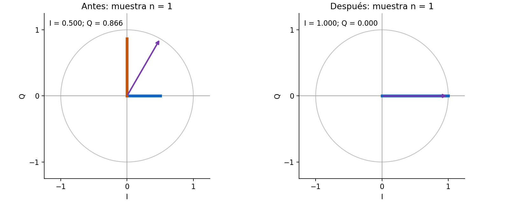
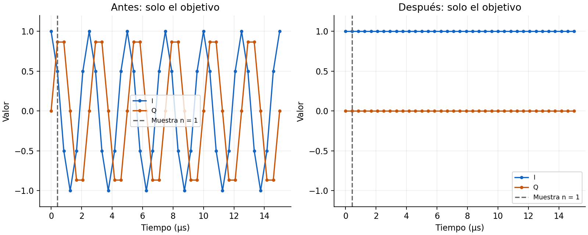
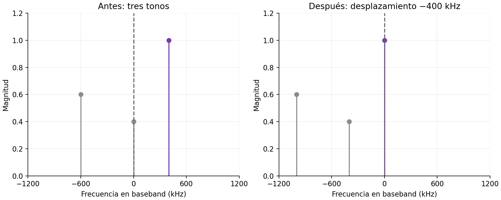

# Mezcla compleja, muestra por muestra

- **Propósito:** relacionar una misma señal con su flecha en el plano I/Q, sus muestras en el tiempo y su espectro.
- **Pregunta principal:** ¿por qué un tono de +400 kHz puede quedar como I = 1 y Q = 0 después de centrarlo, y por qué ese resultado no se aplica a cualquier señal?
- **Alcance:** ampliación opcional hacia S04, vinculada al [avance de la sección 6.6](index.md#66-y-si-interesa-la-banda-situada-fuera-del-centro). No necesita dongle ni archivos `.cu8`.

## Recorrido guiado

- **1. Sin mezcla:** al avanzar las muestras, las dos flechas se mueven igual. No se ha cambiado la señal.
- **2. Centrar en 0 Hz:** la flecha de entrada sigue girando; la de salida queda fija. Se canceló la frecuencia del tono, no la cuadratura entre los ejes I y Q.
- **3. Fase de 45°:** la salida sigue centrada, pero ahora I y Q son distintas de cero. Centrar no significa eliminar Q.
- **4. Con modulación:** incluso después de centrar el canal, su flecha y sus componentes siguen cambiando. Esa variación no se elimina con la mezcla.

Los controles se activan con JavaScript. Si no está disponible, las imágenes muestran el caso estático: tono de +400 kHz, mezcla de −400 kHz, fase inicial 0° y muestra n = 1.

<button type="button" data-preset="original" aria-pressed="true">1. Sin mezcla</button>
<button type="button" data-preset="centered" aria-pressed="false">2. Centrar en 0 Hz</button>
<button type="button" data-preset="phase" aria-pressed="false">3. Fase de 45°</button>
<button type="button" data-preset="modulated" aria-pressed="false">4. Con modulación</button>

<label for="mixer-tone">Frecuencia del objetivo <output data-value="tone" for="mixer-tone">+400 kHz</output></label>
<input id="mixer-tone" data-control="toneHz" type="range" min="-800" max="800" step="100" value="400">

<label for="mixer-frequency">Frecuencia de mezcla <output data-value="mix" for="mixer-frequency">0 kHz</output></label>
<input id="mixer-frequency" data-control="mixHz" type="range" min="-800" max="800" step="100" value="0">

<label for="mixer-phase">Fase inicial del objetivo <output data-value="phase" for="mixer-phase">0°</output></label>
<input id="mixer-phase" data-control="phaseDeg" type="range" min="0" max="180" step="15" value="0">

<label for="mixer-mode">Tipo de objetivo</label>
<select id="mixer-mode" data-control="mode">
<option value="tone">Tono puro, sin mensaje</option>
<option value="fm">Señal FM didáctica</option>
</select>

<label class="sdr-check"><input type="checkbox" data-control="neighbors" checked> Incluir los otros dos tonos en el espectro</label>

<button type="button" data-step="-1">Muestra anterior</button>
<button type="button" data-step="1">Siguiente muestra</button>
<button type="button" data-action="play" aria-pressed="false">Reproducir lentamente</button>

<label class="sdr-sample" for="mixer-sample">Muestra seleccionada: <output data-value="sample" for="mixer-sample"></output></label>
<input id="mixer-sample" data-control="sample" type="range" min="0" max="36" step="1" value="1">

La reproducción avanza 5 muestras por segundo para observarlas. El sample rate del modelo sigue siendo 2.4 MS/s; no es una reproducción en tiempo real. Después de n = 36 se vuelve a n = 0.

Antes, x₀[n]<output data-value="input"></output>

Después, y₀[n]<output data-value="output"></output>

Frecuencia del tono o centro de la banda: entrada + mezcla<output data-value="frequency"></output>

Fase de esta muestra: entrada + mezcla = salida<output data-value="phase-sum"></output>

## 1. Una muestra es un punto con dos coordenadas

<label>Caso <select data-preset-select><option value="" disabled>Parámetros modificados</option><option value="original">1. Sin mezcla</option><option value="centered">2. Centrar en 0 Hz</option><option value="phase">3. Fase de 45°</option><option value="modulated">4. Con modulación</option></select></label>
<button type="button" data-step="-1">Muestra anterior</button>
<button type="button" data-step="1">Siguiente muestra</button>
<output data-local-sample aria-label="Muestra seleccionada"></output>

**Figura 1.** Una misma muestra del objetivo antes y después de la mezcla, con sus proyecciones sobre los ejes I y Q.

- **Flecha izquierda:** representa la muestra de entrada. Su posición horizontal es I y su posición vertical es Q.
- **Flecha derecha:** representa la muestra después de multiplicarla por el oscilador complejo.
- **Caso estático:** en n = 1, la entrada tiene fase 60°. La mezcla añade −60°, por lo que la salida tiene fase 0°.
- **Longitud:** vale 1 antes y después. No se aumenta la amplitud ni se elimina una rama.

### Comprobación

- Se selecciona **«3. Fase de 45°»**. ¿La flecha centrada queda sobre el eje I? ¿Q desaparece?

??? example "Solución explicada"

    - La mezcla cancela el cambio de fase debido a +400 kHz, pero conserva la fase inicial de 45°.
    - La salida es $e^{j\pi/4}=\cos(\pi/4)+j\sin(\pi/4)$.
    - I y Q valen aproximadamente 0.707. La flecha queda entre ambos ejes; no sobre el eje I.
    - Centrar la frecuencia no obliga a que Q sea cero. El caso I = 1, Q = 0 requiere además fase inicial cero y amplitud 1.

## 2. Las curvas I/Q son las coordenadas de esa flecha

<label>Caso <select data-preset-select><option value="" disabled>Parámetros modificados</option><option value="original">1. Sin mezcla</option><option value="centered">2. Centrar en 0 Hz</option><option value="phase">3. Fase de 45°</option><option value="modulated">4. Con modulación</option></select></label>
<button type="button" data-step="-1">Muestra anterior</button>
<button type="button" data-step="1">Siguiente muestra</button>
<output data-local-sample aria-label="Muestra seleccionada"></output>

**Figura 2.** Las componentes I y Q del objetivo durante 37 muestras; la línea vertical identifica la muestra del plano I/Q.

- **Azul:** valores I, es decir, las posiciones horizontales de la flecha.
- **Naranja:** valores Q, es decir, las posiciones verticales de la misma flecha.
- **Antes:** el tono gira y sus coordenadas cambian. No son dos señales de radio distintas.
- **Después:** para el tono puro con fase inicial cero, la flecha queda fija en (1, 0). Por eso las curvas son horizontales.

### Comprobación

- Se selecciona **«2. Centrar en 0 Hz»**, se cambia la fase inicial a **90°** y se avanzan varias muestras. ¿Qué valores deberían mantenerse?

??? example "Solución explicada"

    - Para un tono puro centrado, $y_0[n]=e^{j\phi}$. Ya no hay un término de fase que crezca con n.
    - Con $\phi=90°=\pi/2$, I es $\cos(\pi/2)=0$ y Q es $\sin(\pi/2)=1$.
    - Las dos curvas siguen siendo constantes, pero ahora la componente no nula es Q.
    - No hay un traslado obligatorio de toda la señal a I: la orientación final depende de la fase inicial.

## 3. El espectro permite comprobar el desplazamiento

<label>Caso <select data-preset-select><option value="" disabled>Parámetros modificados</option><option value="original">1. Sin mezcla</option><option value="centered">2. Centrar en 0 Hz</option><option value="phase">3. Fase de 45°</option><option value="modulated">4. Con modulación</option></select></label>
<button type="button" data-step="-1">Muestra anterior</button>
<button type="button" data-step="1">Siguiente muestra</button>
<output data-local-sample aria-label="Muestra seleccionada"></output>

**Figura 3.** Espectros del bloque completo antes y después de la mezcla; centrar el objetivo no elimina las otras componentes.

- **Objetivo:** el tono original de +400 kHz se representa en morado.
- **Otros tonos:** aparecen en gris y también se desplazan −400 kHz. No desaparecen.
- **Distinción importante:** esta figura puede mostrar los tres tonos; las dos figuras anteriores muestran solamente el objetivo, aislado por construcción.
- **Línea vertical:** indica una frecuencia presente; no representa un pulso en el tiempo.

### Comprobación

- Se selecciona **«4. Con modulación»** y se desmarca **«Incluir los otros dos tonos en el espectro»**. Si el centro está en 0 Hz, ¿por qué siguen variando I y Q?

??? example "Solución explicada"

    - El objetivo modulado se representa como $x_0[n]=s[n]e^{j2\pi f_0n/f_s}$.
    - La mezcla con $f_{\mathrm{mix}}=-f_0$ cancela el factor de desplazamiento y deja $y_0[n]=s[n]$.
    - En este ejemplo FM, $s[n]=e^{j[\phi+1.2\sin(2\pi\,100000\,n/f_s)]}$. La fase de la modulación cambia entre muestras.
    - Por eso I y Q siguen variando y el espectro conserva varias componentes alrededor de cero. No toda la banda se transforma en una sola componente DC.
    - Desmarcar los otros tonos cambia la señal sintética del ejemplo. No implementa un filtro ni demuestra que la mezcla seleccione el canal.

## Qué se calcula y qué no

- **Sample rate:** $f_s=2.4$ MS/s, fijo. El avance lento de la interfaz no lo modifica.
- **Tono puro:** $x_0[n]=e^{j(2\pi f_0n/f_s+\phi)}$, de magnitud 1.
- **Mezcla:** $y_0[n]=x_0[n]e^{j2\pi f_{\mathrm{mix}}n/f_s}$. Se suman fases; no se anula la separación de 90° entre las referencias I/Q.
- **Otros tonos:** están en −600 y 0 kHz, con amplitudes 0.6 y 0.4. Una coincidencia con el objetivo muestra la suma compleja de sus contribuciones.
- **Bloque del espectro:** 240 muestras, duración 100 µs y separación entre bins de 10 kHz. La interfaz calcula una DFT directa normalizada; una FFT del mismo bloque obtiene los mismos coeficientes. Se omiten residuos numéricos menores que $10^{-7}$, no señales de una captura real.
- **FM didáctica:** el mensaje es un coseno de frecuencia $f_m=100$ kHz. El índice de modulación es $\beta=1.2$, sin unidades.
- **Desviación:** $\Delta f=\beta f_m=120$ kHz. Este valor permite observar la variación en la interfaz; no es la referencia de 75 kHz del laboratorio.
- **Límite:** centrar no equivale a filtrar, decimar ni demodular. La recuperación del mensaje necesita etapas adicionales.

### Por qué la fórmula representa FM

- **Fase:** el modelo continuo del objetivo es $\theta(t)=2\pi f_0t+\phi+\beta\sin(2\pi f_mt)$, con $t$ en segundos y $\theta(t)$ en radianes.
- **Frecuencia instantánea:** mide qué tan rápido cambia la fase. La derivada expresa esa rapidez:

$$
f_i(t)=\frac{1}{2\pi}\frac{d\theta(t)}{dt}
=f_0+\beta f_m\cos(2\pi f_mt)
=f_0+\Delta f\cos(2\pi f_mt).
$$

- **Mensaje:** el coseno hace variar la frecuencia alrededor de $f_0$. La fase contiene un seno porque acumula esa variación de frecuencia.
- **Muestreo:** la interfaz evalúa $e^{j\theta(t)}$ en $t=n/f_s$. Así obtiene las muestras de la fórmula anterior.
- **Después de centrar:** la mezcla elimina $f_0$. Permanece la variación $\Delta f\cos(2\pi f_mt)$; por eso I y Q siguen cambiando.
- **Alcance:** este ejemplo genera muestras sintéticas. No reproduce una emisora FM ni simula el filtro analógico de un receptor.

## Referencias y continuación

- [Sesión 2, sección 6.6: avance hacia la selección de canal](index.md#66-y-si-interesa-la-banda-situada-fuera-del-centro).
- [MathWorks: representación I/Q mediante complex envelope y traslación con una exponencial compleja](https://www.mathworks.com/help/signal/ug/visualize-complex-signals.html).
- [MathWorks: relación entre mensaje, fase y desviación en FM](https://www.mathworks.com/help/comm/ref/comm.fmmodulator-system-object.html).
- [Volver a la sección 6.1: interpretar las etiquetas RF](index.md#61-que-frecuencia-de-radio-representa-cada-punto).
