# Del texto al enlace BPSK — Mapa de los 24 pasos

## Propósito de la clase

El estudiante explica qué transforma cada bloque y qué problema resuelve cada paso del [laboratorio de enlace digital](laboratorio-enlace-digital.md).
La guía de construcción indica cómo montar el flowgraph. Esta clase conecta esos procedimientos con el sistema completo.

El hilo conductor es una pregunta: **¿qué debe ocurrir para que el receptor entregue exactamente el texto escrito en el transmisor?**

## Objetivos

Al finalizar el recorrido, el estudiante puede:

- Seguir un mensaje a través de texto, bytes, bits, símbolos y muestras.
- Distinguir el contenido útil, el paquete protegido y la trama transmitida.
- Explicar el propósito de los filtros y de cada función de sincronización.
- Relacionar una perturbación del canal con la función receptora que la trata.
- Identificar dónde falla un envío utilizando observaciones y contadores.
- Separar un resultado comprobado de una conclusión que el experimento todavía no permite.

## Cómo leer el mapa

Cada paso conserva las posiciones de los bloques. El mapa amplía el esquema conceptual del paso 15 de la guía.
Los bloques agrupan funciones; un recuadro puede corresponder a varios bloques de GNU Radio.

- **Naranja, borde grueso:** función estudiada en ese paso.
- **Azul:** funciones relacionadas que ayudan a explicar el experimento.
- **Gris:** contexto del sistema completo; no significa que el bloque ya esté instalado o activo.
- **T:** transmisor, TX. La fila se lee de izquierda a derecha.
- **C:** canal simulado. Las flechas continúan de derecha a izquierda.
- **R:** receptor, RX. La fila se lee de izquierda a derecha.
- **Fila inferior:** entorno, observadores, auxiliares de prueba y rama rectangular de comparación.

RRC significa *Root Raised Cosine*, raíz de coseno alzado. El paso 13 introduce este filtro para dar forma a los pulsos.

**Los mapas no son capturas de ejecución ni planos de cableado.**
El texto de cada paso declara qué ruta utiliza el experimento.
Las conexiones y los parámetros exactos permanecen en la guía.

El recorrido utiliza muestras complejas de banda base. No incluye antenas, conversión a radiofrecuencia, hardware ni propagación física.
Los efectos introducidos en el canal representan perturbaciones controladas del enlace.

!!! info "Estado del material"

    Esta clase acompaña los 24 pasos BPSK. No inicia otra sesión formal ni desarrolla todavía QPSK.
    Las capturas manuales del paso 24 quedan pendientes. Sus referencias automáticas tienen el alcance declarado en la guía.
    El archivo `end-to-end.grc` guardado en el repositorio corresponde al estado restaurado del paso 23.
    El paso 24 se aplica siguiendo la guía.

## Antes de seguir un mensaje: cinco representaciones

Un mismo contenido cambia de representación durante el recorrido.
La cantidad de elementos puede cambiar sin que cambie el texto.

| Representación | Qué significa un elemento | Ejemplo del laboratorio |
|---|---|---|
| Texto | Carácter del mensaje escrito. | La palabra `Hola` tiene cuatro caracteres. |
| Bytes | Valores de ocho bits de la codificación UTF-8. | `48 6f 6c 61`, en hexadecimal. |
| Bits | Valores individuales cero o uno. | El byte `48` se separa como `01001000`. |
| Símbolos BPSK | Elecciones de dos valores complejos posibles. | Cero selecciona −1; uno selecciona +1. |
| Muestras I/Q | Valores complejos en instantes separados por el intervalo de muestreo. | El pulso rectangular utiliza cuatro muestras por símbolo. |

La señal compleja se escribe $x[n]=I[n]+jQ[n]$.
$I$ es la componente real, $Q$ es la componente imaginaria y $j^2=-1$.
El índice $n$ cuenta muestras; no cuenta caracteres ni paquetes.

En BPSK, *Binary Phase Shift Keying*, cada símbolo transporta un bit.
El mapeo del laboratorio sitúa los símbolos en $(-1,0)$ y $(+1,0)$.
Los filtros construyen las muestras entre los instantes de símbolo.

### Tasas que no deben confundirse

La tasa $R_s$ cuenta símbolos por segundo. La tasa $f_s$ cuenta muestras por segundo.
$L$, también llamado `sps`, cuenta muestras por símbolo:

$$
f_s=L R_s.
$$

Con $R_s=1000$ símbolos/s y $L=4$, resulta $f_s=4000$ muestras/s.
Un símbolo dura 1 ms. Dos muestras consecutivas quedan separadas por 0.25 ms.
Estas son las tasas nominales; el ensayo de reloj introduce una diferencia relativa entre TX y RX.

### Tres tamaños distintos para Hola

CRC significa *Cyclic Redundancy Check*, comprobación cíclica de redundancia.
El CRC permite detectar alteraciones; no corrige bits.

| Momento de la construcción | Contenido transmitido antes del mapeo | Tamaño |
|---|---|---|
| Pasos 7–15 | Longitud interna + texto UTF-8 + CRC. | 10 bytes. |
| Pasos 16–23 | Acceso + longitud externa duplicada + paquete protegido. | 22 bytes. |
| Paso 24 | Preámbulo + acceso + longitud externa duplicada + paquete protegido. | 54 bytes. |

La longitud interna de `Hola` siempre indica cuatro bytes de texto.
Cada copia de la longitud externa indica diez bytes de paquete protegido.
Los ceros de cierre de los filtros no pertenecen a ninguno de esos campos.

El formato admite hasta 500 palabras y 5000 bytes UTF-8 de texto, sin recortar mensajes que excedan los límites.

## Recorrido de aprendizaje

| Tramo | Pregunta central | Punto de llegada |
|---|---|---|
| [Pasos 1–10](#paso-1) | ¿Cómo se representa y comprueba el mensaje? | Datos preparados, todavía sin señal temporal. |
| [Pasos 11–15](#paso-11) | ¿Cómo pasan los bits por una señal? | Recuperación con referencias ideales. |
| [Pasos 16–17](#paso-16) | ¿Cómo encuentra RX el paquete? | Detección desde bits y recepción sin etiquetas de TX. |
| [Pasos 18–23](#paso-18) | ¿Qué ocurre al perturbar la señal? | Comparación de controles y recuperación de portadora y tiempo. |
| [Paso 24](#paso-24) | ¿La cadena integrada recupera el primer envío? | Adquisición previa al acceso y comprobación conjunta. |

El orden de enseñanza incorpora primero casos fáciles de comprobar.
El orden físico de los bloques responde al procesamiento de la señal.
Por ejemplo, el mapa final sitúa Symbol Sync antes de Costas, aunque Costas se estudia antes.

## Paso 1 — Preparar el entorno de la simulación { #paso-1 }

**Pregunta guía:** ¿Qué prepara el programa antes de que exista una señal?

Options define cómo se genera y ejecuta el programa. La interfaz Qt permite introducir mensajes y observar resultados.

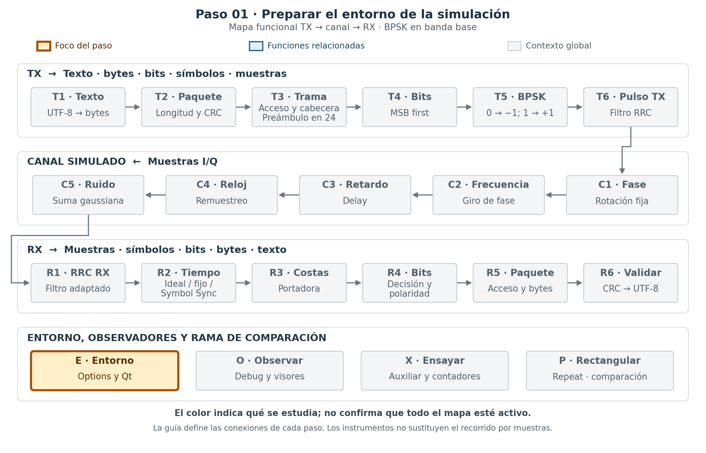
**Figura 1.** El foco del paso 1 corresponde a E · Entorno.

- **Fila TX:** La cadena de datos sirve de contexto. En este paso solo se prepara el programa.
- **Fila canal:** Todavía no existe una señal temporal en este ensayo. La fila C muestra contexto futuro.
- **Fila RX:** El receptor del mapa todavía no forma parte del ensayo.
- **Fila de entorno y observación:** E identifica las opciones y el entorno Qt; no transporta el mensaje.

[Ampliar el mapa](figures/enlace-mapa-paso-01.png).

**Entrada y salida del ensayo:** Configuración del flowgraph → programa ejecutable con interfaz Qt.

- **Qué cambia:** Se crea y guarda el archivo; se configuran sus opciones.
- **Qué permanece fijo:** Todavía no existe una cadena de transmisión ni un canal.
- **Qué se observa:** La aplicación puede abrirse y cerrarse sin errores.

**Comprobación e interpretación:** Guardar el archivo no equivale a transmitir. La extensión .grc identifica el diagrama; el ID identifica la clase del programa generado.

**Error que debe evitarse:** Un canvas vacío que ejecuta correctamente solo comprueba el entorno.

[Montaje y procedimiento del paso 1](laboratorio-enlace-digital.md#1-preparar-end-to-endgrc).

## Paso 2 — Definir la entrada de texto { #paso-2 }

**Pregunta guía:** ¿Por dónde entra la información del usuario?

QT GUI Message Edit Box recibe texto y publica un mensaje al confirmarlo. Su puerto pertenece al dominio de mensajes.

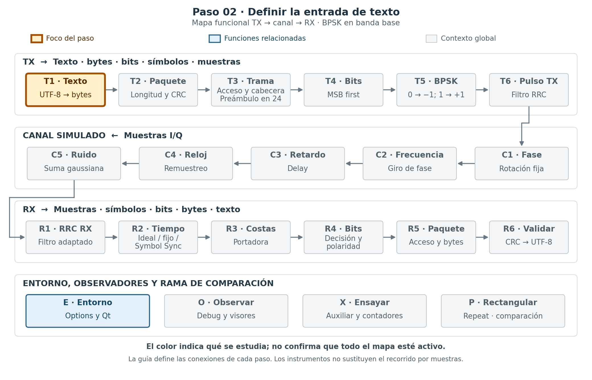
**Figura 2.** El foco del paso 2 corresponde a T1 · Texto.

- **Fila TX:** Solo se estudia la entrada de texto. La conversión UTF-8 de T1 se incorpora en el paso 5.
- **Fila canal:** Todavía no existe una señal temporal en este ensayo. La fila C muestra contexto futuro.
- **Fila RX:** El receptor del mapa todavía no forma parte del ensayo.
- **Fila de entorno y observación:** E organiza la interfaz; la publicación de mensajes se comprueba después.

[Ampliar el mapa](figures/enlace-mapa-paso-02.png).

**Entrada y salida del ensayo:** Texto escrito → mensaje interno de GNU Radio.

- **Qué cambia:** Se añade el cuadro de texto.
- **Qué permanece fijo:** No hay bytes de paquete, símbolos BPSK ni muestras.
- **Qué se observa:** El cuadro admite Hola y reconoce la confirmación con Enter.

**Comprobación e interpretación:** El puerto de mensajes no representa una entrada de muestras complejas. Los adaptadores posteriores conectarán ambos dominios.

**Error que debe evitarse:** Escribir una palabra sin confirmarla no demuestra que el bloque haya publicado el mensaje.

[Montaje y procedimiento del paso 2](laboratorio-enlace-digital.md#2-primer-bloque-qt-gui-message-edit-box).

## Paso 3 — Comprobar la interfaz antes de continuar { #paso-3 }

**Pregunta guía:** ¿Qué confirma esta primera prueba y qué queda sin comprobar?

Una prueba pequeña permite revisar la entrada sin mezclar errores de interfaz, formato y procesamiento de señal.

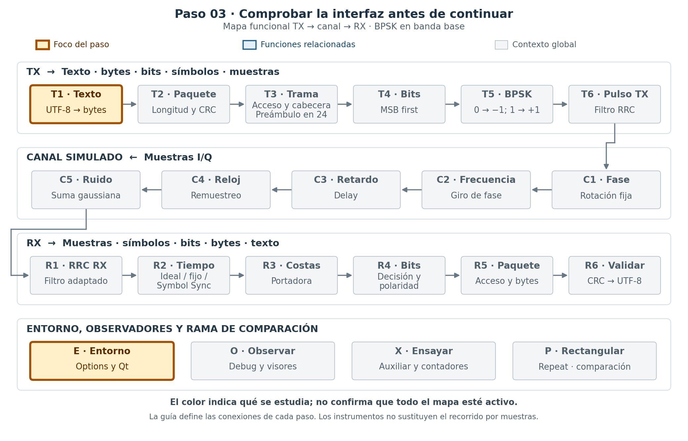
**Figura 3.** El foco del paso 3 corresponde a T1 · Texto, E · Entorno.

- **Fila TX:** Solo se estudia la entrada de texto. La conversión UTF-8 de T1 se incorpora en el paso 5.
- **Fila canal:** Todavía no existe una señal temporal en este ensayo. La fila C muestra contexto futuro.
- **Fila RX:** El receptor del mapa todavía no forma parte del ensayo.
- **Fila de entorno y observación:** E representa la comprobación de apertura, entrada y cierre de la ventana.

[Ampliar el mapa](figures/enlace-mapa-paso-03.png).

**Entrada y salida del ensayo:** Interacción del usuario → evento de publicación del cuadro de texto.

- **Qué cambia:** Se ejecuta la interfaz y se introduce el primer mensaje.
- **Qué permanece fijo:** Se conserva el cuadro del paso 2; todavía no hay un receptor.
- **Qué se observa:** La ventana aparece y responde a las acciones previstas.

**Comprobación e interpretación:** La evidencia visible solo confirma la interfaz. El paso 4 añadirá un observador de la salida.

**Error que debe evitarse:** Una ventana abierta no prueba que otro bloque haya recibido Hola.

[Montaje y procedimiento del paso 3](laboratorio-enlace-digital.md#3-comprobar-el-primer-bloque).

## Paso 4 — Observar mensajes con Message Debug { #paso-4 }

**Pregunta guía:** ¿Qué entrega realmente el cuadro de texto?

Message Debug permite inspeccionar la salida del bloque de entrada. La conexión transporta mensajes dentro del mismo programa.

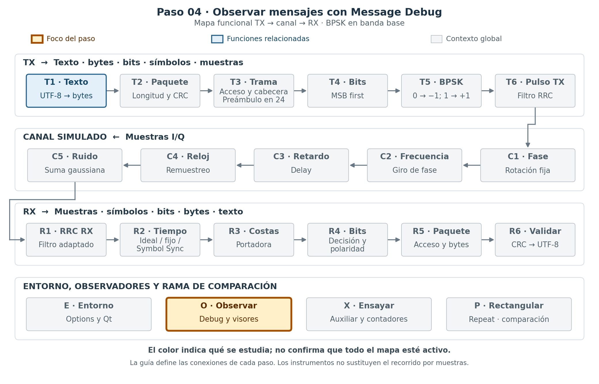
**Figura 4.** El foco del paso 4 corresponde a O · Observar.

- **Fila TX:** Solo se estudia la entrada de texto. La conversión UTF-8 de T1 se incorpora en el paso 5.
- **Fila canal:** Todavía no existe una señal temporal en este ensayo. La fila C muestra contexto futuro.
- **Fila RX:** El receptor del mapa todavía no forma parte del ensayo.
- **Fila de entorno y observación:** O identifica Message Debug, conectado a la salida de la entrada de texto.

[Ampliar el mapa](figures/enlace-mapa-paso-04.png).

**Entrada y salida del ensayo:** Mensaje del cuadro → Message Debug → texto en consola.

- **Qué cambia:** Se conecta un observador a la salida de mensajes.
- **Qué permanece fijo:** Se mantiene Hola y todavía no existe una señal modulada.
- **Qué se observa:** La consola muestra el contenido después de confirmar el envío.

**Comprobación e interpretación:** El observador recibe el mensaje, pero no realiza una recepción de radio. No existe aún una ruta a través de muestras.

**Error que debe evitarse:** Confundir una conexión de mensajes con el canal del enlace ocultaría errores posteriores del procesamiento de señal.

[Montaje y procedimiento del paso 4](laboratorio-enlace-digital.md#4-observar-el-mensaje-con-message-debug).

## Paso 5 — Codificar el texto como bytes UTF-8 { #paso-5 }

**Pregunta guía:** ¿Qué números representan el texto?

UTF-8 convierte caracteres en bytes. Una PDU, Protocol Data Unit o unidad de datos, conserva un vector junto con sus metadatos.

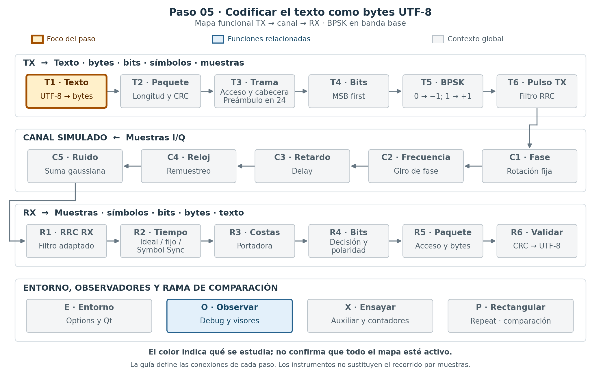
**Figura 5.** El foco del paso 5 corresponde a T1 · Texto.

- **Fila TX:** T1 convierte el texto en bytes. Los demás bloques TX todavía no intervienen.
- **Fila canal:** Todavía no existe una señal temporal en este ensayo. La fila C muestra contexto futuro.
- **Fila RX:** El receptor del mapa todavía no forma parte del ensayo.
- **Fila de entorno y observación:** O permite inspeccionar los bytes y los metadatos de la PDU.

[Ampliar el mapa](figures/enlace-mapa-paso-05.png).

**Entrada y salida del ensayo:** Mensaje de texto → PDU con bytes UTF-8.

- **Qué cambia:** Se incorpora el convertidor de texto a bytes.
- **Qué permanece fijo:** Se conserva el contenido del texto y sus espacios.
- **Qué se observa:** Hola produce 48 6f 6c 61 en hexadecimal: cuatro bytes.

**Comprobación e interpretación:** La cantidad de caracteres puede diferir de la cantidad de bytes. La letra á ocupa dos bytes en UTF-8.

**Error que debe evitarse:** Una PDU de cuatro bytes todavía no contiene cuatro símbolos ni cuatro muestras.

[Montaje y procedimiento del paso 5](laboratorio-enlace-digital.md#5-convertir-texto-en-bytes-utf-8).

## Paso 6 — Comprobar la conversión inversa { #paso-6 }

**Pregunta guía:** ¿La codificación permite recuperar exactamente el texto?

El convertidor inverso interpreta los bytes como UTF-8. Esta prueba conecta los convertidores directamente mediante mensajes.

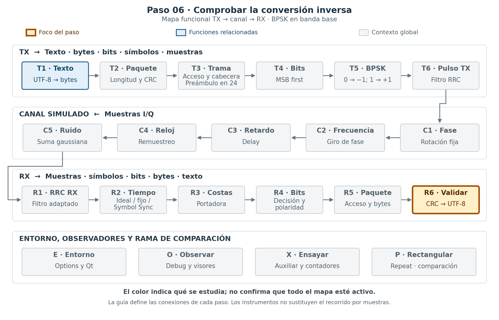
**Figura 6.** El foco del paso 6 corresponde a R6 · Validar.

- **Fila TX:** T1 convierte el texto en bytes. Los demás bloques TX todavía no intervienen.
- **Fila canal:** Todavía no existe una señal temporal en este ensayo. La fila C muestra contexto futuro.
- **Fila RX:** R6 señala la decodificación UTF-8. Se conecta directamente por mensajes, sin filtros, sincronizadores ni CRC.
- **Fila de entorno y observación:** O muestra el texto recuperado por la conexión directa.

[Ampliar el mapa](figures/enlace-mapa-paso-06.png).

**Entrada y salida del ensayo:** Texto → bytes UTF-8 → texto recuperado, sin atravesar el canal del mapa.

- **Qué cambia:** Se añade la conversión de bytes a texto.
- **Qué permanece fijo:** No se añade todavía longitud, CRC ni modulación.
- **Qué se observa:** El texto recuperado coincide con el original, incluidos sus espacios.

**Comprobación e interpretación:** R6 señala la función de decodificación que luego pertenecerá al receptor. Su comprobador CRC todavía no forma parte de este ensayo.

**Error que debe evitarse:** Esta recuperación valida la representación del texto; todavía no valida un enlace de muestras.

[Montaje y procedimiento del paso 6](laboratorio-enlace-digital.md#6-recuperar-el-texto-desde-los-bytes).

## Paso 7 — Construir un paquete que pueda comprobarse { #paso-7 }

**Pregunta guía:** ¿Cómo sabrá el receptor cuántos bytes pertenecen al texto?

El constructor añade dos bytes de longitud y cuatro de CRC-32. El CRC, Cyclic Redundancy Check, permite detectar alteraciones del paquete.

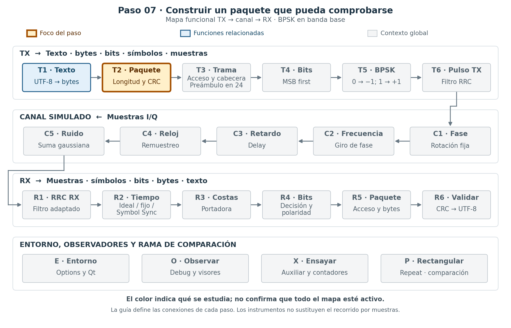
**Figura 7.** El foco del paso 7 corresponde a T2 · Paquete.

- **Fila TX:** T2 construye el paquete protegido. T3, el acceso, todavía no interviene.
- **Fila canal:** Todavía no existe una señal temporal en este ensayo. La fila C muestra contexto futuro.
- **Fila RX:** El comprobador R6 se incorporará después. El ensayo actual inspecciona el paquete construido.
- **Fila de entorno y observación:** O muestra el vector con longitud, texto y CRC.

[Ampliar el mapa](figures/enlace-mapa-paso-07.png).

**Entrada y salida del ensayo:** 4 bytes de Hola → 2 de longitud + 4 de texto + 4 de CRC = 10 bytes.

- **Qué cambia:** Se incorpora el formato del paquete protegido.
- **Qué permanece fijo:** Los bytes UTF-8 del texto permanecen iguales.
- **Qué se observa:** La longitud interna vale cuatro, aunque el paquete completo contiene diez bytes.

**Comprobación e interpretación:** El CRC se calcula sobre longitud y texto. No incluye su propio campo. Los límites se aplican a palabras y bytes del texto.

**Error que debe evitarse:** El CRC detecta errores; no corrige bits ni autentica al emisor.

[Montaje y procedimiento del paso 7](laboratorio-enlace-digital.md#7-construir-el-paquete).

## Paso 8 — Validar antes de entregar el texto { #paso-8 }

**Pregunta guía:** ¿Qué condiciones permiten aceptar un paquete?

El comprobador interpreta la longitud y verifica el CRC antes de entregar los bytes al convertidor UTF-8.

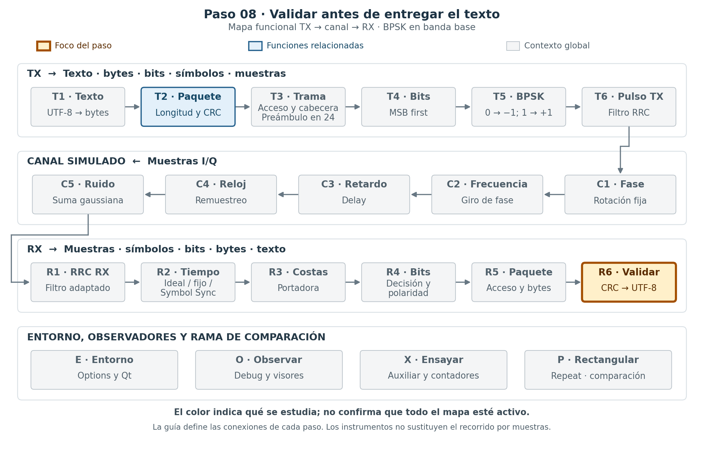
**Figura 8.** El foco del paso 8 corresponde a R6 · Validar.

- **Fila TX:** T2 construye el paquete protegido. T3, el acceso, todavía no interviene.
- **Fila canal:** Todavía no existe una señal temporal en este ensayo. La fila C muestra contexto futuro.
- **Fila RX:** El comprobador y el decodificador R6 reciben una PDU por conexión directa; no atraviesan el canal.
- **Fila de entorno y observación:** O permite observar la aceptación o el motivo de rechazo.

[Ampliar el mapa](figures/enlace-mapa-paso-08.png).

**Entrada y salida del ensayo:** Paquete protegido → comprobación → bytes útiles → texto.

- **Qué cambia:** Se conecta el comprobador al constructor por la ruta directa de PDU.
- **Qué permanece fijo:** Se conserva el formato del paso 7; el canal del mapa sigue sin utilizarse.
- **Qué se observa:** Hola se acepta cuando tamaño, longitud y CRC son coherentes.

**Comprobación e interpretación:** La salida aceptada es una decisión del protocolo. El comprobador no necesita conocer de antemano que el usuario escribió Hola.

**Error que debe evitarse:** Comparar solo lo enviado y lo mostrado no sustituye la comprobación del paquete recibido.

[Montaje y procedimiento del paso 8](laboratorio-enlace-digital.md#8-comprobar-el-paquete-y-recuperar-el-texto).

## Paso 9 — Introducir un error deliberado { #paso-9 }

**Pregunta guía:** ¿El receptor rechaza una alteración sin perder los mensajes siguientes?

Un auxiliar de prueba cambia un bit del segundo paquete después de calcular el CRC. La referencia exige rechazo, no recuperación de ese paquete.

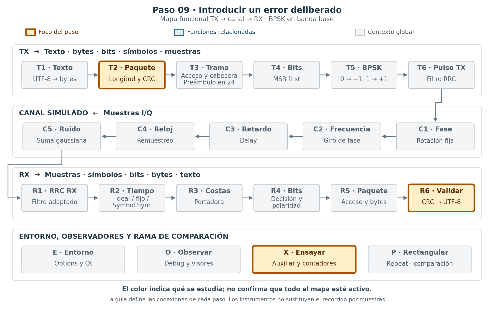
**Figura 9.** El foco del paso 9 corresponde a T2 · Paquete, R6 · Validar, X · Ensayar.

- **Fila TX:** T2 construye el paquete protegido. T3, el acceso, todavía no interviene.
- **Fila canal:** Todavía no existe una señal temporal en este ensayo. La fila C muestra contexto futuro.
- **Fila RX:** El comprobador y el decodificador R6 reciben una PDU por conexión directa; no atraviesan el canal.
- **Fila de entorno y observación:** X representa el auxiliar que altera el segundo paquete. O muestra los tres resultados.

[Ampliar el mapa](figures/enlace-mapa-paso-09.png).

**Entrada y salida del ensayo:** Paquete válido → alteración controlada → comprobador → rechazo del segundo envío.

- **Qué cambia:** El auxiliar altera únicamente el segundo paquete de tres envíos.
- **Qué permanece fijo:** Se envía el mismo texto y se conserva el comprobador.
- **Qué se observa:** El primer y el tercer paquete se aceptan; el segundo se rechaza.

**Comprobación e interpretación:** El auxiliar es un instrumento de prueba. Más adelante se repite este control a través de las muestras.

**Error que debe evitarse:** Este error deliberado no representa todavía ruido gaussiano ni un modelo de canal.

[Montaje y procedimiento del paso 9](laboratorio-enlace-digital.md#9-comprobar-el-rechazo-de-un-bit-alterado).

## Paso 10 — Separar cada byte en ocho bits { #paso-10 }

**Pregunta guía:** ¿Cambió el contenido o cambió su representación?

Bytes a bits entrega un elemento por bit, en orden MSB first: primero el bit más significativo de cada byte.

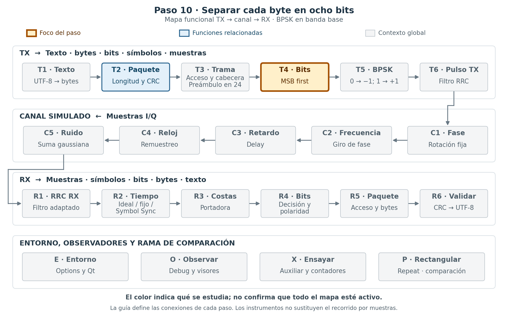
**Figura 10.** El foco del paso 10 corresponde a T4 · Bits.

- **Fila TX:** T4 separa los bytes del paquete en bits. No añade información nueva.
- **Fila canal:** Todavía no existe una señal temporal en este ensayo. La fila C muestra contexto futuro.
- **Fila RX:** El comprobador y el decodificador R6 reciben una PDU por conexión directa; no atraviesan el canal.
- **Fila de entorno y observación:** O permite contar y revisar los bits del vector.

[Ampliar el mapa](figures/enlace-mapa-paso-10.png).

**Entrada y salida del ensayo:** Paquete de 10 bytes → vector de 80 bits individuales.

- **Qué cambia:** Se cambia la representación y la cantidad de elementos del vector.
- **Qué permanece fijo:** La secuencia de información del paquete y su CRC permanecen iguales.
- **Qué se observa:** El byte de H, 0x48, aparece como 01001000.

**Comprobación e interpretación:** Ochenta elementos con valores cero o uno no significan ochenta bytes de texto. Cada elemento representa un bit.

**Error que debe evitarse:** El orden de bits dentro del byte y el orden de bytes dentro de un campo son decisiones diferentes.

[Montaje y procedimiento del paso 10](laboratorio-enlace-digital.md#10-representar-el-paquete-mediante-bits).

## Paso 11 — Mapear los bits a símbolos BPSK { #paso-11 }

**Pregunta guía:** ¿Qué valor complejo representa cada bit?

BPSK, Binary Phase Shift Keying, asigna dos estados de fase. El laboratorio utiliza 0 → −1 y 1 → +1, con componente imaginaria cero.

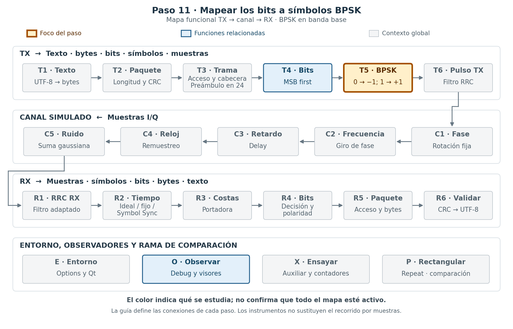
**Figura 11.** El foco del paso 11 corresponde a T5 · BPSK.

- **Fila TX:** T5 transforma bits en símbolos. Todavía no actúa el filtro RRC T6.
- **Fila canal:** Todavía no existe una señal temporal en este ensayo. La fila C muestra contexto futuro.
- **Fila RX:** Los bloques RX son contexto futuro. Los visores actuales observan el transmisor.
- **Fila de entorno y observación:** O reúne constelación y consola; los visores no actúan como receptor.

[Ampliar el mapa](figures/enlace-mapa-paso-11.png).

**Entrada y salida del ensayo:** 80 bits → 80 símbolos complejos, situados en (−1, 0) y (+1, 0).

- **Qué cambia:** El adaptador pasa de PDU a tagged stream, flujo con etiquetas, y Chunks to Symbols aplica el mapeo.
- **Qué permanece fijo:** Cada bit conserva su posición; todavía no se forman varios valores temporales por símbolo.
- **Qué se observa:** La constelación TX tiene dos posiciones posibles.

**Comprobación e interpretación:** Un símbolo es una elección del alfabeto de modulación. Una muestra es un valor de la señal en un instante.

**Error que debe evitarse:** La constelación no muestra por sí sola el orden temporal de los símbolos.

[Montaje y procedimiento del paso 11](laboratorio-enlace-digital.md#11-asociar-bits-con-simbolos-bpsk).

## Paso 12 — Construir muestras con un pulso rectangular { #paso-12 }

**Pregunta guía:** ¿Cómo adquieren duración los símbolos?

Repeat representa cada símbolo mediante L muestras iguales. L es samples per symbol, muestras por símbolo, y corresponde a sps.

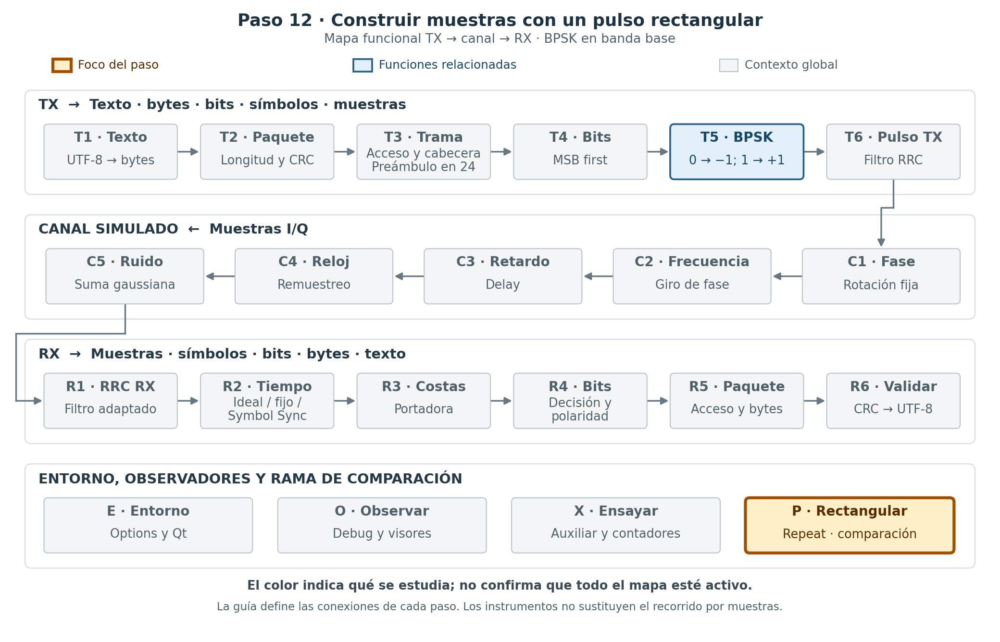
**Figura 12.** El foco del paso 12 corresponde a P · Rectangular.

- **Fila TX:** T5 alimenta la rama rectangular P. La cadena RRC T6 permanece como contexto futuro.
- **Fila canal:** El recorrido de muestras es ideal. No se introducen las perturbaciones de la fila C.
- **Fila RX:** Los bloques RX son contexto futuro. Los visores actuales observan el transmisor.
- **Fila de entorno y observación:** P produce la señal rectangular. O muestra I y Q en el tiempo.

[Ampliar el mapa](figures/enlace-mapa-paso-12.png).

**Entrada y salida del ensayo:** 80 símbolos → 320 muestras complejas con sps = 4.

- **Qué cambia:** Se añade la rama rectangular de comparación; el bloque T6 RRC todavía no interviene.
- **Qué permanece fijo:** La tasa de símbolos vale 1000 símbolos/s y el paquete conserva sus bits.
- **Qué se observa:** La tasa de muestreo vale 4000 muestras/s. I presenta escalones y Q permanece en cero.

**Comprobación e interpretación:** Cuatro muestras por símbolo separan las tasas. No multiplican por cuatro la cantidad de bits del mensaje.

**Error que debe evitarse:** El eje temporal del visor expresa tiempo de señal. No obliga al computador a esperar esa duración.

[Montaje y procedimiento del paso 12](laboratorio-enlace-digital.md#12-construir-la-senal-en-el-dominio-del-tiempo).

## Paso 13 — Dar forma RRC y cerrar la ráfaga { #paso-13 }

**Pregunta guía:** ¿Por qué el último mensaje necesita muestras de cierre?

El filtro Root Raised Cosine, RRC o raíz de coseno alzado, interpola y da forma a los pulsos. Su memoria continúa después del último símbolo.

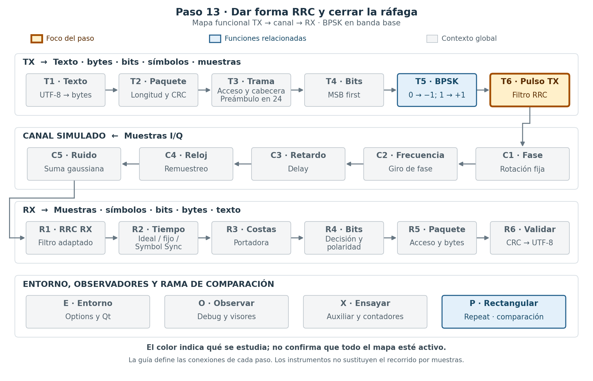
**Figura 13.** El foco del paso 13 corresponde a T6 · Pulso TX.

- **Fila TX:** La rama RRC T6 produce las muestras TX. T3 todavía no añade una envoltura de trama.
- **Fila canal:** El recorrido de muestras es ideal. No se introducen las perturbaciones de la fila C.
- **Fila RX:** Los bloques RX son contexto futuro. Los visores actuales observan el transmisor.
- **Fila de entorno y observación:** P conserva la comparación rectangular. O permite leer la respuesta RRC y su cierre.

[Ampliar el mapa](figures/enlace-mapa-paso-13.png).

**Entrada y salida del ensayo:** 80 símbolos + 8 ceros de cierre → 88 elementos → 352 muestras RRC.

- **Qué cambia:** Se añade la rama RRC y se compara con la rama rectangular.
- **Qué permanece fijo:** Se conservan BPSK, el paquete y las tasas nominales.
- **Qué se observa:** Las transiciones dejan de ser escalones. El cierre permite observar la respuesta del filtro al último símbolo.

**Comprobación e interpretación:** Los ocho ceros no representan bits adicionales. Los parámetros de referencia son roll-off α = 0.35 y 33 coeficientes.

**Error que debe evitarse:** La forma RRC no debe interpretarse como una lista de niveles BPSK constantes entre símbolos.

[Montaje y procedimiento del paso 13](laboratorio-enlace-digital.md#13-construir-un-pulso-rrc-y-observar-el-cierre-del-paquete).

## Paso 14 — Recibir con filtro y tiempo conocidos { #paso-14 }

**Pregunta guía:** ¿En qué instantes recupera el receptor los símbolos?

El matched filter, filtro adaptado, utiliza la forma RRC del transmisor. La primera selección conoce el retardo y los límites de la PDU.

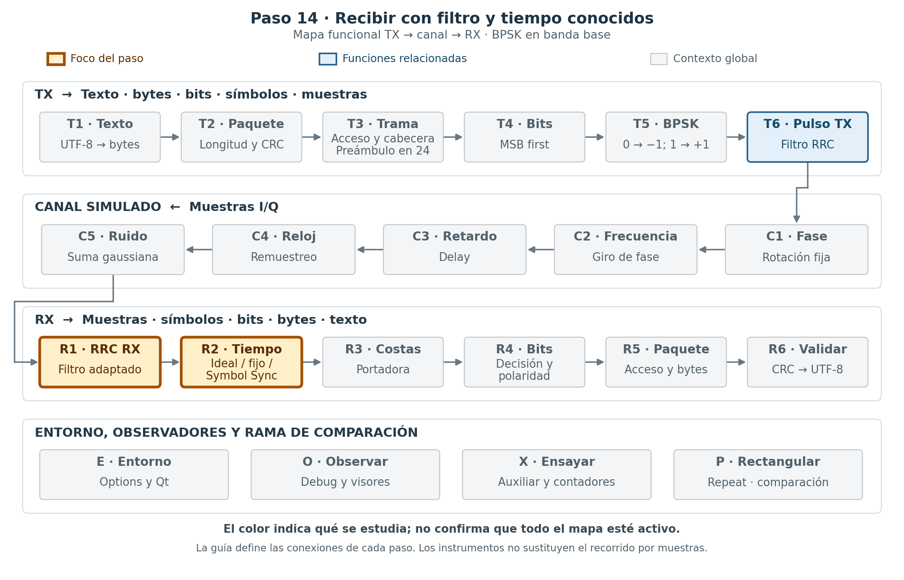
**Figura 14.** El foco del paso 14 corresponde a R1 · RRC RX, R2 · Tiempo.

- **Fila TX:** La rama RRC T6 produce las muestras TX. T3 todavía no añade una envoltura de trama.
- **Fila canal:** El recorrido de muestras es ideal. No se introducen las perturbaciones de la fila C.
- **Fila RX:** R1 filtra y R2 selecciona con referencias ideales. Todavía no se utiliza Symbol Sync.
- **Fila de entorno y observación:** O distingue el registro completo de las muestras seleccionadas.

[Ampliar el mapa](figures/enlace-mapa-paso-14.png).

**Entrada y salida del ensayo:** Muestras RRC → cierre RX y filtro RRC → selección ideal → 80 símbolos.

- **Qué cambia:** Se añade el filtro receptor y se compensa el retardo conjunto.
- **Qué permanece fijo:** El canal sigue ideal; sps y la fase de selección son conocidos.
- **Qué se observa:** Con 33 coeficientes por filtro, el retardo conjunto es 32 muestras. Se seleccionan los índices 32, 36, 40 y siguientes.

**Comprobación e interpretación:** El registro de Hola tiene 384 muestras con ambos cierres. Solo 80 muestras seleccionadas representan los símbolos del paquete.

**Error que debe evitarse:** Esta selección ideal no estima un reloj desconocido. Todavía recibe información de delimitación mediante etiquetas internas.

[Montaje y procedimiento del paso 14](laboratorio-enlace-digital.md#14-filtrar-en-el-receptor-ideal-y-seleccionar-los-simbolos).

## Paso 15 — Recuperar bits, bytes y el paquete { #paso-15 }

**Pregunta guía:** ¿La ruta de muestras conserva el mensaje y permite detectar errores?

El receptor toma I, decide un bit por su signo, reúne ocho bits por byte y entrega el paquete al comprobador.

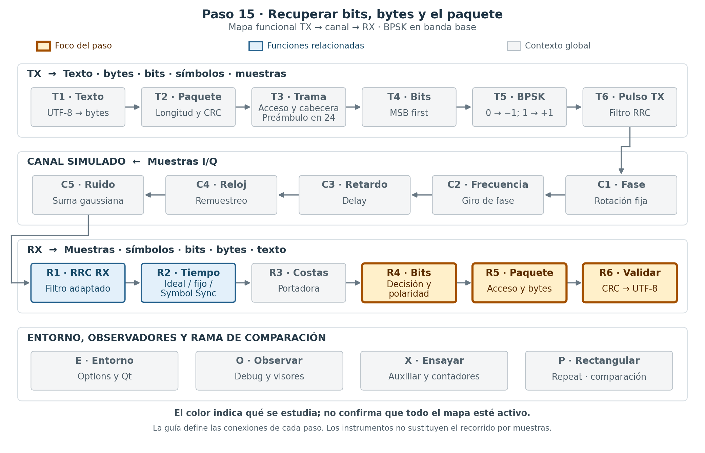
**Figura 15.** El foco del paso 15 corresponde a R4 · Bits, R5 · Paquete, R6 · Validar.

- **Fila TX:** La rama RRC T6 produce las muestras TX. T3 todavía no añade una envoltura de trama.
- **Fila canal:** El recorrido de muestras es ideal. No se introducen las perturbaciones de la fila C.
- **Fila RX:** R4 decide los bits y R5 reconstruye bytes con límites conocidos. La detección de acceso todavía no interviene.
- **Fila de entorno y observación:** O permite comprobar símbolos, bytes y resultado del CRC.

[Ampliar el mapa](figures/enlace-mapa-paso-15.png).

**Entrada y salida del ensayo:** 80 símbolos RX → 80 bits → 10 bytes → CRC correcto → Hola.

- **Qué cambia:** Se cierra la recuperación de datos a través de las muestras.
- **Qué permanece fijo:** Se mantiene la selección ideal; los límites del paquete todavía son conocidos.
- **Qué se observa:** Hola, SDR y el texto Unicode se recuperan. La alteración deliberada sigue produciendo rechazo.

**Comprobación e interpretación:** R5 agrupa la reconstrucción de bytes. Su detector de acceso se añadirá en el paso 16.

**Error que debe evitarse:** Una constelación con dos grupos no demuestra que los bytes estén ordenados ni que el CRC sea correcto.

[Montaje y procedimiento del paso 15](laboratorio-enlace-digital.md#15-recuperar-los-bytes-y-comprobar-el-paquete).

## Paso 16 — Detectar acceso y longitud desde los bits { #paso-16 }

**Pregunta guía:** ¿Cómo encuentra el receptor dónde empieza el paquete?

TX añade una palabra de acceso y una cabecera externa duplicada. RX busca el acceso y crea una etiqueta nueva desde los bits recibidos.

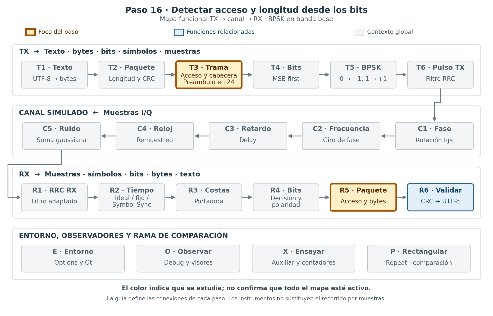
**Figura 16.** El foco del paso 16 corresponde a T3 · Trama, R5 · Paquete.

- **Fila TX:** T3 añade acceso y cabecera. La trama de Hola contiene 22 bytes antes del mapeo.
- **Fila canal:** El recorrido de muestras es ideal. No se introducen las perturbaciones de la fila C.
- **Fila RX:** R5 detecta el acceso; R2 todavía selecciona con referencias ideales.
- **Fila de entorno y observación:** O permite inspeccionar la detección y la longitud creada por RX.

[Ampliar el mapa](figures/enlace-mapa-paso-16.png).

**Entrada y salida del ensayo:** 10 bytes protegidos → trama de 22 bytes → detección → paquete original de 10 bytes.

- **Qué cambia:** La envoltura añade ocho bytes de acceso y cuatro de longitud externa.
- **Qué permanece fijo:** La longitud interna de Hola sigue siendo cuatro y su CRC no cambia.
- **Qué se observa:** Las dos copias externas valen diez. El detector entrega 80 bits del paquete protegido.

**Comprobación e interpretación:** La palabra de acceso viaja en la señal. packet_len es una etiqueta de GNU Radio y no viaja como muestra.

**Error que debe evitarse:** Este paso resuelve la detección del paquete; la selección de instantes todavía utiliza referencias ideales.

[Montaje y procedimiento del paso 16](laboratorio-enlace-digital.md#16-detectar-el-comienzo-y-la-longitud-desde-los-bits).

## Paso 17 — Recibir muestras sin etiquetas del transmisor { #paso-17 }

**Pregunta guía:** ¿Qué debe descubrir RX y qué sigue suponiendo conocido?

La frontera elimina las etiquetas de delimitación antes del receptor. Keep M in N conserva una muestra por símbolo con una fase nominal fija.

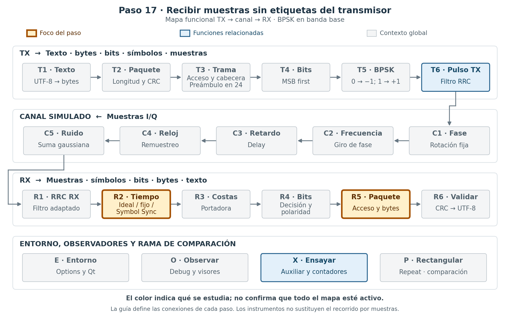
**Figura 17.** El foco del paso 17 corresponde a R2 · Tiempo, R5 · Paquete.

- **Fila TX:** T3 añade acceso y cabecera. La trama de Hola contiene 22 bytes antes del mapeo.
- **Fila canal:** El recorrido de muestras es ideal. No se introducen las perturbaciones de la fila C.
- **Fila RX:** R2 utiliza selección nominal fija. R5 detecta el paquete y R6 lo comprueba. Costas todavía no interviene.
- **Fila de entorno y observación:** O observa el stream; los auxiliares no entregan el texto directamente a RX.

[Ampliar el mapa](figures/enlace-mapa-paso-17.png).

**Entrada y salida del ensayo:** Stream de muestras sin etiquetas privadas → selección fija → bits → acceso → paquete.

- **Qué cambia:** La recepción deja de utilizar la PDU delimitada por TX.
- **Qué permanece fijo:** Se conocen la tasa nominal, la fase de selección y el retardo de los filtros.
- **Qué se observa:** Cada mensaje, incluido el último, se recibe sin enviar otro para completar buffers.

**Comprobación e interpretación:** El detector genera sus propias etiquetas. El selector fijo todavía no estima un error temporal desconocido.

El visor puede incluir arranque, cierre y muestras fuera del instante adecuado.
Los puntos cercanos al origen no añaden un tercer símbolo al alfabeto BPSK.

**Error que debe evitarse:** Un stream sin etiquetas de paquete no implica señal de duración infinita. Durante las pausas no se añaden muestras artificiales.

[Montaje y procedimiento del paso 17](laboratorio-enlace-digital.md#17-recibir-desde-un-stream-sin-etiquetas-de-delimitacion).

## Paso 18 — Añadir ruido y contar cada etapa { #paso-18 }

**Pregunta guía:** ¿En qué etapa se pierde un envío?

El canal suma ruido gaussiano complejo antes del filtro RX. Los contadores separan envíos, detecciones, paquetes completos y textos aceptados.

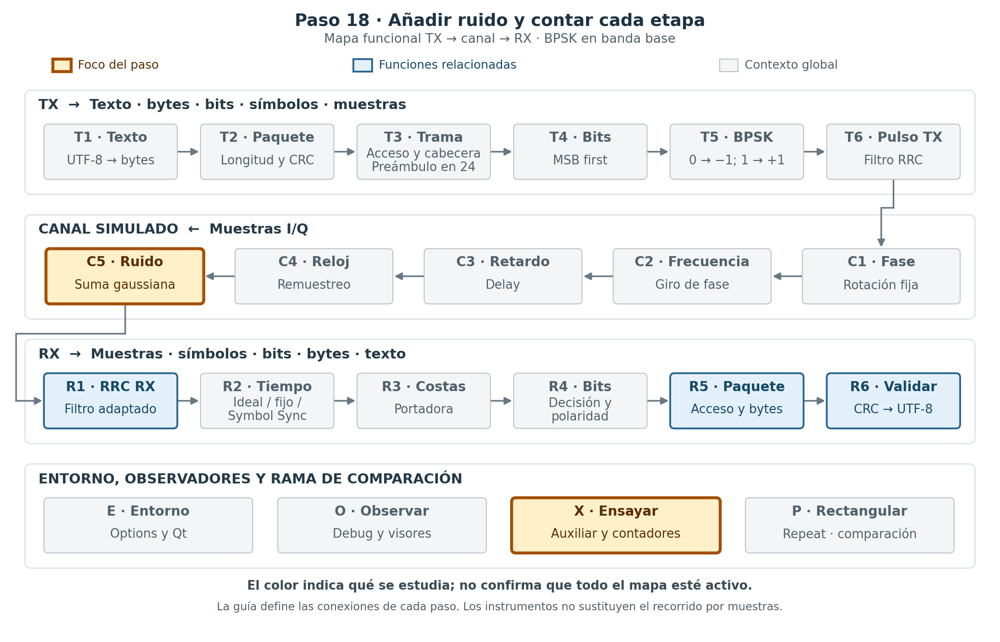
**Figura 18.** El foco del paso 18 corresponde a C5 · Ruido, X · Ensayar.

- **Fila TX:** T3 añade acceso y cabecera. La trama de Hola contiene 22 bytes antes del mapeo.
- **Fila canal:** Solo C5 añade ruido. Los demás desajustes permanecen en cero.
- **Fila RX:** R2 utiliza selección nominal fija. R5 detecta el paquete y R6 lo comprueba. Costas todavía no interviene.
- **Fila de entorno y observación:** X incorpora los contadores. O permite relacionar dispersión y resultado de los envíos.

[Ampliar el mapa](figures/enlace-mapa-paso-18.png).

**Entrada y salida del ensayo:** Muestras limpias + ruido → muestras RX → DET → RX → OK.

- **Qué cambia:** Se cambia ruido_amplitud y se declara la semilla del ensayo.
- **Qué permanece fijo:** Se conserva el corpus y se mantienen los demás desajustes en cero.
- **Qué se observa:** Las muestras se dispersan. El resumen permite distinguir ausencia de detección y rechazo del paquete.

**Comprobación e interpretación:** TX cuenta envíos; DET cuenta detecciones; RX cuenta paquetes completos; OK cuenta textos aceptados. La amplitud del generador no es una SNR.

**Error que debe evitarse:** El CRC no elimina ruido. Un lote pequeño tampoco establece una tasa de error estadística para cualquier mensaje.

[Montaje y procedimiento del paso 18](laboratorio-enlace-digital.md#18-anadir-ruido-gaussiano-y-contar-resultados).

## Paso 19 — Introducir fase y observar Costas { #paso-19 }

**Pregunta guía:** ¿Alinear los grupos garantiza interpretar sus bits?

Una fase constante rota la señal. El Costas Loop, lazo de recuperación de portadora, busca alinear los símbolos BPSK con el eje real.

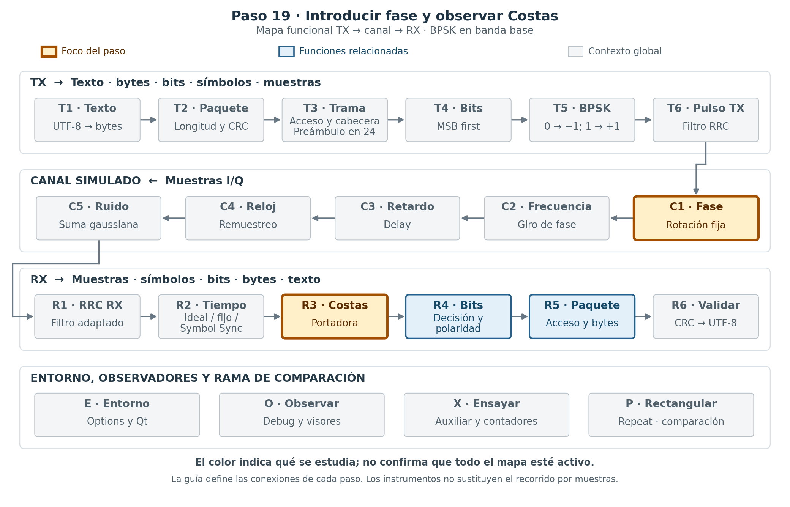
**Figura 19.** El foco del paso 19 corresponde a C1 · Fase, R3 · Costas.

- **Fila TX:** T3 añade acceso y cabecera. La trama de Hola contiene 22 bytes antes del mapeo.
- **Fila canal:** C1 aplica una fase constante; los demás desajustes permanecen en cero.
- **Fila RX:** R3 recupera portadora después de la selección fija. La segunda hipótesis de polaridad todavía no interviene.
- **Fila de entorno y observación:** O compara las constelaciones antes y después de Costas.

[Ampliar el mapa](figures/enlace-mapa-paso-19.png).

**Entrada y salida del ensayo:** Símbolos rotados → Costas de orden 2 → símbolos alineados, con posible inversión.

- **Qué cambia:** Se aplica fase constante y se compara el receptor con Costas y sin Costas.
- **Qué permanece fijo:** No se introduce todavía desajuste de frecuencia ni deriva de reloj.
- **Qué se observa:** Los grupos rotan antes del lazo. Después pueden quedar alineados, pero intercambiados.

**Comprobación e interpretación:** BPSK presenta una ambigüedad de 180°. El control de 120° conserva un fallo que el siguiente paso debe resolver.

**Error que debe evitarse:** Una alineación geométrica correcta no establece cuál grupo significa cero.

[Montaje y procedimiento del paso 19](laboratorio-enlace-digital.md#19-introducir-una-rotacion-constante-y-recuperar-fase).

## Paso 20 — Resolver la polaridad con el protocolo { #paso-20 }

**Pregunta guía:** ¿Qué hipótesis convierte la alineación en bits interpretables?

El receptor prueba los bits normales y sus complementos. Cada ruta busca la misma palabra de acceso y entrega el paquete al mismo comprobador.

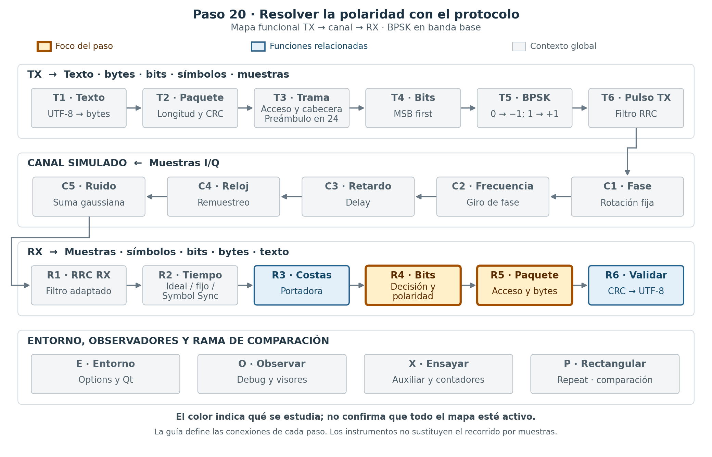
**Figura 20.** El foco del paso 20 corresponde a R4 · Bits, R5 · Paquete.

- **Fila TX:** T3 añade acceso y cabecera. La trama de Hola contiene 22 bytes antes del mapeo.
- **Fila canal:** C1 aplica una fase constante; los demás desajustes permanecen en cero.
- **Fila RX:** R2 sigue fijo. R3 conserva Costas y R4–R5 prueban las dos polaridades.
- **Fila de entorno y observación:** O permite identificar la ruta normal o invertida que entrega el paquete.

[Ampliar el mapa](figures/enlace-mapa-paso-20.png).

**Entrada y salida del ensayo:** Bits decididos → hipótesis normal e invertida → acceso y CRC → texto aceptado.

- **Qué cambia:** Se añade la segunda hipótesis de polaridad.
- **Qué permanece fijo:** Se conserva Costas, la palabra de acceso, el paquete y el CRC.
- **Qué se observa:** El caso de 120° puede recuperar el texto por la ruta invertida.

**Comprobación e interpretación:** El receptor utiliza estructura transmitida y CRC. No recibe la fase exacta del canal para elegir la polaridad.

**Error que debe evitarse:** Invertir los bits resuelve la ambigüedad de signo. No corrige una selección temporal errónea.

[Montaje y procedimiento del paso 20](laboratorio-enlace-digital.md#20-resolver-la-polaridad-bpsk-y-recuperar-el-caso-de-120).

## Paso 21 — Seguir una diferencia de frecuencia { #paso-21 }

**Pregunta guía:** ¿Qué cambia cuando la fase gira durante el mensaje?

Un frequency offset, desajuste de frecuencia, acumula fase con el tiempo. El Costas existente estima y sigue esa evolución dentro de las condiciones ensayadas.

El desajuste se expresa en Hz, hertz o ciclos por segundo.

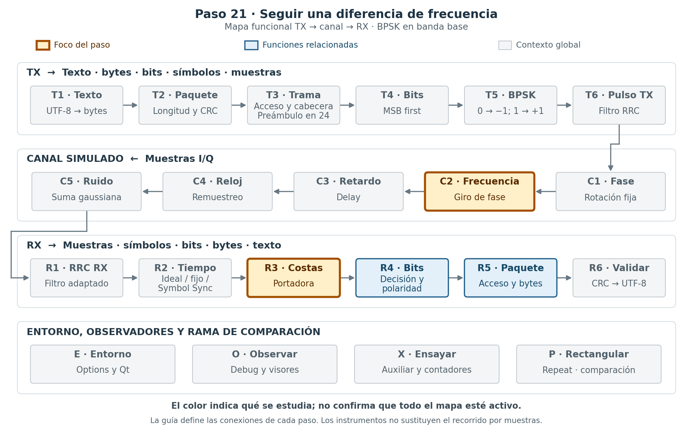
**Figura 21.** El foco del paso 21 corresponde a C2 · Frecuencia, R3 · Costas.

- **Fila TX:** T3 añade acceso y cabecera. La trama de Hola contiene 22 bytes antes del mapeo.
- **Fila canal:** C2 introduce una diferencia de frecuencia. Se estudia su efecto con los demás desajustes en cero.
- **Fila RX:** R2 sigue fijo. R3 conserva Costas y R4–R5 prueban las dos polaridades.
- **Fila de entorno y observación:** O incluye la estimación de frecuencia expresada en Hz.

[Ampliar el mapa](figures/enlace-mapa-paso-21.png).

**Entrada y salida del ensayo:** Muestras con giro progresivo → Costas → símbolos corregidos y estimación de frecuencia.

- **Qué cambia:** El Rotator introduce un desajuste en Hz y se observa la estimación del lazo.
- **Qué permanece fijo:** Se mantienen el tiempo nominal, ambas polaridades y el formato del paquete.
- **Qué se observa:** Con +10 Hz, la estimación debe acercarse a +10 Hz después del arranque.

**Comprobación e interpretación:** La fase constante y la diferencia de frecuencia son magnitudes distintas. Sus unidades son grados o radianes y Hz, respectivamente.

**Error que debe evitarse:** Una fase que cambia durante el paquete no se compensa mediante una sola rotación constante. La fila −10 Hz queda para el alumno.

[Montaje y procedimiento del paso 21](laboratorio-enlace-digital.md#21-introducir-un-desajuste-de-frecuencia-y-recuperarlo-con-costas).

## Paso 22 — Separar retardo y fase de muestreo { #paso-22 }

**Pregunta guía:** ¿Qué ocurre si RX decide entre los instantes adecuados?

Delay desplaza las muestras. Un selector fijo puede tomar muestras entre símbolos; cambiar offset_muestreo permite un control manual con retardo conocido.

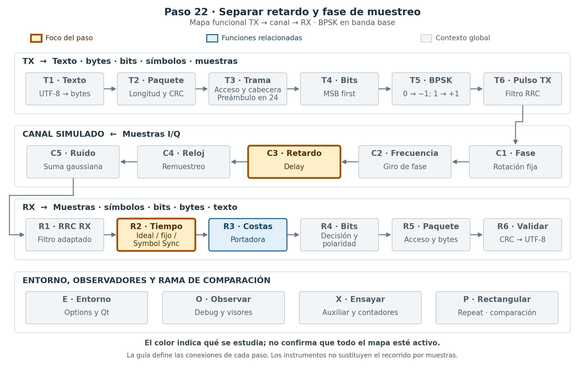
**Figura 22.** El foco del paso 22 corresponde a C3 · Retardo, R2 · Tiempo.

- **Fila TX:** T3 añade acceso y cabecera. La trama de Hola contiene 22 bytes antes del mapeo.
- **Fila canal:** C3 desplaza la señal; las tasas permanecen iguales.
- **Fila RX:** R2 sigue fijo. R3 conserva Costas y R4–R5 prueban las dos polaridades.
- **Fila de entorno y observación:** O compara constelaciones y resumen en las tres condiciones temporales.

[Ampliar el mapa](figures/enlace-mapa-paso-22.png).

**Entrada y salida del ensayo:** Muestras retrasadas → selector fijo desalineado → amplitudes intermedias y posibles pérdidas.

- **Qué cambia:** Se compara retardo cero, retardo dos con offset cero y retardo dos con offset dos.
- **Qué permanece fijo:** Las tasas son iguales y los demás desajustes permanecen en cero.
- **Qué se observa:** Dos muestras equivalen a medio símbolo con sps = 4. El control manual recupera Hola al cambiar la selección.

**Comprobación e interpretación:** El ensayo modela un desajuste constante del instante de llegada respecto del muestreo nominal. No incluye ecos ni deriva de reloj.

**Error que debe evitarse:** Costas puede alinear la fase sin corregir el instante de muestreo. El valor manual conocido no constituye sincronización automática.

[Montaje y procedimiento del paso 22](laboratorio-enlace-digital.md#22-introducir-un-desajuste-temporal-y-reconocer-sus-efectos).

## Paso 23 — Adquirir el instante y seguir el reloj { #paso-23 }

**Pregunta guía:** ¿Por qué una corrección temporal inicial puede dejar de servir?

Symbol Sync con Gardner estima los instantes y ajusta el período. Una diferencia constante entre relojes produce un desplazamiento temporal que se acumula.

La unidad ppm significa partes por millón. Un error de +1000 ppm corresponde a una diferencia relativa de +0.001.

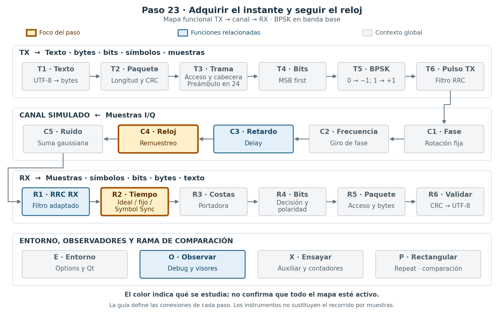
**Figura 23.** El foco del paso 23 corresponde a C4 · Reloj, R2 · Tiempo.

- **Fila TX:** T3 añade acceso y cabecera. La trama de Hola contiene 22 bytes antes del mapeo.
- **Fila canal:** El ensayo A varía C3. El ensayo B utiliza C4 y restablece el retardo a cero.
- **Fila RX:** R2 utiliza Symbol Sync; R3 conserva Costas. Las dos polaridades alimentan detección y comprobación del paquete.
- **Fila de entorno y observación:** O añade el período estimado en muestras/símbolo. X conserva los contadores.

[Ampliar el mapa](figures/enlace-mapa-paso-23.png).

**Entrada y salida del ensayo:** Muestras RX → filtro adaptado → Symbol Sync → una muestra por símbolo y período estimado.

- **Qué cambia:** Se sustituye el selector activo y después se introduce reloj_ppm mediante un remuestreador.
- **Qué permanece fijo:** El receptor conoce sps nominal, pero no recibe el retardo ni el error exacto del canal.
- **Qué se observa:** El retardo inicial se adquiere con período cercano a cuatro. Con +1000 ppm, el período esperado es 4.004 muestras/símbolo.

**Comprobación e interpretación:** En el ensayo de reloj se envía el texto largo primero y Hola después. El selector fijo rechaza el largo; Symbol Sync recupera ambos.

**Error que debe evitarse:** No se sustituye esa secuencia por dos Hola. La fila −1000 ppm queda para el alumno y el ensayo aún no demuestra seguimiento de jitter.

[Montaje y procedimiento del paso 23](laboratorio-enlace-digital.md#23-recuperar-el-instante-de-simbolo-y-seguir-la-deriva-de-reloj).

## Paso 24 — Dar tiempo de adquisición e integrar { #paso-24 }

**Pregunta guía:** ¿Puede el primer acceso llegar antes de que los lazos se estabilicen?

La combinación de desajustes reveló una pérdida inicial sin preámbulo. TX añade 32 bytes 0x55 antes del acceso para proporcionar muestras de adquisición.

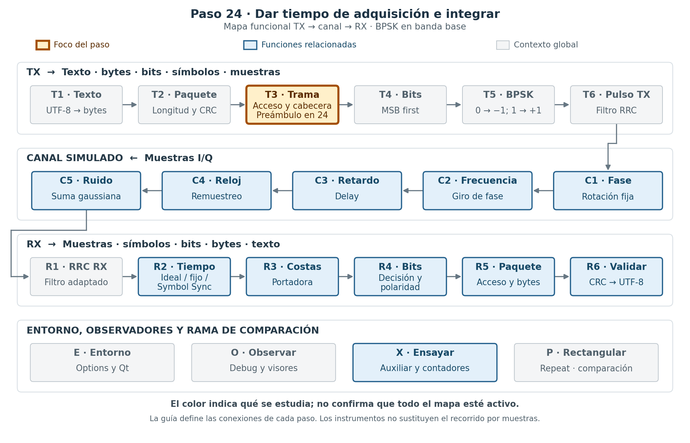
**Figura 24.** El foco del paso 24 corresponde a T3 · Trama.

- **Fila TX:** T3 incorpora el preámbulo. La trama de Hola contiene 54 bytes antes del mapeo.
- **Fila canal:** C1–C4 actúan juntos. La tercera condición añade también ruido en C5.
- **Fila RX:** R2 utiliza Symbol Sync; R3 conserva Costas. Las dos polaridades alimentan detección y comprobación del paquete.
- **Fila de entorno y observación:** O y X reúnen constelaciones, frecuencia, período y resumen. Sus capturas manuales quedan pendientes.

[Ampliar el mapa](figures/enlace-mapa-paso-24.png).

**Entrada y salida del ensayo:** 32 bytes de preámbulo + 22 de trama anterior → 54 bytes → adquisición → acceso → paquete protegido.

- **Qué cambia:** Se combinan fase, frecuencia, retardo y reloj; una ejecución adicional añade ruido de amplitud 0.1.
- **Qué permanece fijo:** Se mantienen los parámetros de los lazos, el acceso exacto, las longitudes útiles y el CRC.
- **Qué se observa:** La referencia automática recupera el primer texto antes del siguiente envío en los escenarios declarados.

**Comprobación e interpretación:** El preámbulo añade 256 símbolos, equivalentes a 256 ms con 1000 símbolos/s. No cambia el paquete protegido de diez bytes.

**Error que debe evitarse:** Los lazos no corrigen retroactivamente un acceso ya perdido. Las capturas manuales del paso 24 quedan pendientes; QPSK requiere otra validación.

[Montaje y procedimiento del paso 24](laboratorio-enlace-digital.md#24-cerrar-la-etapa-bpsk-con-el-enlace-integrado).

## Síntesis: qué función trata cada dificultad

| Dificultad | Dónde se introduce | Función receptora relacionada | Qué queda por comprobar |
|---|---|---|---|
| Representación incorrecta del texto | T1 y R6. | Codificación y decodificación UTF-8. | Igualdad de bytes y conservación de espacios. |
| Paquete alterado | Auxiliar X o errores de recepción. | Comprobación de longitud y CRC en R6. | Rechazo sin presentar el CRC como corrector. |
| Comienzo desconocido | Trama T3 y stream recibido. | Acceso y cabecera en R5. | Recepción de mensajes consecutivos y del último envío. |
| Ruido | C5. | Filtro RRC y decisión; CRC comprueba el paquete resultante. | Contadores para una amplitud, una semilla y un corpus declarados. |
| Fase de portadora | C1. | Costas en R3 y polaridad en R4–R5. | Texto correcto además de alineación geométrica. |
| Diferencia de frecuencia | C2. | Seguimiento de portadora en R3. | Estimación en Hz y recuperación dentro de las condiciones ensayadas. |
| Instante inicial desconocido | C3. | Adquisición temporal en R2. | Recepción del primer mensaje sin indicar su retardo al receptor. |
| Diferencia entre relojes | C4. | Seguimiento temporal en R2. | Texto largo y período estimado coherente. |
| Arranque antes del acceso | Trama T3. | Preámbulo para adquisición de R2 y R3. | Primer paquete recibido antes del siguiente envío. |

### Cuatro funciones que deben nombrarse por separado

- **Adquisición:** los lazos ajustan sus estimaciones iniciales a partir de las muestras observadas.
- **Seguimiento:** los lazos continúan ajustando portadora o instantes de símbolo mientras avanza la señal.
- **Detección del paquete:** el detector encuentra el acceso y lee su longitud externa.
- **Validación:** el comprobador decide si el paquete reconstruido cumple el formato y el CRC antes de entregar el texto.

El preámbulo proporciona muestras antes del acceso. La palabra de acceso permite localizar el paquete.
El CRC comprueba su contenido reconstruido. Esas funciones no se sustituyen entre sí.

Una pérdida inicial con desajustes combinados no demuestra incapacidad general de los sincronizadores.
En el control sin preámbulo, los lazos podían estabilizarse después de que hubiera pasado el primer acceso.
Ese paquete no se recuperaba retroactivamente. El paso 24 modifica el comienzo de la trama y vuelve a comprobar el primer envío.

La referencia integrada contempla condiciones discretas y semillas declaradas.
No demuestra recepción con cualquier ruido, desajuste, canal variable o dispersión multipath, propagación por varios caminos.

## Ejercicios de integración

### Ejercicio A — Seguir las longitudes de Hola

El mensaje contiene cuatro bytes UTF-8.
¿Cuántos bytes tienen el paquete protegido, la trama del paso 16 y la trama del paso 24?
¿Qué indican las longitudes interna y externa?

??? example "Solución explicada"

    - **Datos:** texto de cuatro bytes; longitud interna de dos; CRC de cuatro; acceso de ocho; cabecera externa de cuatro; preámbulo de 32.
    - **Fórmulas:** $N_p=2+N_t+4$; $N_{16}=8+4+N_p$; $N_{24}=32+N_{16}$.
    - **Sustitución:** $N_p=2+4+4$; $N_{16}=8+4+10$; $N_{24}=32+22$.
    - **Resultado:** paquete de 10 bytes; tramas de 22 y 54 bytes.
    - **Interpretación:** la longitud interna indica cuatro bytes de texto. Cada copia externa indica diez bytes de paquete protegido.
    - El preámbulo, el acceso y los ceros de cierre no aumentan esas longitudes.

### Ejercicio B — Separar símbolos, muestras y tiempo

Se utilizan 80 símbolos BPSK, $R_s=1000$ símbolos/s y $L=4$.
¿Cuántas muestras produce el pulso rectangular? ¿Cuánto duran?
¿Cuánto tiempo representan dos muestras de retardo?

??? example "Solución explicada"

    - **Datos:** $N_s=80$, $R_s=1000$ símbolos/s, $L=4$ y retardo de dos muestras.
    - **Fórmulas:** $N_m=L N_s$; $f_s=L R_s$; $t=N_m/f_s$; $\tau=2/f_s$.
    - **Sustitución:** $N_m=4(80)$; $f_s=4(1000)$; $t=320/4000$; $\tau=2/4000$.
    - **Resultado:** 320 muestras; 4000 muestras/s; 80 ms de señal; 0.5 ms de retardo.
    - **Interpretación:** dos muestras equivalen a medio símbolo. Las cuatro muestras por símbolo no añaden bits.
    - El cálculo de duración corresponde al pulso rectangular, sin añadir cierres RRC.

### Ejercicio C — Encontrar los instantes del receptor ideal

Cada filtro RRC simétrico tiene 33 coeficientes. La tasa de muestreo es 4000 muestras/s y $L=4$.
¿Cuál es el retardo conjunto y cuáles son los tres primeros índices de selección?

??? example "Solución explicada"

    - **Datos:** dos filtros con $N_h=33$, $f_s=4000$ muestras/s y $L=4$.
    - **Fórmulas:** $D=2(N_h-1)/2$; $\tau=D/f_s$; $n_k=D+kL$.
    - **Sustitución:** $D=2(33-1)/2=32$; $\tau=32/4000$; $n_k=32+4k$.
    - **Resultado:** 32 muestras, equivalentes a 8 ms. Los primeros índices son 32, 36 y 40.
    - **Interpretación:** el receptor ideal utiliza ese retardo conocido. Symbol Sync tendrá que estimar los instantes cuando deje de conocerse la alineación.

### Ejercicio D — Localizar un fallo con contadores

Un ensayo produce `TX=2 DET=2 RX=2 OK=1`.
Otro produce `TX=2 DET=0 RX=0 OK=0`.
¿Qué información ofrece cada resumen? ¿Permite atribuir ambos fallos al CRC?

??? example "Solución explicada"

    - **Datos:** el primer ensayo detecta dos comienzos y entrega dos paquetes completos al comprobador. Solo uno produce texto aceptado.
    - **Relaciones:** $\mathrm{RECH}=\mathrm{RX}-\mathrm{OK}$; $\mathrm{SIN\_PDU}=\mathrm{TX}-\mathrm{RX}$.
    - **Sustitución:** primer ensayo: $2-1=1$ rechazo y $2-2=0$ ausencias. Segundo: cero paquetes completos y dos ausencias.
    - **Resultado:** el primer ensayo presenta un rechazo. El segundo no llega a entregar un paquete para validarlo.
    - **Interpretación:** la consola debe precisar el motivo del rechazo del primer ensayo.
    - El segundo exige revisar sincronización, polaridad, acceso y cabecera. El resumen no demuestra un rechazo por CRC.

### Ejercicio E — Relacionar reloj y desplazamiento acumulado

La trama larga del paso 23 contiene 6536 símbolos.
Se aplican +1000 ppm y $L=4$. ¿Cuál es el período esperado y cuánto desplazamiento se acumula durante la trama?

??? example "Solución explicada"

    - **Datos:** $N_s=6536$, $L=4$ y diferencia relativa $\epsilon=1000\times10^{-6}=0.001$.
    - **Fórmulas:** $T_{\mathrm{RX}}=L(1+\epsilon)$; $\Delta n=N_s L\epsilon$.
    - **Sustitución:** $T_{\mathrm{RX}}=4(1.001)$; $\Delta n=6536(4)(0.001)$.
    - **Resultado:** período de 4.004 muestras/símbolo y desplazamiento aproximado de 26.144 muestras.
    - **Interpretación:** el selector fijo no mantiene la alineación a lo largo del paquete.
    - Una diferencia de reloj constante produce un desajuste temporal acumulado; no equivale a repetir el mismo retardo constante.

### Ejercicio F — Explicar el preámbulo sin confundirlo con el acceso

El transmisor añade 32 bytes `0x55` antes del acceso.
¿Cuántos símbolos BPSK añade? ¿Cuánto tiempo representan a 1000 símbolos/s?
¿Por qué el receptor conserva el mismo CRC?

??? example "Solución explicada"

    - **Datos:** 32 bytes, ocho bits por byte y un bit por símbolo BPSK.
    - **Fórmulas:** $N_s=32(8)$; $t=N_s/R_s$.
    - **Sustitución:** $N_s=256$; $t=256/1000$.
    - **Resultado:** 256 símbolos, equivalentes a 0.256 s o 256 ms de señal.
    - **Interpretación:** los lazos disponen de muestras anteriores al acceso. Ese tiempo de señal no impone una espera real equivalente al programa.
    - El CRC permanece calculado sobre longitud interna y texto. El preámbulo se añade fuera del paquete protegido.

## Laboratorio de lectura y explicación

Este recorrido se utiliza junto con la guía de construcción.

1. El estudiante selecciona un paso y localiza sus bloques resaltados.
2. Describe la representación de entrada y la de salida antes de ejecutar.
3. Predice qué cambiará y elige el observador que permitirá comprobarlo.
4. Ejecuta el experimento de la guía y registra también los fallos.
5. Compara el resultado con la predicción y explica qué función lo produce.
6. Propone una comprobación adicional que mantenga las demás variables fijas.

Para los pasos 18–24, la explicación incluye condiciones del canal, secuencia de mensajes y contadores.
La constelación por sí sola no sustituye esos datos.

La fila de −10 Hz y la de −1000 ppm permanecen como actividades del alumno.
Las capturas manuales del paso 24 se incorporarán después.
La integración BPSK no certifica todavía QPSK, hardware ni canales con variaciones arbitrarias.

## Lecturas y fuentes

- [Guía de construcción y referencias del laboratorio](laboratorio-enlace-digital.md#referencias): formatos, parámetros y evidencias que sustentan este mapa.
- [Costas Loop en GNU Radio 3.10.12.0](https://github.com/gnuradio/gnuradio/blob/v3.10.12.0/gr-digital/include/gnuradio/digital/costas_loop_cc.h): recuperación de portadora y configuración para BPSK.
- [Symbol Sync en GNU Radio 3.10.12.0](https://github.com/gnuradio/gnuradio/blob/v3.10.12.0/gr-digital/include/gnuradio/digital/symbol_sync_cc.h): sincronización temporal y parámetros nominales.
- [Correlate Access Code - Tag Stream en GNU Radio 3.10.12.0](https://github.com/gnuradio/gnuradio/blob/v3.10.12.0/gr-digital/include/gnuradio/digital/correlate_access_code_bb_ts.h): búsqueda del acceso y cabecera de longitud duplicada.
