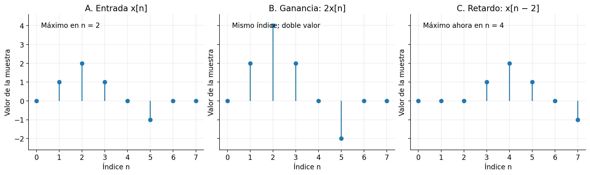
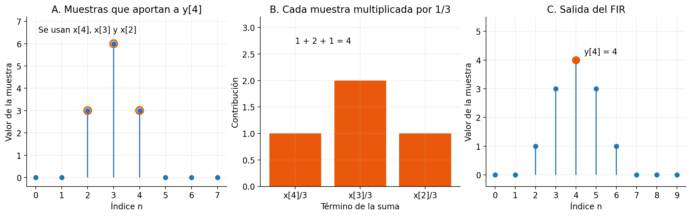
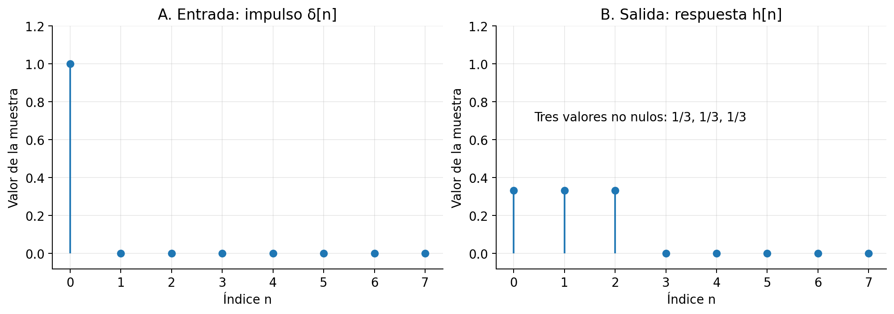
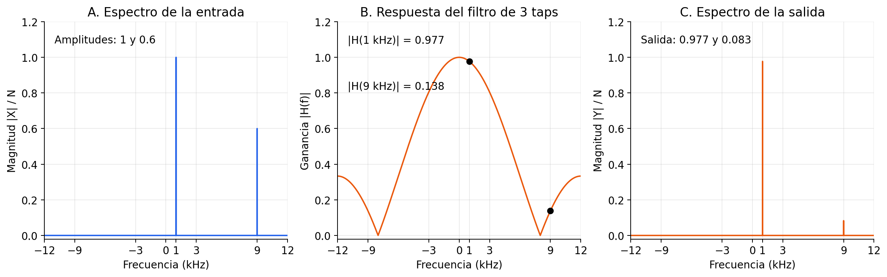
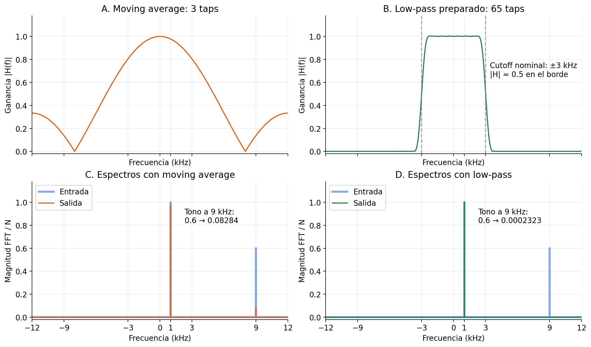
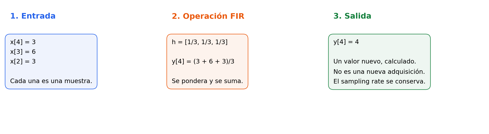

# Sesión 03 — Sistemas y filtros digitales

## Objetivos de aprendizaje

Al finalizar esta sesión, el estudiante será capaz de:

- Distinguir entrada y salida de un sistema, y calcular el efecto de una ganancia y un retardo.
- Calcular muestras de salida de un FIR a partir de sus taps y explicar su respuesta al impulso.
- Utilizar la respuesta en frecuencia de un filtro para predecir qué tonos conserva y cuáles atenúa, sin confundir filtrado con decimación.

## Introducción

- En la [sesión 2](../02-tiempo-frecuencia-iq/index.md), se aprendió a interpretar una señal en tiempo y frecuencia. Ahora se estudiará **cómo modificar sus muestras**.
- Un receptor SDR no trabaja directamente con la onda RF del aire: procesa su representación compleja en baseband, $x[n]=I[n]+jQ[n]$.
- Un sistema recibe esas muestras y calcula una salida. Un filtro es un ejemplo de sistema: puede conservar unas componentes de frecuencia y atenuar otras.
- Primero se utilizarán secuencias reales cortas para poder comprobar las cuentas a mano. Después se volverá a los tonos complejos I/Q de la sesión 2.
- La clase se concentra en tres ideas: **transformar muestras, combinarlas mediante un FIR e interpretar el efecto en frecuencia**. No se desarrollarán transformada Z, filtros IIR ni un procedimiento completo de diseño de filtros.
- El sampling rate permanecerá fijo. La selección de canal y la reducción del sampling rate se estudiarán en la sesión 4, después de revisar esta sesión.

!!! info "Recorrido sugerido: 2 h de clase y 2 h de laboratorio"

    - Sección 1 y ejercicios: 25 min.
    - Sección 2 y ejercicios: 40 min.
    - Sección 3 y ejercicios: 40 min.
    - Síntesis y preguntas: 15 min.
    - El [laboratorio #3](laboratorio-filtrado.md) ocupa las 2 h de práctica. Los snippets permiten preparar o repetir las demostraciones en Google Colab; no es necesario escribirlos todos durante la clase.

## Teoría

### 1. Un sistema transforma una señal

#### 1.1. Entrada, operación y salida

- La entrada se representa por $x[n]$ y la salida por $y[n]$. Ambas son secuencias de muestras, pero sus valores no tienen por qué ser iguales.
- Un sistema establece una regla que permite calcular $y[n]$ a partir de $x[n]$. Por ejemplo, multiplicar cada muestra por una constante.
- Para una **ganancia** real $a$, la regla es:

$$
y[n]=a\,x[n].
$$

- Si $a=2$ y $x[2]=2$, entonces $y[2]=4$: cambia el valor, no la posición de esa muestra.
- Si $x[n]$ es compleja y $a$ es real, se multiplican tanto I como Q: $a(I+jQ)=aI+jaQ$. No se elimina Q ni se convierte la señal en una señal real.
- Otra operación es el **delay** o retardo de $d$ muestras, con $d$ entero no negativo:

$$
y[n]=x[n-d].
$$

- Con $d=2$, la salida de índice 4 contiene el valor que la entrada tenía en el índice 2: $y[4]=x[2]$.
- El retardo temporal se calcula usando el sampling rate, tal como en la sesión 2: $\tau=d/f_s$. Dos muestras de retardo a 8 kS/s representan $2/8000=0.25$ ms.
- En los ejemplos finitos, se supone que la entrada vale cero fuera de los índices mostrados. Por eso un retardo comienza con ceros; las últimas muestras **no reaparecen al inicio**.

#### 1.2. Figura: cambiar valores no es desplazar muestras

- **Qué varía:** la operación aplicada: ninguna, ganancia 2 o retardo de dos muestras.
- **Qué permanece fijo:** la entrada, los índices observados y el sampling rate.
- **Qué debe notarse:** la ganancia modifica la altura de las muestras; el retardo modifica el índice donde aparece cada valor.


**Figura 1.** Comparación entre una ganancia y un retardo aplicados a la misma secuencia.

- **Panel A — Entrada:** el máximo vale 2 y aparece en $n=2$. La secuencia es real solo para facilitar esta primera lectura.
- **Panel B — Ganancia:** el máximo sigue en $n=2$, pero ahora vale 4. Los valores negativos también se multiplican por 2; no se vuelven positivos.
- **Panel C — Retardo:** el máximo conserva su valor 2, pero aparece en $n=4$. Las muestras se han desplazado dos posiciones hacia la derecha.
- **Lectura del inicio:** en el panel C, $y[0]=x[-2]=0$ y $y[1]=x[-1]=0$, por la hipótesis de entrada nula antes de $n=0$.
- **Lo que no cambia:** no se han generado más instantes por segundo. Multiplicar o retrasar no cambia por sí solo $f_s$.

**Demostración en Colab.** Las celdas de la sesión se ejecutan en orden en un mismo notebook.

```python
import numpy as np
import matplotlib.pyplot as plt
from scipy import signal

x_corta = np.array([0, 1, 2, 1, 0, -1, 0, 0], dtype=float)
n_corta = np.arange(len(x_corta))
y_ganancia = 2 * x_corta
y_retardo = np.concatenate([np.zeros(2), x_corta])[:len(x_corta)]

fig, axs = plt.subplots(1, 3, figsize=(13, 3.8), layout="constrained", sharex=True, sharey=True)
for ax, valores, titulo in zip(axs, [x_corta, y_ganancia, y_retardo], ["Entrada", "Ganancia 2", "Retardo de 2 muestras"]):
    ax.stem(n_corta, valores, basefmt=" ")
    ax.set(title=titulo, xlabel="Índice n", ylabel="Valor", xticks=n_corta, ylim=(-2.6, 4.6))
    ax.grid(True, alpha=0.25)
plt.show()
```

- `np.concatenate` antepone dos ceros y el corte conserva los ocho índices que se comparan en la figura.
- El corte limita la **ventana observada**. Si una muestra no nula quedara fuera de ella, no significaría que el sistema la destruyó: aparecería más adelante.
- No se utiliza `np.roll`: esa función llevaría muestras del final al inicio, lo que representaría un desplazamiento circular distinto del retardo descrito aquí.

#### 1.3. Ejercicios de la sección 1

**Ejercicio 1 — Ganancia sobre una muestra I/Q.** Una muestra vale $x[5]=1-2j$. El sistema aplica $a=3$. ¿Cuánto valen $y[5]$, I y Q a la salida? ¿Cambia el sampling rate?

??? example "Solución explicada"

    - La regla de esta sección es $y[n]=a\,x[n]$; se sustituye $n=5$ y $a=3$.
    - Se distribuye la multiplicación sobre las dos componentes: $y[5]=3(1-2j)=3-6j$.
    - La componente I de salida es la parte real: $I_y[5]=3$.
    - La componente Q de salida es el coeficiente de $j$: $Q_y[5]=-6$. Su signo se conserva porque la ganancia es positiva.
    - La salida sigue siendo una muestra **compleja**. Aplicar ganancia no equivale a tomar $|x[5]|$ ni a quedarse solo con I.
    - El índice sigue siendo 5. Esta operación entrega una muestra de salida por cada muestra de entrada; el sampling rate no cambia.

**Ejercicio 2 — Retardo y tiempo.** La entrada es $x=[1,2,-1]$, comienza en $n=0$ y vale cero fuera de ese bloque. Se aplica $y[n]=x[n-2]$. Calcular la salida entre $n=0$ y $n=4$ y el retardo temporal para $f_s=8000$ S/s.

??? example "Solución explicada"

    - Se aplica la fórmula $y[n]=x[n-d]$, con $d=2$, sin cambiar el valor de las muestras.
    - Para $n=0$, se necesita $x[-2]$; vale cero por la condición del enunciado. Por tanto, $y[0]=0$.
    - Para $n=1$, $y[1]=x[-1]=0$ por la misma razón.
    - Para $n=2$, $y[2]=x[0]=1$; para $n=3$, $y[3]=x[1]=2$; para $n=4$, $y[4]=x[2]=-1$.
    - La secuencia solicitada es $y=[0,0,1,2,-1]$. Tiene cinco posiciones porque se observa también la parte retrasada después del bloque original, no porque haya aumentado $f_s$.
    - Con $T_s=1/f_s=1/8000$ s, cada separación representa $125$ µs.
    - El retardo es $\tau=dT_s=2/8000=0.00025$ s, es decir, **0.25 ms**.

### 2. Un FIR combina muestras

#### 2.1. De una muestra a una pequeña memoria

- La ganancia de la sección 1 utilizaba una sola muestra: $x[n]$. Un filtro puede utilizar también muestras anteriores.
- Un **moving average** o promedio móvil de tres muestras calcula:

$$
y[n]=\frac{x[n]+x[n-1]+x[n-2]}{3}.
$$

- Se utiliza la muestra actual y las dos anteriores. No aparece $x[n+1]$, de modo que no se necesitan muestras futuras: el filtro es **causal**.
- Para calcular $y[4]$, se usan $x[4]$, $x[3]$ y $x[2]$. Al pasar a $y[5]$, el grupo avanza una posición y se usan $x[5]$, $x[4]$ y $x[3]$.
- Los pesos que multiplican las muestras se llaman **taps** o coeficientes. En este ejemplo, son $h[0]=h[1]=h[2]=1/3$.
- La fórmula general de un FIR causal con $L$ taps es:

$$
y[n]=\sum_{k=0}^{L-1}h[k]x[n-k].
$$

- **FIR** significa *Finite Impulse Response*: respuesta al impulso de duración finita. En la implementación utilizada, la suma tiene un número finito de coeficientes y no utiliza salidas anteriores $y[n-1]$ para calcular la nueva salida.
- La combinación anterior es una **convolución**, escrita $y=x*h$. No es una multiplicación elemento a elemento entre dos vectores.
- Los coeficientes se mantienen fijos en estos ejemplos. La operación es lineal —ponderar una suma equivale a sumar los resultados ponderados— y no depende del instante absoluto de aplicación. Se trata de un sistema **LTI**, *Linear Time-Invariant*.
- La ecuación coincide con la implementación FIR de [`scipy.signal.lfilter`](https://docs.scipy.org/doc/scipy/reference/generated/scipy.signal.lfilter.html) cuando se utiliza `b=h` y `a=[1.0]`. Sin estado inicial especificado, la función supone reposo inicial.

#### 2.2. Figura: seguir una muestra de salida

- **Qué varía:** las muestras que entran en la suma al avanzar el índice $n$.
- **Qué permanece fijo:** los tres taps, todos iguales a $1/3$.
- **Qué debe notarse:** el valor de salida es una suma ponderada; no se copia simplemente una de las muestras de entrada.


**Figura 2.** Cálculo de una muestra de salida mediante un moving average de tres taps.

- **Panel A — Muestras seleccionadas:** los círculos destacan $x[2]=3$, $x[3]=6$ y $x[4]=3$. Aunque se leen de izquierda a derecha, en la fórmula aparecen como $x[4]$, $x[3]$ y $x[2]$.
- **Panel B — Contribuciones:** $h[0]x[4]=1$, $h[1]x[3]=2$ y $h[2]x[2]=1$. Cada barra representa un término de la suma, no una muestra nueva tomada por el receptor.
- **Panel C — Resultado:** las tres contribuciones dan $y[4]=1+2+1=4$. El máximo de entrada valía 6; la salida combina ese valor con sus vecinos.
- **Al avanzar:** para $y[5]$, ya no participa $x[2]$. Entra $x[5]=0$ y quedan $x[4]=3$ y $x[3]=6$, por lo que $y[5]=3$.
- **Sobre “suavizar”:** en este ejemplo el pico se reparte entre varias salidas. Esto permite visualizar un promedio, pero no demuestra que cualquier FIR siempre suavice; su efecto depende de los taps.

```python
x_fir = np.array([0, 0, 3, 6, 3, 0, 0, 0], dtype=float)
h_media = np.ones(3) / 3
y_fir = np.convolve(x_fir, h_media, mode="full")
contribuciones = h_media * x_fir[[4, 3, 2]]
print("Contribuciones a y[4]:", contribuciones)
print("y[4] =", y_fir[4])
print("Salida completa:", y_fir)

fig, axs = plt.subplots(1, 3, figsize=(13, 4), layout="constrained")
axs[0].stem(np.arange(len(x_fir)), x_fir, basefmt=" ")
axs[0].scatter([2, 3, 4], x_fir[[2, 3, 4]], s=100, facecolors="none", edgecolors="tab:orange", linewidths=2)
axs[0].set(title="Muestras para y[4]", xlabel="Índice n", ylabel="Valor", xticks=np.arange(len(x_fir)))
axs[1].bar([0, 1, 2], contribuciones, color="tab:orange")
axs[1].set(title="Contribuciones", ylabel="Valor ponderado", xticks=[0, 1, 2], xticklabels=["x[4]/3", "x[3]/3", "x[2]/3"])
axs[2].stem(np.arange(len(y_fir)), y_fir, basefmt=" ")
axs[2].scatter([4], [y_fir[4]], color="tab:orange", s=80)
axs[2].set(title="Salida: y[4] = 4", xlabel="Índice n", ylabel="Valor", xticks=np.arange(len(y_fir)))
plt.show()
```

- Con `mode="full"`, [`np.convolve`](https://numpy.org/doc/stable/reference/generated/numpy.convolve.html) devuelve $N+L-1$ posiciones: aquí $8+3-1=10$.
- Se supone entrada nula fuera del bloque. Las dos posiciones finales permiten incluir la respuesta a las últimas muestras, mientras estas siguen pasando por la memoria del filtro; en este ejemplo concreto también terminan en cero.
- Esas posiciones son **salidas calculadas**, no muestras adicionales adquiridas por un ADC ni zero-padding utilizado para dibujar una FFT más densa.
- Un stream de GNU Radio puede continuar indefinidamente. Si se quisiera observar toda la cola de un FIR después de terminar un archivo, habría que proporcionar los ceros finales correspondientes; un stream que termina no los crea automáticamente.

#### 2.3. Figura: conocer el filtro con un impulso

- El impulso discreto $\delta[n]$ vale 1 en $n=0$ y 0 en los demás índices. Es una secuencia de prueba, no un pico de duración infinitamente corta en tiempo continuo.
- Al introducirlo en la ecuación FIR, se obtiene $y[n]=h[n]$: la muestra unitaria va recorriendo los coeficientes.
- Por eso $h[n]$ se llama **respuesta al impulso**. Para un FIR, los taps son precisamente sus valores.
- **Qué varía:** el impulso de entrada se transforma en varias muestras de salida.
- **Qué permanece fijo:** el mismo filtro de tres taps de la figura anterior y el reposo inicial.
- **Qué debe notarse:** la salida revela tres coeficientes no nulos y después vuelve a cero.


**Figura 3.** La respuesta al impulso permite observar los taps del FIR.

- **Panel A — Entrada:** solo $x[0]=1$ es no nula. Las demás muestras de la secuencia de prueba son cero.
- **Panel B — Primera salida:** $y[0]=(1+0+0)/3=1/3$.
- **Panel B — Salidas siguientes:** $y[1]=(0+1+0)/3=1/3$ y $y[2]=(0+0+1)/3=1/3$. Es la misma muestra de entrada contribuyendo en tres instantes distintos.
- **Panel B — Fin de la respuesta:** desde $n=3$, todos los términos son cero. La respuesta no continúa indefinidamente.
- **Conclusión:** $h=[1/3,1/3,1/3]$ describe este filtro. Para predecir una salida cualquiera, se utiliza esa respuesta en la convolución; no basta con conocer solo el número de taps.

```python
impulso = np.zeros(8)
impulso[0] = 1
respuesta = signal.lfilter(h_media, [1.0], impulso)
print("Respuesta al impulso:", respuesta)

fig, axs = plt.subplots(1, 2, figsize=(11, 3.8), layout="constrained", sharex=True, sharey=True)
for ax, valores, titulo in zip(axs, [impulso, respuesta], ["Impulso δ[n]", "Respuesta h[n]"]):
    ax.stem(np.arange(len(valores)), valores, basefmt=" ")
    ax.set(title=titulo, xlabel="Índice n", ylabel="Valor", xticks=np.arange(len(valores)), ylim=(-0.08, 1.2))
    ax.grid(True, alpha=0.25)
plt.show()
```

- En esta celda, `lfilter` devuelve una salida por cada una de las ocho muestras proporcionadas. La entrada ya contiene suficientes ceros para observar la respuesta completa al impulso.
- `np.convolve(..., mode="full")` y `lfilter(h, [1.0], x)` implementan la misma suma FIR con reposo inicial, pero **no devuelven automáticamente la misma longitud** para una entrada finita.

#### 2.4. Ejercicios de la sección 2

**Ejercicio 3 — Convolución completa.** Para $x=[3,6,3]$ y $h=[1/3,1/3,1/3]$, calcular la salida completa. La entrada comienza en $n=0$ y vale cero fuera del bloque.

??? example "Solución explicada"

    - Se utiliza $y[n]=(x[n]+x[n-1]+x[n-2])/3$, con $x[0]=3$, $x[1]=6$ y $x[2]=3$.
    - La longitud completa es $N+L-1=3+3-1=5$: se calcularán los índices 0, 1, 2, 3 y 4.
    - En $n=0$: $y[0]=(3+0+0)/3=1$. Los índices negativos corresponden al reposo inicial.
    - En $n=1$: $y[1]=(6+3+0)/3=3$.
    - En $n=2$: $y[2]=(3+6+3)/3=4$. Aquí participan las tres muestras no nulas.
    - En $n=3$: $x[3]=0$, pero todavía aportan las muestras anteriores: $y[3]=(0+3+6)/3=3$.
    - En $n=4$: $y[4]=(0+0+3)/3=1$. Desde $n=5$, todos los términos son cero.
    - La respuesta es **$y=[1,3,4,3,1]$**. Las dos posiciones finales muestran la memoria del filtro, no una adquisición adicional.
    - Con `lfilter(h, [1.0], x)` se obtendrían solo las tres primeras salidas. Para observar también 3 y 1, se puede prolongar la entrada con dos ceros.

**Ejercicio 4 — Filtrar I y Q.** La entrada es $x=[1+j,1-j]$ y los taps son $h=[1/2,1/2]$. Calcular la salida completa. ¿Se conserva una representación compleja?

??? example "Solución explicada"

    - Con dos taps, la ecuación general se reduce a $y[n]=\tfrac12x[n]+\tfrac12x[n-1]$.
    - La longitud completa es $2+2-1=3$; se calculan los índices 0, 1 y 2.
    - En $n=0$: $y[0]=\tfrac12(1+j)+\tfrac12(0)=0.5+0.5j$.
    - En $n=1$: $y[1]=\tfrac12(1-j)+\tfrac12(1+j)=1+0j$. Q se cancela **en esta muestra**, porque sus dos contribuciones tienen signos opuestos.
    - En $n=2$: la entrada actual es cero, pero queda la muestra anterior: $y[2]=\tfrac12(0)+\tfrac12(1-j)=0.5-0.5j$.
    - La salida completa es **$[0.5+0.5j,1+0j,0.5-0.5j]$**.
    - Para taps reales, se puede separar la suma como $y[n]=\sum h[k]I[n-k]+j\sum h[k]Q[n-k]$. El mismo FIR actúa sobre ambas componentes.
    - Que una salida particular tenga Q igual a cero no transforma todo el stream en un stream real. No se ha aplicado magnitud ni se ha descartado Q.

### 3. El filtro tiene una respuesta en frecuencia

#### 3.1. Del cálculo de muestras al efecto sobre tonos

- La sesión 2 mostró que un tono complejo tiene la forma $x[n]=A e^{j2\pi fn/f_s}$. Ahora se introduce ese tono en la ecuación FIR:

$$
\begin{aligned}
y[n]&=\sum_{k=0}^{L-1}h[k]A e^{j2\pi f(n-k)/f_s}\\
&=A e^{j2\pi fn/f_s}\underbrace{\sum_{k=0}^{L-1}h[k]e^{-j2\pi fk/f_s}}_{H(f)}.
\end{aligned}
$$

- La primera parte sigue siendo el tono original. La suma restante no depende de $n$: para una frecuencia fija, es una constante compleja llamada **respuesta en frecuencia**, $H(f)$.
- En consecuencia, un tono que atraviesa este FIR LTI, una vez superado el inicio del filtro, **conserva su frecuencia**. Su amplitud se multiplica por $|H(f)|$ y su fase cambia en $\arg H(f)$ cuando $H(f)\ne0$.
- La predicción de amplitud es:

$$
A_{\mathrm{salida}}=A_{\mathrm{entrada}}\,|H(f)|.
$$

- $H(f)$ describe al **filtro**, no a una grabación particular. El espectro $X$ describe a la **señal**. Si se cambia la entrada sin cambiar los taps ni $f_s$, la respuesta del filtro no cambia.
- Para varios tonos, la linealidad permite aplicar esta predicción a cada componente y sumar los resultados.
- La expresión de $H(f)$ es la utilizada por [`scipy.signal.freqz`](https://docs.scipy.org/doc/scipy/reference/generated/scipy.signal.freqz.html). `freqz` devuelve valores complejos; para representar la ganancia de amplitud se utiliza `np.abs(H)`.
- Las figuras siguientes muestran magnitudes. **No muestran la fase ni todo el retardo del filtro**: dos salidas con espectros de magnitud parecidos pueden tener distinto alineamiento temporal.

#### 3.2. Figura: predecir la salida del moving average

- **Entrada:** suma de un tono complejo de 1 kHz y amplitud 1, y otro de 9 kHz y amplitud 0.6.
- **Sampling rate:** $f_s=24000$ S/s. Ambos tonos están dentro del intervalo baseband $[-12,12)$ kHz; aquí no se está provocando aliasing.
- **Filtro:** el mismo moving average de tres taps.
- **Qué varía:** se compara la señal antes y después del FIR.
- **Qué permanece fijo:** las frecuencias de los tonos y el sampling rate.
- **Qué debe notarse:** el tono de 9 kHz se atenúa más que el de 1 kHz, aunque ambos atraviesan exactamente los mismos taps.


**Figura 4.** La ganancia del filtro en cada frecuencia permite predecir la amplitud de los tonos de salida.

- **Panel A — Entrada:** hay un pico en +1 kHz y otro en +9 kHz, con magnitudes 1 y 0.6. Son tonos complejos positivos; no se añaden réplicas negativas como en un coseno real.
- **Panel B — Filtro:** $|H(1\text{ kHz})|\approx0.9773$ y $|H(9\text{ kHz})|\approx0.1381$. Los puntos negros marcan las ganancias correspondientes a los dos tonos.
- **Panel B — Forma de la curva:** la ganancia no baja de manera continua hasta el borde. Tiene ceros en ±8 kHz y luego vuelve a aumentar. Un promedio corto no es un selector de canal ideal.
- **Panel C — Tono de 1 kHz:** la amplitud pasa de $1$ a $1\times0.9773\approx0.9773$. Se conserva casi por completo.
- **Panel C — Tono de 9 kHz:** pasa de $0.6$ a $0.6\times0.1381\approx0.08284$. No desaparece: queda un tono pequeño a **la misma frecuencia**.
- **Comparación horizontal:** los picos no se desplazan hacia cero ni hacia los lados. El FIR modifica su amplitud y fase; no realiza la mezcla compleja estudiada en la sesión 2.

```python
fs = 24000
N = 4800
descarte = 256
n = np.arange(N + descarte)
x_tonos = np.exp(1j * 2 * np.pi * 1000 * n / fs) + 0.6 * np.exp(1j * 2 * np.pi * 9000 * n / fs)
y_media = signal.lfilter(h_media, [1.0], x_tonos)
x_estable = x_tonos[descarte:]
y_estable = y_media[descarte:]

def espectro(z, fs):
    f = np.fft.fftshift(np.fft.fftfreq(len(z), 1 / fs))
    C = np.fft.fftshift(np.fft.fft(z)) / len(z)
    return f, np.abs(C)

f, X = espectro(x_estable, fs)
_, Y_media = espectro(y_estable, fs)
f_respuesta = np.linspace(-fs / 2, fs / 2, 4097)
_, H_media = signal.freqz(h_media, worN=f_respuesta, fs=fs)
_, H_tonos = signal.freqz(h_media, worN=np.array([1000, 9000]), fs=fs)
print("Ganancias a 1 y 9 kHz:", np.abs(H_tonos))
print("Amplitudes predichas:", np.array([1.0, 0.6]) * np.abs(H_tonos))

fig, axs = plt.subplots(1, 3, figsize=(13, 4), layout="constrained")
axs[0].plot(f / 1000, X)
axs[1].plot(f_respuesta / 1000, np.abs(H_media), color="tab:orange")
axs[1].scatter([1, 9], np.abs(H_tonos), color="black")
axs[2].plot(f / 1000, Y_media, color="tab:orange")
for ax, titulo, ylabel in zip(axs, ["Entrada", "Ganancia del FIR", "Salida"], ["Magnitud FFT / N", "|H(f)|", "Magnitud FFT / N"]):
    ax.set(title=titulo, xlabel="Frecuencia (kHz)", ylabel=ylabel, xlim=(-12, 12), ylim=(-0.02, 1.2))
    ax.grid(True, alpha=0.25)
plt.show()
```

- `lfilter` comienza en reposo. Las primeras salidas no ven todavía un tono presente en toda la memoria del filtro: aparece un **transitorio de inicio**.
- Se descartan 256 muestras **solo para comparar el régimen estable de estos tonos continuos**. Es más de lo necesario para el FIR de tres taps, y también permite comparar después el de 65 taps con el mismo segmento.
- No se propone borrar siempre 256 muestras de una captura o de un mensaje. En un receptor real, el transitorio y el retardo deben considerarse al decidir dónde comienza la información útil.
- Quedan $N=4800$ muestras, que representan $N/f_s=0.2$ s. En ese intervalo hay exactamente 200 ciclos de 1 kHz y 1800 de 9 kHz; los tonos coinciden con bins de la FFT.
- La FFT se divide por $N$, como en la sesión 2. Así, la magnitud de cada pico de estos tonos complejos coincide con su amplitud; no se pretende calibrar potencia RF.

#### 3.3. Figura: un low-pass preparado selecciona mejor

- El moving average permitió entender los cálculos, pero solo tiene tres coeficientes y no ofrece un rechazo fuerte en todas las frecuencias altas.
- Un **low-pass** o filtro pasa-bajos se prepara para conservar una región alrededor de 0 Hz y atenuar componentes más alejadas.
- Para esta demostración se entregan sus taps calculados por SciPy. **No se exige diseñar el filtro desde cero**:

```python
h_lp = signal.firwin(65, 3000, fs=fs)
y_lp = signal.lfilter(h_lp, [1.0], x_tonos)
_, Y_lp = espectro(y_lp[descarte:], fs)
_, H_lp = signal.freqz(h_lp, worN=f_respuesta, fs=fs)
_, H_lp_tonos = signal.freqz(h_lp, worN=np.array([1000, 9000]), fs=fs)
print("Número de taps:", len(h_lp))
print("Ganancias low-pass a 1 y 9 kHz:", np.abs(H_lp_tonos))
print("Amplitudes de salida:", np.array([1.0, 0.6]) * np.abs(H_lp_tonos))

fig, axs = plt.subplots(2, 2, figsize=(12, 7), layout="constrained")
axs[0, 0].plot(f_respuesta / 1000, np.abs(H_media), color="tab:orange")
axs[0, 1].plot(f_respuesta / 1000, np.abs(H_lp), color="tab:green")
axs[0, 1].axvline(3, color="gray", linestyle="--")
axs[0, 1].axvline(-3, color="gray", linestyle="--")
axs[1, 0].plot(f / 1000, X, label="Entrada", alpha=0.55, linewidth=3)
axs[1, 0].plot(f / 1000, Y_media, label="Salida", color="tab:orange")
axs[1, 1].plot(f / 1000, X, label="Entrada", alpha=0.55, linewidth=3)
axs[1, 1].plot(f / 1000, Y_lp, label="Salida", color="tab:green")
for ax, titulo in zip(axs.flat, ["Moving average: 3 taps", "Low-pass: 65 taps", "Espectros con moving average", "Espectros con low-pass"]):
    ax.set(title=titulo, xlabel="Frecuencia (kHz)", ylabel="Ganancia" if ax in axs[0] else "Magnitud FFT / N", xlim=(-12, 12), ylim=(-0.02, 1.18))
    ax.grid(True, alpha=0.25)
axs[1, 0].legend()
axs[1, 1].legend()
plt.show()
```

- `65` es el número de taps, no un sampling rate ni una frecuencia.
- `3000` es el **cutoff** nominal en Hz, porque se ha proporcionado `fs=24000`. En [`firwin`](https://docs.scipy.org/doc/scipy/reference/generated/scipy.signal.firwin.html), el cutoff corresponde aproximadamente a media amplitud, $|H|=0.5$ o −6 dB; no a −3 dB ni al final de una zona perfectamente plana.
- `firwin` utiliza por defecto una ventana Hamming y normaliza la ganancia en DC para este low-pass. La ganancia en otras frecuencias puede quedar ligeramente por encima o por debajo de 1.
- **Qué varía:** únicamente el vector de taps: promedio de tres valores frente a low-pass de 65 coeficientes.
- **Qué permanece fijo:** la entrada, el sampling rate, el segmento analizado y los ejes de comparación.
- **Qué debe notarse:** el low-pass preparado conserva el tono de 1 kHz y rechaza mucho mejor el de 9 kHz. No se atribuye esta mejora únicamente a tener más taps: también importa cómo se eligieron sus valores.


**Figura 5.** Un low-pass preparado ofrece un rechazo mayor que el moving average del ejemplo.

- **Panel A — Promedio:** la curva tiene una región central y lóbulos laterales. A 9 kHz, su ganancia todavía es aproximadamente 0.1381.
- **Panel B — Low-pass:** la zona cercana a cero tiene ganancia próxima a 1; después aparece una **transition band**, una franja donde la ganancia cae gradualmente. No es una pared vertical.
- **Panel B — Líneas discontinuas:** señalan ±3 kHz, donde la ganancia es aproximadamente 0.5. Un tono situado justo ahí ya se atenúa; “cutoff 3 kHz” no significa conservar sin cambio todo lo que esté hasta ese borde.
- **Panel C — Resultado con promedio:** el tono de 9 kHz baja de 0.6 a aproximadamente 0.08284, pero sigue siendo visible. La curva azul es la entrada y la naranja es la salida.
- **Panel D — Resultado con low-pass:** el mismo tono baja a aproximadamente 0.0002323. A esta escala lineal casi no se distingue, pero **no es exactamente cero**.
- **Panel D — Tono útil:** el tono de 1 kHz queda en aproximadamente 1.0027. La pequeña diferencia respecto de 1 es parte de la respuesta del filtro, no una frecuencia nueva.
- **Los cuatro paneles:** la entrada y la salida mantienen $f_s=24$ kS/s. El eje sigue llegando a ±12 kHz; una menor región ocupada no implica haber reducido el sampling rate.

#### 3.4. Ejercicios de la sección 3

**Ejercicio 5 — Predecir amplitudes.** Un FIR LTI tiene $|H(1\text{ kHz})|=0.98$ y $|H(9\text{ kHz})|=0.02$. La entrada contiene tonos complejos de amplitudes 1 y 0.6 en esas frecuencias. Calcular sus amplitudes de salida en régimen estable. ¿Se pueden deducir sus fases de estos dos datos?

??? example "Solución explicada"

    - Se utiliza $A_{\mathrm{salida}}=A_{\mathrm{entrada}}|H(f)|$, evaluando la respuesta en la frecuencia de **cada** tono.
    - A 1 kHz, la amplitud de entrada es 1 y la ganancia es 0.98: $A_{1,\mathrm{salida}}=1\times0.98=0.98$.
    - A 9 kHz, la amplitud de entrada es 0.6 y la ganancia es 0.02: $A_{9,\mathrm{salida}}=0.6\times0.02=0.012$.
    - Las frecuencias de salida siguen siendo **1 y 9 kHz**. La deducción de la sección 3.1 conserva el factor $e^{j2\pi fn/f_s}$ y multiplica cada tono por una constante compleja.
    - La linealidad permite sumar esas dos respuestas. El tono no deseado queda pequeño, pero no desaparece porque la ganancia indicada no es cero.
    - No se pueden deducir las fases a partir de $|H|$. Hace falta conocer $\arg H(f)$, además de la fase de entrada; una gráfica de magnitud no contiene esa información.
    - La predicción se aplica al régimen estable de los tonos, no a las primeras muestras del arranque del FIR.

**Ejercicio 6 — ¿Filtrado o cambio de sampling rate?** Un stream I/Q de 24 kS/s pasa por un FIR sin decimación. Su salida solo tiene energía apreciable entre −3 y +3 kHz. Un estudiante afirma que ahora el stream tiene 6 kS/s y que, como los taps son reales, puede descartar Q. Identificar los dos errores.

??? example "Solución explicada"

    - El intervalo con energía apreciable describe el **contenido espectral**, no el número de muestras que circulan por segundo.
    - En el FIR sin decimación se calcula una salida $y[n]$ por cada nueva muestra $x[n]$. No hay una operación que seleccione una de cada varias muestras.
    - Por tanto, el sampling rate de salida continúa siendo **24000 S/s** y $T_s=1/24000$ s. El eje baseband sigue siendo $[-12,12)$ kHz, aunque gran parte tenga poca energía.
    - El valor 6 kHz representa aquí el ancho aproximado entre −3 y +3 kHz, no un nuevo sampling rate. Para reducir la tasa habrá que estudiar una operación adicional y su filtro anti-aliasing en la sesión 4.
    - El segundo error se comprueba con la fórmula FIR: si $x[n]=I[n]+jQ[n]$ y $h[k]$ es real, entonces $y[n]=\sum h[k]I[n-k]+j\sum h[k]Q[n-k]$.
    - Los taps reales filtran ambas componentes; **no borran Q**. Descartarla sería otra operación y, en general, perdería información de la representación compleja.
    - El ejercicio 4 ya ofrece un contraejemplo: taps reales producen salidas con parte imaginaria no nula.

## Síntesis: de la regla al filtro

- La figura siguiente retoma el cálculo de $y[4]$ de la sección 2, sin introducir otra señal ni otros coeficientes.
- **Qué debe seguirse:** las muestras de entrada, los pesos que se aplican y el nuevo valor calculado.


**Figura 6.** Un FIR transforma muestras mediante una regla de ponderación y suma.

- **Panel 1 — Entrada:** se dispone de las muestras 3, 6 y 3. Son tres valores en instantes distintos, no tres medidas de la misma muestra.
- **Panel 2 — Operación:** cada valor se multiplica por $1/3$ y se suman las contribuciones. Los taps describen cómo se utiliza la memoria del filtro.
- **Panel 3 — Salida:** se obtiene $y[4]=4$. El receptor no adquirió una nueva muestra física para encontrar ese 4: el sistema lo calculó.
- **Relación con la figura 3:** un impulso permite obtener $h[n]$, la descripción del filtro en tiempo.
- **Relación con las figuras 4 y 5:** $H(f)$ describe el mismo filtro en frecuencia. Su magnitud predice cuánto se conserva de cada tono, y su fase determina el cambio de fase.
- **Distinción central:** filtrar modifica los valores y el contenido espectral. Con los ejemplos sin decimación de esta sesión, **no cambia el sampling rate ni traslada un tono a otra frecuencia**.
- **Puente hacia la sesión 4:** si después se reduce el sampling rate, también se reduce el intervalo de frecuencias representable sin aliasing. Las componentes que queden fuera del nuevo intervalo pueden plegarse sobre la señal útil; por eso deben atenuarse **antes** de la reducción, como se observó en la sesión 2.
- **Resultado esperado:** el estudiante debe poder calcular una salida FIR y predecir qué tonos atenúa. Elegir la nueva tasa y el filtro anti-aliasing correspondiente queda para la sesión 4.

## Laboratorio #3 — Filtros FIR en Python y GNU Radio

- [Laboratorio #3 — Filtros FIR en Python y GNU Radio](laboratorio-filtrado.md).
- Se comparan los mismos dos filtros y los mismos tonos de la clase. No se necesita dongle, transmisión RF ni descarga de una captura.
- La evidencia consiste en cálculos, figuras y una explicación del resultado; no basta con presentar un flowgraph que ejecute sin errores.

## Lecturas y referencias

- **Referencia del curso:** Qasim Chaudhari, *Introduction to Systems*, Lesson 2 de Wireless Pi: [PDF de referencia](https://github.com/ollerenac-uni/sdr/blob/main/sdr-reference-courses/sdr-course/Lesson_2/67694513adfaa_Lesson2.pdf). Se recomiendan las diapositivas sobre sistemas, respuesta al impulso, convolución y FIR; no se exige cubrir autocorrelación, cambios de tasa y AWGN en esta sesión.
- **Implementación de la convolución:** [NumPy — `convolve`](https://numpy.org/doc/stable/reference/generated/numpy.convolve.html). Diferencia entre la salida completa y los otros modos.
- **Filtrado de muestras:** [SciPy — `lfilter`](https://docs.scipy.org/doc/scipy/reference/generated/scipy.signal.lfilter.html). Ecuación de diferencias y estado inicial.
- **Respuesta en frecuencia:** [SciPy — `freqz`](https://docs.scipy.org/doc/scipy/reference/generated/scipy.signal.freqz.html). Interpretación de los coeficientes y de la respuesta compleja.
- **Filtro preparado:** [SciPy — `firwin`](https://docs.scipy.org/doc/scipy/reference/generated/scipy.signal.firwin.html). Número de taps, ventana por defecto y significado del cutoff.

<!-- Figuras reproducibles: figures/gen_sistemas_filtros.py. La sesión 4 no se inicia hasta retirar status: draft con aprobación del profesor. -->
