# Laboratorio #3 — Enlace digital de mensajes

## Propósito y forma de trabajo

- El estudiante construye un enlace que recibe texto, lo convierte en una señal y recupera el mensaje en el receptor.
- El recorrido empieza con BPSK y después incorpora QPSK, modulaciones con dos y cuatro estados de fase, respectivamente.
- La construcción avanza por pasos. Cada paso introduce pocos bloques y termina con una comprobación.
- Esta guía pertenece a la sesión 3. El enlace completo se desarrollará en entregas posteriores; no se exige terminarlo en esta sesión.
- La [práctica de filtros FIR](laboratorio-filtrado.md) se conserva como material complementario.

!!! info "Alcance de esta entrega"

    - Los apartados 1–3 preparan y comprueban el cuadro de texto.
    - El apartado 4 conecta `Message Debug` para observar el mensaje en consola.
    - El apartado 5 convierte el texto en bytes y comprueba su contenido.
    - El apartado 6 recupera el texto desde esos bytes.
    - El apartado 7 construye un paquete con longitud, texto y CRC.
    - El apartado 8 comprueba el paquete y recupera el texto.
    - El apartado 9 altera un bit y comprueba el rechazo del paquete.
    - El apartado 10 representa los bytes del paquete mediante bits individuales.
    - El apartado 11 asigna símbolos BPSK a los bits y muestra su constelación.
    - El apartado 12 construye muestras temporales con un pulso rectangular y muestra sus componentes I/Q.
    - El apartado 13 añade un pulso RRC y compara su forma, retardo y cierre con la rama rectangular.
    - El apartado 14 añade el RRC receptor y selecciona los instantes de símbolo con referencias conocidas.
    - El apartado 15 recupera los bytes desde los símbolos RX y comprueba longitud, CRC y texto.
    - El apartado 16 añade una envoltura y detecta el acceso y la longitud desde los bits recibidos.
    - El apartado 17 recibe muestras sin etiquetas de delimitación y selecciona una fase nominal directamente en el stream.
    - El apartado 18 añade ruido gaussiano y cuenta detecciones, paquetes completos y textos aceptados.
    - El apartado 19 introduce una rotación constante y un Costas Loop, con un control de ambigüedad BPSK.
    - El apartado 20 resuelve la polaridad BPSK y repite el ensayo de 120° para comprobar la recuperación de los textos.
    - El apartado 21 introduce un desajuste de frecuencia y comprueba su seguimiento con el Costas Loop existente.
    - El apartado 22 introduce un retardo constante y observa el efecto de seleccionar muestras fuera del instante previsto.
    - El apartado 23 instala recuperación temporal y distingue adquisición de retardo inicial y seguimiento de una diferencia entre relojes.
    - El apartado 24 integra los desajustes BPSK y añade un preámbulo para adquirir antes de la palabra de acceso.
    - QPSK y los desajustes mayores requieren sus propias pruebas.

## Objetivos de este paso

- Configurar un flowgraph, diagrama de bloques, con una interfaz gráfica.
- Añadir `QT GUI Message Edit Box` y reconocer sus puertos.
- Conectar su salida a `Message Debug` y comprobar el texto recibido por ese bloque.
- Convertir texto a bytes UTF-8 y reconocer las partes de una PDU.
- Recuperar el texto desde la PDU y compararlo con el mensaje escrito.
- Construir un paquete y distinguir la longitud del texto de la longitud total.
- Comprobar longitud y CRC antes de entregar los bytes al convertidor de texto.
- Distinguir el rechazo de un paquete alterado de la recuperación del siguiente paquete válido.
- Representar cada byte mediante ocho bits, sin cambiar el contenido del paquete.
- Asignar un símbolo BPSK a cada bit e interpretar sus coordenadas I/Q.
- Construir varias muestras por símbolo y distinguir tasa de símbolos, tasa de muestreo y duración del paquete.
- Comparar los pulsos rectangular y RRC, incluyendo el retardo del filtro y el cierre del paquete.
- Seleccionar una muestra por símbolo después de compensar el retardo de los filtros de transmisión y recepción.
- Reconstruir bytes, comprobar el CRC y recuperar el texto desde los símbolos RX.
- Distinguir una palabra de acceso transmitida de una etiqueta interna de GNU Radio.
- Recuperar paquetes desde muestras sin etiquetas de delimitación, con tasas y fase de muestreo conocidas.
- Relacionar la amplitud del ruido complejo con su potencia y contar los envíos que no producen una entrega completa.
- Observar una rotación constante de fase y comparar los símbolos antes y después de un Costas Loop.
- Distinguir alineación de la constelación y recuperación de la correspondencia entre bits y símbolos.
- Completar el ensayo de fase del paso 19: resolver la polaridad BPSK y recuperar los textos con el mismo canal a 120°.
- Introducir un frequency offset, desajuste de frecuencia, y comparar la recepción sin seguimiento y con seguimiento mediante Costas.
- Convertir la frecuencia normalizada del lazo a Hz con la tasa que recibe ese bloque.
- Distinguir un retardo constante de una diferencia entre relojes y comprobar el efecto del instante de selección.
- Recuperar los instantes de símbolo con Symbol Sync y observar el período estimado ante una diferencia entre relojes.
- Distinguir un mensaje interno de GNU Radio de una secuencia de muestras I/Q.

## 1. Preparar `end-to-end.grc`

### 1.1. Archivo y opciones

1. El estudiante crea un flowgraph nuevo en GRC o continúa el archivo que ya tiene abierto.
2. Guarda el archivo como `end-to-end.grc` dentro de `gnuradio-flowgraphs/`.
3. Abre el bloque `Options`, que configura el programa generado.
4. Establece los valores de la tabla y confirma los cambios.

| Campo de `Options` | Valor | Propósito |
|---|---|---|
| `ID` | `end_to_end` | Nombre válido para la clase de Python generada. |
| `Title` | `Enlace digital de mensajes` | Título de la ventana al ejecutar. |
| `Output Language` | `Python` | Lenguaje del programa generado. |
| `Generate Options` | `QT GUI` | Activa la interfaz gráfica. |

- El archivo puede conservar guiones: `end-to-end.grc`.
- El `ID` utiliza guiones bajos: `end_to_end`. El valor `end-to-end` no es un identificador válido de Python.
- La variable `samp_rate` puede permanecer con su valor actual. Este paso no utiliza esa variable.

??? note "Para profundizar: el archivo generado"

    - GRC significa GNU Radio Companion, el editor de diagramas.
    - GRC utiliza el `ID` para generar el archivo `end_to_end.py` y la clase `end_to_end`.
    - El archivo de trabajo sigue siendo `end-to-end.grc`. No se necesita editar el archivo Python generado.
    - Dos flowgraphs con el mismo `ID` pueden sobrescribir el mismo archivo generado. Cada flowgraph debe tener un `ID` distinto.

### Ejercicio 1 — Dos nombres diferentes

¿Debe cambiarse el nombre `end-to-end.grc` para que el `ID` sea `end_to_end`?

??? example "Solución explicada"

    - No. El nombre del archivo y el `ID` son campos diferentes.
    - `end-to-end.grc` identifica el documento que abre GRC.
    - `end_to_end` identifica la clase de Python que genera GRC.
    - El guion bajo permite formar un identificador válido. Un guion se interpreta como un operador de resta en Python.

## 2. Primer bloque: `QT GUI Message Edit Box`

### 2.1. ¿Para qué sirve?

- El bloque crea un cuadro donde el usuario escribe texto.
- Al confirmar una edición, el bloque publica un mensaje por su puerto `msg`.
- Todavía no convierte el texto en muestras I/Q. Tampoco modula ni transmite por RF, radiofrecuencia.

### 2.2. Añadir y configurar el bloque

1. El estudiante busca `QT GUI Message Edit Box` en la lista de bloques de GRC.
2. Arrastra el bloque al área de trabajo.
3. Abre sus propiedades y aplica estos valores.

| Campo | Valor | Significado |
|---|---|---|
| `ID` | `mensaje_a` | Nombre de esta instancia del bloque. |
| `Type` | `String` | El contenido se trata como texto. |
| `Value` | Dejar vacío | El cuadro comienza sin texto. |
| `Label` | `Mensaje de A` | Texto que identifica el cuadro en la ventana. |
| `Pair Mode` | `False` | El bloque no envuelve el texto en una pareja clave–valor. |
| `Static Mode` | `True` | El tipo de mensaje queda fijo durante la ejecución. |
| `GUI Hint` | Dejar vacío | Se utiliza la disposición gráfica predeterminada. |

- Los nombres y etiquetas se escriben sin añadir comillas.
- Si el campo `Key` aparece, se deja vacío. No se utiliza con `Pair Mode = False`.
- **`Static Mode = True` no impide editar el texto.** Fija el tipo de mensaje, no el contenido escrito.

### 2.3. Reconocer el bloque y su cuadro de texto

La figura relaciona el bloque del editor con el cuadro que aparece al ejecutar. Es un esquema, no una captura de GRC.

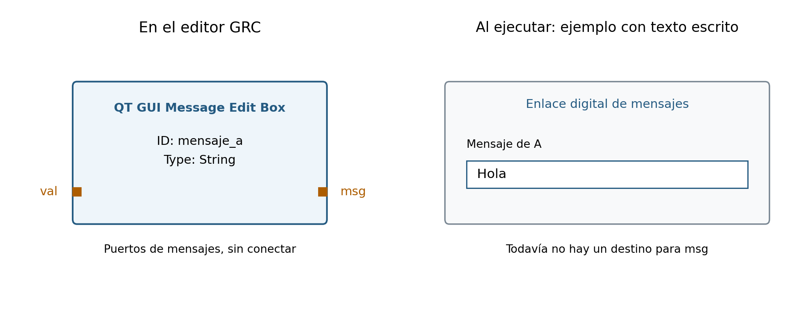
**Figura 1.** El bloque crea un cuadro para escribir texto; sus puertos transportan mensajes, no muestras.

**Panel izquierdo — En el editor GRC**

- La caja representa `QT GUI Message Edit Box`, con `ID = mensaje_a` y `Type = String`.
- `val` es una entrada opcional de mensajes. Permite recibir contenido desde otro bloque; en este paso queda sin conectar.
- `msg` es la salida de mensajes. También queda sin conectar hasta el siguiente paso.

**Panel derecho — Al ejecutar**

- `Mensaje de A` identifica el cuadro editable. `Hola` muestra un ejemplo de texto introducido por el usuario.
- El usuario puede escribir otro texto sin modificar el flowgraph. Este cuadro no es un visor de muestras.
- Sin un bloque conectado a `msg`, el texto todavía no llega a otro bloque ni aparece en un registro de recepción.

??? note "Para profundizar: mensaje, PDU y muestras"

    - Un mensaje interno transporta un objeto cuando ocurre un evento. Aquí, el objeto contiene texto.
    - Una PDU, unidad de datos del protocolo, puede contener metadatos y un vector de bytes.
    - Este bloque, con la configuración indicada, no entrega todavía esa PDU de bytes. La conversión se añadirá después.
    - Un stream de muestras es una secuencia de valores procesada por bloques. El texto aún no se ha convertido en ese stream.
    - `samp_rate` no controla cuántas letras se escriben ni cuántos mensajes se publican.

### 2.4. El primer bloque en GRC

La captura muestra el primer bloque añadido al flowgraph, todavía sin conexiones.

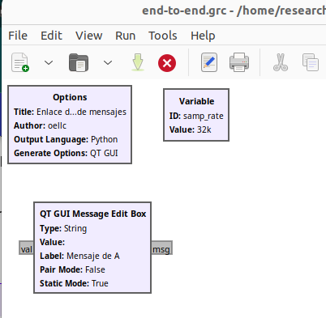
**Figura 2.** El cuadro de texto está configurado en GRC; los puertos `val` y `msg` permanecen sin conectar.

- El bloque inferior muestra `Type: String`, `Label: Mensaje de A`, `Pair Mode: False` y `Static Mode: True`.
- Arriba aparecen `Options` y la variable `samp_rate`. Esa variable no interviene en este paso.
- La captura muestra el editor, no la ventana de ejecución. La comprobación del cuadro de texto corresponde al apartado 3.

### Ejercicio 2 — Qué entrega el bloque

El usuario escribe `Hola`. ¿La salida `msg` entrega muestras I/Q? ¿`Static Mode = True` impide cambiar ese texto?

??? example "Solución explicada"

    - La salida entrega un mensaje de texto, no muestras I/Q.
    - El campo `Type = String` establece que el contenido es texto.
    - `Static Mode = True` mantiene ese tipo durante la ejecución. No fija la palabra escrita.
    - El usuario puede cambiar `Hola` por `SDR`. El contenido cambia, pero ambos mensajes siguen siendo texto.

## 3. Comprobar el primer bloque

### 3.1. Experimento

- **Qué cambia:** el texto escrito en el cuadro.
- **Qué permanece fijo:** `Type = String`, `Pair Mode = False` y `Static Mode = True`.
- **Qué se observa:** el cuadro aparece y admite texto. Todavía no se comprueba la recepción del mensaje en otro bloque.

1. El estudiante guarda el flowgraph y selecciona la acción `Execute` de GRC.
2. Comprueba que aparece la ventana `Enlace digital de mensajes`, con el cuadro `Mensaje de A`.
3. Escribe `Hola` y pulsa Enter.
4. Sustituye el texto por `SDR` y pulsa Enter.
5. Cierra la ventana de ejecución y conserva el archivo `.grc`.

- El bloque publica el mensaje al confirmar la edición, pero no hay un destino conectado para observarlo.
- **No se espera texto recibido en la consola en este paso.** La ausencia de esa salida no indica un error.
- No se añade `Throttle`: este paso no contiene un stream de muestras cuyo ritmo deba limitarse.

??? note "Para profundizar: cuándo se publica el mensaje"

    - En GNU Radio 3.10.12.0, el bloque utiliza el evento de Enter. Cambiar el foco no publica el texto.
    - Si `Value` contiene texto al arrancar, el bloque también publica ese contenido inicial. Por eso se deja vacío en esta guía.
    - Estos detalles corresponden al [código de esta versión](https://github.com/gnuradio/gnuradio/blob/v3.10.12.0/gr-qtgui/lib/edit_box_msg_impl.cc).

### 3.2. Lista de comprobación

- El archivo está guardado como `gnuradio-flowgraphs/end-to-end.grc`.
- `Options` contiene `ID = end_to_end` y `Generate Options = QT GUI`.
- El bloque `mensaje_a` tiene el tipo `String` y los modos indicados.
- La ventana permite cambiar `Hola` por `SDR`.
- Los puertos `val` y `msg` siguen sin conectar. Todavía no existe transmisión de radio.

### Ejercicio 3 — Qué demuestra esta prueba

Si el cuadro permite escribir `Hola`, ¿ya se demostró que el receptor recupera ese mensaje?

??? example "Solución explicada"

    - No. Solo se comprobó la entrada gráfica de texto.
    - Todavía no hay un bloque conectado a `msg` para observar el mensaje publicado.
    - Tampoco existen modulador, canal ni receptor. La prueba no demuestra una comunicación de extremo a extremo.
    - El siguiente paso añadirá `Message Debug` para comprobar el mensaje interno, antes de convertirlo en bytes.

## 4. Observar el mensaje con `Message Debug`

### 4.1. Añadir y conectar el bloque

- `Message Debug` muestra los mensajes que recibe. Permite comprobar el contenido antes de convertirlo en bytes.
- En este paso se utiliza su entrada `print`. No se utilizan `log`, `store` ni `print_pdu`.

1. El estudiante detiene la ejecución y añade `Message Debug` al flowgraph.
2. Conserva sus parámetros predeterminados: `Print PDU contents = On` y `Log level = Info`.
3. Conecta `msg` de `QT GUI Message Edit Box` con `print` de `Message Debug`.
4. Guarda el archivo y ejecuta el flowgraph.

La línea discontinua muestra el recorrido del mensaje entre los dos bloques.

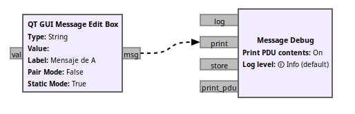
**Figura 3.** La conexión lleva el mensaje del cuadro de texto a la entrada `print` de `Message Debug`.

- El bloque izquierdo entrega el texto por `msg`. Conserva la configuración del apartado 2.
- El bloque derecho recibe el mensaje por `print` y muestra su contenido en la consola de ejecución de GRC.
- La línea transporta mensajes internos, no muestras I/Q. Todavía no hay modulación ni transmisión por RF.

### 4.2. Escribir y confirmar el texto

- **Qué cambia:** el texto introducido, primero `Hola` y después `SDR`.
- **Qué permanece fijo:** los parámetros de los bloques y la conexión `msg` → `print`.
- **Qué se observa:** la consola muestra el texto que se confirma con Enter.

1. El estudiante escribe `Hola` en el cuadro `Mensaje de A`.
2. Pulsa Enter y consulta la consola de GRC.
3. Sustituye el texto por `SDR` y pulsa Enter.
4. Comprueba que la consola también muestra `SDR`.

El texto se escribe en la ventana de ejecución, no en las propiedades del bloque.

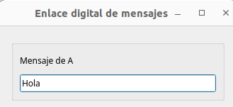
**Figura 4.** El cuadro `Mensaje de A` contiene `Hola`; Enter publica ese texto como mensaje.

- `Mensaje de A` identifica el campo editable. `Hola` es su contenido actual.
- La imagen muestra dónde se escribe. Por sí sola, no demuestra que otro bloque haya recibido el texto.
- La comprobación se realiza en la consola, como muestra la Figura 5.

### 4.3. Leer el resultado en consola

La consola permite comprobar qué texto recibió `Message Debug`.

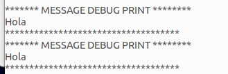
**Figura 5.** La consola muestra dos registros con `Hola`, impresos por `Message Debug`.

- `MESSAGE DEBUG PRINT` identifica la salida del bloque. Las filas de asteriscos separan los registros.
- La línea `Hola` contiene el texto recibido. Los asteriscos no forman parte del mensaje escrito.
- La captura contiene dos registros de `Hola`. No demuestra una recepción por radio ni identifica qué acciones produjeron la repetición.

??? note "Para profundizar: un mismo texto puede aparecer varias veces"

    - En esta versión, cada pulsación de Enter publica el contenido actual, aunque el texto no haya cambiado.
    - Dos pulsaciones pueden producir dos registros iguales. La captura no permite confirmar que esa haya sido la causa.
    - La prueba comprueba el contenido recibido. No exige deducir el número de pulsaciones a partir de una captura.

### Ejercicio 4 — Qué se ha comprobado

La consola muestra `Hola`. ¿Qué parte funciona? ¿El texto ya pasó por un canal de radio?

??? example "Solución explicada"

    - El cuadro de texto publicó un mensaje y `Message Debug` recibió su contenido por `print`.
    - La línea discontinua conecta puertos de mensajes, como muestra la Figura 3.
    - El mensaje todavía no pasó por un modulador, un canal ni un receptor de radio.
    - El resultado valida la entrada y la observación del texto. El siguiente paso preparará los bytes para construir el paquete.

## 5. Convertir texto en bytes UTF-8

- Se utiliza un `Embedded Python Block`, bloque con código Python integrado en GRC, para convertir el texto mediante UTF-8.
- UTF-8 es una codificación de caracteres. Por ejemplo, `Hola` produce los bytes `72, 111, 108, 97`, expresados en decimal.
- El bloque agrupa esos bytes en una PDU, unidad de datos del protocolo, con un campo de metadatos y un vector de bytes.
- Esta conversión no añade protección contra errores. No es codificación de canal ni modulación.

### 5.1. Añadir el bloque y abrir el editor

1. El estudiante detiene la ejecución y añade `Embedded Python Block` al flowgraph.
2. Abre las propiedades del bloque.
3. Selecciona `Open in Editor` para editar el código.

El bloque recién añadido todavía contiene la plantilla que se va a reemplazar.

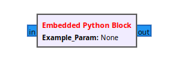
**Figura 6.** El bloque inicial todavía no contiene el convertidor de texto a bytes.

- `Embedded Python Block` es el nombre de la plantilla. El código cambiará el nombre visible a `Texto a bytes UTF-8`.
- `Example_Param` pertenece al ejemplo inicial. No es un parámetro del convertidor que se construye aquí.
- Esta captura no muestra la configuración final. El resultado que debe obtenerse aparece en la Figura 9.

El botón `Open in Editor` abre el archivo donde se sustituye el código de ejemplo.

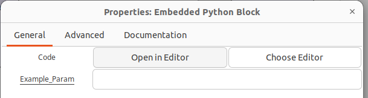
**Figura 7.** El código se edita mediante `Open in Editor`, no en el campo `Example_Param`.

- `Open in Editor` abre el editor de código.
- `Choose Editor` permite seleccionar el programa de edición si hace falta.
- El convertidor no necesita `Example_Param`. Ese campo deja de formar parte del bloque al cargar el nuevo código.

### 5.2. Introducir el código completo

1. El estudiante reemplaza todo el código de ejemplo por el siguiente contenido.
2. Guarda los cambios en el editor y regresa a GRC.
3. Confirma las propiedades del bloque y guarda el flowgraph.

```python
from gnuradio import gr
import pmt


class blk(gr.basic_block):
    def __init__(self):
        gr.basic_block.__init__(
            self, name="Texto a bytes UTF-8", in_sig=None, out_sig=None
        )

        self.message_port_register_in(pmt.intern("in"))
        self.message_port_register_out(pmt.intern("out"))
        self.set_msg_handler(pmt.intern("in"), self.convertir)

    def convertir(self, mensaje):
        # El cuadro de texto entrega un símbolo PMT.
        if not pmt.is_symbol(mensaje):
            print("Texto a bytes: se esperaba un mensaje de texto.")
            return

        texto = pmt.symbol_to_string(mensaje)
        datos = texto.encode("utf-8")

        # PDU: metadatos vacíos y vector de bytes.
        metadatos = pmt.make_dict()
        vector = pmt.init_u8vector(len(datos), list(datos))
        pdu = pmt.cons(metadatos, vector)

        self.message_port_pub(pmt.intern("out"), pdu)
```

- `pmt` es la biblioteca de tipos de mensajes de GNU Radio. PMT significa *Polymorphic Types*, tipos polimórficos.
- `in` recibe el texto. `convertir` obtiene sus bytes UTF-8 y construye la PDU con metadatos vacíos.
- `out` publica esa PDU. El bloque no procesa un stream de muestras; por eso no necesita una función `work`.

La captura muestra parte del código en el editor; el contenido completo está en el bloque copiable anterior.

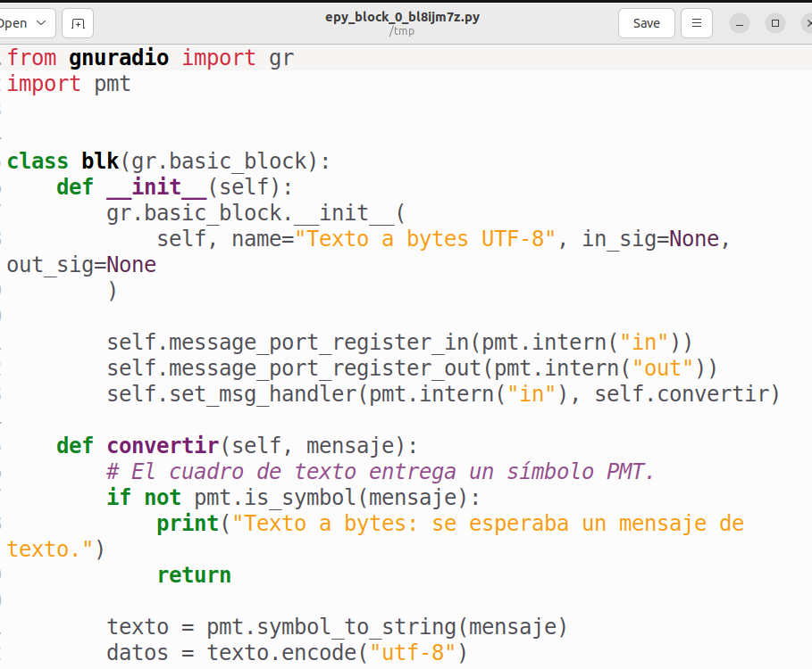
**Figura 8.** El editor muestra la definición del bloque y el comienzo de la conversión a bytes.

- `name="Texto a bytes UTF-8"` establece el nombre que aparece en el diagrama.
- `message_port_register_in` y `message_port_register_out` crean los puertos de mensajes.
- La captura no incluye las últimas líneas. Se copia el código completo, incluida la publicación de la PDU por `out`.

### 5.3. Conectar el convertidor

1. El estudiante elimina la conexión directa entre el cuadro de texto y `Message Debug`.
2. Conecta `msg` del cuadro de texto a `in` de `Texto a bytes UTF-8`.
3. Conecta `out` del convertidor a `print` de `Message Debug`.
4. Conserva `Print PDU contents = On` para observar los bytes.

El convertidor queda entre la entrada de texto y el bloque que muestra el resultado.

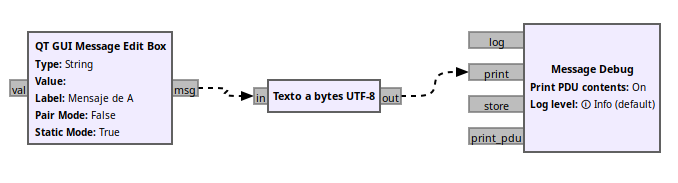
**Figura 9.** El texto entra por `in`; la PDU sale por `out` y llega a `print` de `Message Debug`.

- A la izquierda, `msg` entrega el texto con `Type = String` y `Pair Mode = False`.
- En el centro, el convertidor agrupa los bytes en una PDU. No añade todavía una cabecera de transmisión.
- A la derecha, `print` recibe la PDU. Las dos conexiones siguen transportando mensajes, no muestras I/Q.

### 5.4. Escribir un mensaje de prueba

- **Qué cambia:** el texto escrito, primero `Hola` y después `SDR`.
- **Qué permanece fijo:** el código del convertidor, las conexiones y los parámetros del cuadro de texto.
- **Qué se observa:** la longitud de la PDU y sus bytes en hexadecimal, una representación numérica en base 16.

1. El estudiante guarda y ejecuta el flowgraph.
2. Escribe `Hola` en `Mensaje de A` y pulsa Enter.
3. Comprueba la longitud y los bytes en la consola.
4. Repite la prueba con `SDR`: debe obtener tres bytes, `53 44 52` en hexadecimal.

El cuadro de entrada conserva su aspecto; el cambio está en el procesamiento posterior.

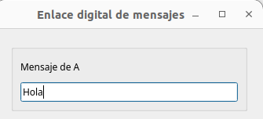
**Figura 10.** El usuario escribe `Hola` y pulsa Enter para enviar el texto al convertidor.

- El cuadro recibe letras, no números hexadecimales.
- El convertidor obtiene los bytes después de recibir el mensaje.
- La ventana de entrada no muestra la PDU. El resultado se comprueba en la consola.

### 5.5. Leer la PDU en consola

El registro completo muestra cuatro bytes para `Hola`; el fragmento superior pertenece a una impresión anterior.

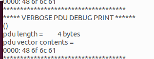
**Figura 11.** La PDU contiene cuatro bytes: `48 6f 6c 61`, que representan `Hola` en UTF-8.

- Debajo de `VERBOSE PDU DEBUG PRINT`, `()` representa el campo de metadatos vacío. No es parte del texto escrito.
- `pdu length = 4 bytes` indica la longitud del vector de bytes, no la cantidad de muestras I/Q.
- `0000:` señala la posición inicial del vector. Los bytes son `48 6f 6c 61`, equivalentes a `72, 111, 108, 97` en decimal.

??? note "Para profundizar: bytes y caracteres no siempre coinciden"

    - En `Hola`, cada letra ocupa un byte UTF-8. Otros caracteres, como las letras con tilde, pueden ocupar más de un byte.
    - El código conserva espacios y no añade un salto de línea. Enter publica el mensaje, pero no se añade como carácter al texto.
    - Los metadatos y el vector forman una PDU interna. Todavía no existe un paquete transmitido por radio.

### Ejercicio 5 — Interpretar el resultado

La consola muestra `pdu length = 4 bytes` y `0000: 48 6f 6c 61`. ¿Es `0000` otro byte? ¿Ya se generaron muestras I/Q?

??? example "Solución explicada"

    - **Datos:** el vector contiene `48 6f 6c 61`, en hexadecimal, y la longitud indicada es cuatro bytes.
    - **Concepto:** `0000:` identifica la posición inicial del vector. No es un byte adicional del mensaje.
    - **Resultado:** esos cuatro bytes representan `Hola` en UTF-8. El convertidor no ha añadido letras ni cambiado su orden.
    - **Interpretación:** la salida es una PDU de bytes. Todavía no hay símbolos modulados ni muestras I/Q.

## 6. Recuperar el texto desde los bytes

- El bloque `Bytes a texto UTF-8` realiza la conversión inversa: obtiene `Hola` a partir de la PDU.
- La prueba comprueba el recorrido texto → bytes → texto. Todavía no contiene modulación, un canal de radio ni sincronizadores.

### 6.1. Añadir el convertidor inverso

1. El estudiante detiene la ejecución y añade otro `Embedded Python Block`.
2. Conserva el bloque `Texto a bytes UTF-8` del apartado anterior.
3. Abre `Open in Editor` del bloque nuevo y reemplaza todo el código por este contenido.
4. Guarda el código, regresa a GRC y confirma las propiedades del bloque.

```python
from gnuradio import gr
import pmt


class blk(gr.basic_block):
    def __init__(self):
        gr.basic_block.__init__(
            self, name="Bytes a texto UTF-8", in_sig=None, out_sig=None
        )

        self.message_port_register_in(pmt.intern("in"))
        self.message_port_register_out(pmt.intern("out"))
        self.set_msg_handler(pmt.intern("in"), self.convertir)

    def convertir(self, mensaje):
        # La entrada debe ser una PDU con un vector de bytes.
        if not pmt.is_pdu(mensaje) or not pmt.is_u8vector(pmt.cdr(mensaje)):
            print("Bytes a texto: se esperaba una PDU de bytes.")
            return

        vector = pmt.cdr(mensaje)
        datos = bytes(pmt.u8vector_elements(vector))

        try:
            texto = datos.decode("utf-8")
        except UnicodeDecodeError:
            print("Bytes a texto: los bytes no forman un texto UTF-8 válido.")
            return

        self.message_port_pub(pmt.intern("out"), pmt.intern(texto))
```

- `pmt.cdr(mensaje)` extrae el vector de la PDU. Los metadatos no se convierten en letras.
- `decode("utf-8")` interpreta los bytes y obtiene el texto.
- `out` publica el texto recuperado como mensaje. Si los bytes no forman UTF-8 válido, el bloque muestra un aviso y no publica texto.

### 6.2. Conectar una cadena con un solo visor

1. El estudiante elimina la conexión desde `Texto a bytes UTF-8` hacia `Message Debug`.
2. Conecta `out` de `Texto a bytes UTF-8` a `in` de `Bytes a texto UTF-8`.
3. Conecta `out` de `Bytes a texto UTF-8` a `print` de `Message Debug`.
4. Conserva la conexión desde `msg` del cuadro de texto hasta `in` del primer convertidor.

El mensaje recorre los dos convertidores antes de llegar al único visor de esta captura.

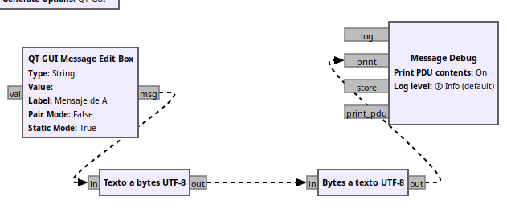
**Figura 12.** Los dos convertidores reconstruyen el texto y lo entregan a un único `Message Debug`.

- `QT GUI Message Edit Box` publica el texto por `msg`. El primer convertidor entrega una PDU de bytes.
- El segundo convertidor recibe esa PDU y publica el texto recuperado. No recibe el texto original mediante una conexión directa.
- `Message Debug` recibe solamente la salida del segundo convertidor por `print`. En este montaje no muestra los bytes intermedios.

??? note "Para profundizar: observar bytes y texto al mismo tiempo"

    - Un segundo visor es opcional. La cadena de la Figura 12 basta para comprobar el texto final.
    - Para comparar ambas representaciones, se añade otro `Message Debug` y se conecta a `out` de `Texto a bytes UTF-8` por `print`.
    - Esa rama muestra los bytes; el visor final sigue mostrando texto. No se conecta el texto original directamente al visor final.

### 6.3. Probar la recuperación

- **Qué cambia:** el texto escrito: `Hola`, `SDR` y `¡Hola, Perú!`.
- **Qué permanece fijo:** los dos convertidores y las conexiones de la Figura 12.
- **Qué se observa:** el texto recuperado debe coincidir con el escrito, incluidas las tildes y los espacios.

1. El estudiante guarda y ejecuta el flowgraph.
2. Escribe `Hola` y pulsa Enter.
3. Comprueba que la consola muestra `Hola` bajo `MESSAGE DEBUG PRINT`.
4. Repite con `SDR` y `¡Hola, Perú!`, comparando cada resultado con su entrada.

El cuadro de entrada no cambia; ahora el mensaje atravesará ambos convertidores.

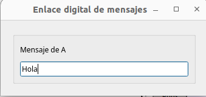
**Figura 13.** El usuario escribe `Hola` para comprobar el recorrido texto → bytes → texto.

- `Hola` es la entrada de la prueba. El usuario no necesita escribir sus bytes manualmente.
- Enter publica el mensaje hacia el primer convertidor.
- La ventana muestra la entrada, no el texto recuperado. El resultado aparece en la consola de la Figura 14.

### 6.4. Interpretar el texto recuperado

La consola muestra el texto que recibe el visor situado después de los dos convertidores.

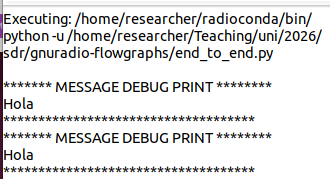
**Figura 14.** El visor final imprime `Hola`, el texto recuperado desde la PDU.

- Cada encabezado `MESSAGE DEBUG PRINT` inicia un registro del visor final. La línea `Hola` contiene su mensaje recibido.
- Los dos registros pertenecen al mismo visor. No representan uno al convertir a bytes y otro al recuperar el texto.
- La coincidencia con la entrada comprueba este ejemplo de conversión. No demuestra transmisión por radio ni funcionamiento frente a errores del canal.

??? note "Para profundizar: límites de esta comprobación"

    - La captura contiene dos registros, pero no muestra las acciones que causaron la repetición. Pulsar Enter varias veces puede publicar el mismo texto.
    - Decodificar UTF-8 no comprueba la integridad del mensaje. Algunos cambios de bytes pueden producir otro texto UTF-8 válido.
    - El convertidor no corrige errores. Una comprobación del paquete se añadirá en una etapa posterior.

### Ejercicio 6 — Qué demuestra la salida

La Figura 14 muestra `Hola` dos veces. ¿Cada registro corresponde a un convertidor? ¿Ya funciona el receptor de radio?

??? example "Solución explicada"

    - **Datos:** la Figura 12 tiene dos convertidores, pero solo un `Message Debug` conectado al final.
    - **Concepto:** los convertidores publican mensajes por sus salidas. El visor final imprime el texto recuperado.
    - **Resultado:** ambos registros de `Hola` pertenecen a ese visor. No indican dos etapas de observación distintas.
    - **Interpretación:** se ha recuperado el texto después de representarlo mediante bytes. Todavía no existen modulador, canal de radio ni receptor.

## 7. Construir el paquete

- `Construir paquete` recibe la PDU del convertidor y añade información para interpretar y comprobar el mensaje.
- La salida sigue siendo una PDU. Ahora su vector contiene longitud, texto y CRC, no solamente texto.
- CRC significa *Cyclic Redundancy Check*, comprobación cíclica de redundancia. Permite detectar errores; no los corrige ni garantiza detectar todas las alteraciones.

### 7.1. Formato y límites

| Campo, en orden | Tamaño | Contenido |
|---|---|---|
| Longitud | 2 bytes | Número de bytes del texto, sin contar longitud ni CRC. |
| Payload, contenido útil | Hasta 5000 bytes | Texto UTF-8 original, incluidos sus espacios. |
| CRC-32 | 4 bytes | Resultado de calcular el CRC sobre longitud y texto, juntos. |

- El texto admite hasta **500 palabras y 5000 bytes UTF-8**. Debe cumplir ambos límites; 5 kB significa 5000 bytes.
- Una palabra es un grupo separado por espacios en blanco. `texto.split()` también reconoce tabulaciones y saltos de línea.
- El bloque rechaza mensajes vacíos, mensajes formados solo por espacios en blanco y mensajes que exceden algún límite. No los recorta.
- La longitud y el CRC usan **big-endian**: el byte más significativo aparece primero.
- No se añade relleno hasta 5000 bytes ni se comprime el texto. La secuencia de sincronización se añadirá después.

Para `Hola`, se conservan los cuatro bytes del texto y se añaden seis bytes de control.

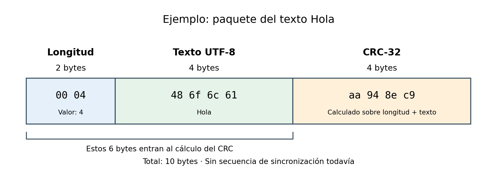
**Figura 15.** El paquete de `Hola` contiene dos bytes de longitud, cuatro de texto y cuatro de CRC.

- **Izquierda:** `00 04` representa la longitud del texto: cuatro bytes. No indica la longitud total del paquete.
- **Centro:** `48 6f 6c 61` conserva `Hola`. Estos bytes son el contenido útil, sin cambios.
- **Derecha:** `aa 94 8e c9` es el CRC de los seis bytes anteriores. El vector completo contiene diez bytes.

??? note "Para profundizar: qué define este formato"

    - El paquete es un formato didáctico del laboratorio, no un protocolo universal de GNU Radio.
    - `struct.pack("!H", longitud)` produce dos bytes sin signo. `!` selecciona big-endian y evita relleno entre campos.
    - `struct.pack("!I", crc)` produce cuatro bytes sin signo, también en big-endian.
    - El CRC se calcula con `zlib.crc32(cabecera + datos)`. No se incluye el propio campo CRC en ese cálculo.
    - La biblioteca devuelve un entero de 32 bits sin signo. Usar esta función no comprime los datos.
    - El orden de bytes no define todavía el orden de transmisión de los bits dentro de cada byte.
    - Los metadatos PMT se conservan fuera del vector. No se incluyen en la longitud, el CRC ni los bytes del paquete.
    - La futura detección del comienzo del paquete necesitará una secuencia de sincronización. Añadir una longitud no resuelve esa detección.
    - El CRC no autentica al emisor ni protege contra cambios deliberados.

### 7.2. Añadir el bloque

1. El estudiante detiene la ejecución y guarda el flowgraph.
2. Añade otro `Embedded Python Block`. No reemplaza los convertidores anteriores.
3. Abre `Open in Editor` del bloque nuevo y reemplaza todo el código por este contenido.
4. Guarda el código, regresa a GRC y confirma las propiedades.
5. Comprueba que aparece `Construir paquete`, con puertos de mensajes `in` y `out`.

```python
from gnuradio import gr
import pmt
import struct
import zlib


class blk(gr.basic_block):
    def __init__(self):
        gr.basic_block.__init__(
            self, name="Construir paquete", in_sig=None, out_sig=None
        )

        self.message_port_register_in(pmt.intern("in"))
        self.message_port_register_out(pmt.intern("out"))
        self.set_msg_handler(pmt.intern("in"), self.construir)

    def construir(self, mensaje):
        if not pmt.is_pdu(mensaje) or not pmt.is_u8vector(pmt.cdr(mensaje)):
            print("Construir paquete: se esperaba una PDU de bytes.")
            return

        datos = bytes(pmt.u8vector_elements(pmt.cdr(mensaje)))
        if len(datos) > 5000:
            print("Construir paquete: el texto supera 5000 bytes. No se envía.")
            return

        try:
            texto = datos.decode("utf-8")
        except UnicodeDecodeError:
            print("Construir paquete: los bytes no forman un texto UTF-8 válido.")
            return

        palabras = texto.split()
        if not palabras:
            print("Construir paquete: mensaje vacío. No se envía.")
            return
        if len(palabras) > 500:
            print("Construir paquete: el texto supera 500 palabras. No se envía.")
            return

        # La longitud cuenta solo los bytes originales del texto.
        cabecera = struct.pack("!H", len(datos))
        contenido = cabecera + datos
        crc = struct.pack("!I", zlib.crc32(contenido))
        paquete = contenido + crc

        # Los metadatos siguen separados de los bytes del paquete.
        vector = pmt.init_u8vector(len(paquete), list(paquete))
        salida = pmt.cons(pmt.car(mensaje), vector)
        self.message_port_pub(pmt.intern("out"), salida)
```

- El bloque interpreta el texto para contar palabras. Construye el paquete con `datos`, los bytes originales, sin quitar espacios.
- `cabecera + datos` une longitud y texto. El código calcula el CRC sobre ese resultado y lo añade al final.
- Ante una entrada rechazada, `return` termina el procesamiento. El bloque muestra un aviso, pero no publica una PDU.

### 7.3. Conectar la prueba

1. El estudiante selecciona `Bytes a texto UTF-8` y pulsa `D` para deshabilitarlo, sin borrarlo. El atajo corresponde a `Disable` en GRC 3.10.
2. Sus conexiones pueden permanecer, como muestra la Figura 16. No se usan mientras el bloque esté deshabilitado.
3. Conserva la conexión del cuadro de texto con `Texto a bytes UTF-8`.
4. Conecta los puertos según la tabla y conserva `Print PDU contents = On` en `Message Debug`.
5. Si añadió el visor opcional del apartado 6.2, lo desconecta y deshabilita. En esta prueba, solo se observa la salida del constructor.

| Origen | Puerto de salida | Destino | Puerto de entrada |
|---|---|---|---|
| `QT GUI Message Edit Box` | `msg` | `Texto a bytes UTF-8` | `in` |
| `Texto a bytes UTF-8` | `out` | `Construir paquete` | `in` |
| `Construir paquete` | `out` | `Message Debug` | `print` |

Las conexiones negras llevan el mensaje al constructor; la rama gris conserva el convertidor anterior, deshabilitado.

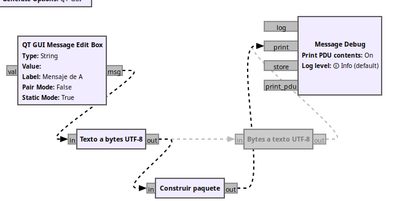
**Figura 16.** El recorrido activo pasa por `Construir paquete` y termina en `print` de `Message Debug`.

- **Izquierda:** el cuadro entrega texto a `Texto a bytes UTF-8`. Su salida entrega los bytes al constructor situado debajo.
- **Abajo y derecha:** `Construir paquete` publica la PDU completa. La conexión negra lleva esa PDU a `print` de `Message Debug`.
- **Centro, en gris:** `Bytes a texto UTF-8` está deshabilitado. Sus conexiones permanecen visibles, pero no procesan ni entregan mensajes.

!!! warning "La salida ya no contiene solamente texto"

    - No se conecta `Construir paquete` directamente a `Bytes a texto UTF-8`.
    - Primero deberá comprobarse el CRC y retirarse la cabecera y el CRC. El convertidor actual no realiza esas tareas.

### 7.4. Probar y leer el resultado

- **Qué cambia:** el texto escrito: primero `Hola`, después `á` y finalmente tres espacios.
- **Qué permanece fijo:** el formato, el código y las conexiones del apartado 7.3.
- **Qué se observa:** longitud total, bytes del paquete y avisos de rechazo en la consola.

El estudiante realiza esta prueba:

1. El estudiante guarda y ejecuta el flowgraph.
2. Escribe `Hola`, sin comillas, y pulsa Enter.
3. Busca `pdu length = 10 bytes` y compara los bytes con el resultado indicado debajo.
4. Reemplaza `Hola` por `á` y pulsa Enter. El vector debe contener ocho bytes y empezar con `00 02 c3 a1`.
5. Reemplaza el texto por tres espacios y pulsa Enter. Debe aparecer `mensaje vacío`, sin un nuevo registro de PDU.
6. Envía `Hola` otra vez. El bloque debe volver a producir el paquete de diez bytes.

El cuadro de entrada permanece igual; el cambio está en el recorrido del mensaje después de pulsar Enter.

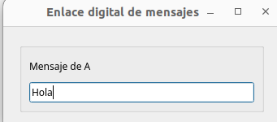
**Figura 17.** El usuario escribe `Hola` para probar el constructor del paquete.

- El cuadro contiene el texto original. No necesita mostrar ni recibir los bytes de longitud o CRC.
- Al pulsar Enter, el texto recorre los bloques activos de la Figura 16.
- Esta ventana no muestra el paquete construido. Ese resultado aparece en la consola de la Figura 18.

### 7.5. Leer el paquete en consola

La consola muestra los mismos diez bytes del ejemplo de la Figura 15.

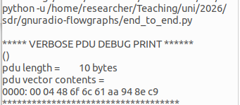
**Figura 18.** La PDU de `Hola` contiene diez bytes, con longitud y CRC incluidos.

- **Longitud total:** `pdu length = 10 bytes` cuenta todo el vector. `0000:` indica la posición inicial, no un byte adicional.
- **Longitud y texto:** `00 04` indica cuatro bytes de texto. Los bytes siguientes, `48 6f 6c 61`, representan `Hola`.
- **CRC:** `aa 94 8e c9` coincide con el cálculo sobre longitud y texto. Esta captura muestra la construcción, no una comprobación en recepción.

??? note "Para profundizar: alcance de la prueba"

    - `á` ocupa dos bytes UTF-8, aunque sea un carácter. Con longitud y CRC, el paquete ocupa ocho bytes.
    - Un texto aceptado de 5000 bytes produce un paquete de 5006 bytes. Ese total todavía excluye la futura secuencia de sincronización.
    - El límite de palabras no sustituye el límite de bytes. Un texto puede cumplir uno y superar el otro.
    - La prueba todavía utiliza mensajes internos. No genera muestras I/Q ni mide latencia de transmisión.
    - El constructor añade el CRC. La comprobación del CRC en recepción pertenece al siguiente paso.
    - Repetir `Hola` produce los mismos diez bytes. El constructor no incorpora fecha ni un número de mensaje.
    - Las capturas muestran la prueba con `Hola`. Las pruebas con `á`, espacios y límites de tamaño se comprueban por separado.

### Ejercicio 7 — Longitud del texto y longitud del paquete

El texto `Hola` ocupa cuatro bytes UTF-8. ¿Qué longitud lleva la cabecera y cuántos bytes debe mostrar `Message Debug`?

??? example "Solución explicada"

    - **Datos:** texto de 4 bytes, cabecera de 2 bytes y CRC de 4 bytes.
    - **Fórmula:** longitud total = longitud de cabecera + longitud del texto + longitud del CRC.
    - **Sustitución:** $2 + 4 + 4 = 10$ bytes.
    - **Resultado:** la cabecera contiene `00 04`, que representa 4 bytes. El visor indica `pdu length = 10 bytes`.
    - **Interpretación:** la cabecera describe el texto; el visor cuenta todo el vector. Las dos longitudes miden contenidos diferentes.

## 8. Comprobar el paquete y recuperar el texto

- `Comprobar paquete` recibe la PDU completa y comprueba su longitud y su CRC.
- Si ambas comprobaciones pasan, publica una PDU que contiene únicamente los bytes del texto.
- `Bytes a texto UTF-8` convierte esos bytes en letras. Un único `Message Debug` muestra el texto final.

### 8.1. Qué comprueba el bloque

El bloque utiliza el formato de la Figura 15. Para `Hola`, recibe diez bytes y debe entregar cuatro.

| Comprobación | Ejemplo con `Hola` | Si falla |
|---|---|---|
| Longitud permitida: de 1 a 5000 bytes de texto. | `00 04` indica 4 bytes. | Rechaza el paquete. |
| Tamaño total: longitud indicada más 6 bytes de control. | $4 + 6 = 10$ bytes recibidos. | Rechaza el paquete. |
| CRC calculado sobre longitud y texto, igual al CRC recibido. | El resultado coincide con `aa 94 8e c9`. | Rechaza el paquete. |

- El bloque no corrige un paquete rechazado. Muestra un aviso y no publica contenido por `out`.
- Si acepta el paquete, retira los dos bytes de longitud y los cuatro bytes de CRC.
- El ejemplo entrega `48 6f 6c 61`. El convertidor existente interpreta esos cuatro bytes como `Hola`.

### 8.2. Añadir `Comprobar paquete`

1. El estudiante detiene la ejecución y guarda el flowgraph.
2. Añade otro `Embedded Python Block`. Conserva los bloques anteriores.
3. Abre `Open in Editor` del bloque nuevo y reemplaza todo el código por el siguiente contenido.
4. Guarda el código, regresa a GRC y confirma las propiedades.
5. Comprueba que el bloque se llama `Comprobar paquete` y tiene puertos de mensajes `in` y `out`.

```python
from gnuradio import gr
import pmt
import struct
import zlib


class blk(gr.basic_block):
    def __init__(self):
        gr.basic_block.__init__(
            self, name="Comprobar paquete", in_sig=None, out_sig=None
        )

        self.message_port_register_in(pmt.intern("in"))
        self.message_port_register_out(pmt.intern("out"))
        self.set_msg_handler(pmt.intern("in"), self.comprobar)

    def comprobar(self, mensaje):
        if not pmt.is_pdu(mensaje) or not pmt.is_u8vector(pmt.cdr(mensaje)):
            print("Comprobar paquete: se esperaba una PDU de bytes.")
            return

        paquete = bytes(pmt.u8vector_elements(pmt.cdr(mensaje)))

        # Primero debe haber espacio para longitud y CRC.
        if len(paquete) < 6:
            print("Comprobar paquete: paquete demasiado corto. Se rechaza.")
            return

        longitud = struct.unpack("!H", paquete[:2])[0]
        if not 1 <= longitud <= 5000:
            print("Comprobar paquete: longitud no permitida. Se rechaza.")
            return

        if len(paquete) != longitud + 6:
            print("Comprobar paquete: el tamaño no coincide. Se rechaza.")
            return

        crc_recibido = struct.unpack("!I", paquete[-4:])[0]
        crc_calculado = zlib.crc32(paquete[:-4])
        if crc_recibido != crc_calculado:
            print("Comprobar paquete: CRC incorrecto. Se rechaza.")
            return

        # Solo se entregan los bytes del texto, sin longitud ni CRC.
        datos = paquete[2:-4]
        vector = pmt.init_u8vector(len(datos), list(datos))
        salida = pmt.cons(pmt.car(mensaje), vector)
        self.message_port_pub(pmt.intern("out"), salida)
```

- `paquete[:2]` obtiene la longitud. `paquete[-4:]` obtiene el CRC recibido.
- `paquete[:-4]` contiene longitud y texto, sin el CRC. El bloque calcula otro CRC sobre esos bytes y compara ambos valores.
- `paquete[2:-4]` obtiene únicamente el texto. Esta salida solo se publica después de superar las comprobaciones.

??? note "Para profundizar: interpretación del código"

    - `struct.unpack` interpreta bytes y devuelve una tupla. `[0]` obtiene el único número de esa tupla.
    - `!H` lee dos bytes sin signo; `!I` lee cuatro. Ambos conservan el orden big-endian utilizado por el constructor.
    - Seis bytes permiten leer los campos de control. Un paquete válido necesita al menos siete, porque el texto debe ocupar un byte como mínimo.
    - La longitud declarada no basta: debe coincidir con el tamaño real menos seis bytes. El bloque rechaza bytes adicionales o faltantes.
    - Los metadatos se conservan, pero no deciden la longitud. El bloque lee la longitud dentro del propio vector.
    - El constructor controla las 500 palabras y rechaza textos formados solo por espacios. Este comprobador verifica estructura, longitud y CRC.
    - `Bytes a texto UTF-8` comprueba después si los bytes forman texto UTF-8 válido. Un CRC correcto no garantiza esa condición.

### 8.3. Reconectar la cadena

El bloque gris de la Figura 16 volverá a utilizarse. Primero se retira su conexión antigua de entrada.

1. El estudiante elimina la conexión gris desde `Texto a bytes UTF-8` hacia `Bytes a texto UTF-8`, si todavía existe.
2. Elimina la conexión desde `Construir paquete` hacia `print` de `Message Debug`.
3. Selecciona `Bytes a texto UTF-8` y pulsa `E` para habilitarlo. El atajo corresponde a `Enable` en GRC 3.10.
4. Conecta `Construir paquete.out` con `Comprobar paquete.in`.
5. Conecta `Comprobar paquete.out` con `Bytes a texto UTF-8.in`.
6. Conserva o restablece la conexión de `Bytes a texto UTF-8.out` con `Message Debug.print`.

La cadena activa debe tener estas conexiones:

| Origen | Salida | Destino | Entrada |
|---|---|---|---|
| `QT GUI Message Edit Box` | `msg` | `Texto a bytes UTF-8` | `in` |
| `Texto a bytes UTF-8` | `out` | `Construir paquete` | `in` |
| `Construir paquete` | `out` | `Comprobar paquete` | `in` |
| `Comprobar paquete` | `out` | `Bytes a texto UTF-8` | `in` |
| `Bytes a texto UTF-8` | `out` | `Message Debug` | `print` |

El mensaje pasa por el constructor y el comprobador antes de volver a convertirse en texto.

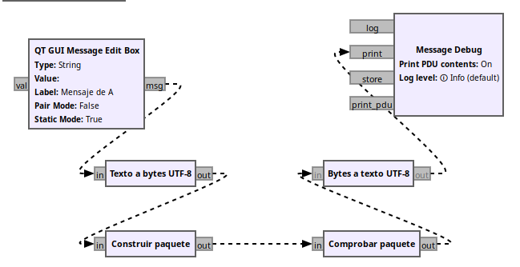
**Figura 19.** El paquete pasa por `Comprobar paquete` antes de entregar sus bytes al convertidor de texto.

- **Izquierda:** el cuadro publica el texto. `Texto a bytes UTF-8` entrega sus bytes a `Construir paquete`.
- **Abajo:** el constructor añade longitud y CRC. El comprobador recibe ese paquete y solo publica los bytes del texto si supera las comprobaciones.
- **Derecha:** `Bytes a texto UTF-8` vuelve a estar habilitado. Su salida lleva el texto recuperado a `print` de `Message Debug`.

!!! warning "El texto debe pasar por el comprobador"

    - No debe quedar una conexión directa entre ambos convertidores. Esa conexión entregaría texto sin comprobar el paquete.
    - `Message Debug` recibe únicamente la salida de `Bytes a texto UTF-8`. No se conecta también al constructor ni al comprobador.
    - Si existe un visor opcional anterior, permanece desconectado y deshabilitado durante esta prueba.

### 8.4. Probar la recuperación

- **Qué cambia:** el texto escrito: `Hola`, `SDR` y `¡Hola, Perú!`.
- **Qué permanece fijo:** los cuatro bloques de procesamiento, el formato del paquete y las conexiones del apartado 8.3.
- **Qué se observa:** el texto final debe coincidir con la entrada, incluidas las tildes y los espacios.

El estudiante realiza esta prueba:

1. Guarda y ejecuta el flowgraph.
2. Escribe `Hola` en el cuadro y pulsa Enter.
3. Comprueba que aparece `Hola` bajo `MESSAGE DEBUG PRINT`.
4. Repite con `SDR` y `¡Hola, Perú!`.

La entrada sigue siendo `Hola`; ahora su paquete debe pasar por el comprobador antes de llegar al visor.

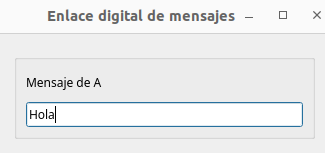
**Figura 20.** El usuario escribe `Hola` para probar la cadena con el comprobador del paquete.

- El cuadro muestra el texto de entrada. No muestra el texto recuperado ni el resultado de comprobar el CRC.
- Enter publica el mensaje hacia la cadena de la Figura 19.
- El resultado se busca en la consola, no en este cuadro de entrada.

### 8.5. Leer el texto recuperado

La consola vuelve a mostrar letras porque el visor recibe la salida del convertidor de texto.

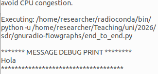
**Figura 21.** El visor final muestra `Hola`, después del recorrido por el constructor, el comprobador y el convertidor de texto.

- `MESSAGE DEBUG PRINT` identifica el registro del visor. La línea siguiente contiene `Hola`, el texto recuperado.
- La salida coincide con la entrada de la Figura 20. Ya no se muestran los diez bytes del paquete de la Figura 18.
- Este resultado comprueba la recuperación de `Hola` en esta cadena. No demuestra todavía el rechazo de un paquete alterado ni transmisión por radio.

??? note "Si la salida no coincide"

    - Si aparece `VERBOSE PDU DEBUG PRINT`, el visor está recibiendo una PDU. Se revisan sus conexiones antes de continuar.
    - Si aparece un aviso de rechazo, no debe mostrarse texto nuevo correspondiente a ese paquete. Los registros anteriores pueden permanecer en la consola.

??? note "Para profundizar: qué demuestra esta prueba"

    - El recorrido es texto → bytes → paquete → bytes comprobados → texto.
    - Una PDU ya contiene un vector delimitado. Este paso no descubre el comienzo del paquete dentro de muestras I/Q.
    - El CRC permite detectar errores, pero no corrige bytes ni garantiza detectar todas las alteraciones posibles.
    - Todavía no hay modulación, canal de radio ni sincronizadores. La prueba con paquetes alterados se realiza por separado.
    - Las Figuras 20 y 21 muestran el ensayo con `Hola`. Las pruebas con otros textos y errores se comprueban por separado.

### Ejercicio 8 — Una longitud que no coincide

Llegan diez bytes, pero la cabecera declara cinco bytes de texto. ¿Debe el bloque entregar ese texto?

??? example "Solución explicada"

    - **Datos:** llegan 10 bytes. La cabecera declara 5 bytes de texto; longitud y CRC ocupan 6 bytes adicionales.
    - **Fórmula:** tamaño esperado = longitud declarada + 6 bytes.
    - **Sustitución:** $5 + 6 = 11$ bytes.
    - **Resultado:** el tamaño recibido, 10 bytes, no coincide con los 11 esperados. El bloque rechaza el paquete antes de comparar el CRC.
    - **Interpretación:** la cabecera y el vector no concuerdan. El bloque no inventa el byte faltante ni entrega texto parcial.

## 9. Comprobar el rechazo de un bit alterado

- Se añade `Alterar segundo paquete`, un bloque auxiliar para esta prueba. El constructor y el comprobador conservan su código.
- El auxiliar deja pasar el primer paquete, altera un bit del segundo y deja pasar los siguientes sin cambios.
- El estudiante envía `Hola` tres veces en una misma ejecución. Debe observar texto, rechazo y texto, en ese orden.

### 9.1. Qué se altera

- **Qué cambia:** un bit del primer byte del texto, solo en el segundo paquete.
- **Qué permanece fijo:** el texto escrito `Hola`, la longitud, el CRC recibido, los demás bytes y las conexiones.
- **Qué se observa:** el comprobador rechaza el segundo paquete. El tercer envío vuelve a mostrar `Hola`.

El cambio ocurre después de construir el paquete: `48` pasa a `49`, pero el CRC conserva su valor original.

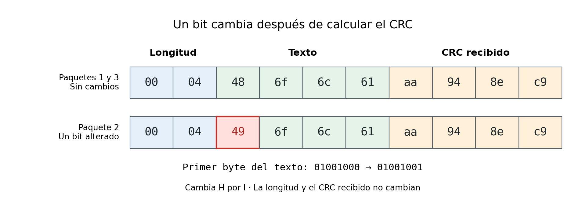
**Figura 22.** El segundo paquete cambia un bit del texto, pero conserva la longitud y el CRC del paquete original.

- **Fila superior:** los paquetes primero y tercero contienen `48 6f 6c 61`, que representa `Hola`. No se altera ningún byte.
- **Fila inferior:** el segundo paquete contiene `49 6f 6c 61`, que representaría `Iola`. El comprobador debe rechazarlo antes de convertirlo en texto.
- **Detalle inferior:** `01001000` cambia a `01001001`. Solo cambia el bit de la derecha; el CRC recibido permanece en `aa 94 8e c9`.

### 9.2. Añadir el bloque de prueba

1. El estudiante detiene la ejecución y guarda el flowgraph.
2. Añade otro `Embedded Python Block` y abre `Open in Editor`.
3. Reemplaza todo el código del bloque nuevo por este contenido.
4. Guarda el código, regresa a GRC y confirma las propiedades.

```python
from gnuradio import gr
import pmt


class blk(gr.basic_block):
    def __init__(self):
        gr.basic_block.__init__(
            self, name="Alterar segundo paquete", in_sig=None, out_sig=None
        )

        self.contador = 0
        self.message_port_register_in(pmt.intern("in"))
        self.message_port_register_out(pmt.intern("out"))
        self.set_msg_handler(pmt.intern("in"), self.procesar)

    def procesar(self, mensaje):
        if not pmt.is_pdu(mensaje) or not pmt.is_u8vector(pmt.cdr(mensaje)):
            print("Inyector: se esperaba una PDU de bytes.", flush=True)
            return

        paquete = bytearray(pmt.u8vector_elements(pmt.cdr(mensaje)))
        if len(paquete) < 7:
            print("Inyector: paquete demasiado corto.", flush=True)
            return

        self.contador += 1
        if self.contador == 2:
            # Índices 0 y 1: longitud. Índice 2: primer byte del texto.
            paquete[2] ^= 0x01
            print("Inyector: paquete 2, bit alterado.", flush=True)
        else:
            print(f"Inyector: paquete {self.contador}, sin cambios.", flush=True)

        # Se conserva el CRC recibido; no se calcula otro CRC.
        vector = pmt.init_u8vector(len(paquete), list(paquete))
        salida = pmt.cons(pmt.car(mensaje), vector)
        self.message_port_pub(pmt.intern("out"), salida)
```

- `bytearray` permite modificar una copia de los bytes. No modifica la PDU de entrada.
- `paquete[2] ^= 0x01` invierte el bit menos significativo del primer byte del texto. El código no cambia el campo CRC.
- `self.contador` cuenta los paquetes que pasan por este auxiliar. No se añade al paquete ni llega al comprobador como información adicional.

??? note "Para profundizar: XOR y límites del auxiliar"

    - XOR significa *exclusive OR*, operación lógica exclusiva. Aplicar XOR con `1` invierte un bit; aplicar XOR con `0` lo conserva.
    - `0x01` representa `00000001` en binario. Por eso la operación cambia únicamente el bit de la derecha.
    - El auxiliar recibe paquetes del constructor. La comprobación de siete bytes evita acceder a un texto ausente; no sustituye al comprobador.
    - Las entradas de tipo incorrecto o demasiado cortas no avanzan el contador.
    - Un texto rechazado por el constructor tampoco llega al auxiliar. Por eso la prueba utiliza siempre `Hola`.
    - El contador comienza en cero al crear el bloque. Detener y volver a ejecutar el programa desde GRC reinicia la secuencia.
    - El cuarto paquete y los siguientes pasan sin cambios. No se alternan errores de forma indefinida.

### 9.3. Insertarlo entre constructor y comprobador

1. El estudiante elimina la conexión directa entre `Construir paquete.out` y `Comprobar paquete.in`.
2. Conecta `Construir paquete.out` con `Alterar segundo paquete.in`.
3. Conecta `Alterar segundo paquete.out` con `Comprobar paquete.in`.
4. Conserva el resto de la cadena de la Figura 19. `Message Debug` sigue conectado únicamente a la salida del convertidor de texto.
5. Comprueba que `Value` de `QT GUI Message Edit Box` permanece vacío.

El paquete debe atravesar el auxiliar antes de llegar al comprobador.

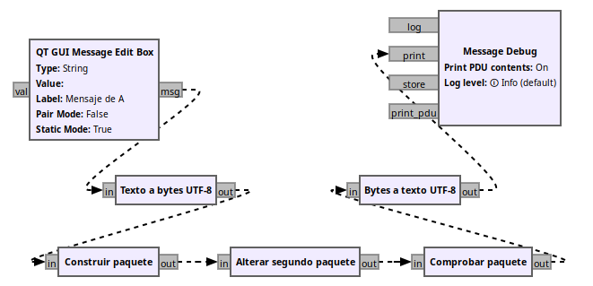
**Figura 23.** El auxiliar altera el paquete antes de comprobarlo; el visor muestra únicamente el texto aceptado.

- **Recorrido inferior:** `Construir paquete` entrega el paquete al auxiliar. La salida del auxiliar entra en `Comprobar paquete`.
- **Recorrido hacia el visor:** el comprobador entrega los bytes aceptados a `Bytes a texto UTF-8`. El texto llega a `Message Debug.print`.
- **Conexiones:** no existe una ruta directa que evite el auxiliar o el comprobador.

!!! warning "No se recalcula el CRC después del cambio"

    - El auxiliar debe quedar después del constructor. Si el cambio ocurre antes, el constructor calculará un CRC para el contenido ya modificado.
    - No debe quedar una conexión directa que evite el auxiliar. Tampoco una conexión directa entre los dos convertidores de texto.
    - `Value` vacío evita un envío inicial automático que cambiaría la numeración de la prueba.

### 9.4. Enviar tres veces el mismo texto

1. El estudiante guarda y ejecuta el flowgraph. El cuadro debe comenzar vacío.
2. Escribe `Hola` y pulsa Enter una vez. Espera hasta observar el texto en consola.
3. Sin cambiar el texto ni detener la ejecución, pulsa Enter otra vez. Espera el aviso de CRC incorrecto.
4. Pulsa Enter por tercera vez. Espera un nuevo registro con `Hola`.

El texto escrito permanece igual durante los tres envíos.

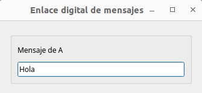
**Figura 24.** La entrada permanece en `Hola`; el auxiliar introduce el cambio después de construir el segundo paquete.

- **Cuadro de entrada:** contiene `Hola`. El estudiante no escribe `Iola` ni cambia el texto entre envíos.
- **Acción:** cada pulsación de Enter publica otro mensaje. La imagen muestra la entrada, no confirma una recepción.

La consola debe mostrar estos resultados:

| Envío de `Hola` | Aviso del auxiliar | Resultado esperado |
|---|---|---|
| Primero | `Inyector: paquete 1, sin cambios.` | Un registro `MESSAGE DEBUG PRINT` con `Hola`. |
| Segundo | `Inyector: paquete 2, bit alterado.` | `Comprobar paquete: CRC incorrecto. Se rechaza.` Sin texto nuevo. |
| Tercero | `Inyector: paquete 3, sin cambios.` | Otro registro `MESSAGE DEBUG PRINT` con `Hola`. |
| Cuarto y siguientes | `Inyector: paquete 4, sin cambios.`, etc. | Un registro con `Hola` por envío. |

- Tras los tres primeros envíos hay **dos registros de texto `Hola` y un rechazo por CRC**.
- El segundo envío no debe mostrar `Iola` ni un nuevo `Hola`. El registro anterior puede permanecer visible; no es una nueva recepción.
- El tercer envío demuestra que el rechazo no bloqueó el procesamiento del mensaje siguiente.

En el primer envío, el auxiliar conserva el paquete y el visor muestra el texto.

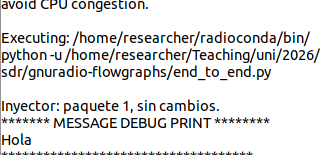
**Figura 25.** El primer paquete pasa sin cambios y produce un registro con `Hola`.

- **Aviso del auxiliar:** `paquete 1, sin cambios` identifica el primer envío de esta ejecución.
- **Salida del visor:** `Hola` aparece bajo `MESSAGE DEBUG PRINT`. El paquete pasó la comprobación.

En el segundo envío, el comprobador detecta el cambio y no entrega texto nuevo.

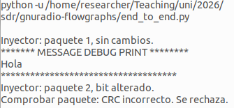
**Figura 26.** El segundo paquete se rechaza; el `Hola` anterior permanece visible en la consola.

- **Parte superior:** `Hola` pertenece al primer envío. No es la salida del paquete alterado.
- **Parte inferior:** `paquete 2, bit alterado` va seguido del rechazo por CRC. No aparece un nuevo registro de texto.
- **Límite de la captura:** muestra los dos primeros envíos. La recuperación del tercero se comprueba con otra pulsación de Enter.

!!! info "¿Por qué casi todos los mensajes llegan correctamente?"

    - El error no es aleatorio. La condición `self.contador == 2` altera solamente el segundo paquete de cada ejecución.
    - El primero, el tercero y los posteriores pasan sin cambios. El auxiliar no alterna paquetes válidos y alterados indefinidamente.
    - Detener y volver a ejecutar desde GRC reinicia el contador. Por eso el rechazo vuelve a aparecer cerca del inicio.
    - El paquete alterado no se entrega como texto errado. El comprobador lo rechaza. La consola conserva los registros anteriores en pantalla.

??? note "Si el resultado no coincide"

    - Si el segundo envío muestra `Hola`, se revisan conexiones directas que eviten el auxiliar o el comprobador.
    - Si muestra `Iola`, se revisa que el comprobador esté habilitado y forme parte del recorrido hacia el visor.
    - Si el aviso indica otra numeración, se detiene el programa, se deja `Value` vacío y se inicia una ejecución nueva.
    - Si aparecen más registros, se comprueba que Enter se pulsó una sola vez por envío y que el visor tenga una sola conexión activa.

### 9.5. Dejar el montaje sin alteraciones

1. El estudiante detiene la ejecución.
2. Elimina las dos conexiones de `Alterar segundo paquete` y lo deshabilita con `D`, sin borrarlo.
3. Restablece la conexión directa `Construir paquete.out` → `Comprobar paquete.in`.
4. Guarda y ejecuta de nuevo. Envía `Hola` dos veces y comprueba que ambos mensajes aparecen sin rechazo.

El montaje queda preparado para continuar:

- La cadena activa vuelve a la Figura 19. El auxiliar queda disponible para repetir el experimento después.
- Este ensayo modifica bytes de forma controlada. No simula todavía ruido, errores de frecuencia ni otros efectos sobre una señal I/Q.

### Ejercicio 9 — ¿Por qué no recalcular el CRC?

El auxiliar cambia `Hola` por `Iola`. ¿Qué ocurriría si también sustituyera el CRC por el calculado sobre longitud y texto modificados?

??? example "Solución explicada"

    - **Datos:** el texto cambia, pero mantiene cuatro bytes. La longitud total sigue siendo diez bytes.
    - **Concepto:** el comprobador compara el CRC recibido con otro calculado sobre longitud y texto recibidos.
    - **Resultado:** si ambos CRC corresponden al texto modificado, coincidirán. La longitud también coincidirá y el paquete será aceptado.
    - **Interpretación:** el visor mostraría `Iola`, no `Hola`. El comprobador no dispone del texto original para compararlo.
    - La prueba conserva el CRC original para provocar una discrepancia. Un CRC no autentica al emisor ni protege contra cambios deliberados.

## 10. Representar el paquete mediante bits

- Se añade `Bytes a bits` para preparar la entrada del futuro modulador.
- Los bytes ya contienen bits. El bloque los separa: cada elemento de salida guarda solamente el valor `0` o `1`.
- Se transforma el paquete completo: longitud, texto y CRC. No se añade información ni se recalcula el CRC.

### 10.1. Qué cambia en la representación

- **Qué cambia:** cada byte de entrada produce ocho elementos de salida.
- **Qué permanece fijo:** el contenido del paquete y el orden de sus bytes.
- **Qué se observa:** el paquete de `Hola` ocupa diez bytes de entrada y produce 80 valores binarios.

Se usa **MSB first**, primero el bit más significativo. Cada byte se recorre desde la posición 7 hasta la posición 0.

El ejemplo muestra los primeros tres bytes del paquete, no solamente los bytes del texto.

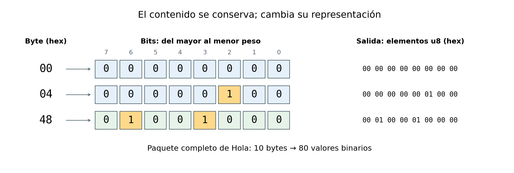
**Figura 27.** Cada byte se representa mediante ocho valores; el orden empieza por el bit de mayor peso.

- **Columna izquierda:** los valores son hexadecimales. `00 04` representa la longitud del texto; `48` corresponde a `H`.
- **Columnas centrales:** los bits se leen de izquierda a derecha. `04` produce `00000100`; los ceros iniciales se conservan.
- **Columna derecha:** cada bit se guarda en un elemento `u8`, entero sin signo de ocho bits. Su valor solo puede ser `00` o `01`.

!!! note "80 bits representados mediante 80 bytes de memoria"

    - La salida sigue siendo una PDU con un vector de bytes. Ahora cada byte del vector representa un único bit del paquete original.
    - `Message Debug` indicará `80 bytes`. Cuenta los elementos almacenados, no nuevos bytes de texto.
    - Los diez bytes originales ya contenían esos 80 bits. Separarlos no añade redundancia ni constituye codificación de canal.

??? note "Para profundizar: dos órdenes diferentes"

    - Big-endian define el orden de los bytes de longitud y CRC. MSB first define el orden de los bits dentro de cada byte.
    - Esta guía elige MSB first. BPSK no obliga a elegir ese orden, pero transmisor y receptor deben usar el mismo.
    - El campo de longitud conserva el valor 4 para `Hola`. No se sustituye por 10 ni por 80.
    - Antes de comprobar el paquete recibido, será necesario reagrupar los bits en bytes con el mismo orden.
    - Todavía se intercambian mensajes internos. La salida no es un stream, flujo de elementos procesados por los puertos continuos de GNU Radio.

### 10.2. Añadir `Bytes a bits`

1. El estudiante detiene la ejecución y guarda el flowgraph.
2. Añade un `Embedded Python Block` nuevo y abre `Open in Editor`.
3. Reemplaza todo el código del bloque nuevo por el siguiente contenido.
4. Guarda el código, regresa a GRC y confirma las propiedades.

```python
from gnuradio import gr
import pmt


class blk(gr.basic_block):
    def __init__(self):
        gr.basic_block.__init__(
            self, name="Bytes a bits", in_sig=None, out_sig=None
        )

        self.message_port_register_in(pmt.intern("in"))
        self.message_port_register_out(pmt.intern("out"))
        self.set_msg_handler(pmt.intern("in"), self.convertir)

    def convertir(self, mensaje):
        if not pmt.is_pdu(mensaje) or not pmt.is_u8vector(pmt.cdr(mensaje)):
            print("Bytes a bits: se esperaba una PDU de bytes.", flush=True)
            return

        datos = pmt.u8vector_elements(pmt.cdr(mensaje))
        if not datos:
            print("Bytes a bits: vector vacío.", flush=True)
            return

        bits = []
        for byte in datos:
            for posicion in range(7, -1, -1):
                bits.append((byte >> posicion) & 1)

        vector = pmt.init_u8vector(len(bits), bits)
        salida = pmt.cons(pmt.car(mensaje), vector)
        self.message_port_pub(pmt.intern("out"), salida)
```

- El bucle exterior conserva el orden de los bytes. El interior extrae sus ocho bits, empezando por la posición 7.
- `>>` desplaza el bit elegido hasta la derecha. `& 1` conserva únicamente ese bit.
- El bloque conserva los metadatos. No interpreta UTF-8, no comprueba el CRC y no modifica los bloques anteriores.

### 10.3. Conectar y observar los bits

1. El estudiante desconecta `Alterar segundo paquete` y lo deshabilita con `D`, si todavía está activo.
2. Elimina la conexión directa entre `Construir paquete.out` y `Comprobar paquete.in`, si existe.
3. Deshabilita `Comprobar paquete` y `Bytes a texto UTF-8` con `D`, sin borrarlos.
4. Retira la conexión de `Bytes a texto UTF-8.out` a `Message Debug.print`.
5. Conecta `Construir paquete.out` con `Bytes a bits.in`.
6. Conecta `Bytes a bits.out` con `Message Debug.print`. El visor debe tener una sola entrada activa.
7. Conserva la conexión del cuadro de texto al convertidor y del convertidor al constructor.
8. Comprueba `Print PDU contents = On` en el visor. Guarda, ejecuta, escribe `Hola` y pulsa Enter.

El recorrido activo debe terminar en el visor de bits:

```text
QT GUI Message Edit Box.msg → Texto a bytes UTF-8.in
Texto a bytes UTF-8.out → Construir paquete.in
Construir paquete.out → Bytes a bits.in
Bytes a bits.out → Message Debug.print
```

- Debe aparecer `VERBOSE PDU DEBUG PRINT` y una longitud de **80 bytes**.
- El contenido debe usar únicamente `00` y `01`. Son los valores hexadecimales de los bits separados, no caracteres de texto.
- Los primeros 24 elementos corresponden a los tres bytes de la Figura 27, en este orden:

| Byte original | Ocho elementos consecutivos de salida |
|---|---|
| `00`, primer byte de longitud | `00 00 00 00 00 00 00 00` |
| `04`, segundo byte de longitud | `00 00 00 00 00 01 00 00` |
| `48`, primer byte del texto | `00 01 00 00 01 00 00 00` |

!!! warning "No se entrega esta salida al comprobador de paquetes"

    - El comprobador espera bytes empaquetados, no un byte por bit. Los tipos coinciden, pero la representación es diferente.
    - En este paso no debe aparecer `Hola` como texto recuperado. El visor muestra la nueva representación del paquete.

### 10.4. Comprobar el montaje y la salida

El recorrido activo termina en `Bytes a bits` y entrega su salida al visor.

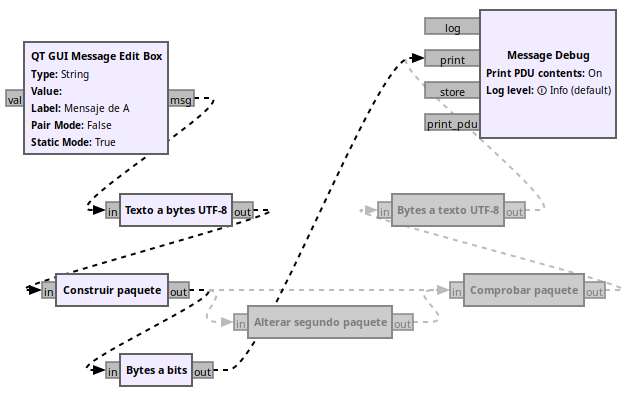
**Figura 28.** El visor recibe los bits del paquete; los bloques grises no participan en la ejecución.

- **Ruta activa:** cuadro de texto → convertidor UTF-8 → constructor → `Bytes a bits` → `Message Debug.print`.
- **Bloques grises:** permanecen deshabilitados para conservar el trabajo anterior. Sus conexiones grises no forman parte del recorrido activo.
- **Salida observada:** el visor recibe una PDU de bits, no texto recuperado ni muestras de radio.

El mensaje utilizado para comprobar esta conversión sigue siendo `Hola`.

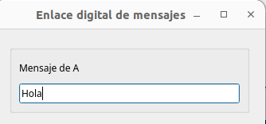
**Figura 29.** El texto `Hola` permite comparar la salida con el paquete conocido de diez bytes.

- **Entrada:** contiene cuatro caracteres ASCII, que ocupan cuatro bytes UTF-8.
- **Paquete:** longitud y CRC añaden seis bytes. El constructor entrega diez bytes al convertidor de bits.

La consola muestra los 80 bits, almacenados como valores `00` y `01`.

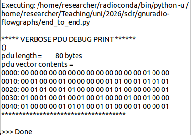
**Figura 30.** Los 80 valores corresponden al paquete completo de `Hola`, incluidos longitud y CRC.

- **Cabecera:** `pdu length = 80 bytes` cuenta los elementos del vector. Cada elemento representa un bit del paquete original.
- **Filas:** `0000`, `0010`, `0020`, `0030` y `0040` son posiciones iniciales en hexadecimal. No forman parte de los datos.
- **Comprobación:** al reagrupar ocho valores por byte, se obtiene `00 04 48 6f 6c 61 aa 94 8e c9`.

??? note "Para profundizar: cómo leer la consola"

    - Cada fila contiene 16 elementos; cinco filas contienen los 80 valores. Las posiciones se escriben en hexadecimal.
    - Los ocho primeros valores producen `00`; los ocho siguientes producen `04`. Esa cabecera indica cuatro bytes de texto.
    - Los 32 valores siguientes representan `48 6f 6c 61`, el texto `Hola`. Los últimos 32 representan el CRC.
    - La comparación valida esta conversión para `Hola`. No demuestra todavía transmisión ni recepción por un canal.

### Ejercicio 10 — ¿Cuántos bits produce `SDR`?

El estudiante escribe `SDR`. ¿Cuántos elementos debe mostrar la PDU de salida de `Bytes a bits`?

??? example "Solución explicada"

    - **Datos:** `SDR` ocupa 3 bytes UTF-8. La longitud añade 2 bytes y el CRC añade 4 bytes.
    - **Fórmula:** elementos de salida = bytes del paquete × 8 bits por byte.
    - **Sustitución:** $(2 + 3 + 4)\times 8 = 72$ bits.
    - **Resultado:** salen 72 elementos `u8`, uno por bit. `Message Debug` indica 72 bytes almacenados.
    - **Interpretación:** la cuenta incluye longitud y CRC. No son 72 bytes de texto ni nuevas muestras I/Q.

## 11. Asociar bits con símbolos BPSK

- Se usa `Chunks to Symbols` para convertir bits en símbolos. `QT GUI Constellation Sink` muestra esos símbolos en el plano I/Q.
- BPSK significa *Binary Phase Shift Keying*: cada bit selecciona uno de dos estados de fase.
- Un símbolo es el valor que representa una selección del modulador. En BPSK, cada símbolo representa un bit.

### 11.1. Dos bits posibles, dos símbolos posibles

Se utiliza este mapeo, igual al de `constellation_bpsk` de GNU Radio:

| Bit de entrada | Símbolo complejo | Componente I | Componente Q | Fase |
|---|---|---|---|---|
| `0` | $-1+j0$ | $-1$ | $0$ | $180^\circ$ |
| `1` | $+1+j0$ | $+1$ | $0$ | $0^\circ$ |

- $I$ es la parte real y $Q$ es la parte imaginaria. $j$ es la unidad imaginaria.
- Los dos símbolos tienen magnitud 1 y fases separadas por $180^\circ$. No representan ausencia y presencia de señal.
- Aquí $Q=0$ por la elección de la constelación. No es una propiedad general de las señales SDR ni de las muestras del RTL-SDR.

Si $b$ es un bit con valor 0 o 1, su símbolo $a$ se calcula así:

$$
a=(2b-1)+j0.
$$

Los símbolos se sitúan en dos posiciones; el orden de los bits determina la secuencia de símbolos.

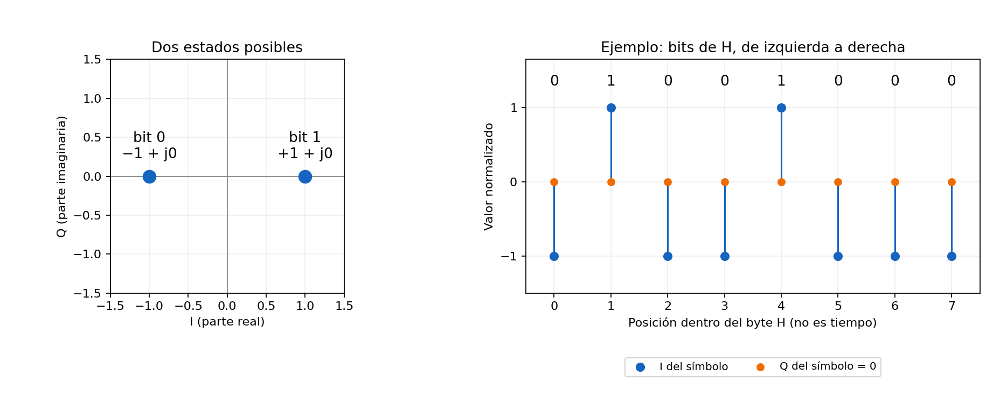
**Figura 31.** Cada bit selecciona un punto BPSK; una secuencia de bits produce una secuencia de símbolos.

- **Panel izquierdo:** el eje horizontal es $I$ y el vertical es $Q$. El bit `0` selecciona el punto izquierdo; `1` selecciona el derecho.
- **Panel derecho:** el eje horizontal indica la posición dentro del byte `H`. Los puntos azules muestran $I$ y los naranjas muestran $Q$.
- **Ejemplo:** `H` contiene `01001000`. Sus símbolos tienen $I=(-1,+1,-1,-1,+1,-1,-1,-1)$ y $Q=0$. La posición no representa tiempo.

??? note "Para profundizar: símbolos y muestras"

    - Este bloque realiza el mapeo de bits. Todavía no construye la forma temporal completa de una señal modulada.
    - El símbolo identifica un estado. El sampling rate $f_s$ es la tasa de muestreo, en muestras por segundo.
    - Las muestras representarán la señal en instantes separados por $1/f_s$ segundos.
    - Pulse shaping, conformación del pulso, definirá después cómo contribuye cada símbolo a las muestras de la señal.
    - No se han fijado la duración del símbolo ni las muestras por símbolo. `samp_rate` no determina esos valores en este montaje.
    - Los valores $+1$ y $-1$ son amplitudes normalizadas. No se especifica una potencia física en vatios.
    - Se puede definir el mapeo inverso si el receptor usa la misma convención. Esta guía conserva el mapeo de la tabla.

### 11.2. Pasar de PDU a stream

- `Chunks to Symbols` recibe un stream: una secuencia de elementos. No recibe directamente la PDU de `Bytes a bits`.
- `PDU to Tagged Stream` entrega esos elementos en orden. Un tag, etiqueta asociada a una posición, indica la longitud del paquete.
- El nombre elegido para esa etiqueta es `packet_len`. Su valor cuenta elementos, no bytes de texto.

1. El estudiante detiene la ejecución y guarda el flowgraph.
2. Activa `View → Show All Block IDs`. Añade `PDU to Tagged Stream` y configura la tabla siguiente.
3. Confirma las propiedades. El bloque debe tener una entrada de mensajes `pdus` y una salida de stream.

| Campo | Valor |
|---|---|
| `ID` | `a_stream` |
| `Item Type` | `Byte` |
| `Length tag name` | `packet_len` |

Para `Hola`, la PDU contiene 80 elementos `u8`. El adaptador entrega 80 elementos y coloca `packet_len = 80` al inicio.

??? note "Para profundizar: etiqueta y cabecera no son lo mismo"

    - La cabecera `00 04` sigue dentro de los datos. Indica cuatro bytes de texto.
    - `packet_len` acompaña al stream dentro de GNU Radio. No añade bits a los datos ni se transmite como una cabecera RF.
    - Esta etiqueta permite comprobar el mapeo. No sustituye la detección de paquetes desde las muestras en el receptor futuro.

### 11.3. Mapear con `Chunks to Symbols`

1. El estudiante añade `Chunks to Symbols`, el bloque estándar de mapeo.
2. Configura los valores de la tabla.
3. Confirma las propiedades. No necesita un nuevo `Embedded Python Block`.

| Campo | Valor |
|---|---|
| `ID` | `mapeador` |
| `Input Type` | `Byte` |
| `Output Type` | `Complex` |
| `Symbol Table` | `[-1+0j, 1+0j]` |
| `Dimension` | `1` |
| `Num Ports` | `1` |

- El valor de entrada selecciona una posición de `Symbol Table`. `0` selecciona `-1+0j`; `1` selecciona `1+0j`.
- `Dimension = 1` produce un complejo por bit. El valor debe cambiarse si aparece `2` como valor predeterminado.
- Los datos entran por el puerto de stream. El puerto `set_symbol_table` cambia la tabla y queda sin conectar.

!!! warning "La entrada debe contener bits desempaquetados"

    - La entrada procede de `Bytes a bits`, cuyos elementos son `0` o `1`.
    - No se conecta `Construir paquete` directamente al mapeador. Sus bytes pueden tener valores mayores que `1`, fuera de esta tabla.
    - `Dimension` no cuenta las componentes I y Q. Cada complejo ya contiene ambas componentes.

### 11.4. Reconstruir la PDU de símbolos

1. El estudiante añade `Tagged Stream to PDU`.
2. Configura la tabla siguiente y confirma las propiedades.

| Campo | Valor |
|---|---|
| `Item Type` | `Complex` |
| `Length tag name` | `packet_len` |

- El bloque usa `packet_len` para reunir los símbolos de cada paquete. Los dos adaptadores deben usar exactamente el mismo nombre.
- Con `Dimension = 1`, cada bit produce un símbolo. Para `Hola`, la etiqueta sigue indicando 80 elementos.
- La salida `pdus` entrega una PDU compleja al completar esos 80 símbolos. No necesita esperar otro mensaje.

### 11.5. Reservar espacio para el paquete máximo

Los adaptadores necesitan espacio para un paquete completo. El estudiante configura los buffers, espacios de memoria temporal, antes de ejecutar.

1. Añade el bloque estándar `Python Snippet`.
2. Selecciona `Main - After Init` en `Section of Flowgraph`.
3. Introduce estas dos líneas en `Code Snippet`. Confirma las propiedades y deja el bloque sin conexiones.

```python
self.a_stream.set_min_output_buffer(0, (5000 + 6) * 8 * 2)
self.mapeador.set_min_output_buffer(0, (5000 + 6) * 8 * 2)
```

- Los nombres `a_stream` y `mapeador` deben coincidir con los IDs de las tablas anteriores.
- Estas llamadas configuran memoria. No convierten bits ni sustituyen el mapeo estándar.
- La configuración permite probar también el límite de 5 kB. No basta con comprobar un mensaje corto como `Hola`.

??? note "Para profundizar: tamaño del buffer y versión instalada"

    - El paquete máximo contiene $(5000+6)\times8=40048$ bits. La configuración solicita $40048\times2=80096$ elementos por buffer.
    - GNU Radio 3.10.12 limita una operación a la mitad del buffer de salida. El factor 2 reserva espacio para esa condición.
    - Los tamaños cuentan elementos, no bytes. Cada elemento ocupa un byte antes del mapeo y ocho bytes después.
    - En esta versión, `Min Output Buffer` no aplica el ajuste a `Chunks to Symbols` por su declaración de puertos múltiples.
    - La llamada con `0` selecciona explícitamente el primer puerto. `Python Snippet` ejecuta las llamadas antes de iniciar el flujo.

### 11.6. Añadir el visor de constelación

1. El estudiante añade `QT GUI Constellation Sink`.
2. Abre sus propiedades y configura los valores de la tabla.
3. Confirma los cambios. El visor debe mostrar una entrada de mensajes llamada `in`.

| Campo | Valor |
|---|---|
| `Type` | `Complex Message` |
| `Name` | `Simbolos BPSK` |
| `Grid` | `Yes` |
| `Autoscale` | `No` |
| `X min` / `X max` | `-1.5` / `1.5` |
| `Y min` / `Y max` | `-1.5` / `1.5` |
| `Line 1 Style`, pestaña `Config` | `None` |
| `Line 1 Marker`, pestaña `Config` | `Circle` |

- `Complex Message` permite recibir la PDU compleja directamente. El visor no utiliza una entrada de stream en este montaje.
- `None` evita unir los puntos mediante líneas. `Circle` permite ver las dos posiciones de la constelación.
- Los ejes conservan su escala. Los campos ocultos pueden permanecer con sus valores predeterminados.

### 11.7. Conectar y probar con `Hola`

1. El estudiante retira la conexión de `Bytes a bits.out` a `Message Debug.print`.
2. Conserva `Message Debug` habilitado. Si está gris, lo selecciona y pulsa `E`.
3. Cambia `Print PDU contents` a `On` en `Message Debug`. Así observa el tamaño y los bytes del vector complejo.
4. Mantiene deshabilitados los tres bloques grises de la Figura 28. Conserva todas las conexiones anteriores a `Bytes a bits`.
5. Realiza las conexiones de la tabla. Los puertos de stream corresponden a la única entrada o salida de datos.

    | Origen | Destino | Tipo de conexión |
    |---|---|---|
    | `Bytes a bits.out` | `PDU to Tagged Stream.pdus` | Mensaje |
    | Salida de `PDU to Tagged Stream` | Entrada de `Chunks to Symbols` | Stream `Byte` |
    | Salida de `Chunks to Symbols` | Entrada de `Tagged Stream to PDU` | Stream `Complex` |
    | `Tagged Stream to PDU.pdus` | `QT GUI Constellation Sink.in` | Mensaje |
    | `Tagged Stream to PDU.pdus` | `Message Debug.print` | Mensaje |

6. Guarda, ejecuta, escribe `Hola` y pulsa Enter una vez.

El recorrido activo utiliza los tres bloques estándar y entrega la misma PDU a los dos visores.

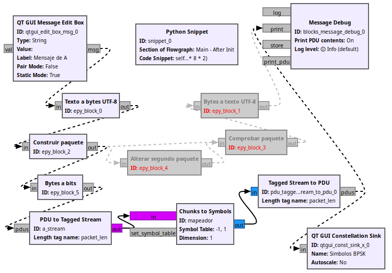
**Figura 32.** Los adaptadores permiten mapear los bits y entregar la PDU compleja a los dos visores.

- **Recorrido izquierdo:** el texto pasa por `Texto a bytes UTF-8`, `Construir paquete` y `Bytes a bits`.
- **Recorrido inferior:** `PDU to Tagged Stream` entrega bits al mapeador. `Tagged Stream to PDU` reúne los símbolos complejos.
- **Visores derechos:** la salida `pdus` llega a `Message Debug.print` y a `QT GUI Constellation Sink.in`.
- **Bloques grises:** comprobador, auxiliar de errores y convertidor inverso permanecen deshabilitados.
- **Configuración:** ambos adaptadores usan `packet_len`. `Message Debug` tiene `Print PDU contents = On`.

??? note "Si ya existe el mapeador Python de la versión anterior"

    El estudiante desconecta y deshabilita `Bits a simbolos BPSK`, sin borrarlo. Los tres bloques estándar sustituyen ese recorrido.

### 11.8. Leer la constelación y la consola

Las dos capturas siguientes usan `Hola`, con `H` mayúscula, como los ejemplos anteriores.

La prueba debe mostrar lo siguiente:

- **Consola:** `Message Debug` indica `pdu length = 640 bytes` y muestra el contenido del vector complejo.
- **Constelación:** aparecen dos puntos, en $(-1,0)$ y $(+1,0)$. Los símbolos repetidos se superponen en esas posiciones.
- **Límite:** dos puntos visibles no significan dos símbolos enviados. El paquete contiene 80 símbolos, pero solo utiliza dos valores distintos.

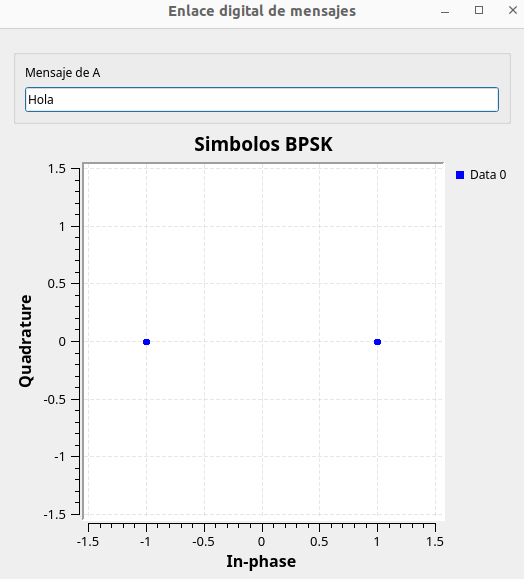
**Figura 33.** Al enviar `Hola`, los 80 símbolos BPSK se superponen en dos posiciones de la constelación.

- **Entrada superior:** `Mensaje de A` contiene `Hola`. Sus cuatro bytes UTF-8 son `48 6f 6c 61`.
- **Ejes del visor:** `In-phase` muestra la componente $I$; `Quadrature` muestra la componente $Q$.
- **Punto izquierdo:** $(-1,0)$ representa el bit `0`. El punto derecho, $(+1,0)$, representa el bit `1`.
- **Lectura:** cada símbolo aparece en una de esas posiciones. La imagen no muestra el orden ni la cantidad de repeticiones.

La consola permite comprobar cuánto espacio ocupa la PDU de símbolos.

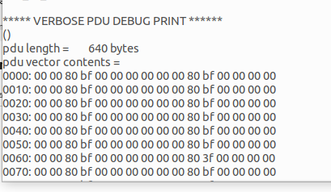
**Figura 34.** La PDU contiene 80 símbolos complejos y ocupa 640 bytes; la captura muestra el comienzo del vector.

- **Cabecera:** `VERBOSE PDU DEBUG PRINT` identifica la PDU. `()` indica metadatos vacíos.
- **Tamaño:** `pdu length = 640 bytes` cuenta el almacenamiento de los 80 elementos complejos.
- **Filas:** `0000` a `0070` son posiciones en bytes, escritas en hexadecimal. Cada fila contiene 16 bytes, equivalentes a dos símbolos.
- **Contenido:** los grupos de ocho bytes representan símbolos complejos. No son los bytes UTF-8 del texto.
- **Límite de la captura:** las ocho filas muestran 128 de los 640 bytes, correspondientes a los primeros 16 símbolos.

Los tamaños de las tres representaciones se comparan así:

| Salida observada | Contenido para `Hola` | Almacenamiento del vector |
|---|---|---|
| `Construir paquete` | 2 bytes de longitud, 4 de texto y 4 de CRC | 10 bytes |
| `Bytes a bits` | 80 elementos `u8`, uno por bit | 80 bytes |
| `Tagged Stream to PDU` | 80 elementos complejos `c32`, uno por símbolo | 640 bytes |

??? note "Para profundizar: por qué aparecen 640 bytes"

    - El vector `c32` almacena cada complejo mediante dos componentes de 32 bits: I y Q.
    - Cada complejo ocupa $2\times32/8=8$ bytes. Para `Hola`, $80\times8=640$ bytes.
    - Para `SDR`, $72\times8=576$ bytes. `Message Debug` informa el almacenamiento del vector, no el número de símbolos.
    - Con `Print PDU contents = Off`, el tamaño se conserva y aparece `(printing disabled)`. Para reproducir la Figura 34, se usa `On`.
    - El bloque estándar no imprime el aviso `BPSK: 80 simbolos.` de la versión Python anterior.

El experimento permite cambiar el mensaje sin cambiar el mapeo:

- **Qué cambia:** el texto pasa de `Hola` a `SDR`. Se pulsa Enter después del cambio.
- **Qué permanece fijo:** mapeo BPSK, magnitud de los símbolos y escala del visor.
- **Qué se observa:** la consola indica 576 bytes, correspondientes a 72 símbolos. La constelación conserva las mismas dos posiciones.

!!! warning "El visor necesita símbolos complejos"

    - No se conecta `Bytes a bits` directamente al visor. Su vector es `u8`, no `c32`.
    - No se conectan los símbolos al comprobador de paquetes. Primero será necesario recuperar bits y reagruparlos en bytes.
    - Este montaje comprueba el mapeo. No transmite RF ni fija todavía una tasa de símbolos.

??? note "Para profundizar: ejecución sin Throttle"

    Cada mensaje produce un paquete finito. No existe una fuente continua que genere datos durante el silencio; esta prueba no necesita `Throttle`.

### Ejercicio 11 — ¿Por qué hay dos puntos si hay 80 símbolos?

El visor muestra dos puntos después de enviar `Hola`. ¿Se han perdido los otros 78 símbolos?

??? example "Solución explicada"

    - **Datos:** el paquete contiene 80 bits. BPSK asigna un símbolo a cada bit y dispone de dos valores posibles.
    - **Fórmula:** número de símbolos = número de bits / bits por símbolo.
    - **Sustitución:** $80/1=80$ símbolos.
    - **Resultado:** los 80 símbolos ocupan dos posiciones distintas. Los símbolos con el mismo valor se dibujan uno encima de otro.
    - **Interpretación:** la constelación no muestra el orden ni la cantidad de repeticiones. Dos puntos no prueban una pérdida de símbolos.

## 12. Construir la señal en el dominio del tiempo

- El estudiante continúa desde el canvas de la Figura 32. Añade una rama a la salida de `mapeador`.
- Esa rama construye un pulso rectangular: conserva el valor de cada símbolo durante cuatro muestras consecutivas.
- Los visores del apartado 11 conservan su conexión. Permiten comparar los símbolos con las nuevas muestras.
- Se utiliza pulse shaping, conformación del pulso, rectangular. Un filtro con otra forma de pulso se estudiará después.

### 12.1. Símbolos, muestras y tiempo

- **Qué cambia:** cada símbolo produce cuatro muestras. El paquete de `Hola` pasa de 80 símbolos a 320 muestras.
- **Qué permanece fijo:** texto, longitud, CRC, orden de los bits y mapeo BPSK.
- **Qué se observa:** el visor temporal muestra muestras de $I$ en $-1$ o $+1$, y muestras de $Q$ en cero.

La señal compleja de banda base es $x[n]=I[n]+jQ[n]$. El índice $n$ cuenta muestras desde el comienzo del paquete.

La tasa de símbolos $R_s$ cuenta símbolos por segundo. La tasa de muestreo $f_s$ cuenta muestras por segundo.
El parámetro `sps`, *samples per symbol*, indica cuántas muestras representan cada símbolo.

$$
f_s=R_s\,\mathrm{sps},\qquad T_s=\frac{1}{R_s},\qquad \Delta t=\frac{1}{f_s}.
$$

- $T_s$ es la duración de un símbolo. $\Delta t$ es el intervalo entre dos muestras consecutivas.
- Se elige $R_s=1000$ símbolos/s y `sps = 4`. Por tanto, $f_s=4000$ muestras/s.
- Cada símbolo dura $T_s=1$ ms. Las muestras están separadas por $\Delta t=0.25$ ms.
- Dos símbolos consecutivos con el mismo valor forman un tramo más largo. No aparece una transición por cada símbolo.

Si $a[k]$ es el símbolo de posición $k$ y $L=\mathrm{sps}$, las muestras del pulso rectangular cumplen:

$$
x[Lk+r]=a[k],\qquad r=0,1,\ldots,L-1.
$$

El índice $r$ recorre las muestras de un símbolo, desde cero hasta $L-1$.

El byte `H` empieza después de los 16 bits de longitud. Su fragmento temporal ocupa desde 16 ms hasta 24 ms.

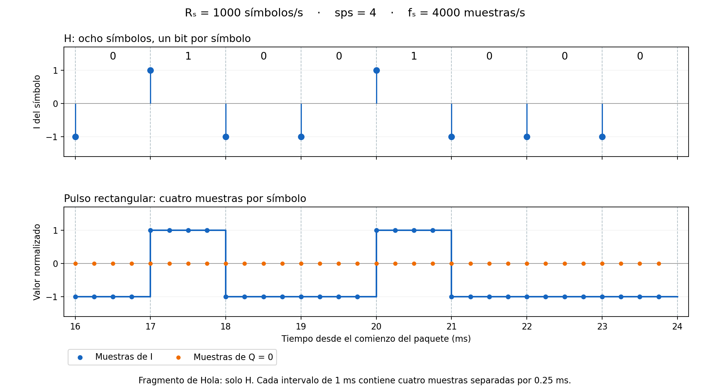
**Figura 35.** Cada símbolo de `H` produce cuatro muestras; las líneas verticales separan intervalos de un milisegundo.

- **Panel superior:** los ocho bits de `H`, `01001000`, seleccionan ocho valores de $I$. Los puntos indican el comienzo de cada símbolo.
- **Panel inferior:** los puntos azules muestran 32 muestras de $I$. Los puntos naranjas muestran $Q=0$.
- **Eje horizontal:** indica tiempo desde el comienzo del paquete. La figura muestra solo `H`, no todo `Hola` ni el CRC.
- **Separación:** cada intervalo de 1 ms contiene cuatro muestras, separadas por 0.25 ms. La línea escalonada ilustra el pulso rectangular.

??? note "Tiempo de la señal y tiempo de ejecución"

    - El paquete de `Hola` contiene 80 símbolos y dura $80/1000=0.080$ s: 80 ms.
    - También contiene 320 muestras. Su duración es $320/4000=0.080$ s.
    - La última muestra está en $(320-1)/4000=79.75$ ms. La duración del paquete incluye el intervalo de esa muestra final.
    - El cálculo puede terminar antes de 80 ms. `Sample Rate` del visor define el eje temporal; no regula la velocidad de ejecución.
    - No se añade `Throttle`: cada mensaje produce un paquete finito. Todavía no se genera una señal continua durante las pausas.

### 12.2. Definir las tasas

1. El estudiante detiene la ejecución y guarda el flowgraph.
2. Añade dos bloques `Variable`, con IDs `symbol_rate` y `sps`.
3. Edita la variable `samp_rate` que ya existe. Establece los valores siguientes.

| ID | Value | Significado |
|---|---|---|
| `symbol_rate` | `1000` | Tasa de símbolos, en símbolos/s. |
| `sps` | `4` | Muestras por símbolo. Debe ser un entero positivo. |
| `samp_rate` | `symbol_rate * sps` | Tasa de muestreo, en muestras/s; aquí vale 4000. |

- Las variables no tienen conexiones. Sus nombres se utilizan en las propiedades de los bloques.
- Los cambios de `sps` se realizan con el flowgraph detenido. Después se vuelve a ejecutar para aplicar parámetros y buffers coherentes.

### 12.3. Añadir `Repeat`

1. El estudiante añade el bloque estándar `Repeat`.
2. Configura la tabla y confirma las propiedades.

| Campo | Valor |
|---|---|
| `ID` | `pulso_rect` |
| `Type` | `Complex` |
| `Interpolation` | `sps` |
| `Vector Length` | `1` |

- El bloque recibe símbolos complejos por stream. Cada símbolo produce `sps` copias consecutivas.
- Con `sps = 4`, `-1+j0` produce cuatro valores `-1+j0`. `+1+j0` produce cuatro valores `+1+j0`.
- La repetición construye muestras del pulso rectangular. No añade bits al paquete ni recalcula el CRC.
- El puerto de mensajes `interpolation`, si aparece, queda sin conectar. La interpolación se fija en las propiedades.

### 12.4. Actualizar la longitud en muestras

1. El estudiante añade `Tagged Stream Multiply Length Tag`.
2. Configura los valores siguientes y confirma las propiedades.

| Campo | Valor |
|---|---|
| `ID` | `longitud_muestras` |
| `IO Type` | `Complex` |
| `Length tag names` | `packet_len` |
| `Length Scalar` | `sps` |

- `Repeat` propaga la posición de la etiqueta, pero conserva su valor. Para `Hola`, ese valor sigue siendo 80 al salir de `Repeat`.
- El bloque nuevo multiplica el valor por `sps`. Así, `packet_len` pasa de 80 a 320 en la rama temporal.
- No cambia las muestras. El puerto `set_scalar` queda sin conectar.
- La cabecera del paquete sigue indicando cuatro bytes de texto. No se sustituye por 320.

!!! warning "La etiqueta debe contar muestras"

    Si se conserva `packet_len = 80`, el adaptador siguiente no podrá reunir correctamente las 320 muestras del paquete.
    El bloque de longitud se coloca después de `Repeat`, en la rama temporal. La rama de símbolos conserva `packet_len = 80`.

### 12.5. Reunir las muestras en una PDU

1. El estudiante añade otro `Tagged Stream to PDU`. Conserva el adaptador del apartado 11.
2. Configura este bloque nuevo y confirma las propiedades.

| Campo | Valor |
|---|---|
| `ID` | `muestras_a_pdu` |
| `Item Type` | `Complex` |
| `Length tag name` | `packet_len` |

- La salida `pdus` entrega una PDU compleja con las muestras del paquete completo.
- Para `Hola`, reúne 320 muestras. Para `SDR`, reúne 288.
- Este adaptador sirve para observar el paquete. La etiqueta interna no sustituye una futura detección desde muestras.

### 12.6. Ampliar la configuración de buffers

1. El estudiante abre el `Python Snippet` existente, con `Section of Flowgraph = Main - After Init`.
2. Reemplaza sus dos líneas por estas cuatro. Conserva el bloque sin conexiones.

```python
self.a_stream.set_min_output_buffer(0, (5000 + 6) * 8 * 2)
self.mapeador.set_min_output_buffer(0, (5000 + 6) * 8 * 2)
self.pulso_rect.set_min_output_buffer(0, (5000 + 6) * 8 * self.sps * 2)
self.longitud_muestras.set_min_output_buffer(0, (5000 + 6) * 8 * self.sps * 2)
```

- Los IDs `pulso_rect` y `longitud_muestras` deben coincidir con las propiedades anteriores.
- El paquete máximo contiene 40048 símbolos. Con `sps = 4`, produce 160192 muestras.
- Las dos líneas nuevas solicitan 320384 elementos por buffer. El factor 2 conserva el criterio de GNU Radio 3.10.12 del apartado 11.5.
- Los tamaños cuentan elementos complejos. El ajuste permite reunir también el paquete máximo, sin esperar un mensaje posterior.

### 12.7. Añadir el visor temporal

1. El estudiante añade `QT GUI Time Sink` y abre sus propiedades.
2. Configura la tabla. En la pestaña `Config`, asigna los nombres y los marcadores de las dos curvas.
3. Confirma las propiedades. El bloque debe mostrar una entrada de mensajes `in`.

| Campo | Valor |
|---|---|
| `ID` | `tiempo_bpsk` |
| `Type` | `Complex Message` |
| `Name` | `Senal temporal BPSK` |
| `Sample Rate` | `samp_rate` |
| `Grid` | `Yes` |
| `Autoscale` | `No` |
| `Y min` | `-1.5` |
| `Y max` | `1.5` |
| `Line 1 Label` | `I` |
| `Line 2 Label` | `Q` |
| `Line 1 Style` | `Solid` |
| `Line 2 Style` | `Solid` |
| `Line 1 Marker` | `Circle` |
| `Line 2 Marker` | `Circle` |

- En modo `Complex Message`, el visor adapta el número de puntos a la PDU recibida. `Number of Points` queda oculto.
- El eje horizontal utiliza `samp_rate` para representar el tiempo. La curva `I` muestra la parte real; `Q`, la parte imaginaria.
- Las líneas del visor unen las muestras. Esa unión no añade muestras ni modifica el pulso construido por `Repeat`.
- Un envío nuevo actualiza la gráfica. Durante una pausa, la última gráfica puede permanecer visible.

### 12.8. Añadir un visor del tamaño de las muestras

1. El estudiante añade otro `Message Debug`. Conserva el visor de símbolos del apartado 11.
2. Establece los valores de la tabla y confirma las propiedades.

| Campo | Valor |
|---|---|
| `ID` | `debug_muestras` |
| `Print PDU contents` | `Off` |

- El bloque nuevo muestra el tamaño de la PDU de muestras sin imprimir todo su contenido.
- El visor anterior conserva `Print PDU contents = On`. Su PDU de símbolos sigue ocupando 640 bytes para `Hola`.
- El visor nuevo informa 2560 bytes para `Hola`: 320 muestras complejas de ocho bytes cada una.

### 12.9. Conectar desde el canvas actual

1. El estudiante conserva las conexiones y los bloques grises de la Figura 32.
2. Añade una segunda conexión desde la salida de stream de `mapeador` hacia `Repeat`.
3. Completa la rama nueva según la tabla. Los puertos de stream corresponden a la única entrada o salida de datos.

| Origen | Destino | Tipo de conexión |
|---|---|---|
| Salida de `mapeador` | Entrada de `pulso_rect` | Stream `Complex` |
| Salida de `pulso_rect` | Entrada de `longitud_muestras` | Stream `Complex` |
| Salida de `longitud_muestras` | Entrada de `muestras_a_pdu` | Stream `Complex` |
| `muestras_a_pdu.pdus` | `tiempo_bpsk.in` | Mensaje |
| `muestras_a_pdu.pdus` | `debug_muestras.print` | Mensaje |

La salida de `mapeador` alimenta dos ramas. Cada rama permite observar una representación diferente del mismo paquete.

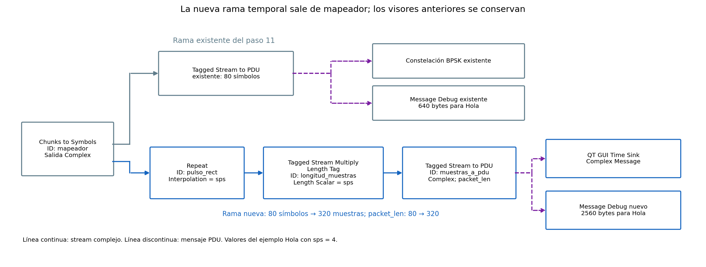
**Figura 36.** La rama nueva construye y reúne las muestras; la rama anterior permite observar los símbolos originales.

- **Origen izquierdo:** `mapeador` entrega los símbolos complejos del paquete a las dos ramas.
- **Rama superior:** conserva el adaptador y los visores del apartado 11. Para `Hola`, observa 80 símbolos.
- **Rama inferior:** `Repeat` produce 320 muestras. El bloque de longitud actualiza `packet_len`; el adaptador reúne la PDU.
- **Extremo derecho:** el visor temporal recibe las muestras. `debug_muestras` informa su almacenamiento de 2560 bytes.
- **Líneas:** las continuas representan streams complejos. Las discontinuas representan mensajes PDU.

### 12.10. Probar con `Hola` y comparar las cantidades

1. El estudiante guarda y ejecuta el flowgraph. El cuadro de texto debe comenzar vacío.
2. Escribe `Hola`, con `H` mayúscula, y pulsa Enter una vez.
3. Espera la gráfica temporal y el registro de tamaño. Comprueba las cantidades de la tabla.
4. Sin detener la ejecución, escribe `SDR` y pulsa Enter. Espera la actualización.
5. Hace una pausa y envía `Hola` otra vez. El último paquete debe aparecer sin necesitar otro envío.

| Texto | Símbolos BPSK | Muestras, con `sps = 4` | Bytes del vector de muestras | Duración |
|---|---|---|---|---|
| `Hola` | 80 | 320 | 2560 | 80 ms |
| `SDR` | 72 | 288 | 2304 | 72 ms |

- **Consola de símbolos:** mantiene 640 bytes para `Hola` y 576 para `SDR`.
- **Consola de muestras:** indica `pdu length = 2560 bytes (printing disabled)` para `Hola`. Para `SDR`, indica 2304 bytes.
- **Gráfica temporal:** `I` toma los valores $-1$ y $+1$. Cada símbolo aporta cuatro puntos consecutivos; `Q` permanece en cero.
- **Comienzo de `Hola`:** los ocho bits del primer byte de longitud son cero. Las primeras 32 muestras tienen $I=-1$.
- **Campo de texto:** el fragmento de `H` aparece desde 16 ms, como en la Figura 35. El paquete no empieza por `H`.
- **Pausas:** no se añaden muestras que representen el tiempo entre pulsaciones de Enter. Cada PDU describe su propio paquete desde tiempo cero.

??? note "Si el resultado no coincide"

    - Si el visor nuevo indica 640 bytes, se revisa que reciba la salida de `muestras_a_pdu`, después de `Repeat`.
    - Si el adaptador espera o informa etiquetas ausentes, se revisan `packet_len` y `Length Scalar = sps`.
    - Si los tiempos no coinciden, se comprueba `Sample Rate = samp_rate` y `samp_rate = symbol_rate * sps`.
    - Si falla un mensaje largo, se comprueban las cuatro líneas del snippet, sus IDs y `Main - After Init`.
    - Se espera la actualización antes de enviar otro texto. El visor puede omitir una actualización si recibe mensajes demasiado próximos.

### 12.11. Leer las capturas de ejecución

La Figura 37 muestra el envío de `Hola` con `sps = 4`. Los dos visores presentan el mismo paquete en representaciones diferentes.

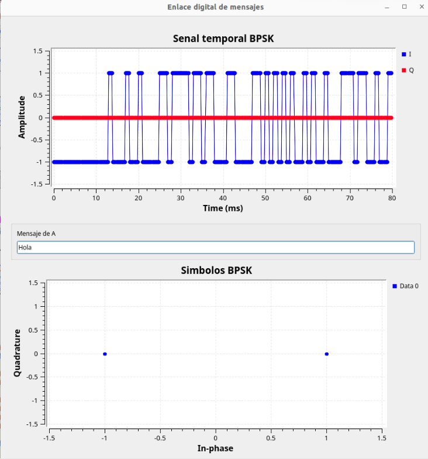
**Figura 37.** Con `sps = 4`, la señal temporal de `Hola` identifica sus componentes I/Q y conserva las dos posiciones BPSK.

- **Panel superior:** la curva azul representa $I$. La curva roja representa $Q=0$. Los marcadores indican las muestras.
- **Eje horizontal:** muestra tiempo en milisegundos. La última muestra está en 79.75 ms, con 320 muestras a 4000 muestras/s. El paquete dura 80 ms.
- **Comienzo del paquete:** la longitud precede al texto. Los bits iniciales en cero producen el tramo azul en $I=-1$.
- **Cuadro central:** contiene `Hola`, con `H` mayúscula. Este texto mantiene el ejemplo uniforme con los apartados anteriores.
- **Panel inferior:** los 80 símbolos ocupan las posiciones $(-1,0)$ y $(1,0)$. Los símbolos repetidos se superponen.
- **Líneas del visor:** unen muestras discretas. Los trazos entre $-1$ y $+1$ no representan muestras adicionales generadas por `Repeat`.
- **Leyenda:** `I` identifica la componente real azul. `Q` identifica la componente imaginaria roja, según el apartado 12.7.

La Figura 38 muestra los tamaños de las dos ramas con `sps = 4`.

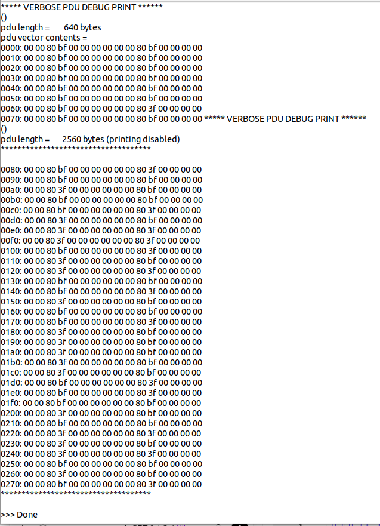
**Figura 38.** Con `sps = 4`, la consola muestra 640 bytes de símbolos y 2560 bytes de muestras temporales.

- **Primer tamaño:** $80\times8=640$ bytes. Cada símbolo complejo `c32` utiliza ocho bytes de almacenamiento.
- **Volcado hexadecimal:** pertenece al visor de símbolos, que conserva `Print PDU contents = On`.
- **Segundo tamaño:** `pdu length = 2560 bytes (printing disabled)` corresponde a $320\times8$ bytes de muestras.
- **Contenido desactivado:** `printing disabled` evita el volcado de las muestras. El visor conserva la impresión de su tamaño.
- **Registros intercalados:** el registro temporal aparece dentro del volcado de símbolos. Las filas posteriores continúan ese volcado.

??? note "Los dos visores comparten la consola"

    - Los bloques `Message Debug` imprimen desde tareas independientes. Sus registros pueden intercalarse, incluso dentro de una línea.
    - El intercalado observado concuerda con esa ejecución y con las llamadas sucesivas de impresión de `Message Debug`.
    - Se identifican las ramas por sus tamaños: 640 bytes de símbolos y 2560 bytes de muestras con `sps = 4`.
    - La posición del texto en consola no cambia las PDUs ni demuestra una pérdida de muestras.

??? note "Aviso de GRC sobre Throttle"

    - Al generar con F5, GRC puede recomendar `Throttle` porque no encuentra bloques de control de velocidad.
    - El aviso no impide ejecutar el montaje. Cada pulsación de Enter produce un paquete finito; la cadena espera cuando no llegan mensajes.
    - En este montaje se conserva la ejecución sin `Throttle`. `Sample Rate` del visor define la escala temporal, no la velocidad del procesador.

### 12.12. Cambiar las muestras por símbolo

1. El estudiante detiene la ejecución y cambia `sps` de `4` a `8`.
2. Conserva `symbol_rate = 1000` y vuelve a ejecutar. Envía `Hola` una vez.
3. Comprueba 640 muestras y 5120 bytes en el visor nuevo. La duración del paquete sigue siendo 80 ms.
4. Detiene la ejecución, restablece `sps = 4`, guarda y vuelve a ejecutar.

- **Qué cambia:** muestras por símbolo, tasa de muestreo, número de muestras y almacenamiento del vector.
- **Qué permanece fijo:** bits, 80 símbolos, mapeo BPSK y tasa de símbolos.
- **Qué se observa:** $f_s$ pasa de 4000 a 8000 muestras/s. Cada símbolo mantiene 1 ms, con ocho muestras separadas por 0.125 ms.
- La repetición representa el mismo contenido mediante más muestras. No incorpora codificación de canal ni bits adicionales.

Las Figuras 39 y 40 muestran el resultado del mismo envío con `sps = 8`.

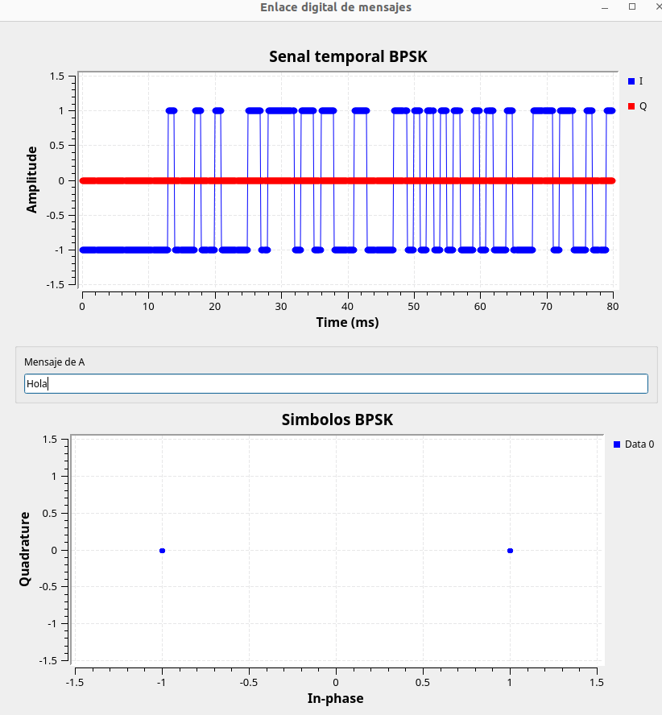
**Figura 39.** Con `sps = 8`, `Hola` conserva su duración y sus valores BPSK; cada símbolo contiene ocho muestras.

- **Panel superior:** muestra $I$ en $-1$ o $+1$, y $Q=0$. Los valores y el orden coinciden con la Figura 37.
- **Eje horizontal:** conserva unos 80 ms. Las 640 muestras utilizan $f_s=8000$ muestras/s; la última muestra está en 79.875 ms.
- **Marcadores:** representan muestras separadas por 0.125 ms. La escala del visor puede superponerlos; la consola permite comprobar la cantidad.
- **Cuadro central:** conserva `Hola`. Cambia `sps`, pero se conserva `symbol_rate = 1000`.
- **Panel inferior:** mantiene las posiciones $(-1,0)$ y $(1,0)$. La rama de símbolos no pasa por `Repeat`.

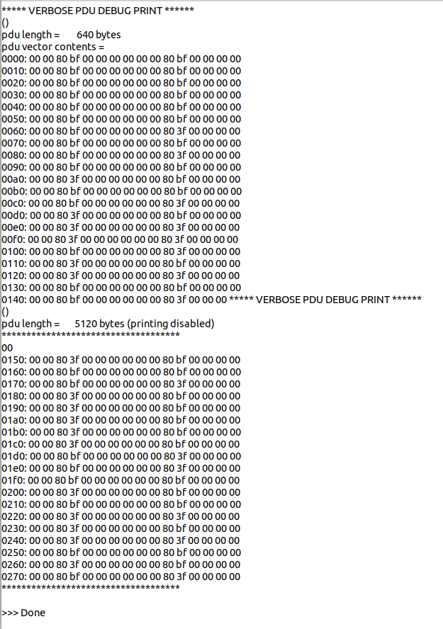
**Figura 40.** Con `sps = 8`, la consola conserva 640 bytes de símbolos y muestra 5120 bytes de muestras temporales.

- **Símbolos:** el primer tamaño sigue siendo $80\times8=640$ bytes. El contenido del paquete y el mapeo permanecen iguales.
- **Muestras:** `pdu length = 5120 bytes (printing disabled)` corresponde a $640\times8$ bytes de almacenamiento.
- **Intercalado:** el registro de muestras interrumpe visualmente el volcado de símbolos. Se aplica la misma lectura de la Figura 38.
- **Final:** `>>> Done` aparece después de los registros. El fragmento mostrado no contiene un error de ejecución.

La comparación conserva `Hola` y `symbol_rate = 1000`:

| `sps` | Tasa de muestreo | Símbolos | Muestras | Bytes del vector de muestras | Duración |
|---|---|---|---|---|---|
| `4` | 4000 muestras/s | 80 | 320 | 2560 | 80 ms |
| `8` | 8000 muestras/s | 80 | 640 | 5120 | 80 ms |

- Se duplican las muestras, su almacenamiento y la tasa de muestreo. La duración cumple $T=320/4000=640/8000=0.080$ s.
- Aumentar `sps` no añade información al paquete. Después de comparar, el estudiante restablece `sps = 4` para continuar.

### Ejercicio 12 — ¿Por qué no cambia la duración?

El estudiante envía `SDR` con `symbol_rate = 1000` y `sps = 8`. ¿Cuántas muestras produce y cuánto dura el paquete?

??? example "Solución explicada"

    - **Datos:** `SDR` produce $N_s=72$ símbolos. Se utilizan ocho muestras por símbolo y 1000 símbolos/s.
    - **Fórmula:** $N_m$ cuenta muestras y $T$ es la duración. $N_m=N_s\,\mathrm{sps}$, $f_s=R_s\,\mathrm{sps}$ y $T=N_m/f_s$.
    - **Sustitución:** $N_m=72\times8=576$ muestras; $f_s=1000\times8=8000$ muestras/s; $T=576/8000=0.072$ s.
    - **Resultado:** 576 muestras complejas, 4608 bytes almacenados y 72 ms de duración.
    - **Interpretación:** aumentar `sps` también aumenta $f_s$. El contenido y la duración de cada símbolo se conservan.

## 13. Construir un pulso RRC y observar el cierre del paquete

- El estudiante continúa desde el paso 12, con `sps = 4` y las leyendas I/Q configuradas.
- Añade una rama RRC desde `mapeador`. Conserva las ramas de símbolos y de pulso rectangular para comparar sus resultados.
- RRC significa *root raised cosine*, raíz de coseno alzado. Es una forma de pulso utilizada con un filtro correspondiente en el receptor.
- Este paso construye y observa la señal del transmisor. El filtro del receptor se añadirá después.

### 13.1. Qué cambia al filtrar los símbolos

- **Qué cambia:** cada símbolo aporta un pulso que se extiende sobre varios intervalos de símbolo. Los pulsos se suman.
- **Qué permanece fijo:** `Hola`, sus bytes, el CRC, los 80 símbolos BPSK, `symbol_rate = 1000` y `sps = 4`.
- **Qué se observa:** $I$ adquiere valores intermedios y puede superar $\pm1$. $Q$ permanece en cero porque los símbolos y los coeficientes son reales.

El FIR, *finite impulse response*, filtro de respuesta finita al impulso, usa coeficientes $h[n]$, llamados *taps*.
La salida interpola directamente los símbolos; no recibe las muestras del bloque `Repeat`.

Si $a[k]$ es el símbolo de posición $k$ y $L=\mathrm{sps}$, la salida cumple:

$$
x[n]=\sum_k a[k]h[n-kL].
$$

- El índice $n$ cuenta muestras. El desplazamiento $kL$ sitúa cada pulso en el instante de su símbolo.
- Se utiliza `rrc_alpha = 0.35`. El parámetro $\alpha$, *roll-off*, controla el exceso de banda del pulso ideal; no es una ganancia.
- Se utiliza `rrc_span = 8`: la respuesta diseñada abarca ocho intervalos de símbolo entre sus extremos.
- El número de coeficientes es `rrc_ntaps = rrc_span * sps + 1`: aquí, 33.

Los coeficientes son simétricos. El retardo de grupo $D$ desplaza el centro de cada pulso:

$$
D=\frac{N_h-1}{2}=16\ \text{muestras},\qquad \frac{D}{f_s}=\frac{16}{4000}=4\ \text{ms}.
$$

Aquí, $N_h$ cuenta coeficientes y $f_s$ es la tasa de muestreo. El centro del pulso del primer símbolo aparece a los 4 ms.

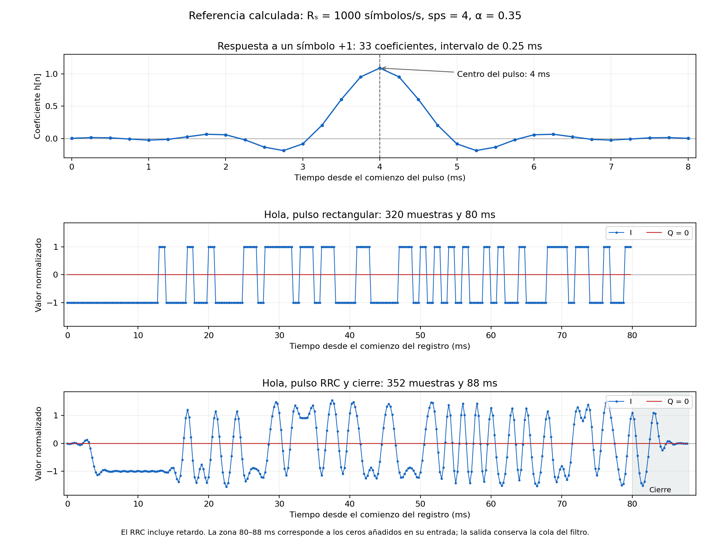
**Figura 41.** El filtro RRC extiende y suma los pulsos; los ceros de cierre permiten observar su respuesta completa.

- **Panel superior:** muestra los 33 coeficientes del pulso producido por un símbolo `+1`. La línea vertical marca su centro a los 4 ms.
- **Panel central:** conserva la referencia rectangular del paso 12. Sus 320 muestras representan 80 ms.
- **Panel inferior:** muestra 352 muestras RRC. $I$ es azul y $Q=0$ es roja; el registro dura 88 ms.
- **Zona sombreada:** corresponde a los ocho ceros añadidos al final de la entrada del filtro. La salida todavía contiene la cola de los símbolos anteriores.
- **Amplitud:** los pulsos sumados pueden superar $\pm1$. Para `Hola` y estos parámetros, los extremos están cerca de $\pm1.55$.
- **Comparación:** la figura es una referencia calculada. Los registros tienen diferentes longitudes y la rama RRC incluye retardo.

!!! warning "Las muestras RRC no son todavía decisiones de bits"

    - Se conservan dos valores posibles en los símbolos BPSK. Las muestras filtradas pueden tomar otros valores.
    - No se espera que cada muestra ni cada centro de símbolo RRC valga exactamente $-1$ o $+1$.
    - El receptor necesitará un filtro correspondiente y una selección de instantes de decisión. No se conecta esta salida al comprobador de paquetes.

### 13.2. Definir los parámetros del pulso

1. El estudiante detiene la ejecución. Comprueba `sps = 4` y conserva `samp_rate = symbol_rate * sps`.
2. Añade tres bloques `Variable` con los valores siguientes. Guarda el flowgraph.

| ID | Value | Significado |
|---|---|---|
| `rrc_alpha` | `0.35` | Factor de exceso de banda del pulso RRC. |
| `rrc_span` | `8` | Extensión de la respuesta en intervalos de símbolo. Se conserva en este ensayo. |
| `rrc_ntaps` | `rrc_span * sps + 1` | Número de coeficientes del filtro; aquí vale 33. |

- Las variables quedan sin conexiones. La expresión de `rrc_ntaps` mantiene un número impar de coeficientes.
- Los cambios de parámetros se realizan con la ejecución detenida. Después se vuelve a ejecutar para aplicar también los buffers.

### 13.3. Añadir los ceros de cierre

1. El estudiante añade el bloque estándar `Burst Shaper`.
2. Configura la tabla y confirma las propiedades.

| Campo | Valor |
|---|---|
| `ID` | `cierre_rrc` |
| `Type` | `Complex` |
| `Window Taps` | `[1.0]` |
| `Pre-padding Length` | `0` |
| `Post-padding Length` | `rrc_span` |
| `Insert phasing symbols` | `No` |
| `Length Tag Name` | `packet_len` |

- En esta configuración, la ventana de valor uno conserva los símbolos de los extremos. No aplica una rampa de amplitud.
- El bloque añade ocho elementos `0+j0` después de cada paquete de símbolos. No añade elementos antes del paquete.
- Para `Hola`, la etiqueta `packet_len` pasa de 80 a 88. El bloque actualiza esa longitud automáticamente.
- Los ceros permiten terminar la respuesta del filtro y vaciar su memoria antes del siguiente paquete.
- Estos elementos no representan bits del texto ni campos nuevos. El paquete de bytes conserva su cabecera y su CRC.

??? note "Por qué se añaden ocho ceros"

    - Con 33 coeficientes e interpolación cuatro, el filtro estándar organiza nueve coeficientes por fase.
    - Su implementación añade tres coeficientes cero para completar las fases. No modifica los 33 coeficientes diseñados.
    - La memoria requiere los ocho elementos anteriores. Ocho ceros al final permiten completar la respuesta sin usar el mensaje siguiente.
    - Si se filtra el paquete sin ese cierre, la respuesta final puede aparecer dentro del paquete siguiente.
    - El cierre añade 8 ms de señal modelada. No fija la pausa de reloj entre pulsaciones de Enter.

### 13.4. Añadir `Root Raised Cosine Filter`

1. El estudiante añade el bloque estándar `Root Raised Cosine Filter`.
2. Elige el tipo interpolador complejo y configura los valores siguientes.

| Campo | Valor |
|---|---|
| `ID` | `pulso_rrc` |
| `FIR Type` | `Complex->Complex (Interpolating)` |
| `Interpolation` | `sps` |
| `Gain` | `sps` |
| `Sample Rate` | `samp_rate` |
| `Symbol Rate` | `symbol_rate` |
| `Alpha` | `rrc_alpha` |
| `Num Taps` | `rrc_ntaps` |

- La entrada recibe símbolos y ceros de cierre. La salida produce cuatro muestras por elemento de entrada.
- `Sample Rate` corresponde a la salida: 4000 muestras/s. `Symbol Rate` vale 1000 símbolos/s.
- `Gain = sps` normaliza la suma de los coeficientes a cuatro. No obliga a que los máximos del pulso valgan uno.
- El valor predeterminado de `Num Taps` se reemplaza por `rrc_ntaps`. No se usa un número de coeficientes proporcional a miles de símbolos.
- El filtro no actualiza el valor de `packet_len` al interpolar. La corrección se añade en el apartado siguiente.

!!! warning "La rama RRC parte de los símbolos"

    La entrada de `cierre_rrc` sale de `mapeador`. No sale de `Repeat` ni de `longitud_muestras`.
    El filtro RRC realiza su propia interpolación; alimentar esa rama con muestras repetidas cambiaría las tasas y las cantidades.

### 13.5. Actualizar la longitud y reunir la PDU RRC

1. El estudiante añade otro `Tagged Stream Multiply Length Tag`.
2. Configura la primera tabla. Después añade otro `Tagged Stream to PDU` y configura la segunda.

| Campo | Valor |
|---|---|
| `ID` | `longitud_rrc` |
| `IO Type` | `Complex` |
| `Length tag names` | `packet_len` |
| `Length Scalar` | `sps` |

| Campo | Valor |
|---|---|
| `ID` | `rrc_a_pdu` |
| `Item Type` | `Complex` |
| `Length tag name` | `packet_len` |

- El bloque de longitud se coloca después del filtro RRC. Su etiqueta pasa de 88 elementos de entrada a 352 muestras.
- `rrc_a_pdu` reúne esas 352 muestras en una sola PDU compleja. La salida `pdus` sirve para observar el registro completo.
- Los bloques `longitud_muestras` y `muestras_a_pdu` conservan la rama rectangular anterior.
- Los puertos de configuración `set_scalar` y `set_taps`, si aparecen, quedan sin conectar.

### 13.6. Ampliar los buffers de la rama RRC

1. El estudiante abre el `Python Snippet` existente, con `Section of Flowgraph = Main - After Init`.
2. Conserva sus cuatro líneas y añade las tres nuevas. El contenido completo queda así:

```python
self.a_stream.set_min_output_buffer(0, (5000 + 6) * 8 * 2)
self.mapeador.set_min_output_buffer(0, (5000 + 6) * 8 * 2)
self.pulso_rect.set_min_output_buffer(0, (5000 + 6) * 8 * self.sps * 2)
self.longitud_muestras.set_min_output_buffer(0, (5000 + 6) * 8 * self.sps * 2)
self.cierre_rrc.set_min_output_buffer(0, ((5000 + 6) * 8 + self.rrc_span) * 2)
self.pulso_rrc.set_min_output_buffer(0, ((5000 + 6) * 8 + self.rrc_span) * self.sps * 2)
self.longitud_rrc.set_min_output_buffer(0, ((5000 + 6) * 8 + self.rrc_span) * self.sps * 2)
```

- Los IDs deben coincidir con los bloques anteriores. El snippet queda sin conexiones.
- El paquete máximo contiene 40048 símbolos. Su rama RRC añade ocho ceros y produce 160224 muestras con `sps = 4`.
- Se solicitan 80112 elementos en `cierre_rrc` y 320448 en cada uno de los dos buffers nuevos de muestras.
- El factor dos conserva el criterio del apartado 11.5. El cierre del último paquete no depende de un envío posterior.

### 13.7. Añadir los visores RRC

1. El estudiante añade otro `QT GUI Time Sink` y configura la tabla.
2. En `Config`, identifica las dos curvas como I y Q. Conserva los marcadores para observar las muestras.

| Campo | Valor |
|---|---|
| `ID` | `tiempo_rrc` |
| `Type` | `Complex Message` |
| `Name` | `Senal temporal BPSK RRC` |
| `Sample Rate` | `samp_rate` |
| `Grid` | `Yes` |
| `Autoscale` | `No` |
| `Y min` | `-2` |
| `Y max` | `2` |
| `Line 1 Label` | `I` |
| `Line 2 Label` | `Q` |
| `Line 1 Style` | `Solid` |
| `Line 2 Style` | `Solid` |
| `Line 1 Marker` | `Circle` |
| `Line 2 Marker` | `Circle` |

3. Añade otro `Message Debug`, con los valores siguientes.

| Campo | Valor |
|---|---|
| `ID` | `debug_rrc` |
| `Print PDU contents` | `Off` |

- El visor temporal adapta sus puntos a la PDU. Los límites de amplitud permiten ver los máximos sin recortar la señal.
- El visor de tamaño informa 2816 bytes para `Hola`. La impresión desactivada evita volcar todas las muestras.
- Los tres registros de consola pueden intercalarse. Se distinguen por 640, 2560 y 2816 bytes en este ejemplo.

Para comparar los dos visores temporales en la misma fila, el estudiante asigna estos valores de `GUI Hint`:

| Bloque | `GUI Hint` |
|---|---|
| `tiempo_bpsk` | `0,0,1,1` |
| `tiempo_rrc` | `0,1,1,1` |
| `QT GUI Message Edit Box` existente | `1,0,1,2` |
| `QT GUI Constellation Sink` existente | `2,0,1,2` |

- El formato indica fila, columna y extensión en filas y columnas. Solo cambia la posición de los controles.
- Los valores se asignan a todos los visores de la tabla para evitar posiciones superpuestas.

### 13.8. Conectar la nueva rama

1. El estudiante conserva las conexiones anteriores y los bloques deshabilitados del canvas.
2. Añade la tercera conexión desde `mapeador`. Completa la tabla y guarda el flowgraph.

| Origen | Destino | Tipo de conexión |
|---|---|---|
| Salida de `mapeador` | Entrada de `cierre_rrc` | Stream `Complex` |
| Salida de `cierre_rrc` | Entrada de `pulso_rrc` | Stream `Complex` |
| Salida de `pulso_rrc` | Entrada de `longitud_rrc` | Stream `Complex` |
| Salida de `longitud_rrc` | Entrada de `rrc_a_pdu` | Stream `Complex` |
| `rrc_a_pdu.pdus` | `tiempo_rrc.in` | Mensaje |
| `rrc_a_pdu.pdus` | `debug_rrc.print` | Mensaje |

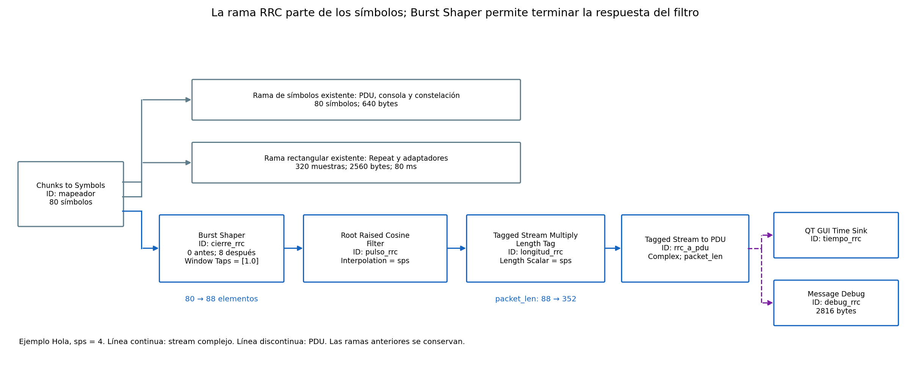
**Figura 42.** La rama RRC añade el cierre antes de filtrar y actualiza la longitud antes de formar la PDU de muestras.

- **Origen izquierdo:** `mapeador` entrega el mismo paquete de símbolos a las tres ramas.
- **Ramas superiores:** conservan los símbolos y el pulso rectangular. Sus cantidades siguen siendo las del paso 12.
- **Rama inferior:** añade ocho ceros, interpola con el RRC y multiplica la longitud por `sps`.
- **Extremo derecho:** el visor temporal y `debug_rrc` reciben la misma PDU, con 352 muestras para `Hola`.
- **Líneas:** las continuas representan streams complejos. Las discontinuas representan mensajes PDU.

### 13.9. Probar `Hola` y comprobar el último paquete

1. El estudiante ejecuta el flowgraph. El cuadro debe comenzar vacío.
2. Escribe `Hola` y pulsa Enter una vez. Espera la actualización de los dos visores temporales.
3. Comprueba las cantidades de la tabla. No envía otro mensaje para completar la gráfica RRC.
4. Escribe `SDR`, pulsa Enter y espera la actualización. La PDU RRC debe cambiar de longitud.
5. Hace una pausa y envía `Hola` otra vez. Debe reaparecer la misma forma RRC del primer envío.

| Texto | Símbolos | Ceros de cierre | Muestras rectangulares | Muestras RRC | Bytes RRC | Duración RRC |
|---|---|---|---|---|---|---|
| `Hola` | 80 | 8 | 320 | 352 | 2816 | 88 ms |
| `SDR` | 72 | 8 | 288 | 320 | 2560 | 80 ms |

- **Consola RRC:** muestra `pdu length = 2816 bytes (printing disabled)` para `Hola`. Para `SDR`, muestra 2560 bytes.
- **Visor rectangular:** conserva $I=\pm1$ y la duración de 80 ms para `Hola`. Su configuración de tasas permanece igual.
- **Visor RRC:** presenta transiciones y oscilaciones del pulso. $Q=0$; $I$ puede superar $\pm1$ por la suma de pulsos.
- **Retardo:** el centro del pulso de cada símbolo se desplaza 4 ms. Ese desplazamiento no modifica los bytes ni representa un error de frecuencia.
- **Cierre:** los ceros de entrada permiten completar la cola. No se espera una línea cero durante todos los últimos 8 ms.
- **Duración:** los símbolos de `Hola` conservan 80 ms nominales. La PDU RRC incluye 8 ms adicionales de cierre; el registro completo dura 88 ms.
- **Pausa:** el montaje no genera nuevas muestras durante la espera del usuario. La gráfica anterior puede permanecer visible.

La Figura 43 muestra el envío de `Hola` con los parámetros de este paso y la disposición del apartado 13.7.

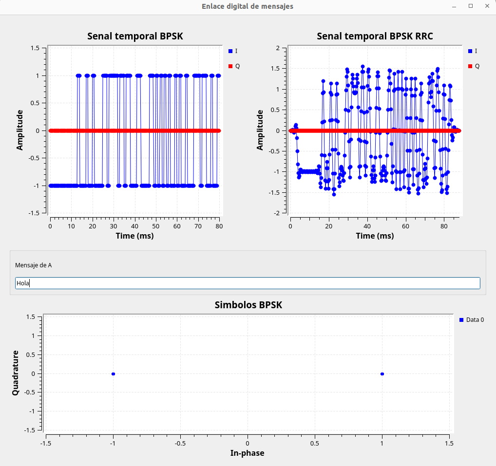
**Figura 43.** El mismo paquete produce un pulso rectangular y un pulso RRC; la constelación conserva los símbolos anteriores al filtro.

- **Panel superior izquierdo:** $I$ azul toma los valores $-1$ y $+1$; $Q$ roja permanece en cero. El registro alcanza unos 80 ms.
- **Panel superior derecho:** $I$ presenta valores intermedios y extremos cercanos a $\pm1.55$. Los pulsos de varios símbolos se suman; $Q$ permanece en cero.
- **Marcadores y líneas:** cada marcador representa una muestra. Con `sps = 4`, los trazos unen cuatro muestras por intervalo de símbolo.
- **Comienzo y cierre RRC:** el filtro muestra un transitorio inicial y una cola final que vuelve a cero. El registro alcanza unos 88 ms.
- **Ejes temporales:** cada panel adapta su eje a su PDU. La rama RRC contiene más muestras y tiene un retardo de 4 ms.
- **Cuadro central:** contiene `Hola`, con `H` mayúscula. La disposición permite comparar las dos representaciones del mismo envío.
- **Panel inferior:** muestra los símbolos de la rama anterior al RRC. Las posiciones $(-1,0)$ y $(1,0)$ conservan el mapeo BPSK.
- **Comprobación de tamaño:** la Figura 44 confirma los tamaños de las tres ramas para este envío.

La consola registra las tres PDUs del mismo paquete. La Figura 44 permite comprobar sus cantidades.

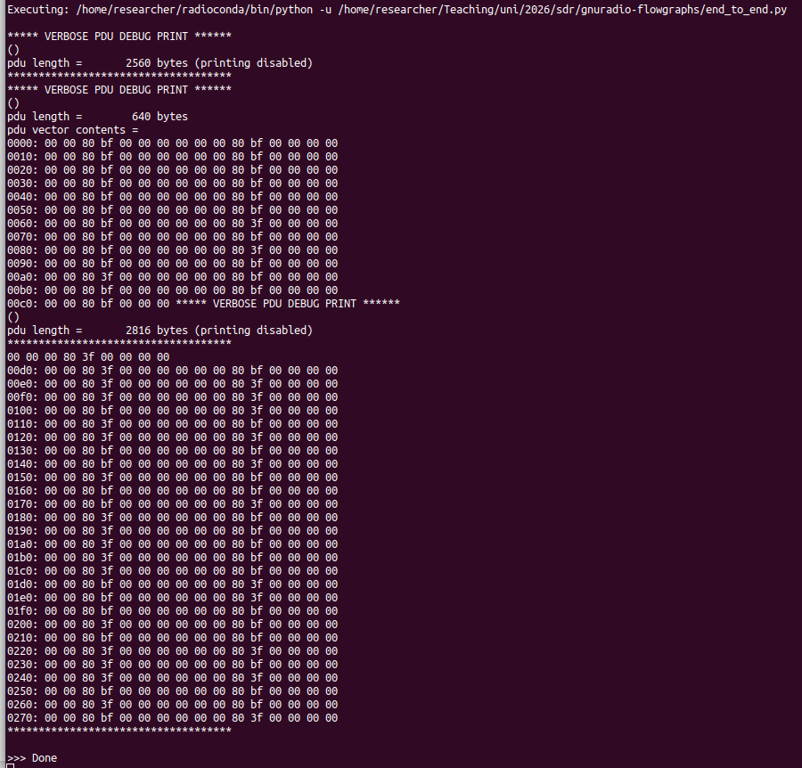
**Figura 44.** La consola confirma 2560 bytes rectangulares, 640 bytes de símbolos y 2816 bytes RRC para `Hola`.

- **Primer registro:** `pdu length = 2560 bytes (printing disabled)` corresponde a $2560/8=320$ muestras complejas del pulso rectangular.
- **Segundo registro:** `pdu length = 640 bytes` corresponde a $640/8=80$ símbolos complejos. El volcado hexadecimal pertenece a esta rama.
- **Registro intercalado:** `pdu length = 2816 bytes (printing disabled)` corresponde a $2816/8=352$ muestras complejas RRC.
- **Almacenamiento:** cada elemento complejo utiliza ocho bytes. Los tamaños anteriores cuentan bytes de memoria, no bytes de texto.
- **Impresión desactivada:** `printing disabled` conserva el registro del tamaño y omite el contenido de esa PDU.
- **Orden en consola:** el registro RRC aparece dentro del volcado de símbolos porque los visores imprimen desde tareas independientes. Las filas posteriores completan ese volcado.
- **Duraciones:** con 4000 muestras/s, las ramas rectangular y RRC representan $320/4000=0.080$ s y $352/4000=0.088$ s.
- **Final de la captura:** `>>> Done` indica que terminó la ejecución. La captura contiene los tres registros de tamaño.

??? note "Si el resultado no coincide"

    - Si el tamaño o la forma no coinciden, se revisa que la rama RRC parta de `mapeador` y no de `Repeat`.
    - Si la PDU espera otro envío o sale incompleta, se comprueban el cierre, las etiquetas y las siete líneas del snippet.
    - Si los máximos aparecen cortados, se comprueban `Y min = -2` y `Y max = 2` en el visor RRC.
    - Si la duración no es 88 ms, se comprueban `sps = 4`, `samp_rate = 4000` y `Post-padding Length = rrc_span`.
    - Si aparece `Q` distinto de cero, se revisan los símbolos de `mapeador` y el tipo de filtro complejo con coeficientes reales.
    - Un único RRC de transmisión no garantiza muestras de decisión en $\pm1$. El filtro del receptor sigue pendiente.

### 13.10. Cambiar `rrc_alpha` sin cambiar las cantidades

1. El estudiante detiene la ejecución, establece `rrc_alpha = 0.20` y vuelve a ejecutar. Envía `Hola` una vez.
2. Repite el ensayo con `rrc_alpha = 0.50`. Conserva `sps = 4` y `rrc_span = 8`.
3. Compara la forma y las oscilaciones del pulso. Comprueba 352 muestras, 2816 bytes y 88 ms en ambos ensayos.
4. Detiene la ejecución, restablece `rrc_alpha = 0.35`, guarda y vuelve a ejecutar.

- **Qué cambia:** los coeficientes y la forma del pulso RRC.
- **Qué permanece fijo:** datos, símbolos, tasas, número de coeficientes y ceros de cierre.
- **Qué se observa:** cambia la forma temporal. El tamaño de la PDU y su duración permanecen iguales.
- Esta comparación no mide todavía el ancho de banda. La respuesta finita tiene límites distintos del pulso ideal.

### Ejercicio 13 — ¿Por qué la PDU RRC dura 88 ms?

El estudiante envía `Hola` con `sps = 4` y los parámetros de este paso. ¿Cuántas muestras produce la rama RRC y qué tiempos debe distinguir?

??? example "Solución explicada"

    - **Datos:** 80 símbolos, ocho ceros de cierre, cuatro muestras por elemento, 4000 muestras/s y 33 coeficientes.
    - **Fórmula:** $N_m=(N_s+N_c)\mathrm{sps}$ y $T=N_m/f_s$. $N_c$ cuenta los ceros de cierre; $N_s$, los símbolos del paquete.
    - **Sustitución:** $N_m=(80+8)\times4=352$ muestras. $T=352/4000=0.088$ s.
    - **Resultado:** la PDU almacena 352 muestras complejas, equivalentes a $352\times8=2816$ bytes, y representa 88 ms.
    - **Retardo:** $(33-1)/(2\times4000)=0.004$ s: 4 ms. La última muestra está en $351/4000=87.75$ ms.
    - **Interpretación:** los símbolos representan 80 ms nominales. El registro incluye el cierre; el retardo de grupo es otra magnitud, no ocho bits añadidos.

## 14. Filtrar en el receptor ideal y seleccionar los símbolos

- El estudiante continúa desde el paso 13, con `sps = 4` y `rrc_alpha = 0.35`.
- Añade un filtro RRC del receptor a la salida de `longitud_rrc`. Conserva las tres ramas anteriores.
- El receptor recibe las muestras del transmisor por una conexión ideal, sin ruido ni cambios de fase o frecuencia.
- TX identifica al transmisor y RX al receptor en las tablas y figuras.
- Selecciona una muestra por símbolo después de compensar el retardo de los dos filtros.
- Este paso observa símbolos recuperados. La conversión a bits, bytes y texto se añadirá después.

### 14.1. Qué cambia al añadir el filtro del receptor

- **Qué cambia:** las muestras RRC atraviesan otro filtro RRC. Después se seleccionan los instantes conocidos de cada símbolo.
- **Qué permanece fijo:** `Hola`, el paquete, el CRC, los 80 símbolos originales, las tasas y los parámetros RRC del paso 13.
- **Qué se observa:** las muestras seleccionadas se agrupan cerca de $-1$ y $+1$. El registro completo conserva transiciones y transitorios.

Un filtro adaptado, *matched filter*, utiliza la respuesta del transmisor invertida en el tiempo y conjugada.
Los coeficientes RRC de esta guía son reales y simétricos. El receptor utiliza la misma forma, con otra escala de ganancia.

Cada RRC aporta 16 muestras de retardo. El retardo total $D$ es:

$$
D=2\frac{N_h-1}{2}=N_h-1=32\ \text{muestras},\qquad D/f_s=32/4000=8\ \text{ms}.
$$

Aquí, $N_h=33$ cuenta coeficientes y $f_s=4000$ muestras/s. Se conserva $L=\mathrm{sps}=4$.
Si $y[n]$ es la salida del receptor, la muestra del símbolo $k$ se toma en:

$$
d[k]=y[D+kL],\qquad k=0,1,\ldots,N_s-1.
$$

- Para `Hola`, $N_s=80$. Los índices son 32, 36, 40, hasta 348; los tiempos son 8, 9, 10, hasta 87 ms.
- Los dos RRC ideales forman una respuesta de coseno alzado. Los filtros de 33 coeficientes son aproximaciones finitas.
- Por eso las muestras seleccionadas quedan cerca de $\pm1$, con pequeñas diferencias de amplitud. No se exige igualdad exacta.
- Con los parámetros de referencia, todos los signos de `Hola` coinciden con los símbolos transmitidos.

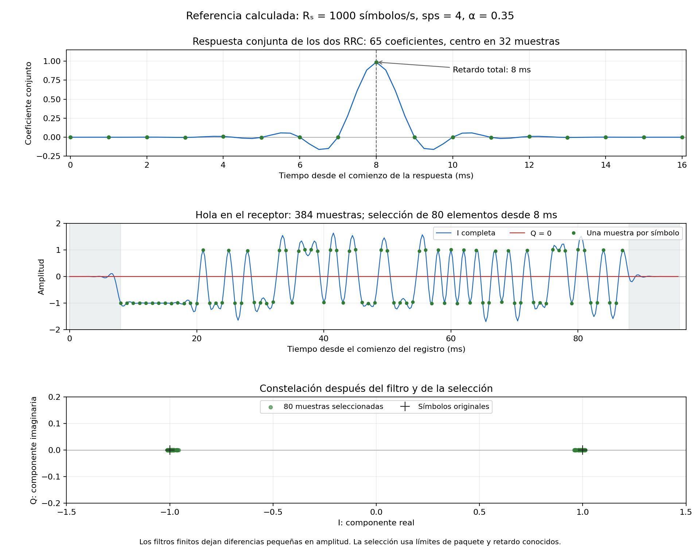
**Figura 45.** Los dos filtros acumulan 8 ms de retardo; seleccionar cada cuarta muestra recupera los instantes de los símbolos.

- **Panel superior:** muestra la respuesta conjunta a un símbolo `+1`. Su centro está en 8 ms; los marcadores identifican intervalos de 1 ms.
- **Panel central:** muestra $I$ azul y $Q=0$ roja. Los marcadores verdes señalan las 80 muestras que se conservarán.
- **Zonas sombreadas:** quedan fuera de la selección. Contienen el arranque y el cierre del registro, que dura 96 ms.
- **Panel inferior:** los valores seleccionados se agrupan cerca de $(-1,0)$ y $(1,0)$. Las diferencias pequeñas reflejan el filtro finito.
- **Tipo de figura:** es una referencia calculada con `Hola`. No representa una captura de ejecución del estudiante.

!!! info "Receptor con referencias conocidas"

    - `packet_len` proporciona los límites del paquete dentro del flowgraph. No es una secuencia transmitida ni un detector de inicio.
    - El receptor conoce `sps`, el retardo y la fase de muestreo. No utiliza el texto original para seleccionar las muestras.
    - La sincronización y la detección de paquetes desde muestras se incorporarán después. Esta conexión no introduce un canal de radio.

### 14.2. Definir el retardo y el cierre del receptor

1. El estudiante detiene la ejecución y guarda el flowgraph.
2. Comprueba `sps = 4`, `rrc_alpha = 0.35` y `rrc_span = 8`.
3. Añade las dos variables de la tabla. Conserva las variables anteriores.

| ID | Value | Significado |
|---|---|---|
| `retardo_total` | `rrc_ntaps - 1` | Retardo de los dos filtros, en muestras: 32. |
| `cierre_rx_muestras` | `rrc_ntaps - 1` | Ceros añadidos a la entrada del receptor, en muestras: 32. |

- Los valores coinciden porque los dos filtros tienen la misma longitud. Describen magnitudes diferentes.
- El transmisor ya añadió ocho ceros a los símbolos. El cierre nuevo añade 32 ceros a sus muestras.
- Estos ceros permiten completar la respuesta del receptor y vaciar su memoria antes del siguiente paquete.
- Para `Hola`, entran 352 muestras del transmisor. El receptor procesa $352+32=384$ muestras.

### 14.3. Añadir el cierre antes del filtro receptor

1. El estudiante añade otro `Burst Shaper`.
2. Configura la tabla y confirma las propiedades.

| Campo | Valor |
|---|---|
| `ID` | `cierre_rx` |
| `Type` | `Complex` |
| `Window Taps` | `[1.0]` |
| `Pre-padding Length` | `0` |
| `Post-padding Length` | `cierre_rx_muestras` |
| `Insert phasing symbols` | `No` |
| `Length Tag Name` | `packet_len` |

- La ventana de valor uno conserva las muestras recibidas del transmisor.
- El bloque añade ceros complejos $0+j0$. Actualiza `packet_len` de 352 a 384 para `Hola`.
- Este cierre no modifica los bytes, el CRC ni los símbolos originales.

### 14.4. Añadir el RRC del receptor

1. El estudiante añade otro `Root Raised Cosine Filter`.
2. Configura la tabla. Este bloque recibe muestras, no símbolos a interpolar.

| Campo | Valor |
|---|---|
| `ID` | `filtro_rx` |
| `FIR Type` | `Complex->Complex (Decimating)` |
| `Decimation` | `1` |
| `Gain` | `1` |
| `Sample Rate` | `samp_rate` |
| `Symbol Rate` | `symbol_rate` |
| `Alpha` | `rrc_alpha` |
| `Num Taps` | `rrc_ntaps` |

- `Decimation = 1` conserva todas las muestras. La selección de símbolos se realiza después, dentro de la PDU.
- El bloque utiliza los mismos 33 coeficientes en forma, con ganancia distinta. Cada filtro aporta 4 ms de retardo.
- El transmisor conserva `Gain = sps`. El receptor usa `Gain = 1`, que normaliza la suma de sus coeficientes a uno.
- Esta combinación produce muestras de decisión próximas a $\pm1$. La longitud finita introduce diferencias pequeñas.
- La tasa continúa en 4000 muestras/s. La etiqueta sigue indicando 384 elementos; aquí no se añade otro multiplicador de longitud.

### 14.5. Reunir la PDU y seleccionar una muestra por símbolo

1. El estudiante añade otro `Tagged Stream to PDU` y configura la tabla.

| Campo | Valor |
|---|---|
| `ID` | `rx_a_pdu` |
| `Item Type` | `Complex` |
| `Length tag name` | `packet_len` |

2. Añade el bloque estándar `PDU Lambda`.
3. En `Mode`, selecciona `Uniform Vector`. Configura el resto de la tabla y confirma las propiedades.

| Campo | Valor |
|---|---|
| `ID` | `muestrear_rx` |
| `Mode` | `Uniform Vector` |
| `Function` | `lambda x: x[retardo_total:-cierre_rx_muestras:sps]` |

- `PDU Lambda` aplica la función al vector de cada mensaje. Conserva sus metadatos y el tipo complejo de las muestras seleccionadas.
- `x` representa el vector completo de salida del receptor. Los índices comienzan en cero.
- `retardo_total` omite las primeras 32 muestras, anteriores al primer instante de símbolo.
- `-cierre_rx_muestras` fija el límite antes de las últimas 32 muestras. El límite final no se incluye.
- `sps` toma un elemento y avanza cuatro posiciones. Para `Hola`, la expresión equivale a `x[32:352:4]` y produce 80 elementos.
- La función se aplica desde el principio de cada PDU. No acumula una posición de muestreo entre paquetes de longitudes diferentes.
- Los puertos de `PDU Lambda` se llaman `pdu`, tanto en la entrada como en la salida. No se añade un `Embedded Python Block`.

### 14.6. Ampliar los buffers del snippet

1. El estudiante abre el `Python Snippet` existente. Conserva `Section of Flowgraph = Main - After Init`.
2. Sustituye sus siete líneas por las nueve líneas siguientes. Los IDs deben coincidir con los bloques del flowgraph.

```python
self.a_stream.set_min_output_buffer(0, (5000 + 6) * 8 * 2)
self.mapeador.set_min_output_buffer(0, (5000 + 6) * 8 * 2)
self.pulso_rect.set_min_output_buffer(0, (5000 + 6) * 8 * self.sps * 2)
self.longitud_muestras.set_min_output_buffer(0, (5000 + 6) * 8 * self.sps * 2)
self.cierre_rrc.set_min_output_buffer(0, ((5000 + 6) * 8 + self.rrc_span) * 2)
self.pulso_rrc.set_min_output_buffer(0, ((5000 + 6) * 8 + self.rrc_span) * self.sps * 2)
self.longitud_rrc.set_min_output_buffer(0, ((5000 + 6) * 8 + self.rrc_span) * self.sps * 2)
self.cierre_rx.set_min_output_buffer(0, (((5000 + 6) * 8 + self.rrc_span) * self.sps + self.cierre_rx_muestras) * 2)
self.filtro_rx.set_min_output_buffer(0, (((5000 + 6) * 8 + self.rrc_span) * self.sps + self.cierre_rx_muestras) * 2)
```

- El mensaje máximo contiene 40048 símbolos. El registro del receptor contiene $(40048+16)\times4=160256$ muestras.
- Las dos líneas nuevas solicitan 320512 elementos por buffer, siguiendo el criterio de los pasos anteriores.
- El paquete aislado y el último paquete deben terminar sin otro envío. El snippet configura capacidad; no construye el filtro.

### 14.7. Añadir los visores del receptor

1. El estudiante añade otro `QT GUI Time Sink` y configura la tabla.

| Campo | Valor |
|---|---|
| `ID` | `tiempo_rx` |
| `Type` | `Complex Message` |
| `Name` | `Senal temporal del receptor RRC` |
| `Sample Rate` | `samp_rate` |
| `Grid` | `Yes` |
| `Autoscale` | `No` |
| `Y min` | `-2` |
| `Y max` | `2` |
| `Line 1 Label` | `I` |
| `Line 2 Label` | `Q` |
| `Line 1 Style` | `Solid` |
| `Line 2 Style` | `Solid` |
| `Line 1 Marker` | `Circle` |
| `Line 2 Marker` | `Circle` |

2. Añade otro `QT GUI Constellation Sink`. Este visor recibe solamente las muestras seleccionadas.

| Campo | Valor |
|---|---|
| `ID` | `constelacion_rx` |
| `Type` | `Complex Message` |
| `Name` | `Simbolos recuperados: receptor ideal` |
| `Grid` | `Yes` |
| `Autoscale` | `No` |
| `X min` | `-1.5` |
| `X max` | `1.5` |
| `Y min` | `-1.5` |
| `Y max` | `1.5` |

3. Añade dos `Message Debug`. Configura cada instancia con su tabla.

| Campo | Valor |
|---|---|
| `ID` | `debug_rx` |
| `Print PDU contents` | `Off` |

| Campo | Valor |
|---|---|
| `ID` | `debug_simbolos_rx` |
| `Print PDU contents` | `Off` |

- `debug_rx` informa 3072 bytes para las 384 muestras completas de `Hola`.
- `debug_simbolos_rx` informa 640 bytes para sus 80 muestras seleccionadas. Son símbolos complejos, todavía no bytes del paquete.
- El visor original de símbolos conserva el contenido activado. Su registro de 640 bytes incluye el volcado hexadecimal.
- El registro nuevo de 640 bytes contiene `printing disabled`. Los registros de los cinco visores pueden intercalarse.

### 14.8. Organizar las pestañas y conectar desde el montaje actual

1. El estudiante añade un `QT GUI Tab Widget`. Este bloque organiza los visores y queda sin conexiones de datos.
2. Configura la tabla. Las pestañas se numeran desde cero.

| Campo | Valor |
|---|---|
| `ID` | `vistas` |
| `Num Tabs` | `2` |
| `Label 0` | `Transmisor` |
| `Label 1` | `Receptor ideal` |
| `GUI Hint` | `1,0,1,2` |

3. Sustituye los `GUI Hint` anteriores por los de esta tabla. También configura los dos visores nuevos.

| Bloque | `GUI Hint` |
|---|---|
| `QT GUI Message Edit Box` existente | `0,0,1,2` |
| `tiempo_bpsk` | `vistas@0:0,0,1,1` |
| `tiempo_rrc` | `vistas@0:0,1,1,1` |
| `QT GUI Constellation Sink` existente | `vistas@0:1,0,1,2` |
| `tiempo_rx` | `vistas@1:0,0,1,2` |
| `constelacion_rx` | `vistas@1:1,0,1,2` |

- El cuadro de texto permanece fuera de las pestañas. Se puede enviar un mensaje mientras se observa el transmisor o el receptor.
- `vistas@0` identifica la primera pestaña; `vistas@1`, la segunda. Los cuatro números conservan el formato de fila, columna y extensiones.
- La pestaña del receptor muestra la señal completa arriba y los símbolos seleccionados abajo.
- Si la ventana no muestra un panel completo, el estudiante la amplía o utiliza el desplazamiento vertical.

4. Conserva todas las conexiones anteriores y añade las de la tabla. La rama nueva empieza en el stream de `longitud_rrc`.

| Origen | Destino | Tipo de conexión |
|---|---|---|
| Salida de `longitud_rrc` | Entrada de `cierre_rx` | Stream `Complex` |
| Salida de `cierre_rx` | Entrada de `filtro_rx` | Stream `Complex` |
| Salida de `filtro_rx` | Entrada de `rx_a_pdu` | Stream `Complex` |
| `rx_a_pdu.pdus` | `tiempo_rx.in` | Mensaje |
| `rx_a_pdu.pdus` | `debug_rx.print` | Mensaje |
| `rx_a_pdu.pdus` | `muestrear_rx.pdu` | Mensaje |
| `muestrear_rx.pdu` | `constelacion_rx.in` | Mensaje |
| `muestrear_rx.pdu` | `debug_simbolos_rx.print` | Mensaje |

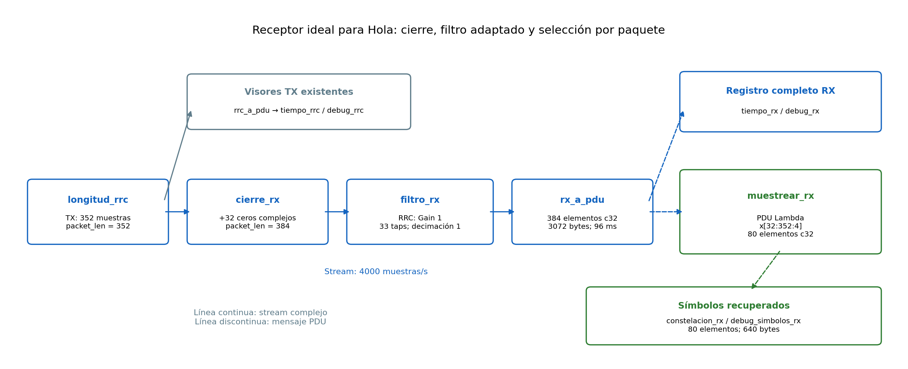
**Figura 46.** El receptor completa el cierre, filtra las muestras y selecciona los instantes de símbolo dentro de cada PDU.

- **Origen izquierdo:** `longitud_rrc` conserva la conexión a los visores del transmisor. Otra conexión alimenta la rama nueva.
- **Centro:** `cierre_rx` añade 32 ceros y actualiza la longitud. `filtro_rx` procesa las 384 muestras de `Hola` sin cambiar la tasa.
- **PDU completa:** `rx_a_pdu` entrega el registro al visor temporal y a la selección de muestras.
- **Selección:** `muestrear_rx` conserva los índices 32, 36, hasta 348. Sus 80 elementos alimentan la constelación del receptor.
- **Líneas:** las continuas representan streams complejos; las discontinuas, mensajes PDU.

### 14.9. Probar `Hola`, `SDR` y una pausa

1. El estudiante guarda y ejecuta el flowgraph. El cuadro comienza vacío.
2. Selecciona la pestaña `Receptor ideal`, escribe `Hola` y pulsa Enter una vez.
3. Espera el registro completo y la constelación. Comprueba las cantidades de la tabla sin enviar otro mensaje.
4. Cambia a `Transmisor` y comprueba las gráficas del paso 13. Cambiar de pestaña no envía otro paquete.
5. Envía `SDR` y vuelve a observar el receptor. El número de muestras seleccionadas cambia a 72.
6. Hace una pausa, envía `Hola` otra vez y comprueba la misma forma del primer envío.

| Texto | Muestras TX RRC | Muestras RX completas | Bytes RX completos | Duración RX | Símbolos seleccionados | Bytes seleccionados |
|---|---|---|---|---|---|---|
| `Hola` | 352 | 384 | 3072 | 96 ms | 80 | 640 |
| `SDR` | 320 | 352 | 2816 | 88 ms | 72 | 576 |

- **Señal completa:** conserva oscilaciones y picos entre instantes de símbolo. No se espera que todas sus muestras sean $\pm1$.
- **Constelación recuperada:** presenta dos grupos próximos a $(-1,0)$ y $(1,0)$. Su dispersión pequeña es esperada en esta referencia finita.
- **Componente Q:** permanece en cero porque la conexión y los coeficientes no introducen componentes imaginarias.
- **Primer instante seleccionado:** aparece a los 8 ms del registro. El último de `Hola` aparece a los 87 ms.
- **Duración:** 96 ms describe el registro completo. Los 80 símbolos siguen representando 80 ms nominales.
- **Pausa:** no genera muestras nuevas. El cierre permite terminar cada paquete y reiniciar el filtrado del siguiente sin memoria residual.
- **Salida de texto:** la guía sigue observando símbolos. La recuperación de bytes y el comprobador CRC se conectarán en el siguiente paso.

Las Figuras 47–50 muestran la construcción y la ejecución del profesor con `Hola`, `sps = 4` y `rrc_alpha = 0.35`.

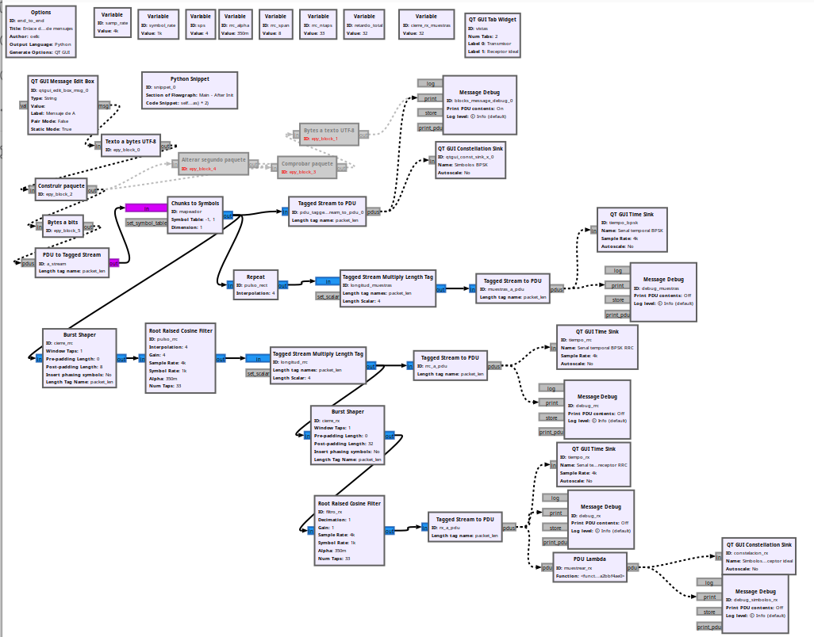
**Figura 47.** El montaje conserva las ramas anteriores y añade el filtro receptor, la selección de muestras y sus visores.

- **Parte superior:** las variables fijan 1000 símbolos/s, 4000 muestras/s, cuatro muestras por símbolo y 33 coeficientes por filtro RRC.
- **Ramas del transmisor:** `mapeador` alimenta la observación de símbolos, la repetición rectangular y el filtrado RRC.
- **Rama del receptor:** `longitud_rrc` entrega muestras a `cierre_rx`, `filtro_rx` y `rx_a_pdu`.
- **Observación completa:** `rx_a_pdu.pdus` alimenta `tiempo_rx` y `debug_rx`.
- **Selección:** `muestrear_rx` conserva un elemento por símbolo. Su salida alimenta `constelacion_rx` y `debug_simbolos_rx`.
- **Bloques grises:** el comprobador de paquete y el convertidor a texto todavía están deshabilitados.

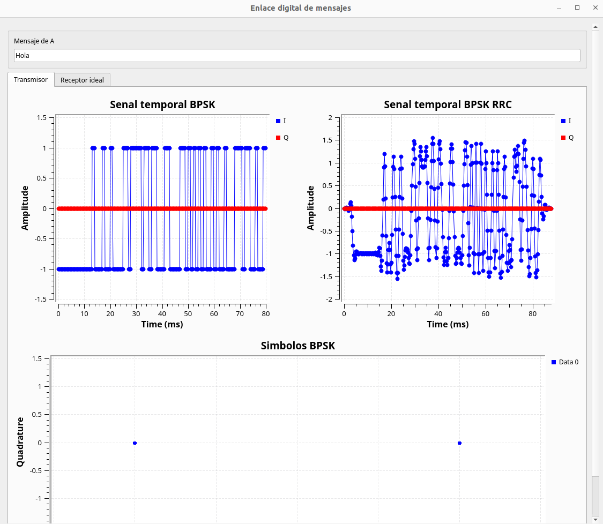
**Figura 48.** La pestaña Transmisor muestra las tres representaciones de `Hola` conservadas del paso anterior.

- **Panel superior izquierdo:** el eje horizontal indica tiempo en milisegundos. I azul toma valores $-1$ y $+1$ durante 80 ms.
- **Panel superior derecho:** el RRC produce valores intermedios y picos entre símbolos. El registro incluye el cierre y abarca 88 ms.
- **Curvas rojas:** Q permanece en cero en ambos paneles temporales.
- **Panel inferior:** los símbolos originales ocupan las posiciones $(-1,0)$ y $(1,0)$ en los ejes I y Q.
- **Ventana:** la captura recorta la parte inferior del visor. El estudiante puede ampliar la ventana o usar la barra de desplazamiento.

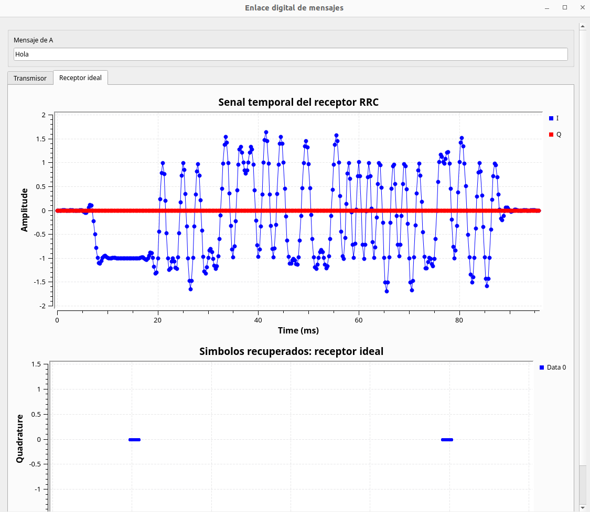
**Figura 49.** El receptor muestra el registro completo y dos grupos de muestras seleccionadas próximos a los símbolos BPSK ideales.

- **Panel superior:** el eje horizontal indica tiempo en milisegundos. I azul conserva el transitorio, los picos y el cierre del registro de 96 ms.
- **Curva roja:** Q permanece en cero. Los dos filtros usan coeficientes reales y la entrada BPSK tiene Q cero.
- **Panel inferior:** los ejes representan I y Q. Los grupos se concentran cerca de $(-1,0)$ y $(1,0)$.
- **Dispersión horizontal:** los valores seleccionados no son exactamente $\pm1$. La respuesta finita de los filtros produce esta variación pequeña.
- **Alcance:** la captura confirma la selección de símbolos. La recuperación del paquete y su CRC todavía no aparecen en esta salida.

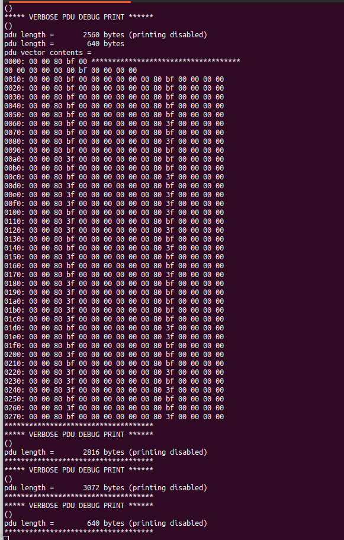
**Figura 50.** Los cinco tamaños de la consola coinciden con las representaciones de `Hola` antes y después del filtrado receptor.

| Registro en la captura | Origen | Elementos complejos | Bytes almacenados | Contenido impreso |
|---|---|---|---|---|
| Primero | `muestras_a_pdu` → `debug_muestras` | 320 muestras rectangulares | 2560 | `printing disabled` |
| Segundo | `pdu_tagged_stream_to_pdu_0` → `blocks_message_debug_0` | 80 símbolos TX | 640 | Volcado hexadecimal |
| Tercero | `rrc_a_pdu` → `debug_rrc` | 352 muestras TX RRC | 2816 | `printing disabled` |
| Cuarto | `rx_a_pdu` → `debug_rx` | 384 muestras RX completas | 3072 | `printing disabled` |
| Quinto | `muestrear_rx` → `debug_simbolos_rx` | 80 símbolos RX seleccionados | 640 | `printing disabled` |

- **Unidad de almacenamiento:** cada elemento complejo ocupa ocho bytes: cuatro para I y cuatro para Q.
- **Dos registros de 640 bytes:** el primero contiene símbolos TX. El último contiene símbolos RX seleccionados.
- **Intercalado:** algunos encabezados aparecen dentro del volcado hexadecimal. Los visores imprimen desde tareas independientes; el intercalado no modifica las PDUs.
- **Límite:** `640 bytes` no indica que se recuperaron 640 bytes de texto. La salida del receptor conserva 80 valores complejos.

??? note "Si el resultado no coincide"

    - Si el receptor no termina con un solo envío, se comprueban `cierre_rx_muestras`, `packet_len` y las nueve líneas del snippet.
    - Si la selección contiene 88 elementos para `Hola`, se revisa el comienzo de la función: debe usar `retardo_total`.
    - Si aparecen cientos de posiciones de constelación, se comprueba que el visor reciba `muestrear_rx.pdu`.
    - Si las amplitudes seleccionadas se acercan a $\pm4$, se comprueba `Gain = 1` en el RRC receptor.
    - Si falla `PDU Lambda`, se comprueban `Uniform Vector`, los nombres de variables y la función completa. Un error puede dejar pasar el vector original.
    - Si falta un visor en su pestaña, se revisan `vistas`, el índice después de `@` y los `GUI Hint` de la tabla.

### 14.10. Comprobar la compensación del retardo

1. El estudiante detiene la ejecución. Conserva tasas, filtros y conexiones.
2. En `muestrear_rx`, sustituye temporalmente la función por `lambda x: x[0:-cierre_rx_muestras:sps]`.
3. Ejecuta y envía `Hola`. El visor de selección debe indicar 704 bytes: 88 elementos complejos.
4. Observa los valores próximos a cero del arranque y los dos grupos principales en la constelación.
5. Detiene la ejecución y restablece `lambda x: x[retardo_total:-cierre_rx_muestras:sps]`.
6. Ejecuta y envía `Hola` otra vez. La selección vuelve a 80 elementos y 640 bytes.

- **Qué cambia:** el comienzo de la selección. Se incluyen ocho intervalos anteriores al primer símbolo recuperado.
- **Qué permanece fijo:** `Hola`, las muestras completas, los filtros, las tasas y el paso entre muestras seleccionadas.
- **Qué se observa:** la selección sin compensación contiene ocho elementos adicionales y valores del transitorio de arranque.
- Esta prueba cambia la alineación del paquete. La búsqueda automática del instante y la fase de muestreo sigue pendiente.

### Ejercicio 14 — ¿Cuántas muestras de `SDR` se seleccionan?

El receptor procesa `SDR` con los parámetros de referencia. ¿Cuántas muestras completas y seleccionadas produce, y cuándo toma la última?

??? example "Solución explicada"

    - **Datos:** 72 símbolos, `sps = 4`, dos cierres equivalentes a ocho intervalos cada uno y retardo total de 32 muestras.
    - **Fórmula:** $N_{rx}=(N_s+2N_c)L$; $n_k=D+kL$. Aquí, $N_c=8$ cuenta intervalos por cierre.
    - **Sustitución:** $N_{rx}=(72+16)\times4=352$ muestras. La selección equivale a `x[32:320:4]`.
    - **Resultado:** 352 muestras completas y 2816 bytes, con duración $352/4000=88$ ms. Se seleccionan 72 elementos y 576 bytes.
    - **Último instante:** $n_{71}=32+71\times4=316$; $316/4000=79$ ms. La última muestra del registro está en 87.75 ms.
    - **Interpretación:** el registro incluye retardos y cierre. La selección conserva un elemento por símbolo del paquete original.

## 15. Recuperar los bytes y comprobar el paquete

- El receptor decide un bit por símbolo seleccionado y reconstruye el paquete completo.
- Se añaden bloques estándar para extraer I, decidir los bits y empaquetarlos. Los adaptadores conservan la separación entre mensajes y streams.
- Se reutilizan `Comprobar paquete` y `Bytes a texto UTF-8`. El texto aceptado llega al visor existente.

### 15.1. De una amplitud a un bit

- **Qué cambia:** los valores complejos se convierten en bits y después en bytes empaquetados.
- **Qué permanece fijo:** `Hola`, el transmisor, los filtros, las tasas, la selección de símbolos y el CRC recibido.
- **Qué se observa:** 80 símbolos producen 10 bytes de paquete. El comprobador acepta cuatro bytes de texto y el visor muestra `Hola`.

La decisión dura (*hard decision*) asigna un bit sin conservar la amplitud del símbolo. Para la BPSK de esta guía:

$$
\widehat b_k=\begin{cases}0,&I_k<0,\\1,&I_k\geq0.\end{cases}
$$

- El umbral es cero. `Binary Slicer` asigna `1` también a un valor exactamente cero.
- Los símbolos útiles de la referencia ideal están próximos a $-1$ o $+1$. Las pequeñas diferencias de amplitud no cambian sus decisiones.
- Q permanece en cero. `Complex To Real` entrega I al decisor.
- Los bits se agrupan mediante MSB first, el mismo orden usado por `Bytes a bits` en transmisión.


**Figura 51.** Las decisiones del receptor reconstruyen los bytes originales sin calcular un CRC nuevo.

- **Panel superior:** el eje horizontal identifica las ocho posiciones de bit del primer byte del texto. El eje vertical muestra I seleccionada.
- **Umbral horizontal:** los puntos inferiores a cero producen `0`. Los puntos superiores producen `1`.
- **Etiquetas:** la secuencia `01001000` reconstruye `48`, el byte hexadecimal de `H`.
- **Panel inferior:** las primeras dos filas reconstruyen `00 04`, la longitud de cuatro bytes. La tercera reconstruye el comienzo del texto.
- **Paquete completo:** `00 04 48 6f 6c 61 aa 94 8e c9`. Los cuatro bytes finales conservan el CRC transmitido.

### 15.2. Preparar los bloques existentes

`Comprobar paquete` es el `Embedded Python Block` con ID `epy_block_3`. Su nombre está definido en el código del bloque.
En el canvas aparece gris porque está deshabilitado. Está a la derecha de `Alterar segundo paquete` y debajo de `Bytes a texto UTF-8`.
El estudiante reutiliza este bloque; no lo añade desde el catálogo.

1. El estudiante detiene la ejecución y guarda el flowgraph.
2. Comprueba `sps = 4`, `symbol_rate = 1000` y `rrc_alpha = 0.35`.
3. Comprueba la función de `muestrear_rx`: `lambda x: x[retardo_total:-cierre_rx_muestras:sps]`.
4. Conserva todas las ramas temporales y de constelación del paso 14.
5. Si existen, retira `epy_block_2.out` → `epy_block_3.in` y `epy_block_4.out` → `epy_block_3.in`. Si la entrada está desconectada, continúa con el paso siguiente.
6. Comprueba que `Bytes a texto UTF-8.in` tenga únicamente la conexión desde `Comprobar paquete.out`.
7. Habilita `Comprobar paquete` y `Bytes a texto UTF-8`. Conserva sus códigos revisados.
8. Retira la conexión de la PDU de símbolos TX a `Message Debug.print` del visor original.
9. Conserva o restablece `Bytes a texto UTF-8.out` → `Message Debug.print` del visor original.
10. Conserva `Alterar segundo paquete` deshabilitado. Comprueba que `Value` del cuadro de texto esté vacío.

- En el canvas actual, `Comprobar paquete` tiene ID `epy_block_3` y `Bytes a texto UTF-8` tiene ID `epy_block_1`.
- El visor original tiene ID `blocks_message_debug_0`. La PDU de símbolos TX procede de `pdu_tagged_stream_to_pdu_0`.
- La conexión de símbolos TX a su constelación permanece activa.
- El comprobador recibirá paquetes exclusivamente desde la nueva rama RX. El texto original no debe llegar al visor por otra ruta.

### 15.3. Añadir los cinco bloques estándar

El estudiante añade cada bloque, abre sus propiedades y confirma los valores de su tabla.

**Primer adaptador: `PDU to Tagged Stream`.** Recibe los valores complejos seleccionados y los entrega como un stream.

| Campo | Valor |
|---|---|
| `ID` | `rx_a_stream` |
| `Item Type` | `Complex` |
| `Length tag name` | `"packet_len"` |

- Para `Hola`, la entrada contiene 80 elementos complejos y ocupa 640 bytes. El adaptador crea `packet_len = 80`.
- La etiqueta cuenta elementos del stream. No cuenta bytes de memoria ni mide una duración.

**Extracción de I: `Complex To Real`.** Entrega la parte real de cada símbolo, sin cambiar la cantidad de elementos.

| Campo | Valor |
|---|---|
| `ID` | `extraer_i` |
| `Vector Length` | `1` |

**Decisión: `Binary Slicer`.** Su entrada es un stream `float`; su salida es un stream de bytes con valores `0` o `1`.

| Campo | Valor |
|---|---|
| `ID` | `decidir_bits` |

- El bloque usa un umbral fijo de cero. No se añade una propiedad de umbral.
- Los 80 elementos de salida todavía representan un bit cada uno. No son 80 bytes del paquete reconstruido.

**Empaquetado: `Repack Bits`.** Agrupa ocho bits separados en cada byte de salida.

| Campo | Valor |
|---|---|
| `ID` | `empaquetar_bits` |
| `Bits per input byte` | `1` |
| `Bits per output byte` | `8` |
| `Length Tag Key` | `"packet_len"` |
| `Packet Alignment` | `Output` |
| `Endianness` | `MSB` |

- `MSB` corresponde a `gr.GR_MSB_FIRST`. El valor predeterminado `LSB` no coincide con el transmisor.
- `Length Tag Key` activa el procesamiento por paquetes. El bloque actualiza `packet_len` de 80 a 10 para `Hola`.
- `Packet Alignment = Output` conserva bytes completos. Una entrada que no sea múltiplo de ocho perdería sus bits finales incompletos.
- La selección correcta produce múltiplos de ocho. Este ajuste no repara bits perdidos ni identifica el comienzo del paquete.
- No se añade otro multiplicador de longitud después de `Repack Bits`.

**Segundo adaptador: `Tagged Stream to PDU`.** Reúne los bytes empaquetados en una PDU para el comprobador existente.

| Campo | Valor |
|---|---|
| `ID` | `paquete_rx_a_pdu` |
| `Item Type` | `Byte` |
| `Length tag name` | `"packet_len"` |

- Esta PDU contiene longitud, texto y CRC. Para `Hola`, contiene diez elementos `u8` y ocupa diez bytes.
- Los valores ya no están restringidos a `00` y `01`. Por ejemplo, el primer byte del texto vuelve a ser `48`.

### 15.4. Conectar la recuperación y sus visores

1. El estudiante conserva las conexiones de `muestrear_rx.pdu` a los visores de símbolos recuperados.
2. Añade las conexiones de la cadena siguiente. Los cinco bloques nuevos tienen un único puerto de stream de entrada o salida.
3. Comprueba que el comprobador tenga una única entrada activa, desde `paquete_rx_a_pdu.pdus`.
4. Comprueba que el visor original tenga una única entrada activa, desde el convertidor UTF-8.

```text
muestrear_rx.pdu → rx_a_stream.pdus
rx_a_stream.out → extraer_i.in
extraer_i.re → decidir_bits.in
decidir_bits.out → empaquetar_bits.in
empaquetar_bits.out → paquete_rx_a_pdu.in
paquete_rx_a_pdu.pdus → Comprobar paquete.in
Comprobar paquete.out → Bytes a texto UTF-8.in
Bytes a texto UTF-8.out → Message Debug.print
```

El estudiante añade otro `Message Debug` para observar el paquete antes de comprobarlo.

| Campo | Valor |
|---|---|
| `ID` | `debug_paquete_rx` |
| `Print PDU contents` | `On` |
| `Log level` | `Info` |

- Conecta `paquete_rx_a_pdu.pdus` → `debug_paquete_rx.print`.
- El visor nuevo muestra los bytes reconstruidos. El visor original muestra únicamente el texto aceptado.
- Los visores de símbolos y muestras conservan `Print PDU contents = Off` para evitar volcados extensos.


**Figura 52.** La nueva rama recupera el paquete desde los símbolos RX y reutiliza los bloques de comprobación y texto.

- **Fila superior, de izquierda a derecha:** la PDU seleccionada pasa a stream complejo. `extraer_i` entrega la componente real.
- **Fila central, de derecha a izquierda:** el decisor entrega bits separados. `empaquetar_bits` reconstruye bytes y el adaptador crea la PDU.
- **Fila inferior, de izquierda a derecha:** el comprobador acepta únicamente el texto cuyo paquete cumple longitud y CRC. El convertidor entrega texto al visor.
- **Tipos:** complejo, `float` y byte identifican elementos distintos. El orden de conexión respeta los tipos de los puertos.
- **Conexiones discontinuas:** transportan mensajes. Las conexiones continuas transportan elementos del stream.

### 15.5. Ampliar el snippet de buffers

El mensaje máximo contiene 5006 bytes de paquete y 40048 símbolos. Dos bloques nuevos deben disponer de espacio para un paquete completo.

1. El estudiante abre el `Python Snippet` existente.
2. Conserva `Section of Flowgraph = Main - After Init`.
3. Reemplaza su contenido por estas once líneas. Las primeras nueve conservan los ajustes anteriores.

```python
self.a_stream.set_min_output_buffer(0, (5000 + 6) * 8 * 2)
self.mapeador.set_min_output_buffer(0, (5000 + 6) * 8 * 2)
self.pulso_rect.set_min_output_buffer(0, (5000 + 6) * 8 * self.sps * 2)
self.longitud_muestras.set_min_output_buffer(0, (5000 + 6) * 8 * self.sps * 2)
self.cierre_rrc.set_min_output_buffer(0, ((5000 + 6) * 8 + self.rrc_span) * 2)
self.pulso_rrc.set_min_output_buffer(0, ((5000 + 6) * 8 + self.rrc_span) * self.sps * 2)
self.longitud_rrc.set_min_output_buffer(0, ((5000 + 6) * 8 + self.rrc_span) * self.sps * 2)
self.cierre_rx.set_min_output_buffer(0, (((5000 + 6) * 8 + self.rrc_span) * self.sps + self.cierre_rx_muestras) * 2)
self.filtro_rx.set_min_output_buffer(0, (((5000 + 6) * 8 + self.rrc_span) * self.sps + self.cierre_rx_muestras) * 2)
self.rx_a_stream.set_min_output_buffer(0, (5000 + 6) * 8 * 2)
self.decidir_bits.set_min_output_buffer(0, (5000 + 6) * 8 * 2)
```

- `rx_a_stream` debe publicar el vector complejo completo. Su salida necesita espacio para los 40048 símbolos del caso máximo.
- `Repack Bits` consume cada paquete completo. El buffer de `decidir_bits` debe reunir sus 40048 bits separados.
- Los argumentos cuentan elementos. Los bytes de memoria dependen del tipo de salida de cada bloque.
- El factor `2` conserva el margen utilizado en los pasos anteriores. No duplica los símbolos transmitidos ni la longitud del paquete.

### 15.6. Comprobar el texto recuperado

1. El estudiante guarda y ejecuta el flowgraph. Comprueba que el cuadro comience vacío.
2. Escribe `Hola` y pulsa Enter una vez. Espera la PDU de diez bytes y un registro de texto `Hola`.
3. Sin detener la ejecución, escribe `SDR` y pulsa Enter una vez. Espera nueve bytes de paquete y el texto `SDR`.
4. Escribe `¡Hola, Perú!` y pulsa Enter una vez. Comprueba el texto completo, incluidos los dos caracteres no ASCII.
5. Hace una pausa. Comprueba que la pausa no publique otro mensaje.
6. Envía `Hola` otra vez. Comprueba un nuevo registro con el mismo texto.

| Texto | Símbolos seleccionados | Bits separados | Bytes del paquete RX | Bytes UTF-8 aceptados |
|---|---|---|---|---|
| `Hola` | 80 | 80 | 10 | 4 |
| `SDR` | 72 | 72 | 9 | 3 |
| `¡Hola, Perú!` | 160 | 160 | 20 | 14 |
| Texto de 5000 bytes UTF-8 | 40048 | 40048 | 5006 | 5000 |

- **Paquete de Hola:** `debug_paquete_rx` indica `pdu length = 10 bytes` y muestra `00 04 48 6f 6c 61 aa 94 8e c9`.
- **Texto aceptado:** el visor original muestra `MESSAGE DEBUG PRINT` seguido de `Hola`. El comprobador no imprime un aviso de éxito.
- **Tamaños:** los 640 bytes de símbolos seleccionados se convierten en diez bytes de paquete. El texto de aplicación ocupa cuatro bytes.
- **Longitud:** el campo del paquete conserva `00 04`. La etiqueta interna cambia de 80 a 10 durante el empaquetado.
- **CRC:** el receptor compara el CRC recibido con el calculado sobre longitud y texto reconstruidos. No sustituye el campo recibido.
- **Registros:** los visores pueden intercalar sus impresiones. Un encabezado intercalado no indica otro mensaje ni cambia el contenido de la PDU.
- **Límite:** la cadena recupera texto con límites, retardo y fase conocidos. El paquete todavía se delimita mediante `packet_len`.

??? note "Si el resultado no coincide"

    - Si no aparece el texto, se comprueban los puertos `pdus`, `in`, `out`, `re` y `print`, según la cadena de 15.4.
    - Si el comprobador recibe 80 bytes para Hola, se revisan `Bits per output byte = 8` y la conexión después de `Repack Bits`.
    - Si el paquete contiene 11 bytes, se comprueba que la selección comience en `retardo_total`, no en cero.
    - Si los bytes están invertidos dentro de cada grupo, se comprueba `Endianness = MSB`. El orden big-endian de los campos no reemplaza este ajuste.
    - Si aparece un error de `packet_len` o falta la PDU, se comprueba `Length Tag Key` en `Repack Bits` y los dos adaptadores.
    - Si solo se bloquean mensajes largos, se comprueban las once líneas del snippet y los IDs de los bloques.
    - Si aparecen dos textos por envío, se revisan rutas antiguas desde el constructor al comprobador y las entradas activas del visor original.
    - Si aparece CRC incorrecto en el montaje ideal, se revisan el selector, el orden de bits y `Alterar segundo paquete`.

### 15.7. Repetir el rechazo a través de las muestras

La prueba del paso 9 puede recorrer ahora el transmisor y el receptor completos.

1. El estudiante detiene la ejecución. Habilita `Alterar segundo paquete` sin cambiar su código.
2. Retira `Construir paquete.out` → `Bytes a bits.in`.
3. Conecta `Construir paquete.out` → `Alterar segundo paquete.in` → `Bytes a bits.in`.
4. Comprueba que no exista una conexión desde el auxiliar al comprobador. El recorrido continúa por símbolos, filtros y recuperación de bytes.
5. Guarda y ejecuta de nuevo, con `Value` vacío. Envía `Hola` tres veces en la misma ejecución.
6. Espera texto aceptado, rechazo por CRC y texto aceptado, en ese orden.

| Envío | Paquete reconstruido | Resultado del visor de texto |
|---|---|---|
| Primero | `00 04 48 6f 6c 61 aa 94 8e c9` | `Hola` |
| Segundo | `00 04 49 6f 6c 61 aa 94 8e c9` | Sin texto nuevo; `Comprobar paquete: CRC incorrecto. Se rechaza.` |
| Tercero | `00 04 48 6f 6c 61 aa 94 8e c9` | Otro registro con `Hola` |

- **Qué cambia:** un bit del segundo paquete, antes de separar sus bytes en bits. El CRC recibido permanece fijo.
- **Qué permanece fijo:** texto escrito, longitud, tasas, filtros, conexiones RX y selección de símbolos.
- **Qué se observa:** los filtros y las decisiones transportan el bit alterado. El comprobador detecta la discrepancia del CRC.
- La decisión dura recupera el valor recibido; no corrige este error. El segundo paquete no debe aparecer como `Iola` en el visor de texto.

El estudiante restablece el montaje ideal:

1. Detiene la ejecución y retira las dos conexiones del auxiliar.
2. Deshabilita el auxiliar con `D`. Restablece `Construir paquete.out` → `Bytes a bits.in`.
3. Guarda, ejecuta y envía `Hola` dos veces. Comprueba dos registros de texto sin rechazo.

### 15.8. Relacionar los caminos con los conceptos aprendidos

El diagrama agrupa los bloques del montaje por función. Las cantidades corresponden a `Hola`, con `sps = 4` y 33 coeficientes RRC.
El estudiante sigue las flechas. Las tres ramas reciben los mismos símbolos del bloque `mapeador`.


**Figura 53.** Las tres ramas comparten los símbolos BPSK; la rama RRC continúa hacia el receptor ideal y la recuperación del texto.

- **Franja superior:** el texto ocupa cuatro bytes. El paquete añade longitud y CRC; sus diez bytes producen 80 bits y 80 símbolos BPSK.
- **Rama A, azul:** reúne los símbolos para observar la constelación. El recorrido termina en el visor.
- **Rama B, turquesa:** `Repeat` genera cuatro muestras iguales por símbolo. `longitud_muestras` actualiza la etiqueta; los visores reciben 320 muestras rectangulares.
- **Rama C, naranja:** `cierre_rrc` añade ocho ceros a los símbolos. `pulso_rrc` construye 352 muestras RRC; `longitud_rrc` actualiza su longitud.
- **Frontera TX/RX:** `longitud_rrc.out` entrega las muestras a `cierre_rx.in` mediante una conexión ideal. El montaje trabaja en banda base, sin conversión a RF.
- **Franja violeta, de derecha a izquierda:** `cierre_rx` añade 32 ceros a las muestras. `filtro_rx` aplica el filtro adaptado; `muestrear_rx` selecciona 80 símbolos.
- **Franja verde, de izquierda a derecha:** el receptor decide los bits, reconstruye diez bytes y comprueba longitud y CRC. El convertidor entrega `Hola`.
- **Cierres:** ambos `Burst Shaper` usan una ventana `[1.0]`. Añaden ceros para completar las respuestas de los filtros; esos ceros no representan bits del mensaje.
- **Agrupación:** algunos recuadros contienen varios bloques consecutivos. Los adaptadores de PDU y los visores temporales se agrupan para destacar el concepto de cada camino.

El estudiante puede ampliar la [versión vectorial del diagrama](figures/enlace-53-mapa-conceptos.svg).

### 15.9. Leer las capturas de recuperación

Las capturas muestran la ejecución manual con `Hola`, `SDR` y `¡Hola, Perú!`. El receptor reconstruye cada paquete y entrega el texto aceptado.


**Figura 54.** El receptor reconstruye el paquete de diez bytes de `Hola` y entrega el texto después de comprobar longitud y CRC.

- **Parte superior:** los registros indican 2560 bytes rectangulares, 2816 bytes RRC TX, 3072 bytes RX completos y 640 bytes de símbolos seleccionados.
- **Paquete reconstruido:** `pdu length = 10 bytes`. El contenido es `00 04 48 6f 6c 61 aa 94 8e c9`.
- **Parte inferior:** `MESSAGE DEBUG PRINT` muestra `Hola`. El comprobador aceptó el paquete antes de convertir sus bytes UTF-8.


**Figura 55.** El texto de tres bytes `SDR` produce un paquete de nueve bytes que el receptor acepta y convierte correctamente.

- **Parte superior:** los tamaños son 2304, 2560, 2816 y 576 bytes. La selección contiene 72 símbolos complejos.
- **Paquete reconstruido:** `00 03` indica tres bytes de texto. `53 44 52` representa `SDR`; el CRC recibido es `ab 1d 72 c3`.
- **Parte inferior:** el visor muestra `SDR`. La recuperación conserva el contenido aunque cambie la longitud respecto de `Hola`.


**Figura 56.** El receptor acepta el paquete de veinte bytes y conserva los caracteres UTF-8 de `¡Hola, Perú!`.

- **Parte superior:** los tamaños son 5120, 5376, 5632 y 1280 bytes. La selección contiene 160 símbolos complejos.
- **Paquete reconstruido:** `00 0e` indica 14 bytes de texto. El CRC recibido es `a5 ca 42 3d`.
- **Contenido UTF-8:** `c2 a1` representa `¡` y `c3 ba` representa `ú`. La longitud cuenta bytes, no caracteres.
- **Parte inferior:** el visor muestra `¡Hola, Perú!` completo. No aparecen caracteres de sustitución ni un rechazo por CRC.

Los tres CRC coinciden con el cálculo sobre la longitud y el texto reconstruidos. `printing disabled` solo indica que el visor omite el contenido del vector.
Estas capturas documentan los tres casos de texto de 15.6. El reenvío de `Hola` también se comprobó durante la ejecución.
El rechazo deliberado del segundo paquete se comprueba por separado en 15.7.

### 15.10. Leer las capturas del rechazo por CRC

Las capturas muestran tres envíos de `Hola` en una misma ejecución. El auxiliar altera únicamente el segundo paquete, antes de separar sus bytes en bits.
Los paquetes atraviesan el transmisor RRC, el receptor y la reconstrucción de bytes antes de llegar al comprobador.


**Figura 57.** El primer paquete atraviesa la cadena TX/RX sin alteraciones y produce el texto `Hola`.

- **Parte superior:** `Inyector: paquete 1, sin cambios.` identifica el primer envío.
- **Paquete RX:** el contenido reconstruido es `00 04 48 6f 6c 61 aa 94 8e c9`. La longitud y el CRC corresponden al texto recibido.
- **Parte inferior:** `MESSAGE DEBUG PRINT` muestra `Hola` después de aceptar el paquete.


**Figura 58.** El segundo paquete conserva el CRC original, pero contiene un bit alterado; el comprobador lo rechaza después de reconstruirlo desde RX.

- **Parte superior:** `Inyector: paquete 2, bit alterado.` identifica la única alteración de esta ejecución.
- **Paquete RX:** el primer byte del texto cambia de `48` a `49`. La longitud sigue en `00 04`; el CRC recibido sigue en `aa 94 8e c9`.
- **Parte inferior:** aparece `Comprobar paquete: CRC incorrecto. Se rechaza.` No aparece un nuevo registro de texto.
- **Interpretación:** los filtros y las decisiones recuperan el contenido alterado. El comprobador detecta la discrepancia y evita entregar `Iola` como texto aceptado.


**Figura 59.** El tercer paquete vuelve a producir `Hola`; el rechazo anterior no bloquea la recuperación del siguiente mensaje.

- **Parte superior:** `Inyector: paquete 3, sin cambios.` identifica el tercer envío.
- **Paquete RX:** se recupera otra vez `00 04 48 6f 6c 61 aa 94 8e c9`.
- **Parte inferior:** aparece un nuevo registro con `Hola`. Corresponde al tercer paquete, no al primero.

Los tres envíos conservan los tamaños de observación: 2560, 2816, 3072 y 640 bytes. Cada paquete reconstruido contiene diez bytes.
La prueba produce dos registros de texto aceptado y un rechazo por CRC. El estudiante completa la restauración final indicada en 15.7.

### Ejercicio 15 — ¿Qué significa el tamaño de cada representación?

El receptor ideal recupera `¡Hola, Perú!`. ¿Cuántos bytes ocupan los símbolos seleccionados, los bits separados, el paquete y el texto?

??? example "Solución explicada"

    - **Datos:** el texto ocupa 14 bytes UTF-8. La longitud añade dos bytes y el CRC añade cuatro.
    - **Fórmula:** $N_p=N_t+6$; $N_b=8N_p$. Cada símbolo complejo ocupa ocho bytes; cada bit separado ocupa un byte.
    - **Sustitución:** $N_p=14+6=20$ bytes; $N_b=8\times20=160$ bits y 160 símbolos BPSK.
    - **Resultado:** símbolos seleccionados: $160\times8=1280$ bytes; bits separados: 160 bytes; paquete: 20 bytes; texto aceptado: 14 bytes.
    - **Interpretación:** los tamaños de memoria cambian con la representación. Los bytes de longitud y CRC se retiran solo después de aceptar el paquete.

## 16. Detectar el comienzo y la longitud desde los bits

- El estudiante continúa después de recuperar los textos y comprobar el rechazo por CRC del paso 15.
- Añade una palabra de acceso y una cabecera externa antes del paquete protegido. Esta envoltura se llama **trama**.
- El receptor busca la palabra en los bits y lee la longitud externa. Después entrega el paquete al comprobador existente.
- Se usan dos bloques estándar de procesamiento: `PDU Lambda` y `Correlate Access Code - Tag Stream`.
- Los filtros, el comprobador y los convertidores UTF-8 conservan su código y configuración.
- La selección temporal permanece ideal: `muestrear_rx` todavía trabaja sobre PDUs con retardo y fase conocidos.

### 16.1. Distinguir trama, paquete y etiquetas

- **Qué cambia:** la transmisión incluye 12 bytes nuevos. El receptor detecta la palabra de acceso y genera una etiqueta de longitud nueva.
- **Qué permanece fijo:** el texto, el paquete protegido, su CRC, BPSK, `sps = 4`, las tasas y ambos filtros RRC.
- **Qué se observa:** la trama de `Hola` contiene 22 bytes. El receptor vuelve a entregar el paquete original de diez bytes y el texto `Hola`.

La palabra de acceso, *access code*, contiene 64 bits conocidos por TX y RX. Se transmite como ocho bytes: `ac dd a4 e2 f2 8c 20 fc`.
Esta secuencia es una referencia fija del laboratorio. No identifica un estándar de radio.

La cabecera externa contiene dos copias big-endian de un entero de 16 bits. Cada copia indica los bytes del paquete protegido, incluidos su longitud y CRC.
El detector estándar exige esta cabecera duplicada. Si las copias no coinciden, vuelve a buscar la palabra de acceso.

Para `Hola`, las tres longitudes tienen funciones diferentes:

| Elemento | Valor | Qué cuenta |
|---|---|---|
| Longitud dentro del paquete | `00 04` | Cuatro bytes del texto UTF-8. |
| Cada copia de la longitud externa | `00 0a` | Diez bytes del paquete protegido. |
| Trama completa | 22 bytes | Ocho de acceso, cuatro de cabecera externa y diez de paquete. |


**Figura 60.** La envoltura añade acceso y longitud externa; el paquete de `Hola` y su CRC permanecen sin cambios.

- **Franja superior:** la palabra de acceso permite buscar un comienzo. La cabecera externa indica cuánto contenido debe entregar el detector.
- **Bytes inferiores:** `00 0a 00 0a` cuenta el paquete; `00 04` cuenta el texto. No se intercambian esos valores.
- **Paquete protegido:** sigue siendo `00 04 48 6f 6c 61 aa 94 8e c9`. Su CRC no se recalcula sobre la envoltura.

### 16.2. Definir la palabra y el tamaño máximo

El estudiante detiene la ejecución y guarda el montaje. Añade estas cuatro variables.

| ID | Value | Significado |
|---|---|---|
| `sync_bytes` | `[0xac, 0xdd, 0xa4, 0xe2, 0xf2, 0x8c, 0x20, 0xfc]` | Ocho bytes de acceso. |
| `sync_bits` | `''.join(format(b, '08b') for b in sync_bytes)` | La misma palabra, expresada como 64 caracteres binarios. |
| `max_trama_bytes` | `5000 + 6 + len(sync_bytes) + 4` | Máximo transmitido: 5018 bytes. |
| `max_trama_bits` | `max_trama_bytes * 8` | Máximo transmitido: 40144 bits y símbolos BPSK. |

- `sync_bits` no contiene valores `0` y `1` separados por espacios. Es una cadena de 64 caracteres.
- El detector recibe esa cadena: `1010110011011101101001001110001011110010100011000010000011111100`.
- Las variables no llevan conexiones. El texto de aplicación conserva sus límites de 500 palabras y 5000 bytes UTF-8.

### 16.3. Añadir la envoltura en TX

El estudiante añade un `PDU Lambda` nuevo. Configura esta tabla.

| Campo | Valor |
|---|---|
| `ID` | `envolver_trama` |
| `Mode` | `Uniform Vector` |
| `Function` | `lambda x: np.concatenate((np.array(sync_bytes + [len(x) >> 8, len(x) & 0xff] * 2, dtype=np.uint8), x))` |

- `x` contiene el paquete protegido. `len(x)` cuenta sus bytes, no los bytes del texto.
- El desplazamiento y la máscara separan la longitud externa en dos bytes big-endian. `* 2` repite esos dos bytes.
- `np.concatenate` coloca acceso y cabecera delante del paquete. `dtype=np.uint8` conserva la representación de bytes.
- El bloque estándar importa `numpy as np` en el programa generado. No se añade un `Embedded Python Block`.
- Para `Hola`, la salida es `ac dd a4 e2 f2 8c 20 fc 00 0a 00 0a 00 04 48 6f 6c 61 aa 94 8e c9`.

### 16.4. Añadir el detector y los visores

El estudiante añade **`Correlate Access Code - Tag Stream`**. Elige el bloque con ese nombre completo.
La variante `Correlate Access Code - Tag` solo marca coincidencias; no interpreta esta cabecera ni extrae el paquete.

| Campo | Valor |
|---|---|
| `ID` | `detectar_trama` |
| `IO Type` | `Byte` |
| `Access Code` | `sync_bits` |
| `Threshold` | `0` |
| `Tag Name` | `"packet_len"` |

- El detector recibe bits separados, cada uno almacenado en un byte con valor `0` o `1`.
- `Threshold = 0` exige coincidencia exacta de los 64 bits de acceso.
- Al encontrar acceso y cabecera válida, entrega únicamente los bits del paquete protegido.
- Genera `packet_len = 8 × longitud externa`. Para `Hola`, esa etiqueta vale 80.
- El bloque descarta las etiquetas de entrada. El valor 176 de la trama no se utiliza como longitud del paquete de salida.
- La cabecera duplicada no reemplaza al CRC. El comprobador existente sigue validando el paquete reconstruido.

El estudiante añade dos visores.

| Campo | Valor |
|---|---|
| `ID` | `debug_trama_tx` |
| `Print PDU contents` | `On` |
| `Log level` | `Info` |

El primer visor es `Message Debug`. Recibe la trama completa antes de convertirla en bits.

| Campo | Valor |
|---|---|
| `ID` | `debug_deteccion` |
| `Input Type` | `Byte` |
| `Name` | `"Paquetes detectados"` |
| `Key Filter` | `"packet_len"` |
| `Display` | `On` |

El segundo visor es `Tag Debug`. Observa las etiquetas creadas por el detector, antes del empaquetado.

### 16.5. Conectar desde el montaje actual

1. El estudiante conserva `Alterar segundo paquete` deshabilitado. Retira sus conexiones de entrada y salida si todavía están presentes.
2. Retira `Construir paquete.out` → `Bytes a bits.in`.
3. Conecta `Construir paquete.out` → `envolver_trama.pdu` → `Bytes a bits.in`.
4. Conecta también `envolver_trama.pdu` → `debug_trama_tx.print`.
5. Retira `decidir_bits.out` → `empaquetar_bits.in`.
6. Conecta `decidir_bits.out` → `detectar_trama.in` → `empaquetar_bits.in`.
7. Conecta también `detectar_trama.out` → `debug_deteccion.in`.
8. Conserva las conexiones desde `empaquetar_bits` hasta el visor de texto. Conserva los filtros y las ramas de observación anteriores.
9. Comprueba que `Value` del cuadro de texto permanezca vacío.


**Figura 61.** TX transmite la envoltura; RX la interpreta y crea la longitud del paquete antes de reconstruir los bytes.

- **Rama TX:** `envolver_trama` se coloca antes de `Bytes a bits`. La trama completa atraviesa BPSK y los filtros.
- **Rama RX:** `detectar_trama` se coloca después de las decisiones binarias y antes de `Repack Bits`.
- **Visores:** `debug_trama_tx` muestra 22 bytes para `Hola`; `debug_deteccion` muestra la longitud nueva de 80 bits.
- **Salida:** `debug_paquete_rx` sigue mostrando diez bytes. El comprobador recibe el paquete protegido, sin acceso ni cabecera externa.

### 16.6. Ampliar los buffers para la trama

El estudiante abre el `Python Snippet`. Conserva `Main - After Init` y reemplaza su contenido por estas doce líneas.

```python
self.a_stream.set_min_output_buffer(0, self.max_trama_bits * 2)
self.mapeador.set_min_output_buffer(0, self.max_trama_bits * 2)
self.pulso_rect.set_min_output_buffer(0, self.max_trama_bits * self.sps * 2)
self.longitud_muestras.set_min_output_buffer(0, self.max_trama_bits * self.sps * 2)
self.cierre_rrc.set_min_output_buffer(0, (self.max_trama_bits + self.rrc_span) * 2)
self.pulso_rrc.set_min_output_buffer(0, (self.max_trama_bits + self.rrc_span) * self.sps * 2)
self.longitud_rrc.set_min_output_buffer(0, (self.max_trama_bits + self.rrc_span) * self.sps * 2)
self.cierre_rx.set_min_output_buffer(0, ((self.max_trama_bits + self.rrc_span) * self.sps + self.cierre_rx_muestras) * 2)
self.filtro_rx.set_min_output_buffer(0, ((self.max_trama_bits + self.rrc_span) * self.sps + self.cierre_rx_muestras) * 2)
self.rx_a_stream.set_min_output_buffer(0, self.max_trama_bits * 2)
self.decidir_bits.set_min_output_buffer(0, self.max_trama_bits * 2)
self.detectar_trama.set_min_output_buffer(0, (5000 + 6) * 8 * 2)
```

- TX y la selección RX deben almacenar hasta 40144 elementos de trama, además de los cierres cuando corresponda.
- La salida de `detectar_trama` contiene hasta 40048 bits del paquete protegido. Su buffer permite entregarlo completo a `Repack Bits`.
- Los argumentos siguen contando elementos. El margen dos no duplica el mensaje transmitido.

### 16.7. Ejecutar y leer las longitudes nuevas

1. El estudiante guarda y ejecuta el montaje con el cuadro vacío.
2. Envía `Hola`. Comprueba una trama TX de 22 bytes, una etiqueta RX de 80 bits y un paquete RX de diez bytes.
3. Comprueba el texto `Hola` en el visor original.
4. Sin detener la ejecución, envía `SDR` y `¡Hola, Perú!`. Comprueba las cantidades de la tabla y los textos exactos.
5. Hace una pausa y vuelve a enviar `Hola`. Comprueba un nuevo mensaje aceptado.

| Texto | Trama TX, bytes | Símbolos seleccionados | Etiqueta del detector, bits | Paquete RX, bytes |
|---|---|---|---|---|
| `Hola` | 22 | 176 | 80 | 10 |
| `SDR` | 21 | 168 | 72 | 9 |
| `¡Hola, Perú!` | 32 | 256 | 160 | 20 |
| Texto de 5000 bytes UTF-8 | 5018 | 40144 | 40048 | 5006 |

- **Trama:** el visor TX muestra acceso, longitud externa duplicada y paquete protegido. El visor RX muestra solo este último.
- **Etiquetas:** `Tag Debug` muestra `packet_len` con valores 80, 72 y 160 para los tres primeros envíos.
- **Posición:** los offsets de salida son 0, 80 y 152 bits. Cuentan elementos acumulados de salida del detector; no son tiempos ni posiciones de muestras I/Q.
- **Símbolos:** los visores anteriores ahora incluyen la envoltura. La constelación BPSK conserva sus dos posiciones.
- **Muestras de Hola:** rectangular 704/5632 bytes; RRC TX 736/5888 bytes; RX completo 768/6144 bytes; selección 176/1408 bytes.
- **Tiempo modelado:** los registros rectangular, RRC TX y RX de `Hola` duran 176, 184 y 192 ms con 4000 muestras/s.
- **CRC:** `debug_paquete_rx` conserva `00 04 48 6f 6c 61 aa 94 8e c9`; el texto se entrega después de comprobarlo.

!!! note "Qué delimitación se ha aprendido"

    - El detector busca acceso y longitud en los bits. Genera su etiqueta de salida sin usar las etiquetas de entrada.
    - La etapa temporal todavía selecciona símbolos por PDU, con retardo y fase conocidos. Este paso no demuestra recepción desde muestras sin límites previos.
    - El siguiente incremento trasladará la selección al stream. La estimación de reloj y fase y los efectos del canal se incorporarán después.

??? note "Si el resultado no coincide"

    - Si llegan 22 bytes al comprobador, se revisa que el recorrido pase por `Correlate Access Code - Tag Stream`, antes de `Repack Bits`.
    - Si no se detecta nada, se revisan `sync_bits`, `Threshold = 0`, `IO Type = Byte` y el orden MSB first.
    - Si no hay etiqueta, se comprueban ambas copias big-endian de `len(x)` en la trama TX.
    - Si aparece CRC incorrecto en el caso ideal, se comprueban las conexiones únicas, el selector y el auxiliar deshabilitado.
    - Si solo fallan mensajes largos, se comprueban las doce líneas del snippet y los nombres de las cuatro variables nuevas.

### 16.8. Mantener separado el ensayo de CRC

Para repetir el ensayo de 15.7, el estudiante inserta el auxiliar entre el constructor y `envolver_trama`.
El recorrido es `Construir paquete.out` → `Alterar segundo paquete.in` → `envolver_trama.pdu` → `Bytes a bits.in`.

- El auxiliar modifica el paquete protegido. No modifica la palabra de acceso ni la cabecera externa.
- El detector encuentra los tres paquetes. El comprobador rechaza únicamente el segundo por su CRC.
- Al terminar, el estudiante deshabilita el auxiliar y restablece `Construir paquete.out` → `envolver_trama.pdu`.
- La conexión directa constructor → bits del paso 15 ya no corresponde al montaje con envoltura.

### 16.9. Leer las capturas de detección normal

Las tres capturas muestran envíos consecutivos de `Hola`, `SDR` y `¡Hola, Perú!`. El detector recupera los paquetes y crea sus etiquetas de longitud.


**Figura 62.** La trama de `Hola` contiene 22 bytes; el detector entrega 80 bits y el receptor recupera el paquete original de diez bytes.

- **Parte superior:** aparecen la palabra de acceso, las dos copias `00 0a` y el paquete protegido, en ese orden.
- **Detección:** `Tag Debug` muestra `Offset: 0`, `Key: packet_len` y `Value: 80`. La longitud cuenta bits del paquete, sin la envoltura.
- **Parte inferior:** el paquete RX es `00 04 48 6f 6c 61 aa 94 8e c9`. El visor de texto muestra `Hola` después de comprobar el CRC.


**Figura 63.** La trama de `SDR` contiene 21 bytes; el detector genera una longitud de 72 bits y el receptor entrega `SDR`.

- **Parte superior:** la cabecera externa contiene `00 09 00 09`. La longitud interna del paquete es `00 03`.
- **Detección:** el offset 80 sigue a los 80 bits del paquete anterior. El valor nuevo, 72, cuenta los bits del paquete de nueve bytes.
- **Parte inferior:** se recupera `00 03 53 44 52 ab 1d 72 c3`. El visor muestra el texto exacto `SDR`.


**Figura 64.** El detector entrega los 160 bits del paquete de `¡Hola, Perú!`; el receptor conserva los caracteres UTF-8.

- **Parte superior:** la trama tiene 32 bytes. La longitud externa es `00 14`, veinte bytes; la interna es `00 0e`, 14 bytes de texto.
- **Detección:** el offset 152 equivale a `80 + 72` bits anteriores. El valor de `packet_len` es 160.
- **Volcado RX:** `Tag Debug` se intercala entre `a5 ca` y `42 3d`. Esos cuatro bytes completan el CRC del mismo paquete.
- **Parte inferior:** el visor muestra `¡Hola, Perú!` completo. El intercalado de las impresiones no altera los bytes recibidos.

Los cuatro tamaños de observación también coinciden con las cantidades previstas. La tabla cuenta bytes de memoria de vectores complejos.

| Texto | Rectangular | RRC TX | RX completo | Símbolos seleccionados |
|---|---|---|---|---|
| `Hola` | 5632 | 5888 | 6144 | 1408 |
| `SDR` | 5376 | 5632 | 5888 | 1344 |
| `¡Hola, Perú!` | 8192 | 8448 | 8704 | 2048 |

### 16.10. Leer las capturas con el auxiliar de alteración

La segunda ejecución conecta el auxiliar antes de `envolver_trama`, como indica 16.8. Los tres envíos mantienen la palabra de acceso y la cabecera externa.


**Figura 65.** El primer envío conserva el paquete; el detector lo encuentra y el comprobador entrega `Hola`.

- **Parte superior:** `Inyector: paquete 1, sin cambios.` precede a la trama original de 22 bytes.
- **Detección:** aparece `packet_len = 80` en el offset 0 de esta ejecución.
- **Parte inferior:** el paquete RX conserva `48` como primer byte del texto y `aa 94 8e c9` como CRC. Se entrega `Hola`.


**Figura 66.** El detector encuentra el segundo paquete, pero el comprobador rechaza su contenido porque el CRC original no corresponde al byte alterado.

- **Parte superior:** `Inyector: paquete 2, bit alterado.` identifica el cambio. La trama conserva el acceso y ambas copias `00 0a`.
- **Detección:** aparece otra etiqueta `packet_len = 80`, ahora en el offset 80. Detectar el paquete no demuestra que su CRC sea válido.
- **Paquete RX:** el contenido es `00 04 49 6f 6c 61 aa 94 8e c9`. El primer byte del texto cambia; el CRC recibido permanece fijo.
- **Parte inferior:** aparece `Comprobar paquete: CRC incorrecto. Se rechaza.` No se entrega texto nuevo.


**Figura 67.** El tercer paquete vuelve a entregar `Hola`; el rechazo del segundo no bloquea el detector ni la recuperación posterior.

- **Parte superior:** `Inyector: paquete 3, sin cambios.` precede a la trama original.
- **Detección:** `packet_len = 80` aparece en el offset 160. El detector ya entregó dos paquetes anteriores de 80 bits, incluido el rechazado después por CRC.
- **Parte inferior:** se recupera el paquete original de diez bytes y aparece un nuevo registro de texto `Hola`.

El ensayo produce tres detecciones, dos textos aceptados y un rechazo por CRC. Los offsets del detector son `0`, `80` y `160`.
Al terminar, el estudiante deshabilita el auxiliar y restablece `Construir paquete.out` → `envolver_trama.pdu`.

### Ejercicio 16 — ¿Se rechaza por CRC una palabra de acceso alterada?

Un bit de la palabra de acceso cambia y `Threshold = 0`. El paquete protegido permanece intacto. ¿Qué salida se espera?

??? example "Solución explicada"

    - **Datos:** el detector exige los 64 bits exactos. La alteración afecta el acceso, no el paquete protegido.
    - **Concepto:** la detección ocurre antes de reconstruir el paquete y comprobar su CRC.
    - **Resultado:** sin otra coincidencia válida, no se publica ese paquete ni aparece su texto. No se imprime un rechazo por CRC.
    - **Interpretación:** un paquete no detectado y un paquete rechazado por CRC son resultados distintos. Ambos deben contarse al evaluar el enlace.
    - Si se altera el texto protegido, manteniendo acceso y cabecera válidos, la detección puede completarse y el comprobador rechaza el paquete por CRC.

## 17. Recibir desde un stream sin etiquetas de delimitación

- El estudiante continúa con la conexión normal del paso 16: `Construir paquete.out` → `envolver_trama.pdu`.
- Retira las etiquetas antes del filtro receptor. Selecciona una muestra de cada grupo de `sps` muestras directamente en el stream.
- La recuperación del texto deja de utilizar `rx_a_pdu`, `muestrear_rx` y `rx_a_stream`.
- El detector de acceso y longitud conserva su configuración. Genera las etiquetas necesarias para reconstruir cada paquete.
- Se añaden dos bloques estándar de procesamiento: `Tag Gate` y `Keep M in N`.
- La tasa y la fase de muestreo siguen siendo conocidas. No se añade todavía un estimador de reloj ni de fase.

### 17.1. Separar la generación de la ráfaga de la recepción

- **Qué cambia:** RX recibe muestras sin etiquetas. El selector trabaja de forma continua y conserva también el arranque y el cierre.
- **Qué permanece fijo:** la trama, la palabra de acceso, BPSK, ambos RRC, `sps = 4`, las tasas, el paquete protegido y su CRC.
- **Qué se observa:** el detector recupera los mismos paquetes. El texto ya no depende de límites indicados por una PDU de muestras.

El bloque `cierre_rx` conserva su ID y sus parámetros. En este paso se considera un auxiliar de generación de la ráfaga, situado antes del receptor.
Añade 32 ceros complejos después de las muestras RRC TX. Esas muestras permiten completar la respuesta del filtro RX cuando termina un envío aislado.

La frontera de recepción queda en `sin_etiquetas`, entre ese cierre y `filtro_rx`. Solo las muestras atraviesan esta frontera; no se trasladan etiquetas privadas.
El RRC receptor procesa el stream sin conocer dónde empieza ni cuánto ocupa cada paquete.


**Figura 68.** El receptor filtra y selecciona muestras sin etiquetas; el detector de bits reconstruye después los límites de cada paquete.

- **Zona TX:** `cierre_rx` añade la cola de ceros antes de la frontera. Su nombre se conserva para mantener los IDs del montaje.
- **Frontera:** `Tag Gate` copia todas las muestras y retira todas las etiquetas.
- **Zona RX:** `Keep M in N` selecciona la fase nominal; el detector busca la palabra de acceso entre los bits decididos.
- **Salida:** las primeras etiquetas de longitud de la nueva rama RX proceden de `detectar_trama`, no del transmisor.

### 17.2. Preparar los bloques existentes

1. El estudiante detiene la ejecución y guarda el montaje.
2. Comprueba `sps = 4`, `symbol_rate = 1000` y `rrc_alpha = 0.35`. Mantiene `Alterar segundo paquete` deshabilitado y la conexión directa `Construir paquete.out` → `envolver_trama.pdu`.
3. Deshabilita con `D` los bloques `rx_a_pdu`, `muestrear_rx`, `rx_a_stream`, `debug_rx` y `debug_simbolos_rx`, sin borrarlos.
4. Retira las conexiones de esos cinco bloques. Conserva `tiempo_rx` y `constelacion_rx` para cambiar sus modos de entrada.
5. Retira `cierre_rx.out` → `filtro_rx.in`. Añadirá `Tag Gate` entre ambos.
6. Conserva `extraer_i`, `decidir_bits`, `detectar_trama`, `empaquetar_bits`, `paquete_rx_a_pdu`, el comprobador y el convertidor UTF-8.
7. Conserva las tres ramas TX y sus visores. Comprueba que el auxiliar de alteración siga deshabilitado y `Value` esté vacío.

### 17.3. Añadir la frontera y el selector

El estudiante añade `Tag Gate` y configura esta tabla.

| Campo | Valor |
|---|---|
| `ID` | `sin_etiquetas` |
| `Item Type` | `Complex` |
| `Vector Length` | `1` |
| `Propagate Tags` | `No` |
| `Single Key` | `""` |

- `Single Key` vacío permite retirar todas las etiquetas con `Propagate Tags = No`.
- El bloque no elimina, añade ni cambia muestras. No interpreta acceso, longitud ni CRC.

El estudiante añade `Keep M in N` y configura la segunda tabla.

| Campo | Valor |
|---|---|
| `ID` | `muestrear_stream` |
| `Type` | `Complex` |
| `M` | `1` |
| `N` | `sps` |
| `initial offset` | `0` |

- El bloque conserva la muestra 0 de cada grupo de cuatro: índices globales `0, 4, 8, 12, ...`.
- La selección continúa entre mensajes y entre llamadas del procesador. No reinicia un índice al comenzar cada paquete.
- La tasa nominal pasa de 4000 muestras/s a 1000 valores/s. El bloque no estima ni corrige un reloj desconocido.

El estudiante añade un `Tag Debug` para observar la entrada del receptor.

| Campo | Valor |
|---|---|
| `ID` | `debug_sin_etiquetas` |
| `Input Type` | `Complex` |
| `Name` | `"Entrada RX sin etiquetas"` |
| `Key Filter` | `""` |
| `Display` | `On` |

- El bloque recibe la salida de `sin_etiquetas`. Escribe en la consola de ejecución de GRC; no añade un panel a la GUI.
- Si encuentra etiquetas, imprime el nombre `Entrada RX sin etiquetas` y sus datos. El ID `debug_sin_etiquetas` no es el título del registro.
- Si no encuentra etiquetas, no imprime ningún registro ni su nombre. Ese silencio es el resultado esperado después de `Tag Gate`.
- La ausencia de registros solo se interpreta después de comprobar la conexión, el bloque habilitado y `Display = On`.
- `debug_deteccion`, después del detector, sigue mostrando las nuevas etiquetas `packet_len`.

### 17.4. Cambiar los visores RX a stream

El estudiante conserva los IDs y los valores de `GUI Hint`. Cambia estos campos de `tiempo_rx`.

| Campo | Valor |
|---|---|
| `ID` | `tiempo_rx` |
| `Type` | `Complex` |
| `Name` | `"Senal RX: ventana de 64 ms"` |
| `Number of Points` | `256` |
| `Sample Rate` | `samp_rate` |

- `Type = Complex` crea una entrada de stream. Se conserva una entrada, con I y Q, y las etiquetas de curva `I` y `Q`.
- Con 4000 muestras/s, 256 puntos representan una ventana de 64 ms. La ventana no contiene necesariamente un paquete completo.
- Se conservan los límites de amplitud `-2` y `2`, la cuadrícula y el disparo libre.

Después cambia estos campos de `constelacion_rx`.

| Campo | Valor |
|---|---|
| `ID` | `constelacion_rx` |
| `Type` | `Complex` |
| `Name` | `"Muestras a una por simbolo: incluye cierre"` |
| `Number of Points` | `64` |

- La constelación recibe ventanas de 64 valores del selector. Se conservan los ejes entre `-1.5` y `1.5`.
- Los valores cercanos al origen pueden corresponder al arranque y al cierre. El detector no los entrega automáticamente como datos del paquete.
- Los visores TX mantienen el modo de mensajes. Solo estos dos visores RX cambian al modo de stream.

### 17.5. Conectar la nueva rama

El estudiante conecta los siguientes puertos. Las entradas y salidas de stream se muestran como `in` y `out` en el canvas.

```text
cierre_rx.out → sin_etiquetas.in
sin_etiquetas.out → filtro_rx.in
sin_etiquetas.out → debug_sin_etiquetas.in
filtro_rx.out → muestrear_stream.in
filtro_rx.out → tiempo_rx.in
muestrear_stream.out → extraer_i.in
muestrear_stream.out → constelacion_rx.in
```

- Desde `extraer_i`, la cadena continúa por decisiones, detección, empaquetado, PDU, comprobador y UTF-8, como en el paso 16.
- Ninguna salida de los bloques deshabilitados se conecta a la recuperación activa.
- RX vuelve a crear una PDU después de reconstruir los bytes del paquete. No necesita una PDU de muestras para empezar.

### 17.6. Retirar el buffer del adaptador deshabilitado

El estudiante abre el `Python Snippet`. Conserva `Main - After Init` y reemplaza su contenido por estas once líneas.

```python
self.a_stream.set_min_output_buffer(0, self.max_trama_bits * 2)
self.mapeador.set_min_output_buffer(0, self.max_trama_bits * 2)
self.pulso_rect.set_min_output_buffer(0, self.max_trama_bits * self.sps * 2)
self.longitud_muestras.set_min_output_buffer(0, self.max_trama_bits * self.sps * 2)
self.cierre_rrc.set_min_output_buffer(0, (self.max_trama_bits + self.rrc_span) * 2)
self.pulso_rrc.set_min_output_buffer(0, (self.max_trama_bits + self.rrc_span) * self.sps * 2)
self.longitud_rrc.set_min_output_buffer(0, (self.max_trama_bits + self.rrc_span) * self.sps * 2)
self.cierre_rx.set_min_output_buffer(0, ((self.max_trama_bits + self.rrc_span) * self.sps + self.cierre_rx_muestras) * 2)
self.filtro_rx.set_min_output_buffer(0, ((self.max_trama_bits + self.rrc_span) * self.sps + self.cierre_rx_muestras) * 2)
self.decidir_bits.set_min_output_buffer(0, self.max_trama_bits * 2)
self.detectar_trama.set_min_output_buffer(0, (5000 + 6) * 8 * 2)
```

- Se retira la línea de `self.rx_a_stream`: un bloque deshabilitado no se construye en el programa generado.
- `Tag Gate` y `Keep M in N` procesan porciones del stream. No requieren reunir un paquete completo.
- `retardo_total` puede conservarse como referencia. La selección activa ya no utiliza esa variable para recortar paquetes.

### 17.7. Distinguir muestras seleccionadas de datos detectados

Los filtros conservan un retardo conjunto de 32 muestras. Ese retardo equivale a ocho valores después de seleccionar una de cada cuatro muestras.
La fase elegida coincide porque `retardo_total` es múltiplo de `sps`. El acceso aparece ocho posiciones después del comienzo del primer registro de referencia.

El selector conserva también las ocho posiciones finales del registro. Para `Hola`, entrega `176 + 8 + 8 = 192` valores.
El detector encuentra la palabra y la cabecera, y entrega únicamente los 80 bits del paquete protegido.


**Figura 69.** El selector conserva arranque, trama y cierre; el detector separa después los bits del paquete protegido.

- **Panel superior:** las 768 muestras RX contienen la respuesta de los filtros. Los puntos seleccionados utilizan una fase global conocida.
- **Panel inferior:** hay 192 valores seleccionados. Las primeras y últimas ocho posiciones quedan fuera de la trama útil.
- **Trama útil:** ocupa 176 posiciones; incluye acceso, cabecera externa y paquete. Solo 80 posiciones corresponden al paquete protegido.
- **Tipo de figura:** es una referencia calculada. El visor real muestra ventanas de stream, sin recortar el paquete por su longitud original.

| Texto | Muestras RX | Valores seleccionados | Bits del detector | Bytes del paquete RX |
|---|---|---|---|---|
| `Hola` | 768 | 192 | 80 | 10 |
| `SDR` | 736 | 184 | 72 | 9 |
| `¡Hola, Perú!` | 1088 | 272 | 160 | 20 |
| Texto de 5000 bytes UTF-8 | 160640 | 40160 | 40048 | 5006 |

- La tabla cuenta elementos, excepto su última columna. Los valores del selector no forman por sí solos un paquete.
- Las cantidades RX de la tabla se verifican con instrumentación. Ya no aparecen como resúmenes PDU de `debug_rx` y `debug_simbolos_rx`, ahora deshabilitados.
- Los visores TX siguen mostrando sus PDUs. El visor final del paquete y el de texto siguen activos.

### 17.8. Comprobar recuperación, pausa y CRC

1. El estudiante guarda y ejecuta el montaje con el cuadro vacío.
2. Envía `Hola`. Comprueba una etiqueta del detector de 80 bits, un paquete RX de diez bytes y el texto `Hola`.
3. Envía `SDR` y `¡Hola, Perú!`. Comprueba los textos exactos y las longitudes de 72 y 160 bits del detector.
4. Comprueba la conexión y `Display = On` de `debug_sin_etiquetas`. En consola no debe aparecer un registro `Tag Debug: Entrada RX sin etiquetas`.
5. Hace una pausa y reenvía `Hola`. Comprueba una nueva entrega, sin pedir otro mensaje para terminar el anterior.
6. **Opcional: repetir el ensayo de CRC.** El estudiante sigue el procedimiento complementario indicado debajo.
7. **Solo si realizó el punto 6:** detiene la ejecución, retira las conexiones del auxiliar y lo deshabilita. Restablece constructor → `envolver_trama`.

- Los puntos 1–5 corresponden a la prueba normal, con el auxiliar deshabilitado desde 17.2. No se activa el auxiliar para enviar esos textos.
- El punto 6 permite volver a comprobar el rechazo con la nueva rama de stream. No es obligatorio para completar la prueba normal.
- El punto 7 restaura el montaje únicamente cuando el ensayo opcional cambió sus conexiones.
- Las etiquetas del detector aparecen bajo `Tag Debug: Paquetes detectados`. Su offset cuenta los bits acumulados de salida del detector.
- Con la secuencia `Hola`, `SDR`, `¡Hola, Perú!`, `Hola`, los offsets son `0`, `80`, `152` y `312`. No cuentan muestras ni tiempo.

??? example "Ensayo opcional: activar el auxiliar y comprobar el CRC"

    1. El estudiante detiene la ejecución y habilita `Alterar segundo paquete`.
    2. Retira `Construir paquete.out` → `envolver_trama.pdu`.
    3. Conecta `Construir paquete.out` → `Alterar segundo paquete.in` y `Alterar segundo paquete.out` → `envolver_trama.pdu`.
    4. Guarda y ejecuta con el cuadro vacío. Envía `Hola` tres veces en la misma ejecución.
    5. Comprueba aceptación, rechazo por CRC y aceptación, en ese orden. El detector encuentra los tres paquetes.
    6. Detiene la ejecución y retira las dos conexiones del auxiliar. Lo deshabilita con `D` y restablece constructor → `envolver_trama`.

!!! note "Qué permanece ideal"

    - El receptor ya no utiliza límites transferidos por etiquetas ni PDUs de muestras. La fase y las tasas siguen siendo referencias conocidas.
    - `Keep M in N` selecciona una fase fija. No busca el instante óptimo ni sigue diferencias de reloj.
    - Un stream describe el tipo de puertos. El transmisor sigue generando ráfagas finitas por mensaje; no emite muestras indefinidamente entre pulsaciones.
    - La pausa de reloj entre envíos no se convierte automáticamente en muestras de silencio. Los ceros de cierre sí forman parte del registro generado.

??? note "Si el resultado no coincide"

    - Si aparece un error de `rx_a_stream` al ejecutar, se retira su línea del snippet de buffers.
    - Si el filtro o los visores reciben entradas incompatibles, se comprueban los tipos `Complex` y los puertos de stream.
    - Si no se detecta el acceso, se revisan `M = 1`, `N = sps` e `initial offset = 0`.
    - Si aparecen valores próximos al origen en la constelación, se distinguen los transitorios del texto detectado antes de concluir que existe un fallo.
    - Si no aparecen paquetes, se comprueba que el selector alimente `extraer_i` y que no quede una ruta activa desde los adaptadores antiguos.
    - Si el visor de etiquetas anterior al filtro muestra `packet_len`, se revisan `Propagate Tags = No` y `Single Key` vacío.

### 17.9. Leer las primeras capturas del montaje manual

Las capturas muestran el transmisor, dos entregas de `Hola` y la conexión normal del constructor. El auxiliar permanece deshabilitado.


**Figura 70.** Las ramas TX conservan el pulso rectangular, el pulso RRC y los símbolos BPSK al cambiar la recepción a stream.

- **Panel superior izquierdo:** el tiempo se expresa en milisegundos. I azul toma valores de menos uno o más uno; Q roja permanece en cero.
- **Panel superior derecho:** las muestras RRC incluyen transiciones y cierre. I puede superar la amplitud de los símbolos originales.
- **Panel inferior:** la constelación anterior al filtro conserva las dos posiciones BPSK. Esta captura no muestra los visores de la pestaña RX.


**Figura 71.** El receptor detecta 80 bits, reconstruye el paquete de diez bytes y entrega `Hola` después de comprobarlo.

- **Parte superior:** TX muestra la trama de 22 bytes. Las observaciones rectangular y RRC TX ocupan 5632 y 5888 bytes.
- **Detección:** `Tag Debug: Paquetes detectados` imprime `packet_len = 80` en el offset cero.
- **Paquete RX:** se recupera `00 04 48 6f 6c 61 aa 94 8e c9`. El visor final entrega `Hola`.
- **Registros ausentes:** no aparecen los resúmenes de los antiguos visores PDU RX. `debug_sin_etiquetas` tampoco imprime registros si no recibe etiquetas.


**Figura 72.** Otra entrega de `Hola` conserva el paquete original; el offset 312 expresa la posición acumulada en la salida del detector.

- **Detección:** la longitud sigue en 80 bits. El offset 312 indica que el detector ya había entregado 312 bits de paquetes anteriores.
- **Interpretación:** el profesor confirmó los envíos intermedios de `SDR` y `¡Hola, Perú!`. Los paquetes anteriores suman `80 + 72 + 160 = 312` bits.
- **Alcance del recorte:** la captura no muestra los registros intermedios. La secuencia completa de textos enviados se conoce por la confirmación del profesor.
- **Parte inferior:** el paquete reconstruido y el texto aceptado coinciden con el primer `Hola`.


**Figura 73.** La prueba normal utiliza constructor → `envolver_trama` y mantiene el auxiliar de alteración deshabilitado.

- **Zona central:** `Construir paquete.out` alimenta `envolver_trama.pdu`. El auxiliar gris no interviene.
- **Continuación TX:** la envoltura pasa a `Bytes a bits`, al adaptador de stream y al mapeador BPSK.
- **Ensayo opcional:** esa ruta solo cambia temporalmente si el estudiante decide repetir la prueba de CRC de 17.8.

### Ejercicio 17 — ¿Se ha recuperado el reloj del receptor?

El texto se recupera después de seleccionar una muestra cada cuatro. ¿Demuestra este resultado que el receptor estima su reloj desde la señal?

??? example "Solución explicada"

    - **Datos:** `N = sps` y la fase inicial se fijan antes de ejecutar. Las tasas nominales de TX y RX coinciden.
    - **Concepto:** seleccionar con una referencia conocida y estimar una referencia desconocida son operaciones diferentes.
    - **Resultado:** se recuperan los paquetes desde el stream, pero no se ha estimado el reloj ni la fase de muestreo.
    - **Interpretación:** el acceso permite localizar las tramas en los bits seleccionados. No garantiza que esos bits sean correctos con cualquier desajuste temporal.
    - Un sincronizador temporal posterior deberá estimar y seguir los instantes de decisión cuando cambien las condiciones del canal o del reloj.

## 18. Añadir ruido gaussiano y contar resultados

- El estudiante continúa después de comprobar el paso 17. Conserva el auxiliar deshabilitado y constructor → `envolver_trama`.
- Añade dos bloques estándar: `Noise Source`, fuente de ruido, y `Add`, suma de dos streams complejos.
- Introduce AWGN, *additive white Gaussian noise*: ruido aditivo blanco gaussiano, antes del filtro receptor.
- Conserva trama, filtros, tasas y selección temporal. No introduce errores de frecuencia, fase ni reloj en este paso.
- Reutiliza los observadores existentes para contar resultados. Un snippet imprime el resumen al cerrar normalmente la ventana de ejecución.

### 18.1. Situar el ruido en el recorrido de muestras

- **Qué cambia:** cada muestra recibida es la suma de la muestra TX y una muestra de ruido complejo.
- **Qué permanece fijo:** BPSK, trama, CRC, `sps = 4`, `symbol_rate = 1000`, `rrc_alpha = 0.35` y selección de fase cero.
- **Qué se observa:** aparecen variaciones en I y Q. Algunos envíos pueden perder el acceso, producir un paquete rechazado o entregar el texto correcto.

La señal limpia es $x[n]$, el ruido es $w[n]$ y la entrada del RRC receptor es $r[n]$. El índice $n$ cuenta muestras:

$$
r[n]=x[n]+w[n].
$$

El ruido se suma después de `sin_etiquetas`. El receptor sigue sin recibir etiquetas privadas de delimitación.
Se usan dos bloques para estudiar únicamente la suma de ruido, manteniendo el recorrido temporal del paso 17.


**Figura 74.** El ruido se suma antes del RRC receptor; los observadores cuentan eventos sin proporcionar referencias al receptor.

- **Recorrido superior:** la salida limpia de `sin_etiquetas` entra por el puerto cero de `sumar_ruido`.
- **Rama de ruido:** `ruido` alimenta el puerto uno. La suma pasa a `filtro_rx`; el selector conserva su configuración.
- **Observadores inferiores:** TX, paquete RX y texto aceptado alimentan también puertos `store`. El detector conserva las etiquetas que genera.
- **Resumen:** se lee al cerrar la ventana Qt. No es un nuevo panel gráfico ni modifica las decisiones del receptor.

### 18.2. Preparar y definir los parámetros

1. El estudiante detiene la ejecución y guarda el montaje del paso 17.
2. Comprueba que el auxiliar esté deshabilitado y que constructor → `envolver_trama` sea la única ruta activa de esos mensajes.
3. Conserva `sin_etiquetas`, los dos RRC, `muestrear_stream`, el comprobador, los convertidores y los visores.
4. Añade dos variables con estos valores iniciales.

| ID | Value | Significado |
|---|---|---|
| `ruido_amplitud` | `0.0` | Amplitud del generador complejo. Cero permite comprobar la conexión sin ruido. |
| `ruido_semilla` | `42` | Semilla del generador pseudoaleatorio. |

- Los cambios de amplitud y semilla se realizan con el montaje detenido. Cada ejecución inicia una secuencia nueva.
- Una semilla fija permite repetir el ensayo en la misma instalación, con la misma secuencia de mensajes y configuración.
- No se cambia la semilla hasta encontrar un resultado favorable. Se registran todas las condiciones ensayadas.

### 18.3. Añadir la fuente y el sumador

El estudiante añade `Noise Source`.

| Campo | Valor |
|---|---|
| `ID` | `ruido` |
| `Output Type` | `Complex` |
| `Noise Type` | `Gaussian` |
| `Amplitude` | `ruido_amplitud` |
| `Seed` | `ruido_semilla` |

Después añade `Add`.

| Campo | Valor |
|---|---|
| `ID` | `sumar_ruido` |
| `IO Type` | `Complex` |
| `Num Inputs` | `2` |
| `Vector Length` | `1` |

1. Retira únicamente `sin_etiquetas.out` → `filtro_rx.in`.
2. Conecta `sin_etiquetas.out` → `sumar_ruido.in0`.
3. Conecta `ruido.out` → `sumar_ruido.in1`.
4. Conecta `sumar_ruido.out` → `filtro_rx.in`.
5. Conserva `sin_etiquetas.out` → `debug_sin_etiquetas.in`. Conserva las demás conexiones RX y las tres ramas TX.

- Cada entrada del sumador tiene un solo origen. Los números cero y uno identifican sus dos entradas de stream.
- El ruido afecta también al acceso, la cabecera externa y los cierres. No se suma solamente al texto.
- `Noise Source` genera un stream continuo, pero `Add` necesita datos en ambas entradas para entregar la suma.
- El montaje sigue produciendo ráfagas por mensaje. Una pausa entre pulsaciones no genera automáticamente muestras adicionales del canal.
- No se añade un `Throttle` a esta cadena de ráfagas. La fuente de ruido queda limitada por el consumo de la suma y sus buffers.

### 18.4. Interpretar la potencia del ruido

Se llama $a$ al valor de `ruido_amplitud`. En GNU Radio 3.10.12, el generador gaussiano complejo utiliza:

$$
w[n]=w_I[n]+jw_Q[n],\qquad
\operatorname{var}(w_I)=\operatorname{var}(w_Q)=\frac{a^2}{2},\qquad
P_w=\mathbb{E}\{|w[n]|^2\}=a^2.
$$

- $w_I$ y $w_Q$ son las componentes real e imaginaria, con media cero. $j$ es la unidad imaginaria.
- $\operatorname{var}$ representa la varianza y $\mathbb{E}$ el promedio estadístico. $P_w$ es la potencia compleja esperada.
- Los valores están normalizados. No representan vatios sin una calibración física adicional.
- Una muestra individual no tiene potencia exactamente $a^2$. El promedio de un registro finito fluctúa alrededor de ese valor.

| Amplitud $a$ | Potencia compleja esperada $P_w$ | Varianza por componente |
|---|---|---|
| 0 | 0 | 0 |
| 0.5 | 0.25 | 0.125 |
| 1 | 1 | 0.5 |
| 2 | 4 | 2 |

La SNR, *signal-to-noise ratio*, relaciona potencias de señal y ruido medidas en el mismo punto. No es el valor de amplitud del generador.
Si $N$ cuenta muestras de un registro limpio, su potencia media es:

$$
P_x=\frac{1}{N}\sum_{n=0}^{N-1}|x[n]|^2,\qquad
\mathrm{SNR}_{\mathrm{ref,dB}}=10\log_{10}\left(\frac{P_x}{a^2}\right),\quad a>0.
$$

- Como referencia, `Hola` produce 768 muestras antes del RRC RX, incluidos ambos cierres, con $P_x\approx0.906449$.
- Esa referencia requiere `sps = 4`, `rrc_alpha = 0.35` y los filtros de la guía. No es la potencia de todos los mensajes posibles.
- Con $a=1$, la relación de referencia del registro es aproximadamente $-0.43$ dB. No es la SNR después del filtro ni una relación $E_b/N_0$.
- La potencia medida del ruido finito y la relación medida pueden diferir de los valores de referencia. El ejemplo usa la potencia esperada $a^2$.
- El generador reproducible calcula esa referencia; las pruebas verifican su correspondencia con los filtros reales.


**Figura 75.** El ruido modifica I y Q antes del filtro; el RRC y la selección producen una nube de valores alrededor de los símbolos ideales.

- **Panel superior:** muestra una ventana temporal de la entrada RX. Compara I limpia con I y Q después de sumar ruido.
- **Panel inferior:** compara 176 posiciones de trama de la referencia, sin ruido y con ruido. Los ejes indican I y Q normalizadas.
- **Selección real:** `muestrear_stream` conserva los 192 valores de `Hola`, incluidos los transitorios. El recorte de la figura solo facilita la comparación.
- **Interpretación:** una nube más dispersa no determina por sí sola cuántos paquetes se aceptaron. El acceso, la cabecera y el CRC intervienen después.
- **Tipo de figura:** referencia calculada con NumPy, no captura manual ni reproducción exacta de la secuencia pseudoaleatoria de GNU Radio.

### 18.5. Conservar los eventos que se van a contar

Los puertos `print` muestran mensajes. Los puertos `store` conservan mensajes para consultar su número; una conexión no sustituye a la otra.

El estudiante añade estas tres conexiones de mensajes, sin retirar las conexiones existentes a `print`:

```text
envolver_trama.pdu → debug_trama_tx.store
paquete_rx_a_pdu.pdus → debug_paquete_rx.store
Bytes a texto UTF-8.out → blocks_message_debug_0.store
```

- El visor original de texto es un bloque `Message Debug`. Su ID es `blocks_message_debug_0`, según el montaje revisado.
- `View → Show All Block IDs` es una opción del menú de GRC, no un bloque. Esta opción muestra los identificadores de los bloques.
- El estudiante también puede abrir las propiedades del visor y consultar el campo `ID`.
- Si ese visor tiene otro ID, utiliza el ID real en el snippet de 18.6. No añade un segundo visor para contar el mismo texto.
- El contenido almacenado sirve para observar el ensayo. No se conecta a las entradas del receptor ni reemplaza los datos recibidos.

Después abre el snippet existente, `Main - After Init`. Conserva sus once líneas de buffers y añade esta línea al final:

```python
self.debug_deteccion.set_save_all(True)
```

- La línea permite consultar todas las etiquetas del detector al terminar. No altera la detección ni transfiere etiquetas TX al receptor.
- El almacenamiento se reinicia al crear una nueva ejecución. En este ensayo se utilizan lotes pequeños; no se acumulan mensajes indefinidamente.

### 18.6. Añadir el resumen al cerrar la ejecución

El estudiante añade un segundo `Python Snippet`. Conserva el primero para los buffers y la captura de etiquetas.

| Campo | Valor |
|---|---|
| `ID` | `resumen_ensayo` |
| `Section of Flowgraph` | `Main - After Stop` |

Introduce estas ocho líneas en el snippet nuevo:

```python
n_tx = self.debug_trama_tx.num_messages()
n_det = len(self.debug_deteccion.current_tags())
n_rx = self.debug_paquete_rx.num_messages()
n_ok = self.blocks_message_debug_0.num_messages()
print(f"RESUMEN amplitud={self.ruido_amplitud} semilla={self.ruido_semilla}", flush=True)
print(f"TX={n_tx} DET={n_det} RX={n_rx} OK={n_ok}", flush=True)
print(f"RECH={n_rx-n_ok} SIN_PDU={n_tx-n_rx} SIN_TEXTO={n_tx-n_ok}", flush=True)
print("TEXTOS_OK=", [pmt.symbol_to_string(self.blocks_message_debug_0.get_message(i)) for i in range(n_ok)], flush=True)
```

- El programa generado ya importa `pmt` por los bloques PDU existentes. No se añade un bloque Python embebido.
- El resumen aparece en consola al cerrar normalmente la ventana Qt de ejecución. No aparece después de cada envío ni crea un panel gráfico.
- Si el proceso se mata de forma forzada, el snippet final puede no ejecutarse. Para esta prueba se utiliza el cierre de la ventana Qt.

| Indicador | Qué cuenta |
|---|---|
| `TX` | Tramas publicadas por el transmisor, después de validar el texto. |
| `DET` | Etiquetas de inicio de paquete producidas por el detector. |
| `RX` | PDUs de paquetes completos entregadas al comprobador. |
| `OK` | Textos publicados por el convertidor final. Se comparan con los textos enviados. |
| `RECH` | Paquetes completos sin texto publicado: `RX - OK`. Los avisos distinguen longitud, CRC u otros fallos. |
| `SIN_PDU` | Envíos sin un paquete completo reconstruido: `TX - RX`. Incluye fallos de acceso, cabecera o recepción incompleta. |
| `SIN_TEXTO` | Envíos sin texto aceptado: `TX - OK = RECH + SIN_PDU`. |

- Una detección no garantiza una PDU completa. Una cabecera errónea puede indicar una longitud que no se complete dentro del ensayo.
- `SIN_PDU` no identifica por sí solo la causa de la pérdida. `RECH` no significa exclusivamente rechazo por CRC.
- Las diferencias se interpretan para este ensayo controlado, sin duplicaciones y con textos identificados. Una detección falsa requiere revisión separada.
- Un CRC aceptado no sustituye la comparación del texto con el mensaje enviado. `TEXTOS_OK` permite revisar los identificadores y el contenido.

### 18.7. Comprobar primero el caso sin ruido

1. El estudiante conserva `ruido_amplitud = 0.0` y `ruido_semilla = 42`. Guarda y ejecuta con el cuadro vacío.
2. Envía `Hola`, `SDR`, `¡Hola, Perú!` y otro `Hola` después de una pausa.
3. Comprueba los cuatro textos exactos. Las etiquetas y los tamaños de paquete conservan los valores del paso 17.
4. Cierra la ventana Qt. Espera el resumen en la consola de GRC.

```text
RESUMEN amplitud=0.0 semilla=42
TX=4 DET=4 RX=4 OK=4
RECH=0 SIN_PDU=0 SIN_TEXTO=0
TEXTOS_OK= ['Hola', 'SDR', '¡Hola, Perú!', 'Hola']
```

- Con amplitud cero, la suma no cambia las muestras. La nueva conexión debe conservar el resultado anterior antes de probar ruido.
- Si `TX`, `RX` u `OK` valen cero aunque hubo mensajes, se revisan sus conexiones a `store`.
- Si `DET` no cuenta todas las detecciones, se revisa la línea `set_save_all(True)` del snippet inicial.

### 18.8. Comparar lotes con amplitud y semilla declaradas

1. El estudiante fija una amplitud de la tabla y conserva la semilla 42. Inicia una ejecución nueva, con el auxiliar deshabilitado.
2. Envía `Hola 01`, `Hola 02`, hasta `Hola 10`, una vez cada texto y en ese orden. Cada texto tiene siete bytes UTF-8.
3. Espera cinco segundos después del último envío. Cierra la ventana Qt y copia el resumen completo, incluidos los identificadores aceptados.
4. Repite el procedimiento para las cuatro amplitudes. No mezcla resultados de ejecuciones distintas.
5. Repite las condiciones con semillas 43 y 44. Registra todas las filas, incluso cuando no se entregue texto.

| Amplitud | Semilla | TX | DET | RX | OK | RECH | SIN_PDU | SIN_TEXTO |
|---|---|---|---|---|---|---|---|---|
| 0.0 | 42 | 10 | 10 | 10 | 10 | 0 | 0 | 0 |
| 0.5 | 42 | | | | | | | |
| 1.0 | 42 | | | | | | | |
| 2.0 | 42 | | | | | | | |
| 0.0 | 43 | 10 | 10 | 10 | 10 | 0 | 0 | 0 |
| 0.5 | 43 | | | | | | | |
| 1.0 | 43 | | | | | | | |
| 2.0 | 43 | | | | | | | |
| 0.0 | 44 | 10 | 10 | 10 | 10 | 0 | 0 | 0 |
| 0.5 | 44 | | | | | | | |
| 1.0 | 44 | | | | | | | |
| 2.0 | 44 | | | | | | | |

- Cada mensaje válido produce un paquete de 13 bytes y una trama de 25 bytes. El detector entrega 104 bits cuando interpreta correctamente su cabecera.
- Se conservan tasas, filtros, selector, textos y orden. Cambian únicamente la amplitud y, en la repetición indicada, la semilla.
- Se espera mayor dispersión al aumentar la amplitud. Una muestra pequeña no garantiza un descenso estricto de `OK` en cada fila.
- El ruido puede impedir una detección sin producir un aviso de CRC. Esos envíos también deben quedar reflejados en el resumen.
- Las gráficas TX permanecen limpias porque observan antes de la suma. Los visores RX muestran el efecto del ruido.
- Si la nube sale de los ejes, se amplían los límites del visor para observarla. Ese cambio visual no modifica las decisiones.
- Este lote permite comprobar el método de conteo. Diez mensajes por condición no constituyen una curva de rendimiento ni una estimación concluyente de errores.
- No se calcula BER, proporción de bits erróneos. Para medirla se necesitarían referencias, alineación y una cantidad de bits declarada.
- Al terminar, se restablece `ruido_amplitud = 0.0`. Se conserva la cadena nueva y el auxiliar deshabilitado.

### 18.9. Leer los resultados automáticos de referencia

La tabla conserva los nueve lotes ruidosos de referencia. Cada lote comienza en una ejecución nueva y transmite `Hola 01` hasta `Hola 10`.
Se utiliza GNU Radio 3.10.12.0 con los parámetros de este apartado. Las pruebas comparan cada texto aceptado con los identificadores enviados.

| Amplitud | Semilla | TX | DET | RX | OK | RECH | SIN_PDU | SIN_TEXTO |
|---|---|---|---|---|---|---|---|---|
| 0.5 | 42 | 10 | 10 | 10 | 10 | 0 | 0 | 0 |
| 0.5 | 43 | 10 | 10 | 10 | 10 | 0 | 0 | 0 |
| 0.5 | 44 | 10 | 10 | 10 | 10 | 0 | 0 | 0 |
| 1.0 | 42 | 10 | 8 | 8 | 6 | 2 | 2 | 4 |
| 1.0 | 43 | 10 | 9 | 9 | 6 | 3 | 1 | 4 |
| 1.0 | 44 | 10 | 8 | 8 | 8 | 0 | 2 | 2 |
| 2.0 | 42 | 10 | 0 | 0 | 0 | 0 | 10 | 10 |
| 2.0 | 43 | 10 | 0 | 0 | 0 | 0 | 10 | 10 |
| 2.0 | 44 | 10 | 0 | 0 | 0 | 0 | 10 | 10 |

- Con amplitud uno y semilla 42, seis textos llegan correctamente. Dos paquetes completos se rechazan y dos envíos no producen una PDU completa.
- Con amplitud dos no se detecta ningún paquete de estos lotes. La ausencia de avisos CRC no representa una recepción correcta.
- La repetición de cada condición conserva sus muestras y resultados en la instalación validada. No se exige una cantidad universal para cualquier entorno.
- Una comprobación separada de 200000 muestras y semilla 42 mide potencias de ruido de aproximadamente 0.24947, 0.99789 y 3.99155.
- Esas mediciones corresponden a amplitudes 0.5, uno y dos. Se aproximan a las potencias esperadas 0.25, uno y cuatro.

### Ejercicio 18 — Distinguir rechazo de falta de recepción completa

Un ensayo informa `TX=10`, `DET=8`, `RX=7` y `OK=5`. ¿Cuántos envíos quedan sin texto? ¿Todos fallaron por CRC?

??? example "Solución explicada"

    - **Datos:** diez tramas transmitidas, ocho detecciones, siete paquetes completos y cinco textos publicados. No hubo detecciones falsas ni duplicaciones.
    - **Fórmula:** `RECH = RX - OK`; `SIN_PDU = TX - RX`; `SIN_TEXTO = TX - OK`.
    - **Sustitución:** `RECH = 7 - 5`; `SIN_PDU = 10 - 7`; `SIN_TEXTO = 10 - 5`.
    - **Resultado:** dos paquetes completos rechazados, tres envíos sin paquete completo y cinco envíos sin texto aceptado.
    - **Interpretación:** dos envíos no produjeron detección y otro no completó su paquete. Los avisos permiten distinguir las causas de rechazo de los paquetes completos.
    - Los contadores por sí solos no justifican atribuir los cinco fallos al CRC.

### 18.10. Interpretar la comprobación manual abreviada

El montaje revisado transmite `Hola`, `SDR`, `¡Hola, Perú!` y otro `Hola`. Cada condición empieza en una ejecución nueva, con semilla 42.
Esta comprobación abreviada observa dos formas de fallo. No sustituye la matriz completa de 18.8 ni constituye una medición estadística.


**Figura 76.** Resumen manual de cuatro envíos con amplitud de ruido cero.

- `TX=4 DET=4 RX=4 OK=4`: los cuatro textos se recuperan exactamente.
- `RECH=0 SIN_PDU=0 SIN_TEXTO=0`: no se observan rechazos ni pérdidas en esta ejecución.


**Figura 77.** Resumen manual con amplitud uno y un paquete completo rechazado.

- `TX=4 DET=4 RX=4 OK=3`: el primer `Hola` no produce texto aceptado; los otros tres envíos sí.
- La revisión del paquete recibido identifica `08 04` donde se transmitió `00 04`. El campo interno declara 2052 bytes de texto, en vez de cuatro.
- El comprobador rechaza el tamaño antes de evaluar el CRC. Los bytes de `Hola` permanecen correctos en ese paquete.
- El segundo `Hola` usa otro tramo de la secuencia de ruido y llega correctamente. La semilla no reinicia la secuencia en cada mensaje.


**Figura 78.** Resumen manual con amplitud dos y cuatro envíos sin paquete completo.

- `TX=4 DET=0 RX=0 OK=0`: el detector no produce etiquetas de paquete y el comprobador no recibe paquetes completos.
- `RECH=0` no indica recepción correcta. Los cuatro envíos quedan registrados en `SIN_PDU=4` y `SIN_TEXTO=4`.
- Estos contadores no distinguen por sí solos errores del código de acceso y errores de la cabecera externa.
- Después de esta comprobación se restablece `ruido_amplitud = 0.0`, con la cadena nueva y el auxiliar deshabilitado.

## 19. Introducir una rotación constante y recuperar fase

### 19.1. Propósito y condiciones del experimento

El estudiante observa un **phase offset**, desfase constante, y añade `Costas Loop`, un lazo estándar de recuperación de portadora.
El lazo calcula su corrección desde las muestras recibidas. El canal conserva el ruido desactivado para observar únicamente el efecto de fase.

- **Cambia:** el ángulo del canal y la ruta con o sin el lazo.
- **Permanece fijo:** `ruido_amplitud = 0.0`, semilla 42, BPSK, filtros RRC, tasas, selector nominal, envoltura y comprobación del paquete.
- **Se observa:** constelaciones anteriores y posteriores al lazo, textos publicados y contadores al cerrar Qt.
- **Rango de esta entrega:** fases iniciales de −60°, −30°, 0°, 30° y 60°, frecuencia residual cero y muestreo nominal.
- **Control de límite:** 120° muestra una inversión de bits que el lazo BPSK no resuelve por sí solo.

Esta prueba no introduce diferencias de frecuencia ni de reloj. Tampoco establece un rango de adquisición para esos desajustes.

### 19.2. Variables y modelo de fase

El estudiante añade dos bloques `Variable`:

| Variable | Valor |
|---|---|
| `fase_grados` | `0.0` |
| `costas_bw` | `0.0628` |

El ángulo en radianes es $\theta=\texttt{fase\_grados}\,\pi/180$. La señal del canal cumple:

$$
r[n]=x[n]e^{j\theta}+w[n].
$$

- $n$ identifica la muestra; $x[n]$ es la señal TX, $w[n]$ es el ruido y $r[n]$ entra al filtro RX.
- En esta prueba $w[n]=0$. El factor $e^{j\theta}$ tiene módulo uno: gira las coordenadas I/Q y conserva la magnitud.
- La fase es constante para todas las muestras. Un error de frecuencia produciría un ángulo que cambia con $n$.
- `costas_bw` ajusta la dinámica del lazo. Es un parámetro normalizado del bloque; el valor de la tabla no se introduce en Hz.

### 19.3. Añadir la rotación en el canal

El estudiante añade un bloque estándar `Multiply Const`:

| Campo | Valor |
|---|---|
| `ID` | `rotar_fase` |
| `IO Type` | `Complex` |
| `Constant` | `np.exp(1j*np.deg2rad(fase_grados))` |
| `Vector Length` | `1` |

1. Retira la conexión `sin_etiquetas.out → sumar_ruido.in0`.
2. Conecta `sin_etiquetas.out → rotar_fase.in`.
3. Conecta `rotar_fase.out → sumar_ruido.in0`.
4. Conserva `ruido.out → sumar_ruido.in1` y `sumar_ruido.out → filtro_rx.in`.

- `np` ya se importa en el programa por los bloques anteriores. El bloque trabaja con muestras complejas de stream.
- `debug_sin_etiquetas` conserva su conexión anterior. La rotación no añade etiquetas ni utiliza límites de PDU.
- Los observadores TX permanecen antes del canal y conservan sus señales originales.

### 19.4. Añadir Costas Loop al receptor

El estudiante añade el bloque estándar `Costas Loop`:

| Campo | Valor |
|---|---|
| `ID` | `recuperar_fase` |
| `Loop Bandwidth` | `costas_bw` |
| `Order` | `2` |
| `Use SNR` | `No` |

1. Retira `muestrear_stream.out → extraer_i.in`.
2. Conecta `muestrear_stream.out → recuperar_fase.in`.
3. Conecta la primera salida compleja de `recuperar_fase` a `extraer_i.in`.
4. Conserva `muestrear_stream.out → constelacion_rx.in` para observar antes del lazo.

- `Order = 2` selecciona el detector de fase para BPSK.
- La entrada compleja recibe una muestra por símbolo, con tasa nominal `symbol_rate = 1000` símbolos/s.
- El puerto de mensajes `noise` y las salidas opcionales `frequency`, `phase` y `error` quedan sin conexión.
- El bloque no recibe `fase_grados`, referencias TX ni etiquetas `phase_est`. Su corrección procede de las muestras.
- `Keep M in N` conserva la selección nominal. `Costas Loop` no sustituye la recuperación temporal.

### 19.5. Observar antes y después del lazo

El estudiante añade un `QT GUI Constellation Sink`. Conserva el visor anterior y añade el nuevo en otra fila de la pestaña RX.

| Campo | Valor |
|---|---|
| `ID` | `constelacion_fase` |
| `Type` | `Complex` |
| `Name` | `"Muestras despues de Costas: incluye cierre"` |
| `Number of Points` | `64` |
| `Number of Inputs` | `1` |
| `Grid` | `Yes` |
| `Autoscale` | `No` |
| `X min` | `-1.5` |
| `X max` | `1.5` |
| `Y min` | `-1.5` |
| `Y max` | `1.5` |
| `Update Period` | `0.10` |
| `GUI Hint` | `vistas@1:2,0,1,2` |

Conecta la primera salida compleja de `recuperar_fase` también a `constelacion_fase.in`.


**Figura 79.** Rotación de fase en el canal y recuperación después del selector nominal de símbolos.

- **Canal:** `rotar_fase` modifica las muestras antes de sumar ruido. El filtro RX y su selección conservan la configuración anterior.
- **Receptor:** el lazo recibe muestras complejas; la extracción de I y la decisión de bits ocurren después de su salida.
- **Observación:** el visor anterior muestra la rotación; el nuevo muestra la evolución posterior a la corrección. Ambos incluyen transitorios y cierre.
- **Tasas:** antes del selector hay 4000 muestras/s. Después hay 1000 valores/s, con la fase temporal nominal del experimento.

### 19.6. Conservar el resumen y declarar la fase

El estudiante conserva las ocho líneas de `resumen_ensayo`, en `Main - After Stop`, y añade esta línea al final:
Si ya existe una línea que empieza por `FASE`, la sustituye por la siguiente; no añade una segunda línea de fase.

```python
print(f"FASE grados={self.fase_grados} costas={'activo' if hasattr(self, 'recuperar_fase') else 'sin_lazo'}", flush=True)
```

- Se copia únicamente la línea de Python, sin los delimitadores Markdown del ejemplo.
- GRC omite el objeto del lazo cuando su estado es `Disabled`. La consulta `hasattr` identifica la prueba sin lazo en el resumen.
- El resumen anterior conserva TX, DET, RX, OK, RECH, SIN_PDU, SIN_TEXTO y los textos aceptados.
- El snippet inicial conserva sus buffers y `set_save_all(True)`. No se añaden líneas con el ángulo para inicializar el receptor.

### 19.7. Comprobación manual corta

Cada fila corresponde a una ejecución nueva. El auxiliar permanece deshabilitado y el cuadro de entrada empieza vacío.

!!! info "Por qué se ejecuta el caso de 120°"

    El ensayo registra un fallo concreto antes de añadir la resolución de ambigüedad. Ese registro permitirá comprobar qué corrige la siguiente etapa.

    - **Observación esperada ahora:** el visor posterior al lazo muestra puntos cerca de $I=\pm1$, con Q próxima a cero, pero los textos no llegan.
    - **Causa en esta referencia:** la correspondencia entre bits y posiciones queda invertida. El detector no reconoce la palabra de acceso.
    - **Registro inicial:** se conservan las constelaciones y el resumen de los dos envíos, incluidos `DET=0`, `RX=0` y `OK=0`.
    - **Comparación posterior:** después de resolver la ambigüedad, se repetirá la prueba desde una ejecución nueva, con los mismos parámetros y dos envíos de `Hola`.
    - **Criterio de la corrección futura:** deberán recuperarse ambos textos, con `TX=2 DET=2 RX=2 OK=2`, sin proporcionar el ángulo del canal al receptor.

    La comparación distingue dos resultados: constelación alineada y texto recuperado correctamente. La alineación por sí sola no demuestra recepción correcta.
    Basta esta prueba corta para conservar el caso de fallo; no se necesita una matriz extensa para observar este límite.
    La segunda ejecución, con resolución de ambigüedad, pertenece al siguiente incremento. Sus resultados todavía no se presentan como medidos.

1. El estudiante configura la primera fila y ejecuta el programa.
2. Envía `Hola`, espera su resultado y vuelve a enviar `Hola`. En el control de 120° espera cinco segundos entre envíos.
3. Observa las dos constelaciones, espera cinco segundos después del segundo envío y cierra la ventana Qt.
4. Copia el resumen y la línea `FASE`. Repite el procedimiento para las filas siguientes.

| Caso | `fase_grados` | Estado de `recuperar_fase` | TX | DET | RX | OK |
|---|---|---|---|---|---|---|
| Referencia | `0.0` | `Enabled` | 2 | 2 | 2 | 2 |
| Rotación sin corrección | `60.0` | `Disabled` y conexiones directas indicadas abajo | 2 | 2 | 2 | 2 |
| Rotación con corrección | `60.0` | `Enabled` | 2 | 2 | 2 | 2 |
| Control de ambigüedad | `120.0` | `Enabled` | 2 | 0 | 0 | 0 |

**Preparar la fila sin corrección:**

1. El estudiante detiene la ejecución y selecciona `recuperar_fase`.
2. Aplica `Edit → Disable`, o la tecla `d`. Conserva las conexiones del bloque, que quedan inactivas.
3. Añade temporalmente `muestrear_stream.out → extraer_i.in`.
4. Añade temporalmente `muestrear_stream.out → constelacion_fase.in`.
5. Conserva la conexión existente `muestrear_stream.out → constelacion_rx.in`. Ejecuta y realiza los dos envíos de la fila.

**Restaurar la fila con corrección:**

1. El estudiante detiene la ejecución y retira las dos conexiones temporales de los pasos 3 y 4.
2. Selecciona `recuperar_fase` y aplica `Edit → Enable`, o la tecla `e`.
3. Comprueba que `extraer_i` y `constelacion_fase` reciben únicamente la salida activa de `recuperar_fase`.
4. Conserva `fase_grados = 60.0` y ejecuta la siguiente fila.

- `Costas Loop` no admite la acción `Bypass` de GRC en esta versión. Sus puertos opcionales impiden que cumpla la condición de una entrada y una salida.
- `Disabled` elimina el lazo del programa; las dos conexiones directas mantienen el recorrido de muestras para esta comparación.
- En la fila sin lazo, el visor llamado «Muestras despues de Costas» muestra la señal directa, porque su entrada se conecta temporalmente al selector.
- Antes de habilitar el lazo se retiran las conexiones temporales. Dos conexiones activas hacia una misma entrada stream producen un error de GRC.
- Con 60° y sin ruido, la componente I conserva el signo de cada símbolo. Los textos pueden llegar incluso sin corrección de fase.
- La mejora observada con el lazo es la alineación de las muestras con el eje real. Con ruido, la proyección reducida sobre I también importaría.
- Estas cantidades corresponden a las condiciones declaradas y a GNU Radio 3.10.12.0. Una diferencia exige revisar parámetros y conservar el resultado observado.

### 19.8. Interpretar la constelación y la ambigüedad

Para símbolos ideales $a_k\in\{-1,+1\}$, el error residual es $\varepsilon_k=\theta-\widehat{\theta}_k$.
Aquí $k$ identifica el símbolo y $\widehat{\theta}_k$ representa la corrección estimada por el lazo.

$$
I_k\approx a_k\cos\varepsilon_k,\qquad Q_k\approx a_k\sin\varepsilon_k.
$$


**Figura 80.** Corrección de 60° y ambigüedad de 180° observadas con el bloque Costas Loop real.

- **Panel superior izquierdo:** entrada del lazo a 60°. I y Q son valores normalizados; los símbolos aparecen cerca de $(0.5,0.866)$ y $(-0.5,-0.866)$.
- **Panel superior derecho:** salida posterior a la convergencia. Los mismos bits se aproximan a $+1$ y $-1$ sobre el eje I.
- **Panel inferior izquierdo:** entrada a 120°. El signo de I se invierte respecto del mapeo original.
- **Panel inferior derecho:** el lazo alinea los puntos con I, pero intercambia la correspondencia entre bits y posiciones.
- **Colores:** azul identifica el bit transmitido cero; naranja identifica el bit uno. Solo esta referencia de evaluación conoce esos bits.
- **Ventana:** cada panel utiliza 84 posiciones del primer `Hola`, con índices de entrada al lazo entre 100 y 183. Los visores reales también reciben el arranque y el cierre.

El detector BPSK del lazo utiliza el producto I·Q. Con un cambio de signo simultáneo en I y Q, ese producto permanece igual.
Por eso el lazo puede alinear BPSK con una ambigüedad de 180°. Una nube sobre el eje real no demuestra que los bits sean correctos.

La señal conserva la información: invertir nuevamente los bits permitiría recuperar su correspondencia original.
El receptor necesita identificar esa inversión mediante información del protocolo recibido.
La cantidad de grados no indica una gravedad creciente: una rotación de 360° equivale a una de 0°.
El fallo de este ensayo identifica una ambigüedad pendiente; no demuestra que la señal sea irrecuperable.

- Con 120°, esta referencia converge a una salida invertida. El detector de acceso no reconoce la palabra transmitida y no entrega paquetes completos.
- El CRC no resuelve ese caso: todavía no hay un paquete reconstruido que comprobar.
- La resolución de ambigüedad necesita otra decisión del receptor, que se desarrollará en el siguiente incremento.
- No se utiliza 90° como comprobación de aceptación. En ese límite la proyección ideal sobre I es cero y los residuos numéricos pueden decidir el signo.

### 19.9. Límites de la validación y estado final

La referencia automática prueba −60°, −30°, 0°, 30° y 60°, con ruido cero y frecuencia residual cero.
Comprueba el primer mensaje, mensajes consecutivos, pausas, Unicode, espacios y el máximo de 5000 bytes de texto.

- Para el primer `Hola`, el error residual queda por debajo de 1° desde el índice 100 hasta la última posición de datos de ese registro.
- El límite se mide en la secuencia de símbolos del ensayo. No es un tiempo universal de adquisición ni una garantía para cualquier señal o nivel de ruido.
- Las variantes de filtros y tasas se verifican por separado. No se modifica el índice inicial del selector para facilitar el resultado.
- Se mantienen las pruebas de rechazo por CRC y ausencia de etiquetas. Los observadores de evaluación no alimentan el receptor.
- Con −120°, 120° y 180° se registra la salida invertida como límite esperado. No se presenta como recuperación correcta.
- No se afirma recuperación de frecuencia, corrección del reloj ni comportamiento validado con fase y ruido combinados.

Al terminar, el estudiante restablece `fase_grados = 0.0`, conserva `ruido_amplitud = 0.0` y deja `recuperar_fase` en `Enabled`.
El nuevo visor y las conexiones permanecen instalados.

### 19.10. Revisar los cuatro casos manuales

El montaje revisado ejecuta los cuatro casos de 19.7. Cada ejecución envía dos veces `Hola`, con ruido cero y semilla 42.

| Fase | Ruta | TX | DET | RX | OK | RECH | SIN_PDU |
|---|---|---|---|---|---|---|---|
| 0° | Lazo activo | 2 | 2 | 2 | 2 | 0 | 0 |
| 60° | Conexiones directas, lazo deshabilitado | 2 | 2 | 2 | 2 | 0 | 0 |
| 60° | Lazo activo | 2 | 2 | 2 | 2 | 0 | 0 |
| 120° | Lazo activo | 2 | 0 | 0 | 0 | 0 | 2 |

- Con 0°, ambas constelaciones permanecen sobre el eje real y se recuperan los dos textos.
- Con 60° y ruta directa, ambos visores muestran las mismas muestras rotadas. El signo de I permite recuperar los textos en este caso sin ruido.
- Con 60° y lazo activo, el primer registro muestra el transitorio de adquisición. El segundo muestra la salida alineada y ambos textos llegan correctamente.
- El control de 120° conserva el fallo antes de resolver la ambigüedad. Sus capturas se interpretan a continuación.


**Figura 81.** Primer envío de `Hola` con fase de 120° y Costas Loop activo.

- **Panel superior:** I es el eje horizontal y Q es el vertical. Las muestras se agrupan cerca de $(-0.5,0.866)$ y $(0.5,-0.866)$.
- **Panel inferior:** aparecen posiciones intermedias mientras el lazo ajusta su corrección. La dispersión observada corresponde al transitorio del lazo con ruido desactivado.
- **Origen:** ambos visores incluyen muestras de cierre y transitorios cerca de cero. Esos puntos no constituyen un tercer símbolo BPSK.


**Figura 82.** Segundo envío de `Hola` con la salida del lazo alineada y sin texto recuperado.

- **Panel superior:** la entrada conserva la rotación de 120°. El canal permanece igual entre mensajes.
- **Panel inferior:** las muestras aparecen cerca de $I=\pm1$, con Q próxima a cero. El lazo conserva su estado entre envíos.
- **Límite de la imagen:** todos los puntos tienen el mismo color. Este visor no identifica qué bit transmitido corresponde a cada posición.
- **Interpretación conjunta:** la referencia de la Figura 80 identifica los bits y muestra la inversión esperada. El resumen siguiente confirma la falta de recuperación manual.


**Figura 83.** Resumen manual del control de ambigüedad con dos envíos y cero textos aceptados.

- `TX=2 DET=0 RX=0 OK=0`: el transmisor publica dos tramas, pero el detector no produce etiquetas y no se reconstruyen paquetes completos.
- `RECH=0` indica que ningún paquete completo llegó a ser rechazado. `SIN_PDU=2` y `SIN_TEXTO=2` registran los dos envíos sin entrega.
- `TEXTOS_OK=[]` confirma que no se publicó ningún texto. `FASE grados=120.0 costas=activo` declara la condición del ensayo.
- Los registros de consola muestran las tramas y muestras TX. Sus bytes correctos corresponden a observaciones anteriores al canal.
- El resultado coincide con el control esperado: la salida puede verse alineada mientras la correspondencia invertida impide recuperar el acceso.

La comprobación manual del paso 19 queda registrada para estas condiciones. La resolución de ambigüedad continúa pendiente.
El paso 20 continúa este mismo ensayo: añade la resolución de polaridad y comprueba que ahora se recuperan ambos textos a 120°.

### Ejercicio 19 — Distinguir alineación e inversión

Un símbolo BPSK $a_k=+1$ llega con un desfase constante de 120°. ¿Qué signo tiene I antes del lazo? ¿Una salida sobre I garantiza recuperar el bit?

??? example "Solución explicada"

    - **Datos:** $a_k=+1$, fase 120°, ruido cero y decisión por el signo de I. El mapeo asigna el bit uno a $+1$.
    - **Fórmula:** $I=a_k\cos\theta$ y $Q=a_k\sin\theta$.
    - **Sustitución:** $I=\cos120^\circ=-0.5$; $Q=\sin120^\circ\approx0.866$.
    - **Resultado:** I tiene signo negativo; sin corrección, el decisor entrega el bit cero.
    - **Interpretación:** el lazo puede alinear el símbolo cerca de $-1$, con una ambigüedad residual de 180°. La alineación no garantiza el bit correcto.
    - El receptor necesita resolver la inversión antes de afirmar recuperación de texto para ese escenario.

## 20. Resolver la polaridad BPSK y recuperar el caso de 120°

### 20.1. Continuar el ensayo de fase del paso 19

El paso 19 registra un fallo con el canal a 120°: Costas alinea la constelación, pero el receptor no recupera los textos.
El estudiante añade la resolución de **polaridad**, correspondencia entre los signos BPSK y los valores de bit, y repite ese mismo ensayo.

El receptor conserva Costas y compara dos hipótesis sobre sus decisiones binarias.
Una ruta conserva los bits; la otra intercambia cero y uno antes de buscar el mismo acceso y reconstruir el paquete.
Ambas rutas utilizan el comprobador de longitud y CRC existente. El receptor no recibe el ángulo configurado en el canal.

- **Cambia:** se añade la ruta invertida y se contabilizan sus detecciones.
- **Permanece fijo:** transmisor, acceso, cabecera, CRC, filtros, selector nominal, `Costas Loop`, ruido cero y semilla 42.
- **Se observa:** recuperación de los dos textos a 120°, ruta que detecta los paquetes y conservación de la recepción a 0°.
- **Límite del ensayo:** fase constante por ejecución, frecuencia residual cero y muestreo nominal. No se introduce una inversión dentro de un paquete.

!!! info "Comparación antes y después de completar el receptor"

    - **Antes, paso 19:** canal a 120°, Costas activo y dos envíos de `Hola`; resultado registrado `TX=2 DET=0 RX=0 OK=0`.
    - **Después, paso 20:** mismo canal y mensajes, con resolución de polaridad; resultado esperado `TX=2 DET=2 RX=2 OK=2`.
    - **Control a 0°:** la ruta normal debe conservar la recuperación de ambos textos.

    Los visores complejos pueden conservar su aspecto anterior. La corrección nueva actúa sobre los bits posteriores a Costas.
    La comprobación manual utiliza solo 120° y 0°. No requiere un ensayo nuevo con el canal a 180°.

Los pasos 19 y 20 separan la observación del límite de Costas y su corrección. Ambas partes podrían presentarse dentro de un único experimento.

### 20.2. Conservar Costas y añadir una segunda hipótesis

Antes de añadir bloques, el estudiante comprueba el estado final de 19.9: fase cero, ruido cero y `recuperar_fase` habilitado.
Las conexiones temporales del ensayo sin lazo deben estar retiradas. El auxiliar de alteración permanece deshabilitado.

La ruta normal se conserva completa:

```text
decidir_bits → detectar_trama → empaquetar_bits → paquete_rx_a_pdu
```

- La ruta normal recibe una secuencia de bytes cuyos valores son cero o uno. Cada byte representa un bit decidido.
- La ruta nueva recibe la misma secuencia desde una segunda conexión de salida de `decidir_bits`.
- Las rutas interpretan sus cabeceras y reconstruyen sus PDUs de forma independiente. Ambas entregan candidatos al comprobador existente.
- El receptor no consulta `fase_grados` para elegir la ruta. La detección del acceso y la comprobación del paquete determinan qué textos se publican.
- Costas y ambas rutas permanecen instalados. La ruta normal permite recibir sin inversión; la nueva permite recibir con inversión.

### 20.3. Invertir los bits y buscar el acceso

El estudiante añade dos bloques estándar. El primero es `Map`:

| Campo | Valor |
|---|---|
| `ID` | `invertir_bits` |
| `Map` | `[1, 0]` |

- La tabla realiza `0 → 1` y `1 → 0`. Se aplica a los bits individuales de `decidir_bits`, antes del empaquetado.
- Por ejemplo, `0 1 1 0` pasa a `1 0 0 1`. El orden de los bits se conserva.
- El bloque tiene una entrada y una salida de stream de tipo Byte. No se añade un bloque Python embebido.

El segundo es `Correlate Access Code - Tag Stream`:

| Campo | Valor |
|---|---|
| `ID` | `detectar_invertida` |
| `IO Type` | `Byte` |
| `Access Code` | `sync_bits` |
| `Threshold` | `0` |
| `Tag Name` | `"packet_len"` |

El estudiante añade estas conexiones, sin retirar `decidir_bits.out → detectar_trama.in`:

```text
decidir_bits.out → invertir_bits.in
invertir_bits.out → detectar_invertida.in
```

- Los dos detectores usan el mismo acceso. `Map` corrige toda la secuencia de la segunda hipótesis antes de buscarlo.
- La inversión afecta también a la longitud externa duplicada. Buscar solo un acceso complementado dejaría esa longitud incorrecta.
- `Threshold = 0` conserva la coincidencia exacta. La nueva ruta resuelve la inversión completa; no corrige errores aislados de bits.

### 20.4. Reconstruir la PDU de la ruta invertida

El estudiante añade `Repack Bits`:

| Campo | Valor |
|---|---|
| `ID` | `empaquetar_invertida` |
| `Bits per input byte` | `1` |
| `Bits per output byte` | `8` |
| `Length Tag Key` | `"packet_len"` |
| `Packet Alignment` | `Output` |
| `Endianness` | `MSB` |

Después añade `Tagged Stream to PDU`:

| Campo | Valor |
|---|---|
| `ID` | `pdu_invertida` |
| `Item Type` | `Byte` |
| `Length tag name` | `"packet_len"` |

Conecta los bloques nuevos:

```text
detectar_invertida.out → empaquetar_invertida.in
empaquetar_invertida.out → pdu_invertida.in
```

Añade tres conexiones de mensajes, conservando las conexiones existentes de `paquete_rx_a_pdu`:

```text
pdu_invertida.pdus → Comprobar paquete.in
pdu_invertida.pdus → debug_paquete_rx.print
pdu_invertida.pdus → debug_paquete_rx.store
```

- En el montaje revisado, `Comprobar paquete` tiene ID `epy_block_3`. Se reutiliza su puerto de mensajes `in`.
- Un puerto de mensajes admite productores de ambas rutas. Los mensajes llegan como PDUs independientes.
- Las entradas de stream de `Repack Bits` y `Tagged Stream to PDU` conservan un único productor activo.
- El comprobador conserva longitud y CRC originales. La ruta no recalcula el CRC ni modifica el transmisor.
- No se añade una unión de streams. Los candidatos de ambas rutas se reúnen después de reconstruir sus paquetes.

### 20.5. Observar la nueva ruta y ajustar sus buffers

El estudiante añade `Tag Debug`:

| Campo | Valor |
|---|---|
| `ID` | `debug_invertida` |
| `Input Type` | `Byte` |
| `Name` | `"Paquetes detectados: ruta invertida"` |
| `Key Filter` | `"packet_len"` |
| `Display` | `On` |

Conecta `detectar_invertida.out → debug_invertida.in`. El bloque imprime en consola; no crea otro panel Qt.

En el snippet existente `Main - After Init`, conserva todas las líneas anteriores y añade estas dos al final:

```python
self.detectar_invertida.set_min_output_buffer(0, (5000 + 6) * 8 * 2)
self.debug_invertida.set_save_all(True)
```

- El nuevo detector necesita espacio de salida para los bits del paquete máximo, como el detector normal.
- El observador conserva todas las etiquetas para consultar el número de detecciones al terminar.
- Se conserva también `self.debug_deteccion.set_save_all(True)`. Ambos contadores se reinician con cada ejecución nueva.


**Figura 84.** Dos rutas estándar reconstruyen candidatos que comparten el comprobador de longitud y CRC.

- **Origen:** ambas rutas reciben las decisiones binarias posteriores al lazo. Ninguna recibe el texto TX ni el ángulo configurado en el canal.
- **Ruta normal:** conserva el detector, el empaquetado y el adaptador anteriores.
- **Ruta invertida:** corrige cero y uno, busca el acceso y reconstruye otra PDU.
- **Convergencia:** las líneas de mensajes terminan en el mismo comprobador. La validación conserva los requisitos del paquete original.
- **Observadores:** cada detector conserva sus etiquetas; el visor de paquetes y el visor de texto cuentan los mensajes de ambas rutas.

### 20.6. Contar ambas polaridades

El estudiante abre `resumen_ensayo`, que conserva `Section of Flowgraph = Main - After Stop`.
Sustituye su contenido por estas doce líneas. Copia solo el código Python, sin los delimitadores Markdown.

```python
n_tx = self.debug_trama_tx.num_messages()
n_normal = len(self.debug_deteccion.current_tags())
n_invertida = len(self.debug_invertida.current_tags())
n_det = n_normal + n_invertida
n_rx = self.debug_paquete_rx.num_messages()
n_ok = self.blocks_message_debug_0.num_messages()
print(f"RESUMEN amplitud={self.ruido_amplitud} semilla={self.ruido_semilla}", flush=True)
print(f"TX={n_tx} DET={n_det} RX={n_rx} OK={n_ok}", flush=True)
print(f"RECH={n_rx-n_ok} SIN_PDU={n_tx-n_rx} SIN_TEXTO={n_tx-n_ok}", flush=True)
print("TEXTOS_OK=", [pmt.symbol_to_string(self.blocks_message_debug_0.get_message(i)) for i in range(n_ok)], flush=True)
print(f"FASE grados={self.fase_grados} costas={'activo' if hasattr(self, 'recuperar_fase') else 'sin_lazo'}", flush=True)
print(f"POLARIDAD normal={n_normal} invertida={n_invertida}", flush=True)
```

- `DET` suma las etiquetas de los dos detectores. Contar únicamente la ruta normal ocultaría las detecciones que resuelven el caso de 120°.
- `RX` cuenta todos los candidatos completos que recibe el comprobador. `OK` cuenta los textos publicados tras la validación.
- `POLARIDAD` identifica la ruta que produjo cada conjunto de detecciones. No indica una estimación nueva del ángulo.
- Las diferencias de contadores mantienen la interpretación del ensayo controlado, sin duplicaciones ni detecciones falsas. Una detección falsa requiere revisión separada.
- La línea `FASE` declara el parámetro del experimento; el procesamiento RX no utiliza ese valor.

### 20.7. Recuperar el ensayo de 120° y comprobar la ruta normal a 0°

El estudiante realiza dos ejecuciones nuevas. Conserva ruido cero, semilla 42, el auxiliar deshabilitado, el lazo activo y ambas rutas habilitadas.
El resultado anterior de 120° ya está registrado en 19.10. No necesita retirar la corrección para repetir ese fallo.

1. Fija `fase_grados = 120.0`, ejecuta y envía `Hola`. Espera su texto recuperado antes de enviar el segundo `Hola`.
2. Guarda las constelaciones. Espera cinco segundos después del segundo envío y cierra la ventana Qt para obtener el resumen.
3. Compara los dos textos y los contadores con el fallo de 19.10. El ángulo del canal permanece en 120° en ambas condiciones.
4. Fija `fase_grados = 0.0`, inicia una ejecución nueva y envía dos veces `Hola`, esperando el resultado entre envíos.
5. Espera cinco segundos después del segundo envío, cierra Qt y guarda el resumen. Comprueba los dos textos y las detecciones normales.

| Caso | TX | DET normal | DET invertida | DET total | RX | OK | SIN_TEXTO |
|---|---|---|---|---|---|---|---|
| 120°, paso 19, sin resolución | 2 | 0 | Sin ruta | 0 | 0 | 0 | 2 |
| 120°, paso 20 | 2 | 0 | 2 | 2 | 2 | 2 | 0 |
| 0°, paso 20, control de la ruta normal | 2 | 2 | 0 | 2 | 2 | 2 | 0 |

Resumen esperado al cerrar la ejecución de 120° del paso 20:

```text
RESUMEN amplitud=0.0 semilla=42
TX=2 DET=2 RX=2 OK=2
RECH=0 SIN_PDU=0 SIN_TEXTO=0
TEXTOS_OK= ['Hola', 'Hola']
FASE grados=120.0 costas=activo
POLARIDAD normal=0 invertida=2
```

- El visor anterior al lazo conserva la rotación de 120°. El visor posterior puede volver a mostrar puntos cerca de $I=\pm1$, con Q próxima a cero.
- Esos visores están antes de las nuevas rutas de bits. La comparación decisiva es que ahora llegan ambos textos y las detecciones aparecen en `debug_invertida`.
- El primer `Hola` debe terminar sin esperar otro envío. Repetir el texto comprueba además que no se publique un candidato duplicado.
- Si una entrada stream presenta dos productores activos, se revisan las conexiones temporales de 19.7. Los dos candidatos se unen únicamente mediante mensajes PDU.

### 20.8. Distinguir la fase del canal de la polaridad residual

En este ensayo, 120° es la rotación que introduce el canal. La expresión «ambigüedad de 180°» describe las dos orientaciones posibles después de Costas.
El fallo del paso 19 muestra esa ambigüedad con el canal a 120°. La resolución de polaridad se añade para corregir ese fallo ya observado.

Para cada bit decidido $b_k\in\{0,1\}$, las dos hipótesis son $b_k$ y $1-b_k$. El índice $k$ identifica el bit recibido.
Cuando el lazo conserva una inversión de 180°, la segunda hipótesis restaura el acceso, las longitudes, el texto y el CRC.


**Figura 85.** Recuperación de los bytes de la trama de `Hola` desde decisiones invertidas de la referencia de 120°.

- **Fila TX:** muestra los bytes originales de acceso, cabecera externa, longitud interna, texto y CRC.
- **Fila de decisiones:** las muestras del Costas Loop real producen los bits invertidos de esta referencia. Los bytes se agrupan solo para facilitar la lectura.
- **Fila Map:** el bloque estándar aplica `[1, 0]` a esos bits individuales. Los bytes reconstruidos coinciden con la fila TX.
- **Cabecera:** la longitud externa de `Hola`, `00 0a 00 0a`, queda invertida como `ff f5 ff f5`. Por eso la corrección precede a su interpretación.
- **Paquete interno:** la longitud `00 04`, los bytes de `Hola` y el CRC vuelven a sus valores originales. El comprobador aplica después sus pruebas normales.

Esta corrección resuelve dos correspondencias posibles de BPSK. No añade redundancia al transmisor ni corrige errores aislados mediante codificación de canal.
Un paquete alterado conserva su CRC incompatible y debe seguir siendo rechazado.

### 20.9. Alcance de la corrección y estado final

La corrección resuelve las dos polaridades BPSK cuando Costas consigue alinearse. Los bloques nuevos permanecen como parte del receptor.
La comprobación manual compara el mismo canal a 120° antes y después de añadirlos. El ensayo a 0° comprueba la ruta normal.

- La fase permanece constante durante cada ejecución. No se garantiza recuperar inversiones dentro de un paquete ni ordenar candidatos de ambas rutas ante cambios arbitrarios de polaridad.
- Los casos de 90° y 270° quedan fuera de esta comprobación. La doble polaridad no sustituye una adquisición de fase fiable ni la recuperación temporal.
- El ruido, la frecuencia residual y la deriva de reloj combinados necesitan otros ensayos. Los contadores con ruido del paso 18 no se extrapolan a esta nueva cadena.

??? note "Validación automática adicional: no requiere repetirla manualmente"

    La referencia automática usa fases −150°, −120°, −60°, −30°, 0°, 30°, 60°, 120°, 150°, 180°, 300° y 360°.
    Cada fase comienza en una ejecución nueva con ruido cero, frecuencia residual cero y selector temporal nominal.
    El caso de 180° aporta una comprobación adicional; no condiciona la construcción ni la aceptación manual de este paso.

    - El corpus incluye `Hola`, `SDR`, `¡Hola, Perú!`, espacios, reenvíos y un texto de 5000 bytes. Se verifica contenido exacto, orden y ausencia de duplicados.
    - Los casos de 120° y 180° recuperan los textos mediante la ruta invertida. Los casos de 0° y 60° mantienen la ruta normal.
    - La evaluación usa referencias TX solo para comprobar los resultados. Ninguna conexión entrega esas referencias a las rutas RX.
    - Las pruebas conservan el rechazo por CRC y la independencia de etiquetas TX. El acceso recibido origina las nuevas etiquetas de paquete.

Al terminar, el estudiante restablece `fase_grados = 0.0`, conserva `ruido_amplitud = 0.0` y deja el lazo y ambas rutas habilitados.
El transmisor, los visores complejos y el comprobador permanecen instalados.

### 20.10. Comparar la comprobación manual abreviada

Las capturas disponibles registran un envío de `Hola` a 120° y otro a 0°, en ejecuciones independientes.
Ambos resúmenes indican `TX=1`, ruido cero, semilla 42 y Costas activo.

| Condición manual | TX | DET normal | DET invertida | RX | OK | Textos recuperados |
|---|---|---|---|---|---|---|
| 120°, paso 19, sin resolución | 2 | 0 | Sin ruta | 0 | 0 | Ninguno |
| 120°, paso 20, con resolución | 1 | 0 | 1 | 1 | 1 | `Hola` |
| 0°, paso 20, control normal | 1 | 1 | 0 | 1 | 1 | `Hola` |

- El caso de 120° cambia de ausencia de paquetes a recuperación del texto por la ruta invertida.
- El caso de 0° conserva la recuperación por la ruta normal. Añadir la segunda hipótesis no impide recibir este mensaje sin inversión.
- Los lotes contienen cantidades distintas de envíos. Esta comparación documenta el resultado funcional; no mide una tasa estadística de errores.


**Figura 86.** Constelaciones del envío manual de `Hola` a 120° con resolución de polaridad instalada.

- **Panel superior:** I es el eje horizontal y Q el vertical. Los grupos permanecen cerca de $(-0.5,0.866)$ y $(0.5,-0.866)$.
- **Panel inferior:** la salida de Costas muestra posiciones intermedias y grupos próximos al eje I, compatibles con el transitorio de adquisición.
- **Comparación con el paso 19:** ambos visores observan antes de las nuevas rutas de bits. La resolución de polaridad no modifica estas muestras complejas.
- **Límite del visor:** los puntos comparten color. La constelación por sí sola no identifica qué bit transmitido ocupa cada posición.


**Figura 87.** Resumen manual de un envío a 120° recuperado por la ruta invertida.

- `TX=1 DET=1 RX=1 OK=1`: la única trama transmitida produce una detección, un paquete completo y un texto aceptado.
- `POLARIDAD normal=0 invertida=1`: la detección procede de la hipótesis invertida.
- `TEXTOS_OK=['Hola']` confirma el texto exacto. Los contadores de rechazo y ausencia permanecen en cero.
- La consola identifica `Paquetes detectados: ruta invertida`, con `packet_len=80`. El adaptador entrega una PDU de 10 bytes.


**Figura 88.** Constelaciones del control manual a 0° con ambas rutas de polaridad instaladas.

- **Panel superior:** I es el eje horizontal y Q el vertical. Los símbolos aparecen cerca de $I=-1$ e $I=+1$, con Q próxima a cero.
- **Panel inferior:** la salida de Costas conserva la alineación sobre el eje real.
- **Origen:** los puntos cercanos a cero incluyen cierre y transitorios. No constituyen un tercer símbolo BPSK.


**Figura 89.** Resumen manual de un envío a 0° recuperado por la ruta normal.

- `TX=1 DET=1 RX=1 OK=1` y `TEXTOS_OK=['Hola']`: el mensaje llega completo y coincide con el enviado.
- `POLARIDAD normal=1 invertida=0`: la ruta normal produce la detección y la invertida no registra detecciones.
- La consola de esta ruta también declara `packet_len=80` y entrega una PDU de 10 bytes.

Las dos consolas muestran el mismo paquete recibido: `00 04 48 6f 6c 61 aa 94 8e c9`.
La longitud interna es cuatro, el texto contiene los bytes de `Hola` y el CRC conserva su valor original.

!!! info "Qué queda pendiente de la comprobación de 20.7"

    Las capturas confirman la recuperación de un mensaje por cada ruta en las condiciones declaradas.
    Todavía no registran dos envíos consecutivos dentro de cada ejecución, como solicita 20.7.
    Para completar esa comprobación, cada fase debe producir `TX=2 DET=2 RX=2 OK=2` y `TEXTOS_OK=['Hola', 'Hola']`.
    A 120° se esperan dos detecciones invertidas; a 0°, dos normales. No se requiere un ensayo a 180°.

### Ejercicio 20 — Explicar qué cambió entre los pasos 19 y 20

Con el canal a 120°, el paso 19 registra `TX=2 DET=0 RX=0 OK=0`.
Tras añadir la resolución de polaridad, se obtiene `TX=2 DET=2 RX=2 OK=2` y `POLARIDAD normal=0 invertida=2`.
¿Qué cambió en el receptor? ¿Era necesario configurar el canal a 180° para añadir esa corrección?

??? example "Solución explicada"

    - **Datos:** el canal conserva 120° y Costas permanece activo. El segundo montaje añade una hipótesis invertida y recupera dos textos.
    - **Operación:** `Map` transforma cada decisión $b_k$ en $1-b_k$ antes de buscar el acceso y leer la cabecera.
    - **Resultado:** la segunda hipótesis reconstruye los bytes originales. La normal no detecta esos dos paquetes en este ensayo.
    - **Interpretación:** el receptor resuelve la correspondencia entre bits y signos mediante el protocolo recibido. El mismo caso de 120° permite comprobar la corrección.
    - Los 180° describen la ambigüedad residual de BPSK. No se necesita otro ensayo con ese ángulo para añadir la resolución de polaridad.
    - El CRC comprueba el paquete reconstruido. No calcula los bits correctos ni corrige errores aislados.

## 21. Introducir un desajuste de frecuencia y recuperarlo con Costas

### 21.1. Propósito y diferencia respecto de una fase constante

El estudiante simula un **frequency offset**, desajuste de frecuencia constante, y comprueba que Costas sigue la fase que cambia entre muestras.
Se conserva el lazo instalado en el paso 19 y la resolución de polaridad del paso 20.

- **Cambia:** el canal añade un incremento de fase por muestra y el receptor muestra su estimación de frecuencia.
- **Permanece fijo:** fase inicial cero, ruido cero, semilla 42, protocolo, filtros, tasas, selector nominal y parámetros de Costas.
- **Se observa:** constelaciones antes y después del lazo, frecuencia estimada en Hz, paquetes completos y textos recuperados.
- **Límite:** el desajuste permanece constante durante cada ejecución. El ensayo no introduce deriva de reloj ni frecuencia variable.

Sean $n$ el índice de muestra, $f_s$ la tasa de muestreo y $\Delta f$ el desajuste en Hz.
Con fase inicial cero y ruido desactivado, el modelo es:

$$
r[n]=s[n]e^{j2\pi\Delta f n/f_s}.
$$

- Con fase constante, todos los símbolos reciben el mismo ángulo adicional.
- Con desajuste de frecuencia, el ángulo adicional crece con $n$. El signo de $\Delta f$ determina el sentido del giro.
- Para $\Delta f=10$ Hz y $f_s=4000$ muestras/s, el incremento es $2\pi(10)/4000\approx0.015708$ rad/muestra, equivalente a 0.9° por muestra.
- Después del selector, una muestra por símbolo corresponde a 1000 valores/s. El incremento entre esos valores es 3.6°.

!!! info "El bloque de recuperación ya está instalado"

    Costas estima fase y frecuencia desde las muestras. Este paso añade el desajuste del canal y permite observar su seguimiento.
    El receptor no recibe `frecuencia_offset_hz` para corregir la señal. Tampoco se inicializa el lazo con el error conocido del simulador.

### 21.2. Añadir el desajuste al canal

El estudiante añade una variable:

| ID | Valor inicial |
|---|---|
| `frecuencia_offset_hz` | `0.0` |

Conserva `fase_grados = 0.0`, `ruido_amplitud = 0.0` y el auxiliar de alteración deshabilitado.
Añade el bloque estándar `Rotator`:

| Campo | Valor |
|---|---|
| `ID` | `desajustar_frecuencia` |
| `Phase Increment` | `2*np.pi*frecuencia_offset_hz/samp_rate` |
| `Tag Increment Updates` | `No` |

1. Retira `rotar_fase.out → sumar_ruido.in0`.
2. Conecta `rotar_fase.out → desajustar_frecuencia.in`.
3. Conecta `desajustar_frecuencia.out → sumar_ruido.in0`.
4. Conserva las demás conexiones del canal y deja el puerto de mensajes `cmd` sin conexión.

- `Rotator` tiene entrada y salida complejas. Multiplica por una exponencial de magnitud uno y conserva la magnitud de cada muestra.
- `Phase Increment` utiliza radianes por muestra, no Hz. La expresión convierte el desajuste declarado con la tasa del canal.
- La rotación ocurre antes del RRC receptor y del selector. Aquí corresponde usar `samp_rate`, que vale 4000 muestras/s.
- `rotar_fase` permanece instalado con fase cero. Los experimentos de fase constante y desajuste de frecuencia conservan controles independientes.

### 21.3. Conservar la recuperación y las dos polaridades

El estudiante conserva estas conexiones:

```text
sumar_ruido → filtro_rx → muestrear_stream → recuperar_fase → extraer_i → decidir_bits
```

- `recuperar_fase` mantiene `Order = 2`, `Loop Bandwidth = costas_bw = 0.0628` y `Use SNR = No`.
- El lazo recibe 1000 muestras/s. Su estimación de frecuencia representa un incremento de fase por muestra de esa entrada.
- Las rutas normal e invertida permanecen habilitadas. Ambas utilizan el acceso recibido y el comprobador existente.
- Los visores `constelacion_rx` y `constelacion_fase` conservan sus conexiones antes y después de Costas.
- El parámetro `Loop Bandwidth` no equivale directamente al máximo desajuste recuperable en Hz.

### 21.4. Convertir la estimación de Costas a Hz

La salida opcional `frequency` contiene la estimación $\widehat\omega$ en radianes por muestra de entrada al lazo.
El lazo recibe una muestra por símbolo. Su tasa de entrada es $f_{\mathrm{lazo}}=1000$ muestras/s, con el mismo valor numérico que `symbol_rate`.
La conversión es:

$$
\widehat f=\widehat\omega\frac{f_{\mathrm{lazo}}}{2\pi}.
$$

El estudiante añade `Multiply Const`:

| Campo | Valor |
|---|---|
| `ID` | `frecuencia_a_hz` |
| `IO Type` | `Float` |
| `Constant` | `symbol_rate/(2*np.pi)` |
| `Vector Length` | `1` |

Conecta `recuperar_fase.frequency → frecuencia_a_hz.in`. Selecciona la salida Float llamada `frequency`, distinta de la primera salida compleja.

- A +10 Hz se espera una frecuencia normalizada próxima a $2\pi(10)/1000\approx0.062832$ rad/muestra en régimen estable.
- Multiplicar por `symbol_rate/(2*np.pi)` devuelve aproximadamente +10 Hz. El signo negativo debe conservarse en el ensayo de −10 Hz.
- Usar `samp_rate` en esta conversión mostraría cuatro veces el valor correcto con `sps = 4`.
- El conversor solo observa la estimación. Su salida no alimenta el procesamiento que decide los bits.

Para organizar el visor, el estudiante abre el bloque existente `QT GUI Tab Widget`:

| Campo | Valor |
|---|---|
| `ID` | `vistas` |
| `Num Tabs` | `3` |
| `Label 2` | `"Sincronizacion"` |

Conserva `Label 0`, `Label 1` y el `GUI Hint` anterior. El índice de la pestaña nueva es dos.

### 21.5. Mostrar la frecuencia estimada

El estudiante añade `QT GUI Time Sink`:

| Campo | Valor |
|---|---|
| `ID` | `frecuencia_estimada` |
| `Type` | `Float` |
| `Name` | `"Frecuencia estimada por Costas"` |
| `Number of Points` | `192` |
| `Sample Rate` | `symbol_rate` |
| `Number of Inputs` | `1` |
| `Y Axis Label` | `"Frecuencia estimada"` |
| `Y Axis Unit` | `"Hz"` |
| `Y min` | `-25` |
| `Y max` | `25` |
| `Grid` | `Yes` |
| `Autoscale` | `No` |
| `Disp. Tags` | `No` |
| `Trigger Mode` | `Free` |
| `Update Period` | `0.01` |
| `Line 1 Label` | `"Estimacion RX"` |
| `GUI Hint` | `vistas@2:0,0,1,2` |

Conecta `frecuencia_a_hz.out → frecuencia_estimada.in`.

- El eje horizontal representa tiempo de muestras procesadas. A 1000 valores/s, la ventana contiene 192 ms.
- El eje vertical muestra la estimación en Hz. Una curva inicial que se aproxima a +10 Hz indica adquisición del desajuste positivo.
- La ráfaga completa de `Hola` aporta 192 valores, con transitorios y cierre. La ventana puede completarse con un solo envío.
- La ventana del visor no identifica los límites de cualquier paquete. Otros textos pueden ocupar varias ventanas o una fracción de ellas.
- Los visores complejos muestran el efecto sobre los símbolos. Este visor permite comprobar qué frecuencia estima el lazo.


**Figura 90.** Desajuste de frecuencia en el canal y observación de su seguimiento mediante el Costas Loop existente.

- **Canal:** `Rotator` añade un incremento de fase a 4000 muestras/s, antes del RRC receptor.
- **Receptor:** el selector entrega 1000 valores/s a Costas. La salida compleja continúa hacia las decisiones y las dos rutas de polaridad.
- **Observación:** la salida Float `frequency` pasa por un factor calculado con `symbol_rate` y termina en el visor de Hz.
- **Independencia:** el valor configurado del desajuste solo controla el canal. El receptor utiliza su propia estimación.

### 21.6. Registrar el desajuste del ensayo

El estudiante conserva las doce líneas de `resumen_ensayo`, en `Main - After Stop`, y añade al final:

```python
print(f"FRECUENCIA offset_hz={self.frecuencia_offset_hz}", flush=True)
```

- Se copia solo la línea Python, sin los delimitadores Markdown.
- Esta línea declara el parámetro del canal. No es una medida de la frecuencia estimada por el receptor.
- TX, DET, RX, OK, rechazos, pérdidas y `POLARIDAD` conservan su interpretación anterior.
- El snippet inicial y todos los buffers anteriores permanecen iguales. No se añade un bloque Python embebido.

### 21.7. Comparar el mismo canal sin seguimiento y con seguimiento

Cada fila comienza en una ejecución nueva. Se conservan fase cero, ruido cero, semilla 42 y ambas rutas de polaridad habilitadas.
El auxiliar permanece deshabilitado. Cada ejecución transmite dos veces `Hola`.
Las tres primeras filas muestran los resultados de referencia. La fila de −10 Hz queda como actividad para el alumno.
El estudiante completa sus contadores y su estimación con los resultados de su ejecución.

| Caso | `frecuencia_offset_hz` | Costas | TX | DET | RX | OK | Estimación de frecuencia |
|---|---|---|---|---|---|---|---|
| Referencia | `0.0` | Activo | 2 | 2 | 2 | 2 | Próxima a 0 Hz |
| Sin seguimiento | `10.0` | Deshabilitado y rutas directas | 2 | 0 | 0 | 0 | Visor deshabilitado |
| Con seguimiento | `10.0` | Activo | 2 | 2 | 2 | 2 | Próxima a +10 Hz |
| Signo contrario — actividad del alumno | `-10.0` | Activo | 2 | ___ | ___ | ___ | ___ |

**Preparar la fila sin seguimiento:**

1. El estudiante detiene la ejecución y deshabilita `recuperar_fase`, `frecuencia_a_hz` y `frecuencia_estimada`, mediante `Edit → Disable` o `d`.
2. Conserva sus conexiones, que quedan inactivas. Deshabilitar los observadores evita entradas sin productor activo.
3. Añade temporalmente `muestrear_stream.out → extraer_i.in` y `muestrear_stream.out → constelacion_fase.in`, como en 19.7.
4. Fija `frecuencia_offset_hz = 10.0`, ejecuta y realiza ambos envíos. Guarda las constelaciones y el resumen.

**Restaurar el seguimiento:**

1. El estudiante detiene la ejecución y retira las dos conexiones temporales.
2. Habilita `recuperar_fase`, `frecuencia_a_hz` y `frecuencia_estimada`, mediante `Edit → Enable` o `e`.
3. Comprueba que `extraer_i` y `constelacion_fase` reciben solo la salida compleja de Costas.
4. Conserva +10 Hz y ejecuta la fila con seguimiento. La ejecución con −10 Hz corresponde a la actividad del alumno descrita abajo.

- GRC no permite `Bypass` en este Costas Loop. La comparación utiliza bloques deshabilitados y las rutas directas explícitas.
- En cada fila activa, el estudiante envía el primer `Hola` y comprueba su texto antes de enviar el segundo.
- En la fila sin seguimiento, espera cinco segundos entre envíos y conserva la ausencia de texto como resultado observado.
- Antes de cerrar cada ejecución, espera cinco segundos después del segundo envío. Cierra Qt y guarda el resumen completo.
- Para observar frecuencia, abre la pestaña `Sincronizacion`. La pestaña puede quedar vacía en la fila con el visor deshabilitado.
- Las constelaciones anteriores al lazo pueden mostrar arcos o un anillo, según la ventana. Después de adquirir, se esperan grupos próximos al eje I.
- La adquisición inicial incluye un transitorio. Una captura del transitorio no sustituye el conteo de paquetes y textos.

**Actividad del alumno: completar la fila de −10 Hz.**

1. Antes de ejecutar, el estudiante predice el signo de la frecuencia estimada y la recuperación de los dos mensajes.
2. Cambia solo `frecuencia_offset_hz` a `-10.0`. Conserva fase cero, ruido cero, Costas activo y ambas rutas de polaridad habilitadas.
3. Inicia una ejecución nueva y realiza los dos envíos con el procedimiento anterior. Guarda el resumen completo y las capturas de frecuencia.
4. Completa las celdas vacías con sus resultados. Compara la adquisición del primer mensaje y el seguimiento del segundo con el caso de +10 Hz.

Los resultados de referencia no sustituyen las medidas del alumno. Una diferencia se registra antes de revisar parámetros; no se elimina un envío fallido del resumen.

### 21.8. Interpretar la referencia automática y la medida


**Figura 91.** Constelaciones y frecuencia estimada con Rotator y Costas Loop reales, sin ruido y con fase inicial cero.

- **Panel superior izquierdo:** I y Q representan la entrada de Costas con +10 Hz. Los puntos ocupan distintas orientaciones porque la fase cambia entre símbolos.
- **Panel superior derecho:** muestra los mismos instantes después de Costas. Tras la adquisición, los símbolos se aproximan al eje real.
- **Colores superiores:** azul identifica el bit TX cero y naranja el bit uno. Solo la evaluación conoce esas etiquetas; no alimentan el receptor.
- **Panel inferior:** el eje horizontal es tiempo de muestras y el vertical es Hz. Las curvas muestran la estimación para 0, +10 y −10 Hz.
- **Líneas discontinuas:** indican los desajustes conocidos únicamente por la evaluación. No son entradas del receptor.
- **Ventanas:** las constelaciones usan los índices 100–183 del primer `Hola`; las curvas de frecuencia incluyen sus 192 valores, con arranque y cierre.

La validación automática usa 0, ±5, ±10 y ±20 Hz, en ejecuciones independientes.
El corpus incluye `Hola`, `SDR`, `¡Hola, Perú!`, 5000 bytes de texto, espacios y un reenvío después de una pausa.

- Se comprueban texto exacto, paquetes, primer mensaje aislado, orden y ausencia de duplicados en esas condiciones.
- Se verifica la rotación sobre las muestras reales antes del filtro RX. Las etiquetas del transmisor no delimitan los paquetes recibidos.
- La frecuencia se evalúa sobre datos, excluyendo el cierre. En el primer `Hola`, la ventana corresponde a los índices 100–183.
- En los otros textos cortos del corpus se mide desde el índice 100 hasta el último símbolo de la trama.
- Para el texto máximo se evalúan los últimos 84 símbolos de datos, antes del cierre.
- El error medio de la estimación y el desajuste residual deben ser menores de 0.1 Hz en las ventanas declaradas de la referencia.
- El desajuste residual se evalúa desde la pendiente de fase de la salida, eliminando la ambigüedad BPSK mediante el cuadrado complejo.
- Se mantienen el rechazo de un CRC alterado y las pruebas separadas de tasas. No se modifica el CRC para facilitar la aceptación.

La lectura visual permite observar el seguimiento. La cota de 0.1 Hz corresponde a la evaluación numérica, no a una medida hecha con el cursor del visor.
El archivo `gen_enlace_frecuencia.py`, en la carpeta `figures` de esta guía, reproduce las conexiones y las curvas con los bloques reales.

### 21.9. Alcance y estado final

- El ensayo estudia desajustes constantes pequeños, con fase inicial cero, ruido cero y muestreo nominal.
- Costas tiene un rango de adquisición limitado. Un desajuste mayor puede impedir adquirir antes de recibir la palabra de acceso.
- La recuperación de un segundo mensaje no permite declarar recuperado el primero. Cada envío permanece en los contadores.
- La fase inicial distinta de cero, el ruido y la frecuencia variable necesitan otros ensayos antes de afirmar recuperación combinada.
- Un desajuste de frecuencia modifica la fase entre muestras. Un error de reloj modifica los instantes de muestreo; son efectos distintos.
- El modelo conserva las ráfagas del montaje. Rotator y Costas avanzan al procesar muestras; una pausa del usuario no representa silencio RF de esa duración.
- Las dos rutas de polaridad permanecen necesarias cuando la adquisición deja invertida la correspondencia BPSK.

Al terminar, el estudiante restablece `frecuencia_offset_hz = 0.0`, `fase_grados = 0.0` y `ruido_amplitud = 0.0`.
Deja habilitados Costas, el conversor a Hz, el visor y ambas rutas de polaridad. Retira las conexiones temporales.

### Ejercicio 21 — Elegir la tasa para convertir a Hz

El canal trabaja a 4000 muestras/s y Costas recibe 1000 valores/s. Su salida `frequency` vale aproximadamente 0.062832 rad/muestra.
¿Qué desajuste estima el receptor? ¿Qué ocurriría si se utilizara la tasa del canal para convertir esa salida?

??? example "Solución explicada"

    - **Datos:** $\widehat\omega\approx0.062832$ rad/muestra y tasa de entrada al lazo $f_{\mathrm{lazo}}=1000$ muestras/s.
    - **Fórmula:** $\widehat f=\widehat\omega f_{\mathrm{lazo}}/(2\pi)$.
    - **Sustitución:** $\widehat f\approx0.062832(1000)/(2\pi)$.
    - **Resultado:** aproximadamente +10 Hz.
    - **Interpretación:** la conversión utiliza la tasa de las muestras que actualizan el lazo. Usar 4000 produciría aproximadamente +40 Hz.
    - El incremento del Rotator sí utiliza 4000 muestras/s, porque ese bloque se encuentra antes del selector.

## 22. Introducir un desajuste temporal y reconocer sus efectos

### 22.1. Propósito y diferencia respecto de una rotación

El estudiante introduce un retardo constante y observa qué ocurre cuando el receptor selecciona muestras fuera del instante previsto.
El paso conserva Costas y las dos rutas de polaridad. Todavía no incorpora recuperación temporal automática, *timing recovery*.

- **Cambia:** el retardo del canal, expresado en muestras. Un control posterior cambia manualmente el offset del selector.
- **Permanece fijo:** ruido cero, fase cero, desajuste de frecuencia cero, semilla 42, protocolo, filtros, tasas y parámetros de Costas.
- **Se observa:** amplitudes seleccionadas, constelaciones antes y después de Costas, detecciones, paquetes completos y textos recuperados.
- **Límite:** el retardo permanece constante durante cada ejecución. Los relojes mantienen la misma tasa nominal.

Sean $d$ el retardo entero no negativo, $f_s$ la tasa de muestreo y $R_s$ la tasa de símbolos.
El período de símbolo es $T=1/R_s$. Con ruido, fase y frecuencia desactivados, el modelo del canal es:

$$
r[n]=s[n-d],\qquad \tau=\frac{d}{f_s},\qquad \frac{\tau}{T}=\frac{d}{\text{sps}}.
$$

Se toma $s[n]=0$ antes del comienzo del stream.

Para $f_s=4000$ muestras/s, $R_s=1000$ símbolos/s y `sps = 4`:

| Retardo $d$ | Retardo $\tau$ | Fracción del período de símbolo |
|---|---|---|
| 0 muestras | 0 ms | 0 |
| 1 muestra | 0.25 ms | $1/4$ |
| 2 muestras | 0.5 ms | $1/2$ |
| 3 muestras | 0.75 ms | $3/4$ |

- Una rotación cambia el ángulo de cada muestra. Un retardo desplaza la secuencia en el tiempo.
- Después del filtro receptor, el selector puede conservar contribuciones de varios pulsos vecinos. Se observa interferencia entre símbolos, *intersymbol interference* (ISI).
- Costas corrige la orientación de las muestras seleccionadas. No cambia sus instantes ni sustituye un sincronizador temporal.
- El desajuste temporal estudiado es una fracción de símbolo, aunque `Delay` utilice un número entero de muestras.

!!! info "Retardo constante y deriva de reloj son efectos distintos"

    En este paso, la separación entre instantes seleccionados permanece fija. El canal desplaza la señal respecto de esos instantes.
    Una diferencia entre relojes hace variar esa relación durante la recepción. Ese segundo efecto necesita otro modelo y otro ensayo.

### 22.2. Añadir controles independientes

El estudiante detiene la ejecución y añade dos variables:

| ID | Valor inicial |
|---|---|
| `retardo_muestras` | `0` |
| `offset_muestreo` | `0` |

- `retardo_muestras` controla el canal. No utiliza milisegundos ni grados.
- `offset_muestreo` controla qué muestra conserva el receptor dentro de cada grupo de `sps` muestras.
- El ensayo usa valores enteros entre 0 y `sps - 1`. Se cambia cada valor con el flowgraph detenido.
- Las variables permanecen independientes. No se escribe `offset_muestreo = retardo_muestras` ni se conecta el canal al selector mediante mensajes.
- Se conservan `sps = 4`, `symbol_rate = 1000`, `rrc_alpha = 0.35`, fase cero, frecuencia cero y ruido cero.

### 22.3. Añadir Delay y configurar el selector existente

El estudiante añade el bloque estándar `Delay`:

| Campo | Valor |
|---|---|
| `ID` | `retardar_canal` |
| `Type` | `Complex` |
| `Delay` | `retardo_muestras` |
| `Num Ports` | `1` |
| `Vector Length` | `1` |
| `Show Msg Ports` | `No` |

- El bloque recibe y entrega un stream complejo. Con retardo positivo, inserta ceros al comienzo del stream.
- El retardo actúa sobre el stream completo. No se reinicia en cada mensaje ni inserta una nueva cabecera en cada paquete.
- El puerto de mensajes `dly` permanece sin conexión. No se cambia el retardo durante una ejecución.
- El bloque no cambia la tasa ni remuestrea la señal. No simula una diferencia entre relojes.

Después modifica solo `initial offset` del `Keep M in N` existente:

| Campo | Valor |
|---|---|
| `ID` | `muestrear_stream` |
| `Type` | `Complex` |
| `M` | `1` |
| `N` | `sps` |
| `initial offset` | `offset_muestreo` |

Si $v[n]$ representa la salida del filtro RX y $o$ el offset, el selector conserva:

$$
z_o[k]=v[k\,\text{sps}+o],\qquad 0\leq o<\text{sps}.
$$

El selector no estima $o$. La variable permite mantener la referencia en cero o realizar el control manual posterior.

Los filtros conservan su retardo conjunto de 32 muestras. Con dos muestras adicionales, el primer instante de referencia pasa de la posición 32 a la 34.
El offset cero conserva las posiciones 0, 4, 8, …, 32, 36. El offset dos conserva 2, 6, 10, …, 34, 38.

### 22.4. Conectar el retardo antes del filtro receptor

1. El estudiante retira `desajustar_frecuencia.out → sumar_ruido.in0`.
2. Conecta `desajustar_frecuencia.out → retardar_canal.in`.
3. Conecta `retardar_canal.out → sumar_ruido.in0`.
4. Conserva `ruido.out → sumar_ruido.in1` y todas las conexiones posteriores.

La cadena activa queda así:

```text
sin_etiquetas → rotar_fase → desajustar_frecuencia → retardar_canal
→ sumar_ruido → filtro_rx → muestrear_stream → recuperar_fase
→ extraer_i → decidir_bits → ambas rutas de polaridad → CRC → texto
```

- Costas, el conversor a Hz y el visor de frecuencia permanecen habilitados. No se añaden rutas directas.
- Las etiquetas del transmisor siguen retirándose antes del canal. El receptor detecta el paquete desde los bits.
- El cierre existente se conserva. La prueba comprobará el primer mensaje antes de enviar el segundo.


**Figura 92.** Retardo constante del canal y selección temporal fija, con un ajuste manual independiente para el control diagnóstico.

- **Canal:** `Delay` desplaza las muestras a 4000 muestras/s. `retardo_muestras` controla únicamente ese bloque.
- **Selector:** `Keep M in N` conserva una muestra de cada cuatro. `offset_muestreo` selecciona su posición dentro del grupo.
- **Recuperación existente:** Costas y las dos rutas de polaridad continúan procesando las muestras elegidas. No hay un estimador temporal nuevo.
- **Control manual:** elegir el offset conociendo el retardo permite comprobar la causa del fallo. No demuestra adquisición temporal automática.

### 22.5. Conservar los visores y ampliar sus ejes

El estudiante conserva las tres pestañas y todos los valores de `GUI Hint`.
En `constelacion_rx` y `constelacion_fase`, establece los mismos límites:

| Campo | Valor |
|---|---|
| `X min` | `-2` |
| `X max` | `2` |
| `Y min` | `-2` |
| `Y max` | `2` |

- Se conservan nombres, ventana de 64 valores y `Autoscale = No`. Los límites mayores evitan ocultar amplitudes próximas a 1.7.
- En `Receptor ideal`, el panel anterior a Costas muestra las muestras seleccionadas. El panel posterior muestra lo que Costas entrega al decisor.
- Con fase y frecuencia cero, ambas constelaciones pueden permanecer sobre el eje I, aunque falle la detección.
- Los puntos próximos al origen pueden incluir arranque, cierre y muestras mal seleccionadas. Una captura monocolor no distingue por sí sola esas causas.
- `tiempo_rx` sigue mostrando la salida del filtro a `samp_rate`. La forma temporal puede parecer similar, aunque cambien las amplitudes seleccionadas.
- En `Sincronizacion`, la estimación de frecuencia debe permanecer próxima a cero. Ese visor no mide el error temporal.

### 22.6. Registrar el retardo y el offset de selección

El estudiante conserva todas las líneas de `resumen_ensayo`, en `Main - After Stop`, y añade al final:

```python
print(f"TIEMPO retardo_muestras={self.retardo_muestras} offset_muestreo={self.offset_muestreo}", flush=True)
```

- La línea declara los controles del ensayo. No presenta una estimación temporal del receptor.
- Los contadores TX, DET, RX, OK, rechazos y ausencias conservan su significado.
- Se conserva el snippet `Main - After Init`. No se añade un bloque Python embebido.

### 22.7. Comparar referencia, desajuste y control manual

Cada fila utiliza una ejecución nueva y dos envíos de `Hola`. Se mantienen las condiciones fijas de 22.1.
Los valores de la tabla son resultados de referencia reproducibles. El estudiante registra por separado los resultados de su montaje.

| Caso | `retardo_muestras` | `offset_muestreo` | TX | DET | RX | OK |
|---|---|---|---|---|---|---|
| Referencia temporal | `0` | `0` | 2 | 2 | 2 | 2 |
| Medio símbolo sin ajuste temporal | `2` | `0` | 2 | 0 | 0 | 0 |
| Control manual con retardo conocido | `2` | `2` | 2 | 2 | 2 | 2 |

1. El estudiante fija ambos controles en cero. Ejecuta, envía el primer `Hola` y comprueba el texto antes de enviar el segundo.
2. Guarda las constelaciones y el resumen completo. Espera cinco segundos después del segundo envío y cierra Qt.
3. Cambia solo `retardo_muestras` a `2`. Conserva `offset_muestreo = 0` y realiza una ejecución nueva.
4. Envía dos veces `Hola`, con cinco segundos entre envíos. Registra la dispersión de amplitudes y la presencia o ausencia de detecciones.
5. Espera cinco segundos después del segundo envío, cierra Qt y guarda el resumen. No elimina los envíos sin texto.
6. Conserva el retardo en `2` y cambia manualmente `offset_muestreo` a `2`. Realiza una ejecución nueva con dos envíos.
7. Comprueba el primer texto antes del segundo. Guarda el resumen y compara sus contadores y constelaciones con las otras filas.

!!! info "Qué demuestra el control manual"

    El operador conoce que el canal retrasa dos muestras y elige la posición de índice dos del grupo, contando desde cero.
    Esa referencia conocida permite recuperar las muestras que antes correspondían al instante nominal.
    Un receptor autónomo deberá estimar el instante desde la señal. Esa función todavía no está instalada.

Resumen de referencia para el caso sin ajuste temporal:

```text
RESUMEN amplitud=0.0 semilla=42
TX=2 DET=0 RX=0 OK=0
RECH=0 SIN_PDU=2 SIN_TEXTO=2
TEXTOS_OK= []
FASE grados=0.0 costas=activo
POLARIDAD normal=0 invertida=0
FRECUENCIA offset_hz=0.0
TIEMPO retardo_muestras=2 offset_muestreo=0
```

- `RECH=0` no significa que el CRC haya aceptado dos paquetes. Sin detecciones, el comprobador no recibe candidatos.
- El fallo descrito corresponde a esta trama, filtros y selección de medio símbolo. No se generaliza a todo retardo no nulo.
- Un cuarto de símbolo puede permitir recuperar `Hola` sin ruido, aunque disperse las amplitudes y reduzca el margen de decisión.

### 22.8. Interpretar la referencia reproducible


**Figura 93.** El retardo desplaza la forma temporal; el offset del selector determina qué amplitudes llegan al receptor.

- **Columna izquierda:** el eje horizontal representa tiempo en períodos de símbolo, desde el inicio nominal de la trama tras los filtros. El vertical muestra I.
- **Curvas:** representan la salida real del filtro RX. Las líneas que unen muestras solo facilitan su lectura; no añaden muestras adquiridas.
- **Puntos naranjas:** indican las muestras conservadas por `Keep M in N` durante los primeros doce símbolos de la palabra de acceso.
- **Primera fila:** sin retardo y con offset cero, las muestras se aproximan a los niveles BPSK previstos.
- **Segunda fila:** el canal retrasa medio símbolo, pero el selector conserva sus instantes. Las muestras incluyen contribuciones de pulsos vecinos.
- **Tercera fila:** el retardo permanece. El ajuste manual desplaza los instantes seleccionados y recupera las amplitudes de referencia.
- **Columna derecha:** I y Q representan las 176 muestras seleccionadas de la trama del primer `Hola`, antes de Costas. Se excluyen arranque y cierre.
- **Lectura conjunta:** la alineación sobre el eje I no basta para demostrar recuperación. La segunda fila permanece sobre ese eje y falla el detector.

El archivo `gen_enlace_tiempo.py`, en la carpeta `figures`, reproduce los datos con Delay, RRC y selector reales de GNU Radio.
La evaluación compara el canal con ceros iniciales y las muestras originales desplazadas. También compara el control manual con la referencia sin retardo.

### 22.9. Límites y estado final

- El paso estudia un retardo constante, entero en muestras y fraccionario respecto del período de símbolo.
- No estudia retardos fraccionarios menores de una muestra, deriva de reloj, jitter ni recuperación temporal automática.
- Un retardo adicional de un símbolo completo conserva la fase dentro del grupo. La detección puede absorber ese desplazamiento de la trama.
- Por ello, aumentar el retardo no garantiza empeorar siempre la recepción. Importa la posición de selección respecto de los pulsos.
- El control manual utiliza una referencia conocida. Sus resultados no cierran la aceptación de sincronización temporal autónoma.
- Los resultados con ruido, fase, frecuencia y reloj combinados necesitarán ensayos separados.

Al terminar, el estudiante restablece `retardo_muestras = 0` y `offset_muestreo = 0`.
Conserva fase, frecuencia y ruido en cero, Costas y ambas polaridades activos, los ejes ampliados y todas las conexiones nuevas.

### 22.10. Comprobación manual de los tres casos

Los tres resúmenes registran dos envíos de `Hola` por ejecución, con ruido, fase y frecuencia cero, semilla 42 y Costas activo.
Las condiciones coinciden con las tres filas de 22.7.

| Caso | Retardo, en muestras | Offset del selector | TX | DET | RX | OK |
|---|---|---|---|---|---|---|
| Referencia temporal | 0 | 0 | 2 | 2 | 2 | 2 |
| Medio símbolo sin ajuste temporal | 2 | 0 | 2 | 0 | 0 | 0 |
| Control manual con retardo conocido | 2 | 2 | 2 | 2 | 2 | 2 |

**Referencia temporal, retardo cero y offset cero.**


**Figura 94.** Constelaciones del primer `Hola` de referencia, con retardo y offset cero.

- **Panel superior:** muestra las muestras seleccionadas antes de Costas. Los grupos útiles permanecen próximos a $I=\pm1$, con $Q=0$.
- **Panel inferior:** muestra la salida de Costas con la misma orientación. No existe una rotación que corregir en este control.
- **Origen:** los visores incluyen arranque y cierre; los puntos próximos a cero no representan un tercer símbolo BPSK.


**Figura 95.** La referencia temporal recupera ambos mensajes sin rechazos ni ausencias de texto.

- El resumen indica `TX=2 DET=2 RX=2 OK=2` y `TEXTOS_OK= ['Hola', 'Hola']`.
- Ambas detecciones corresponden a la ruta normal. La línea `TIEMPO` confirma retardo cero y offset cero.

**Medio símbolo sin ajuste temporal, retardo dos y offset cero.**


**Figura 96.** Con medio símbolo de retardo, las muestras permanecen sobre el eje I pero sus amplitudes se dispersan.

- **Panel superior:** el selector mantiene sus instantes. Las amplitudes dejan de concentrarse en los dos grupos de referencia.
- **Panel inferior:** Costas conserva la orientación, pero no restablece los instantes de selección.
- La alineación sobre el eje I no demuestra que los bits permitan detectar la trama.


**Figura 97.** Los dos envíos con medio símbolo de retardo no producen detecciones con el selector fijo en cero.

- El resumen indica `TX=2 DET=0 RX=0 OK=0`, `SIN_PDU=2` y `SIN_TEXTO=2`.
- `RECH=0` significa que no se rechazaron candidatos. El detector no entregó paquetes al comprobador CRC.
- La línea `TIEMPO` confirma retardo dos y offset cero; Costas permanece activo.

**Control manual, retardo dos y offset dos.**

La constelación siguiente pertenece al primer ensayo del control manual, con un envío.
El resumen posterior corresponde a una repetición con dos envíos y los mismos valores de retardo y offset.


**Figura 98.** El ajuste manual del selector recupera los grupos de referencia aunque el retardo del canal permanece.

- **Panel superior:** el offset dos desplaza los instantes seleccionados. Las amplitudes vuelven a los grupos próximos a $\pm1$.
- **Panel inferior:** Costas mantiene esos grupos sobre el eje I. Los visores siguen incluyendo arranque y cierre.
- El operador eligió el ajuste conociendo el retardo. La figura no demuestra estimación temporal automática.


**Figura 99.** La repetición del control manual recupera ambos mensajes con retardo dos y offset dos.

- El resumen indica `TX=2 DET=2 RX=2 OK=2`, dos textos `Hola` y `RECH=0 SIN_PDU=0 SIN_TEXTO=0`.
- Ambas detecciones corresponden a la ruta normal. La línea `TIEMPO` confirma que el canal conserva el retardo de dos muestras.

La comprobación manual de 22.7 queda completa para estas tres condiciones. La recuperación temporal automática sigue pendiente.

### Ejercicio 22 — Distinguir retardo, selección y reloj

El canal retrasa dos muestras a 4000 muestras/s. El receptor conserva una de cada cuatro muestras, con offset cero.
¿Qué fracción de símbolo representa el retardo? ¿Qué demuestra cambiar manualmente el offset a dos? ¿Se ha simulado una diferencia entre relojes?

??? example "Solución explicada"

    - **Datos:** $d=2$ muestras, $f_s=4000$ muestras/s y `sps = 4`.
    - **Fórmulas:** $\tau=d/f_s$ y $\tau/T=d/\text{sps}$.
    - **Sustitución:** $\tau=2/4000=0.0005$ s; $\tau/T=2/4$.
    - **Resultado:** 0.5 ms, equivalente a medio símbolo.
    - **Interpretación:** el offset dos desplaza manualmente la selección hasta los instantes retrasados. El control comprueba la causa del fallo.
    - El operador suministra el ajuste conocido. El receptor no lo estima; todavía no hay recuperación temporal automática.
    - Las tasas permanecen iguales. El modelo introduce un retardo constante, no una diferencia entre relojes.

## 23. Recuperar el instante de símbolo y seguir la deriva de reloj

### 23.1. Propósito y dos ensayos del mismo sincronizador

El estudiante instala `Symbol Sync` para estimar los instantes de símbolo desde la señal recibida.
El bloque interpola la salida del filtro RX y entrega una muestra por símbolo a Costas.

- **Ensayo A, adquisición:** el canal mantiene un retardo constante. El receptor debe recuperar el primer `Hola` sin conocer ese retardo.
- **Ensayo B, seguimiento:** el canal introduce una diferencia pequeña entre tasas de muestreo. El mismo sincronizador debe seguir la deriva acumulada.
- **Permanece fijo:** fase cero, frecuencia cero, ruido cero, semilla 42, protocolo, filtros, Costas y ambas rutas de polaridad.
- **Se observa:** primer texto, constelaciones, período estimado en muestras por símbolo, detecciones y resultados del CRC.

El bloque `Keep M in N` del paso 22 conserva una posición fija. `Symbol Sync` ajusta esa posición y la separación entre instantes interpolados.
El receptor conoce `sps` nominal, pero no recibe `retardo_muestras` ni el desajuste de reloj del canal.

El detector de error temporal, *timing error detector* (TED), será Gardner.
Utiliza muestras alrededor del instante de símbolo y del punto intermedio. No necesita decidir primero si el símbolo transmitido fue −1 o +1.
El filtro RRC RX existente permanece antes del sincronizador. El interpolador MMSE interno no añade otro filtro adaptado RRC.

### 23.2. Añadir Symbol Sync y sustituir la selección activa

Con el flowgraph detenido, el estudiante conserva `retardo_muestras = 0` y `offset_muestreo = 0`.
Añade `Symbol Sync` con estos valores:

| Campo | Valor |
|---|---|
| `ID` | `sincronizar_simbolos` |
| `I/O Type` | `Complex` |
| `Timing Error Detector` | `Gardner` |
| `Samples per Symbol` | `sps` |
| `Expected TED Gain` | `0.5` |
| `Loop Bandwidth` | `0.08` |
| `Damping Factor` | `1.0` |
| `Maximum Deviation` | `0.05` |
| `Output Samples/Symbol` | `1` |
| `Interpolating Resampler` | `MMSE, 8 tap FIR` |

1. El estudiante establece `muestrear_stream` en `Disabled`. Conserva el bloque y sus cables como referencia del selector fijo.
2. Conecta `filtro_rx.out → sincronizar_simbolos.in`.
3. Conecta la primera salida compleja de `sincronizar_simbolos` a `recuperar_fase.in`.
4. Conecta esa misma salida compleja a `constelacion_rx.in`.
5. Conserva la conexión de Costas a `constelacion_fase` y al resto del receptor.

La cadena activa queda así:

```text
retardar_canal → sumar_ruido → filtro_rx → sincronizar_simbolos
→ recuperar_fase → extraer_i → decidir_bits → ambas polaridades → CRC → texto
```

- Los cables del selector deshabilitado quedan inactivos. Cada entrada conserva un solo productor activo.
- `offset_muestreo` permanece en el grafo, pero no controla la ruta con `Symbol Sync`.
- `Expected TED Gain = 0.5` es el ajuste ensayado con estos pulsos y amplitudes. No es una constante universal de Gardner.
- `Loop Bandwidth = 0.08` utiliza la normalización del bloque. No representa 0.08 Hz ni un límite de reloj en ppm.
- `Maximum Deviation = 0.05` limita el período medio alrededor de `sps`: de 3.95 a 4.05 muestras/símbolo cuando `sps = 4`.
- El bloque necesita muestras futuras para interpolar. La cantidad de valores entregados por ráfaga puede cambiar; no se exige conservar los 192 del selector fijo.
- Se conservan el cierre, los buffers y la palabra de acceso existentes. No se añade un preámbulo ni se descarta el primer mensaje.

### 23.3. Conectar las salidas de diagnóstico y organizar las pestañas

`Symbol Sync` ofrece cuatro salidas: señal compleja, `error`, `T_inst` y `T_avg`.
Las tres últimas son Float. Para utilizar `T_avg`, las salidas anteriores también deben estar conectadas.

El estudiante añade `Null Sink`:

| Campo | Valor |
|---|---|
| `ID` | `descartar_ted` |
| `Input Type` | `Float` |
| `Num Inputs` | `2` |
| `Vector Length` | `1` |

Conecta `sincronizar_simbolos.error → descartar_ted.in0` y `sincronizar_simbolos.T_inst → descartar_ted.in1`.
Este bloque consume los diagnósticos que no se mostrarán. No participa en la recuperación.

En `QT GUI Tab Widget`, el estudiante cambia únicamente estos campos:

| Campo | Valor |
|---|---|
| `ID` | `vistas` |
| `Num Tabs` | `4` |
| `Label 3` | `"Temporizacion"` |
| `GUI Hint` | `1,0,1,2` |

Conserva `Transmisor`, `Receptor ideal` y `Sincronizacion` en los índices cero, uno y dos.
El `GUI Hint` del contenedor no cambia. La nueva pestaña tiene índice tres.

Añade `QT GUI Time Sink`:

| Campo | Valor |
|---|---|
| `ID` | `reloj_estimado` |
| `Type` | `Float` |
| `Name` | `"Periodo estimado por Symbol Sync"` |
| `Number of Points` | `128` |
| `Sample Rate` | `symbol_rate` |
| `Number of Inputs` | `1` |
| `Y Axis Label` | `"Periodo estimado"` |
| `Y Axis Unit` | `"muestras/simbolo"` |
| `Y min` | `3.94` |
| `Y max` | `4.06` |
| `Grid` | `Yes` |
| `Autoscale` | `No` |
| `Disp. Tags` | `No` |
| `Trigger Mode` | `Free` |
| `Update Period` | `0.01` |
| `Line 1 Label` | `"T_avg RX"` |
| `GUI Hint` | `vistas@3:0,0,1,2` |

Conecta `sincronizar_simbolos.T_avg → reloj_estimado.in`.
En `frecuencia_estimada`, cambia `Number of Points` de `192` a `128`. Conserva sus demás campos y conexiones.

- Ambas ventanas Float caben dentro del primer `Hola`, aunque la interpolación cambie la cantidad de valores iniciales.
- El eje horizontal utiliza `symbol_rate` nominal. Durante las pausas sin muestras, el visor no mide el tiempo transcurrido en la computadora.
- `T_avg` muestra el período medio estimado en muestras de entrada por símbolo. Con relojes iguales, su referencia es cuatro.
- La estimación puede fluctuar por el patrón de datos y los transitorios. Un `Hola` aislado no permite medir pequeñas diferencias de reloj con precisión.
- En `Receptor ideal`, el panel superior ahora observa la salida de `Symbol Sync`, antes de Costas. El panel inferior conserva la salida de Costas.
- `tiempo_rx` conserva su conexión al filtro RX, antes de la recuperación temporal. No cambia su `GUI Hint`.


**Figura 100.** El sincronizador temporal sustituye al selector fijo y conserva la recuperación de fase y el protocolo existentes.

- **Ruta superior:** el canal entrega muestras al filtro RX. El remuestreador del canal se añadirá después del ensayo A.
- **Ruta central:** `Symbol Sync` interpola los instantes de símbolo. Su salida compleja alimenta Costas y la constelación superior.
- **Ruta inferior:** `T_avg` alimenta el visor de temporización. `error` y `T_inst` terminan en las dos entradas Float del `Null Sink`.
- El receptor utiliza `sps` nominal. No hay un cable que le entregue los controles conocidos del canal.

### 23.4. Ampliar el resumen sin cambiar los contadores

El estudiante conserva el código de `resumen_ensayo`, en `Main - After Stop`, y añade al final:

```python
print(f"RELOJ ppm={self.reloj_ppm} temporal={'activo' if hasattr(self, 'sincronizar_simbolos') else 'fijo'}", flush=True)
```

Antes de ejecutar, añade la variable siguiente. Durante el ensayo A todavía no controla ningún bloque del canal:

| ID | Valor inicial |
|---|---|
| `reloj_ppm` | `0.0` |

- `TIEMPO` sigue declarando retardo y offset. El offset solo actúa cuando el selector fijo está habilitado.
- `RELOJ` declara el control del simulador y la ruta activa. No presenta una estimación del receptor.
- Los contadores TX, DET, RX, OK, rechazos y ausencias conservan su significado.

### 23.5. Ensayo A: adquirir un retardo inicial desconocido

Cada fila utiliza una ejecución nueva y dos envíos de `Hola`.
El remuestreador del canal todavía no está instalado. Las tasas permanecen iguales, con `sps = 4` y `symbol_rate = 1000`.

| Caso | `retardo_muestras` | `offset_muestreo` | Recuperación temporal | TX | DET | RX | OK |
|---|---|---|---|---|---|---|---|
| Referencia con adquisición | `0` | `0`, inactivo | Symbol Sync | 2 | 2 | 2 | 2 |
| Medio símbolo con adquisición | `2` | `0`, inactivo | Symbol Sync | 2 | 2 | 2 | 2 |

1. El estudiante ejecuta la primera fila. Envía `Hola` y comprueba su recepción antes de enviar el segundo mensaje.
2. Guarda las constelaciones del primer envío y el visor de `Temporizacion`. Espera cinco segundos entre envíos y antes de cerrar Qt.
3. Guarda el resumen completo de dos envíos. Comprueba `RELOJ ppm=0.0 temporal=activo`.
4. Detiene el grafo, cambia solo `retardo_muestras` a `2` y repite el procedimiento.
5. Compara la segunda fila con el fallo de 22.7: el canal conserva medio símbolo de retardo, pero ahora el receptor estima los instantes.

- La salida debe concentrarse cerca de los niveles BPSK. Puede conservar dispersión durante la adquisición inicial.
- `T_avg` puede presentar un transitorio, aunque no exista diferencia entre tasas. Corregir el instante inicial no exige cambiar permanentemente el período medio.
- La recepción del primer texto es el criterio principal. No se espera al segundo envío para completar el primero.


**Figura 101.** Gardner recupera el primer paquete con retardo de dos muestras y sin conocer ese retardo.

- **Panel izquierdo:** I y Q muestran la selección fija en cero. Las amplitudes se dispersan sobre I y el detector no encuentra este paquete.
- **Panel central:** I y Q muestran la salida compleja real de `Symbol Sync`. Incluye el transitorio y los valores de arranque y cierre.
- **Panel derecho:** el eje horizontal cuenta valores entregados por el sincronizador; el vertical muestra `T_avg`, en muestras/símbolo.
- La línea de referencia corresponde a cuatro muestras/símbolo. La estimación temporal no es una rotación de la constelación.

### 23.6. Añadir una diferencia pequeña entre relojes

Después del ensayo A, el estudiante restablece `retardo_muestras = 0`.
Añade `Fractional Resampler`, remuestreador fraccionario, al canal:

| Campo | Valor |
|---|---|
| `ID` | `desajustar_reloj` |
| `Type` | `Complex` |
| `Phase Shift` | `0` |
| `Resampling Ratio` | `1/(1+reloj_ppm*1e-6)` |

1. Retira `retardar_canal.out → sumar_ruido.in0`.
2. Conecta `retardar_canal.out → desajustar_reloj.in`.
3. Conecta `desajustar_reloj.out → sumar_ruido.in0`.
4. Deja las entradas opcionales `rate` y `msg_in` sin conexión.
5. Conserva el sincronizador y sus parámetros. No introduce `reloj_ppm` en ningún campo del receptor.

Sean $f_{\mathrm{TX}}$ y $f_{\mathrm{RX}}$ las tasas de muestreo efectivas del transmisor y receptor.
Se define el error relativo $\epsilon=(f_{\mathrm{RX}}-f_{\mathrm{TX}})/f_{\mathrm{TX}}$, expresado en partes por millón, ppm:

$$
\epsilon=\text{reloj\_ppm}\,10^{-6},\qquad
\rho=\frac{f_{\mathrm{TX}}}{f_{\mathrm{RX}}}=\frac{1}{1+\epsilon},\qquad
P_{\mathrm{RX}}=\text{sps}\,(1+\epsilon).
$$

`Resampling Ratio` utiliza **tasa de entrada dividida entre tasa de salida**.
Por ello, +1000 ppm requiere $\rho=1/1.001\approx0.999001$, no 1.001.
El canal entrega algo más de cuatro muestras por símbolo: $P_{\mathrm{RX}}=4.004$.
Con −1000 ppm, el período esperado es 3.996 muestras/símbolo.

- El signo positivo representa un reloj RX más rápido que el reloj TX. El selector fijo de cuatro muestras pierde gradualmente su alineación.
- La diferencia de tasas es constante. El desajuste entre instantes crece durante la señal; no equivale a un único retardo constante.
- `Phase Shift` controla la posición fraccionaria inicial del interpolador. No representa una fase de portadora en grados.
- Incluso con relación uno, el bloque conserva su ventana de interpolación y cambia el origen de la secuencia. No se exige identidad muestra por muestra.
- El ensayo A utiliza la conexión directa para aislar el retardo. El ensayo B conserva el remuestreador tanto en su referencia como en sus comparaciones.
- La simulación cambia la relación entre muestras y símbolos. No cambia la tasa nominal de los visores ni requiere esperar según un reloj físico.

### 23.7. Ensayo B: observar deriva acumulada y seguimiento

El estudiante abre [el texto de prueba de reloj](texto-prueba-reloj.txt) y copia su única línea en el cuadro de mensajes.
Contiene 200 palabras `SDR`, separadas por espacios: 799 bytes ASCII. No añade comillas ni una expresión Python.

La trama contiene 6536 símbolos, sin contar el cierre. Con +1000 ppm, el desplazamiento acumulado durante esa trama es aproximadamente:

$$
\Delta n=6536(4)(0.001)=26.144\ \text{muestras}.
$$

Ese desplazamiento permite distinguir una selección fija de un seguimiento temporal. Un mensaje corto puede terminar antes de que el error cause un fallo.

Cada fila utiliza una ejecución nueva: primero el texto largo y después `Hola`, con cinco segundos entre envíos.
Se mantienen `retardo_muestras = 0`, `offset_muestreo = 0`, fase cero, frecuencia cero y ruido cero.

**Envíos en todas las filas: texto largo primero y `Hola` después.**
La columna «Textos aceptados» enumera las entregas correctas del receptor.

| Caso | `reloj_ppm` | Ruta temporal | TX | DET | RX | OK | Textos aceptados |
|---|---|---|---|---|---|---|---|
| Referencia de reloj | `0.0` | Symbol Sync | 2 | 2 | 2 | 2 | Largo y Hola |
| Deriva sin seguimiento | `1000.0` | Selector fijo | 2 | 2 | 2 | 1 | Hola; largo rechazado por CRC |
| Deriva con seguimiento | `1000.0` | Symbol Sync | 2 | 2 | 2 | 2 | Largo y Hola |
| Comprobación del alumno | `-1000.0` | Symbol Sync | — | — | — | — | Por completar |

Para utilizar temporalmente el selector fijo:

1. Con el grafo detenido, el estudiante establece `sincronizar_simbolos`, `descartar_ted` y `reloj_estimado` en `Disabled`.
2. Establece `muestrear_stream` en `Enabled`. Sus cables anteriores vuelven a alimentar Costas y `constelacion_rx`.
3. Conserva Costas, ambas polaridades y el visor de frecuencia activos. El remuestreador del canal permanece activo.
4. Ejecuta el texto largo y comprueba el resultado antes de enviar `Hola`. Registra el rechazo CRC del primer paquete.
5. Guarda las constelaciones del primer envío y el resumen final. En este caso se esperan `RECH=1 SIN_PDU=0 SIN_TEXTO=1`.

Para recuperar el seguimiento, el estudiante detiene el grafo y deshabilita `muestrear_stream`.
Después habilita `sincronizar_simbolos`, `descartar_ted` y `reloj_estimado`, sin cambiar los parámetros del sincronizador.

- Antes del segundo envío, comprueba que el texto largo recibido coincide con el original.
- Guarda las constelaciones y `Temporizacion` después del texto largo. El período debe aproximarse a 4.004 muestras/símbolo para +1000 ppm.
- Envía `Hola`, espera cinco segundos, cierra Qt y guarda el resumen completo.
- Para −1000 ppm, completa los contadores y explica hacia qué valor debe tender `T_avg`.
- Un CRC correcto de `Hola` con el selector fijo no demuestra seguimiento. El primer paquete largo de esa misma ejecución falla.
- `T_avg` es una estimación con fluctuaciones. El ensayo no exige leer exactamente 4.004 en cada punto del visor.


**Figura 102.** El mismo sincronizador sigue una diferencia constante entre relojes y estima un período distinto de cuatro muestras/símbolo.

- **Panel superior:** el eje horizontal cuenta símbolos de salida. El vertical muestra el período estimado durante el texto largo, con adquisición incluida.
- **Panel inferior:** muestra un promedio móvil de 256 valores de `T_avg` en el tramo final. Las líneas discontinuas marcan 4.000, 4.004 y 3.996 muestras/símbolo.
- Ese promedio solo facilita la lectura de la figura. No se añade un filtro al receptor ni al visor de Qt.
- Las curvas proceden del bloque estándar real. Sus fluctuaciones dependen del patrón de datos; no son una medida de ruido añadido al canal.
- Las referencias positivas y negativas conservan el mismo sincronizador y sus parámetros. Solo cambia el control del canal.

### 23.8. Alcance comprobado y estado final

La referencia utiliza GNU Radio 3.10.12.0 y comprueba recepción completa desde el primer mensaje.
Los generadores de las Figuras 100–102 están en `figures/gen_enlace_reloj.py`.

- La adquisición se comprueba con retardos de cero a tres muestras, sin suministrar esos valores al receptor.
- El seguimiento se comprueba con errores de reloj de 0, ±500 y ±1000 ppm, con fase, frecuencia y ruido cero.
- Se incluyen texto Unicode, espacios conservados, el máximo de 5000 bytes y un paquete alterado que el CRC debe rechazar.
- La estimación numérica se evalúa sobre una ventana larga después de adquirir. No se deduce precisión a partir de una captura de `Hola`.
- Estos resultados no validan saltos de retardo, jitter, tasas variables, multipath ni errores de canal combinados.
- El margen configurado no garantiza adquisición para cualquier diferencia de reloj. El sondeo de +2000 ppm pierde el primer mensaje en una condición ensayada.
- Durante pausas sin muestras, el lazo conserva estado. El modelo no genera muestras de silencio correspondientes al tiempo de espera del operador.

Al terminar, el estudiante deja `retardo_muestras = 0`, `offset_muestreo = 0` y `reloj_ppm = 0.0`.
Conserva `desajustar_reloj`, `Symbol Sync`, sus diagnósticos, Costas y ambas polaridades activos. El selector fijo queda deshabilitado.

### 23.9. Comprobación manual de la adquisición temporal

Las capturas siguientes corresponden a las dos condiciones de 23.5.
El profesor identifica las constelaciones y el período como capturas del primer `Hola` de cada ejecución.
Los resúmenes de cierre registran dos envíos por condición.

| Retardo, en muestras | Offset del selector, inactivo | TX | DET | RX | OK | Textos aceptados |
|---|---|---|---|---|---|---|
| 0 | 0 | 2 | 2 | 2 | 2 | Hola, Hola |
| 2 | 0 | 2 | 2 | 2 | 2 | Hola, Hola |

En ambos casos se mantienen ruido, fase, frecuencia y reloj en cero, semilla 42 y Costas activo.
`Symbol Sync` realiza la selección temporal. El selector fijo permanece deshabilitado y el remuestreador del canal todavía no está instalado.

**Retardo cero, referencia con adquisición.**


**Figura 103.** Con retardo cero, la salida del sincronizador presenta grupos alrededor de los dos niveles BPSK.

- **Panel superior:** I y Q representan la salida de `Symbol Sync`, antes de Costas. Las muestras permanecen sobre el eje I.
- **Panel inferior:** muestra la salida de Costas con la misma orientación. Fase y frecuencia del canal permanecen en cero.
- Los grupos tienen dispersión de amplitudes. El visor incluye la adquisición, el arranque y el cierre; no se exigen dos puntos ideales.


**Figura 104.** La estimación del período presenta un transitorio incluso con retardo y diferencia de reloj cero.

- El eje vertical representa muestras de entrada por símbolo. La curva azul corresponde a `T_avg` del sincronizador.
- La curva parte cerca de cuatro, sube y vuelve hacia valores próximos a cuatro durante la ventana mostrada.
- La captura no incluye el eje horizontal completo. No permite medir un tiempo de convergencia ni deducir precisión en ppm.


**Figura 105.** La referencia con adquisición recupera ambos textos sin rechazos ni ausencias.

- El resumen indica `TX=2 DET=2 RX=2 OK=2` y `TEXTOS_OK= ['Hola', 'Hola']`.
- Ambas detecciones corresponden a la ruta normal. `TIEMPO` declara retardo cero y offset cero; `RELOJ` declara temporización activa y cero ppm.

**Retardo dos, adquisición de medio símbolo.**


**Figura 106.** El sincronizador entrega grupos alrededor de los niveles BPSK con dos muestras de retardo y sin ajuste manual del offset.

- **Panel superior:** muestra la salida de `Symbol Sync`. Los grupos se concentran alrededor de I igual a −1 y +1, con Q próxima a cero.
- **Panel inferior:** muestra la salida de Costas. El lazo mantiene la orientación y conserva la dispersión temporal de amplitudes observada.
- El offset sigue en cero y su selector está deshabilitado. El receptor no recibe el retardo conocido como ajuste.


**Figura 107.** La adquisición con medio símbolo de retardo produce un transitorio distinto, con período nominal de cuatro muestras por símbolo.

- El eje vertical representa muestras por símbolo. La curva azul muestra `T_avg`, no el retardo del canal en muestras.
- La curva baja durante el transitorio y después fluctúa cerca de cuatro en la ventana mostrada.
- La captura recorta parte del visor y el eje horizontal. No se asigna una duración exacta al transitorio.
- La diferencia entre relojes permanece en cero. Este ensayo comprueba adquisición inicial; el seguimiento de deriva corresponde a 23.7.


**Figura 108.** Con retardo dos y offset cero, ambos textos se recuperan mediante la sincronización temporal activa.

- El resumen indica `TX=2 DET=2 RX=2 OK=2`, dos textos `Hola` y `RECH=0 SIN_PDU=0 SIN_TEXTO=0`.
- `TIEMPO` confirma retardo dos y offset cero. `RELOJ` confirma cero ppm y temporización activa; ambas detecciones utilizan la polaridad normal.
- En 22.7, ese mismo retardo y offset con selección fija dieron `DET=0 RX=0 OK=0`. El nuevo resultado comprueba la recuperación temporal instalada.

La revisión manual de las dos condiciones de 23.5 queda completa en el alcance de estas capturas.
Antes de continuar con 23.6, el estudiante restablece `retardo_muestras = 0`. Conserva `Symbol Sync` activo y el selector fijo deshabilitado.

### 23.10. Comprobación manual del reloj y control adicional

El profesor aporta las capturas de referencia y seguimiento con texto largo seguido de `Hola`.
En un primer ensayo sin seguimiento envía `Hola` dos veces. Esa secuencia se conserva como un control adicional.
Después repite el caso sin seguimiento con texto largo y `Hola`, como solicita 23.7.

| Caso ejecutado | Secuencia | Reloj, en ppm | TX | DET | RX | OK |
|---|---|---|---|---|---|---|
| Referencia con Symbol Sync | Largo, Hola | 0 | 2 | 2 | 2 | 2 |
| Selector fijo, control adicional | Hola, Hola | +1000 | 2 | 1 | 1 | 0 |
| Seguimiento con Symbol Sync | Largo, Hola | +1000 | 2 | 2 | 2 | 2 |
| Selector fijo, repetición prevista | Largo, Hola | +1000 | 2 | 2 | 2 | 1 |

Los tres resúmenes declaran retardo cero, offset cero, ruido cero, fase cero, frecuencia cero y Costas activo.
La identificación de los mensajes corresponde a la descripción del profesor y a los textos visibles en los resúmenes.

**Referencia de reloj, con Symbol Sync y cero ppm.**


**Figura 109.** La ventana del texto largo de referencia muestra amplitudes dispersas sobre I, antes y después de Costas.

- **Panel superior:** representa la salida de `Symbol Sync` mediante I y Q. La ventana incluye valores alrededor de los niveles BPSK y valores intermedios.
- **Panel inferior:** representa la salida de Costas. Las muestras conservan Q próxima a cero con fase y frecuencia del canal en cero.
- La forma de esta ventana no sustituye la comprobación del paquete. El resumen siguiente registra la aceptación de ambos textos.


**Figura 110.** Después de `Hola`, el período estimado de referencia fluctúa cerca de cuatro muestras por símbolo.

- El eje vertical indica muestras de entrada por símbolo. La curva azul muestra `T_avg`.
- La ventana presenta fluctuaciones asociadas al estado del lazo y al patrón de datos. La diferencia de reloj configurada es cero.
- La captura no incluye el eje horizontal completo. No se mide precisión en ppm ni duración del transitorio desde esta imagen.


**Figura 111.** La referencia de reloj recupera el texto largo y `Hola`, sin rechazos ni ausencias.

- El resumen indica `TX=2 DET=2 RX=2 OK=2` y muestra el texto `SDR` repetido seguido de `Hola` entre los textos aceptados.
- `RELOJ` declara cero ppm y temporización activa. Las dos detecciones utilizan la ruta de polaridad normal.

**Control adicional: dos Hola con selector fijo y +1000 ppm.**

Este control utiliza una secuencia distinta de la fila sin seguimiento de 23.7.
No se sustituye la referencia largo/Hola por el resultado de dos mensajes cortos.


**Figura 112.** El primer `Hola` con selector fijo presenta amplitudes dispersas sobre I.

- **Panel superior:** representa las muestras conservadas por `Keep M in N`. No existe recuperación temporal activa en esta ejecución.
- **Panel inferior:** representa la salida de Costas. El lazo mantiene la orientación, pero conserva las amplitudes seleccionadas.
- El visor de temporización está deshabilitado durante este control. Su ausencia corresponde a la ruta fija prevista.


**Figura 113.** El segundo `Hola` conserva dispersión de amplitudes con el mismo selector fijo.

- **Panel superior:** muestra la selección temporal del segundo envío. La distribución difiere de la ventana del primer envío.
- **Panel inferior:** muestra la salida de Costas. La orientación sobre I no demuestra recuperación de los bits ni del texto.
- El canal mantiene su desajuste durante el stream. Los dos envíos no reinician automáticamente el remuestreador.


**Figura 114.** El control de dos `Hola` produce una PDU rechazada y ninguna entrega de texto.

- El resumen indica `TX=2 DET=1 RX=1 OK=0`, `RECH=1`, `SIN_PDU=1` y `SIN_TEXTO=2`.
- `TEXTOS_OK` está vacío. `RELOJ` confirma +1000 ppm y selección temporal fija.
- Estos contadores pertenecen a dos `Hola`. La repetición posterior con texto largo y después `Hola` se presenta al final del apartado.

Una copia aislada del montaje reproduce los contadores de este control: `TX=2 DET=1 RX=1 OK=0`.
La misma copia, con texto largo seguido de `Hola`, reproduce `TX=2 DET=2 RX=2 OK=1` y el rechazo CRC del texto largo.
El sondeo automático conserva ambas secuencias. La repetición manual posterior se presenta al final del apartado.

- La cantidad de símbolos transmitidos determina la deriva acumulada antes del segundo mensaje.
- Cambiar el primer mensaje cambia la alineación de entrada al segundo. El número de mensajes aceptados no tiene que conservarse.
- La referencia y la prueba con seguimiento mantienen la secuencia largo/Hola. La comparación sin seguimiento debe utilizar esa misma secuencia.

**Seguimiento de reloj, con Symbol Sync y +1000 ppm.**


**Figura 115.** La ventana del texto largo con seguimiento conserva amplitudes intermedias, aunque el receptor acepta el paquete.

- **Panel superior:** muestra la salida del sincronizador temporal. El visor presenta una ventana limitada de la secuencia, con Q próxima a cero.
- **Panel inferior:** muestra la salida de Costas. Fase y frecuencia del canal permanecen en cero.
- El resumen de esta ejecución confirma el texto largo y `Hola`. No se concluye fallo a partir de la dispersión de una ventana.


**Figura 116.** El período estimado con seguimiento se observa alrededor de la referencia de 4.004 muestras por símbolo.

- El eje vertical representa muestras por símbolo. La curva azul muestra `T_avg`, con fluctuaciones durante el mensaje.
- La referencia 4.004 procede de `sps = 4` y +1000 ppm. No es una media calculada desde los píxeles de la captura.
- La comparación con la Figura 110 permite observar el pequeño desplazamiento. Una lectura cuantitativa precisa requiere las muestras del estimador.


**Figura 117.** El seguimiento temporal recupera ambos textos con +1000 ppm, sin rechazos ni ausencias.

- El resumen indica `TX=2 DET=2 RX=2 OK=2`, el texto `SDR` repetido y `Hola` entre los textos aceptados.
- `RECH=0 SIN_PDU=0 SIN_TEXTO=0`. `RELOJ` confirma +1000 ppm y temporización activa; ambas detecciones utilizan la ruta normal.

**Repetición sin seguimiento: texto largo y después Hola, con +1000 ppm.**

Esta ejecución utiliza la secuencia prevista en 23.7. El selector fijo permanece activo y `Symbol Sync` está deshabilitado.


**Figura 118.** El texto largo con selector fijo presenta amplitudes dispersas sobre I.

- **Panel superior:** muestra las muestras conservadas por `Keep M in N`, sin recuperación temporal activa.
- **Panel inferior:** muestra la salida de Costas. La orientación permanece sobre I, con fase y frecuencia del canal en cero.
- La dispersión de amplitudes continúa después de Costas. El resumen final registra el rechazo de un paquete.


**Figura 119.** La ventana de `Hola` conserva amplitudes intermedias, aunque este mensaje se recupera correctamente.

- **Panel superior:** muestra la selección fija durante el segundo envío. La ventana incluye valores cercanos al origen y amplitudes intermedias.
- **Panel inferior:** muestra la salida de Costas con Q próxima a cero. El lazo no cambia los instantes seleccionados.
- La aceptación de `Hola` se comprueba con el resumen. No se exige que una ventana con arranque y cierre contenga solo dos puntos.


**Figura 120.** El selector fijo detecta ambos paquetes candidatos, rechaza uno y entrega únicamente `Hola`.

- El resumen indica `TX=2 DET=2 RX=2 OK=1`, `RECH=1 SIN_PDU=0 SIN_TEXTO=1` y `TEXTOS_OK= ['Hola']`.
- `RELOJ` confirma +1000 ppm y selección temporal fija. Ambas detecciones utilizan la polaridad normal.
- Los contadores coinciden con la fila sin seguimiento de 23.7. La descripción del ensayo identifica el texto largo como primer envío.

Las tres condiciones previstas para el profesor en 23.7 quedan comprobadas con la secuencia texto largo y después `Hola`.
La fila de −1000 ppm permanece como actividad del alumno. El control adicional de dos `Hola` se conserva como otro ensayo.

Antes de continuar, el estudiante restablece `reloj_ppm = 0.0`, habilita `sincronizar_simbolos`, `descartar_ted` y `reloj_estimado`, y deshabilita `muestrear_stream`.
Conserva el remuestreador del canal activo, retardo y offset cero, Costas y ambas polaridades activos.


### Ejercicio 23 — Distinguir adquisición y seguimiento temporal

El transmisor usa cuatro muestras por símbolo. El reloj RX es 1000 ppm más rápido.
¿Qué relación debe utilizar el remuestreador del canal? ¿Qué período debe estimar `Symbol Sync`? ¿Bastaría un ajuste inicial fijo?

??? example "Solución explicada"

    - **Datos:** `sps = 4` y $\epsilon=1000\times10^{-6}=0.001$.
    - **Fórmulas:** $\rho=1/(1+\epsilon)$ y $P_{\mathrm{RX}}=\text{sps}(1+\epsilon)$.
    - **Sustitución:** $\rho=1/1.001$ y $P_{\mathrm{RX}}=4(1.001)$.
    - **Resultado:** relación aproximada 0.999001 y período de 4.004 muestras/símbolo.
    - **Interpretación:** el receptor debe ajustar continuamente sus instantes. Un ajuste inicial fijo no elimina la deriva acumulada.
    - La adquisición determina el instante inicial. El seguimiento mantiene la alineación mientras cambian las posiciones relativas de muestreo.

## 24. Cerrar la etapa BPSK con el enlace integrado

### 24.1. Propósito y alcance del cierre

El estudiante comprueba la cadena completa con desajustes simultáneos y conserva la recepción del primer mensaje.
Este apartado cierra la etapa BPSK en los escenarios declarados. QPSK y la reorganización de la guía completa siguen previstos después.

- **Cambia:** el canal combina fase, frecuencia, retardo y reloj. Una tercera ejecución añade ruido pequeño con semilla fija.
- **Permanece fijo:** BPSK, tasas nominales, filtros, parámetros de los sincronizadores, palabra de acceso, cabecera duplicada y comprobador del paquete.
- **Se observa:** recepción antes del siguiente envío, textos exactos, contadores, constelaciones y estimaciones de frecuencia y período.
- **Límite:** cada ejecución conserva los mismos parámetros del canal. No se ensayan saltos, jitter, multipath ni tasas que cambien durante el paquete.

El sondeo sin un tramo de adquisición detectó un límite al combinar 60°, +10 Hz, retardo dos y +1000 ppm.
El primer texto largo no produjo una detección; el `Hola` posterior sí se recuperó.
El resultado fue `TX=2 DET=1 RX=1 OK=1`. No basta con recibir el segundo mensaje para aceptar el enlace integrado.

Los sincronizadores necesitan observar muestras antes de decidir los bits de acceso.
Este paso añade un **preámbulo de adquisición** antes de la palabra de acceso. El detector seguirá buscando el mismo acceso exacto.

### 24.2. Comprobar el orden activo del canal

Con el flowgraph detenido, el estudiante comprueba esta cadena:

```text
sin_etiquetas → rotar_fase → desajustar_frecuencia → retardar_canal
→ desajustar_reloj → sumar_ruido → filtro_rx → sincronizar_simbolos
→ recuperar_fase → extraer_i → decidir_bits → ambas polaridades → CRC → texto
```

Si dejó `retardar_canal` deshabilitado y conectó el remuestreador directamente después del Rotator, realiza estos cambios:

1. Retira `desajustar_frecuencia.out → desajustar_reloj.in`.
2. Retira la antigua conexión `retardar_canal.out → sumar_ruido.in0`, si todavía existe como cable inactivo.
3. Conserva o conecta `desajustar_frecuencia.out → retardar_canal.in`.
4. Conecta `retardar_canal.out → desajustar_reloj.in` y conserva `desajustar_reloj.out → sumar_ruido.in0`.
5. Habilita `retardar_canal`. Comprueba que cada entrada tiene un único productor activo.

- `muestrear_stream` permanece deshabilitado. `Symbol Sync`, sus diagnósticos, Costas y ambas rutas de polaridad permanecen activos.
- El retardo y el reloj tienen controles independientes. Ninguno proporciona su valor exacto a los sincronizadores.
- Las etiquetas del transmisor siguen retirándose antes del canal. El receptor descubre el acceso y la longitud desde los bits.
- En `frecuencia_estimada`, establece `Number of Points = 128`, si todavía conserva 192. No cambian los demás campos del visor.
- Las cuatro pestañas, sus nombres y sus valores de `GUI Hint` permanecen iguales.

### 24.3. Añadir tiempo de adquisición antes del acceso

El estudiante añade una variable y modifica el máximo transmitido:

| ID | Valor |
|---|---|
| `preambulo_bytes` | `32` |
| `max_trama_bytes` | `preambulo_bytes + 5000 + 6 + len(sync_bytes) + 4` |

`max_trama_bits` conserva la expresión `max_trama_bytes * 8`.
Los snippets de buffers ya utilizan esas variables y se conservan completos.

En el `PDU Lambda` existente, modifica únicamente `Function`:

| Campo | Valor |
|---|---|
| `ID` | `envolver_trama` |
| `Mode` | `Uniform Vector` |
| `Function` | `lambda x: np.concatenate((np.array([0x55] * preambulo_bytes + sync_bytes + [len(x) >> 8, len(x) & 0xff] * 2, dtype=np.uint8), x))` |

- `0x55` representa los bits `01010101`. Los 32 bytes añaden 256 símbolos BPSK antes del acceso.
- Con 1000 símbolos/s, el preámbulo representa 256 ms de señal por trama. La simulación procesa las muestras sin imponer ese tiempo de espera real.
- El preámbulo proporciona muestras a los lazos. La palabra de acceso continúa identificando el comienzo del paquete.
- La longitud externa sigue contando solo los bytes del paquete protegido. No incluye el preámbulo ni el acceso.
- El CRC y el límite de 5000 bytes de texto permanecen iguales. No se recalcula el CRC sobre el preámbulo.
- No se añade un bloque Python embebido. Se amplía la función específica de envoltura que ya utiliza el bloque estándar.
- El detector conserva `Threshold = 0`. No se permite una coincidencia menos estricta para ocultar errores de adquisición.
- Se conservan los cierres RRC existentes. El preámbulo se añade a cada trama, también después de una pausa del operador.

Para `Hola`, la trama pasa de 22 a 54 bytes: 32 de preámbulo y los 22 anteriores.
El máximo transmitido pasa de 5018 a 5050 bytes, equivalentes a 40400 símbolos BPSK.
El paquete protegido de `Hola` sigue teniendo diez bytes y el receptor entrega el mismo texto.

### 24.4. Declarar el preámbulo en el resumen

El estudiante conserva todas las líneas de `resumen_ensayo`, en `Main - After Stop`, y añade:

```python
print(f"ADQUISICION preambulo_bytes={self.preambulo_bytes}", flush=True)
```

La línea declara el formato transmitido. Las líneas anteriores siguen mostrando canal, ruta temporal, detecciones, rechazos y textos.
No se elimina ningún envío del resumen porque haya fallado.

### 24.5. Comparar tres ejecuciones del mismo enlace

!!! info "Capturas manuales pendientes"

    Las capturas del paso 24 quedan pendientes por decisión del profesor. Los resultados automáticos de referencia se describen en 24.6.
    El procedimiento siguiente se conserva para completar la evidencia manual después.

**Envíos de cada fila: texto largo primero y `Hola` después.**
Se utiliza el mismo archivo de 799 bytes de 23.7. Cada fila comienza con una ejecución nueva y mantiene `preambulo_bytes = 32`.

| Caso | Fase, grados | Frecuencia, Hz | Retardo, muestras | Reloj, ppm | Ruido, amplitud |
|---|---|---|---|---|---|
| Referencia integrada | 0 | 0 | 0 | 0 | 0.0 |
| Desajustes combinados | 60 | +10 | 2 | +1000 | 0.0 |
| Combinación con ruido | 60 | +10 | 2 | +1000 | 0.1 |

Las columnas corresponden a `fase_grados`, `frecuencia_offset_hz`, `retardo_muestras`, `reloj_ppm` y `ruido_amplitud`.
Se mantienen `ruido_semilla = 42`, `offset_muestreo = 0`, `sps = 4`, `symbol_rate = 1000` y `rrc_alpha = 0.35`.
El offset no controla la ruta activa de `Symbol Sync`.

| Caso | TX | DET | RX | OK | Textos aceptados |
|---|---|---|---|---|---|
| Referencia integrada | 2 | 2 | 2 | 2 | Largo y Hola |
| Desajustes combinados | 2 | 2 | 2 | 2 | Largo y Hola |
| Combinación con ruido | 2 | 2 | 2 | 2 | Largo y Hola |

Estos son resultados de referencia ensayados. El estudiante registra los resultados de su montaje sin sustituir pérdidas por valores esperados.

1. El estudiante configura la referencia integrada e inicia el grafo.
2. Envía el texto largo y comprueba su recepción antes de enviar `Hola`.
3. Guarda las constelaciones del texto largo. Después envía `Hola`, con cinco segundos de separación.
4. Guarda `Sincronizacion` y `Temporizacion` después de `Hola`. Espera cinco segundos, cierra Qt y guarda el resumen completo.
5. Repite el procedimiento con desajustes combinados y después con la misma combinación más ruido de amplitud 0.1.

Se necesitan cuatro capturas por fila: constelaciones del texto largo, frecuencia después de `Hola`, período después de `Hola` y resumen final.
El estudiante anota también si el primer texto apareció antes del segundo envío.

- **Constelación superior:** muestra la salida de `Symbol Sync`, todavía antes de corregir la fase y frecuencia de portadora.
- **Constelación inferior:** muestra la salida de Costas. La adquisición, el preámbulo, el cierre y el ruido pueden ensanchar los grupos.
- **Frecuencia:** la referencia es cero en la primera fila y aproximadamente +10 Hz en las otras dos.
- **Período:** la referencia es cuatro en la primera fila y aproximadamente 4.004 muestras/símbolo en las otras dos.
- **Resumen:** se esperan `RECH=0 SIN_PDU=0 SIN_TEXTO=0`. La distribución entre polaridades se registra; no se exige la misma ruta en todas las filas.
- **Ruido:** el resultado de una semilla no demuestra recepción sin errores para cualquier realización del ruido.

### 24.6. Verificaciones automáticas y límites

La referencia comprueba el primer `Hola` aislado, textos consecutivos, Unicode, espacios conservados y el máximo de 5000 bytes.
También comprueba el preámbulo transmitido, los bytes del paquete recibido, las pausas y el rechazo de una alteración deliberada.

- Las pruebas conservan el fallo inicial sin preámbulo. El preámbulo permite recuperar ese primer mensaje con los mismos parámetros de los lazos.
- Se incluyen condiciones discretas de 60° y 120°, diferencias de frecuencia de ±10 Hz y reloj de ±1000 ppm.
- Esas condiciones no representan todas las combinaciones posibles de fase, frecuencia, reloj, retardo y ruido.
- Con ruido de amplitud 0.1 se comprueban las semillas 17, 42 y 83. No se extrapola una tasa de error estadística.
- En ventanas largas de 2048 valores, la frecuencia media debe diferir menos de 0.2 Hz del valor aplicado.
- El período medio debe diferir menos de 100 ppm del período esperado, respecto de `sps` nominal. Las capturas no sustituyen esta medición.
- Un control que anula la señal transmitida debe producir TX positivo y ningún texto recibido. Las conexiones de mensajes no simulan una recepción.
- Los valores exactos del canal solo se utilizan en instrumentos de evaluación. No alimentan los sincronizadores del receptor.

### 24.7. Estado final y continuidad

El estudiante deja todos los controles del canal en cero, `ruido_semilla = 42` y `preambulo_bytes = 32`.
Mantiene Delay y el remuestreador en serie, los sincronizadores y las dos polaridades activos, y el selector fijo deshabilitado.
Conserva las cuatro pestañas y las ventanas de diagnóstico de 128 puntos.

El cierre BPSK corresponde únicamente a los escenarios comprobados. La transición a QPSK necesita revisar mapeo, tasas y ambigüedad de fase.
La reorganización de la guía completa se realizará después de esa transición. No se inicia otra sesión formal ni se publica automáticamente el sitio.

### Ejercicio 24 — Separar adquisición y detección del paquete

Se añaden 32 bytes de preámbulo antes del acceso, con BPSK a 1000 símbolos/s.
¿Cuántos símbolos y cuánto tiempo de señal añade cada trama? ¿Cambia la longitud externa de un paquete protegido de diez bytes?

??? example "Solución explicada"

    - **Datos:** 32 bytes, ocho bits por byte, un símbolo BPSK por bit y 1000 símbolos/s.
    - **Fórmula:** $N=32\times8$ y $t=N/R_s$.
    - **Sustitución:** $N=256$; $t=256/1000$.
    - **Resultado:** 256 símbolos y 0.256 s de señal, equivalentes a 256 ms por trama.
    - **Interpretación:** los lazos reciben muestras de adquisición antes del acceso. La longitud externa sigue indicando diez bytes de paquete protegido.
    - El receptor descarta el tramo anterior al acceso al detectar el paquete. El preámbulo no aumenta la longitud del texto ni cambia su CRC.

## Siguiente etapa: transición a QPSK

- Se revisarán el mapeo, los bits por símbolo, las tasas, el orden de Costas y las hipótesis de ambigüedad.
- Se reutilizará el protocolo validado. La aceptación QPSK tendrá sus propios escenarios antes de reorganizar la guía integral.

## Referencias

- [Symbol Sync, GNU Radio 3.10.12.0](https://github.com/gnuradio/gnuradio/blob/v3.10.12.0/gr-digital/include/gnuradio/digital/symbol_sync_cc.h) y [definición del bloque](https://github.com/gnuradio/gnuradio/blob/v3.10.12.0/gr-digital/grc/digital_symbol_sync_xx.block.yml): parámetros, interpolación y salidas de diagnóstico.
- [Implementación de Symbol Sync](https://github.com/gnuradio/gnuradio/blob/v3.10.12.0/gr-digital/lib/symbol_sync_cc_impl.cc) y [detector Gardner](https://github.com/gnuradio/gnuradio/blob/v3.10.12.0/gr-digital/lib/timing_error_detector.cc): actualización temporal, período estimado y muestras necesarias.
- [Fractional Resampler](https://github.com/gnuradio/gnuradio/blob/v3.10.12.0/gr-filter/include/gnuradio/filter/mmse_resampler_cc.h) y [su implementación](https://github.com/gnuradio/gnuradio/blob/v3.10.12.0/gr-filter/lib/mmse_resampler_cc_impl.cc): relación entre tasas de entrada y salida e interpolación fraccionaria.
- [Symbol Clock Recovery, Andy Walls, GNU Radio Conference 2017](https://www.gnuradio.org/grcon/grcon17/presentations/symbol_clock_recovery_and_improved_symbol_synchronization_blocks/Andy-Walls-Samples-to-Digital-Symbols.pdf): adquisición, seguimiento y detectores temporales.

- [Delay, documentación oficial de GNU Radio](https://wiki.gnuradio.org/index.php/Delay) y [definición del bloque en 3.10.12.0](https://github.com/gnuradio/gnuradio/blob/v3.10.12.0/gr-blocks/grc/blocks_delay.block.yml): retardo en elementos, ceros iniciales, tipos y puerto de mensajes.
- [Keep M in N, implementación en 3.10.12.0](https://github.com/gnuradio/gnuradio/blob/v3.10.12.0/gr-blocks/lib/keep_m_in_n_impl.cc): selección de las posiciones `i*n+offset`, con una muestra conservada por grupo.
- [Rotator, GNU Radio 3.10.12.0](https://github.com/gnuradio/gnuradio/blob/v3.10.12.0/gr-blocks/include/gnuradio/blocks/rotator_cc.h) y [definición del bloque](https://github.com/gnuradio/gnuradio/blob/v3.10.12.0/gr-blocks/grc/blocks_rotator_cc.block.yml): incremento de fase por muestra y puertos del simulador de frecuencia.
- [Control Loop](https://github.com/gnuradio/gnuradio/blob/v3.10.12.0/gr-blocks/include/gnuradio/blocks/control_loop.h): actualización de las estimaciones de fase y frecuencia por muestra procesada.
- [QT GUI Time Sink](https://github.com/gnuradio/gnuradio/blob/v3.10.12.0/gr-qtgui/grc/qtgui_time_sink_x.block.yml) y [QT GUI Tab Widget](https://github.com/gnuradio/gnuradio/blob/v3.10.12.0/gr-qtgui/grc/qtgui_tab_widget.block.yml): campos del visor Float, unidades y posición en pestañas.
- [Map, GNU Radio 3.10.12.0](https://github.com/gnuradio/gnuradio/blob/v3.10.12.0/gr-digital/grc/digital_map_bb.block.yml): tabla de transformación y puertos Byte del bloque estándar.
- [Costas Loop, GNU Radio 3.10.12.0](https://github.com/gnuradio/gnuradio/blob/v3.10.12.0/gr-digital/include/gnuradio/digital/costas_loop_cc.h) y [definición del bloque](https://github.com/gnuradio/gnuradio/blob/v3.10.12.0/gr-digital/grc/digital_costas_loop_cc.block.yml): selección BPSK, parámetros y puertos opcionales.
- [Implementación de Costas Loop](https://github.com/gnuradio/gnuradio/blob/v3.10.12.0/gr-digital/lib/costas_loop_cc_impl.cc) y [detector BPSK](https://github.com/gnuradio/gnuradio/blob/v3.10.12.0/gr-digital/lib/costas_loop_cc_impl.h): rotación por la fase estimada y producto I·Q.
- [Multiply Const](https://github.com/gnuradio/gnuradio/blob/v3.10.12.0/gr-blocks/grc/blocks_multiply_const_vxx.block.yml): constante compleja y actualización del multiplicador.
- [Condición de Bypass en GRC](https://github.com/gnuradio/gnuradio/blob/v3.10.12.0/grc/core/blocks/block.py): `can_bypass()` exige una entrada y una salida; cuenta también los puertos opcionales declarados.
- [Noise Source, GNU Radio 3.10.12.0](https://github.com/gnuradio/gnuradio/blob/v3.10.12.0/gr-analog/lib/noise_source_impl.cc) y [generador aleatorio](https://github.com/gnuradio/gnuradio/blob/v3.10.12.0/gnuradio-runtime/lib/math/random.cc): escala de amplitud compleja, distribución gaussiana y semilla.
- [Definición de Noise Source](https://github.com/gnuradio/gnuradio/blob/v3.10.12.0/gr-analog/grc/analog_noise_source_x.block.yml) y [definición de Add](https://github.com/gnuradio/gnuradio/blob/v3.10.12.0/gr-blocks/grc/blocks_add_xx.block.yml): tipos, parámetros y entradas.
- [Almacenamiento en Message Debug](https://github.com/gnuradio/gnuradio/blob/v3.10.12.0/gr-blocks/lib/message_debug_impl.cc): puertos `print` y `store`, consulta de mensajes y conteo.
- [Implementación de Tag Debug, GNU Radio 3.10.12.0](https://github.com/gnuradio/gnuradio/blob/v3.10.12.0/gr-blocks/lib/tag_debug_impl.cc): salida en consola condicionada a encontrar etiquetas; sin etiquetas no se imprime el nombre.
- [Keep M in N, GNU Radio 3.10.12.0](https://github.com/gnuradio/gnuradio/blob/v3.10.12.0/gr-blocks/lib/keep_m_in_n_impl.cc): selección por grupos, offset y conservación del avance del stream.
- [Definición de Tag Gate](https://github.com/gnuradio/gnuradio/blob/v3.10.12.0/gr-blocks/grc/blocks_tag_gate.block.yml): tipos, propagación de etiquetas y filtro de clave.

- [Correlate Access Code - Tag Stream, GNU Radio 3.10.12.0](https://github.com/gnuradio/gnuradio/blob/v3.10.12.0/gr-digital/lib/correlate_access_code_bb_ts_impl.cc): búsqueda, cabecera duplicada, longitud en bits y descarte de etiquetas de entrada.
- [Definición de Correlate Access Code - Tag Stream](https://github.com/gnuradio/gnuradio/blob/v3.10.12.0/gr-digital/grc/digital_correlate_access_code_xx_ts.block.yml): nombre de catálogo, tipos y parámetros.
- [PDU Lambda](https://github.com/gnuradio/gnuradio/blob/v3.10.12.0/gr-pdu/python/pdu/pdu_lambda.py): transformación del vector mediante una función y conservación de metadatos.

- [GNU Radio — QT GUI](https://wiki.gnuradio.org/index.php/QT_GUI): significado de los modos y eventos del cuadro de texto.
- [GNU Radio — Message Passing](https://wiki.gnuradio.org/index.php/Message_Passing): mensajes internos y diferencia respecto de los streams.
- [Definición de Message Edit Box, GNU Radio 3.10.12.0](https://github.com/gnuradio/gnuradio/blob/v3.10.12.0/gr-qtgui/grc/qtgui_edit_box_msg.block.yml): campos y puertos del bloque.
- [Definición de Options, GNU Radio 3.10.12.0](https://github.com/gnuradio/gnuradio/blob/v3.10.12.0/grc/blocks/options.block.yml): programa generado y selección de la interfaz.
- [Implementación de Message Debug, GNU Radio 3.10.12.0](https://github.com/gnuradio/gnuradio/blob/v3.10.12.0/gr-blocks/lib/message_debug_impl.cc): impresión de mensajes y separación de los registros.
- [Ejecución de bloques en tareas independientes, GNU Radio 3.10.12.0](https://github.com/gnuradio/gnuradio/blob/v3.10.12.0/gnuradio-runtime/lib/scheduler_tpb.cc#L67-L81): permite interpretar el intercalado de las impresiones de los dos visores.
- [Tipos y operaciones PMT, GNU Radio 3.10.12.0](https://github.com/gnuradio/gnuradio/blob/v3.10.12.0/gnuradio-runtime/include/pmt/pmt.h): símbolos, pares, diccionarios y vectores de mensajes.
- [Python — bytes.decode](https://docs.python.org/3/library/stdtypes.html#bytes.decode): conversión de bytes a texto y tratamiento de secuencias inválidas.
- [Python — struct](https://docs.python.org/3/library/struct.html#byte-order-size-and-alignment): tamaños de campos y orden de bytes.
- [Python — zlib.crc32](https://docs.python.org/3/library/zlib.html#zlib.crc32): cálculo del CRC de 32 bits, sin comprimir el contenido.
- [Python — str.split](https://docs.python.org/3/library/stdtypes.html#str.split): separación de palabras mediante espacios en blanco.
- [Python — operaciones de bits](https://docs.python.org/3/library/stdtypes.html#bitwise-operations-on-integer-types): XOR, desplazamiento y selección de bits.
- [Python — bytearray](https://docs.python.org/3/library/stdtypes.html#bytearray-objects): secuencia modificable de bytes.
- [Constelación BPSK, GNU Radio 3.10.12.0](https://github.com/gnuradio/gnuradio/blob/v3.10.12.0/gr-digital/lib/constellation.cc#L684-L694): correspondencia entre bits y puntos complejos.
- [Definición de Chunks to Symbols](https://github.com/gnuradio/gnuradio/blob/v3.10.12.0/gr-digital/grc/digital_chunks_to_symbols.block.yml): tipos, tabla, dimensión y puertos del mapeador estándar.
- [Implementación de Chunks to Symbols](https://github.com/gnuradio/gnuradio/blob/v3.10.12.0/gr-digital/lib/chunks_to_symbols_impl.cc): selección del símbolo mediante el índice de entrada.
- [PDU to Tagged Stream](https://github.com/gnuradio/gnuradio/blob/v3.10.12.0/gr-pdu/lib/pdu_to_tagged_stream_impl.cc): conversión de la PDU a elementos y etiquetas.
- [Tagged Stream to PDU](https://github.com/gnuradio/gnuradio/blob/v3.10.12.0/gr-pdu/lib/tagged_stream_to_pdu_impl.cc): reconstrucción de la PDU compleja.
- [Python Snippet](https://github.com/gnuradio/gnuradio/blob/v3.10.12.0/grc/blocks/snippet.block.yml): configuración antes de iniciar el flowgraph.
- [Configuración de buffers](https://github.com/gnuradio/gnuradio/blob/v3.10.12.0/gnuradio-runtime/lib/block.cc#L342-L356) y [espacio disponible para procesar](https://github.com/gnuradio/gnuradio/blob/v3.10.12.0/gnuradio-runtime/lib/block_executor.cc#L53-L79): selección de puerto y capacidad requerida.
- [Definición de Constellation Sink, GNU Radio 3.10.12.0](https://github.com/gnuradio/gnuradio/blob/v3.10.12.0/gr-qtgui/grc/qtgui_const_sink_x.block.yml): modo `Complex Message` y propiedades del visor.
- [Recepción de PDUs en Constellation Sink](https://github.com/gnuradio/gnuradio/blob/v3.10.12.0/gr-qtgui/lib/const_sink_c_impl.cc#L387-L425): vector complejo y cantidad de puntos recibidos.
- [Repeat](https://wiki.gnuradio.org/index.php/Repeat) y [definición en GNU Radio 3.10.12.0](https://github.com/gnuradio/gnuradio/blob/v3.10.12.0/gr-blocks/grc/blocks_repeat.block.yml): repetición de cada elemento y tipos de datos.
- [Implementación de Repeat](https://github.com/gnuradio/gnuradio/blob/v3.10.12.0/gr-blocks/lib/repeat_impl.cc): copias de los elementos y propagación de etiquetas.
- [Tagged Stream Multiply Length Tag](https://wiki.gnuradio.org/index.php/Tagged_Stream_Multiply_Length_Tag) y [definición del bloque](https://github.com/gnuradio/gnuradio/blob/v3.10.12.0/gr-blocks/grc/blocks_tagged_stream_multiply_length.block.yml): actualización de longitudes después de cambiar el número de elementos.
- [Definición de Time Sink](https://github.com/gnuradio/gnuradio/blob/v3.10.12.0/gr-qtgui/grc/qtgui_time_sink_x.block.yml) y [recepción de PDUs complejas](https://github.com/gnuradio/gnuradio/blob/v3.10.12.0/gr-qtgui/lib/time_sink_c_impl.cc#L524-L582): modo de mensajes, componentes I/Q y número de muestras.
- [Generador de GRC, GNU Radio 3.10.12.0](https://github.com/gnuradio/gnuradio/blob/v3.10.12.0/grc/core/generator/top_block.py#L41-L48): condición que produce el aviso general sobre `Throttle`.
- [Burst Shaper, GNU Radio 3.10.12.0](https://github.com/gnuradio/gnuradio/blob/v3.10.12.0/gr-digital/include/gnuradio/digital/burst_shaper.h) y [definición del bloque](https://github.com/gnuradio/gnuradio/blob/v3.10.12.0/gr-digital/grc/digital_burst_shaper.block.yml): ceros antes y después de cada paquete y actualización de longitud.
- [Implementación de Burst Shaper](https://github.com/gnuradio/gnuradio/blob/v3.10.12.0/gr-digital/lib/burst_shaper_impl.cc): ventana, cierre sin consumir otro paquete y propagación de etiquetas.
- [Root Raised Cosine Filter](https://github.com/gnuradio/gnuradio/blob/v3.10.12.0/gr-filter/grc/filter_root_raised_cosine_filter.block.yml): tipos de FIR, interpolación y diseño de coeficientes.
- [Diseño RRC de firdes](https://github.com/gnuradio/gnuradio/blob/v3.10.12.0/gr-filter/lib/firdes.cc#L586-L625): coeficientes impares, simetría y normalización de ganancia.
- [FIR interpolador](https://github.com/gnuradio/gnuradio/blob/v3.10.12.0/gr-filter/lib/interp_fir_filter_impl.cc#L55-L95): organización de fases, coeficientes cero internos y memoria.

- [PDU Lambda, GNU Radio 3.10.12.0](https://github.com/gnuradio/gnuradio/blob/v3.10.12.0/gr-pdu/python/pdu/pdu_lambda.py) y [definición del bloque](https://github.com/gnuradio/gnuradio/blob/v3.10.12.0/gr-pdu/grc/pdu_pdu_lambda.block.yml): aplicación de una función al vector y conservación de metadatos.
- [QT GUI Tab Widget, GNU Radio 3.10.12.0](https://github.com/gnuradio/gnuradio/blob/v3.10.12.0/gr-qtgui/grc/qtgui_tab_widget.block.yml): pestañas y formato de GUI Hint.

- [Binary Slicer, GNU Radio 3.10.12.0](https://github.com/gnuradio/gnuradio/blob/v3.10.12.0/gr-digital/lib/binary_slicer_fb_impl.cc): decisión sobre floats mediante el núcleo VOLK.
- [Complex To Real, GNU Radio 3.10.12.0](https://github.com/gnuradio/gnuradio/blob/v3.10.12.0/gr-blocks/grc/blocks_complex_to_real.block.yml): tipos y puerto de extracción de I.
- [Definición de Repack Bits](https://github.com/gnuradio/gnuradio/blob/v3.10.12.0/gr-blocks/grc/blocks_repack_bits_bb.block.yml) e [implementación, GNU Radio 3.10.12.0](https://github.com/gnuradio/gnuradio/blob/v3.10.12.0/gr-blocks/lib/repack_bits_bb_impl.cc): orden MSB, alineación y tratamiento por paquetes.
