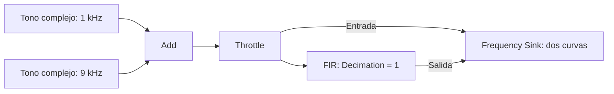

# Práctica complementaria — Filtros FIR en Python y GNU Radio

- Esta práctica conserva los experimentos de filtrado de la sesión 3.
- La construcción gradual del [Laboratorio #3 — Enlace digital de mensajes](laboratorio-enlace-digital.md) tiene su propia guía.

## Objetivos

- Comprobar una convolución FIR con cálculos y código.
- Relacionar los taps con la respuesta al impulso y la respuesta en frecuencia.
- Comparar un moving average y un low-pass preparado, manteniendo fijo el sampling rate.
- Identificar la entrada y la salida complejas de un FIR en GNU Radio.

## Preparación y materiales

- [Sesión 3 — Sistemas y filtros digitales](index.md), con las celdas ejecutadas en orden en un notebook de Google Colab.
- GNU Radio Companion instalado según la [guía del curso](../../setup/instalacion.md). El flowgraph se verifica con GNU Radio 3.10.12.
- [Descargar el flowgraph `filtros_sesion03.grc`](filtros_sesion03.grc). El archivo también se encuentra localmente en `docs/sessions/03-sistemas-filtros-digitales/`.
- No se necesita RTL-SDR, USRP, archivo `.cu8` ni conexión con un transmisor. Los tonos se generan en software.
- En Colab se utiliza Python para analizar bloques finitos. GNU Radio Companion se ejecuta en la computadora del estudiante, no dentro de Colab.

!!! info "Distribución sugerida de las 2 h"

    - Parte A: 25 min.
    - Parte B: 30 min.
    - Parte C: 45 min.
    - Entrega y discusión: 20 min.

## Parte A — Una convolución que se puede comprobar a mano

- Se utilizan $x=[3,6,3]$ y $h=[1/3,1/3,1/3]$, con entrada nula antes y después del bloque.
- Primero se resuelve el ejercicio 3 de la clase mediante $y[n]=\sum h[k]x[n-k]$.
- Después se compara la salida completa de `np.convolve` con la salida de `lfilter` para una entrada de tres muestras y para una entrada prolongada con ceros.

```python
import numpy as np
import matplotlib.pyplot as plt
from scipy import signal

x = np.array([3, 6, 3], dtype=float)
h = np.ones(3) / 3
y_completa = np.convolve(x, h, mode="full")
y_stream = signal.lfilter(h, [1.0], x)
y_con_cola = signal.lfilter(h, [1.0], np.concatenate([x, np.zeros(len(h) - 1)]))
print("Convolución completa:", y_completa)
print("Solo tres entradas a lfilter:", y_stream)
print("Entrada prolongada con dos ceros:", y_con_cola)
```

### Comprobación de la parte A

- ¿Por qué una función devuelve cinco valores y la otra solo tres?
- ¿Qué muestras anteriores aportan a $y[3]$ y $y[4]$?
- ¿Se adquirió una muestra nueva al añadir los ceros para observar la cola?

??? example "Resultados y explicación"

    - La convolución completa devuelve $[1,3,4,3,1]$, porque su longitud es $N+L-1=5$.
    - `lfilter` devuelve $[1,3,4]$ cuando solo recibe tres muestras: entrega una salida por cada entrada proporcionada, sin añadir automáticamente una cola.
    - Con dos ceros adicionales, también se obtienen las últimas salidas: $y[3]=(0+3+6)/3=3$ y $y[4]=(0+0+3)/3=1$.
    - Los ceros prolongan la entrada de este experimento finito y permiten vaciar la memoria. No son muestras medidas por un ADC.
    - No se ha cambiado la separación temporal de las muestras; esta diferencia de longitud no es una decimación ni una modificación del sampling rate.

## Parte B — Predecir antes de observar

- Se comparan los mismos tonos de la sección 3 de la clase: tonos complejos de 1 y 9 kHz, amplitudes 1 y 0.6, y $f_s=24000$ S/s.
- Se conservan el mismo bloque estable de 4800 muestras y el mismo descarte inicial para ambos filtros. Se comparan únicamente los taps.
- Antes de mirar los espectros, se calculan las amplitudes esperadas con $A_{\mathrm{salida}}=A_{\mathrm{entrada}}|H(f)|$.
- Para la tabla, basta con ejecutar la celda siguiente después de la parte A: utiliza sus imports, pero no depende de las variables de la clase.
- Para la comparación visual, se reutilizan las figuras 4 y 5 de la clase o los plots que ya se obtuvieron con sus celdas. No es necesario repetir todo el notebook.

```python
fs = 24000
N = 4800
descarte = 256
n = np.arange(N + descarte)
x = np.exp(1j * 2 * np.pi * 1000 * n / fs) + 0.6 * np.exp(1j * 2 * np.pi * 9000 * n / fs)
frecuencias = np.array([1000, 9000])
amplitudes = np.array([1.0, 0.6])
f_fft = np.fft.fftshift(np.fft.fftfreq(N, 1 / fs))
indices = [np.argmin(np.abs(f_fft - f0)) for f0 in frecuencias]

for nombre, h in [("Moving average", np.ones(3) / 3), ("Low-pass", signal.firwin(65, 3000, fs=fs))]:
    _, H = signal.freqz(h, worN=frecuencias, fs=fs)
    prediccion = amplitudes * np.abs(H)
    y = signal.lfilter(h, [1.0], x)[descarte:]
    Y = np.abs(np.fft.fftshift(np.fft.fft(y)) / N)
    print(nombre)
    for f0, prevista, medida in zip(frecuencias, prediccion, Y[indices]):
        print(f"  {f0:5d} Hz: prevista={prevista:.8f}, medida={medida:.8f}")
```

### Comprobación de la parte B

- ¿Coinciden las amplitudes previstas y medidas, dentro del redondeo?
- ¿Qué filtro atenúa más el tono de 9 kHz? ¿Lo lleva a otra frecuencia?
- ¿Por qué el low-pass puede producir una amplitud ligeramente mayor que 1 a 1 kHz?

??? example "Resultados y explicación"

    - Con el moving average, se esperan aproximadamente 0.97728388 a 1 kHz y 0.08284271 a 9 kHz.
    - Con el low-pass preparado, se esperan aproximadamente 1.00266084 y 0.00023229, respectivamente.
    - Las medidas coinciden porque se analiza el régimen estable y ambos tonos coinciden con bins de la FFT; la normalización por $N$ recupera sus amplitudes complejas.
    - El low-pass atenúa mucho más el segundo tono. No lo desplaza: el factor temporal $e^{j2\pi fn/f_s}$ sigue teniendo la misma frecuencia, como se dedujo en la sección 3.1.
    - La normalización de `firwin` fija la ganancia en DC, no exactamente en todas las frecuencias de su banda. En este ejemplo, $|H(1\text{ kHz})|\approx1.00266$.
    - Una amplitud tan pequeña a 9 kHz puede no distinguirse en una gráfica lineal; la tabla evita interpretar esa limitación visual como un cero exacto.

## Parte C — Los mismos filtros en GNU Radio

### C.1. Reconocer el flowgraph

- **Qué debe seguirse:** el punto donde el mismo stream se divide para comparar entrada y salida. Todas las conexiones llevan muestras complejas a 24 kS/s.


**Figura 1.** El mismo stream se observa antes y después del FIR, conservando el sampling rate.

- **Izquierda — Generación:** dos fuentes producen los tonos conocidos y Add los suma. No interviene una antena ni un archivo.
- **Centro — Bifurcación:** después de Throttle, una rama llega directamente al visor y otra atraviesa el FIR. La rama directa es la referencia para evaluar el cambio.
- **Derecha — Comparación:** el visor recibe dos streams distintos: entrada y salida del filtro. Ambos tienen el mismo sampling rate y las mismas frecuencias de tono.
- **Qué cambia al elegir otro filtro:** solo los taps de la caja FIR. No se modifican las fuentes, el ritmo ni el eje del visor.

- Se abre el archivo descargado en GNU Radio Companion. No se modifica el flowgraph intencionalmente defectuoso `test.grc` de otro laboratorio.
- Los dos bloques **Signal Source** entregan muestras complejas, uno a 1 kHz y otro a 9 kHz. La selección `Cosine` con salida `Complex` genera el tono complejo, no solo un coseno real.
- **Add** suma las dos entradas complejas, ambas con el mismo sampling rate.
- **Throttle** limita la velocidad de ejecución del stream generado en software. No es un filtro ni cambia los valores; evita que el flowgraph intente ejecutarse a toda la velocidad del procesador.
- La salida de Throttle se bifurca: una rama permite observar la entrada y la otra pasa por el FIR.
- **Decimating FIR Filter** se utiliza con `Decimation = 1`. Aunque el nombre del bloque incluya “Decimating”, en esta configuración **no reduce la tasa**.
- El tipo del FIR es `Complex → Complex (Real Taps)`, correspondiente a `ccf`: entrada compleja, salida compleja y coeficientes reales.
- **QT GUI Frequency Sink** recibe ambas ramas: `Entrada` en azul y `Salida` en rojo. El eje está centrado en 0 Hz y tiene `Bandwidth = samp_rate`.

### C.2. Parámetros que se conservan

| Elemento | Valor | Interpretación |
|---|---|---|
| `samp_rate` | `24000` | 24 000 muestras complejas por segundo. |
| Tono útil | 1000 Hz, amplitud 1 | Componente que se desea conservar. |
| Tono no deseado | 9000 Hz, amplitud 0.6 | Componente que se desea atenuar. |
| FIR `Decimation` | `1` | Una salida por muestra de entrada. |
| Visor `Center Frequency` | `0` | Se muestran frecuencias baseband, no RF. |
| Visor `Bandwidth` | `samp_rate` | Eje de aproximadamente −12 a +12 kHz. |
| Visor `FFT Size` | `2048` | Separación entre bins: $24000/2048=11.71875$ Hz. |

- Solo se cambiará la variable `modo_filtro`: `0` selecciona el moving average; `1` selecciona el low-pass preparado.
- La variable `taps` contiene la misma elección de coeficientes utilizada en Python. No es necesario copiar 65 números a mano.
- No se modifica `samp_rate`, la frecuencia de los tonos ni la decimación durante esta comparación.

### C.3. Experimento 1 — Moving average

- Se deja `modo_filtro = 0` y se ejecuta el flowgraph.
- Se identifican los dos picos de entrada, próximos a +1 y +9 kHz.
- Se compara la curva roja con la azul **en cada frecuencia**, no la altura del tono de 1 kHz con la del tono de 9 kHz.
- **Qué debe notarse:** a 1 kHz las curvas casi se superponen; a 9 kHz la salida queda más abajo, pero conserva un pico.
- Se guarda una captura donde se distingan la leyenda y el eje horizontal.

### C.4. Experimento 2 — Low-pass preparado

- Se detiene la ejecución, se cambia `modo_filtro` a `1` en el bloque Variable y se vuelve a ejecutar. No hay un selector interactivo en la ventana del visor.
- Se mantiene la misma escala del visor para poder comparar con el experimento anterior.
- **Qué debe notarse:** el tono de 1 kHz permanece casi sin cambio y el de 9 kHz queda mucho más atenuado.
- Se guarda una segunda captura y se contrasta la observación con la predicción de la parte B.
- La caída no implica que se haya reducido el sampling rate ni que el tono se haya desplazado a 0 Hz.

### C.5. Cómo leer los niveles del visor

- Las figuras de la clase muestran magnitud lineal de una FFT normalizada. El visor de GNU Radio utiliza una escala de nivel en **dB**; no deben igualarse directamente los números de sus ejes verticales.
- Para una misma frecuencia y con la misma configuración del visor, la diferencia de niveles entre salida y entrada se relaciona con la ganancia de amplitud:

$$
\Delta_{\mathrm{dB}}=20\log_{10}|H(f)|.
$$

- Una ganancia de amplitud 1 corresponde a 0 dB de diferencia; una de 0.1 corresponde a −20 dB. El signo negativo indica una salida de menor nivel.
- Para el moving average, las diferencias previstas son aproximadamente −0.20 dB a 1 kHz y −17.20 dB a 9 kHz.
- Para el low-pass, son aproximadamente +0.023 dB a 1 kHz y −68.24 dB a 9 kHz.
- Estas cifras son referencias, no una exigencia de lectura exacta del cursor. La FFT del visor no coincide con la de Colab: tiene 2048 puntos, usa ventana Blackman–Harris y los tonos no coinciden exactamente con sus bins.
- El windowing reduce leakage, pero no convierte el visor en una medida exacta de potencia RF. Si el tono atenuado queda oculto por otros componentes o por el rango mostrado, se utiliza la comprobación numérica de la parte B.

### Comprobación de la parte C

- ¿Por qué el FIR se configura como complejo a complejo, aunque sus taps sean reales?
- ¿Qué valor de `Decimation` confirma que la tasa se conserva?
- ¿Por qué el eje no se estrecha a ±3 kHz al seleccionar el low-pass?

??? example "Resultados y explicación"

    - La entrada representa I/Q. Con taps reales, la ecuación FIR filtra por separado I y Q y conserva $I_y+jQ_y$; no produce automáticamente una salida real.
    - `Decimation = 1` indica que no se selecciona una de cada varias salidas. El sampling rate continúa siendo 24 kS/s.
    - El eje del visor está determinado por el sampling rate indicado en `Bandwidth`, no por el cutoff del filtro.
    - El cutoff de 3 kHz modifica la respuesta en frecuencia, pero no cambia `samp_rate`. Sigue existiendo un intervalo de representación baseband de $[-12,12)$ kHz.
    - A ±3 kHz la respuesta de este `firwin` tiene aproximadamente media amplitud. No es un borde donde todo se conserva hasta un lado y se anula exactamente al otro.

## Entrega

- Cálculo detallado de las cinco muestras de la parte A y salida de la celda que lo verifica.
- Tabla de amplitudes previstas y medidas de la parte B.
- Dos capturas del visor: `modo_filtro = 0` y `modo_filtro = 1`, con leyenda y ejes visibles.
- Una explicación en viñetas: qué se cambió, qué se mantuvo fijo y cómo se relaciona cada resultado con $A_{\mathrm{salida}}=A_{\mathrm{entrada}}|H(f)|$.
- Una conclusión breve que distinga **filtrado, desplazamiento de frecuencia y cambio de sampling rate**.

## Referencias de implementación

- [GNU Radio 3.10.12 — definición del bloque FIR](https://github.com/gnuradio/gnuradio/blob/v3.10.12.0/gr-filter/grc/filter_fir_filter_xxx.block.yml): tipos de entrada/salida, taps y decimación.
- [GNU Radio 3.10.12 — Signal Source](https://github.com/gnuradio/gnuradio/blob/v3.10.12.0/gr-analog/lib/sig_source_impl.cc): generación del tono con salida compleja.
- [GNU Radio 3.10.12 — Throttle](https://github.com/gnuradio/gnuradio/blob/v3.10.12.0/gr-blocks/lib/throttle_impl.cc): control del ritmo de ejecución sin transformación de los valores.
- [GNU Radio 3.10.12 — Frequency Sink](https://github.com/gnuradio/gnuradio/blob/v3.10.12.0/gr-qtgui/lib/freq_sink_c_impl.cc): FFT, ventana y presentación de niveles.
- [SciPy — `firwin`](https://docs.scipy.org/doc/scipy/reference/generated/scipy.signal.firwin.html), [SciPy — `freqz`](https://docs.scipy.org/doc/scipy/reference/generated/scipy.signal.freqz.html) y [SciPy — `lfilter`](https://docs.scipy.org/doc/scipy/reference/generated/scipy.signal.lfilter.html).
