# Clase 4 — Recepción FM y decodificación RDS en GNU Radio

## Objetivos

Al completar la clase, el estudiante puede:

- Interpretar los bytes intercalados de una captura `.cu8` y convertirlos a `complex64`.
- Instalar y reutilizar los bloques Python de `gr-cbs33m` desde GRC.
- Centrar una emisora, filtrar su canal y justificar las tasas después de cada etapa.
- Recuperar audio FM mono y explicar qué bloque regula su reproducción.
- Recuperar grupos RDS y distinguir chips, bits, PDUs y campos interpretados.

El montaje completo de referencia está en [fm.grc](https://github.com/ollerenac-uni/sdr/blob/main/gnuradio/flowgraphs/fm.grc).
La sección 20 incluye una comprobación sin GUI para la captura oficial.

## Identificar las instancias

El estudiante conserva estos IDs en su montaje. El nombre visible identifica el tipo de bloque; el ID distingue cada instancia.

| Nombre en GRC | ID | Uso |
|---|---|---|
| `File Source` | `fuente_captura` | Leer la captura. |
| `Conversor de .cu8 a .c64` | `conversor_iq` | Reunir y normalizar I/Q. |
| `Throttle` | `ritmo_visores` | Regular la observación inicial; queda en Bypass con audio. |
| `Rotador de frecuencias` | `centrar_emisora`, `centrar_rds` | Centrar la emisora o la subportadora RDS. |
| `Decimating FIR Filter` | `filtro_canal`, `filtro_audio`, `filtro_rds` | Seleccionar las tres bandas. |
| `Multiply Const` | `volumen`, `ganancia_rds` | Ajustar audio o amplitud de RDS. |
| `Message Debug` | `grupos_rds`, `campos_rds` | Observar grupos del Decoder o campos del Parser. |

Las conexiones de stream utilizan el puerto `0` cuando el bloque tiene una sola entrada o salida.
`Float To Complex` identifica sus entradas como `re` e `im`. Los puertos de mensajes conservan los nombres `in`, `out` y `print`.

??? note "Propósito y punto de partida"

    - En el laboratorio de mensajes (#3) el estudiante construyó una señal desde sus bits y recuperó el texto en el receptor.
    - Ahora el estudiante empieza desde el otro extremo: **una captura de radio que ya contiene muestras I/Q**.
    - Antes de seleccionar una emisora y demodular FM, el estudiante necesita leer esos datos con el tipo de dato correcto y comprobar qué señal representan.
    - Antes de programar el conversor, el estudiante utiliza `gr-cbs33m`, la biblioteca que reunirá los bloques del curso Python reutilizables.
    - El archivo de trabajo de GRC será `gnuradio/flowgraphs/fm.grc`.

??? note "1. Intro: capturas FM y formato `.cu8`"

    ### 1.1. Reconocer las capturas y sus tasas

    - Las capturas se encuentran en `gnuradio/samples/`, dentro del repositorio.
    - Las grabaciones están excluidas de Git y se distribuyen por Google Drive, como indica la [preparación del curso](../../setup/index.md). Un `git pull` no las descarga ni mueve las copias anteriores.
    - Antes de ejecutar, el estudiante coloca la captura en `gnuradio/samples/`. Si conserva una copia en `samples/`, la mueve a la carpeta nueva.
    - Desde `gnuradio/flowgraphs/fm.grc`, `File Source` utiliza la ruta relativa `../samples/fm_99p1MHz_2p4Msps_g30.cu8`.

    | Archivo | Frecuencia central de captura | Tasa de muestras complejas |
    |---|---|---|
    | `fm_99p1MHz_1p2Msps_g30.cu8` | 99.1 MHz | 1.2 millones/s |
    | `fm_99p1MHz_2p048Msps_g30.cu8` | 99.1 MHz | 2.048 millones/s |
    | `fm_99p1MHz_2p4Msps_g30.cu8` | 99.1 MHz | 2.4 millones/s |

    - El nombre conserva las condiciones de captura: `99p1MHz` representa 99.1 MHz y `2p4Msps` representa 2.4 millones de muestras complejas por segundo.
    - El sufijo `g30` identifica el ajuste de ganancia utilizado al nombrar estas grabaciones; no determina cómo se interpretan sus bytes.
    - Se utiliza **`fm_99p1MHz_2p4Msps_g30.cu8`**. Una captura centrada en 99.1 MHz puede incluir varias señales dentro de su banda; el estudiante no debe suponer que todo el archivo contiene únicamente la emisora situada en el centro.

    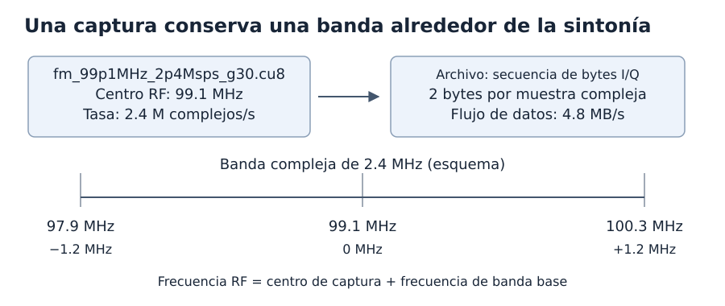
    **Figura 1.** Frecuencia central, tasa de muestras y cantidad de bytes describen aspectos diferentes de la captura.

    Con $f_s=2.4\times10^6$ muestras complejas/s, la banda base compleja abarca nominalmente $-f_s/2$ a $+f_s/2$: de −1.2 a +1.2 MHz. La frecuencia RF se obtiene mediante:

    $$
    f_{\mathrm{RF}}=99.1\ \mathrm{MHz}+f_{\mathrm{baseband}}.
    $$

    Los extremos nominales corresponden a 97.9 y 100.3 MHz; la respuesta real del receptor puede atenuar los bordes. El archivo crudo no incluye necesariamente una cabecera que configure estas tasas automáticamente: el estudiante debe introducirlas en el flowgraph.

    ### 1.2. Interpretar los bytes I/Q

    En estas capturas, `.cu8` identifica **componentes complejas almacenadas como enteros sin signo de ocho bits**. Cada muestra ocupa dos bytes intercalados:

    ```text
    Posición del byte:  0    1    2    3    4    5   ...
    Contenido:         I₀   Q₀   I₁   Q₁   I₂   Q₂  ...
    ```

    Cada byte contiene un número entre 0 y 255, no ocho elementos binarios separados. El primer byte del par representa I y el segundo Q; juntos describen una sola muestra del mismo instante.

    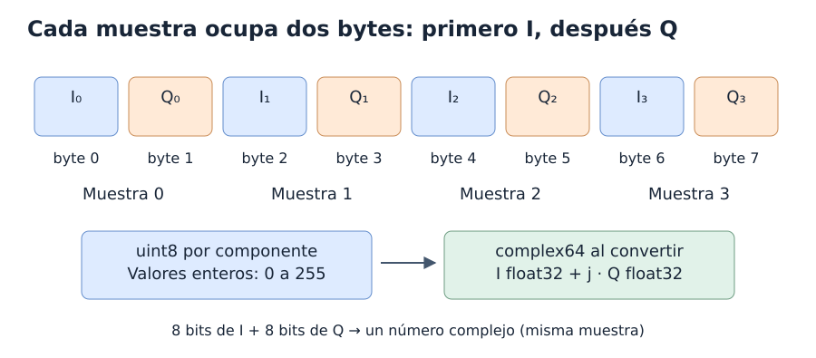
    **Figura 2.** La conversión debe conservar las parejas y su orden temporal.

    El flujo de lectura tiene el doble de elementos que el flujo de muestras complejas.
    El símbolo $R_{\mathrm{Byte}}$ representa la tasa de elementos Byte por segundo:

    $$
    \begin{aligned}
    R_{\mathrm{Byte}}&=2f_s,\\
    &=4.8\times10^6\ \text{bytes/s}.
    \end{aligned}
    $$

    Un segundo de captura ocupa 4.8 MB decimales, sin contar un posible contenedor externo. Leer estos bytes directamente como complejos de punto flotante cambiaría su interpretación y agruparía incorrectamente los datos.

??? note "2. GNU Radio: construir el flowgraph poco a poco"

    - Los estudiantes ya conocen `Options`, variables, conexiones y visores por el laboratorio de mensajes. Aquí el estudiante se concentra en qué tipo de dato pasa por cada conexión y quién fija su ritmo.

    ### 2.1. Leer el archivo con `File Source`

    1. Crear un flowgraph y guardarlo como `gnuradio/flowgraphs/fm.grc`.
    2. Configurar `Options`: `ID = fm`, lenguaje `Python` y `Generate Options = QT GUI`.
    3. Crear la variable `samp_rate = 2.4e6`: contará **muestras complejas por segundo**.
    4. Añadir `File Source`, seleccionar la captura de 2.4 Msps y aplicar esta configuración.

    | Campo | Valor | Interpretación |
    |---|---|---|
    | `Output Type` | `Byte` | Un elemento por byte del archivo. |
    | `Vector Length` | `1` | Elementos escalares. |
    | `File` | `../samples/fm_99p1MHz_2p4Msps_g30.cu8` | Ruta relativa desde `gnuradio/flowgraphs/`. |
    | `Repeat` | `Yes` | Volver al comienzo al terminar la captura. |
    | `Offset` | `0` | Leer desde el comienzo. |
    | `Length` | `0` | Leer el archivo completo. |

    - Dejar sin etiqueta inicial si aparece esa opción. En este momento **no conectar la salida Byte directamente a los visores Complex**: falta construir el conversor. Repetir el archivo facilita observarlo, aunque la unión entre su final y su inicio puede crear una discontinuidad que no pertenece a la recepción original.

    ### 2.2. Regular el ritmo con `Throttle`

    - Un archivo no impone el ritmo de un dispositivo SDR: el programa puede leerlo tan rápido como permitan el procesador y los buffers. `Throttle` limita aproximadamente la cantidad de **elementos de su propio puerto** procesados por segundo.

    - El montaje utiliza esta organización cuando el conversor esté listo:

    ```text
    File Source → Conversor de .cu8 a .c64 → Throttle → Visores
    ```

    - Configurar un solo `Throttle` con `Type = Complex`, `Vector Length = 1` y `Sample Rate = samp_rate`.

    - Este control se utiliza durante la observación con visores. Al añadir `Audio Sink` en la sección 13, el estudiante retira o puentea `Throttle`: el dispositivo de audio regulará el ritmo.

    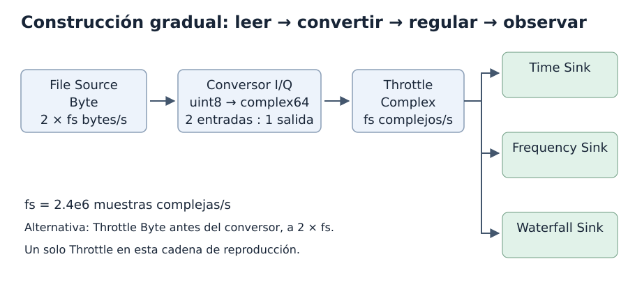
    **Figura 3.** Después del conversor, el ritmo de elementos complejos coincide con `samp_rate`.

    - También es válido poner `Throttle` antes del conversor, pero entonces debe ser `Byte` y su tasa debe ser **`2*samp_rate`**. En el montaje inicial mostrado en clase, usar `samp_rate` antes del conversor reproducía los datos a la mitad del ritmo original. El `Sample Rate` de un visor etiqueta sus ejes; no corrige ese ritmo de ejecución.

    !!! note "Dos significados de tasa que no deben confundirse"

        La conversión consume dos elementos Byte por cada elemento Complex; no reduce la tasa física de muestras de 2.4 a 1.2 Msps. La muestra I/Q continúa representando el mismo instante. Lo que cambia es su representación y la unidad que cuenta cada puerto.

??? note "3. Crear el módulo OOT antes de implementar el conversor"

    ### 3.1. Dos piezas para cada bloque propio

    El estudiante desarrolla el conversor y el rotador como bloques de **`gr-cbs33m`**, un módulo OOT (*Out-of-Tree*): un paquete propio que se instala junto a GNU Radio. Sus bloques aparecerán en la categoría **CBS33M** del panel derecho de GRC y podrán reutilizarse en distintos flowgraphs.

    | Archivo | Responsabilidad |
    |---|---|
    | Python, `.py` | Implementar el bloque: inicialización, puertos, relación entre elementos, estado y procesamiento en `work`. |
    | Descripción de GRC, `.block.yml` | Indicar su nombre y categoría, presentar parámetros y puertos y definir cómo crear la instancia Python. |

    El archivo `.grc` guardará las conexiones y los parámetros de las instancias. El procesamiento de los bloques del curso se mantendrá en archivos Python del módulo. El estudiante puede editar esos archivos directamente con nombres permanentes y compartir una misma implementación entre montajes.

    El repositorio ya incluye los dos bloques completos. El estudiante recorre su implementación y comprueba los archivos existentes; no necesita generar otra biblioteca.
    Los comandos de creación permiten reconstruir la plantilla si el módulo todavía no existe.
    El `CMakeLists.txt` publicado instala únicamente Python y YAML; no necesita compilar una biblioteca C++.
    Si se crea otra plantilla con `gr_modtool`, se conserva la configuración de instalación del módulo del curso.

    Un `Embedded Python Block` sigue otro mecanismo: almacena el código dentro del `.grc` y `Open in Editor` abre una copia temporal. «Guardar como» con otro nombre no vincula ese bloque al archivo nuevo. En este recorrido trabajaremos directamente con los archivos del módulo OOT. La [documentación de GNU Radio](https://wiki.gnuradio.org/index.php/Embedded_Python_Block) explica ambos mecanismos.

    ### 3.2. Crear una sola vez el módulo del curso

    Usar **el entorno Radioconda**, el mismo que proporciona GRC. El `.venv` de MkDocs sirve para construir esta web. En Linux, si Radioconda no está activo, ejecutar `source ~/radioconda/bin/activate`.

    Desde la raíz del repositorio, crear el módulo dentro de `gnuradio/`:

    ```bash
    cd gnuradio
    gr_modtool newmod --scm-mode no cbs33m
    cd gr-cbs33m
    ```

    `--scm-mode no` deja el control de versiones en manos del repositorio del curso. **Crear el módulo una sola vez**. Si ya existe `gnuradio/gr-cbs33m`, entrar en él y continuar con los archivos existentes.

    La organización inicial será:

    ```text
    gnuradio/
    ├── flowgraphs/fm.grc
    ├── samples/fm_99p1MHz_2p4Msps_g30.cu8
    └── gr-cbs33m/
        ├── CMakeLists.txt
        ├── python/cbs33m/
        │   ├── CMakeLists.txt
        │   └── __init__.py
        └── grc/CMakeLists.txt
    ```

    La plantilla incluye otros directorios auxiliares. Primero se añade únicamente el conversor; el rotador se incorpora a este mismo módulo en la sección 7.

    ### 3.3. Generar los archivos del conversor

    Desde `gnuradio/gr-cbs33m`, ejecutar:

    ```bash
    gr_modtool add --scm-mode no -l python -t decimator \
      --argument-list 'escala=127.5' cu8_a_c64
    ```

    `-l python` elige el lenguaje y `-t decimator` expresa la relación entre elementos: el bloque consume dos bytes por cada complejo de salida. El valor concreto `decim=2` se escribe en el inicializador Python.

    `--argument-list` especifica los argumentos del constructor. El asistente puede preguntar el autor en `copyright holder` y si se desean archivos de prueba. El nombre del autor no es un argumento del bloque. Si el archivo ya fue generado, editarlo sin repetir `gr_modtool add`.

    Los archivos de trabajo serán:

    | Archivo, relativo a `gnuradio/gr-cbs33m` | Contenido |
    |---|---|
    | `python/cbs33m/cu8_a_c64.py` | Clase `cu8_a_c64` y procesamiento de conversión. |
    | `grc/cbs33m_cu8_a_c64.block.yml` | Interfaz del conversor en GRC. |
    | `python/cbs33m/__init__.py` | Importación que hace accesible la clase desde el paquete. |

    Abrir la carpeta `gr-cbs33m` en el editor y seleccionar esos archivos desde su explorador. Para abrir un archivo individual, usar **Abrir archivo**, normalmente `Ctrl+O`; **Open Folder** selecciona carpetas. En esta etapa el estudiante no utiliza `Open in Editor` de un bloque integrado.

    ### 3.4. Leer la estructura Python del bloque

    La estructura siguiente ilustra la clase; el código ejecutable completo viene en la sección 4:

    ```python
    import numpy as np
    from gnuradio import gr


    class cu8_a_c64(gr.decim_block):
        def __init__(self, escala=127.5):
            # Aquí se inicializa el bloque y se guarda su configuración.
            pass
    ```

    `class`, `def`, la herencia, el valor predeterminado `127.5` y el método especial `__init__` son parte de Python. `gr` aporta las clases de GNU Radio y `np` los tipos y operaciones de NumPy. `self` se refiere a la instancia actual.

    - `__init__` se ejecuta al crear la instancia y prepara su configuración.
    - `work` se ejecuta repetidamente para procesar porciones del stream.
    - Un parámetro como `escala` es configuración; las muestras llegan a `work` por los puertos.

    El inicializador `gr.decim_block.__init__` definirá una entrada `np.uint8`, una salida `np.complex64` y `decim=2`. `np.complex64` ocupa 64 bits en total: dos componentes flotantes de 32 bits. La relación 2:1 cuenta elementos de puertos con representaciones diferentes; no descarta parejas I/Q de la captura.

    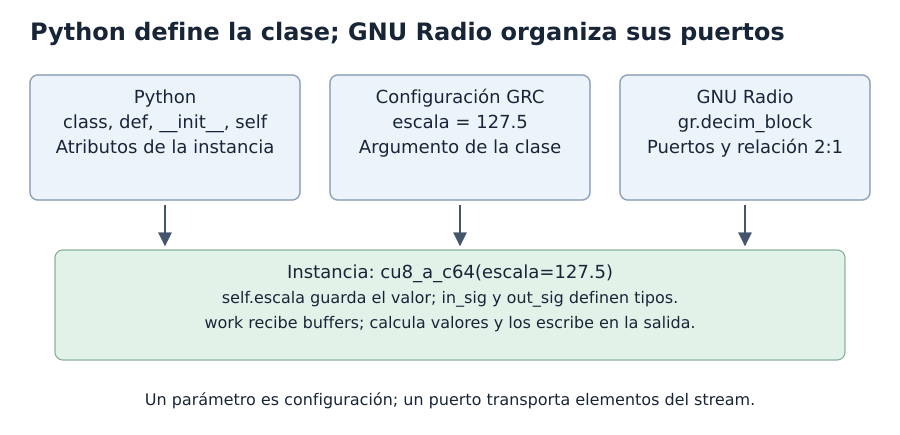
    **Figura 4.** Python define la clase; el YAML presenta los parámetros en GRC.

    - El panel superior separa lenguaje, configuración y puertos.
    - El panel inferior relaciona la instancia con las llamadas repetidas a `work`.

    <iframe src="../animaciones/python-bloque.html" title="Python, parámetros y puertos de un bloque OOT" width="100%" height="950" style="border: 0;" loading="lazy"></iframe>
    **Figura 5.** Creación de una instancia y preparación de sus puertos.

    El estudiante avanza hasta `work` y distingue la configuración inicial de los lotes de muestras.

    [Abrir la animación en una ventana propia](animaciones/python-bloque.html).

    ### 3.5. Relacionar el constructor con la interfaz de GRC

    Guardar `self.escala = float(escala)` permite utilizar el parámetro en `work`. El YAML debe declarar un parámetro de igual significado y una expresión que lo entregue al constructor. El programa generado utilizará una llamada equivalente a:

    ```python
    from gnuradio import cbs33m
    conversor = cbs33m.cu8_a_c64(escala=127.5)
    ```

    En el YAML, `category: '[CBS33M]'` determina la categoría del panel; `label` establece el nombre visible, `templates.imports` importa el módulo y `templates.make` construye el objeto. Los puertos declarados deben coincidir con Python. La [referencia YAML de GRC](https://wiki.gnuradio.org/index.php?title=YAML_GRC) describe estos campos.

    `gr_modtool` genera una **plantilla**, con marcadores como `<+numpy.float32+>` y procesamiento de ejemplo.
    La sección 4 explica el código completo de Python y YAML. Después, el estudiante instala el módulo y utiliza su primer bloque en el flowgraph.

??? note "4. Implementar e instalar el conversor de `.cu8` a `.c64`"

    ### 4.1. Escribir el código del conversor

    Abrir `gnuradio/gr-cbs33m/python/cbs33m/cu8_a_c64.py` y sustituir el código de ejemplo por:

    ```python
    import numpy as np
    from gnuradio import gr


    class cu8_a_c64(gr.decim_block):
        """Convierte bytes I/Q intercalados a complejos normalizados."""

        def __init__(self, escala=127.5):
            gr.decim_block.__init__(
                self,
                name='Conversor de .cu8 a .c64',
                in_sig=[np.uint8],
                out_sig=[np.complex64],
                decim=2
            )
            self.escala = float(escala)
            if not np.isfinite(self.escala) or self.escala <= 0:
                raise ValueError('escala debe ser un número positivo y finito')

        def work(self, input_items, output_items):
            n = len(output_items[0])
            datos = input_items[0][:2*n]

            i = datos[0::2].astype(np.float32)
            q = datos[1::2].astype(np.float32)

            i = (i - self.escala) / self.escala
            q = (q - self.escala) / self.escala

            output_items[0][:n] = i + 1j*q
            return n
    ```

    El bloque consume `I₀, Q₀, I₁, Q₁, …`, dos bytes por complejo de salida. Separa I y Q, convierte a flotantes antes de restar y, con **`escala=127.5`**, centra y normaliza cada componente mediante `(valor - 127.5)/127.5`. Finalmente entrega `I + 1j*Q` sin descartar parejas I/Q. Mantener ese valor de `escala` durante la práctica.

    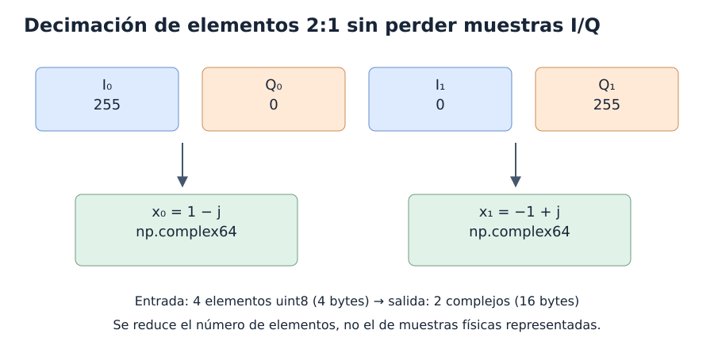
    **Figura 6.** La relación 2:1 cambia la representación sin descartar parejas I/Q.

    - La entrada contiene cuatro elementos de un byte.
    - La salida contiene dos elementos complejos de ocho bytes cada uno.

    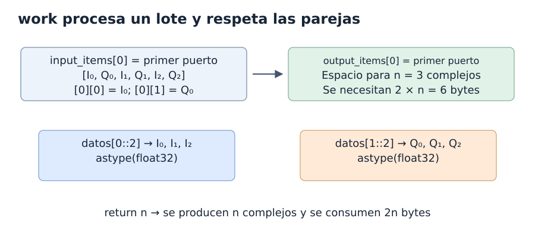
    **Figura 7.** `work` recibe capacidad de salida y procesa el doble de elementos Byte.

    El estudiante sigue cada pareja desde `input_items[0]` hasta una posición de `output_items[0]`.
    `len(output_items[0])` consulta la capacidad disponible; esa línea no reserva memoria.

    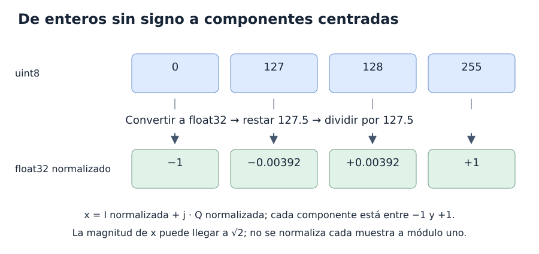
    **Figura 8.** La conversión a flotante precede a la resta y a la división.

    - La fila superior contiene enteros sin signo.
    - La fila inferior contiene los valores normalizados.
    - Los valores 127 y 128 quedan a ambos lados de cero; ningún entero representa exactamente 127.5.

    <iframe src="../animaciones/conversion-cu8.html" title="Conversión de bytes I/Q a complejos normalizados" width="100%" height="950" style="border: 0;" loading="lazy"></iframe>
    **Figura 9.** Conversión de cuatro bytes a dos muestras complejas.

    El estudiante sigue la separación de I y Q y comprueba los resultados `1-1j` y `-1+1j`.

    [Abrir la animación en una ventana propia](animaciones/conversion-cu8.html).

    ### 4.2. Definir el conversor en GRC

    Abrir `gnuradio/gr-cbs33m/grc/cbs33m_cu8_a_c64.block.yml` y sustituir su plantilla por:

    ```yaml
    id: cbs33m_cu8_a_c64
    label: Conversor de .cu8 a .c64
    category: '[CBS33M]'
    flags: [python]

    parameters:
    - id: escala
      label: Escala
      dtype: real
      default: '127.5'

    inputs:
    - domain: stream
      dtype: byte

    outputs:
    - domain: stream
      dtype: complex

    templates:
      imports: from gnuradio import cbs33m
      make: cbs33m.cu8_a_c64(${escala})

    file_format: 1
    ```

    La entrada Byte corresponde a `np.uint8` y la salida Complex a `np.complex64`. La relación de consumo 2:1 sigue definida en Python por `decim=2`.

    ### 4.3. Exportar el primer bloque del paquete

    Comprobar que `python/cbs33m/__init__.py` contenga esta línea, sin duplicarla si el asistente ya la añadió:

    ```python
    from .cu8_a_c64 import cu8_a_c64
    ```

    En esta etapa se estudia la exportación del conversor. El paquete publicado ya exporta también el rotador, cuya implementación se explica en la sección 7.
    Comprobar que `python/cbs33m/CMakeLists.txt` incluya `cu8_a_c64.py` y que `grc/CMakeLists.txt` incluya `cbs33m_cu8_a_c64.block.yml`.
    Las listas publicadas ya contienen los dos bloques. No se debe eliminar una importación ni un archivo al seguir la explicación por etapas.

    ### 4.4. Instalar el módulo en Radioconda

    La instalación debe resolver dos búsquedas: **Python debe encontrar el código y GRC debe encontrar el YAML**. Los comandos siguientes se ejecutan en una terminal Linux con Radioconda activo, desde `gnuradio/gr-cbs33m`.

    Comprobar las herramientas:

    ```bash
    python -c "import sys; from gnuradio import gr; print(sys.executable); print(gr.version())"
    cmake --version
    ```

    El Python mostrado debe pertenecer a Radioconda. CMake puede proceder del sistema o del entorno; esta instalación se comprobó con CMake 3.22.1. Si falta, se puede instalar CMake 3.x:

    ```bash
    conda install --freeze-installed -c conda-forge 'cmake>=3.16,<4'
    ```

    Antes de instalar, comprobar la sintaxis y completar cualquier marcador pendiente en los archivos Python incluidos en el módulo:

    ```bash
    python -m compileall python/cbs33m
    ```

    Si ya se había generado una plantilla del rotador antes de seguir esta secuencia, completarla con la sección 7 antes de instalar: Python carga también las importaciones declaradas en `__init__.py`.

    Configurar, construir e instalar usando el prefijo del entorno activo:

    ```bash
    cmake -S . -B build \
      -DCMAKE_INSTALL_PREFIX="$CONDA_PREFIX" \
      -DPython3_EXECUTABLE="$CONDA_PREFIX/bin/python"
    cmake --build build
    ctest --test-dir build --output-on-failure
    cmake --install build
    ```

    `CONDA_PREFIX` debe corresponder a Radioconda. El CMake publicado comprueba que ese Python importe GNU Radio y obtiene su carpeta `site-packages`. Después instala Python y YAML. No solicita Boost ni compiladores C++ para estos bloques. `ctest` verifica conversión, continuidad de fase, resintonía y parámetros inválidos. Verificar después la importación:

    ```bash
    python -c "from gnuradio import cbs33m; print(cbs33m.cu8_a_c64().name())"
    ```

    ### 4.5. Añadir el conversor desde el panel de bloques

    Recargar la biblioteca de GRC o reiniciar GRC. Buscar **CBS33M → Conversor de .cu8 a .c64**, arrastrarlo al montaje y establecer `ID = conversor_iq` y `Escala = 127.5`.

    Conectar **File Source (`fuente_captura`) → Conversor de .cu8 a .c64 (`conversor_iq`) → Throttle (`ritmo_visores`)**. El conversor mantiene la tasa física de 2.4 millones de muestras I/Q por segundo, cambiando la representación de dos bytes a un elemento complejo. La sección 5 conecta los visores.

    Si Python importa el paquete pero el bloque no aparece en el panel, revisar dónde se instaló el `.block.yml` y las rutas de búsqueda de GRC. Los cambios posteriores se realizan en los archivos del módulo: detener el montaje, reinstalar y volver a ejecutarlo. Al compartir el repositorio, cada computadora debe instalar `gr-cbs33m` en su Radioconda.

??? note "5. Visualicemos"

    ### 5.1. Conectar tiempo, frecuencia y waterfall

    Añadir tres visores y conectarlos en paralelo a la salida de `Throttle`. Los tres reciben **las mismas muestras complejas**; las ramas de observación no dividen la tasa entre tres.

    | Bloque | Configuración principal | Qué permite observar |
    |---|---|---|
    | `QT GUI Time Sink` | Tipo Complex, 1024 puntos, `Sample Rate = samp_rate` | I y Q en función del tiempo; etiquetar las curvas como `I` y `Q`. |
    | `QT GUI Frequency Sink` | Tipo Complex, FFT de 1024, `Bandwidth = samp_rate`, `Center Frequency = 0` | Distribución espectral en banda base. |
    | `QT GUI Waterfall Sink` | Tipo Complex, FFT de 1024, `Bandwidth = samp_rate`, `Center Frequency = 0` | Evolución de los niveles espectrales en el tiempo. |

    Dejar una sola entrada de stream en cada visor. En el visor temporal se pueden usar inicialmente límites de −1 y +1 para cada componente; esos límites son de visualización y no recortan los datos del stream.

    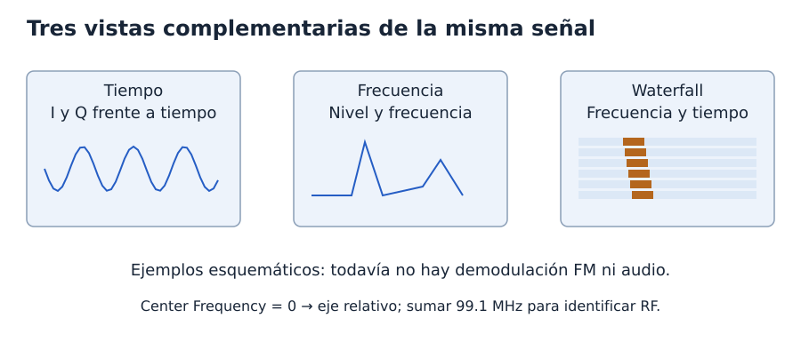
    **Figura 10.** Las figuras son esquemas de lectura, no medidas calculadas desde la captura.

    Con 1024 puntos y $f_s=2.4$ Msps, el registro temporal dura:

    $$
    \frac{1024}{2.4\times10^6}\approx426.67\ \mu\mathrm{s}.
    $$

    La última muestra está en $(1024-1)/f_s=426.25\ \mu$s. La separación entre bins FFT es $f_s/1024=2343.75$ Hz; no debe confundirse con la capacidad efectiva de separar señales, que también depende de la ventana y del procesamiento del visor.

    Si `Center Frequency = 0`, el eje se interpreta como desplazamiento respecto de 99.1 MHz. Un componente observado en −1 MHz corresponde a 98.1 MHz RF. Alternativamente, fijar el centro del visor en `99.1e6` cambia las etiquetas del eje, **no sintoniza ni desplaza la señal**.

    El nivel mostrado es relativo: sin calibración adicional no debe interpretarse como potencia absoluta en dBm. Una línea cerca de cero puede ser continua o un artefacto del receptor; observarla no basta para identificar una emisora. En este punto todavía el estudiante todavía no escucha audio.

    **Comprobación:** ejecutar, revisar actividad en I/Q, verificar que el espectro cubra aproximadamente −1.2 a +1.2 MHz y comparar la distribución espectral con las bandas que persisten en el waterfall.

??? note "6. Del tiempo al espectro: localizar una señal"

    ### 6.1. La FFT recibe una secuencia compleja

    Cada muestra obtenida del conversor es $x[n]=I[n]+jQ[n]$. El visor temporal dibuja sus dos componentes, pero **ambas pertenecen a una sola señal compleja**. Para reconocer las frecuencias presentes, el visor de frecuencia procesa un bloque de $N$ de esas muestras mediante la FFT.

    La FFT es un algoritmo para calcular la transformada discreta de Fourier:

    $$
    X[k]=\sum_{n=0}^{N-1}x[n]e^{-j2\pi kn/N}.
    $$

    Cada posición $k$ de la transformada evalúa una frecuencia de análisis. Una componente de la señal próxima a esa frecuencia aporta una magnitud elevada. El visor ordena los resultados para presentar las frecuencias negativas a la izquierda y las positivas a la derecha, alrededor de cero.

    El visor no calcula por separado «el espectro de I» y «el espectro de Q» para luego dibujar dos mitades: **la entrada a la FFT es el arreglo complejo completo**. Esa representación permite distinguir frecuencias positivas y negativas sin imponer la simetría de magnitud propia de una entrada puramente real.

    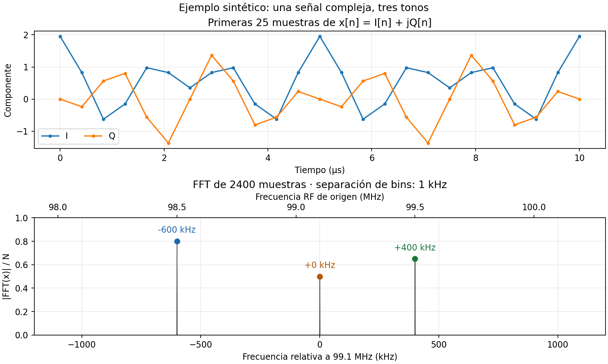
    **Figura 11.** De las muestras temporales a tres componentes en frecuencia: −600 kHz, 0 Hz y +400 kHz respecto de 99.1 MHz.

    La figura utiliza tres tonos complejos sintéticos para distinguir las posiciones con claridad. La curva temporal muestra la suma de los tres, no una curva separada por emisora. Se muestran solo las primeras muestras del registro; la FFT se calcula sobre $N=2400$ muestras, con $f_s=2.4$ Msps y separación de bins de 1 kHz. Estos son parámetros del ejemplo, no un cambio obligatorio de la FFT de 1024 puntos del montaje.

    Sus amplitudes son didácticas y no proceden del conversor de la captura; por ello la suma temporal puede superar uno por componente. La magnitud de la transformada se divide entre $N$ para mostrar las amplitudes de estos tonos alineados con bins. El visor real puede usar otra escala, una ventana y promedio.

    ### 6.2. Interpretar las frecuencias a ambos lados del centro

    La parte inferior de la Figura 11 tiene dos escalas alineadas:

    | Frecuencia en banda base | Frecuencia RF de origen | Interpretación |
    |---|---|---|
    | −600 kHz | 98.5 MHz | 600 kHz por debajo del centro de captura. |
    | 0 Hz | 99.1 MHz | Coincide con el centro de captura. |
    | +400 kHz | 99.5 MHz | 400 kHz por encima del centro de captura. |

    Para una señal de frecuencia RF $f_e$ y una captura centrada en $f_c$:

    $$
    f_{\mathrm{entrada}}=f_e-f_c.
    $$

    Una frecuencia negativa en banda base **no es una frecuencia RF negativa**. Indica el lado del centro donde aparece la señal. En una emisión FM real, el contenido ocupa una banda alrededor de su frecuencia central; un único pico no representa toda la emisora. Las frecuencias de los ejemplos no confirman qué emisoras están presentes en estas capturas.

??? note "7. Sintonizar con el bloque propio rotador"

    ### 7.1. Multiplicar en el tiempo desplaza el espectro

    Para llevar una componente a cero, el bloque multiplica todas las muestras por una exponencial compleja cuyo giro compense su frecuencia relativa:

    $$
    y[n]=x[n]e^{j2\pi f_{\mathrm{mezcla}}n/f_s}.
    $$

    La consecuencia en frecuencia es una traslación:

    $$
    \begin{aligned}
    f_{\mathrm{salida}}&=f_{\mathrm{entrada}}+f_{\mathrm{mezcla}},\\
    f_{\mathrm{mezcla}}&=f_c-f_e.
    \end{aligned}
    $$

    En términos de la transformada, $Y(f)=X(f-f_{\mathrm{mezcla}})$, interpretando el espectro discreto como periódico con período $f_s$. Esta expresión **no significa multiplicar los valores de la FFT por una exponencial**: el bloque multiplicará las muestras temporales y observaremos su resultado con otra FFT.

    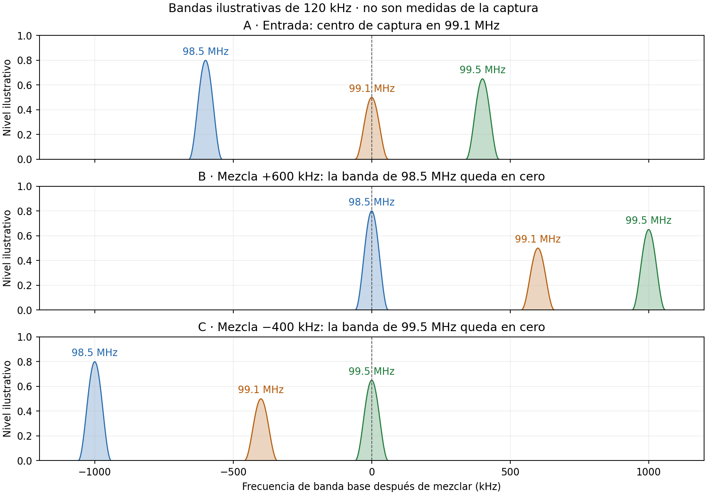
    **Figura 12.** Un desplazamiento positivo centra la señal situada debajo de 99.1 MHz; uno negativo centra la situada encima. Todas las señales se trasladan juntas.

    La Figura 12 sustituye los tonos por bandas ilustrativas de 120 kHz para mostrar que cada banda conserva su ancho. **No son espectros medidos ni una especificación del ancho necesario para cualquier emisora FM**. Los tres colores identifican los mismos orígenes RF en cada fila.

    - **Caso A:** la señal de 98.5 MHz aparece en −600 kHz y la de 99.5 MHz en +400 kHz.
    - **Caso B:** multiplicar por $e^{+j2\pi600000n/f_s}$ mueve todo +600 kHz; la primera señal queda en cero y las otras en +600 y +1000 kHz.
    - **Caso C:** multiplicar por $e^{-j2\pi400000n/f_s}$ mueve todo −400 kHz; la señal de 99.5 MHz queda en cero y las otras en −400 y −1000 kHz.

    El eje de salida representa **banda base después de mezclar**; las etiquetas RF de las bandas identifican su procedencia. Centrar la señal no elimina a sus vecinas, no cambia $f_s$ y todavía no recupera audio. El filtrado para aislar la emisora será otro paso.

    !!! note "El espectro digital es periódico"

        En estos ejemplos, las bandas siguen dentro de ±1.2 MHz. Si otra señal cruza ese intervalo al mezclar, reaparece por el borde opuesto por la periodicidad del espectro discreto. El rotador no es un filtro que suprima esas señales.

    ### 7.2. Construir un oscilador que avance por muestra

    El desplazamiento requiere un **ángulo que cambie entre muestras**, no multiplicar siempre por el mismo número complejo. El incremento angular se calcula como:

    $$
    \Delta\phi=\frac{2\pi f_{\mathrm{mezcla}}}{f_s}.
    $$

    A $f_s=2.4$ Msps, mezclar +600 kHz exige:

    $$
    \Delta\phi=\frac{2\pi(600000)}{2400000}
    =\frac{\pi}{2}=90^\circ\text{ por muestra}.
    $$

    El oscilador utiliza ese avance para generar $p[n]=e^{j\phi[n]}$ y multiplicar cada entrada: $y[n]=x[n]p[n]$. Su magnitud unitaria conserva la magnitud de la muestra; el giro progresivo produce la traslación de frecuencia. Un incremento negativo cambia el sentido del giro.

    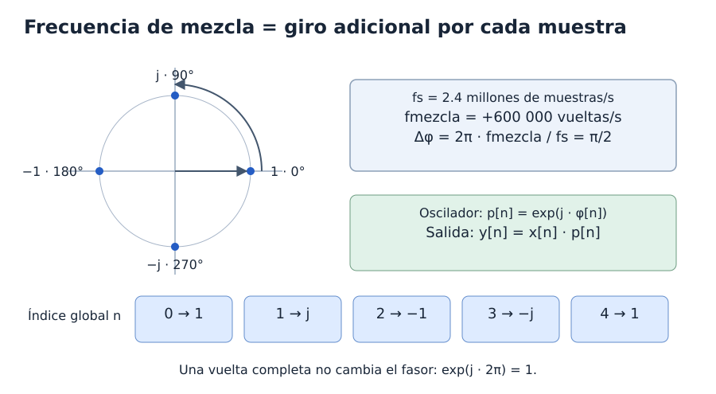
    **Figura 13.** Un avance de 90 grados por muestra genera la secuencia `1, j, -1, -j`.

    El círculo muestra los fasores; la tabla inferior relaciona cada fasor con su índice global.

    ### 7.3. Añadir el rotador al módulo del conversor

    Desde `gnuradio/gr-cbs33m`, añadir un segundo bloque al módulo ya creado:

    ```bash
    gr_modtool add --scm-mode no -l python -t sync \
      --argument-list 'frecuencia_mezcla=0.0, samp_rate=2.4e6' rotador_frecuencia
    ```

    Si estos archivos ya existen, editarlos sin repetir el comando. Abrir `python/cbs33m/rotador_frecuencia.py` en el editor; el estudiante implementa el procesamiento dentro del mismo paquete que el conversor.

    A diferencia del conversor, el bloque utiliza **`gr.sync_block`**: por cada complejo que entra, el bloque produce un complejo. No hay relación 2:1 ni cambio de tasa. Sus parámetros serán `frecuencia_mezcla`, en Hz, y `samp_rate`, en muestras complejas/s.

    Sustituir el código de ejemplo del archivo por el siguiente código completo:

    ```python
    import numpy as np
    from gnuradio import gr


    class rotador_frecuencia(gr.sync_block):
        """Traslada el espectro con un oscilador complejo continuo."""

        def __init__(self, frecuencia_mezcla=0.0, samp_rate=2.4e6):
            gr.sync_block.__init__(
                self,
                name='Rotador I/Q propio',
                in_sig=[np.complex64],
                out_sig=[np.complex64]
            )

            self.frecuencia_mezcla = float(frecuencia_mezcla)
            self.samp_rate = float(samp_rate)
            if not np.isfinite(self.frecuencia_mezcla):
                raise ValueError('frecuencia_mezcla debe ser finita')
            if not np.isfinite(self.samp_rate) or self.samp_rate <= 0:
                raise ValueError('samp_rate debe ser positiva y finita')

            # Fase del oscilador para la próxima muestra que procesaremos.
            self.fase = 0.0

        def set_frecuencia_mezcla(self, frecuencia_mezcla):
            valor = float(frecuencia_mezcla)
            if not np.isfinite(valor):
                raise ValueError('frecuencia_mezcla debe ser finita')
            self.frecuencia_mezcla = valor

        def work(self, input_items, output_items):
            # 1. Un complejo de salida por cada complejo de entrada.
            n = len(output_items[0])

            # 2. Avance angular del oscilador por muestra.
            incremento = 2 * np.pi * self.frecuencia_mezcla / self.samp_rate

            # 3. Ángulos de este lote, empezando en la fase conservada.
            indices = np.arange(n, dtype=np.float64)
            fases = self.fase + incremento * indices

            # 4. Multiplicar cada muestra por su oscilador correspondiente.
            oscilador = np.exp(1j * fases)
            output_items[0][:n] = input_items[0][:n] * oscilador

            # 5. Guardar la fase de la siguiente muestra, sin vueltas enteras.
            self.fase = (self.fase + incremento * n) % (2 * np.pi)

            return n
    ```

    Guardar el archivo Python. Tras recorrer la lógica de `work`, el estudiante completa el YAML y reinstala el módulo en 7.5; después añade el bloque desde el panel de GRC y configuraremos sus parámetros en 7.6.

    `self.fase` es **estado interno**, no un parámetro que el estudiante deba configurar. Se inicializa una vez al crear la instancia y se actualiza al procesar cada lote. Al detener y volver a iniciar el programa se crea una instancia nueva y la fase comienza de nuevo en cero.

    ### 7.4. Seguir la lógica de `work`

    El planificador entrega porciones de muestras, cuyo tamaño puede cambiar entre llamadas. Se denomina $N$ al número de complejos de un lote; en el código, esa cantidad se llama `n`. Un lote no es necesariamente un período del oscilador, una trama ni la ventana FFT de un visor.

    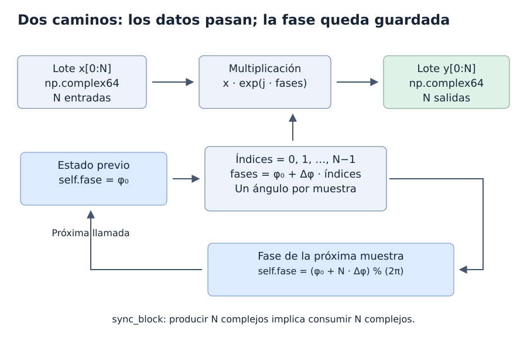
    **Figura 14.** Las muestras recorren el bloque y la fase queda guardada para la próxima llamada.

    - La fila superior sigue los datos de entrada y salida.
    - La fila inferior calcula los ángulos y conserva la fase de continuación.

    #### 1. Obtener la cantidad de muestras de salida

    ```python
    n = len(output_items[0])
    ```

    El primer `[0]` identifica el puerto. Su buffer tiene espacio para `n` complejos; como el bloque es síncrono, el bloque procesa `n` entradas. A diferencia del conversor, el bloque no multiplica esta cantidad por dos.

    #### 2. Convertir Hz a radianes por muestra

    ```python
    incremento = 2 * np.pi * self.frecuencia_mezcla / self.samp_rate
    ```

    El bloque utiliza la tasa de **complejos**, no la tasa de bytes del archivo. Este valor es constante mientras mantengamos la frecuencia de mezcla y la tasa configuradas. Se calcula en `work` para que la relación entre los parámetros y el procesamiento quede explícita.

    #### 3. Numerar el lote y construir sus ángulos

    ```python
    indices = np.arange(n, dtype=np.float64)
    fases = self.fase + incremento * indices
    ```

    Para un lote de cuatro muestras, `indices` contiene `[0, 1, 2, 3]`. Son índices **locales**, que empiezan de nuevo en cero en cada llamada. La suma de `self.fase` hace que el oscilador continúe desde donde corresponde.

    Si la fase al empezar el lote es $\phi_0$, sus ángulos son:

    $$
    \phi_0,\quad\phi_0+\Delta\phi,\quad\ldots,\quad\phi_0+(N-1)\Delta\phi.
    $$

    El bloque utiliza `float64` para el cálculo de ángulos. Eso no cambia la firma de los puertos: las muestras de entrada y salida siguen siendo `complex64`.

    #### 4. Generar el oscilador y escribir el resultado

    ```python
    oscilador = np.exp(1j * fases)
    output_items[0][:n] = input_items[0][:n] * oscilador
    ```

    `np.exp` se aplica a todos los ángulos del arreglo. El producto también es elemento a elemento: la primera entrada se multiplica por el primer fasor, la segunda por el segundo, y así sucesivamente. La asignación escribe en el buffer de salida preparado por GNU Radio.

    El rotador no calcula una FFT ni multiplica todas las muestras por un único complejo fijo. El oscilador toma el valor que corresponde a cada muestra del lote.

    #### 5. Guardar la continuación y devolver lo producido

    ```python
    self.fase = (self.fase + incremento * n) % (2 * np.pi)
    return n
    ```

    La última muestra utilizó el índice `n-1`, pero el bloque debe guardar la fase de **la siguiente**, correspondiente al índice `n`. Por eso el bloque suma `incremento*n`, no `incremento*(n-1)`.

    `return n` informa cuántos complejos produce el bloque. `gr.sync_block` consume esa misma cantidad de entradas. El bloque no necesita llamar manualmente a una función de consumo.

    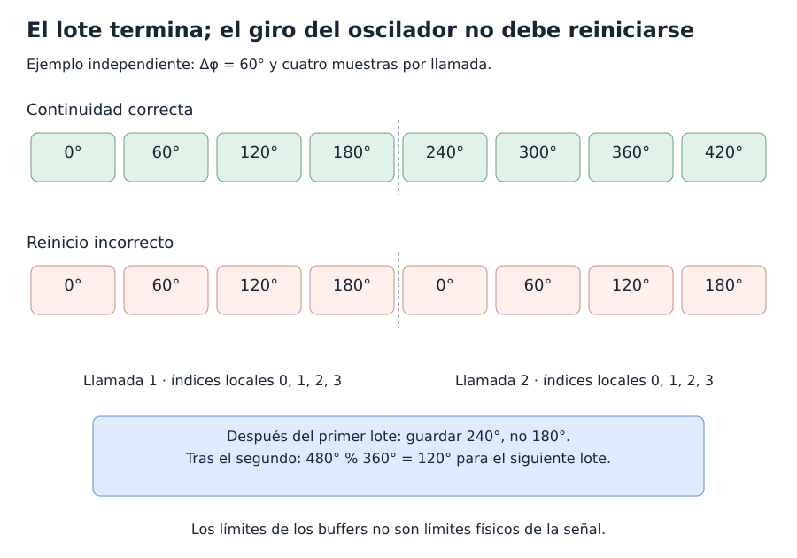
    **Figura 15.** Los índices locales se reinician; el oscilador conserva su continuidad.

    La fila superior continúa en 240 grados. La inferior vuelve a cero e introduce una discontinuidad.
    Este ejemplo usa 60 grados por muestra, distinto del ejemplo anterior de 90 grados.

    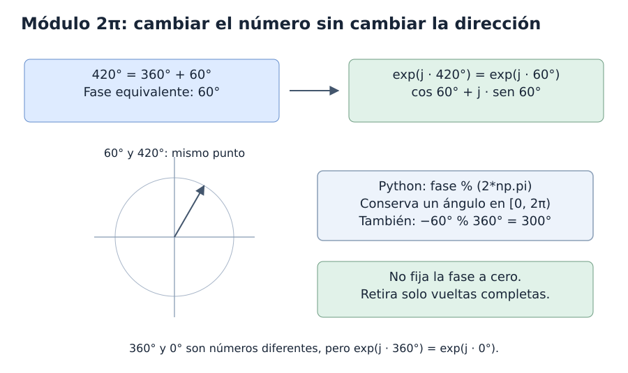
    **Figura 16.** Retirar vueltas completas conserva el fasor.

    El estudiante compara el mismo punto del círculo con dos números de ángulo.
    El módulo limita el ángulo almacenado; no reinicia la fase.

    <iframe src="../animaciones/rotador-propio.html" title="Continuidad de fase entre lotes del rotador" width="100%" height="950" style="border: 0;" loading="lazy"></iframe>
    **Figura 17.** El estado de fase conecta llamadas sucesivas a `work`.

    El estudiante compara un lote de ocho muestras con dos lotes de cuatro. La secuencia debe coincidir.

    [Abrir la animación en una ventana propia](animaciones/rotador-propio.html).

    ### 7.5. Registrar el rotador y su callback en el módulo

    Sustituir `gnuradio/gr-cbs33m/grc/cbs33m_rotador_frecuencia.block.yml` por:

    ```yaml
    id: cbs33m_rotador_frecuencia
    label: Rotador de frecuencias
    category: '[CBS33M]'
    flags: [python]

    parameters:
    - id: frecuencia_mezcla
      label: Frecuencia de mezcla (Hz)
      dtype: real
      default: '0.0'
    - id: samp_rate
      label: Tasa de muestras (sps)
      dtype: real
      default: '2.4e6'

    inputs:
    - domain: stream
      dtype: complex

    outputs:
    - domain: stream
      dtype: complex

    templates:
      imports: from gnuradio import cbs33m
      make: cbs33m.rotador_frecuencia(${frecuencia_mezcla}, ${samp_rate})
      callbacks:
      - set_frecuencia_mezcla(${frecuencia_mezcla})

    file_format: 1
    ```

    El método `set_frecuencia_mezcla` del código anterior es un **setter**: actualiza el valor que utilizará `work` y conserva `self.fase`. El callback indica a GRC que llame a ese método cuando cambie el parámetro de mezcla, por ejemplo desde el control de sintonía. En esta práctica se mantiene fija `samp_rate` mientras se ejecuta el montaje.

    Comprobar que `python/cbs33m/__init__.py` exporte ahora ambos bloques:

    ```python
    from .cu8_a_c64 import cu8_a_c64
    from .rotador_frecuencia import rotador_frecuencia
    ```

    Verificar que los `CMakeLists.txt` incluyan el nuevo Python y el nuevo YAML. Repetir la comprobación de sintaxis, configuración, construcción e instalación de la sección 4.4; después recargar la biblioteca de GRC o reiniciar GRC. La categoría debe mostrar:

    ```text
    CBS33M
    ├── Conversor de .cu8 a .c64
    └── Rotador de frecuencias
    ```

    El estudiante puede comprobar también la importación del bloque nuevo:

    ```bash
    python -c "from gnuradio import cbs33m; print(cbs33m.rotador_frecuencia().name())"
    ```

    ### 7.6. Configurar y conectar el rotador del curso en GRC

    Detener el flowgraph. Conservar `samp_rate = 2.4e6` y añadir tres bloques `Variable`. El grafo final usa un `QT GUI Range` para `frecuencia_emisora`, expresada en Hz:

    | ID | Value inicial | Unidad y significado |
    |---|---|---|
    | `frecuencia_central` | `99.1e6` | Hz; centro con el que se grabó el archivo. |
    | `frecuencia_emisora` | `98.5e6` | Hz; objetivo del primer ejemplo didáctico. |
    | `frecuencia_mezcla` | `frecuencia_central - frecuencia_emisora` | Hz; traslación que aplicaremos. |

    Arrastrar **CBS33M → Rotador de frecuencias** desde el panel derecho. En sus propiedades, establecer:

    | Campo | Valor |
    |---|---|
    | `ID` | `centrar_emisora` |
    | `Frecuencia de mezcla (Hz)` | `frecuencia_mezcla` |
    | `Tasa de muestras (sps)` | `samp_rate` |

    Los nombres visibles vienen del YAML y corresponden a los argumentos `frecuencia_mezcla` y `samp_rate` de `__init__`. **Nuestro bloque no tiene el campo `Phase Increment` del Rotator Core**: recibe Hz y calcula el incremento dentro de `work`. El estudiante no debe introducir $\pi/2$ en el parámetro de frecuencia.

    Tampoco necesita un bloque `Import` con `import math`: importa NumPy en su propio código y utiliza `np.pi` dentro de ese módulo. Cambiar parámetros con el programa detenido y ejecutar de nuevo en cada ensayo.

    En esta etapa el estudiante trabaja solo con visores. Conservarlos y añadir una rama nueva después de `Throttle`, que ya procesa complejos; este se retirará al conectar la salida de audio de la sección 13:

    ```text
    File Source (Byte) → Conversor de .cu8 a .c64 → Throttle (Complex)
                                                   ├→ Time Sink original
                                                   ├→ Frequency Sink original
                                                   ├→ Waterfall Sink original
                                                   └→ Rotador de frecuencias [centrar_emisora] → Frequency Sink nuevo
    ```

    1. Conectar `Throttle.out` a la entrada compleja del bloque propio `centrar_emisora`.
    2. Añadir otro `QT GUI Frequency Sink`, con `ID = espectro_centrado`.
    3. Configurarlo como Complex, una entrada, FFT de 1024 y `Bandwidth = samp_rate`.
    4. Establecer `Center Frequency = 0` y un nombre como `Espectro después del rotador propio`.
    5. Conectar la salida del bloque propio al nuevo visor.
    6. Conservar `Center Frequency = 0` en el visor original y usar la misma ventana FFT, promedio y escala vertical en ambos.

    El visor original muestra frecuencias relativas a 99.1 MHz. El nuevo muestra frecuencias **después de mezclar**, con la señal elegida cerca de cero. Cambiar el centro del visor modifica sus etiquetas, no la señal.

    La rama nueva no necesita otro `Throttle` ni otro conversor `.cu8`: recibe complejos a `samp_rate` y produce la misma cantidad por segundo. Si ya se añadió un Rotator Core durante un ensayo anterior, retirarlo de esta rama para no sumar dos traslaciones.

    ### 7.7. Comprobar la sintonía

    Hacer cada cambio con el montaje detenido y ejecutar de nuevo:

    | Objetivo RF | Posición original | `frecuencia_mezcla`, Hz | Incremento calculado por `work`, rad/muestra | Centro esperado de salida |
    |---|---|---|---|---|
    | 98.5 MHz | −600 kHz | `600000` | $+\pi/2\approx+1.570796$ | 0 Hz |
    | 99.5 MHz | +400 kHz | `-400000` | $-\pi/3\approx-1.047198$ | 0 Hz |
    | 99.1 MHz | 0 Hz | `0` | 0 | Sin desplazamiento; con fase inicial cero, se conservan las muestras. |

    Los ejemplos explican el cálculo; **no garantizan que existan emisoras en esas frecuencias dentro del archivo**. Elegir una señal realmente identificada en la captura y comprobar lo siguiente:

    1. Calcular su posición inicial como `frecuencia_emisora - frecuencia_central` y localizar su banda en el visor original.
    2. Verificar que `frecuencia_mezcla` tenga signo contrario a esa posición.
    3. Comprobar que el centro de toda la banda, no necesariamente su máximo instantáneo, se traslade a cero.
    4. Comparar el ancho antes y después: debe conservarse con la misma escala de frecuencia.
    5. Seguir otra banda y comprobar que también se desplace la misma cantidad.

    Como comprobación numérica independiente, una entrada constante $x[n]=1+j0$ debe entregar el propio oscilador. Con +600 kHz y 2.4 Msps, las primeras salidas serán aproximadamente $1,j,-1,-j$.

    La capacidad de este bloque Python para procesar la captura en tiempo real depende del equipo.

??? note "8. Seleccionar el canal FM con un FIR y decimar"

    El rotador centra la emisora, pero desplaza también las señales vecinas. Ahora añadimos un **pasa bajos para aislar el canal** y reducimos la tasa de muestras después del filtrado. No basta con conservar una muestra de cada ocho: sin filtrar, otras señales podrían plegarse sobre la deseada por aliasing.

    ### 8.1. Variables y configuración del filtro de canal

    Mantener la captura de 2.4 Msps y añadir estas variables:

    | ID | Value | Significado |
    |---|---|---|
    | `decimacion_fir` | `8` | Factor de reducción de la tasa. |
    | `tasa_canal` | `samp_rate / decimacion_fir` | Tasa del canal seleccionado: 300 000 complejos/s. |

    Añadir `Decimating FIR Filter` y configurar:

    | Campo | Valor |
    |---|---|
    | `ID` | `filtro_canal` |
    | `Type` | `Complex → Complex (Real Taps)` |
    | `Decimation` | `decimacion_fir` |
    | `Taps` | `firdes.low_pass(1.0, samp_rate, 120e3, 30e3)` |
    | `Sample Delay` | `0` |

    Conectar **Rotador de frecuencias (`centrar_emisora`) → Decimating FIR Filter (`filtro_canal`)**. El bloque importa `firdes` automáticamente; no hace falta añadir un `Import` para esa función.

    Los *taps* son los coeficientes del FIR. La expresión los diseña con ganancia uno, tasa de **entrada** de 2.4 Msps, centro de transición en 120 kHz y ancho de transición de diseño de 30 kHz. Conserva aproximadamente la banda de −100 a +100 kHz y atenúa las frecuencias exteriores. El corte de 120 kHz no significa una banda perfectamente plana hasta ese punto.

    ### 8.2. Por qué salen 300 ksps para una emisora de unos 200 kHz

    $$
    f_{s,\mathrm{canal}}=\frac{2400000}{8}=300000\ \text{muestras complejas/s}.
    $$

    El intervalo representable pasa a **−150 a +150 kHz**, pero la señal seleccionada no se ensancha a 300 kHz. Los márgenes alrededor de la banda útil permiten la transición de un filtro realizable. Una decimación por doce dejaría ±100 kHz y no daría margen si se desea conservar íntegramente hasta esos bordes.

    Para comparar la salida, añadir otro `QT GUI Frequency Sink` de tipo **Complex**, con `Bandwidth = tasa_canal`, `Center Frequency = 0` y una entrada. No compartir con la señal de 2.4 Msps un visor cuyas entradas usan un único ancho de banda.

    Como prueba con esta grabación, el estudiante puede seleccionar **98.1 MHz**, donde se identificó una señal FM: con las variables de 7.6, usar `frecuencia_emisora = 98.1e6`, que produce una mezcla de +1 MHz. En el `QT GUI Range` del grafo final, introducir `98100000` Hz.

??? note "9. Demodular FM y observar el multiplex"

    ### 9.1. Recuperar los cambios de frecuencia

    Añadir `Quadrature Demod` y conectar **FIR de canal → Quadrature Demod**. El bloque recibe complejos y produce valores reales; no reduce la tasa de 300 000 elementos/s.

    El principio es medir la diferencia de fase entre muestras consecutivas:

    $$
    \Delta\phi[n]=\arg\left(x[n]x^*[n-1]\right).
    $$

    El conjugado permite restar las fases mediante un producto. El resultado representa las variaciones de frecuencia que transportan la modulación FM, no las componentes I y Q por separado.

    ### 9.2. Configurar la ganancia

    Añadir la variable `desviacion_fm = 75e3`, en Hz, y configurar:

    | Campo de `Quadrature Demod` | Valor |
    |---|---|
    | `Gain` | `tasa_canal / (2 * math.pi * desviacion_fm)` |

    El bloque incorpora la importación de `math`. Sustituir la expresión genérica que contiene `fsk_deviation_hz`, porque ese nombre no está definido en este montaje.

    Con estos valores, la ganancia es aproximadamente 0.63662. Una desviación de +75 kHz respecto del centro produce aproximadamente +1 y una de −75 kHz produce −1. Esta desviación de referencia **no es el ancho total del canal ni la frecuencia del audio**.

    ### 9.3. Visualizar la señal demodulada

    Conectar un `QT GUI Frequency Sink` a la salida del demodulador:

    | Campo | Valor |
    |---|---|
    | `Type` | `Float` |
    | `Number of Inputs` | `1` |
    | `Bandwidth` | `tasa_canal` — 300 000 |
    | `Center Frequency` | `0` |
    | `Spectrum Width` | `Half` |
    | `FFT Size` | `4096` inicialmente; `16384` para inspeccionar detalles |
    | `Average` | `Medium` |

    Desactivar `Max Hold` y ampliar con el zoom la zona de **0 a 65 kHz**, sin cambiar `Bandwidth`. El espectro positivo puede mostrar audio mono $L+R$ hasta unos 15 kHz, piloto estéreo en 19 kHz, información $L-R$ entre 23 y 53 kHz y datos RDS alrededor de 57 kHz. Su aspecto real varía con la transmisión; no son bandas rectangulares ideales.

    La FFT de 16384 no mejora la recepción: con 300 ksps permite bins separados aproximadamente 18.3 Hz, frente a 293 Hz con 1024 puntos, analizando un tramo más largo. Para escuchar con menor carga gráfica pueden utilizarse FFT más pequeñas.

??? note "10. Extraer el audio mono con un segundo FIR"

    La salida de `Quadrature Demod` todavía contiene el multiplex. Para obtener **audio mono**, el filtro conserva aproximadamente hasta 15 kHz y atenuamos el piloto, la información estéreo y RDS. Este FIR recibe valores reales, a diferencia del filtro complejo de selección de canal.

    Añadir las variables:

    | ID | Value | Significado |
    |---|---|---|
    | `decimacion_audio` | `6` | Factor de reducción del FIR de audio. |
    | `tasa_audio_intermedia` | `tasa_canal / decimacion_audio` | 50 000 muestras reales/s. |

    Añadir otro `Decimating FIR Filter`:

    | Campo | Valor |
    |---|---|
    | `ID` | `filtro_audio` |
    | `Type` | `Float → Float (Real Taps)` |
    | `Decimation` | `decimacion_audio` |
    | `Taps` | `firdes.low_pass(1.0, tasa_canal, 16e3, 2e3)` |
    | `Sample Delay` | `0` |

    Conectar **Quadrature Demod → Decimating FIR Filter (`filtro_audio`)**. El diseño utiliza la tasa de entrada de 300 ksps, centro de transición en 16 kHz y ancho de transición de diseño de 2 kHz. Conserva aproximadamente hasta 15 kHz y atenúa fuertemente el piloto de 19 kHz.

    La tasa de salida es $300000/6=50000$ muestras/s. Un visor conectado aquí debe ser **Float**, con `Bandwidth = tasa_audio_intermedia`; al mostrar solo la mitad positiva, su eje abarca de 0 a 25 kHz. Debe observarse el contenido de audio sin las bandas superiores del multiplex.

??? note "11. Remuestrear el audio de 50 a 48 ksps"

    Para entregar audio a 48 000 muestras/s, añadir `Rational Resampler` después del FIR de audio:

    | Campo | Valor |
    |---|---|
    | `Type` | `Float → Float (Real Taps)` |
    | `Interpolation` | `24` |
    | `Decimation` | `25` |
    | `Taps` | `[]` |
    | `Fractional BW` | `0.4` |

    La relación de tasas es:

    $$
    \frac{48000}{50000}=\frac{24}{25},\qquad
    f_{s,\mathrm{salida}}=50000\frac{24}{25}=48000\ \text{muestras/s}.
    $$

    Conceptualmente, el remuestreador interpola por 24, filtra y decima por 25. La interpolación calcula valores intermedios: no consiste en repetir cada muestra. La implementación polifásica evita construir explícitamente todo el stream intermedio a 1.2 millones de muestras/s.

    Con `Taps = []`, el bloque diseña automáticamente su filtro de remuestreo. `Fractional BW = 0.4` es un parámetro normalizado de ese diseño, no una frecuencia en Hz.

    Conectar **Decimating FIR Filter (`filtro_audio`) → Rational Resampler** y añadir la variable `tasa_audio = 48000`. El remuestreo conserva la duración y las frecuencias del contenido; un tono de 1 kHz sigue siendo de 1 kHz. Desde este punto, los bloques trabajan a `tasa_audio`; cualquier visor temporal o espectral debe usar esa tasa.

??? note "12. Aplicar el deénfasis"

    Añadir `FM Deemphasis` después del remuestreador:

    | Campo | Valor |
    |---|---|
    | `Sample Rate` | `tasa_audio` — 48 000 |
    | `Tau` | `75e-6` |

    Conectar **Rational Resampler → FM Deemphasis**. El bloque recibe y entrega valores Float y conserva la tasa de 48 ksps.

    En transmisión FM se refuerzan los agudos mediante **preénfasis**. El deénfasis realiza la corrección complementaria: atenúa progresivamente las frecuencias altas para recuperar el balance del audio y reducir parte del ruido añadido durante la recepción. Sin esa corrección, el audio puede sonar demasiado brillante o con más siseo.

    El montaje utiliza la constante de tiempo de **75 microsegundos**, como en el montaje de clase. Debe corresponder al preénfasis de la transmisión; otros sistemas usan 50 microsegundos. No confundir `75e-6` segundos con `75e3` Hz de desviación FM.

    El deénfasis no sustituye al FIR de audio: el FIR selecciona la banda hasta unos 15 kHz, mientras el deénfasis corrige el balance de frecuencias dentro del audio conservado.

??? note "13. Ajustar el volumen y reproducir sin Throttle"

    ### 13.1. Configurar la salida de audio

    Añadir `Multiply Const` y `Audio Sink`:

    | Bloque | Campo | Valor |
    |---|---|---|
    | `Multiply Const` | `IO Type` | `Float` |
    | `Multiply Const` | `Constant` | `0.2` inicialmente |
    | `Multiply Const` | `Vector Length` | `1` |
    | `Audio Sink` | `Sample Rate` | `tasa_audio` — 48 000 |
    | `Audio Sink` | `Device Name` | Vacío, para usar el dispositivo predeterminado |
    | `Audio Sink` | `Num Inputs` | `1` |
    | `Audio Sink` | `OK to Block` | `Yes` |

    Conectar **FM Deemphasis → Multiply Const → Audio Sink**. La constante regula el volumen sin cambiar la frecuencia ni la tasa del audio. La salida es mono: todavía el montaje no incluye un decodificador estéreo.

    ### 13.2. Retirar el Throttle al añadir Audio Sink

    Durante la observación inicial, `Throttle` impedía leer el archivo tan rápido como permitiera el procesador. **Ahora la tarjeta de sonido consume audio a 48 000 muestras/s y proporciona el ritmo de reproducción.** Con `OK to Block = Yes`, el destino puede esperar cuando su buffer está lleno y frenar el procesamiento anterior mediante los buffers de la cadena.

    Mantener además un `Throttle` introduce otro mecanismo de control de ritmo. Si limita demasiado la producción o retrasa la entrega, el dispositivo de audio puede quedarse sin muestras. Esto se manifiesta como cortes o clics y como mensajes **`aU`**, abreviatura de *audio underrun*.

    Antes de ejecutar con audio:

    1. Detener el flowgraph.
    2. Retirar `Throttle` y reconectar su origen con su destino; no basta con dejar una entrada sin conexión.
    3. Si estaba antes del conversor, conectar `File Source (`fuente_captura`), salida 0 → Conversor de .cu8 a .c64 (`conversor_iq`), entrada 0`.
    4. Si estaba después del conversor, alimentar desde este las ramas de observación y el rotador.
    5. También puede dejarse el bloque en `Bypass` si GRC ofrece esa opción, como se hizo en el montaje de clase.
    6. Mantener `Audio Sink` a 48 kHz con `OK to Block = Yes` y ejecutar de nuevo.

    Un caso especialmente problemático era el `Throttle` **Byte** a `samp_rate = 2.4e6`: solo dejaba pasar 1.2 millones de complejos/s y la cadena producía aproximadamente 24 000 valores de audio/s, mientras la tarjeta solicitaba 48 000. Por eso, aunque los parámetros nominales de los filtros fueran correctos, aparecían huecos de audio.

    **El estudiante no compensa esos huecos cambiando la tasa del Audio Sink ni los factores del remuestreador:** retira el límite incorrecto. Si persisten `aU`, deshabilitar visores innecesarios, aumentar su `Update Period` a `0.25` o `0.5` s y comprobar la carga de procesamiento. El aviso sobre Wayland es independiente de la indicación de falta de muestras de audio.

    Si se deshabilita después `Audio Sink` para volver a observar solamente visores, volver a habilitar un único `Throttle` con la tasa correcta para el tipo de su puerto.

    ### 13.3. Recorrer la cadena y comprobar las tasas

    El recorrido final de procesamiento, sin las ramas de visualización, es:

    ```text
    File Source (Byte)
      → Conversor de .cu8 a .c64
      → Rotador de frecuencias [centrar_emisora]
      → Decimating FIR Filter [filtro_canal] /8
      → Quadrature Demod
      → Decimating FIR Filter [filtro_audio] /6
      → Rational Resampler 24/25
      → FM Deemphasis
      → Multiply Const
      → Audio Sink
    ```

    | Salida de la etapa | Tipo de elemento | Tasa nominal |
    |---|---|---|
    | `File Source` | `uint8`, un byte de I o Q | 4 800 000 bytes/s para reproducción a ritmo original |
    | Conversor y rotador | `complex64` | 2 400 000 complejos/s |
    | FIR de canal | `complex64` | 300 000 complejos/s |
    | `Quadrature Demod` | `float32` | 300 000 valores/s |
    | FIR de audio | `float32` | 50 000 valores/s |
    | Remuestreador, deénfasis y volumen | `float32` | 48 000 valores/s |
    | `Audio Sink` | Consume audio mono | 48 000 muestras/s |

    Como comprobación final, escuchar la señal de 98.1 MHz identificada en esta captura y verificar continuidad del audio. Si `Repeat = Yes`, puede aparecer una discontinuidad al volver del final al comienzo del archivo: es distinta de los cortes repetidos por falta de datos que señalan los `aU`.

??? note "14. Abrir una rama RDS desde el multiplex FM"

    ### 14.1. Punto de partida: la emisora de 98.1 MHz

    El estudiante trabaja con `fm_99p1MHz_2p4Msps_g30.cu8` y la señal situada en **98.1 MHz**. Detener la ejecución, seleccionar `frecuencia_emisora = 98.1e6` Hz y volver a ejecutar.

    El primer rotador debe mezclar por **+1 MHz**, porque la emisora está 1 MHz por debajo del centro de captura de 99.1 MHz. Después del FIR de canal con decimación ocho, `Quadrature Demod` recibe complejos y entrega el **multiplex FM real a `tasa_canal = 300000` valores/s**.

    Añadir una rama directamente a esa salida. La rama de audio de las secciones 10 a 13 se conserva en paralelo:

    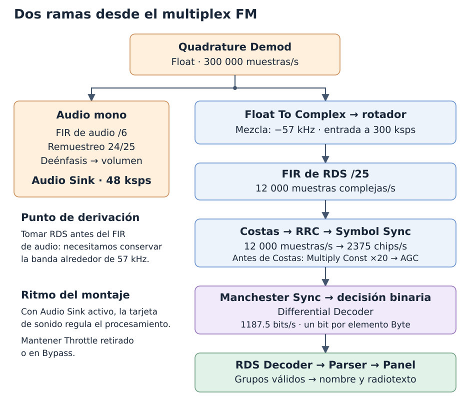
    **Figura 18.** Ambas ramas reciben el multiplex; cada una selecciona y procesa su contenido.

    **La derivación se hace antes del FIR de audio.** Ese filtro elimina las frecuencias superiores a la banda audible, incluida la información RDS alrededor de 57 kHz. Tampoco tomamos la señal después del remuestreador de audio ni del deénfasis.

    Mantener `Throttle` retirado o en `Bypass` mientras `Audio Sink` siga activo. La nueva rama no necesita otro limitador de ritmo. Si se deshabilita el audio y se trabaja únicamente con RDS y visores, habilitar un solo `Throttle` con la tasa correspondiente a su puerto, como se explicó en la sección 13.

    ### 14.2. Qué transporta RDS

    **RDS, Radio Data System**, transmite información digital auxiliar, como el **nombre de servicio de la emisora (PS)** y el **radiotexto (RT)**. En el multiplex, utiliza una subportadora de 57 kHz, suprimida, con bandas laterales que transportan los datos. Por ello el estudiante no debe esperar una gran línea central como la del piloto estéreo de 19 kHz.

    La tasa de datos es **1187.5 bits/s**. Antes de modular, se aplica codificación diferencial y cada bit se representa mediante dos elementos de polaridad opuesta, llamados aquí **chips bifase**:

    $$
    R_{\mathrm{chips}}=2R_b=2(1187.5)=2375\ \text{chips/s}.
    $$

    Primero el montaje recupera esos chips y su reloj; después agrupa esos chips de dos en dos para reconstruir los bits. La tasa de 12 ksps que utiliza el montaje para procesarlos es una **tasa de muestras**, distinta de ambas tasas de información. Estos parámetros proceden de la [especificación de RDS, ITU-R BS.643](https://www.itu.int/dms_pubrec/itu-r/rec/bs/R-REC-BS.643-4-202212-I!!PDF-E.pdf).

??? note "15. Centrar y aislar RDS a 12 ksps"

    ### 15.1. Pasar el multiplex real a un stream complejo

    Añadir `Float To Complex` y configurar `Vector Length = 1`. Conectar **`Quadrature Demod.out → Float To Complex.re`** y dejar la entrada opcional `im` sin conexión; su componente imaginaria será cero:

    $$
    x[n]=m_{\mathrm{MPX}}[n]+j0.
    $$

    El bloque cambia la representación de los valores, pero mantiene **300 000 muestras/s**. Disponer de una salida compleja nos permite utilizar el rotador del curso para trasladar la banda de RDS.

    ### 15.2. Reutilizar el rotador del curso con una instancia nueva

    Arrastrar otra instancia de **CBS33M → Rotador de frecuencias**, implementado en la sección 7. Ambas instancias utilizan la misma clase instalada y cada una conserva su propia fase y sus propios parámetros:

    | Campo | Valor |
    |---|---|
    | `ID` | `centrar_rds` |
    | `frecuencia_mezcla` | `-57000` |
    | `samp_rate` | `tasa_canal` — 300 000 |

    Conectar **Float To Complex → Rotador de frecuencias (`centrar_rds`)**. El bloque multiplica por:

    $$
    e^{-j2\pi(57000)n/300000},\qquad
    f_{\mathrm{salida}}=f_{\mathrm{entrada}}-57000.
    $$

    Así, la banda alrededor de **+57 kHz se centra en 0 Hz**. Como el multiplex original es real, también existe una copia alrededor de −57 kHz; tras mezclar queda alrededor de −114 kHz y el siguiente filtro la elimina. Las dos bandas laterales de la componente elegida quedan a ambos lados de cero.

    La fase debe conservarse entre llamadas a `work`, como en el primer rotador. El parámetro `samp_rate` de esta instancia es **300 ksps**, porque recibe el multiplex demodulado, no las muestras de la captura a 2.4 Msps.

    ### 15.3. Filtrar antes de decimar por 25

    Añadir `Decimating FIR Filter`:

    | Campo | Valor |
    |---|---|
    | `ID` | `filtro_rds` |
    | `Type` | `Complex → Complex (Real Taps)` |
    | `Decimation` | `25` |
    | `Taps` | `firdes.low_pass(1.0, tasa_canal, 3e3, 1e3)` |
    | `Sample Delay` | `0` |

    Conectar **Rotador de frecuencias (`centrar_rds`) → Decimating FIR Filter (`filtro_rds`)**. Los taps usan la tasa de entrada de 300 ksps, centro de transición en 3 kHz y ancho de transición de diseño de 1 kHz. El filtro conserva la banda útil de RDS, que se extiende aproximadamente hasta ±2.375 kHz, y atenúa el contenido exterior antes de reducir la tasa:

    $$
    f_{s,\mathrm{RDS}}=\frac{300000}{25}=12000\ \text{muestras complejas/s}.
    $$

    Añadir la variable `tasa_rds = tasa_canal / 25` para reutilizarla en los bloques siguientes. A 12 ksps, el intervalo representable es de **−6 a +6 kHz**; ese intervalo incluye la banda útil y un margen para el filtro.

    Para comprobar la extracción, conectar en paralelo un `QT GUI Frequency Sink` de tipo **Complex**, una entrada, `Bandwidth = tasa_rds`, `Center Frequency = 0` y FFT de 4096. Desactivar `Max Hold`. En esta captura a 98.1 MHz se observan dos lóbulos alrededor de cero; su forma es compatible con RDS, pero la confirmación llegará al recuperar grupos con códigos de verificación válidos.

??? note "16. Recuperar la fase y filtrar los pulsos RDS"

    ### 16.1. Ajustar la amplitud que recibe el Costas

    Añadir `Multiply Const` después del FIR de RDS:

    | Campo | Valor |
    |---|---|
    | `IO Type` | `Complex` |
    | `Constant` | `20` |
    | `Vector Length` | `1` |

    Esta ganancia establece una escala de amplitud adecuada para el ensayo con esta captura. **Multiplica tanto la señal como el ruido: no mejora su relación señal/ruido.** El valor 20 es parte de la configuración comprobada para este archivo; no es una constante del estándar RDS.

    ### 16.2. Alinear la señal con Costas Loop

    Conectar **Multiply Const (`ganancia_rds`) → Costas Loop** y configurar:

    | Campo | Valor |
    |---|---|
    | `Loop Bandwidth` | `0.01` |
    | `Order` | `2` |
    | `Use SNR` | `No` |

    El rotador nominal de −57 kHz no conoce la fase de la subportadora recibida y puede quedar un pequeño error de frecuencia. El lazo de Costas estima y corrige esos errores para orientar la señal principalmente sobre el eje I. `Order = 2` selecciona el detector para BPSK; la codificación bifase utiliza esas dos polaridades.

    `Loop Bandwidth` es un parámetro normalizado del lazo, no un ancho en Hz ni la tasa de muestras. El bloque no tiene un campo `Sample Rate`: recibe y entrega complejos a **12 ksps**. Usar su salida compleja `out`; las salidas opcionales `frequency`, `phase` y `error` pueden quedar sin conectar.

    Conectar un `QT GUI Constellation Sink` a `out`. El estudiante observa una nube alargada horizontalmente, con menor dispersión en Q. El visor todavía dibuja las muestras de las transiciones entre chips. Una nube circular, sin alineación estable, indica que el estudiante debe revisar la señal recibida y el seguimiento del lazo antes de tomar decisiones binarias.

    ### 16.3. Aplicar el filtro adaptado al conformado de los pulsos

    Añadir `Root Raised Cosine Filter` después del Costas:

    | Campo | Valor |
    |---|---|
    | `FIR Type` | `Complex → Complex (Decimating)` |
    | `Decimation` | `1` |
    | `Gain` | `1.0` |
    | `Sample Rate` | `tasa_rds` — 12 000 |
    | `Symbol Rate` | `2375` |
    | `Alpha` | `1.0` |
    | `Num Taps` | `101` |

    El bloque genera sus taps internamente; su expresión equivalente es `firdes.root_raised_cosine(1.0, tasa_rds, 2375, 1.0, 101)`.

    El FIR anterior seleccionaba una banda de frecuencias. Este RRC se adapta al **conformado de cada chip** para preparar los pulsos para su lectura y reducir ruido fuera de su forma espectral. La elección de 2375 elementos/s y `Alpha = 1` coincide con los taps RRC del [receptor de referencia gr-rds](https://github.com/bastibl/gr-rds/blob/maint-3.10/examples/rds_rx.grc#L132); este montaje utiliza 101 coeficientes a 12 ksps.

    `Symbol Rate = 2375` cuenta los chips, no los bits de información a 1187.5 bits/s. La combinación de los dos chips de cada bit se realizará después con `Manchester Sync`. `Decimation = 1` conserva las **12 ksps** para recuperar el reloj en la siguiente etapa.

    Para comparar, añadir otro `Constellation Sink` después del RRC con los mismos límites de ejes. Puede disminuir tanto la dispersión vertical como la amplitud. Para observar los pulsos en el tiempo, usar `QT GUI Time Sink`, tipo **Complex**, `Sample Rate = tasa_rds`. En esta etapa el visor todavía no muestra únicamente dos puntos: el visor muestra todas las muestras.

??? note "17. Recuperar el reloj de los chips con Symbol Sync"

    Añadir `Symbol Sync` después del RRC:

    | Campo | Valor |
    |---|---|
    | `I/O Type` | `Complex` |
    | `Timing Error Detector` | `Gardner` |
    | `Samples per Symbol` | `tasa_rds / 2375` |
    | `Loop Bandwidth` | `0.01` |
    | `Damping Factor` | `1.0` |
    | `Expected TED Gain` | `1.0` |
    | `Maximum Deviation` | `0.1` |
    | `Output Samples/Symbol` | `1` |
    | `Interpolating Resampler` | `MMSE, 8 tap FIR` |

    **Costas recupera la orientación de la señal; Symbol Sync recupera los instantes de lectura.** Gardner utiliza muestras en los centros y puntos medios de los pulsos para estimar si el reloj está adelantado o atrasado. El lazo ajusta esos instantes y el interpolador calcula valores entre las muestras disponibles.

    La entrada contiene:

    $$
    \mathrm{sps}_{\mathrm{chips}}=\frac{12000}{2375}\approx5.05263\ \text{muestras/chip}.
    $$

    Introducir la expresión completa, sin redondear a cinco. Conservar siempre una muestra de cada cinco produciría una lectura que se desplaza progresivamente respecto del reloj de la señal. El sincronizador sigue la separación fraccionaria y sus pequeñas variaciones.

    `Maximum Deviation = 0.1` limita la desviación del período medio estimado respecto del valor nominal, en **muestras de entrada por chip**. `Expected TED Gain = 1.0` es el valor inicial probado con la amplitud de esta cadena; la ganancia real del detector depende de la forma del pulso y de su amplitud. Los significados de estos campos están descritos en la [documentación de Symbol Sync](https://github.com/gnuradio/gnuradio/blob/v3.10.12.0/gr-digital/include/gnuradio/digital/symbol_sync_cc.h).

    Con `Output Samples/Symbol = 1`, la salida contiene aproximadamente **2375 muestras complejas/s: una por chip**. Conectar esta salida a otro `QT GUI Constellation Sink`. El estudiante observa dos agrupaciones separadas, una a cada lado del origen, con menos puntos entre ellas que después del RRC. El ruido y los errores residuales de fase no desaparecen.

    Si se añade un visor temporal aquí, usar `Sample Rate = 2375`. Las salidas opcionales `error`, `T_inst` y `T_avg` de Symbol Sync pueden quedar sin conectar durante esta práctica.

??? note "18. Decodificar la bifase y recuperar los bits RDS"

    ### 18.1. Encontrar los pares con Manchester Sync

    Symbol Sync identifica los chips, pero falta saber **cuáles forman cada pareja**. Hay dos alineaciones posibles:

    ```text
    Alineación 1: [c0 c1] [c2 c3] [c4 c5] ...
    Alineación 2:    [c1 c2] [c3 c4] [c5 c6] ...
    ```

    Añadir `Manchester Sync`, de **Satellites → Coding**, disponible en Radioconda, y conectar **Symbol Sync → Manchester Sync**:

    | Campo | Valor |
    |---|---|
    | `IO Type` | `Complex` |
    | `Block Size` | `32` |

    El bloque compara ambas alineaciones sobre ventanas de 32 símbolos bifase completos, equivalentes a 64 chips. Favorece la alineación cuyas parejas presentan polaridades opuestas y combina cada pareja mediante:

    $$
    z[k]=\frac{c_{\mathrm{primero}}-c_{\mathrm{segundo}}}{2}.
    $$

    Un par $(+A,-A)$ produce $+A$ y un par $(-A,+A)$ produce $-A$. La salida mantiene valores complejos y reduce la tasa por dos:

    $$
    \frac{2375}{2}=1187.5\ \text{muestras/s}.
    $$

    `Manchester Sync` recibe **dos muestras por símbolo bifase completo**, es decir, la muestra de cada uno de sus dos chips. Esta es la interfaz descrita en la [documentación del bloque](https://github.com/daniestevez/gr-satellites/blob/v5.7.0/include/satellites/manchester_sync.h). No añadir otro remuestreador entre Symbol Sync y Manchester Sync.

    ### 18.2. Tomar decisiones con Complex to Real y Binary Slicer

    Conectar:

    ```text
    Manchester Sync → Complex to Real → Binary Slicer
    ```

    | Bloque | Configuración | Función |
    |---|---|---|
    | `Complex to Real` | `Vector Length = 1` | Conservar I, el eje sobre el que Costas orientó la señal. |
    | `Binary Slicer` | Sin parámetros adicionales | Entregar `1` para valores positivos y `0` para negativos, con umbral en cero. |

    **Manchester Sync se coloca antes del Binary Slicer** porque esta implementación combina las muestras con sus amplitudes. Si ya se había conectado `Symbol Sync → Complex to Real → Binary Slicer`, insertar Manchester Sync inmediatamente después de Symbol Sync.

    La salida del slicer contiene aproximadamente **1187.5 bits/s**, todavía codificados diferencialmente. Cada elemento de su puerto Byte contiene el valor `0` o `1`; no es un byte con ocho bits de información empaquetados.

    ### 18.3. Deshacer la codificación diferencial

    Añadir `Differential Decoder` después del slicer:

    | Campo | Valor |
    |---|---|
    | `Coding` | `Differential` |
    | `Modulus` | `2` |

    Para la secuencia binaria recibida $d[k]$, el bloque recupera el dato mediante:

    $$
    b[k]=d[k]\oplus d[k-1].
    $$

    Un cambio entre bits consecutivos representa un `1`; mantener el valor representa un `0`. La comparación elimina también una inversión global de polaridad, que puede surgir de la ambigüedad de 180° del Costas: invertir ambos operandos no cambia su XOR.

    El bloque conserva el formato Byte con valores `0` o `1` y la tasa aproximada de **1187.5 bits/s**. Estos son los datos que recibirá RDS Decoder; **no añadir Pack K Bits** en esa conexión.

??? note "19. Validar los grupos con RDS Decoder"

    ### 19.1. Del stream de bits a grupos RDS

    Añadir `RDS Decoder`, de la categoría **RDS**, y conectar **Differential Decoder → RDS Decoder**:

    | Campo | Valor |
    |---|---|
    | `Log` | `Enable` |
    | `Debug` | `Disable` |

    Recibe un stream Byte con un bit por elemento. No requiere configurar una tasa de muestreo. `Log` permite observar el estado de sincronización; `Debug` deshabilitado evita imprimir el detalle de cada llamada de procesamiento.

    Cada grupo RDS consta de **cuatro bloques de 26 bits**, es decir, 104 bits. Cada bloque contiene 16 bits de información y 10 bits de verificación combinados con una palabra identificadora (*offset word*). El decoder utiliza esas comprobaciones para identificar la posición de los bloques A, B, C/C′ y D, verificar su integridad y reconstruir grupos válidos.

    Al recuperar un grupo válido, publica un **mensaje PDU por el puerto `out`**. Desde este punto, las conexiones hacia el Parser y el Panel serán de mensajes, representadas con líneas discontinuas en GRC, en lugar de streams de muestras. El proceso de sincronización y validación está en la [implementación de gr-rds](https://github.com/bastibl/gr-rds/blob/maint-3.10/lib/decoder_impl.cc).

    ### 19.2. Observar los grupos con Message Debug

    Añadir `Message Debug`, asignar `ID = grupos_rds` y configurar `Print PDU contents = On` y conectar:

    ```text
    RDS Decoder.out → Message Debug [grupos_rds].print
    ```

    Usar el puerto **`print`**, que imprime el contenido en la terminal. `store` guarda los mensajes para consultarlos desde código. Durante la ejecución, el estudiante observa mensajes del decoder como `Sync State Detected` y PDU con los grupos recuperados, representados en hexadecimal.

    Esta salida permite comprobar la recuperación de datos, pero todavía no interpreta el nombre ni el radiotexto. Para leer esos campos el estudiante añade el Parser en la siguiente sección. La misma salida `out` puede alimentar simultáneamente al Message Debug y al Parser.

??? note "20. Interpretar los mensajes y mostrarlos en RDS Panel"

    ### 20.1. Configurar RDS Parser

    Añadir `RDS Parser`, de la categoría **RDS**:

    | Campo | Valor |
    |---|---|
    | `Log` | `Enable` |
    | `Debug` | `Disable` |
    | `PTY Locale` | `Europe` |
    | `Reset`, si aparece | `0` |

    Conectar **`RDS Decoder.out → RDS Parser.in`** mediante una conexión de mensajes. El Parser identifica el tipo de grupo y reúne los segmentos de texto que llegan en grupos sucesivos:

    - **PS, Program Service:** nombre de servicio de ocho caracteres, transmitido en segmentos de dos caracteres en los grupos 0A/0B.
    - **RT, RadioText:** texto transmitido en segmentos en los grupos 2A/2B; puede tener hasta 64 caracteres en 2A o 32 en 2B.

    El nombre y el radiotexto pueden tardar varios segundos en aparecer porque se necesitan sus segmentos completos. `PTY Locale = Europe` selecciona la tabla RDS de nombres de tipo de programa; no cambia la recuperación de PS ni RT. En esta actividad se mantiene la sintonía en 98.1 MHz; para comparar otra emisora, detener y reiniciar el montaje para comenzar con el estado del Parser vacío.

    El Parser publica los campos interpretados por su salida `out`. Su [implementación](https://github.com/bastibl/gr-rds/blob/maint-3.10/lib/parser_impl.cc) emite, entre otros, mensajes de tipo `1` para PS y `4` para RadioText. Opcionalmente, añadir otro `Message Debug` con `ID = campos_rds` y conectar **`RDS Parser.out → Message Debug (campos_rds).print`** para leer estos mensajes en la terminal y distinguirlos de los grupos crudos del Decoder.

    ### 20.2. Configurar el panel de la emisora

    Añadir `RDS Panel`, también de la categoría **RDS**:

    | Campo | Valor |
    |---|---|
    | `Frequency` | `98.1e6` |
    | `GUI Hint` | Vacío, para colocación automática |

    Conectar **`RDS Parser.out → RDS Panel.in`**. Para esta prueba fija, `Frequency` indica en Hz la frecuencia que se mostrará en el panel; la sintonía RF sigue determinada por el primer rotador. El grafo final deja `campos_rds` deshabilitado para evitar imprimir ambas observaciones a la vez. En la ventana aparecerán **Station Name**, **Radiotext**, el identificador PI y otros campos que la transmisión permita recuperar.

    El recorrido de mensajes queda:

    ```text
    RDS Decoder.out → RDS Parser.in
    RDS Parser.out  → RDS Panel.in
    ```

    La salida del Decoder puede seguir conectada al primer Message Debug y la del Parser al segundo. Esas ramas de observación no consumen ni reparten los mensajes entre destinos: cada destino conectado recibe su copia.

    ### 20.3. Comprobar el recorrido y las tasas de la rama RDS

    ```text
    Quadrature Demod (Float, 300 ksps)
      → Float To Complex
      → Rotador de frecuencias [centrar_rds]: −57 kHz, entrada a 300 ksps
      → Decimating FIR Filter [filtro_rds] /25
      → Multiply Const: 20
      → Costas Loop: orden 2
      → Root Raised Cosine Filter
      → Symbol Sync: una muestra por chip
      → Manchester Sync: una muestra por bit codificado
      → Complex to Real
      → Binary Slicer
      → Differential Decoder
      → RDS Decoder
        out → RDS Parser.in
              out → RDS Panel.in
    ```

    | Salida de la etapa | Tipo | Tasa nominal |
    |---|---|---|
    | `Quadrature Demod` | Float | 300 000 muestras/s del multiplex |
    | `Float To Complex` y rotador de RDS | Complex | 300 000 muestras/s |
    | FIR de RDS, ganancia, Costas y RRC | Complex | 12 000 muestras/s |
    | `Symbol Sync` | Complex | 2375 muestras/s, una por chip |
    | `Manchester Sync` | Complex | 1187.5 muestras/s, una por símbolo bifase completo |
    | `Complex to Real` | Float | 1187.5 muestras/s |
    | `Binary Slicer` y `Differential Decoder` | Byte, valores `0` o `1` | 1187.5 bits/s, un bit por elemento |
    | `RDS Decoder`, `RDS Parser` y `RDS Panel` | Mensajes | Publicaciones según los grupos y campos recuperados |

    En una comprobación local de los **10 segundos completos de esta captura a 98.1 MHz**, sin repetir el archivo, la cadena recuperó **111 grupos válidos**, el nombre **ONDACERO** y radiotexto que identifica a **Omar Courtz**. El texto corresponde al instante grabado, no a una consulta de la programación actual de la emisora.

    Como comprobación visual, seguir la concentración sobre el eje I después del Costas, la reducción de dispersión después del RRC y las dos agrupaciones separadas después de Symbol Sync. La confirmación de recuperación de datos la proporcionan los grupos validados y los campos interpretados, no solo la forma de la constelación.

    En la misma captura no se recuperaron grupos de 99.1 ni 100.1 MHz con esta cadena. Una recepción audible o un piloto de 19 kHz visible no garantizan disponer de RDS decodificable: su componente puede faltar o estar afectada por ruido e interferencias. Al cambiar de emisora, la frecuencia nominal de RDS en el multiplex sigue siendo **57 kHz**.

    ### 20.4. Repetir la comprobación desde la terminal

    Con `gr-cbs33m` instalado y Radioconda activo, ejecutar desde la raíz del repositorio:

    ```bash
    python gnuradio/gr-cbs33m/apps/verificar_fm_rds.py gnuradio/samples/fm_99p1MHz_2p4Msps_g30.cu8
    ```

    El programa procesa el archivo una vez. Usa los bloques OOT instalados y los parámetros del receptor de esta clase.
    La rama de audio cuenta muestras; no abre `Audio Sink`. La rama RDS registra grupos y campos interpretados.
    Por eso esta comprobación no utiliza `Throttle` ni mide la capacidad de reproducción en tiempo real.

    Para los 10 segundos de la captura oficial, el resultado comprobado contiene:

    - `grupos_validos`: `111`.
    - `nombres_ps`: `ONDACERO`.
    - `radiotextos`: `Omar Courtz - Por si ma?ana no estoy`.
    - `muestras_audio`: aproximadamente 480 000; esta ejecución produjo 479 967 muestras.

    El recuento finito de audio incluye el efecto del cierre del procesamiento. La tasa configurada de salida continúa siendo 48 000 muestras/s.
    La prueba de reproducción de la sección 13 comprueba además el dispositivo físico y la continuidad audible.

??? note "Punto de llegada"

    El estudiante ha creado la biblioteca reutilizable `gr-cbs33m`, con el conversor y el rotador implementados en archivos Python y descritos en YAML para GRC. Con esos bloques ha construido un receptor FM mono y una rama de recuperación de RDS desde una captura `.cu8`. Después de `Quadrature Demod`, una rama obtiene audio a 48 kHz y la otra centra RDS, filtra sus pulsos, recupera fase y reloj, decodifica la bifase y la codificación diferencial, valida grupos y muestra el nombre y el radiotexto en `RDS Panel`. `Audio Sink` regula el ritmo del montaje conjunto, que no utiliza `Throttle` activo.

## Ejercicios de consolidación

### Ejercicio 1 — Contar muestras y duración

Una captura `.cu8` ocupa 48 000 000 bytes y se adquirió a 2.4 millones de muestras complejas/s.
El estudiante calcula cuántas muestras contiene, cuánto dura y qué tasa debe configurar en un `Throttle` Byte antes del conversor.

??? example "Solución explicada — captura"

    - **Datos:** cada muestra contiene dos bytes, uno de I y otro de Q; $f_s=2.4\times10^6$ muestras/s.
    - **Fórmulas:** $N=B/2$, $T=N/f_s$ y $R_{\mathrm{Byte}}=2f_s$.
    - **Sustitución:** $N=48000000/2=24000000$ y $T=24000000/2400000$.
    - **Resultados:** 24 millones de muestras complejas, 10 s y 4.8 millones de elementos Byte/s.
    - **Interpretación:** después del conversor, un `Throttle` Complex utiliza 2.4 millones de elementos/s. Ambas configuraciones representan el mismo tiempo físico.

### Ejercicio 2 — Interpretar la salida del conversor

El archivo entrega los bytes `[255, 0, 0, 255]`. El estudiante obtiene los dos complejos con `escala=127.5` y calcula su almacenamiento.

??? example "Solución explicada — conversión"

    - **Datos:** las parejas I/Q son $(255,0)$ y $(0,255)$; cada `complex64` ocupa ocho bytes.
    - **Fórmula:** $x=\frac{I-127.5}{127.5}+j\frac{Q-127.5}{127.5}$.
    - **Sustitución:** la primera pareja produce $1+j(-1)$; la segunda produce $-1+j(1)$.
    - **Resultados:** $x_0=1-j$, $x_1=-1+j$ y $2\times8=16$ bytes de salida.
    - **Interpretación:** cuatro elementos de entrada se convierten en dos elementos de salida. Aumenta el almacenamiento porque cambia la representación numérica.

### Ejercicio 3 — Sintonizar y seguir otra banda

La captura está centrada en 99.1 MHz. El estudiante calcula la mezcla para centrar 98.1 MHz y sigue una componente situada en 100.1 MHz.
También determina la mezcla necesaria para centrar 100.1 MHz en otro ensayo.

??? example "Solución explicada — mezcla"

    - **Datos:** $f_c=99.1$ MHz, $f_s=2.4$ MHz y frecuencias RF de 98.1 y 100.1 MHz.
    - **Fórmulas:** $f_{\mathrm{entrada}}=f_e-f_c$ y $f_{\mathrm{salida}}=f_{\mathrm{entrada}}+f_{\mathrm{mezcla}}$.
    - **Sustitución:** 98.1 MHz aparece en −1 MHz; una mezcla de +1 MHz la lleva a cero.
    - **Resultado para la otra componente:** $+1+1=+2$ MHz. Por periodicidad, $2-2.4=-0.4$ MHz dentro del intervalo mostrado.
    - **Segundo ensayo:** centrar 100.1 MHz requiere una mezcla de −1 MHz.
    - **Interpretación:** el rotador traslada todas las bandas. El `Decimating FIR Filter` (`filtro_canal`) debe seleccionar la banda deseada antes de decimar.

### Ejercicio 4 — Comprobar las tasas de las dos ramas

El estudiante parte de 2.4 Msps complejas y calcula las tasas después de cada cambio del receptor.
También explica por qué el reloj de chips no equivale a una selección fija de una muestra de cada cinco.

??? example "Solución explicada — tasas"

    - **Datos:** decimación de canal 8; decimación de audio 6; remuestreo de audio 24/25; decimación RDS 25; 2375 chips/s.
    - **Fórmulas:** un decimador entrega $f_{\mathrm{salida}}=f_{\mathrm{entrada}}/D$; el remuestreador entrega $f_{\mathrm{entrada}}L/D$.
    - **Canal:** $2400000/8=300000$ muestras/s.
    - **Audio:** $300000/6=50000$ muestras/s; después $50000\times24/25=48000$ muestras/s.
    - **RDS:** $300000/25=12000$ muestras/s y $12000/2375\approx5.05263$ muestras/chip.
    - **Interpretación:** seleccionar una muestra de cada cinco produciría 2400 lecturas/s, distintas de 2375. `Symbol Sync` ajusta los instantes fraccionarios.

### Ejercicio 5 — Conservar la fase entre lotes

Un rotador mezcla +400 kHz a 2.4 Msps. `work` recibe primero cuatro muestras y después otras cuatro.
El estudiante obtiene las fases de ambos lotes y la fase que debe guardar después del segundo.

??? example "Solución explicada — continuidad"

    - **Datos:** $f_{\mathrm{mezcla}}=400000$ Hz, $f_s=2400000$ muestras/s y fase inicial cero.
    - **Fórmula:** $\Delta\phi=2\pi f_{\mathrm{mezcla}}/f_s=\pi/3$ rad/muestra, equivalente a 60 grados/muestra.
    - **Primer lote:** 0, 60, 120 y 180 grados; la fase de continuación es 240 grados.
    - **Segundo lote:** 240, 300, 360 y 420 grados; la siguiente fase es 480 grados.
    - **Resultado almacenado:** $480\bmod360=120$ grados, equivalente a $2\pi/3$ rad.
    - **Interpretación:** guardar 420 grados repetiría la última fase. Reiniciar en cero rompería la continuidad prevista.

### Ejercicio 6 — Separar bifase, decisión y decodificación diferencial

Con las parejas ya alineadas, `Manchester Sync` recibe los chips `[+1,-1, -1,+1, -1,+1, +1,-1]`.
El estudiante obtiene las decisiones binarias y los tres últimos bits después de `Differential Decoder`.
Después repite el cálculo con todos los chips invertidos.

??? example "Solución explicada — bits RDS"

    - **Datos:** hay cuatro parejas de chips; no se conoce el símbolo anterior al primer elemento del ejemplo.
    - **Fórmulas:** $z[k]=(c_0-c_1)/2$; el slicer decide según el signo; $b[k]=d[k]\oplus d[k-1]$.
    - **Sustitución:** Manchester entrega `[+1,-1,-1,+1]`; el slicer entrega `[1,0,0,1]`.
    - **Resultado:** los tres últimos bits diferenciales son `[1,0,1]`. El primer bit requiere conocer el estado anterior.
    - **Inversión global:** el slicer entrega `[0,1,1,0]`; los tres últimos bits siguen siendo `[1,0,1]`.
    - **Interpretación:** Manchester resuelve parejas; el slicer decide polaridad; la comparación diferencial elimina una inversión global estable.

## Lecturas

- [GNU Radio: descripción YAML de un bloque](https://wiki.gnuradio.org/index.php?title=YAML_GRC). Parámetros, puertos, constructor y callbacks de la sección 7.
- [Python: rutas de instalación con sysconfig](https://docs.python.org/3.12/library/sysconfig.html). La ruta utilizada por la instalación del módulo Python.
- [GNU Radio: Symbol Sync](https://github.com/gnuradio/gnuradio/blob/v3.10.12.0/gr-digital/include/gnuradio/digital/symbol_sync_cc.h). Unidades y condiciones de los parámetros de sincronización.
- [gr-satellites: Manchester Sync](https://github.com/daniestevez/gr-satellites/blob/v5.7.0/lib/manchester_sync_impl.cc). Selección de alineación y combinación de chips.
- [gr-rds: receptor de referencia](https://github.com/bastibl/gr-rds/blob/maint-3.10/examples/rds_rx.grc). Conformado RRC y organización de un receptor RDS.
- [ITU-R BS.643: Radio Data System](https://www.itu.int/dms_pubrec/itu-r/rec/bs/R-REC-BS.643-4-202212-I!!PDF-E.pdf). Estructura y parámetros del sistema RDS.
