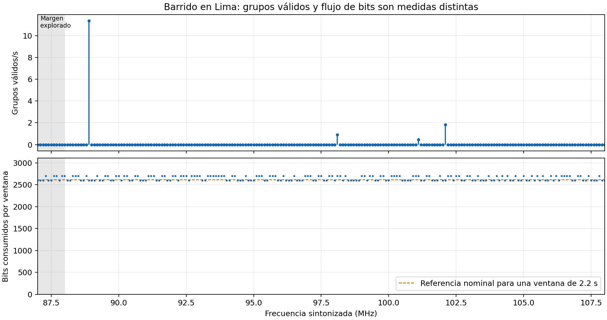
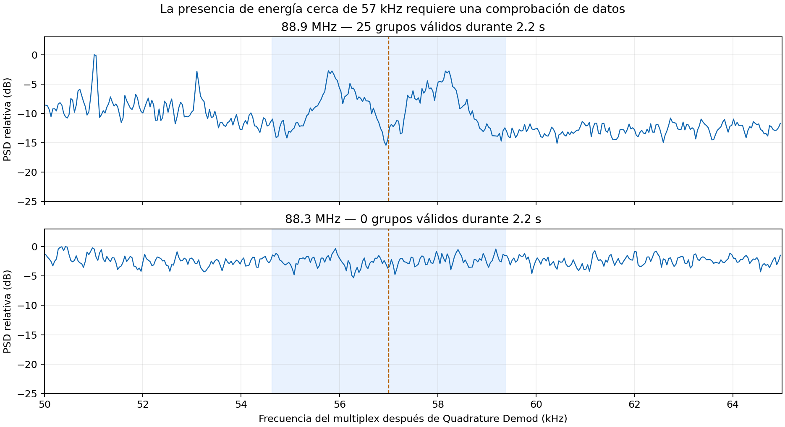

# Recepción FM en vivo: diagnóstico de RDS

Este informe acompaña la [lección 4](clase4.md).
Documenta la revisión de `gnuradio/flowgraphs/fm.grc` y las pruebas de resintonía con el RTL-SDR del profesor.
La recepción se realizó en **Lima, el 7 de noviembre de 2026**.

El `fm.grc` vigente corresponde a la versión **sin Python Snippet**, descrita en la sección 8.
Las secciones 3–5 conservan el diagnóstico y las mediciones de la versión inicial con snippet.
Los dos archivos anteriores están respaldados en `gnuradio/flowgraphs/respaldos/2026-11-07-sin-snippet/`.

## 1. Propósito y criterios

El problema observado es un panel RDS que deja de cambiar mientras continúan el audio y los espectros.
La comprobación separa cuatro observaciones:

1. El receptor entrega muestras del multiplex FM.
2. La rama RDS entrega bits a `RDS Decoder`.
3. `RDS Decoder` publica grupos completos que superan las comprobaciones.
4. `RDS Parser` publica campos y `RDS Panel` los presenta.

**Un pico alrededor de 57 kHz no sustituye la validación de los grupos.**
La energía puede contener señal útil, ruido o interferencia.
El protocolo RDS necesita sincronización, decisiones binarias correctas y las comprobaciones de sus cuatro bloques.

## 2. Banda FM y procedimiento

La [Resolución Ministerial 610-2024-MTC/01.03](https://busquedas.elperuano.pe/dispositivo/NL/2336511-1) define la banda peruana de radiodifusión FM entre **88 y 108 MHz**.
El barrido incluye **87–108 MHz**, por solicitud del profesor; el tramo 87–88 MHz es un margen de exploración.

El barrido recorre 211 puntos, separados por 100 kHz.
El mismo flowgraph permanece ejecutándose al cambiar de frecuencia.
Cada punto reserva 0.8 s de asentamiento y 2.2 s de observación.
Una segunda prueba dedica más tiempo a las frecuencias seleccionadas.
La observación corta no permite descartar una transmisión RDS débil ni garantiza reunir un PS completo.

El programa compila `fm.grc` mediante `grcc`.
Durante la medición reemplaza únicamente `Audio Sink` por `Null Sink` para evitar reproducción física.
`RTL-SDR Source` sigue regulando la adquisición.
Los bloques de sintonía y de decodificación son los del `.grc` compilado.

El registro incluye frecuencia, bits consumidos, grupos válidos, PI, PS, RadioText y medidas espectrales del multiplex.
Los cocientes espectrales son medidas relativas. No son una SNR calibrada ni una prueba independiente de transmisión RDS.
Las frecuencias cercanas pueden recibir el mismo servicio; un punto de sintonía no equivale necesariamente a una emisora distinta.

## 3. Mejoras ensayadas en la versión inicial

Esta sección describe el ensayo con snippet, conservado como `fm.grc.bak` en la carpeta de respaldos.
El grafo vigente conserva AGC y el reinicio nativo del Parser; elimina el snippet y su indicador.

| Cambio | Propósito |
|---|---|
| `Frecuencia de la emisora (MHz)`, con rango 87–108. | Hacer explícita la unidad del control y cubrir el barrido. |
| `frecuencia_emisora_hz = frecuencia_emisora * M`. | Utilizar Hz en el hardware y en los cálculos del rotador. |
| `frecuencia_central` y `desplazamiento_sintonia`, en Hz. | Permitir sintonía directa o un desplazamiento controlado, sin mezclar MHz con Hz. |
| Control `Ganancia RF (dB)`, inicialmente 29.7 dB. | Ajustar la recepción sin editar `RTL-SDR Source`. |
| `AGC` (`normalizar_rds`) antes de `Costas Loop`. | Normalizar la amplitud que recibe el detector de fase. |
| `RDS Parser.Reset = frecuencia_emisora`. | Limpiar el estado de reconstrucción al cambiar la sintonía. |
| `Python Snippet` (`control_resintonia_rds`). | Reiniciar adquisición y actualizar el diagnóstico desde el hilo Qt. |
| `QT GUI Label` (`estado_rds`). | Mostrar flujo de bits, contador de grupos válidos y tiempo desde el último grupo. |
| Salidas de observación hacia `Message Debug.store`. | Contar grupos y campos sin imprimir cada mensaje durante el barrido. |

### 3.1. Normalizar amplitud

Se conserva `Multiply Const` (`ganancia_rds`) y se añade el bloque estándar `AGC` (`normalizar_rds`).
La [referencia de gr-rds](https://github.com/bastibl/gr-rds/blob/maint-3.10/examples/rds_rx.grc) también utiliza control automático de ganancia.

| Campo de `AGC` | Valor |
|---|---|
| `Type` | `Complex` |
| `Rate` | `2e-3` |
| `Reference` | `0.7` |
| `Gain` | `1.0` |
| `Max Gain` | `100` |

El AGC controla la amplitud. No aumenta la SNR ni reconstruye datos perdidos.
Una saturación producida antes del AGC requiere corregir la ganancia RF o la recepción.
La comparación con muestras idénticas mostró una mejora pequeña en Onda Cero; no recuperó grupos en varias frecuencias restantes.

### 3.2. Reiniciar adquisición al resintonizar

El `Python Snippet` instala un temporizador Qt que detecta cambios del control de frecuencia.
Al detectar un cambio realiza estas operaciones:

1. Suspende temporalmente el flujo mediante `lock()`.
2. Lleva la fase y la frecuencia estimadas de `Costas Loop` a cero.
3. Invoca `Symbol Sync.set_sps()` con el período nominal.
4. Restablece la ganancia inicial del AGC y llama a `RDS Parser.reset()`.
5. Reanuda el flujo mediante `unlock()` y reinicia la observación del panel.

La [implementación de `Symbol Sync.set_sps()`](https://github.com/gnuradio/gnuradio/blob/v3.10.12.0/gr-digital/lib/symbol_sync_cc_impl.cc#L124-L150) reinicia el reloj y el interpolador.
`RDS Decoder` conserva su mecanismo propio de búsqueda y recuperación de sincronización.
El cambio no garantiza decodificar cualquier señal visible alrededor de 57 kHz.

### 3.3. Corregir las unidades del panel

La versión instalada de `RDS Panel` divide por un millón la frecuencia recibida en su constructor.
Su método `set_frequency()` presenta directamente el argumento recibido.
La [implementación](https://github.com/bastibl/gr-rds/blob/maint-3.10/python/rdspanel.py) utiliza, por tanto, convenciones diferentes en esas dos entradas.

El parámetro del panel sigue el control en MHz para que su callback funcione al resintonizar.
El snippet corrige la etiqueta inicial mediante `set_frequency(frecuencia_emisora)`.
El hardware recibe `frecuencia_central` en Hz.

## 4. Falla reproducida en la presentación del nombre

Se inyectaron cuatro grupos ya estructurados en `RDS Parser`, con el mismo PI y el nombre de prueba `PRUEBAFM`.
Esta prueba verifica mensajes y presentación. No simula una recepción RF ni comprueba CRC por radio.

| Paso | Resultado del panel |
|---|---|
| Recibir los cuatro segmentos de PS. | `PRUEBAFM`. |
| Limpiar el panel y repetir los mismos grupos sin reiniciar el Parser. | El nombre permanece vacío. |
| Reiniciar el Parser y repetir los cuatro grupos. | `PRUEBAFM`. |

El [Parser conserva las marcas de segmentos recibidos](https://github.com/bastibl/gr-rds/blob/maint-3.10/lib/parser_impl.cc#L96-L116).
Si el segmento se repite sin cambios, no vuelve a publicar el mismo PS.
El Parser también se reinicia cuando detecta otro PI.
Por eso el caso reproducido afecta especialmente al regreso al mismo servicio después de una sintonía sin grupos válidos intermedios.

La prueba automática compila el `.grc`, sustituye el hardware por una fuente de prueba y verifica el regreso al mismo servicio.
También comprueba la correspondencia MHz/Hz y la sintonía con desplazamiento.

## 5. Resultados medidos

### 5.1. Barrido continuo

El barrido recorrió **211 puntos entre 87 y 108 MHz**, sin reiniciar el receptor entre puntos.
En todos los puntos aumentó el contador de bits consumidos por `RDS Decoder`.
La observación corta recuperó grupos válidos en estas frecuencias:

| Frecuencia seleccionada | Grupos válidos en unos 2.2 s | PI |
|---|---|---|
| 88.9 MHz | 25 | `F030` |
| 98.1 MHz | 2 | `3F3F` |
| 101.1 MHz | 1 | `22FF` |
| 102.1 MHz | 4 | `F026` |


**Figura 1.** El decoder consume bits durante todo el barrido, aunque solo algunas sintonías producen grupos válidos.

- **Panel superior:** el eje horizontal indica frecuencia RF; el vertical indica grupos válidos por segundo observado.
  Los puntos con cero grupos no prueban que la emisora carezca de RDS.
- **Panel inferior:** el eje horizontal repite la frecuencia RF; el vertical cuenta bits consumidos durante cada ventana.
  Los contadores avanzan por lotes, de modo que las ventanas cortas no producen cuentas idénticas.
- La franja gris identifica 87–88 MHz, fuera de la banda FM definida por la norma citada.
  La persistencia del contador de bits permite descartar una detención del stream durante este barrido.

### 5.2. Confirmaciones y adquisición lenta

La segunda pasada utilizó ventanas de ocho segundos, después de un segundo de asentamiento.
Volvió a las emisoras iniciales después de recorrer otras frecuencias.

| Frecuencia | Resultado de la pasada prolongada | Identificación obtenida |
|---|---|---|
| 88.9 MHz | 90 grupos; 82 al regresar. | PI `F030`, PS variable con segmentos de `FELICIDAD`. |
| 98.1 MHz | 13 grupos; 11 al regresar. | PI `3F3F`; esas ventanas no completaron el PS. |
| 102.1 MHz | 17 grupos. | PI `F026`, PS `OXIGENO`. |
| 101.1 MHz | Cero grupos en esa ventana. | La detección corta quedó como intermitente. |

Al utilizar un desplazamiento de sintonía de **250 kHz**, 98.1 MHz produjo 17 grupos y completó `ONDACERO`.
En esa misma prueba, 102.1 MHz produjo solo dos grupos.
El desplazamiento se conserva como opción; esta comparación no demuestra una mejora universal ni identifica DC como causa.
En 101.1 MHz reapareció un grupo con PI `22FF`, sin PS completo.
La observación posterior de veinte segundos confirmó ese servicio, como explica la sección 5.5.

RPP 89.7, Exitosa 95.5, Nacional 103.9 y PBO 91.9 MHz no produjeron grupos válidos en sus ventanas prolongadas.
El resultado describe estas muestras y la recepción disponible en Lima.
No demuestra ausencia de transmisión RDS ni cubre todos los transmisores del Perú.

### 5.3. ¿Puede verse una componente en 57 kHz sin recuperar datos?


**Figura 2.** La inspección del multiplex debe acompañarse de la comprobación de los grupos RDS.

- **Panel superior, 88.9 MHz:** la curva azul muestra la densidad espectral del multiplex.
  Aparecen dos elevaciones alrededor de 57 kHz y un valle cerca del centro.
  El decoder recuperó 25 grupos válidos durante la observación correspondiente.
- **Panel inferior, 88.3 MHz:** la curva no muestra una elevación comparable alrededor de 57 kHz en esa ventana.
  El decoder no recuperó grupos válidos.
- Ambos paneles muestran 50–65 kHz del multiplex; la línea discontinua marca 57 kHz.
  Cada curva se normaliza respecto de su propio máximo. No se comparan potencias RF absolutas entre paneles.
- El espectro utiliza los últimos 0.5 s de cada observación.
  Las cuentas de grupos corresponden a la ventana completa de unos 2.2 s.

Un pico estrecho, una banda aparente o un audio audible no certifican datos RDS válidos.
Identificar el origen de una componente concreta requiere medir la captura correspondiente; este informe no atribuye automáticamente los picos a DC o a armónicos.

### 5.4. Repetir las mismas muestras con bloques nuevos

Se guardó el multiplex completo de cada ventana prolongada.
Después se construyeron instancias nuevas de todos los bloques de la rama RDS para procesar cada grabación.
Se conservaron las tasas, los filtros, el AGC y los parámetros de sincronización del grafo mejorado.

| Sintonía | Grupos durante recepción en vivo | Grupos al repetir con estado nuevo |
|---|---|---|
| 88.9 MHz, primera visita | 90 | 88 |
| 98.1 MHz, primera visita | 13 | 11 |
| 102.1 MHz | 17 | 16 |
| 88.9 MHz, regreso | 82 | 86 |
| 98.1 MHz, regreso | 11 | 13 |

En 97.3, 88.3, 89.7, 90.5, 95.5, 100.1, 101.1, 103.9 y 91.9 MHz, ambas comprobaciones produjeron cero grupos.
Para esas grabaciones, el estado dejado por la emisora anterior **no explica por sí solo** la falta de grupos.
Las diferencias pequeñas en las cuentas positivas incluyen adquisición, límites de las ventanas y procesamiento por lotes.
La repetición comienza con estado nuevo y no reproduce exactamente las condiciones del inicio de la ventana en vivo.

### 5.5. Confirmar la detección débil de 101.1 MHz

Una observación posterior de veinte segundos produjo 84 grupos con PI `22FF` y PS variables `PANAMERI` y `....CANA`.
La [frecuencia publicada por Radio Panamericana](https://www.radiopanamericana.com/100-anos-de-la-radio-en-el-peru-por-que-la-radio-sigue-viva-en-tiempos-de-tiktok/) es 101.1 MHz.
La identificación es consistente con esos segmentos recibidos.

Se repitió la observación durante veinte segundos por configuración, con instancias nuevas del receptor al iniciar cada prueba:

| Configuración | Grupos válidos | PS observado |
|---|---|---|
| Sintonía directa, centro del RTL-SDR igual a 101.1 MHz. | 83 | Incluye `PANAMERI` y `....CANA`. |
| Centro del RTL-SDR 400 kHz por encima; rotación digital de +400 kHz. | 50 | `PA..CANA`. |

La sintonía directa también recuperó datos.
El desplazamiento no fue una condición necesaria y estos resultados no demuestran que DC causara la dificultad.
Las pruebas se realizaron en instantes distintos; el número de grupos refleja también la variabilidad de la recepción.

Al repetir la grabación que produjo 84 grupos, con bloques RDS nuevos, se recuperaron 81 y segmentos coherentes de PS.
La grabación de 97.3 MHz siguió produciendo cero grupos en esa comprobación.
Una captura anterior de 97.3 MHz, preparada para el laboratorio, había producido grupos con PI `956B`.
La falta de recuperación posterior no invalida esa detección anterior ni demuestra ausencia de RDS.

También se procesaron prefijos de la **misma grabación directa de veinte segundos**, con estado nuevo en cada ejecución:

| Prefijo procesado | Grupos válidos | PS publicado |
|---|---|---|
| 2 s | 5 | Ninguno. |
| 4 s | 12 | Ninguno. |
| 8 s | 31 | `....CANA`. |
| 12 s | 44 | `....CANA`. |
| 20 s | 86 | Incluye `PANAMERI` y otras variantes. |

Esta prueba demuestra que pueden fluir grupos válidos antes de que aparezca un nombre reconocible en el panel.
Los veinte segundos no son un umbral universal de RDS.
La calidad recibida, la adquisición y los segmentos transmitidos afectan el resultado.

### 5.6. Qué se detectó y qué solución corresponde

- **Falla reproducida:** limpiar el panel sin reiniciar el Parser puede impedir la republicación del mismo PS.
  Se corrigió la dependencia de reinicio y se añadió una prueba de regresión.
- **Bloqueo general al resintonizar:** no se reprodujo en este barrido.
  El receptor consumió bits y volvió a recuperar grupos después de muchas sintonías sin grupos.
- **Adquisición e interpretación:** las ventanas cortas pueden entregar pocos grupos y todavía no completar nombre o radiotexto.
  Se añadió observación separada de bits, grupos y tiempo sin grupos.
- **Señales débiles o interferidas:** reiniciar bloques no garantiza recuperar sus datos.
  Se proponen observaciones más largas y comparaciones de ganancia RF y ubicación de antena, cambiando una condición cada vez.
- **Desplazamiento de sintonía:** queda disponible para ensayos controlados.
  No se exige para todas las emisoras ni se presenta como corrección demostrada de DC.

Las comparaciones iniciales en vivo usaron instantes y ganancias RF distintos.
Por eso sus diferencias de cuenta no se atribuyen a un solo ajuste del receptor.
Los [datos del informe](figures/diagnostico-rds-datos.json) conservan las observaciones y las limitaciones.

## 6. Repetir las comprobaciones

Desde la raíz del repositorio, con Radioconda y `gr-cbs33m` instalados:

```bash
python scripts/barrer_fm_rds.py --inicio 87 --fin 108 --paso 0.1 --espera 0.8 --tiempo 2.2 --salida output/barrido-fm-rds
```

El RTL-SDR debe estar libre antes de iniciar el programa.
La opción `--frecuencias` permite repetir una secuencia específica, incluida la vuelta a una emisora anterior.
El programa guarda `barrido.json` y segmentos del multiplex en el directorio indicado.
Las grabaciones de trabajo permanecen fuera de Git.

## 7. Cómo interpretar una pausa del panel

| Observación | Interpretación y siguiente comprobación |
|---|---|
| Continúan los bits y los grupos válidos. | Revisar campos publicados; el texto puede repetirse. |
| Continúan los bits, pero faltan grupos válidos. | Revisar señal recibida, adquisición y comprobaciones de los bloques. |
| Aparece un PI nuevo, pero falta PS o RadioText. | Esperar sus segmentos; comprobar los tipos de grupo recibidos. |
| Se detienen los bits, el audio y los visores. | Investigar el funcionamiento general del flowgraph. |

El indicador de la versión inicial permitía separar esas situaciones.
El grafo vigente imprime grupos con `Message Debug.print`; el banco de medida registra contadores cuando se necesita un diagnóstico detallado.
La potencia visible en el espectro y el volumen del audio no certifican recuperación de datos RDS.

## 8. Variante sin Python Snippet

La variante probada como `fm_sin_snippet.grc` pasó a ser **`gnuradio/flowgraphs/fm.grc`**, con `Options.ID = fm`.
El cambio de nombre e ID no altera sus bloques de procesamiento.
Las copias exactas anteriores se conservan como `fm.grc.bak` y `fm_sin_snippet.grc.bak` en la carpeta de respaldos.
Su `manifest.json` permite verificar los hashes SHA-256.

La variante introduce estos cambios respecto del grafo mejorado:

- Elimina `Python Snippet` (`control_resintonia_rds`) y `QT GUI Label` (`estado_rds`).
- Conserva `AGC` (`normalizar_rds`) y `RDS Parser.Reset = frecuencia_emisora`.
- Conecta `RDS Decoder.out` a `Message Debug.print` (`grupos_rds`) para observar los grupos recibidos.
- Deja que `Costas Loop` y `Symbol Sync` sigan la nueva señal sin un reinicio coordinado adicional.

No se trasladó el controlador a otro bloque.
El Python generado no contiene funciones `snippets_*` ni el temporizador del indicador.
El reinicio del Parser utiliza el callback nativo de su parámetro `Reset`.

### 8.1. Comprobación con el RTL-SDR

La prueba mantuvo el mismo receptor ejecutándose durante seis sintonías.
Cada sintonía utilizó un segundo de asentamiento y veinte segundos de observación.
La ganancia RF fue 29.7 dB, sin desplazamiento de sintonía.

| Orden | Frecuencia | Grupos válidos en 20 s | PI | PS publicado |
|---|---|---|---|---|
| 1 | 88.9 MHz | 219 | `F030` | Segmentos de `FELICIDAD`. |
| 2 | 98.1 MHz | 70 | `3F3F` | `ONDACERO`. |
| 3 | 101.1 MHz | 180 | `22FF` | `PANAMERI` y `....CANA`. |
| 4 | 102.1 MHz | 46 | `F026` | `OXIGENO`. |
| 5 | 88.9 MHz, regreso | 221 | `F030` | Segmentos de `FELICIDAD`. |
| 6 | 98.1 MHz, regreso | 119 | `3F3F` | `ONDACERO`. |

La variante recuperó grupos en las seis observaciones, incluidos los regresos a servicios anteriores.
El snippet **no fue necesario para decodificar RDS en estas pruebas**.
Las cuentas no permiten comparar rendimiento con otras pruebas realizadas en instantes distintos.
El banco de medida sustituyó `Audio Sink` por `Null Sink`; estas cuentas no verifican reproducción audible.

Las pruebas automáticas también verifican la republicación del mismo PS tras volver a una emisora.
Una prueba con entrada nula comprueba que la variante conserva la frecuencia interna de `Costas Loop` al resintonizar.
Así se comprueba que no existe otro reinicio automático equivalente al eliminado.

### 8.2. Límites del panel

- **Etiqueta inicial:** `RDS Panel` muestra `0.0` al arrancar por la diferencia de unidades descrita en la sección 3.3.
  El RTL-SDR sí inicia en 88.9 MHz. Cambiar de frecuencia actualiza la etiqueta en MHz.
- **RadioText conservado:** en las dos visitas a 98.1 MHz, el panel mostró texto procedente de 88.9 MHz.
  Durante esas ventanas de observación, el Parser no publicó un RadioText nuevo, aunque sí publicó `ONDACERO`.
  Un RadioText visible no debe atribuirse a la sintonía actual sin comprobar sus nuevas publicaciones.
- **Indicador eliminado:** la variante imprime los grupos, pero no muestra el contador ni el tiempo desde el último grupo.

Estas observaciones distinguen la decodificación de grupos y la presentación de campos.
La variante conserva las limitaciones indicadas; no añade código adicional para ocultarlas.

### 8.3. Repetir la prueba

Desde la raíz del repositorio, con el RTL-SDR libre:

```bash
python scripts/barrer_fm_rds.py --grafo gnuradio/flowgraphs/fm.grc --frecuencias 88.9,98.1,101.1,102.1,88.9,98.1 --espera 1 --tiempo 20 --guardar-mpx-completo --salida output/fm-actual-sin-snippet
```

El registro de esta prueba está incluido en los [datos del informe](figures/diagnostico-rds-datos.json), bajo `variante_sin_snippet`.
