# Sesión 8 — Recepción LoRa y análisis LoRaWAN

Esta sesión contiene el **Laboratorio #5**. El archivo conserva el nombre histórico `clase6.md`; en el [índice del curso](../index.md) corresponde a la sesión 08.

!!! note "Señal y alcance de la entrega"

    La práctica obligatoria usa **I/Q generado con GNU Radio a partir de una trama real de Brno**. Los 915 MHz son una referencia de simulación. La entrega consiste en medir los chirps, recuperar los 20 bytes y extraer los siete bytes **cifrados** del `FRMPayload`, además del reto de `FOpts`. El recorrido principal usa **Inspectrum y los scripts de la sección 3**, seguidos de la extracción de la sección 8; **construir un flujograma en GNU Radio Companion es opcional**. Radioconda y `gr-lora_sdr` siguen siendo necesarios porque los scripts utilizan GNU Radio internamente. No se pide descifrar el mensaje en la entrega, implementar OTAA ni descargar las capturas reales de Brno o STU. Las verificaciones adicionales de esas capturas se conservan como [material complementario](#11-material-complementario-capturas-reales-y-descifrado).

## 1. Introducción

**LoRa** define cómo se transmite un paquete por radio. **LoRaWAN** define cómo se organiza la trama y cómo se comunica el dispositivo con la red.

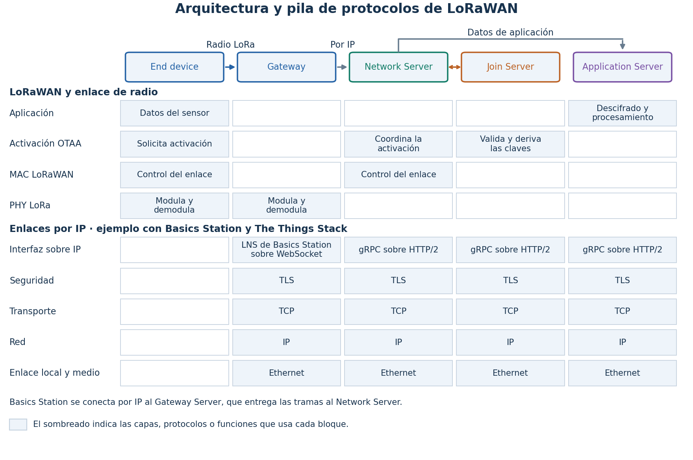
**Figura 1.** Componentes, capas y protocolos de una red LoRaWAN.

[Ver figura ampliada](figures/01-arquitectura.png).

- El *end device*, dispositivo final, transmite por radio LoRa.
- El *gateway*, pasarela, reenvía los paquetes recibidos por radio. También transmite las respuestas de la red.
- El *Network Server*, servidor de red, verifica el MIC, controla los contadores y reenvía al servidor de aplicación los datos de aplicación cifrados.
- El *Join Server*, servidor de activación, valida las solicitudes de activación y deriva las claves de sesión.
- El *Application Server*, servidor de aplicación, descifra el contenido con `AppSKey` y recupera los datos para la aplicación.

La capa física (PHY) LoRa transmite y recibe los símbolos de radio. La capa MAC, *Medium Access Control*, gestiona el enlace LoRaWAN entre el dispositivo y el servidor de red. La fila OTAA, *Over-the-Air Activation*, muestra quién participa en la activación por aire. [Modelo de red de LoRa Alliance](https://lora-alliance.org/wp-content/uploads/2020/11/TS002-1.1.0_LoRaWAN_Backend_Interfaces.pdf#page=8).

El grupo inferior presenta un ejemplo de enlaces por IP, el protocolo de Internet. El gateway usa la interfaz LNS (*LoRaWAN Network Server*) de Basics Station sobre WebSocket. El Gateway Server recibe las tramas y las entrega al Network Server. En este ejemplo, los servidores se comunican mediante gRPC sobre HTTP/2. TLS protege las conexiones, TCP transporta los datos y Ethernet sirve de enlace local. [Basics Station](https://doc.sm.tc/station/tcproto.html) y [conexiones de The Things Stack](https://www.thethingsindustries.com/docs/concepts/networking/).

### Aplicaciones de LoRaWAN

- Medición remota de agua, gas y electricidad
- Agricultura de precisión y gestión del riego
- Seguimiento de activos y flotas
- Monitoreo de la cadena de frío
- Monitoreo ambiental
- Automatización de edificios
- Detección de fugas de agua
- Alumbrado público y gestión de estacionamientos

[Casos de uso de LoRa Alliance](https://lora-alliance.org/cities-vertical-market/) y [aplicaciones en edificios](https://lora-alliance.org/wp-content/uploads/2020/11/wi-fi-and-lorawanr-deployment-synergies.pdf).

### Configuración LoRa de la práctica

El factor de expansión (SF) y el ancho de banda (BW) definen el barrido en frecuencia de cada símbolo. La señal de la práctica usa **SF7 y 125 kHz**. La tabla reúne los demás parámetros que se usan en el ejemplo.

| Parámetro | Qué controla | En la práctica |
|---|---|---|
| Frecuencia central | Dónde sintonizar el canal | 915 MHz como referencia de simulación |
| Tasa de codificación (CR) | Cuánta redundancia se añade al contenido | 4/5 |
| Preámbulo y palabra de sincronización (*sync word*) | La secuencia que usa el receptor para detectar y sincronizar el paquete | 8 chirps repetidos y `0x34` |
| Modo de cabecera | Si el paquete informa la longitud del contenido, la CR y la presencia de CRC | Explícito |
| Comprobación de redundancia cíclica (CRC) | Si se añade una comprobación de errores al contenido | Activada |

En Inspectrum se medirán el BW y la duración del símbolo para obtener el SF. El script `inspeccionar_lora.py`, que utiliza bloques de GNU Radio, decodificará la cabecera explícita y mostrará sus transformaciones en la terminal. [Estructura del paquete LoRa, Tapparel y Burg, §2](https://pubs.gnuradio.org/index.php/grcon/article/download/145/123/390#page=2).

## 2. Chirps, ancho de banda y factor de expansión

Un *chirp* es una señal cuya frecuencia cambia con el tiempo. En un *upchirp* la frecuencia sube. En un *downchirp* baja. LoRa usa CSS (*Chirp Spread Spectrum*), una modulación de espectro ensanchado mediante chirps.

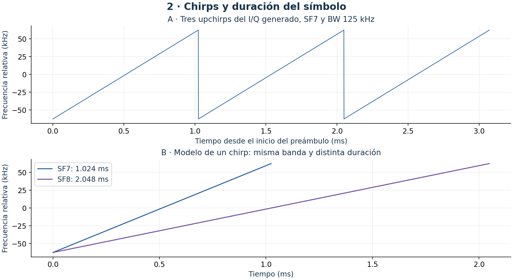
**Figura 2.** Chirps del preámbulo generado y comparación de dos duraciones de símbolo a 125 kHz.

[Ver figura ampliada](figures/02-chirps.png).

- **Panel A.** El eje horizontal mide tiempo desde el inicio del preámbulo. El eje vertical muestra la frecuencia instantánea relativa al centro del canal. Cada *upchirp* sube desde unos −62.5 kHz hasta +62.5 kHz. El siguiente empieza de nuevo por abajo.
- **Panel B.** El eje horizontal mide tiempo y el vertical muestra la frecuencia relativa. Las dos curvas recorren los mismos 125 kHz. Con SF8, el barrido tarda el doble que con SF7.

### Ancho de banda y duración del símbolo

El ancho de banda $BW$ (*bandwidth*) es el intervalo de frecuencias que recorre el chirp. En el panel A mide cerca de $62.5-(-62.5)=125$ kHz. La duración de un símbolo $T_s$ es el tiempo de un barrido completo. En el inicio del preámbulo, se puede medir entre dos reinicios consecutivos.

El factor de expansión $SF$ (*spreading factor*) determina cuántas posiciones de inicio admite el chirp. Con SF7 hay $2^7=128$ posiciones posibles. LoRa representa cada valor de símbolo desplazando circularmente el chirp de referencia. Al llegar al borde superior, el barrido continúa desde el inferior. [Modulación LoRa, Tapparel y Burg, §2.8](https://events.gnuradio.org/event/24/contributions/641/attachments/192/478/paper_tapparel.pdf#page=3).

$$
T_s=\frac{2^{SF}}{BW},\qquad SF=\log_2(BW\,T_s).
$$

Con $BW$ en hertz y $T_s$ en segundos, el producto $BW\,T_s$ da $2^{SF}$. Si $BW$ se mantiene fijo, subir de SF7 a SF8 duplica ese producto y la duración del símbolo. A 125 kHz, $T_s$ pasa de 1.024 ms a 2.048 ms, como en el panel B.

### Qué cambia al subir o bajar el SF

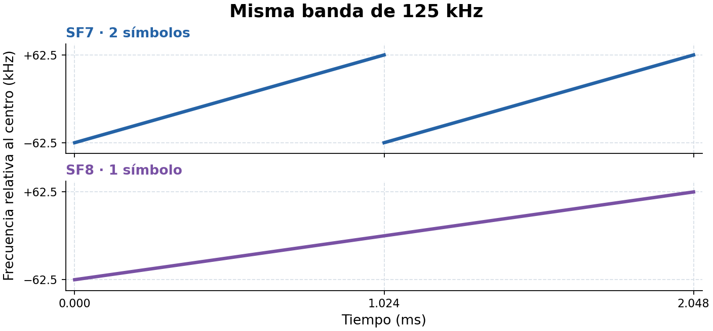
**Figura 3.** Barridos ideales de SF7 y SF8 en una misma ventana de tiempo y con igual ancho de banda.

- **Arriba, SF7.** Cada diagonal tarda 1.024 ms en recorrer la banda. En 2.048 ms caben dos símbolos.
- **Abajo, SF8.** La diagonal sube más despacio y recorre la misma banda en 2.048 ms. En ese tiempo cabe un solo símbolo.

| Con un ancho de banda de 125 kHz | SF7 | SF8 |
|---|---:|---:|
| Duración del símbolo | 1.024 ms | 2.048 ms |
| Símbolos por segundo | ≈ 977 | ≈ 488 |
| Posiciones de inicio del chirp ($2^{SF}$) | 128 | 256 |

- **Subir de SF7 a SF8.** Se duplica la duración del símbolo y se reduce a la mitad la cantidad de símbolos por segundo. El receptor puede detectar señales más débiles. Un paquete con los mismos datos y la misma codificación ocupa más tiempo en el aire. [Sensibilidad y tiempo en el aire, Semtech](https://www.semtech.com/design-support/faq/p0/p0).
- **Bajar de SF8 a SF7.** Los símbolos duran la mitad. Con la misma codificación se pueden transmitir datos más rápido. En las mismas condiciones de ruido, el receptor necesita una señal más fuerte para lograr una tasa de error similar. [Tasa de símbolos y sensibilidad, Semtech SX1276, §4.1.1](https://cdn.sparkfun.com/assets/7/7/3/2/2/SX1276_Datasheet.pdf#page=27).
- **Cambiar el ancho de banda con SF fijo.** Con SF7, pasar de 125 a 250 kHz duplica el recorrido en frecuencia y reduce la duración del símbolo de 1.024 a 0.512 ms. [Relación entre ancho de banda y tasa de símbolos, Semtech SX1276, §4.1.1.5](https://cdn.sparkfun.com/assets/7/7/3/2/2/SX1276_Datasheet.pdf#page=28).

### Qué se medirá en Inspectrum

La práctica usa la señal generada `output/lorawan-iq/correcto.sigmf-data`. Su archivo de metadatos indica una tasa de muestreo $f_s=1$ millón de muestras complejas por segundo. Inspectrum necesita ese valor para dar escala a los ejes. Cada símbolo SF7 del ejemplo ocupa $f_s T_s=1024$ muestras. [Formatos y herramientas de Inspectrum](https://github.com/miek/inspectrum#features).

1. Ampliar en el espectrograma los primeros chirps ascendentes repetidos del paquete. El tiempo se lee en horizontal y la frecuencia en vertical.
2. Estimar $BW$ restando la frecuencia inferior de la superior en el recorrido del chirp. Se esperan aproximadamente 125 kHz.
3. Medir con los cursores el tiempo entre el primer y el quinto reinicio. En ese tramo hay cuatro símbolos completos. Dividir el intervalo medido entre cuatro. Con unos 4.096 ms entre cursores, resulta $T_s\approx 1.024$ ms.
4. Multiplicar los dos valores medidos en hertz y segundos. Con los valores esperados, $125\,000\times 0.001024=128=2^7$. Así se identifica SF7 y se comprueban los valores de $BW$ y $SF$ usados por el receptor del script.

La sección 6 conserva las instrucciones detalladas de los controles de Inspectrum como guía de consulta para realizar estas medidas.

## 3. De los chirps a la cabecera y los bytes del paquete LoRa

Seguiremos el recorrido de un receptor: **medir la señal, obtener los símbolos, leer la cabecera física y recuperar el contenido**. La Figura 4 muestra el resultado de ese análisis sobre la señal de la práctica. Las marcas de contenido y CRC se justifican al completar la decodificación.

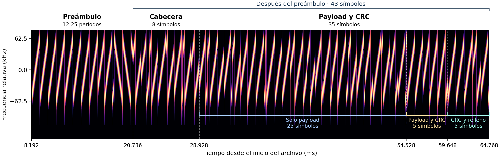
**Figura 4.** Paquete LoRa anotado sobre el espectrograma de las muestras I/Q.

[Ver figura ampliada](figures/anatomia-paquete-lora.png).

El eje horizontal mide el tiempo desde el inicio del archivo; el vertical, la frecuencia relativa al centro del canal. Las diagonales claras son los chirps. Cada símbolo dura **1.024 ms**, según la medición de la sección 2.

### 3.1. Abrir la señal I/Q de la Figura 4

La muestra `correcto.sigmf-data` fue generada con GNU Radio a partir de los bytes del paquete 258 de `03_Brno_join.pcap`, recibido en Brno a 867.9 MHz con SF8. Aquí se volvió a modular con SF7. Los **915 MHz son la referencia de la simulación**, sin transmisión por aire. [Origen de la trama](https://zenodo.org/records/8090619).

Las rutas siguientes parten de la raíz de `sdr`, donde está `mkdocs.yml`.

| Archivo | Ruta relativa | Contenido |
|---|---|---|
| Muestras | `output/lorawan-iq/correcto.sigmf-data` | 113 920 muestras complejas. |
| Metadatos | `output/lorawan-iq/correcto.sigmf-meta` | Formato `cf32_le`, tasa de 1 Msps y frecuencia de referencia. |

En `cf32_le`, cada muestra guarda **I y luego Q**, cada componente como un número de 32 bits en coma flotante y orden *little endian*. Un par I/Q ocupa ocho bytes. A 1 Msps, las muestras están separadas por 1 µs. [Formato SigMF](https://sigmf.org/#sigmf-dataset-format).

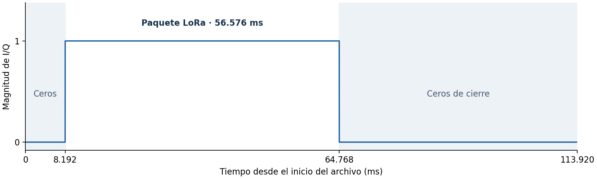
**Figura 5.** Ubicación del paquete dentro del archivo I/Q.

??? tip "Abrir la señal de la Figura 4 en Inspectrum"

    1. Abrir una terminal en la raíz de `sdr`, con **Radioconda activo**. En Windows, usar **Radioconda Prompt**. Generar la muestra si aún no existe:

        ```bash
        python scripts/sesion08_lora/verificar_lorawan_iq.py --salida output/lorawan-iq
        ```

        El programa crea la carpeta y guarda juntos los archivos `.sigmf-data` y `.sigmf-meta`. Requiere `gr-lora_sdr` y `cryptography`. Debe terminar con `Controles aprobados. Informe: output/lorawan-iq/verificacion.json`.

    2. En **Linux (Ubuntu/Debian)**, salir de Radioconda y usar Inspectrum del sistema:

        ```bash
        conda deactivate
        /usr/bin/inspectrum --rate 1000000 --format cf32 output/lorawan-iq/correcto.sigmf-data
        ```

        Algunas compilaciones de `libliquid` incluidas en Radioconda pueden cerrarse con `Instrucción ilegal` por incompatibilidad con la CPU. Usar `/usr/bin/inspectrum` evita esa compilación. [Instalación en Linux](../../setup/instalacion.md#inspectrum-en-linux) · [Fallo documentado](https://github.com/radioconda/radioconda-installer/issues/134).

        En **Windows**, mantener Radioconda activo:

        ```bat
        inspectrum --rate 1000000 --format cf32 output/lorawan-iq/correcto.sigmf-data
        ```

    3. Verificar **Sample rate = 1000000**. El comando indica explícitamente formato y tasa; también funciona con Inspectrum 0.2.3, que no lee los metadatos SigMF. **1 Msps** es la tasa de muestras; **125 kHz**, el ancho de banda del chirp. [Formatos de Inspectrum 0.2.3](https://github.com/miek/inspectrum/blob/v0.2.3/README.md#input).

### 3.2. Medir y contar 43 símbolos

El preámbulo contiene ocho chirps ascendentes repetidos, dos de sincronización y dos descendentes y un cuarto. Su estructura permite detectar el paquete y alinear los símbolos. En **SF7 con cabecera explícita**, los ocho símbolos siguientes forman el bloque de cabecera. Esta estructura pertenece a la **capa física LoRa**; la especificación LoRaWAN se usará en la sección 4 para interpretar el contenido recuperado. [Preámbulo y cabecera, Tapparel y Burg, §§2.2, 2.7 y 2.9](https://pubs.gnuradio.org/index.php/grcon/article/download/145/123/390#page=2).

1. Activar **Scales** y **Enable cursors**. Medir cuatro chirps repetidos, entre 9.216 y 13.312 ms: **Period ≈ 4.096 ms** y **Symbol period ≈ 1.024 ms**.
2. Poner el cursor izquierdo al terminar el cierre del preámbulo, en **20.736 ms**, y el derecho al final del paquete, en **64.768 ms**.
3. Dividir **Period = 44.032 ms** entre **1.024 ms**: se cuentan **43 símbolos**. Poner **Symbols = 43** para comprobar la cuadrícula.

| Tramo | Inicio (ms) | Fin (ms) | Períodos de símbolo |
|---|---:|---:|---:|
| Chirps ascendentes repetidos | 8.192 | 16.384 | 8 |
| Sincronización | 16.384 | 18.432 | 2 |
| Cierre del preámbulo | 18.432 | 20.736 | 2¼ |
| **Después del preámbulo** | **20.736** | **64.768** | **43** |
| Cabecera física, primer bloque SF7 | 20.736 | 28.928 | 8 |
| Cuerpo por decodificar | 28.928 | 64.768 | 35 |

Inspectrum usa segundos en el eje temporal: `0.020736` equivale a 20.736 ms. Para medir el cierre, dividir **Period** entre 1.024 ms; **Symbols** solo acepta enteros. Los reinicios de frecuencia pueden ocurrir dentro de un símbolo: contar con la cuadrícula temporal. [Cursores de Inspectrum](https://github.com/miek/inspectrum/blob/v0.3.1/src/spectrogramcontrols.cpp#L195-L205).

### 3.3. Pasar de los chirps al bloque de 301 bits

El receptor sincroniza la señal y multiplica cada chirp por un chirp de referencia conjugado: el **dechirp**. Una FFT identifica el índice entre 0 y 127. Lo representamos con siete bits, por lo que los 43 índices ocupan **$43\times7=301$ posiciones binarias**. Son índices de símbolos que aún requieren decodificación. [Demodulación en `gr-lora_sdr`](https://github.com/tapparelj/gr-lora_sdr/blob/a8143cb/lib/fft_demod_impl.cc#L74-L117).

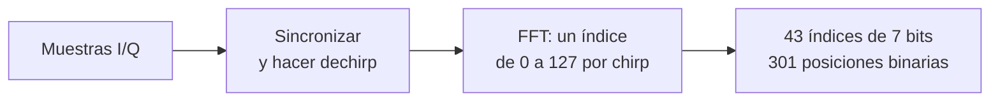

En **Linux, volver a activar Radioconda** para ejecutar GNU Radio. Abrir otra terminal si se desea mantener Inspectrum abierto:

```bash
conda activate base
python scripts/sesion08_lora/inspeccionar_lora.py --etapa simbolos
```

El script lee el archivo I/Q y observa las etapas del receptor. No utiliza la secuencia conocida del transmisor. Imprime los **301 bits completos**, agrupados por índice, con el bit de mayor peso a la izquierda:

```text
01-08 (cabecera): 1011001 0110001 1100001 0000001 1101001 0010001 1100001 1001001
09-15 (cuerpo):   0011110 1011011 1100000 0011000 1011010 0010110 0010100
16-22 (cuerpo):   0010111 1110001 1101111 0000010 0111101 0111000 1001100
23-29 (cuerpo):   0100000 0010111 0100110 0100110 1011010 0010000 0101001
30-36 (cuerpo):   0000101 1101000 0101001 0010000 1111000 1111011 0011011
37-43 (cuerpo):   0011111 0100010 0000001 1111111 0000001 1000000 0010000
```

Las etiquetas 01–43 numeran los símbolos desde el final del preámbulo. El archivo **`output/lorawan-iq/traza/01_simbolos_bits.txt`** guarda los 301 bits en una sola línea sin espacios; sus primeros 56 corresponden a los ocho índices de cabecera.

### 3.4. Seleccionar y decodificar los 56 bits de cabecera

```bash
python scripts/sesion08_lora/inspeccionar_lora.py --etapa cabecera
```

La cabecera seleccionada es:

```text
1011001 0110001 1100001 0000001 1101001 0010001 1100001 1001001
```

Los campos Longitud, CR y Presencia de CRC se leerán **después de estas transformaciones**:

1. **Ajustar los índices y aplicar Gray.** En el primer bloque, el receptor calcula `u = ((indice - 1) % 128) // 4` y `g = u ^ (u >> 1)`. Cada índice de siete bits proporciona una fila de cinco bits: **ocho filas, 40 bits**. La reducción corresponde al tratamiento especial de la cabecera. [Ajuste del primer bloque](https://github.com/tapparelj/gr-lora_sdr/blob/a8143cb/lib/fft_demod_impl.cc#L284-L290) · [Mapeo Gray](https://github.com/tapparelj/gr-lora_sdr/blob/a8143cb/lib/gray_mapping_impl.cc#L56-L62).
2. **Desentrelazar.** Reorganizar esas ocho filas de cinco bits en **cinco palabras de ocho bits**. Se conservan los 40 bits; cambia su posición. [Permutación inversa](https://github.com/tapparelj/gr-lora_sdr/blob/a8143cb/lib/deinterleaver_impl.cc#L89-L118).
3. **Decodificar la protección FEC 4/8 de la cabecera.** Cada palabra de ocho bits entrega cuatro bits, recuperando también su orden. Resultan **20 bits decodificados**. La cabecera tiene esta protección fija para poder leer el CR que se usará en el cuerpo. [Decodificación FEC](https://github.com/tapparelj/gr-lora_sdr/blob/a8143cb/lib/hamming_dec_impl.cc#L119-L166).

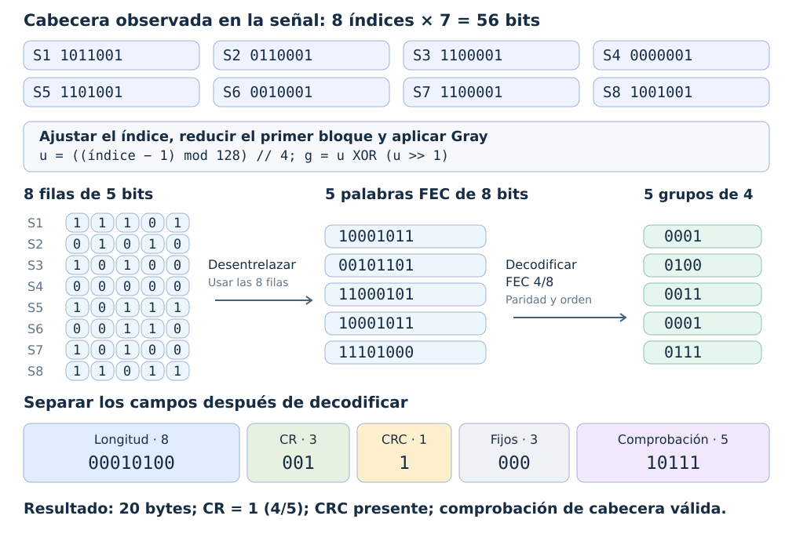
**De la cabecera recibida a sus campos.** Todos los valores proceden de la ejecución del script sobre la muestra.

!!! note "Seguir cada etapa con su entrada y su salida"

    Para S1, la recepción sigue **`1011001` → `1011000` → `10110` → `11101`**. Se resta uno, se divide entre cuatro y se aplica Gray. La operación es **`10110 XOR 01011 = 11101`**.

    `11101` es una **fila entrelazada de cinco bits**. Sus bits se reparten entre cinco palabras FEC: **no se convierte por sí sola en `10001011`**. Esa primera palabra se construye con un bit de cada una de las ocho filas. Tampoco se divide `1110100` entre cuatro: ese valor aparece al explicar el transmisor, antes de la conversión inversa de Gray.

??? example "A. Transmisor: por qué existen la resta de uno y las dos posiciones adicionales"

    Para entender lo que deshace el receptor, reconstruimos primero el **mapeo de una fila en el transmisor**, después del entrelazado. La fila S1 es `11101`. En el primer bloque SF7, el transmisor añade un bit de paridad y un cero fijo:

    ```text
    Fila entrelazada     Paridad XOR     Cero fijo
         11101                0              0
    Fila ampliada:             11101 | 0 | 0 = 1110100
    ```

    La paridad vale cero porque `1 XOR 1 XOR 1 XOR 0 XOR 1 = 0`. El primer bloque utiliza este tratamiento para proteger la lectura de la cabecera. Las dos posiciones adicionales están determinadas por la fila: **no contienen dos bits nuevos de Longitud, CR o CRC**. En ocho símbolos son **ocho paridades y ocho ceros**, 16 posiciones adicionales respecto a los 40 bits del entrelazador. Se describen así **antes del mapeo**, pues después sus posiciones binarias cambian. [Construcción de paridad y cero](https://github.com/tapparelj/gr-lora_sdr/blob/a8143cb/lib/interleaver_impl.cc#L184-L194).

    El transmisor interpreta `1110100` como una etiqueta Gray y obtiene su valor binario mediante la **conversión inversa de Gray**. Se copia el primer bit; cada siguiente bit de salida es el XOR entre **el bit binario ya obtenido a su izquierda** y **el bit Gray actual**:

    | Posición, de izquierda a derecha | Bit Gray | Operación | Bit binario obtenido |
    |---|---:|---|---:|
    | 1 | 1 | Copiar el primer bit | 1 |
    | 2 | 1 | `1 XOR 1` | 0 |
    | 3 | 1 | `0 XOR 1` | 1 |
    | 4 | 0 | `1 XOR 0` | 1 |
    | 5 | 1 | `1 XOR 1` | 0 |
    | 6 | 0 | `0 XOR 0` | 0 |
    | 7 | 0 | `0 XOR 0` | 0 |

    Leyendo la última columna se obtiene `1011000`, cuyo valor es $64+16+8=88$. El transmisor añade un **desplazamiento convencional de +1** al índice, con módulo 128. Por eso el chirp emitido tiene índice 89:

    ```text
    Fila ampliada     Inversa Gray      Sumar 1, módulo 128
       1110100     →     1011000      →       1011001
                           88                    89
    ```

    La resta de uno en recepción **deshace ese +1**; no corrige un error de medición. [Mapeo del transmisor](https://github.com/tapparelj/gr-lora_sdr/blob/a8143cb/lib/gray_demap_impl.cc#L57-L66).

    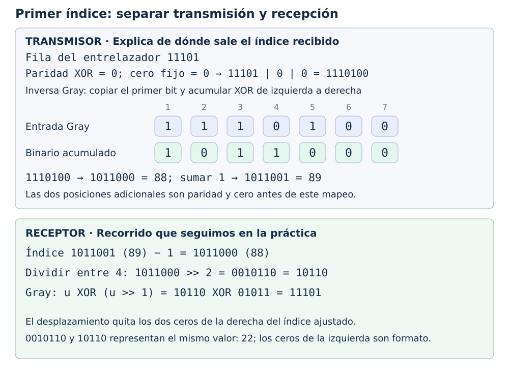

??? example "B. Receptor: dividir entre cuatro, escribir cinco bits y aplicar Gray"

    El primer índice recibido es `1011001`, es decir, 89. Se elimina el desplazamiento del transmisor:

    ```text
    (89 − 1) mod 128 = 88 = 1011000
    ```

    Con la construcción de paridad y cero seguida del mapeo, los 32 índices ideales del primer bloque son `1, 5, 9, …, 125`. Tras restar uno quedan `0, 4, 8, …, 124`. **Dividir entre cuatro identifica cuál de las 32 posibilidades se recibió**, con un resultado entre 0 y 31: se necesitan cinco bits, $SF-2=5$.

    ```text
    Índice ajustado:        10110|00 = 88
    Desplazar 2 a derecha:  00|10110 = 22
    Escribir con 5 bits:       10110 = 22
    ```

    La división entera entre cuatro equivale a desplazar dos posiciones a la derecha. En este ejemplo, salen **los dos ceros de la derecha de `1011000`**. Los dos ceros a la izquierda de `0010110` solo aparecen si mantenemos una presentación de siete posiciones: **`0010110` y `10110` son el mismo número, 22**. Quitar ceros iniciales de presentación no elimina información. [Resta modular y reducción del receptor](https://github.com/tapparelj/gr-lora_sdr/blob/a8143cb/lib/fft_demod_impl.cc#L284-L290).

    A continuación se aplica Gray al valor reducido `u = 10110`:

    ```text
    u:                     10110
    u >> 1:                01011
                           -----
    u XOR (u >> 1):        11101
    ```

    **`01011` es el valor desplazado, no el resultado del XOR.** Gray conserva los cinco bits y recupera la fila que necesita el desentrelazador. La asignación Gray hace que índices reducidos vecinos tengan etiquetas que difieren en un solo bit: limita los errores binarios cuando se confunden símbolos vecinos. En el transmisor se usó la conversión inversa; en el receptor se aplica `u XOR (u >> 1)`. [Gray en el receptor](https://github.com/tapparelj/gr-lora_sdr/blob/a8143cb/lib/gray_mapping_impl.cc#L56-L62).

    El balance de esta etapa es **ocho índices de siete posiciones → ocho filas de cinco bits: 56 → 40**. Estos 40 bits todavía contienen la protección FEC de la cabecera.

??? example "C. Desentrelazado: cómo las ocho filas forman 10001011"

    Después de Gray se tienen **las ocho filas**, no solo S1:

    ```text
         Bit: 12345
    S1        11101
    S2        01010
    S3        10100
    S4        00000
    S5        10111
    S6        00110
    S7        10100
    S8        11011
    ```

    El desentrelazador invierte una permutación diagonal conocida por el transmisor y el receptor. **La posición se calcula primero; después se lee si en ella hay un cero o un uno.** Para construir **la primera palabra**, numerando filas y bits desde uno, se usa:

    $$
    \boxed{c(r)=\big((r-2)\bmod5\big)+1}.
    $$

    Aquí, $r$ es el número de fila, de 1 a 8, y $c(r)$ es la columna o bit seleccionado, de 1 a 5. El **5** es la cantidad de bits de cada fila. El módulo devuelve un valor entre 0 y 4, y el **+1** lo convierte en una columna numerada desde uno. Permite avanzar circularmente: después de la columna 5 vuelve la 1.

    **¿Por qué aparece $r-2$ y se empieza en la columna 5?** El código numera desde cero y asigna cada bit a la palabra `k = (i-j-1) % 5`, donde `i` es la fila y `j` la columna. Para la primera palabra, `k = 0`, por lo que `j = (i-1) % 5`. Al cambiar a la numeración de la tabla, `r = i+1` y `c = j+1`, resulta la fórmula anterior. El desplazamiento inicial es parte de la permutación; no depende del valor de los bits.

    Aplicamos la fórmula a **cada fila**:

    | Fila $r$ | Cálculo de $c(r)$ | Bit seleccionado |
    |---|---|---:|
    | S1, $r=1$ | $(-1\bmod5)+1=4+1$ | **5** |
    | S2, $r=2$ | $(0\bmod5)+1=0+1$ | **1** |
    | S3, $r=3$ | $(1\bmod5)+1=1+1$ | **2** |
    | S4, $r=4$ | $(2\bmod5)+1=2+1$ | **3** |
    | S5, $r=5$ | $(3\bmod5)+1=3+1$ | **4** |
    | S6, $r=6$ | $(4\bmod5)+1=4+1$ | **5** |
    | S7, $r=7$ | $(5\bmod5)+1=0+1$ | **1** |
    | S8, $r=8$ | $(6\bmod5)+1=1+1$ | **2** |

    En S1, $-1\bmod5=4$ porque $-1=(-1)\times5+4$. Así queda justificado el recorrido **5, 1, 2, 3, 4, 5, 1, 2**. Aunque cambien los valores de la señal, estas posiciones se mantienen para esta configuración. Ahora se leen los bits de esas posiciones:

    | Fila | Bit seleccionado | Valor | Posición en la primera palabra |
    |---|---:|---:|---:|
    | S1 | 5 | 1 | 1 |
    | S2 | 1 | 0 | 2 |
    | S3 | 2 | 0 | 3 |
    | S4 | 3 | 0 | 4 |
    | S5 | 4 | 1 | 5 |
    | S6 | 5 | 0 | 6 |
    | S7 | 1 | 1 | 7 |
    | S8 | 2 | 1 | 8 |

    Leer la columna Valor de arriba abajo produce **`10001011`**. El último bit de S1 pasa a ser el primero de esta palabra; los otros cuatro bits de S1 van a las otras cuatro palabras. **No se añaden bits a `11101` ni a `01011` para formar la palabra.** Se redistribuyen los 40 bits existentes: $8\times5=5\times8$.

    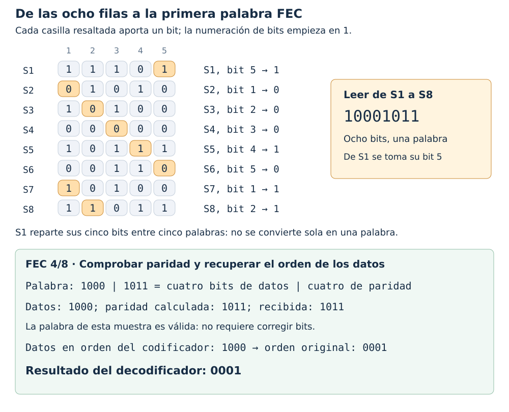

    En el código, con índices desde cero, la asignación es `palabras[(i-j-1) % 5][i] = filas[i][j]`. Así se obtiene también cada una de las otras cuatro palabras. [Permutación del desentrelazador](https://github.com/tapparelj/gr-lora_sdr/blob/a8143cb/lib/deinterleaver_impl.cc#L89-L118).

??? example "D. FEC 4/8: por qué 10001011 entrega 0001"

    La cabecera usa un código Hamming extendido **4/8**: cada grupo original de cuatro bits se representa mediante una palabra de ocho. En el orden que usa esta implementación:

    ```text
    Palabra recibida:      1000 | 1011
                          datos  paridad
    ```

    Para comprobar esta palabra de la muestra, nombramos los cuatro bits de la izquierda `d0 d1 d2 d3 = 1 0 0 0`. Sus cuatro paridades son:

    ```text
    p0 = d0 XOR d1 XOR d2 = 1 XOR 0 XOR 0 = 1
    p1 = d1 XOR d2 XOR d3 = 0 XOR 0 XOR 0 = 0
    p2 = d0 XOR d1 XOR d3 = 1 XOR 0 XOR 0 = 1
    p3 = d0 XOR d2 XOR d3 = 1 XOR 0 XOR 0 = 1
    ```

    La paridad calculada, **`1011`**, coincide con la recibida. En esta muestra la palabra es válida y no requiere corrección. El decodificador usa la redundancia para comprobar la palabra y corregir un error de un bit cuando corresponde; no consiste en dividir el número entre dos. [Construcción de las palabras FEC](https://github.com/tapparelj/gr-lora_sdr/blob/a8143cb/lib/hamming_enc_impl.cc#L96-L106).

    Falta recuperar **el orden original de los cuatro bits**. El codificador los colocó con el bit menos significativo primero. Por ello, el decodificador invierte los cuatro bits de datos:

    ```text
    10001011 → comprobar paridad → 1000 → invertir orden → 0001
    ```

    Ese es el motivo de la transición **`10001011 → 0001`**. La inversión pertenece a la convención de orden de esta implementación, no es la definición de la tasa 4/8. [Recuperación del orden y corrección en el decodificador](https://github.com/tapparelj/gr-lora_sdr/blob/a8143cb/lib/hamming_dec_impl.cc#L119-L166).

La terminal muestra las cinco palabras y sus grupos decodificados:

```text
10001011 -> 0001
00101101 -> 0100
11000101 -> 0011
10001011 -> 0001
11101000 -> 0111
```

Al concatenar los cinco grupos y aplicar el formato de cabecera se obtiene:

```text
Longitud | CR  | CRC | Fijos | Comprobación
00010100 | 001 | 1   | 000   | 10111
 8 bits    3     1     3        5       = 20 bits
```

| Campo | Valor recuperado | Interpretación |
|---|---|---|
| Longitud | `00010100` = `0x14` = **20** | El contenido tiene 20 bytes, sin contar el CRC físico. |
| CR | `001` = **1** | El índice 1 indica tasa **$4/(4+1)=4/5$** para el cuerpo. |
| Presencia de CRC | **1** | El contenido lleva un CRC físico adicional de dos bytes. |
| Fijos | `000` | Posiciones fijas del formato de cabecera. |
| Comprobación de cabecera | `10111` | El receptor comprueba este valor y obtiene **cabecera válida**. |

**La longitud de 20 bytes se ha obtenido de la cabecera recibida.** El script inicia el receptor con longitud 255, CR 4 y CRC desactivado; en modo explícito, los valores recibidos reemplazan esos valores iniciales. [Lectura y comprobación de la cabecera](https://github.com/tapparelj/gr-lora_sdr/blob/a8143cb/lib/header_decoder_impl.cc#L121-L160).

??? info "Referencias para los alumnos: capa física LoRa y formato LoRaWAN"

    Las operaciones de esta sección pertenecen a la **capa física LoRa**. La especificación **LoRaWAN L2 1.0.4 no detalla la conversión Gray, el ajuste del índice ni la permutación de los bits**. Para estudiarlas se usa el artículo *Design and Implementation of LoRa Physical Layer in GNU Radio*, de Tapparel y Burg, que describe la implementación compatible con radios comerciales a partir de ingeniería inversa. Se distingue esta fuente técnica de la especificación normativa LoRaWAN.

    | Lectura | Ubicación exacta |
    |---|---|
    | Campos de la cabecera física | [§2.2 y Figura 3, página 2 del artículo](https://pubs.gnuradio.org/index.php/grcon/article/download/145/123/390#page=2) |
    | Codificación FEC | [§2.4, página 2 del artículo](https://pubs.gnuradio.org/index.php/grcon/article/download/145/123/390#page=2) |
    | Entrelazado, paridad y cero adicional | [§2.5, página 3 del artículo](https://pubs.gnuradio.org/index.php/grcon/article/download/145/123/390#page=3) |
    | Gray y desplazamiento +1 | [§2.6, página 3 del artículo](https://pubs.gnuradio.org/index.php/grcon/article/download/145/123/390#page=3) |
    | Parámetros fijos de protección del primer bloque | [§2.7, página 3 del artículo](https://pubs.gnuradio.org/index.php/grcon/article/download/145/123/390#page=3) |
    | Estructura de los 20 bytes de la Figura 6 | [LoRaWAN L2 1.0.4, §4, páginas 15–25](https://lora-alliance.org/wp-content/uploads/2021/11/LoRaWAN-Link-Layer-Specification-v1.0.4.pdf#page=15) |

### 3.5. Decodificar los 245 bits restantes hasta obtener 20 bytes

Seguiremos **las 35 filas completas** y sus siete bloques, con el mismo tipo de matrices que usamos para la cabecera. La cabecera informó **20 bytes de PHYPayload**, tasa **4/5** y **CRC físico presente**. Aquí «contenido» significa los 20 bytes completos de LoRaWAN, incluido su MIC, no solo el mensaje de aplicación. Un **nibble** es un grupo de **cuatro bits**, equivalente a un dígito hexadecimal; dos nibbles forman un byte.

Los scripts de esta sesión están agrupados en **`scripts/sesion08_lora/`**. Con Radioconda activo, ejecutar los comandos desde la raíz de `sdr`:

```bash
python scripts/sesion08_lora/inspeccionar_lora.py --etapa contenido
```

Ese comando muestra el recorrido completo del cuerpo. Para acompañar la lectura **una transición a la vez**, usar los comandos siguientes; también aparecen en la subsección que corresponde:

| Sección | Comando desde la raíz de `sdr` | Qué muestra en columnas |
|---|---|---|
| 3.5.1 | `python scripts/sesion08_lora/inspeccionar_lora.py --etapa gray` | Índice, resta de uno, desplazamiento y Gray, en B1–B7. |
| 3.5.2 | `python scripts/sesion08_lora/inspeccionar_lora.py --etapa desentrelazado` | Matriz de entrada, columnas seleccionadas y palabras FEC, por bloque. |
| 3.5.2 | `python scripts/sesion08_lora/inspeccionar_lora.py --etapa fec` | Datos, paridad recibida, paridad calculada y nibble recuperado. |
| 3.5.3 | `python scripts/sesion08_lora/inspeccionar_lora.py --etapa relleno` | Palabras conservadas y excluidas por su posición. |
| 3.5.4 | `python scripts/sesion08_lora/inspeccionar_lora.py --etapa bytes` | Nibbles bajo y alto, bloque de origen y byte reagrupado. |
| 3.5.5 | `python scripts/sesion08_lora/inspeccionar_lora.py --etapa blanqueo` | Byte de entrada, máscara y byte recuperado. |
| 3.5.6 | `python scripts/sesion08_lora/inspeccionar_lora.py --etapa crc` | Las cuatro palabras del CRC, sus dos bytes y el recálculo paso a paso. |
| 3.5.7 | `python scripts/sesion08_lora/inspeccionar_lora.py --etapa phypayload` | Los 20 bytes finales en binario y hexadecimal, agrupados por origen. |

Cada comando vuelve a recibir **la misma muestra I/Q** y comprueba las transiciones frente a las etapas reales de GNU Radio. Se puede ejecutar independientemente, sin copiar bits entre programas. `--etapa` selecciona la transición mostrada. Las figuras y las tablas de terminal usan los mismos datos recibidos.

Con `gray`, `desentrelazado`, `fec` y `relleno`, añadir **`--bloque 1`** o **`--bloque 7`** para centrarse en B1 o B7. Sin esa opción se muestran todos los bloques. En `bytes` y `blanqueo` se mantienen las parejas completas, incluidas las que cruzan de un bloque a otro; en `crc` se necesita todo el contenido para recalcular la comprobación.

El script guarda los informes completos en **`output/lorawan-iq/traza/`**: `05_gray.txt`, `06_desentrelazado.txt`, `07_fec.txt`, `08_relleno.txt`, `09_bytes.txt`, `10_blanqueo.txt`, `11_crc.txt` y `12_phypayload.txt`. La tabla filtrada por bloque se guarda además con un sufijo, por ejemplo, **`06_desentrelazado_B1.txt`**. El recorrido completo queda en `04_cuerpo.txt` y sus valores en `traza.json`.

#### 3.5.1. Los 245 bits en 35 filas de siete bits

```bash
python scripts/sesion08_lora/inspeccionar_lora.py --etapa gray
```

Se imprimen las 35 filas en siete tablas B1–B7. Sus columnas permiten seguir `índice → u → u >> 1 → g`, como en la figura. Para mostrar solo las cinco filas de B1, añadir `--bloque 1`.

Después de los ocho símbolos de cabecera quedan **$301-56=245$ posiciones binarias**, correspondientes a los símbolos **S09–S43**. Cada fila representa un índice de chirp escrito con siete bits. Primero restamos uno y aplicamos Gray:

```text
u = (indice - 1) % 128
g = u ^ (u >> 1)
```

En el cuerpo de esta muestra **no se divide entre cuatro**: la optimización de baja tasa de datos, **LDRO**, está desactivada para estos parámetros, y la reducción se aplica solo al primer bloque de cabecera. Por ejemplo, en S09:

```text
Índice: 0011110 = 30
u:      0011101 = 29
u >> 1: 0001110
Gray:   0011101 XOR 0001110 = 0010011
```

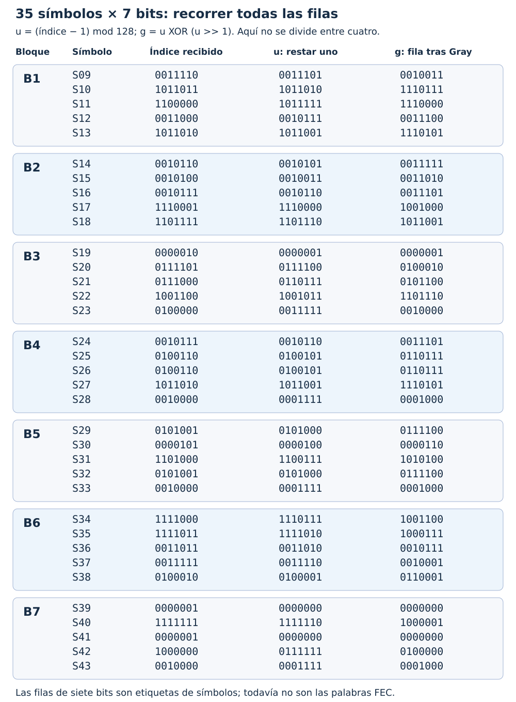
**Las 35 filas se muestran completas.** B1–B7 identifican los grupos de cinco símbolos que procesaremos por separado.

!!! note "Una fila de símbolo de siete bits no es una palabra FEC de siete bits"

    **SF7** determina los siete bits de la etiqueta de un símbolo. La **tasa 4/5** determina otra estructura: una palabra FEC de **cuatro bits de datos y uno de paridad**. El entrelazador reorganiza esas palabras para formar los símbolos. El receptor invierte esa reorganización. Por eso no se pasa de un código de siete bits a otro de cinco: se cambia la distribución de los mismos bits entre filas.

#### 3.5.2. Desentrelazar cinco filas de siete bits en siete palabras de cinco bits

Para acompañar el ejemplo B1, ejecutar:

```bash
python scripts/sesion08_lora/inspeccionar_lora.py --etapa desentrelazado --bloque 1
```

La primera tabla muestra la matriz de entrada; la segunda indica, para **cada una de las siete palabras**, las columnas seleccionadas en las cinco filas, los bits leídos y la palabra de salida. Quitar `--bloque 1` para repetir el proceso con B1–B7; cambiarlo por `--bloque 7` para estudiar el último bloque.

Una palabra FEC del cuerpo tiene cinco bits. El transmisor distribuye esos cinco bits entre **cinco símbolos**. Por eso el receptor toma cinco filas por bloque y deshace la permutación:

$$
\underbrace{5\text{ filas}\times7\text{ bits}}_{35\text{ bits tras Gray}}
=\underbrace{7\text{ palabras}\times5\text{ bits}}_{35\text{ bits FEC}}.
$$

**No se añaden ni se eliminan bits al desentrelazar.** Se reparten los 35 bits de la matriz de entrada en siete filas nuevas de cinco bits. La cabecera y el cuerpo usan dimensiones distintas:

| Región | Entrada al desentrelazador | Salida del desentrelazador |
|---|---|---|
| Cabecera SF7 | 8 filas de 5 bits | 5 palabras FEC de 8 bits |
| Cada bloque del cuerpo SF7, tasa 4/5 | 5 filas de 7 bits | 7 palabras FEC de 5 bits |

Como en la cabecera, se sigue una regla fija. Para la **primera palabra de cada bloque**, con filas locales $r=1,\ldots,5$ y columnas $c=1,\ldots,7$:

$$
c(r)=\big((r-2)\bmod7\big)+1.
$$

El módulo ahora es **7** porque hay siete columnas. Se seleccionan las columnas **7, 1, 2, 3, 4**. En B1:

| Fila | Siete bits tras Gray | Columna seleccionada | Bit leído |
|---|---|---:|---:|
| S09 | `0010011` | 7 | 1 |
| S10 | `1110111` | 1 | 1 |
| S11 | `1110000` | 2 | 1 |
| S12 | `0011100` | 3 | 1 |
| S13 | `1110101` | 4 | 0 |

La primera palabra es **P01 = `11110`**. Para obtener las otras seis palabras se seleccionan otras diagonales de la misma matriz. En el código, con índices locales desde cero, se usa `palabras[(i-j-1) % 7][i] = filas[i][j]`. Los índices locales se reinician en cada bloque. [Permutación del desentrelazador](https://github.com/tapparelj/gr-lora_sdr/blob/a8143cb/lib/deinterleaver_impl.cc#L89-L118).

**Ahora sí se decodifica cada palabra a tasa 4/5.** Se comprueba el bit de paridad haciendo XOR de los cuatro bits de datos y se restaura su orden, igual que en la cabecera. La diferencia es que aquí hay **una paridad**, no cuatro:

```bash
python scripts/sesion08_lora/inspeccionar_lora.py --etapa fec --bloque 1
```

Las columnas separan la palabra FEC, sus cuatro datos, la paridad recibida `p RX`, la recalculada `p XOR` y el nibble en orden original. Quitar `--bloque 1` para mostrar las 49 palabras de los siete bloques, incluido el relleno que se clasificará en la subsección siguiente.

```text
P01: 1111 | 0 → 1 XOR 1 XOR 1 XOR 1 = 0 → datos en orden original: 1111
P02: 1110 | 1 → 1 XOR 1 XOR 1 XOR 0 = 1 → datos en orden original: 0111
      datos  p
```

En esta muestra las paridades coinciden. La primera palabra entrega el nibble `1111` y la segunda, `0111`. Cada palabra conserva cuatro bits de datos y deja de transportar su bit de comprobación. La tasa 4/5 aporta una comprobación de paridad; por sí sola no permite localizar y corregir cualquier error de un bit. [Codificación 4/5](https://github.com/tapparelj/gr-lora_sdr/blob/a8143cb/lib/hamming_enc_impl.cc#L108-L111).

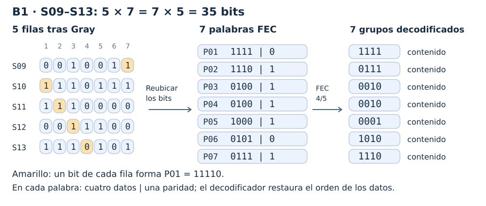
**B1 completo.** Las casillas amarillas forman P01. Los cinco bits de una fila se repartían entre palabras en la cabecera; aquí los siete bits de una fila se reparten entre **siete** palabras.

#### 3.5.3. Los siete bloques y el origen de las cinco palabras de relleno

```bash
python scripts/sesion08_lora/inspeccionar_lora.py --etapa relleno
```

Se muestran las decisiones `CONSERVAR` o `EXCLUIR` para cada palabra, agrupadas en B1–B7. Para centrarse en las cinco palabras de relleno del último bloque:

```bash
python scripts/sesion08_lora/inspeccionar_lora.py --etapa relleno --bloque 7
```

Hay 35 símbolos y se procesan de cinco en cinco:

$$
35/5=7\text{ bloques};\qquad7\text{ bloques}\times7\text{ palabras}=49\text{ palabras}.
$$

La cabecera indica 20 bytes y CRC presente. Cada byte corresponde a dos nibbles de cuatro bits; cada nibble necesita una palabra FEC:

- **Contenido:** $20\times2=40$ palabras, P01–P40.
- **CRC físico:** $2\times2=4$ palabras, P41–P44.
- **Total necesario:** $40+4=44$ palabras.

El último bloque tiene siete posiciones de palabras, pero solo quedan dos nibbles de CRC por transportar. El transmisor completa las otras cinco posiciones con palabras de ceros. **De aquí salen las cinco palabras de relleno:** $49-44=5$. Cada una ocupa cinco bits codificados, de modo que el relleno ocupa **$5\times5=25$ bits**. [Relleno de posiciones vacías en el transmisor](https://github.com/tapparelj/gr-lora_sdr/blob/a8143cb/lib/interleaver_impl.cc#L159-L170).

| Bloque | Símbolos | Palabras obtenidas | Uso de sus palabras |
|---|---|---|---|
| B1 | S09–S13 | P01–P07 | 7 de contenido |
| B2 | S14–S18 | P08–P14 | 7 de contenido |
| B3 | S19–S23 | P15–P21 | 7 de contenido |
| B4 | S24–S28 | P22–P28 | 7 de contenido |
| B5 | S29–S33 | P29–P35 | 7 de contenido |
| B6 | S34–S38 | P36–P42 | 5 de contenido y 2 de CRC |
| B7 | S39–S43 | P43–P49 | 2 de CRC y **5 de relleno** |

Se pueden inspeccionar **todos** los bloques restantes. Cada figura muestra sus cinco filas, sus siete palabras y sus siete nibbles. Los rótulos distinguen contenido, CRC y relleno:

??? example "B2 completo · S14–S18 y P08–P14"

    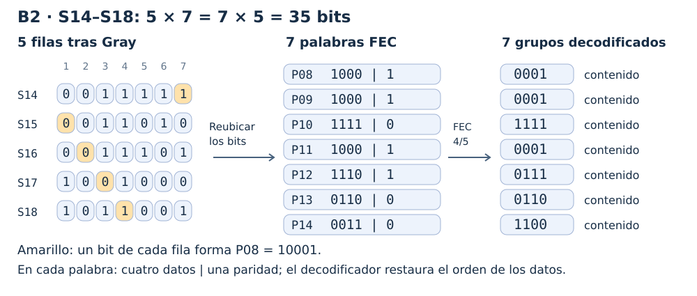

??? example "B3 completo · S19–S23 y P15–P21"

    

??? example "B4 completo · S24–S28 y P22–P28"

    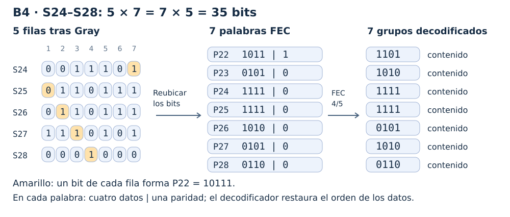

??? example "B5 completo · S29–S33 y P29–P35"

    

??? example "B6 completo · Final del contenido y comienzo del CRC"

    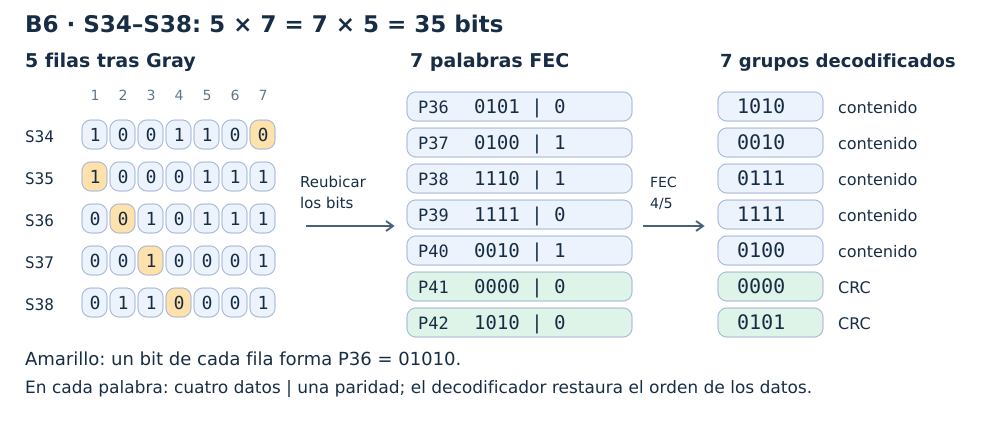

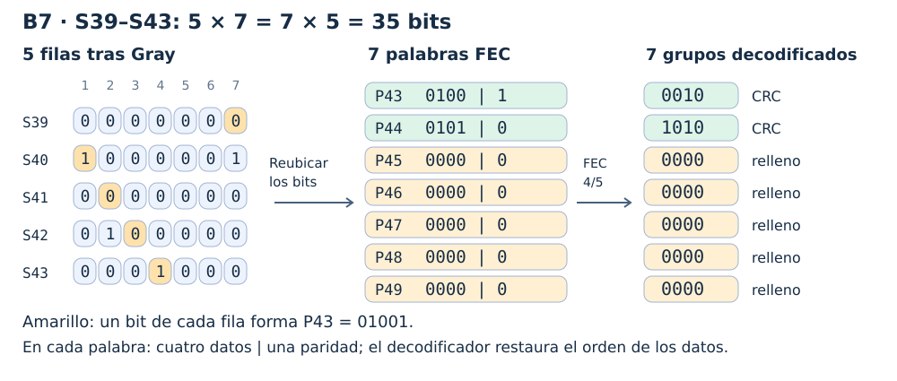
**B7 completo: el relleno es visible.** P43 y P44 pertenecen al CRC. P45, P46, P47, P48 y P49 son `00000` y se excluyen por su posición y por la longitud anunciada. Un `00000` dentro de P01–P44 es un dato válido; **no se elimina una palabra solo porque tenga ceros**.

Después de excluir esas cinco palabras quedan **44 palabras de cinco bits = 220 bits codificados**, equivalentes a **44 nibbles de cuatro bits = 176 bits** al decodificar. En el comando `fec` se mostraron provisionalmente los 49 nibbles, incluido el relleno: $49\times4=196$ bits. Este comando excluye los cinco nibbles de relleno: $196-5\times4=176$. Contar antes o después de FEC lleva al mismo resultado útil: **160 bits de contenido y 16 de CRC**.

#### 3.5.4. Agrupar los 44 nibbles en 22 bytes

```bash
python scripts/sesion08_lora/inspeccionar_lora.py --etapa bytes
```

Las columnas presentan el byte, el bloque o bloques de origen, el nibble bajo, el alto y el byte reagrupado en binario y hexadecimal. Cada pareja se muestra en el grupo de su nibble bajo; la columna **Origen**, por ejemplo `B1/B2`, señala que sus nibbles vienen de bloques distintos. Así se muestran las 22 parejas una sola vez, sin perder las que cruzan un límite de bloque.

El receptor conserva los nibbles P01–P44 en orden. En el contenido y en el CRC, llega **primero el nibble bajo y luego el alto**. Para construir cada byte se escribe `alto | bajo`:

```text
P01 = 1111 (bajo)     P02 = 0111 (alto)
Byte 1 = 0111|1111 = 01111111 = 7f

P03 = 0010 (bajo)     P04 = 0010 (alto)
Byte 2 = 0010|0010 = 00100010 = 22
```

La expresión de Python es `byte = (nibble_alto << 4) | nibble_bajo`. Se repite con P05/P06 y así hasta P43/P44. Las parejas pueden atravesar el límite entre dos bloques: por ejemplo, P07 está en B1 y P08 en B2, y juntas forman el cuarto byte. Los bloques organizan el entrelazado, no los límites de los bytes.

Los **22 bytes antes de deshacer el blanqueo** son:

```text
Contenido, aún blanqueado (20 bytes):
7f 22 a1 1e f1 71 c6 85 0a cc da fa 5f 6a c8 33 95 ac 72 4f

CRC físico (2 bytes, sin blanqueo):
50 a2
```

La cantidad de bits se conserva al reagrupar: **$44\times4=22\times8=176$**. [Reagrupación de nibbles en bytes](https://github.com/tapparelj/gr-lora_sdr/blob/a8143cb/lib/dewhitening_impl.cc#L82-L95).

#### 3.5.5. Revertir el blanqueo: de 7f a 80 en el primer byte

```bash
python scripts/sesion08_lora/inspeccionar_lora.py --etapa blanqueo
```

Se muestran por bloque los bytes de entrada, las máscaras y los bytes de salida, en columnas de ocho bits. Los bytes del CRC aparecen con **`sin XOR`**. La columna hexadecimal permite comparar cada salida con la figura.

Antes de codificar, el transmisor mezcló cada byte de contenido con una **máscara conocida**, mediante XOR. El receptor aplica la misma máscara para recuperar el byte original, porque `(dato XOR mascara) XOR mascara = dato`. No necesita conocer previamente los bytes del mensaje.

La secuencia de máscaras empieza en **`ff fe fc f8 f0 e1 …`**. Se genera con un registro de ocho bits, estado inicial `ff` y polinomio $x^8+x^6+x^5+x^4+1$. Es una regla de la capa física; no es una clave criptográfica ni se deduce de los 20 bytes conocidos de la muestra. [Secuencia usada en `gr-lora_sdr`](https://github.com/tapparelj/gr-lora_sdr/blob/a8143cb/lib/tables.h#L4-L7).

Para el primer byte:

```text
Byte reagrupado:      01111111 = 7f
Máscara conocida:    11111111 = ff
                     --------
XOR, byte original:  10000000 = 80
```

Los siguientes dan `22 XOR fe = dc` y `a1 XOR fc = 5d`. La figura muestra **las 22 parejas**, con el nibble bajo y el alto, el byte reagrupado, la máscara y el resultado:

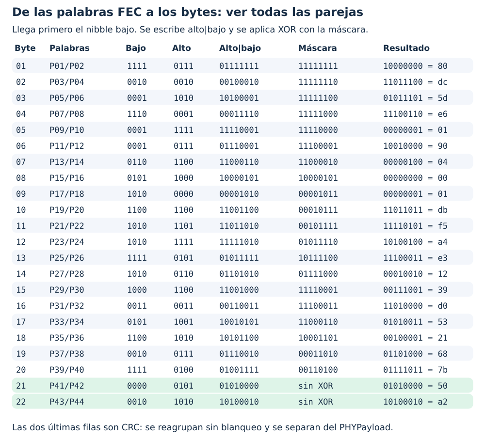

Los dos bytes de CRC se reagrupan **sin aplicar blanqueo**, como indican sus filas. Los 20 bytes de contenido ya quedan recuperados. Esto no descifra el mensaje de aplicación LoRaWAN: el FRMPayload sigue cifrado. [Desblanqueo en el receptor](https://github.com/tapparelj/gr-lora_sdr/blob/a8143cb/lib/dewhitening_impl.cc#L82-L95).

??? example "Generar las máscaras sin conocer el mensaje"

    Esta es la función `secuencia_blanqueo` del script. La máscara de cada byte depende solo del estado del registro:

    ```python
    estado = 0xff
    mascaras = []
    for _ in range(20):
        mascaras.append(estado)
        nuevo = ((estado >> 7) ^ (estado >> 5) ^
                 (estado >> 4) ^ (estado >> 3)) & 1
        estado = ((estado << 1) & 0xff) | nuevo
    print(bytes(mascaras).hex(' '))
    ```

    ```text
    ff fe fc f8 f0 e1 c2 85 0b 17 2f 5e bc 78 f1 e3 c6 8d 1a 34
    ```

#### 3.5.6. Comprobar los dos bytes de CRC y separarlos

```bash
python scripts/sesion08_lora/inspeccionar_lora.py --etapa crc
```

Primero se presentan las cuatro palabras de CRC en sus bloques B6 y B7, y las parejas que forman los dos bytes recibidos. Después, una tabla sigue el **estado del CRC antes y después de cada uno de los primeros 18 bytes de contenido**. La última tabla muestra el XOR con los dos últimos bytes del contenido y la comparación final con el CRC recibido.

La longitud anunciada es de 20 bytes y el indicador CRC vale uno. Por eso, después de esos 20 bytes, se esperan **dos bytes de CRC físico**. Sus nibbles proceden de las últimas cuatro palabras útiles:

| Palabras | Nibble bajo | Nibble alto | Byte reagrupado |
|---|---|---|---|
| P41 / P42 | `0000` | `0101` | `01010000` = **50** |
| P43 / P44 | `0010` | `1010` | `10100010` = **a2** |

El receptor **recalcula** el CRC a partir de los bytes de contenido recuperados y lo compara con esos dos bytes recibidos. La convención de LoRa usa el polinomio **`0x1021`**, estado inicial **`0x0000`**, sobre los primeros **N−2 bytes**; al resultado le aplica XOR con los dos últimos bytes de contenido, colocando el penúltimo en la parte alta. En esta muestra, $N=20$:

```text
CRC-16 sobre los primeros 18 bytes:             ca2b
Últimos dos bytes del contenido:               68 7b
XOR final:                         ca2b XOR 687b = a250

CRC recibido: bytes 50 a2, primero el de menor peso → a250
Comparación: a250 = a250 → CRC físico válido
```

Se separan los bytes `50 a2` y se conservan los **20 bytes = 160 bits de PHYPayload**. El MIC de LoRaWAN sigue dentro de esos 20 bytes; es otra comprobación y no se elimina aquí. [Cálculo y comparación del CRC físico](https://github.com/tapparelj/gr-lora_sdr/blob/a8143cb/lib/crc_verif_impl.cc#L100-L133).

??? example "Reproducir el cálculo del CRC en Python"

    El script implementa esta operación en `crc_lora`. `contenido` es la secuencia de 20 bytes ya desblanqueados:

    ```python
    crc = 0
    for byte in contenido[:-2]:
        crc ^= byte << 8
        for _ in range(8):
            if crc & 0x8000:
                crc = ((crc << 1) ^ 0x1021) & 0xffff
            else:
                crc = (crc << 1) & 0xffff
    crc ^= (contenido[-2] << 8) ^ contenido[-1]
    print(f'{crc:04x}')       # a250
    print(crc.to_bytes(2, 'little').hex(' '))  # 50 a2
    ```

#### 3.5.7. Resultado: los 160 bits de la Figura 6

```bash
python scripts/sesion08_lora/inspeccionar_lora.py --etapa phypayload
```

La salida presenta los 20 bytes en columnas de posición, origen, binario y hexadecimal. Solo aparecen los bytes de contenido; los dos bytes de CRC físico ya se separaron. Como algunos bytes atraviesan bloques, se conserva la misma columna **Origen** que en las transiciones anteriores.

Los bits recuperados, agrupados en los 20 bytes finales, son:

```text
10000000 11011100 01011101 11100110 00000001 10010000 00000100 00000000 00000001 11011011
11110101 10100100 11100011 00010010 00111001 11010000 01010011 00100001 01101000 01111011
```

En hexadecimal:

```text
80 dc 5d e6 01 90 04 00 01 db f5 a4 e3 12 39 d0 53 21 68 7b
```

El script los guarda en **`output/lorawan-iq/traza/03_phypayload.bin`**. No se obtuvieron cortando 160 posiciones del bloque original: se siguieron sus 35 símbolos, sus siete bloques, las 49 palabras, los 44 nibbles útiles y los 22 bytes, hasta separar el CRC físico. Ahora se pueden interpretar sus campos LoRaWAN en la Figura 6.

### 3.6. Volver a las marcas 8 + 25 + 5 + 5 de la Figura 4

Ahora se puede justificar la división anotada. Con SF7 y tasa 4/5, cada bloque de cuerpo reorganiza **siete palabras de cinco bits en cinco símbolos de siete bits**. Sus siete palabras representan $7\times4=28$ bits antes de codificar. Como $160=5\times28+20$:

| Símbolos desde el final del preámbulo | Cantidad | Qué se recupera |
|---|---:|---|
| 1–8 | 8 | Cabecera física. |
| 9–33 | 25 | Cinco bloques: $5\times28=140$ bits de contenido. |
| 34–38 | 5 | 20 bits restantes del contenido y ocho del CRC. |
| 39–43 | 5 | Ocho bits restantes del CRC y relleno. |

El conteo **43** se mide en la señal; la longitud **20 bytes** se lee en la cabecera. La separación detallada del cuerpo se obtiene después de decodificar. Otras longitudes, como 21 o 22 bytes, también pueden ocupar 43 símbolos porque requieren menos relleno.

En la sección 4 aplicaremos la **especificación LoRaWAN** a los 20 bytes recuperados para identificar dirección, contador, mensaje cifrado y MIC. La cabecera física informa cómo recuperar esos bytes; sus campos internos se interpretan con el formato LoRaWAN.

## 4. Campos de la trama LoRaWAN

La sección 3 recuperó los 20 bytes y comprobó el CRC físico. Ahora aplicaremos la **especificación LoRaWAN 1.0.4** para ubicar sus campos y extraer el mensaje cifrado. El origen conocido de la muestra identifica su contenido como LoRaWAN; un CRC físico válido por sí solo no identifica el protocolo que transporta LoRa.

### La especificación que permite interpretar los bytes

La sección 4 de **LoRaWAN L2 1.0.4 (TS001-1.0.4)** define la organización de las tramas. El primer byte, `MHDR`, informa el tipo de trama. En nuestra secuencia vale `80`, o `10000000` en binario: los tres bits superiores son `100`, que la especificación asigna a una **trama de datos ascendente que solicita confirmación**. Por ello se aplica el formato de datos de las secciones 4.1 a 4.3. El valor `00` de los dos bits inferiores indica la versión mayor R1; esos dos bits no identifican por sí solos la revisión 1.0.4. [Formato y tipos de trama, LoRaWAN 1.0.4, §§4.1–4.3](https://lora-alliance.org/wp-content/uploads/2021/11/LoRaWAN-Link-Layer-Specification-v1.0.4.pdf#page=15).

Para una **trama de datos**, las reglas son:

```text
PHYPayload = MHDR (1 byte) + MACPayload (variable) + MIC (4 bytes)
MACPayload = FHDR + FPort (si está presente) + FRMPayload (si está presente)
FHDR       = DevAddr (4 bytes) + FCtrl (1 byte) + FCnt (2 bytes) + FOpts (0 a 15 bytes)
```

`FPort` ocupa un byte cuando está presente. Los cuatro bits inferiores de `FCtrl` contienen `FOptsLen`, la cantidad de bytes de `FOpts`. Así, la longitud de `FHDR` es $4+1+2+FOptsLen=7+FOptsLen$ bytes. Una trama de datos puede tener `FHDR` sin `FPort` ni `FRMPayload`; en nuestro ejemplo están presentes los dos últimos campos. [Campos de datos y cabecera de trama, LoRaWAN 1.0.4, §4.3](https://lora-alliance.org/wp-content/uploads/2021/11/LoRaWAN-Link-Layer-Specification-v1.0.4.pdf#page=17).

### Aplicar el formato a la muestra: Figura 6

Numerar los bytes desde 1. Después de `MHDR`, la dirección ocupa los bytes 2–5; `FCtrl` es el byte 6 y `FCnt` ocupa 7–8. Como `FCtrl = 90` y $0x90\ \&\ 0x0F=0$, no hay `FOpts`: `FHDR` termina en el byte 8 y `FPort` está en el 9. Reservar los cuatro últimos bytes para el `MIC`, posiciones 17–20; quedan los bytes 10–16 para `FRMPayload`. **La Figura 6 representa el resultado de aplicar estas reglas a la secuencia recuperada.**

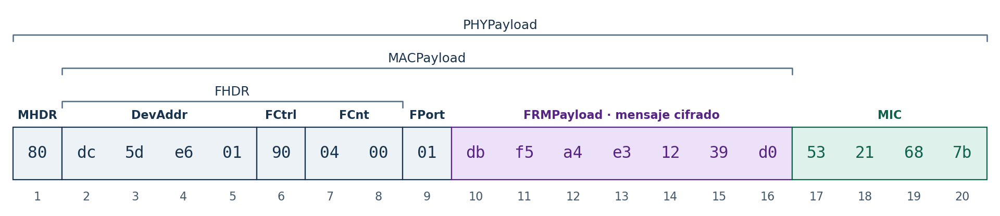
**Figura 6.** Interpretación de la trama recuperada según el formato de datos LoRaWAN.

[Ver figura ampliada](figures/anatomia-trama-lorawan.png).

- Los números inferiores indican la posición de cada byte. La cuenta empieza en 1.
- Las marcas superiores muestran qué bytes forman el `PHYPayload`, el `MACPayload` y la cabecera de trama `FHDR`.
- Aquí `FOptsLen = 0`. La cabecera `FHDR` termina en `FCnt` y el byte siguiente es `FPort`. La [sección 9](#9-reto-de-ubicacion-del-mensaje-cifrado-con-fopts) muestra el caso con opciones.
- El tramo morado contiene el mensaje cifrado. El tramo verde contiene el código de integridad. Identificar la posición del `MIC` no equivale a verificar su valor; esa comprobación se distingue del CRC físico en la sección 5.

Si el formato fuese desconocido, una sola secuencia no bastaría para asignar de forma concluyente esos nombres a sus bytes. Habría que comparar múltiples tramas, variar entradas conocidas y comprobar hipótesis sobre longitudes, direcciones, contadores e integridad. En esta práctica se utiliza la especificación publicada para interpretar una muestra de origen conocido.

### Cómo leer los campos

| Campo | Posiciones inclusive | Bytes en hexadecimal | Qué indica |
|---|---:|---|---|
| `MHDR` | 1 | `80` | Cabecera MAC. Los tres bits superiores son `100`, que identifican una trama ascendente que solicita confirmación. |
| `FHDR → DevAddr` | 2–5 | `dc 5d e6 01` | Dirección corta del dispositivo, `0x01e65ddc`. |
| `FHDR → FCtrl` | 6 | `90` | Control de trama. Sus cuatro bits inferiores indican `FOptsLen = 0`. |
| `FHDR → FCnt` | 7–8 | `04 00` | Los 16 bits bajos del contador de trama tienen valor 4. |
| `FHDR → FOpts` | — | — | Campo de opciones ausente porque su longitud es cero. |
| `FPort` | 9 | `01` | Puerto de aplicación 1. |
| `FRMPayload` | **10–16** | **`db f5 a4 e3 12 39 d0`** | **Siete bytes del mensaje de aplicación cifrado.** |
| `MIC` | 17–20 | `53 21 68 7b` | *Message Integrity Code*, código de integridad de la trama LoRaWAN. |

`DevAddr` y `FCnt` se transmiten en *little endian*, con el byte menos significativo primero. Por eso `04 00` representa el valor `0x0004`. La tabla conserva el orden en que llegan los bytes. [Orden de bytes, LoRaWAN 1.0.4, §1.1](https://lora-alliance.org/wp-content/uploads/2021/11/LoRaWAN-Link-Layer-Specification-v1.0.4.pdf#page=8).

### Cómo ubicar el mensaje cifrado

1. Leer `FCtrl`, en la posición 6. El dígito hexadecimal de la derecha en `90` es `0`. Ese es el valor de `FOptsLen`, la cantidad de bytes de opciones que siguen al contador.
2. Pasar esos bytes de opciones. Como hay cero, `FHDR` termina en la posición 8 y `FPort` ocupa la posición 9. El mensaje cifrado empieza en la posición 10.
3. Reservar los últimos cuatro bytes para el `MIC`. En esta trama de 20 bytes, el `MIC` empieza en la posición 17. El mensaje cifrado termina en la posición 16.

Si `FOptsLen` cambia, también se mueve `FPort` cuando está presente. La longitud total fija dónde empiezan los cuatro bytes del `MIC`. [Opciones, puerto, cifrado e integridad, LoRaWAN 1.0.4, §4.3.1.6–4.4](https://lora-alliance.org/wp-content/uploads/2021/11/LoRaWAN-Link-Layer-Specification-v1.0.4.pdf#page=23).

## 5. Replay: ¿puede un mensaje auténtico introducir datos engañosos?

Un investigador recupera una trama LoRaWAN válida y la guarda. Más tarde la reproduce **sin cambiar sus bytes**. ¿Puede conseguir que una aplicación IoT trate un dato antiguo como si fuera una medición actual? Este es el problema que estudiaremos mediante un ataque de **replay**, o repetición de una trama capturada.

### 5.1. Dónde se verifican el CRC, el MIC y FCnt

En este enlace ascendente, la señal sigue el recorrido **dispositivo → gateway → Network Server → Application Server**. El **gateway** recibe y demodula la radio; el **Network Server** es el servidor de red, que verifica el MIC y controla el contador; el **Application Server** es el servidor de aplicación, que descifra e interpreta el dato. Son funciones diferentes, aunque puedan ejecutarse en una misma computadora. [Arquitectura LoRaWAN](https://www.thethingsnetwork.org/docs/lorawan/architecture/).

| Operación | Dónde se realiza en este recorrido | Qué necesita y qué aporta |
|---|---|---|
| **Comprobar el CRC físico de LoRa** | **Gateway**, durante la recepción de radio. | Compara el CRC de los bytes recibidos con el CRC del paquete para detectar errores accidentales. No necesita una clave. |
| **Verificar el MIC de LoRaWAN** | **Network Server**. | Usa `NwkSKey`, los campos de la trama y su contexto para verificar integridad y autenticidad. |
| **Controlar `FCnt`** | **Network Server**. | Compara con el último contador válido conservado para el dispositivo, la sesión y el sentido. Evita reenviar a la aplicación datos antiguos o repetidos. |
| **Descifrar `FRMPayload`, con `FPort=1`** | **Application Server**. | Usa `AppSKey` y después interpreta la lectura, por ejemplo `temp=25`. |

El gateway reenvía el PHYPayload al servidor de red. En este recorrido no verifica el MIC ni decide si un contador es nuevo. El Network Server puede verificar el MIC sin descifrar el dato de aplicación: utiliza `NwkSKey`, mientras el Application Server utiliza `AppSKey`. [Funciones de las claves, LoRaWAN 1.0.4, §§6.1.2–6.1.3](https://lora-alliance.org/wp-content/uploads/2021/11/LoRaWAN-Link-Layer-Specification-v1.0.4.pdf#page=43).

**Alcance sobre la Figura 6:** el CRC físico comprueba los **bytes 1–20**, incluido el MIC. El MIC se calcula sobre los **bytes 1–16** (`MHDR + FHDR + FPort + FRMPayload` cifrado) y el contexto; sus cuatro bytes de resultado ocupan las posiciones **17–20**. Ninguno de los dos cifra el contenido: el cifrado del `FRMPayload` es una operación diferente. El MIC autentica el valor de `FCnt`; el historial del Network Server permite decidir si ese valor es nuevo.

**«Vulnerable» y «con control de FCnt» describen dos versiones simuladas del Network Server.** La diferencia del experimento está en ese componente. Cada camino tiene su propia aplicación para comparar el resultado; la clase `Receptor` del script agrupa la comprobación del gateway, las decisiones del servidor de red y el estado del servidor de aplicación. No son dos gateways físicos ni dos políticas de descifrado distintas.

**Una copia exacta conserva un CRC y un MIC válidos.** El MIC cubre el contador, pero no sabe qué tramas recibió antes el Network Server: esa memoria pertenece al estado de la sesión. Autenticar un mensaje y reconocer que es nuevo son comprobaciones diferentes. [MIC, LoRaWAN 1.0.4, §4.4](https://lora-alliance.org/wp-content/uploads/2021/11/LoRaWAN-Link-Layer-Specification-v1.0.4.pdf#page=25).

En la Figura 6, `04 00` ocupa los bytes 7–8 y representa `FCnt = 4` cuando los 16 bits superiores son cero. El contador completo tiene **32 bits**, aunque solo sus 16 bits inferiores viajan en `FHDR`. En una red real, el Network Server reconstruye el valor completo del uplink a partir de su estado. Nuestro experimento usa los valores 4 y 5, sin cambios de la parte alta. [Contadores, §4.3.1.5](https://lora-alliance.org/wp-content/uploads/2021/11/LoRaWAN-Link-Layer-Specification-v1.0.4.pdf#page=22).

### 5.2. Preparar dos lecturas y repetir la primera

Usaremos el mismo formato, dirección y claves públicas del ejemplo, pero generaremos **dos lecturas didácticas nuevas**. No son mensajes extraídos de la captura de Brno ni sustituyen los 20 bytes de la Figura 6.

| Entrada | Quién la produce | `FCnt` | Dato de aplicación antes del cifrado |
|---|---|---:|---|
| A: lectura normal | Emisor legítimo simulado | 4 | `temp=25` |
| B: lectura de alarma | Emisor legítimo simulado | 5 | `temp=80` |
| Replay de A | Atacante: copia íntegra de A | 4 | El mismo contenido cifrado de A |

Las dos lecturas tienen siete caracteres ASCII. Cada trama ocupa **20 bytes de PHYPayload**, con `FPort = 1`; el CRC físico tiene dos bytes adicionales. El emisor simulado cifra cada lectura y calcula su MIC y CRC. **La función del atacante solo copia A: no recibe las claves, no descifra y no calcula un MIC nuevo.**

Desde la raíz del repositorio, con Radioconda activo:

```bash
python scripts/sesion08_lora/simular_replay.py --etapa tramas
```

El comando muestra las lecturas, los contadores, el MIC, el CRC y los 20 bytes de cada trama en columnas numeradas. Comparar `A_normal` con `A_replay`: deben coincidir todos sus bytes. El contenido se muestra en claro únicamente para observar qué recibe la aplicación del laboratorio; por radio viajaría cifrado.

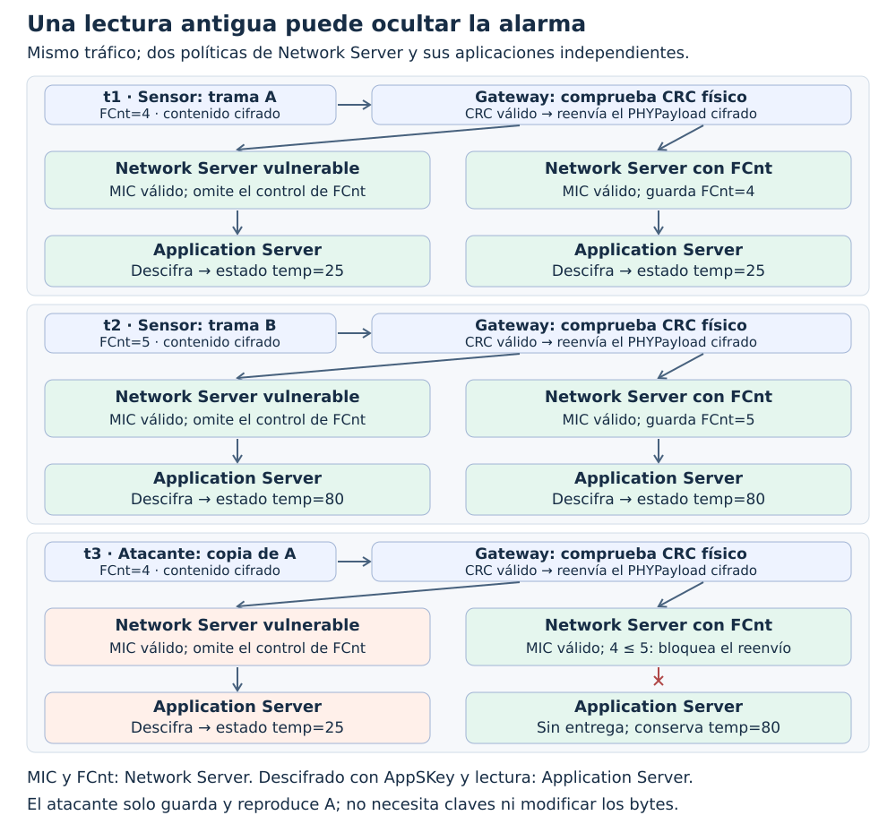
**Figura 7a.** Del gateway al servidor de red y al de aplicación. El replay alcanza de nuevo la aplicación únicamente por el camino cuyo Network Server omite el control de FCnt.

### 5.3. Comparar el Network Server vulnerable con el que verifica FCnt

```bash
python scripts/sesion08_lora/simular_replay.py --etapa replay
```

El script procesa A, después B y finalmente la copia de A. Compara dos caminos independientes con las mismas entradas. El CRC representa la comprobación del gateway; la verificación del MIC y la decisión de reenvío corresponden al Network Server; el dato descifrado y su estado corresponden al Application Server:

| Llegada | CRC y MIC | Network Server vulnerable → su Application Server | Network Server con FCnt → su Application Server |
|---|---|---|---|
| A, `FCnt=4` | Válidos | Reenvía; la aplicación muestra `temp=25`. | Guarda contador 4 y reenvía; la aplicación muestra `temp=25`. |
| B, `FCnt=5` | Válidos | Reenvía; la aplicación muestra `temp=80`. | Guarda contador 5 y reenvía; la aplicación muestra `temp=80`. |
| Replay de A, `FCnt=4` | Válidos | Reenvía otra vez; la aplicación vuelve a `temp=25`. | No reenvía: `4 ≤ 5`; conserva contador 5 y la aplicación mantiene `temp=80`. |

El fallo del Network Server vulnerable es reenviar una trama antigua. Su Application Server guarda como estado actual el **último dato entregado**, y por eso vuelve a mostrar `temp=25`. En el escenario didáctico, la lectura antigua puede ocultar la alarma. No se ha fabricado una temperatura arbitraria ni se ha roto el cifrado: se ha reutilizado un mensaje auténtico fuera de su contexto temporal.

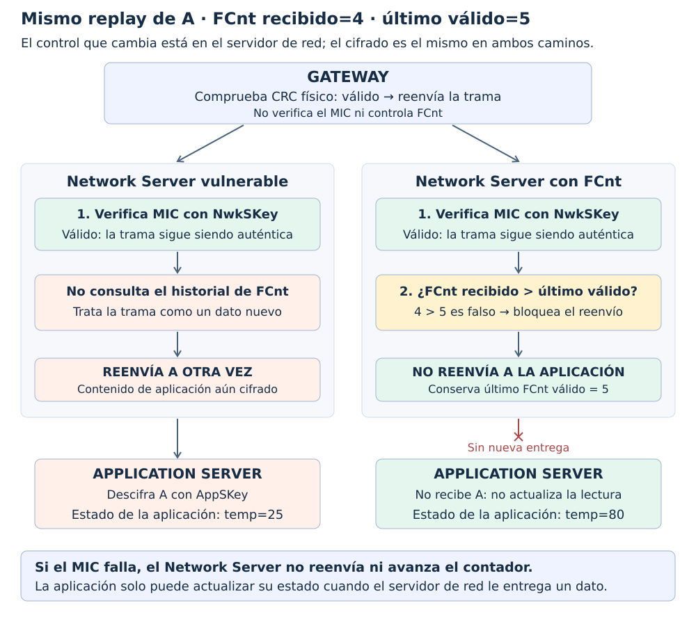
**Figura 7b.** Ubicación de las decisiones. El Network Server controla MIC y FCnt; el Application Server solo actualiza su lectura cuando recibe un dato reenviado. Un mensaje rechazado no actualiza el contador ni la lectura.

La regla del Network Server con control es: **después de verificar el MIC**, si ya existe un contador para la sesión y el dispositivo, reenviar a la aplicación únicamente cuando `FCnt_recibido > FCnt_último`. La primera trama se acepta si pasa las comprobaciones. La copia queda identificada como `FCNT_ANTIGUO_O_REPETIDO`.

En LoRaWAN existen retransmisiones legítimas de uplinks que conservan el contador. La red puede gestionarlas y responder según el protocolo, pero debe **entregar una sola instancia del dato a la aplicación**. En este script, «descartar» significa impedir una nueva entrega; no se simulan los ACK ni `NbTrans`. [Retransmisiones y contadores, §§4.3.1.3 y 4.3.1.5](https://lora-alliance.org/wp-content/uploads/2021/11/LoRaWAN-Link-Layer-Specification-v1.0.4.pdf#page=21).

### 5.4. ¿Por qué el atacante no cambia el contador a 6?

```bash
python scripts/sesion08_lora/simular_replay.py --etapa controles
```

El script ejecuta dos controles sobre una copia de A: cambia un bit del contenido cifrado o cambia `FCnt` de 4 a 6. En ambos casos conserva el MIC original y recalcula el CRC físico.

| Prueba | CRC | MIC | Resultado en ambos Network Servers |
|---|---|---|---|
| Repetir A sin modificarla | Válido | Válido | El control del contador decide si se entrega. |
| Alterar el contenido y recalcular solo el CRC | Válido | Inválido | No se entrega. |
| Cambiar el contador a 6 y recalcular solo el CRC | Válido | Inválido | No se entrega ni se actualiza el contador. |

**El replay explota la falta de control del estado; la alteración de campos se enfrenta al MIC.** Para explicar el resultado, el alumno debe relacionar qué campos autentica el MIC con la información que conserva el receptor.

Para ejecutar todas las etapas de una vez:

```bash
python scripts/sesion08_lora/simular_replay.py
```

Cada comando ejecuta el experimento completo desde un estado vacío y muestra la etapa elegida. Guarda tres archivos de **PHYPayload de 20 bytes** (`A_normal.bin`, `B_alarma.bin` y `A_replay.bin`), `replay.json` con todas las decisiones y un informe de texto en `output/lorawan-replay/`. Los dos bytes de CRC se registran por separado en el JSON; no se añaden a esos `.bin`. Para consultar las opciones:

```bash
python scripts/sesion08_lora/simular_replay.py --help
```

??? question "Investigación: qué debe conservar el Network Server"

    Localizar en la especificación **§4.3.1.5** la obligación de conservar los contadores en dispositivos ABP y la prohibición de reutilizarlos con las mismas claves para mensajes nuevos. Explicar qué podría ocurrir si se pierde el historial del Network Server mientras siguen vigentes la dirección y las claves de la sesión. Distinguir ese fallo de reiniciar el dispositivo cuando el servidor todavía conserva correctamente su estado.

    Examinar `Receptor.recibir()` en `scripts/sesion08_lora/simular_replay.py`: identificar la comprobación del MIC, la comparación del contador y el punto en que se actualiza la memoria. Explicar por qué un paquete con MIC inválido no debe avanzar el contador.

El experimento es una **simulación local sobre bytes**, sin transmitir RF ni conectarse a una red. La clase `Receptor` agrupa las funciones indicadas para mostrar el efecto del replay; no implementa una pila LoRaWAN completa ni demuestra una vulnerabilidad de la captura original. Puede ejecutarse sin generar antes el I/Q. La entrega de la sección 10 conserva sus archivos y requisitos; no se añade implementación criptográfica a cargo del alumno. En GNU Radio, `LoRa Rx` y `Tag Debug` siguen comprobando únicamente el CRC físico: `crc_valid` no acredita MIC válido ni protección contra replay.

## 6. Análisis en Inspectrum

El objetivo es estimar dos parámetros de la señal a partir del preámbulo. La distancia vertical que recorre el chirp da el ancho de banda $BW$. La separación horizontal entre dos reinicios consecutivos da la duración de símbolo $T_s$. Con ambas medidas se obtiene el factor de expansión (SF).

### Localizar el preámbulo

1. Abrir `output/lorawan-iq/correcto.sigmf-data` como en la sección 3. En **Controls**, verificar **Sample rate** de `1000000` muestras/s y activar **Scales** para ver los ejes.
2. Aumentar **Zoom** y mover la barra horizontal hasta ver el tramo de **8 a 16 ms** desde el inicio del archivo. Los primeros chirps del paquete son diagonales ascendentes que se repiten.
3. Si las diagonales aparecen borrosas, reducir **FFT size**. Para esta muestra sirve una FFT de 128 puntos. En Inspectrum 0.3.1, seleccionar el control **FFT size**, pulsar **Inicio** y luego pulsar **→** tres veces. [Controles de Inspectrum 0.3.1](https://github.com/miek/inspectrum/blob/v0.3.1/src/spectrogramcontrols.cpp).

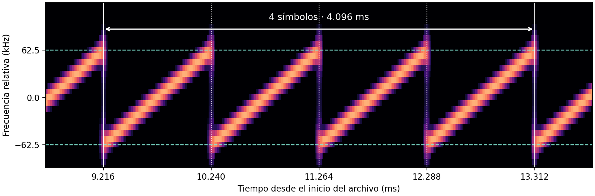
**Figura 8.** Referencias de tiempo y frecuencia marcadas sobre el preámbulo de la muestra.

- Las dos líneas verticales continuas encierran cuatro símbolos. Las tres líneas punteadas intermedias coinciden con los reinicios del barrido.
- Las dos líneas horizontales marcan los extremos aproximados del barrido. La figura amplía la zona del chirp para mostrar dónde leer los límites en el espectrograma.

### Medir la duración del símbolo

1. En **Time selection**, activar **Enable cursors** y colocar **Symbols** en `4`. Ajustar los dos cursores después de cambiar ese campo.
2. Arrastrar el cursor vertical izquierdo a un reinicio del barrido dentro de los chirps repetidos. Un reinicio es el salto desde el final de una diagonal hasta el comienzo de la siguiente. En esta muestra se puede usar el de **9.216 ms**.
3. Contar cuatro barridos completos hacia la derecha. Colocar el segundo cursor en el reinicio que cierra el cuarto barrido, cerca de **13.312 ms**. Las tres divisiones intermedias deben coincidir con los reinicios entre los cursores.
4. Leer **Period**, el tiempo total entre los cursores, y **Symbol period**, el tiempo por símbolo. Cerca de **4.096 ms** entre cursores da **1.024 ms** por símbolo. [Cursores de tiempo y cálculo del período en Inspectrum](https://github.com/miek/inspectrum/blob/v0.3.1/src/spectrogramcontrols.cpp#L195-L205).

### Medir el ancho de banda

1. Hacer clic derecho sobre el espectrograma y elegir **Add derived plot → Add amplitude plot**. Aparecen tres líneas horizontales sobre el espectrograma. La roja marca el centro del sintonizador y las dos blancas indican sus límites. La medición se hace en el espectrograma superior. [Menú de gráficos derivados](https://github.com/miek/inspectrum/blob/v0.3.1/src/plotview.cpp#L121-L135) · [Líneas del sintonizador](https://github.com/miek/inspectrum/blob/v0.3.1/src/tuner.cpp).
2. Arrastrar la línea roja hasta el centro entre los extremos del chirp. En esta señal, ese punto queda en **0 Hz**, a media altura del espectrograma. Arrastrar una línea blanca hasta el extremo de la diagonal brillante. La otra línea se mueve de forma simétrica. Comprobar el ajuste en varios chirps repetidos.
3. Usar las marcas de **Scales** sobre el borde izquierdo para estimar la frecuencia de cada línea blanca. Con una FFT de 128 puntos, las marcas pequeñas están separadas por **100 kHz**. Ambas líneas deberían quedar entre el centro y la primera marca de su lado. Interpolar entre las marcas. Los extremos nominales son **−62.5 kHz** y **+62.5 kHz**. La resolución de la FFT y el difuminado cerca del reinicio limitan la precisión. [Escala de frecuencia de Inspectrum 0.3.1](https://github.com/miek/inspectrum/blob/v0.3.1/src/spectrogramplot.cpp#L77-L151).
4. Restar la frecuencia inferior de la superior. Con los extremos de referencia, $BW=62.5-(-62.5)=125\ \mathrm{kHz}$.

### Obtener el SF

1. Convertir $BW$ a hertz y $T_s$ a segundos. Con los valores de referencia, $BW=125\,000\ \mathrm{Hz}$ y $T_s=0.001024\ \mathrm{s}$.
2. Multiplicar los valores medidos y calcular el logaritmo en base 2. Si el resultado está cerca de 7, se identifica **SF7**. Si queda casi a mitad de camino entre dos enteros, revisar los límites del barrido y el número de símbolos entre los cursores.

$$
BW\,T_s \approx 125\,000 \times 0.001024 = 128 = 2^7,
\qquad SF = \log_2(BW\,T_s) \approx 7.
$$

Registrar el **BW**, el **Symbol period** y el **SF** obtenido. El receptor del inspector usa el ancho de banda nominal de **125 kHz** y **SF7**; las medidas permiten comprobar esos parámetros. [Relación entre ancho de banda, duración del símbolo y SF](https://pubs.gnuradio.org/index.php/grcon/article/download/145/123/390#page=3).

## 7. Recuperación de la trama en GNU Radio Companion (opcional)

La sección 3 ya recuperó los **20 bytes** y comprobó el **CRC físico de LoRa** con el inspector. Se puede **continuar directamente a la sección 8**. Los pasos siguientes son una alternativa opcional para reproducir el resultado construyendo un flujograma en GNU Radio Companion; no son un requisito previo para la extracción ni para la entrega.

Si se elige esta alternativa, usar la tasa de muestreo de la sección 3 y los valores de ancho de banda y SF de la sección 6.

El repositorio incluye el grafo de referencia en `gnuradio/flowgraphs/lora_recuperar_trama.grc`. Los pasos siguientes permiten armarlo en GRC.

### 7.1. Crear el grafo y leer la muestra

1. Abrir GNU Radio Companion desde el entorno de Radioconda que tiene instalado `gr-lora_sdr`. En Linux, volver a activar el entorno después del análisis en Inspectrum:

    ```bash
    conda activate base
    gnuradio-companion
    ```

    En Windows, usar **Radioconda Prompt** o el acceso a GNU Radio Companion del menú Inicio.
2. Crear un grafo nuevo y guardarlo como `gnuradio/flowgraphs/lora_recuperar_trama.grc`, desde la raíz de `sdr`.
3. Abrir el bloque `Options` y configurarlo con estos valores.

    | Campo de `Options` | Valor |
    |---|---|
    | `ID` | `lora_recuperar_trama` |
    | `Output Language` | `Python` |
    | `Generate Options` | `No GUI` |
    | `Run Options` | `Run to Completion` |

4. Añadir `File Source`. El archivo de muestras debe estar en `output/lorawan-iq/`, como se indica en la sección 3.

    | Campo de `File Source` | Valor |
    |---|---|
    | `ID` | `captura_lora` |
    | `File` | `../../output/lorawan-iq/correcto.sigmf-data` |
    | `Output Type` | `Complex` |
    | `Vector Length` | `1` |
    | `Repeat` | `No` |
    | `Offset` | `0` |
    | `Length` | `0` |

GNU Radio Companion ejecuta el grafo desde la carpeta del `.grc`. Los dos `..` llevan de `gnuradio/flowgraphs/` a la raíz de `sdr`. `File Source` lee las muestras desde el inicio. `Length = 0` lee hasta el final del archivo. [Implementación de `File Source` en GNU Radio](https://github.com/gnuradio/gnuradio/blob/v3.10.12.0/gr-blocks/lib/file_source_impl.cc).

### 7.2. Configurar el receptor LoRa

Añadir `LoRa Rx` desde la categoría **LoRa_RX**. Este bloque recibe las muestras complejas y entrega los bytes recuperados.

| Campo de `LoRa Rx` | Valor |
|---|---|
| `ID` | `receptor_lora` |
| `Input sampling rate` | `1000000` |
| `Bandwidth` | `125000` |
| `Spreading factor` | `7` |
| `Implicit header` | `No` |
| `Use soft-decision decoding` | `Yes` |
| `LDRO` | `Auto` |
| `Sync word` | `[0x34]` |
| `Print info` | `None` |

Con `Implicit header = No`, `LoRa Rx` lee la longitud, la tasa de codificación y la presencia de CRC de la cabecera explícita. Por eso GRC oculta `Payload length`, `Coding rate` y `CRC presence`. Con `LDRO = Auto` el receptor determina si usa la optimización de baja tasa de datos. `Print info = None` deja la lectura del CRC a `Tag Debug`. [Definición de `LoRa Rx` en GRC](https://github.com/tapparelj/gr-lora_sdr/blob/a8143cb/grc/lora_sdr_lora_rx.block.yml).

### 7.3. Guardar los bytes y mostrar la etiqueta de CRC

1. Añadir `File Sink` y `Tag Debug` con estos valores.

    | Bloque | Campo | Valor |
    |---|---|---|
    | `File Sink` | `ID` | `guardar_trama` |
    | `File Sink` | `File` | `../../output/lorawan-iq/trama_recibida.bin` |
    | `File Sink` | `Input Type` | `Byte` |
    | `File Sink` | `Vector Length` | `1` |
    | `File Sink` | `Unbuffered` | `Off` |
    | `File Sink` | `Append file` | `Overwrite` |
    | `Tag Debug` | `ID` | `etiquetas_lora` |
    | `Tag Debug` | `Input Type` | `Byte` |
    | `Tag Debug` | `Name` | `CRC LoRa` |
    | `Tag Debug` | `Key Filter` | `frame_info` |
    | `Tag Debug` | `Num Inputs` | `1` |
    | `Tag Debug` | `Vector Length` | `1` |
    | `Tag Debug` | `Display` | `On` |

2. Hacer estas tres conexiones. Las dos últimas salen del mismo puerto de flujo **Byte** de `LoRa Rx`. Se puede dejar libre el puerto `out` de mensajes.

    | Salida | Entrada | Qué circula |
    |---|---|---|
    | `File Source`, puerto `out` | `LoRa Rx`, puerto `in` | Muestras `Complex` |
    | `LoRa Rx`, puerto `out` de flujo `Byte` | `File Sink`, puerto `in` (0) | Bytes recuperados |
    | `LoRa Rx`, puerto `out` de flujo `Byte` | `Tag Debug`, puerto `in` (0) | Bytes y etiqueta `frame_info` |

### 7.4. Ejecutar y comprobar el resultado

1. Guardar y pulsar **F6** para ejecutar. `File Source` lee el archivo una vez y el grafo termina.
2. En la salida de ejecución, buscar la etiqueta `frame_info` impresa por `Tag Debug`. Si GRC solo muestra el aviso de GTK `Locale not supported` o la terminal se cierra enseguida, ejecutar el programa generado desde una terminal con Radioconda activo. Partir de la raíz de `sdr`.

    ```bash
    cd gnuradio/flowgraphs
    python -u lora_recuperar_trama.py
    ```

    Leer estos tres campos de la etiqueta.

    | Campo de la etiqueta | Salida esperada | Significado |
    |---|---|---|
    | `pay_len` | `(pay_len . 20)` | La cabecera indica 20 bytes de contenido. |
    | `crc` | `(crc . 1)` | El paquete incluye el CRC físico. |
    | `crc_valid` | `(crc_valid . #t)` | El CRC calculado coincide con el recibido. |

3. Abrir una terminal en la raíz de `sdr` y leer el archivo que guardó `File Sink`.

    ```bash
    python -c "from pathlib import Path; datos = Path('output/lorawan-iq/trama_recibida.bin').read_bytes(); print(len(datos), 'bytes'); print(datos.hex(' '))"
    ```

    ```text
    20 bytes
    80 dc 5d e6 01 90 04 00 01 db f5 a4 e3 12 39 d0 53 21 68 7b
    ```

4. Comparar la secuencia con la **Figura 6**. Los cuatro bytes finales del archivo son el MIC de la trama LoRaWAN. La etiqueta `frame_info` indica si los bytes guardados pasaron la comprobación del CRC físico de LoRa. [Implementación de `Tag Debug` en GNU Radio](https://github.com/gnuradio/gnuradio/blob/v3.10.12.0/gr-blocks/lib/tag_debug_impl.cc) · [Verificación de CRC en `gr-lora_sdr`](https://github.com/tapparelj/gr-lora_sdr/blob/a8143cb/lib/crc_verif_impl.cc#L100-L171).

### 7.5. Ver el espectro y el waterfall durante la reproducción

1. Abrir `gnuradio/flowgraphs/lora_visualizar_iq.grc` en GNU Radio Companion y pulsar **F6**. El grafo reproduce `correcto.sigmf-data` en bucle.
2. Elegir **1/20× (lenta)** en **Velocidad de reproducción** para seguir los chirps. Elegir **1× (ritmo original)** para reproducir las muestras a 1 Msps.
3. Observar los dos paneles. `QT GUI Frequency Sink` muestra el espectro de cada bloque de muestras. `QT GUI Waterfall Sink` coloca los espectros sucesivos en filas para mostrar cómo cambia la frecuencia. Los chirps aparecen cerca del centro y los intervalos de ceros separan los paquetes.

`Throttle` fija la velocidad de reproducción. Los dos visores conservan el eje de frecuencia de la señal original, centrado en **0 Hz** en banda base. En modo lento, el eje temporal del *waterfall* corresponde a las actualizaciones de la pantalla. Para medir $T_s$ se usa el eje de tiempo del archivo en Inspectrum, como en la sección 6. [GNU Radio, actualización de `QT GUI Waterfall Sink`](https://github.com/gnuradio/gnuradio/blob/v3.10.12.0/gr-qtgui/lib/waterfall_sink_c_impl.cc#L342-L382).

## 8. Extracción del mensaje cifrado

El objetivo es ubicar el campo `FRMPayload` y guardar sus siete bytes tal como se recibieron. El recorrido principal parte de **`output/lorawan-iq/traza/03_phypayload.bin`**, generado por el inspector en la sección 3.5.7. La Figura 6 permite comprobar las posiciones. No hace falta ejecutar el flujograma opcional de la sección 7.

### 8.1. Encontrar el inicio y el final

1. **Leer `FCtrl` en el byte 6.** Su valor es `90` en hexadecimal. Los cuatro bits inferiores forman `FOptsLen`. Al aplicar la máscara `0x0F`, queda `0`. Por eso la cabecera termina en el byte 8.
2. **Ubicar `FPort` en el byte 9.** Se encuentra justo después de la cabecera. Su valor es `01`, el puerto de aplicación 1. El `FRMPayload` empieza en el byte **10**.
3. **Reservar los últimos cuatro bytes para el MIC.** En el archivo de 20 bytes, el MIC empieza en el byte **17**. El último byte del mensaje cifrado es el **16**. [Formato de la trama, opciones, puerto y MIC en LoRaWAN 1.0.4](https://lora-alliance.org/wp-content/uploads/2021/11/LoRaWAN-Link-Layer-Specification-v1.0.4.pdf#page=23).

### 8.2. Extraer los siete bytes

El repositorio incluye **`scripts/sesion08_lora/extraer_mensaje.py`**. Desde la raíz de `sdr`, con Radioconda activo, ejecutar:

```bash
python scripts/sesion08_lora/inspeccionar_lora.py --etapa phypayload
python scripts/sesion08_lora/extraer_mensaje.py
```

El primer comando permite regenerar los 20 bytes si fuera necesario. El segundo lee ese resultado, guarda una copia como **`output/lorawan-iq/trama_recibida.bin`** y extrae **`output/lorawan-iq/mensaje_cifrado.bin`**. Así se conservan los nombres de los archivos que se entregan.

Python numera los bytes desde cero. Por eso `FCtrl` está en el índice `5`; el cálculo que realiza el extractor es:

```python
longitud_opciones = trama[5] & 0x0F
indice_puerto = 8 + longitud_opciones
inicio = indice_puerto + 1
fin = len(trama) - 4
mensaje_cifrado = trama[inicio:fin]
```

El corte incluye `inicio` y excluye `fin`. Los cuatro bytes finales del MIC quedan fuera del mensaje extraído. La terminal muestra:

```text
FOptsLen = 0
FPort = 1 (byte 9)
FRMPayload (bytes 10 a 16) = db f5 a4 e3 12 39 d0
Guardados 7 bytes en output/lorawan-iq/mensaje_cifrado.bin
Guardados 20 bytes en output/lorawan-iq/trama_recibida.bin
```

El archivo de salida contiene los siete bytes cifrados en binario. La línea hexadecimal muestra esos mismos bytes para poder compararlos con la Figura 6.

Si se usó el flujograma opcional, se puede indicar su archivo como entrada con `--entrada output/lorawan-iq/trama_recibida.bin`. Este script localiza y copia campos; no verifica el MIC ni descifra el mensaje.

## 9. Reto de ubicación del mensaje cifrado con `FOpts`

### Por qué importa `FOpts`

`FOpts` permite intercambiar comandos de control entre el dispositivo y el servidor de red en la misma trama que lleva datos de aplicación. Por ejemplo, un dispositivo puede enviar una medición y reportar su nivel de batería con el comando `DevStatusAns`. [Comandos MAC y estado del dispositivo, LoRaWAN 1.0.4, §§5 y 5.5](https://lora-alliance.org/wp-content/uploads/2021/11/LoRaWAN-Link-Layer-Specification-v1.0.4.pdf#page=26).

En **LoRaWAN 1.0.4**, los comandos de `FOpts` viajan en claro y se pueden leer una vez recuperados los bytes de la trama. El MIC cubre `FOpts` y permite detectar cambios en esos bytes al verificarlo con la clave de sesión de red (`NwkSKey`). El contenido de aplicación en `FRMPayload` viaja cifrado con la clave de sesión de aplicación (`AppSKey`). El reto muestra cómo separar los comandos visibles de los bytes cifrados de aplicación. [Cifrado, MIC y comandos MAC, LoRaWAN 1.0.4, §§4.3.3, 4.4 y 5](https://lora-alliance.org/wp-content/uploads/2021/11/LoRaWAN-Link-Layer-Specification-v1.0.4.pdf#page=24).

### Trama del reto

El objetivo es localizar `FOpts` y calcular dónde empieza el `FRMPayload`. El reto parte de una trama didáctica LoRaWAN 1.0.4 en hexadecimal. Cada par representa un byte. Es un ejercicio de estructura: no se proporciona I/Q de esta segunda trama ni se pide validar su MIC o descifrarla.

La Figura 6 muestra el caso de referencia, donde `FOptsLen = 0` y `FPort` sigue a `FCnt`. En el reto, leer el dígito hexadecimal de la derecha de `FCtrl` (byte 6). Ese dígito da la cantidad de bytes de `FOpts` que se deben contar desde el byte 9, justo después de `FCnt`. El siguiente byte es `FPort`. [Sección 4, «Cómo ubicar el mensaje cifrado»](#como-ubicar-el-mensaje-cifrado).

```text
40 87 65 43 21 83 35 00 06 a4 03 11 89 c9 17 d5 d1 6f 5d a1 45 ff
```

1. Numerar los bytes desde 1 y contar la longitud total de la trama.
2. Ubicar `FCtrl`. Mostrar cómo se obtiene `FOptsLen` a partir de sus cuatro bits inferiores. Marcar los bytes que forman `FOpts`.
3. Localizar `FPort` justo después de `FOpts`. Anotar su posición, su valor y la posición del primer byte del `FRMPayload`.
4. Separar los cuatro bytes finales del MIC. Anotar la posición del último byte del `FRMPayload`, su longitud y sus bytes en hexadecimal. Mantener el mensaje cifrado.
5. Comparar la posición inicial del `FRMPayload` con la de la sección 8. Explicar cuántos bytes se desplaza y qué campo causa el desplazamiento.

El estándar describe la longitud de `FOpts` y el orden de los campos que le siguen. [LoRaWAN 1.0.4, secciones 4.3.1.6 a 4.4](https://lora-alliance.org/wp-content/uploads/2021/11/LoRaWAN-Link-Layer-Specification-v1.0.4.pdf#page=23).

## 10. Entrega del informe y del reto

Entregar **un informe en PDF del Laboratorio #5** con la práctica, el reto y la respuesta de cierre. Adjuntar `trama_recibida.bin` (**20 bytes**) y `mensaje_cifrado.bin` (**7 bytes cifrados**), obtenidos de `correcto.sigmf-data` mediante el inspector de la sección 3 y el extractor de la sección 8. La sección 7 ofrece una alternativa opcional mediante GRC. El reto de la sección 9 se resuelve únicamente en el PDF. Las pruebas complementarias de la sección 11 no forman parte de la entrega.

- **Fecha límite** — domingo 15 de noviembre de 2026 a las **23:59**, hora de Lima.
- **Nombre del PDF** — `[codigo_uni].pdf`.
- **Correo de entrega** — `ollerenac@uni.edu.pe`.
- **Asunto del correo** — `tarea-lab05-[codigo_uni]`.

Reemplazar `[codigo_uni]` por el código UNI, sin corchetes. Adjuntar el PDF y los dos archivos binarios al mismo correo.

### 10.1. Capturas de la práctica

1. **Paquete completo en Inspectrum.** Marcar el final de los chirps descendentes del preámbulo y el inicio y fin de la cabecera. Marcar también los tramos de contenido, contenido con CRC, y CRC con relleno. Indicar cuántos símbolos se cuentan desde el final del preámbulo hasta el final del paquete.
2. **Medición del preámbulo en Inspectrum.** Mostrar los cursores sobre cuatro símbolos consecutivos y los dos límites de frecuencia del barrido. Dejar visibles los ejes y la lectura de **Symbol period**. Se pueden usar dos capturas si las lecturas se ven mejor por separado.
3. **Comprobación del CRC en la terminal.** Ejecutar `python scripts/sesion08_lora/inspeccionar_lora.py --etapa crc` y capturar la comparación final: CRC calculado `a250`, recibido `a250` y resultado **VÁLIDO**. Si se eligió el flujograma opcional de la sección 7, también es válida la captura de `Tag Debug` con `pay_len`, `crc` y `crc_valid`.

La captura del espectro y del *waterfall* de la sección 7.5 es opcional.

### 10.2. Resultados de la práctica

1. Anotar el período medido de los cuatro símbolos, la duración $T_s$ de un símbolo y las frecuencias inferior y superior del barrido. Mostrar cómo esas medidas dan el ancho de banda $BW$ y el factor de expansión $SF$.
2. Escribir los 20 bytes de `trama_recibida.bin` en hexadecimal. Presentar una tabla con el nombre, las posiciones y el valor de cada campo de la Figura 6. Numerar los bytes desde 1 e indicar si hay opciones en `FOpts`.
3. Explicar qué comprueba el **CRC físico válido** mostrado por el inspector —o por `crc_valid` si se usó GRC— y qué queda por verificar con el MIC.
4. Mostrar los siete bytes extraídos en hexadecimal e indicar la posición del primer y último byte dentro de la trama. Explicar cómo `FOptsLen` y la posición del MIC permiten fijar esos límites.

### 10.3. Resultado del reto

Incluir en el mismo PDF el análisis de la segunda trama. Indicar su longitud total y mostrar el cálculo de `FOptsLen` a partir de `FCtrl`. Usar una tabla con el campo, las posiciones numeradas desde 1 y los valores en hexadecimal para `FCtrl`, `FOpts`, `FPort`, `FRMPayload` y `MIC`.

Indicar la longitud del `FRMPayload` y explicar por qué cambió su posición inicial respecto a la práctica. Para el reto basta el desarrollo en el PDF.

### 10.4. Pregunta de cierre

**Al comparar varias tramas LoRaWAN sin usar las claves ni descifrar el `FRMPayload`, ¿qué se puede deducir de los campos visibles y qué no se puede deducir del dato de aplicación?** Dar dos ejemplos de observaciones y señalar qué campo o medida respalda cada una. Indicar un dato de aplicación que no se deduce de esos campos. Aunque las claves del ejemplo de Brno están publicadas, esta pregunta se refiere al análisis de los campos visibles.

Distinguir entre leer un campo y verificarlo: sin comprobar el MIC, su valor visible no acredita la integridad ni la autenticidad de la trama.

## 11. Material complementario: capturas reales y descifrado

Este material conserva las verificaciones adicionales del curso. No añade requisitos al informe del Laboratorio #5. Las fuentes tienen entradas y alcances diferentes:

| Fuente | Entrada y frecuencia | Comprobación disponible |
|---|---|---|
| OSU | Captura I/Q recibida por aire a 915 MHz | Recuperación de 48 paquetes LoRa con CRC válido. Sus cargas de fingerprinting no se han validado como LoRaWAN. |
| STU | Captura I/Q recibida por aire a 868.1 MHz | Recuperación de dos tramas LoRaWAN con CRC válido. No se dispone de las claves de esa sesión para verificar su MIC ni descifrarlas localmente. |
| Brno | PCAP de tráfico real en EU868, ya demodulado por el sniffer | Verificación del MIC, derivación de claves OTAA y descifrado con las claves públicas del nodo experimental. El PCAP no contiene I/Q. |
| Ejemplo obligatorio | I/Q generado a partir de la trama de Brno, con 915 MHz como referencia | Medición de chirps, recuperación de bytes y extracción del mensaje cifrado. El verificador de preparación también comprueba MIC y descifrado. |

La muestra generada no acredita una recepción por aire a 915 MHz. Tampoco se pueden aplicar las claves de Brno a la sesión de STU. Sigue pendiente conseguir una **captura I/Q real con las claves de su propia sesión** para comprobar todo el recorrido sobre una misma grabación recibida.

Los procedimientos de descarga, procedencia y resultados están en los README del repositorio: [OSU](https://github.com/ollerenac-uni/sdr/blob/main/gnuradio/samples/lora-915-osu/README.md), [STU](https://github.com/ollerenac-uni/sdr/blob/main/gnuradio/samples/lorawan-stu/README.md), [Brno](https://github.com/ollerenac-uni/sdr/blob/main/gnuradio/samples/lorawan-brno/README.md) y [ejemplo generado](https://github.com/ollerenac-uni/sdr/blob/main/gnuradio/samples/lorawan-didactico/README.md). Los archivos I/Q y el PCAP se descargan por separado y quedan fuera de Git.

Después de descargar los datos indicados en cada README, desde la raíz del curso y con Radioconda activo:

```bash
python scripts/sesion08_lora/verificar_lorawan_brno.py --salida output/verificacion-lorawan/brno.json
python scripts/sesion08_lora/verificar_lora_915.py gnuradio/samples/lorawan-stu/lorawan_samples.sigmf-data --frecuencia-central-hz 868100000 --salida output/verificacion-lorawan/stu.json
```

El primer programa conserva la lectura del PCAP y la validación de OTAA. Para el MIC de datos y el descifrado utiliza el mismo verificador `scripts/sesion08_lora/verificar_lorawan.py` que el ejemplo generado. Así ambas comprobaciones comparten las reglas de interpretación de las tramas de datos LoRaWAN 1.0.x.
