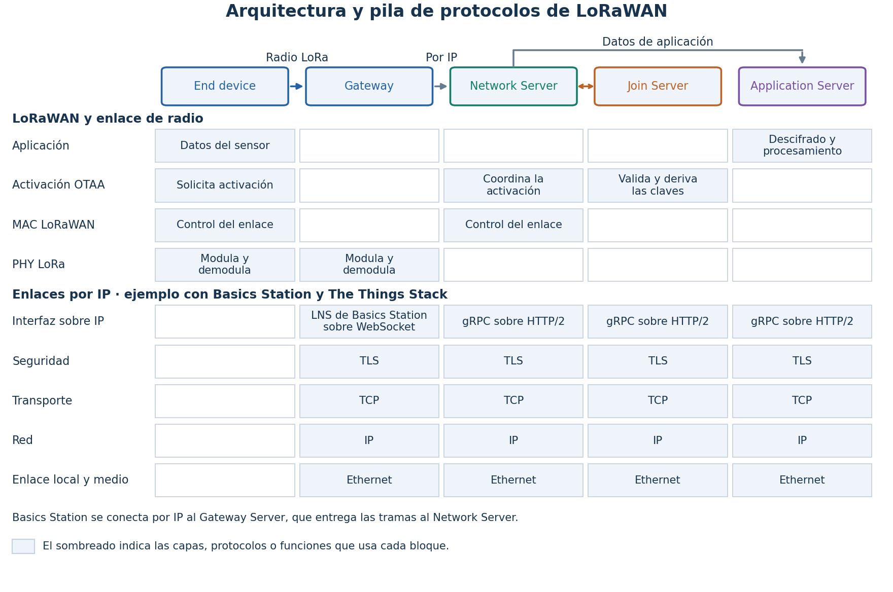
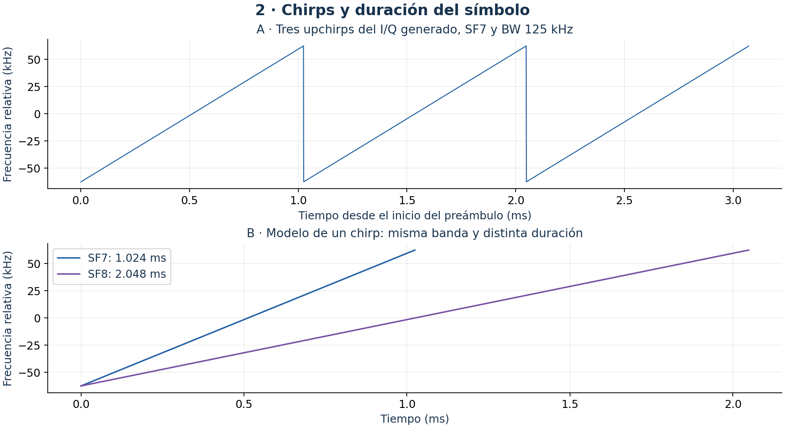
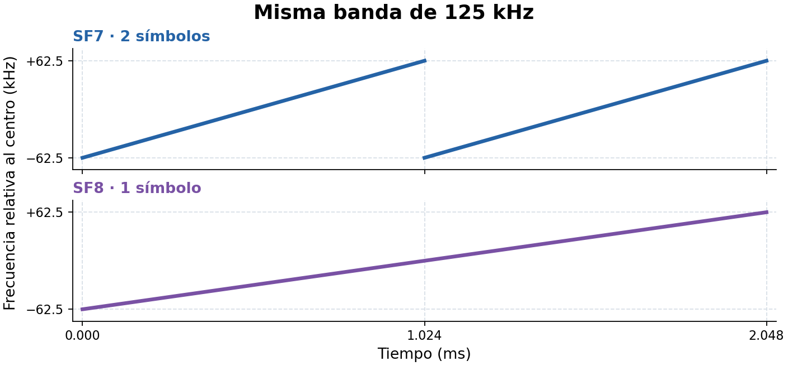
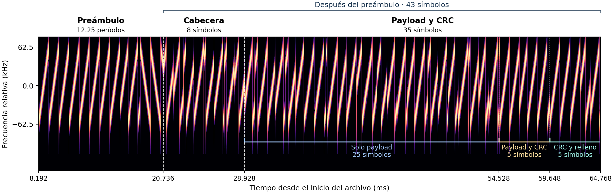
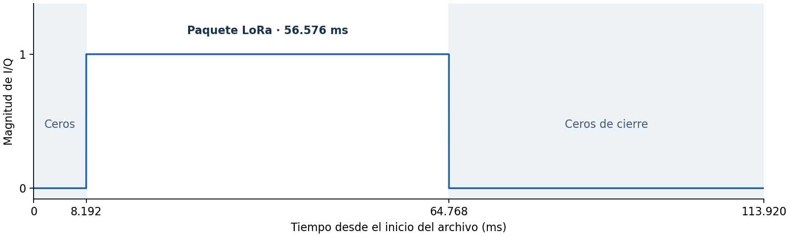
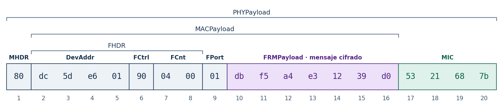
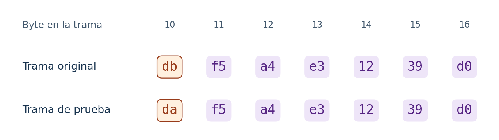
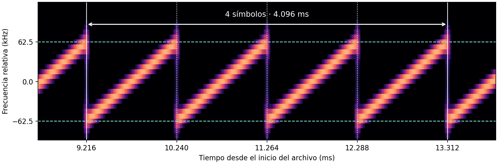

# Clase 6 — Recepción LoRa y análisis LoRaWAN

## 1. Introducción

**LoRa** define cómo se transmite un paquete por radio. **LoRaWAN** define cómo se organiza la trama y cómo se comunica el dispositivo con la red.


**Figura 1.** Componentes, capas y protocolos de una red LoRaWAN.

[Ver figura ampliada](figures/01-arquitectura.png).

- El *end device*, dispositivo final, transmite por radio LoRa.
- El *gateway*, pasarela, reenvía los paquetes recibidos por radio. También transmite las respuestas de la red.
- El *Network Server*, servidor de red, gestiona el enlace y reenvía al servidor de aplicación los datos de aplicación cifrados.
- El *Join Server*, servidor de activación, valida las solicitudes de activación y deriva las claves de sesión.
- El *Application Server*, servidor de aplicación, recupera los datos para la aplicación.

La capa física (PHY) LoRa transmite y recibe los símbolos de radio. La capa MAC, *Medium Access Control*, gestiona el enlace LoRaWAN entre el dispositivo y el servidor de red. La fila OTAA, *Over-the-Air Activation*, muestra quién participa en la activación por aire. [Modelo de red de LoRa Alliance](https://lora-alliance.org/wp-content/uploads/2020/11/TS002-1.1.0_LoRaWAN_Backend_Interfaces.pdf#page=8).

El grupo inferior presenta un ejemplo de enlaces por IP, el protocolo de Internet. El gateway usa la interfaz LNS (*LoRaWAN Network Server*) de Basics Station sobre WebSocket. El Gateway Server recibe las tramas y las entrega al Network Server. En este ejemplo, los servidores se comunican mediante gRPC sobre HTTP/2. TLS protege las conexiones, TCP transporta los datos y Ethernet sirve de enlace local. [Basics Station](https://doc.sm.tc/station/tcproto.html) y [conexiones de The Things Stack](https://www.thethingsindustries.com/docs/concepts/networking/).

### Aplicaciones de LoRaWAN

- Medición remota de agua, gas y electricidad
- Agricultura de precisión y gestión del riego
- Seguimiento de activos y flotas
- Monitoreo de la cadena de frío
- Monitoreo ambiental
- Automatización de edificios
- Detección de fugas de agua
- Alumbrado público y gestión de estacionamientos

[Casos de uso de LoRa Alliance](https://lora-alliance.org/cities-vertical-market/) y [aplicaciones en edificios](https://lora-alliance.org/wp-content/uploads/2020/11/wi-fi-and-lorawanr-deployment-synergies.pdf).

### Configuración LoRa de la práctica

El factor de expansión (SF) y el ancho de banda (BW) definen el barrido en frecuencia de cada símbolo. La señal de la práctica usa **SF7 y 125 kHz**. La tabla reúne los demás parámetros que se usan en el ejemplo.

| Parámetro | Qué controla | En la práctica |
|---|---|---|
| Frecuencia central | Dónde sintonizar el canal | 915 MHz como referencia de simulación |
| Tasa de codificación (CR) | Cuánta redundancia se añade al contenido | 4/5 |
| Preámbulo y palabra de sincronización (*sync word*) | La secuencia que usa el receptor para detectar y sincronizar el paquete | 8 chirps repetidos y `0x34` |
| Modo de cabecera | Si el paquete informa la longitud del contenido, la CR y la presencia de CRC | Explícito |
| Comprobación de redundancia cíclica (CRC) | Si se añade una comprobación de errores al contenido | Activada |

En Inspectrum se medirán el BW y la duración del símbolo para obtener el SF. En GNU Radio se decodificará la cabecera explícita. [Estructura del paquete LoRa, Tapparel y Burg, §2](https://pubs.gnuradio.org/index.php/grcon/article/download/145/123/390#page=2).

## 2. Chirps, ancho de banda y factor de expansión

Un *chirp* es una señal cuya frecuencia cambia con el tiempo. En un *upchirp* la frecuencia sube. En un *downchirp* baja. LoRa usa CSS (*Chirp Spread Spectrum*), una modulación de espectro ensanchado mediante chirps.


**Figura 2.** Chirps del preámbulo generado y comparación de dos duraciones de símbolo a 125 kHz.

[Ver figura ampliada](figures/02-chirps.png).

- **Panel A.** El eje horizontal mide tiempo desde el inicio del preámbulo. El eje vertical muestra la frecuencia instantánea relativa al centro del canal. Cada *upchirp* sube desde unos −62.5 kHz hasta +62.5 kHz. El siguiente empieza de nuevo por abajo.
- **Panel B.** El eje horizontal mide tiempo y el vertical muestra la frecuencia relativa. Las dos curvas recorren los mismos 125 kHz. Con SF8, el barrido tarda el doble que con SF7.

### Ancho de banda y duración del símbolo

El ancho de banda $BW$ (*bandwidth*) es el intervalo de frecuencias que recorre el chirp. En el panel A mide cerca de $62.5-(-62.5)=125$ kHz. La duración de un símbolo $T_s$ es el tiempo de un barrido completo. En el inicio del preámbulo, se puede medir entre dos reinicios consecutivos.

El factor de expansión $SF$ (*spreading factor*) determina cuántas posiciones de inicio admite el chirp. Con SF7 hay $2^7=128$ posiciones posibles. LoRa representa cada valor de símbolo desplazando circularmente el chirp de referencia. Al llegar al borde superior, el barrido continúa desde el inferior. [Modulación LoRa, Tapparel y Burg, §2.8](https://events.gnuradio.org/event/24/contributions/641/attachments/192/478/paper_tapparel.pdf#page=3).

$$
T_s=\frac{2^{SF}}{BW},\qquad SF=\log_2(BW\,T_s).
$$

Con $BW$ en hertz y $T_s$ en segundos, el producto $BW\,T_s$ da $2^{SF}$. Si $BW$ se mantiene fijo, subir de SF7 a SF8 duplica ese producto y la duración del símbolo. A 125 kHz, $T_s$ pasa de 1.024 ms a 2.048 ms, como en el panel B.

### Qué cambia al subir o bajar el SF


**Figura 3.** Barridos ideales de SF7 y SF8 en una misma ventana de tiempo y con igual ancho de banda.

- **Arriba, SF7.** Cada diagonal tarda 1.024 ms en recorrer la banda. En 2.048 ms caben dos símbolos.
- **Abajo, SF8.** La diagonal sube más despacio y recorre la misma banda en 2.048 ms. En ese tiempo cabe un solo símbolo.

| Con un ancho de banda de 125 kHz | SF7 | SF8 |
|---|---:|---:|
| Duración del símbolo | 1.024 ms | 2.048 ms |
| Símbolos por segundo | ≈ 977 | ≈ 488 |
| Posiciones de inicio del chirp ($2^{SF}$) | 128 | 256 |

- **Subir de SF7 a SF8.** Se duplica la duración del símbolo y se reduce a la mitad la cantidad de símbolos por segundo. El receptor puede detectar señales más débiles. Un paquete con los mismos datos y la misma codificación ocupa más tiempo en el aire. [Sensibilidad y tiempo en el aire, Semtech](https://www.semtech.com/design-support/faq/p0/p0).
- **Bajar de SF8 a SF7.** Los símbolos duran la mitad. Con la misma codificación se pueden transmitir datos más rápido. En las mismas condiciones de ruido, el receptor necesita una señal más fuerte para lograr una tasa de error similar. [Tasa de símbolos y sensibilidad, Semtech SX1276, §4.1.1](https://cdn.sparkfun.com/assets/7/7/3/2/2/SX1276_Datasheet.pdf#page=27).
- **Cambiar el ancho de banda con SF fijo.** Con SF7, pasar de 125 a 250 kHz duplica el recorrido en frecuencia y reduce la duración del símbolo de 1.024 a 0.512 ms. [Relación entre ancho de banda y tasa de símbolos, Semtech SX1276, §4.1.1.5](https://cdn.sparkfun.com/assets/7/7/3/2/2/SX1276_Datasheet.pdf#page=28).

### Qué se medirá en Inspectrum

La práctica usa la señal generada `output/lorawan-iq/correcto.sigmf-data`. Su archivo de metadatos indica una tasa de muestreo $f_s=1$ millón de muestras complejas por segundo. Inspectrum necesita ese valor para dar escala a los ejes. Cada símbolo SF7 del ejemplo ocupa $f_s T_s=1024$ muestras. [Formatos y herramientas de Inspectrum](https://github.com/miek/inspectrum#features).

1. Ampliar en el espectrograma los primeros chirps ascendentes repetidos del paquete. El tiempo se lee en horizontal y la frecuencia en vertical.
2. Estimar $BW$ restando la frecuencia inferior de la superior en el recorrido del chirp. Se esperan aproximadamente 125 kHz.
3. Medir con los cursores el tiempo entre el primer y el quinto reinicio. En ese tramo hay cuatro símbolos completos. Dividir el intervalo medido entre cuatro. Con unos 4.096 ms entre cursores, resulta $T_s\approx 1.024$ ms.
4. Multiplicar los dos valores medidos en hertz y segundos. Con los valores esperados, $125\,000\times 0.001024=128=2^7$. Así se identifica SF7 y se pueden configurar $BW$ y $SF$ en `LoRa Rx`.

## 3. Anatomía del paquete LoRa

El objetivo es entender cómo se organizan los chirps para que el receptor detecte el paquete, se sincronice y recupere su contenido. La figura se lee de izquierda a derecha. Primero se buscan los chirps conocidos del preámbulo. Luego se ubican los símbolos que llevan la cabecera, el contenido y la comprobación de errores.


**Figura 4.** Anatomía del paquete LoRa anotada sobre el espectrograma de las muestras I/Q de la práctica.

[Ver figura ampliada](figures/anatomia-paquete-lora.png).

El eje horizontal muestra el tiempo desde el inicio del archivo, como en Inspectrum. El eje vertical muestra la frecuencia relativa al centro del canal. Las diagonales claras son los barridos. Cada símbolo completo dura **1.024 ms**.

- **Preámbulo.** Los ocho primeros chirps ascendentes se repiten. Luego vienen dos chirps con desplazamiento que llevan la palabra de sincronización (*sync word*) y dos chirps descendentes y un cuarto. El receptor usa esta secuencia para detectar el paquete y alinear la lectura de sus símbolos. [Estructura y detección del preámbulo, Tapparel y Burg, §2.9 y §3.2](https://pubs.gnuradio.org/index.php/grcon/article/download/145/123/390#page=4).
- **Cabecera física.** En esta señal, los ocho símbolos siguientes llevan la longitud del contenido, la tasa de codificación y un indicador de si hay CRC. La cabecera tiene su propia comprobación. El primer bloque entrelazado puede compartir espacio con el contenido para otros valores de SF. [Cabecera y primer bloque entrelazado, Tapparel y Burg, §§2.2 y 2.7](https://pubs.gnuradio.org/index.php/grcon/article/download/145/123/390#page=2).
- **Contenido y CRC.** Después de la cabecera vienen **35 símbolos**. Los primeros **25** llevan solo bits del contenido (*payload*). Los siguientes **5** llevan bits del contenido y del CRC. Los últimos **5** llevan bits del CRC y relleno. [Generación de CRC](https://github.com/tapparelj/gr-lora_sdr/blob/a8143cb/lib/add_crc_impl.cc#L110-L125) y [entrelazado](https://github.com/tapparelj/gr-lora_sdr/blob/a8143cb/lib/interleaver_impl.cc#L139-L194).

**Desde el final del preámbulo se cuentan $8+25+5+5=43$ símbolos.** Los 30 que llevan contenido permiten recuperar los **20 bytes** de la trama LoRaWAN. Los cinco símbolos compartidos también llevan bits del CRC.

La fórmula de Semtech calcula $N$, el total de símbolos después del preámbulo. El total incluye la cabecera física cuando está presente. [Semtech SX1276, §4.1.1.7](https://cdn.sparkfun.com/assets/7/7/3/2/2/SX1276_Datasheet.pdf#page=31).

$$
N = 8 + \max\left(0,\left\lceil
\frac{8PL-4SF+28+16\,CRC-20\,IH}{4(SF-2\,DE)}
\right\rceil(CR+4)\right).
$$

En esta muestra, $PL=20$ bytes y $SF=7$. El índice $CR=1$ corresponde a la tasa de codificación 4/5. El CRC está activado ($CRC=1$), la cabecera es explícita ($IH=0$) y la optimización de baja tasa está desactivada ($DE=0$). Los signos $\lceil\ \rceil$ indican redondeo hacia arriba.

$$
N=8+\left\lceil\frac{176}{28}\right\rceil(4+1)
=8+7\times5=43\ \text{símbolos}.
$$

Cada símbolo dura 1.024 ms. Los cursores en Inspectrum abarcan $43\times1.024=44.032\ \mathrm{ms}$ desde el final del preámbulo hasta el final del paquete.

### Presentación de la señal I/Q

La práctica parte de `correcto.sigmf-data`, la señal del espectrograma de la Figura 4. El paquete 258 de `03_Brno_join.pcap` se recibió en Brno a 867.9 MHz con SF8. El archivo guarda sus bytes ya demodulados. GNU Radio vuelve a modular los 20 bytes con SF7 y genera las muestras I/Q en banda base. Los 915 MHz de los metadatos son la referencia de la simulación. [Conjunto de datos de Povalac y Kral](https://zenodo.org/records/8090619).

Estas rutas son relativas a la raíz de `sdr`, la carpeta que contiene `mkdocs.yml`.

| Archivo | Ruta relativa | Contenido |
|---|---|---|
| Muestras | `output/lorawan-iq/correcto.sigmf-data` | Archivo binario con 113 920 muestras complejas. |
| Metadatos | `output/lorawan-iq/correcto.sigmf-meta` | Archivo JSON que indica el formato `cf32_le`, la tasa de muestreo de 1 000 000 muestras complejas/s y la frecuencia de referencia de 915 MHz. |

En `cf32_le`, cada muestra guarda primero **I**, la componente en fase, y luego **Q**, la componente en cuadratura. Cada componente ocupa 32 bits en coma flotante. `_le` indica el orden *little endian* de los bytes de cada componente. Un par I/Q ocupa **8 bytes** y, a **1 Msps** (un millón de muestras complejas por segundo), los pares están separados por **1 µs**. [Formato de datos SigMF](https://sigmf.org/#sigmf-dataset-format).


**Figura 5.** Ubicación del paquete LoRa en el archivo I/Q de la práctica.

- El eje horizontal cuenta el tiempo desde el inicio del archivo. El eje vertical muestra la magnitud de cada par I/Q.
- El paquete empieza en **8.192 ms** y termina en **64.768 ms**. El tramo activo dura **56.576 ms**.
- Las zonas sombreadas muestran los ceros de apertura y cierre. Con esos ceros, el archivo completo dura **113.920 ms**.

Usar una copia actualizada del repositorio `sdr`. La generación de la muestra y la recepción requieren Radioconda con `gr-lora_sdr` y `cryptography`. La instalación del curso para Linux y Windows incluye Inspectrum 0.3.1. [Repositorio del curso](https://github.com/ollerenac-uni/sdr) · [Guía de instalación de Radioconda](../../setup/instalacion.md).

??? tip "Abrir la señal de la Figura 4 en Inspectrum"

    1. Abrir una terminal en la raíz del repositorio `sdr`, la carpeta que contiene `mkdocs.yml`. Activar Radioconda. En Windows, abrir **Radioconda Prompt** y cambiar a esa carpeta.
    2. Comprobar que `correcto.sigmf-data` y `correcto.sigmf-meta` estén juntos en `output/lorawan-iq/`. Esta ruta es relativa a la raíz del repositorio. Si faltan los archivos, ejecutar este comando desde la raíz con Radioconda y `gr-lora_sdr` instalados.

        ```bash
        python scripts/verificar_lorawan_iq.py --salida output/lorawan-iq
        ```

    3. Abrir la señal en Inspectrum.

        ```bash
        inspectrum output/lorawan-iq/correcto.sigmf-data
        ```

    4. Verificar que **Sample rate** muestre `1e+06` o `1000000`. Inspectrum carga ese valor del campo `core:sample_rate` de `correcto.sigmf-meta`. Si el campo de Inspectrum muestra otro valor, ingresar `1000000`. La tasa de muestreo es **1 millón de muestras complejas por segundo**. Los **125 kHz** corresponden al ancho de banda del chirp. [Lectura de metadatos SigMF en Inspectrum](https://github.com/miek/inspectrum/blob/v0.3.1/src/inputsource.cpp).
    5. En el espectrograma, ampliar el comienzo de la señal. Buscar los chirps ascendentes repetidos y luego los descendentes que cierran el preámbulo.

### Contar los símbolos en Inspectrum

Inspectrum muestra el eje horizontal en segundos. Por ejemplo, `0.020736` en el eje corresponde a 20.736 ms en la tabla. **Period** y **Symbol period** muestran sus unidades junto al valor. [Escala de tiempo y controles de Inspectrum](https://github.com/miek/inspectrum/blob/v0.3.1/src/plotview.cpp#L507-L545).

1. Activar **Scales** y **Enable cursors**. Ampliar el preámbulo con **Zoom**. Poner **Symbols** en `4` y arrastrar los cursores verticales a dos reinicios separados por cuatro barridos, cerca de **9.216** y **13.312 ms**. **Period** debe quedar cerca de **4.096 ms** y **Symbol period** cerca de **1.024 ms**.
2. Ubicar el inicio de la cabecera en **20.736 ms**, justo después del cuarto de chirp descendente. Si hace falta, reducir **Zoom** para ver el tramo que se quiere medir.
3. Colocar el cursor izquierdo al terminar el último *downchirp*, cerca de **20.736 ms**, y el derecho donde termina el último chirp, cerca de **64.768 ms**. Leer **Period**. El resultado esperado es **44.032 ms**, que al dividir por **1.024 ms** da **43 símbolos**.
4. Poner **Symbols** en `43` y volver a ajustar los cursores a los mismos extremos. Las líneas punteadas marcan el inicio de cada símbolo dentro de la selección. **Symbol period** debe quedar cerca de **1.024 ms**. Repetir la medición de **Period** para los tramos de la tabla. [Controles de tiempo de Inspectrum](https://github.com/miek/inspectrum/blob/v0.3.1/src/spectrogramcontrols.cpp#L195-L205).

| Tramo que se mide | Cursor izquierdo (ms) | Cursor derecho (ms) | Símbolos esperados | **Period** esperado (ms) |
|---|---:|---:|---:|---:|
| Chirps ascendentes repetidos | 8.192 | 16.384 | 8 | 8.192 |
| Palabra de sincronización | 16.384 | 18.432 | 2 | 2.048 |
| Cierre del preámbulo | 18.432 | 20.736 | 2 completos y ¼ | 2.304 |
| **Total después del preámbulo** | **20.736** | **64.768** | **43** | **44.032** |
| Cabecera física | 20.736 | 28.928 | 8 | 8.192 |
| Solo contenido | 28.928 | 54.528 | 25 | 25.600 |
| Símbolos compartidos por contenido y CRC | 54.528 | 59.648 | 5 | 5.120 |
| CRC y relleno | 59.648 | 64.768 | 5 | 5.120 |

Para medir el cierre del preámbulo, dividir **Period** por 1.024 ms. **Symbols** solo acepta enteros. En la cabecera y los datos, el chirp puede volver al extremo inferior a mitad de símbolo. Contar con la cuadrícula temporal de **1.024 ms**. Los límites del contenido y del CRC se ubican con esa cuadrícula y la estructura conocida de la muestra. [Modulación de los símbolos LoRa](https://pubs.gnuradio.org/index.php/grcon/article/download/145/123/390#page=3).

## 4. Anatomía de la trama LoRaWAN

El objetivo es ubicar cada campo de la trama y extraer los bytes del mensaje cifrado. Se empieza con los 20 bytes que `LoRa Rx` recupera de `correcto.sigmf-data`, la misma señal de la Figura 4. Esos 20 bytes son el contenido del paquete LoRa y forman el `PHYPayload` de LoRaWAN. [Formato de trama de LoRaWAN 1.0.4, §4](https://lora-alliance.org/wp-content/uploads/2021/11/LoRaWAN-Link-Layer-Specification-v1.0.4.pdf#page=15).


**Figura 6.** Campos de la trama LoRaWAN recuperada de la muestra de la práctica.

[Ver figura ampliada](figures/anatomia-trama-lorawan.png).

- Los números inferiores indican la posición de cada byte. La cuenta empieza en 1.
- Las marcas superiores muestran qué bytes forman el `PHYPayload`, el `MACPayload` y la cabecera de trama `FHDR`.
- Aquí `FOptsLen = 0`. La cabecera `FHDR` termina en `FCnt` y el byte siguiente es `FPort`. La [sección 9](#9-reto-de-ubicacion-del-mensaje-cifrado-con-fopts) muestra el caso con opciones.
- El tramo morado contiene el mensaje cifrado. El tramo verde contiene el código de integridad.

### Cómo obtener los 20 bytes de la señal

En Inspectrum, localizar el preámbulo de la señal que se abrió en la sección 3. Para pasar de los chirps a los bytes, `LoRa Rx` en GNU Radio sincroniza, demodula y decodifica el paquete. [Herramientas de Inspectrum](https://github.com/miek/inspectrum#features) · [Cadena receptora LoRa, Tapparel y Burg, §3](https://pubs.gnuradio.org/index.php/grcon/article/download/145/123/390#page=4).

`gr-lora_sdr` es un módulo de código abierto para GNU Radio desarrollado en la EPFL. Implementa la capa física propietaria LoRa. Sus autores publicaron el diseño del receptor y documentaron pruebas de transmisión y recepción entre equipos SDR y radios comerciales con chips Semtech SX1276 y SX1262. Esas pruebas sustentan la compatibilidad con esos equipos. En la práctica, `lora_sdr.lora_sdr_lora_rx(...)` crea el bloque jerárquico `LoRa Rx`. El script lo conecta a `File Source` y `tb.run()` procesa las muestras para recuperar los bytes. [Diseño de la capa física LoRa](https://pubs.gnuradio.org/index.php/grcon/article/view/145) · [Pruebas de interoperabilidad de `gr-lora_sdr`](https://github.com/tapparelj/gr-lora_sdr#features).

Desde la raíz de `sdr`, con Radioconda activo, ejecutar el comando. Así se leen las muestras con el bloque `LoRa Rx` que configura el script de la práctica.

```bash
python -c "import sys; from pathlib import Path; sys.path.insert(0, 'scripts'); from verificar_lorawan_iq import recibir; trama, = recibir(Path('output/lorawan-iq/correcto.sigmf-data')); print(bytes.fromhex(trama['payload_hex']).hex(' '))"
```

La terminal muestra esta línea. Cada par hexadecimal representa un byte.

```text
80 dc 5d e6 01 90 04 00 01 db f5 a4 e3 12 39 d0 53 21 68 7b
```

### Cómo leer los campos

| Campo | Posiciones inclusive | Bytes en hexadecimal | Qué indica |
|---|---:|---|---|
| `MHDR` | 1 | `80` | Cabecera MAC. Los tres bits superiores son `100`, que identifican una trama ascendente que solicita confirmación. |
| `FHDR → DevAddr` | 2–5 | `dc 5d e6 01` | Dirección corta del dispositivo, `0x01e65ddc`. |
| `FHDR → FCtrl` | 6 | `90` | Control de trama. Sus cuatro bits inferiores indican `FOptsLen = 0`. |
| `FHDR → FCnt` | 7–8 | `04 00` | Los 16 bits bajos del contador de trama tienen valor 4. |
| `FHDR → FOpts` | — | — | Campo de opciones ausente porque su longitud es cero. |
| `FPort` | 9 | `01` | Puerto de aplicación 1. |
| `FRMPayload` | **10–16** | **`db f5 a4 e3 12 39 d0`** | **Siete bytes del mensaje de aplicación cifrado.** |
| `MIC` | 17–20 | `53 21 68 7b` | *Message Integrity Code*, código de integridad de la trama LoRaWAN. |

`DevAddr` y `FCnt` se transmiten en *little endian*, con el byte menos significativo primero. Por eso `04 00` representa el valor `0x0004`. La tabla conserva el orden en que llegan los bytes. [Orden de bytes, LoRaWAN 1.0.4, §1.1](https://lora-alliance.org/wp-content/uploads/2021/11/LoRaWAN-Link-Layer-Specification-v1.0.4.pdf#page=8).

### Cómo ubicar el mensaje cifrado

1. Leer `FCtrl`, en la posición 6. El dígito hexadecimal de la derecha en `90` es `0`. Ese es el valor de `FOptsLen`, la cantidad de bytes de opciones que siguen al contador.
2. Pasar esos bytes de opciones. Como hay cero, `FHDR` termina en la posición 8 y `FPort` ocupa la posición 9. El mensaje cifrado empieza en la posición 10.
3. Reservar los últimos cuatro bytes para el `MIC`. En esta trama de 20 bytes, el `MIC` empieza en la posición 17. El mensaje cifrado termina en la posición 16.

Si `FOptsLen` cambia, también se mueve `FPort` cuando está presente. La longitud total fija dónde empiezan los cuatro bytes del `MIC`. [Opciones, puerto, cifrado e integridad, LoRaWAN 1.0.4, §4.3.1.6–4.4](https://lora-alliance.org/wp-content/uploads/2021/11/LoRaWAN-Link-Layer-Specification-v1.0.4.pdf#page=23).

## 5. Qué comprueban el CRC y el MIC

El objetivo es explicar cómo un paquete LoRa puede pasar el CRC y aun así fallar la comprobación del MIC en LoRaWAN.

| Comprobación | Qué compara el receptor | Usa clave |
|---|---|---|
| **CRC de LoRa** | Calcula el CRC a partir de los 20 bytes recuperados y lo compara con los dos bytes de CRC del paquete. Una diferencia indica un error detectado en la capa física. | No |
| **MIC de LoRaWAN 1.0.4** | Calcula el MIC a partir de los bytes 1–16 y del contexto de la trama. Compara el resultado con los cuatro bytes recibidos en las posiciones 17–20. | Sí. Usa la clave de sesión de red (`NwkSKey`). |

El contexto que usa el MIC incluye el sentido de transmisión, la dirección del dispositivo y el contador completo de trama. [CRC de LoRa, Tapparel y Burg, §2.3](https://pubs.gnuradio.org/index.php/grcon/article/download/145/123/390#page=2) · [MIC, LoRaWAN 1.0.4, §4.4](https://lora-alliance.org/wp-content/uploads/2021/11/LoRaWAN-Link-Layer-Specification-v1.0.4.pdf#page=25).

### Comparación de las dos muestras


**Figura 7.** El byte 10 cambia de `db` a `da` en la trama de prueba.

- La fila superior muestra los siete bytes del `FRMPayload` recuperados de `correcto.sigmf-data`.
- La fila inferior muestra las mismas posiciones en `contenido_alterado.sigmf-data`. El cambio de `db` a `da` afecta un bit. Ambas tramas conservan el MIC `53 21 68 7b`.

La segunda muestra se generó con el byte ya modificado. El transmisor LoRa calculó el CRC para los bytes de cada muestra. En la recepción, `LoRa Rx` recupera los 20 bytes y obtiene un CRC válido en ambos casos.

| Muestra | CRC en `LoRa Rx` | MIC recibido | MIC calculado | Resultado del MIC |
|---|---|---|---|---|
| `correcto.sigmf-data` | Válido | `53 21 68 7b` | `53 21 68 7b` | Válido |
| `contenido_alterado.sigmf-data` | Válido | `53 21 68 7b` | `d2 88 82 14` | Inválido |

En la segunda muestra, el CRC coincide con el paquete generado para la prueba. El MIC recibido corresponde a la trama original. Al verificarlo con la clave de sesión y el byte modificado, el resultado cambia.

## 6. Análisis en Inspectrum

El objetivo es estimar dos parámetros de la señal a partir del preámbulo. La distancia vertical que recorre el chirp da el ancho de banda $BW$. La separación horizontal entre dos reinicios consecutivos da la duración de símbolo $T_s$. Con ambas medidas se obtiene el factor de expansión (SF).

### Localizar el preámbulo

1. Abrir `output/lorawan-iq/correcto.sigmf-data` como en la sección 3. En **Controls**, verificar **Sample rate** de `1000000` muestras/s y activar **Scales** para ver los ejes.
2. Aumentar **Zoom** y mover la barra horizontal hasta ver el tramo de **8 a 16 ms** desde el inicio del archivo. Los primeros chirps del paquete son diagonales ascendentes que se repiten.
3. Si las diagonales aparecen borrosas, reducir **FFT size**. Para esta muestra sirve una FFT de 128 puntos. En Inspectrum 0.3.1, seleccionar el control **FFT size**, pulsar **Inicio** y luego pulsar **→** tres veces. [Controles de Inspectrum 0.3.1](https://github.com/miek/inspectrum/blob/v0.3.1/src/spectrogramcontrols.cpp).


**Figura 8.** Referencias de tiempo y frecuencia marcadas sobre el preámbulo de la muestra.

- Las dos líneas verticales continuas encierran cuatro símbolos. Las tres líneas punteadas intermedias coinciden con los reinicios del barrido.
- Las dos líneas horizontales marcan los extremos aproximados del barrido. La figura amplía la zona del chirp para mostrar dónde leer los límites en el espectrograma.

### Medir la duración del símbolo

1. En **Time selection**, activar **Enable cursors** y colocar **Symbols** en `4`. Ajustar los dos cursores después de cambiar ese campo.
2. Arrastrar el cursor vertical izquierdo a un reinicio del barrido dentro de los chirps repetidos. Un reinicio es el salto desde el final de una diagonal hasta el comienzo de la siguiente. En esta muestra se puede usar el de **9.216 ms**.
3. Contar cuatro barridos completos hacia la derecha. Colocar el segundo cursor en el reinicio que cierra el cuarto barrido, cerca de **13.312 ms**. Las tres divisiones intermedias deben coincidir con los reinicios entre los cursores.
4. Leer **Period**, el tiempo total entre los cursores, y **Symbol period**, el tiempo por símbolo. Cerca de **4.096 ms** entre cursores da **1.024 ms** por símbolo. [Cursores de tiempo y cálculo del período en Inspectrum](https://github.com/miek/inspectrum/blob/v0.3.1/src/spectrogramcontrols.cpp#L195-L205).

### Medir el ancho de banda

1. Hacer clic derecho sobre el espectrograma y elegir **Add derived plot → Add amplitude plot**. Aparecen tres líneas horizontales sobre el espectrograma. La roja marca el centro del sintonizador y las dos blancas indican sus límites. La medición se hace en el espectrograma superior. [Menú de gráficos derivados](https://github.com/miek/inspectrum/blob/v0.3.1/src/plotview.cpp#L121-L135) · [Líneas del sintonizador](https://github.com/miek/inspectrum/blob/v0.3.1/src/tuner.cpp).
2. Arrastrar la línea roja hasta el centro entre los extremos del chirp. En esta señal, ese punto queda en **0 Hz**, a media altura del espectrograma. Arrastrar una línea blanca hasta el extremo de la diagonal brillante. La otra línea se mueve de forma simétrica. Comprobar el ajuste en varios chirps repetidos.
3. Usar las marcas de **Scales** sobre el borde izquierdo para estimar la frecuencia de cada línea blanca. Con una FFT de 128 puntos, las marcas pequeñas están separadas por **100 kHz**. Ambas líneas deberían quedar entre el centro y la primera marca de su lado. Interpolar entre las marcas. Los extremos nominales son **−62.5 kHz** y **+62.5 kHz**. La resolución de la FFT y el difuminado cerca del reinicio limitan la precisión. [Escala de frecuencia de Inspectrum 0.3.1](https://github.com/miek/inspectrum/blob/v0.3.1/src/spectrogramplot.cpp#L77-L151).
4. Restar la frecuencia inferior de la superior. Con los extremos de referencia, $BW=62.5-(-62.5)=125\ \mathrm{kHz}$.

### Obtener el SF

1. Convertir $BW$ a hertz y $T_s$ a segundos. Con los valores de referencia, $BW=125\,000\ \mathrm{Hz}$ y $T_s=0.001024\ \mathrm{s}$.
2. Multiplicar los valores medidos y calcular el logaritmo en base 2. Si el resultado está cerca de 7, se identifica **SF7**. Si queda casi a mitad de camino entre dos enteros, revisar los límites del barrido y el número de símbolos entre los cursores.

$$
BW\,T_s \approx 125\,000 \times 0.001024 = 128 = 2^7,
\qquad SF = \log_2(BW\,T_s) \approx 7.
$$

Registrar el **BW**, el **Symbol period** y el **SF** obtenido. Para configurar `LoRa Rx` se usará el ancho de banda nominal de **125 kHz**. [Relación entre ancho de banda, duración del símbolo y SF](https://pubs.gnuradio.org/index.php/grcon/article/download/145/123/390#page=3).

## 7. Recuperación de la trama en GNU Radio

El objetivo es recuperar los **20 bytes** de `correcto.sigmf-data` y comprobar el **CRC físico de LoRa**. Usar la tasa de muestreo de la sección 3 y los valores de ancho de banda y SF de la sección 6.

El repositorio incluye el grafo de referencia en `gnuradio/flowgraphs/lora_recuperar_trama.grc`. Los pasos siguientes permiten armarlo en GRC.

### 7.1. Crear el grafo y leer la muestra

1. Abrir GNU Radio Companion desde el entorno de Radioconda que tiene instalado `gr-lora_sdr`.
2. Crear un grafo nuevo y guardarlo como `gnuradio/flowgraphs/lora_recuperar_trama.grc`, desde la raíz de `sdr`.
3. Abrir el bloque `Options` y configurarlo con estos valores.

    | Campo de `Options` | Valor |
    |---|---|
    | `ID` | `lora_recuperar_trama` |
    | `Output Language` | `Python` |
    | `Generate Options` | `No GUI` |
    | `Run Options` | `Run to Completion` |

4. Añadir `File Source`. El archivo de muestras debe estar en `output/lorawan-iq/`, como se indica en la sección 3.

    | Campo de `File Source` | Valor |
    |---|---|
    | `ID` | `captura_lora` |
    | `File` | `../../output/lorawan-iq/correcto.sigmf-data` |
    | `Output Type` | `Complex` |
    | `Vector Length` | `1` |
    | `Repeat` | `No` |
    | `Offset` | `0` |
    | `Length` | `0` |

GNU Radio Companion ejecuta el grafo desde la carpeta del `.grc`. Los dos `..` llevan de `gnuradio/flowgraphs/` a la raíz de `sdr`. `File Source` lee las muestras desde el inicio. `Length = 0` lee hasta el final del archivo. [Implementación de `File Source` en GNU Radio](https://github.com/gnuradio/gnuradio/blob/v3.10.12.0/gr-blocks/lib/file_source_impl.cc).

### 7.2. Configurar el receptor LoRa

Añadir `LoRa Rx` desde la categoría **LoRa_RX**. Este bloque recibe las muestras complejas y entrega los bytes recuperados.

| Campo de `LoRa Rx` | Valor |
|---|---|
| `ID` | `receptor_lora` |
| `Input sampling rate` | `1000000` |
| `Bandwidth` | `125000` |
| `Spreading factor` | `7` |
| `Implicit header` | `No` |
| `Use soft-decision decoding` | `Yes` |
| `LDRO` | `Auto` |
| `Sync word` | `[0x34]` |
| `Print info` | `None` |

Con `Implicit header = No`, `LoRa Rx` lee la longitud, la tasa de codificación y la presencia de CRC de la cabecera explícita. Por eso GRC oculta `Payload length`, `Coding rate` y `CRC presence`. Con `LDRO = Auto` el receptor determina si usa la optimización de baja tasa de datos. `Print info = None` deja la lectura del CRC a `Tag Debug`. [Definición de `LoRa Rx` en GRC](https://github.com/tapparelj/gr-lora_sdr/blob/a8143cb/grc/lora_sdr_lora_rx.block.yml).

### 7.3. Guardar los bytes y mostrar la etiqueta de CRC

1. Añadir `File Sink` y `Tag Debug` con estos valores.

    | Bloque | Campo | Valor |
    |---|---|---|
    | `File Sink` | `ID` | `guardar_trama` |
    | `File Sink` | `File` | `../../output/lorawan-iq/trama_recibida.bin` |
    | `File Sink` | `Input Type` | `Byte` |
    | `File Sink` | `Vector Length` | `1` |
    | `File Sink` | `Unbuffered` | `Off` |
    | `File Sink` | `Append file` | `Overwrite` |
    | `Tag Debug` | `ID` | `etiquetas_lora` |
    | `Tag Debug` | `Input Type` | `Byte` |
    | `Tag Debug` | `Name` | `CRC LoRa` |
    | `Tag Debug` | `Key Filter` | `frame_info` |
    | `Tag Debug` | `Num Inputs` | `1` |
    | `Tag Debug` | `Vector Length` | `1` |
    | `Tag Debug` | `Display` | `On` |

2. Hacer estas tres conexiones. Las dos últimas salen del mismo puerto de flujo **Byte** de `LoRa Rx`. Se puede dejar libre el puerto `out` de mensajes.

    | Salida | Entrada | Qué circula |
    |---|---|---|
    | `File Source`, puerto `out` | `LoRa Rx`, puerto `in` | Muestras `Complex` |
    | `LoRa Rx`, puerto `out` de flujo `Byte` | `File Sink`, puerto `in` (0) | Bytes recuperados |
    | `LoRa Rx`, puerto `out` de flujo `Byte` | `Tag Debug`, puerto `in` (0) | Bytes y etiqueta `frame_info` |

### 7.4. Ejecutar y comprobar el resultado

1. Guardar y pulsar **F6** para ejecutar. `File Source` lee el archivo una vez y el grafo termina.
2. En la salida de ejecución, buscar la etiqueta `frame_info` impresa por `Tag Debug`. Si GRC solo muestra el aviso de GTK `Locale not supported` o la terminal se cierra enseguida, ejecutar el programa generado desde una terminal con Radioconda activo. Partir de la raíz de `sdr`.

    ```bash
    cd gnuradio/flowgraphs
    python -u lora_recuperar_trama.py
    ```

    Leer estos tres campos de la etiqueta.

    | Campo de la etiqueta | Salida esperada | Significado |
    |---|---|---|
    | `pay_len` | `(pay_len . 20)` | La cabecera indica 20 bytes de contenido. |
    | `crc` | `(crc . 1)` | El paquete incluye el CRC físico. |
    | `crc_valid` | `(crc_valid . #t)` | El CRC calculado coincide con el recibido. |

3. Abrir una terminal en la raíz de `sdr` y leer el archivo que guardó `File Sink`.

    ```bash
    python -c "from pathlib import Path; datos = Path('output/lorawan-iq/trama_recibida.bin').read_bytes(); print(len(datos), 'bytes'); print(datos.hex(' '))"
    ```

    ```text
    20 bytes
    80 dc 5d e6 01 90 04 00 01 db f5 a4 e3 12 39 d0 53 21 68 7b
    ```

4. Comparar la secuencia con la **Figura 6**. Los cuatro bytes finales del archivo son el MIC de la trama LoRaWAN. La etiqueta `frame_info` indica si los bytes guardados pasaron la comprobación del CRC físico de LoRa. [Implementación de `Tag Debug` en GNU Radio](https://github.com/gnuradio/gnuradio/blob/v3.10.12.0/gr-blocks/lib/tag_debug_impl.cc) · [Verificación de CRC en `gr-lora_sdr`](https://github.com/tapparelj/gr-lora_sdr/blob/a8143cb/lib/crc_verif_impl.cc#L100-L171).

### 7.5. Ver el espectro y el waterfall durante la reproducción

1. Abrir `gnuradio/flowgraphs/lora_visualizar_iq.grc` en GNU Radio Companion y pulsar **F6**. El grafo reproduce `correcto.sigmf-data` en bucle.
2. Elegir **1/20× (lenta)** en **Velocidad de reproducción** para seguir los chirps. Elegir **1× (ritmo original)** para reproducir las muestras a 1 Msps.
3. Observar los dos paneles. `QT GUI Frequency Sink` muestra el espectro de cada bloque de muestras. `QT GUI Waterfall Sink` coloca los espectros sucesivos en filas para mostrar cómo cambia la frecuencia. Los chirps aparecen cerca del centro y los intervalos de ceros separan los paquetes.

`Throttle` fija la velocidad de reproducción. Los dos visores conservan el eje de frecuencia de la señal original, centrado en **0 Hz** en banda base. En modo lento, el eje temporal del *waterfall* corresponde a las actualizaciones de la pantalla. Para medir $T_s$ se usa el eje de tiempo del archivo en Inspectrum, como en la sección 6. [GNU Radio, actualización de `QT GUI Waterfall Sink`](https://github.com/gnuradio/gnuradio/blob/v3.10.12.0/gr-qtgui/lib/waterfall_sink_c_impl.cc#L342-L382).

## 8. Extracción del mensaje cifrado

El objetivo es ubicar el campo `FRMPayload` en `trama_recibida.bin` y guardar sus siete bytes tal como se recibieron. Usar el archivo de 20 bytes que generó `File Sink` en la sección 7. La Figura 6 permite comprobar las posiciones.

### 8.1. Encontrar el inicio y el final

1. **Leer `FCtrl` en el byte 6.** Su valor es `90` en hexadecimal. Los cuatro bits inferiores forman `FOptsLen`. Al aplicar la máscara `0x0F`, queda `0`. Por eso la cabecera termina en el byte 8.
2. **Ubicar `FPort` en el byte 9.** Se encuentra justo después de la cabecera. Su valor es `01`, el puerto de aplicación 1. El `FRMPayload` empieza en el byte **10**.
3. **Reservar los últimos cuatro bytes para el MIC.** En el archivo de 20 bytes, el MIC empieza en el byte **17**. El último byte del mensaje cifrado es el **16**. [Formato de la trama, opciones, puerto y MIC en LoRaWAN 1.0.4](https://lora-alliance.org/wp-content/uploads/2021/11/LoRaWAN-Link-Layer-Specification-v1.0.4.pdf#page=23).

### 8.2. Extraer los siete bytes

Guardar el siguiente código como `extraer_mensaje.py` en la raíz de `sdr`. Python numera los bytes desde cero. Por eso `FCtrl` está en el índice `5`. El corte `trama[inicio:fin]` incluye el índice inicial y excluye `fin`.

```python
from pathlib import Path

carpeta = Path("output/lorawan-iq")
trama = (carpeta / "trama_recibida.bin").read_bytes()
if len(trama) != 20:
    raise SystemExit("Se esperaban 20 bytes. Revisar la salida de la sección 7.")

longitud_opciones = trama[5] & 0x0F
indice_puerto = 8 + longitud_opciones
inicio = indice_puerto + 1
fin = len(trama) - 4
if inicio >= fin:
    raise SystemExit("La trama no contiene un FRMPayload en el intervalo esperado.")

puerto = trama[indice_puerto]
mensaje_cifrado = trama[inicio:fin]
(carpeta / "mensaje_cifrado.bin").write_bytes(mensaje_cifrado)

print(f"FOptsLen = {longitud_opciones}")
print(f"FPort = {puerto} (byte {indice_puerto + 1})")
print(f"FRMPayload (bytes {inicio + 1} a {fin}) = {mensaje_cifrado.hex(' ')}")
print(f"Guardados {len(mensaje_cifrado)} bytes en output/lorawan-iq/mensaje_cifrado.bin")
```

Desde esa carpeta, ejecutar el archivo con Radioconda activo.

```bash
python extraer_mensaje.py
```

La terminal debe mostrar este resultado.

```text
FOptsLen = 0
FPort = 1 (byte 9)
FRMPayload (bytes 10 a 16) = db f5 a4 e3 12 39 d0
Guardados 7 bytes en output/lorawan-iq/mensaje_cifrado.bin
```

El archivo de salida contiene los siete bytes cifrados en binario. La línea hexadecimal muestra esos mismos bytes para poder compararlos con la Figura 6.

## 9. Reto de ubicación del mensaje cifrado con `FOpts`

### Por qué importa `FOpts`

`FOpts` permite intercambiar comandos de control entre el dispositivo y el servidor de red en la misma trama que lleva datos de aplicación. Por ejemplo, un dispositivo puede enviar una medición y reportar su nivel de batería con el comando `DevStatusAns`. [Comandos MAC y estado del dispositivo, LoRaWAN 1.0.4, §§5 y 5.5](https://lora-alliance.org/wp-content/uploads/2021/11/LoRaWAN-Link-Layer-Specification-v1.0.4.pdf#page=26).

En **LoRaWAN 1.0.4**, los comandos de `FOpts` viajan en claro y se pueden leer una vez recuperados los bytes de la trama. El MIC cubre `FOpts` y permite detectar cambios en esos bytes al verificarlo con la clave de sesión de red (`NwkSKey`). El contenido de aplicación en `FRMPayload` viaja cifrado con la clave de sesión de aplicación (`AppSKey`). El reto muestra cómo separar los comandos visibles de los bytes cifrados de aplicación. [Cifrado, MIC y comandos MAC, LoRaWAN 1.0.4, §§4.3.3, 4.4 y 5](https://lora-alliance.org/wp-content/uploads/2021/11/LoRaWAN-Link-Layer-Specification-v1.0.4.pdf#page=24).

### Trama del reto

El objetivo es localizar `FOpts` y calcular dónde empieza el `FRMPayload`. El reto parte de una trama didáctica LoRaWAN 1.0.4 en hexadecimal. Cada par representa un byte.

La Figura 6 muestra el caso de referencia, donde `FOptsLen = 0` y `FPort` sigue a `FCnt`. En el reto, leer el dígito hexadecimal de la derecha de `FCtrl` (byte 6). Ese dígito da la cantidad de bytes de `FOpts` que se deben contar desde el byte 9, justo después de `FCnt`. El siguiente byte es `FPort`. [Sección 4, «Cómo ubicar el mensaje cifrado»](#como-ubicar-el-mensaje-cifrado).

```text
40 87 65 43 21 83 35 00 06 a4 03 11 89 c9 17 d5 d1 6f 5d a1 45 ff
```

1. Numerar los bytes desde 1 y contar la longitud total de la trama.
2. Ubicar `FCtrl`. Mostrar cómo se obtiene `FOptsLen` a partir de sus cuatro bits inferiores. Marcar los bytes que forman `FOpts`.
3. Localizar `FPort` justo después de `FOpts`. Anotar su posición, su valor y la posición del primer byte del `FRMPayload`.
4. Separar los cuatro bytes finales del MIC. Anotar la posición del último byte del `FRMPayload`, su longitud y sus bytes en hexadecimal. Mantener el mensaje cifrado.
5. Comparar la posición inicial del `FRMPayload` con la de la sección 8. Explicar cuántos bytes se desplaza y qué campo causa el desplazamiento.

El estándar describe la longitud de `FOpts` y el orden de los campos que le siguen. [LoRaWAN 1.0.4, secciones 4.3.1.6 a 4.4](https://lora-alliance.org/wp-content/uploads/2021/11/LoRaWAN-Link-Layer-Specification-v1.0.4.pdf#page=23).

## 10. Entrega del informe y del reto

Entregar **un informe en PDF** con la práctica, el reto y la respuesta de cierre. Adjuntar `trama_recibida.bin` y `mensaje_cifrado.bin`, generados con `correcto.sigmf-data` en las secciones 7 y 8.

- **Fecha límite** — domingo 15 de noviembre de 2026 a las **23:59**, hora de Lima.
- **Nombre del PDF** — `[codigo_uni].pdf`.
- **Correo de entrega** — `ollerenac@uni.edu.pe`.
- **Asunto del correo** — `tarea-lab05-[codigo_uni]`.

Reemplazar `[codigo_uni]` por el código UNI, sin corchetes. Adjuntar el PDF y los dos archivos binarios al mismo correo.

### 10.1. Capturas de la práctica

1. **Paquete completo en Inspectrum.** Marcar el final de los chirps descendentes del preámbulo y el inicio y fin de la cabecera. Marcar también los tramos de contenido, contenido con CRC, y CRC con relleno. Indicar cuántos símbolos se cuentan desde el final del preámbulo hasta el final del paquete.
2. **Medición del preámbulo en Inspectrum.** Mostrar los cursores sobre cuatro símbolos consecutivos y los dos límites de frecuencia del barrido. Dejar visibles los ejes y la lectura de **Symbol period**. Se pueden usar dos capturas si las lecturas se ven mejor por separado.
3. **Comprobación del CRC en GNU Radio.** Capturar la salida de `Tag Debug` con la etiqueta `frame_info`. Deben verse `pay_len`, `crc` y `crc_valid`.

La captura del espectro y del *waterfall* de la sección 7.5 es opcional.

### 10.2. Resultados de la práctica

1. Anotar el período medido de los cuatro símbolos, la duración $T_s$ de un símbolo y las frecuencias inferior y superior del barrido. Mostrar cómo esas medidas dan el ancho de banda $BW$ y el factor de expansión $SF$.
2. Escribir los 20 bytes de `trama_recibida.bin` en hexadecimal. Presentar una tabla con el nombre, las posiciones y el valor de cada campo de la Figura 6. Numerar los bytes desde 1 e indicar si hay opciones en `FOpts`.
3. Indicar qué comprobación respalda `crc_valid` y qué queda por verificar con el MIC.
4. Mostrar los siete bytes extraídos en hexadecimal e indicar la posición del primer y último byte dentro de la trama. Explicar cómo `FOptsLen` y la posición del MIC permiten fijar esos límites.

### 10.3. Resultado del reto

Incluir en el mismo PDF el análisis de la segunda trama. Indicar su longitud total y mostrar el cálculo de `FOptsLen` a partir de `FCtrl`. Usar una tabla con el campo, las posiciones numeradas desde 1 y los valores en hexadecimal para `FCtrl`, `FOpts`, `FPort`, `FRMPayload` y `MIC`.

Indicar la longitud del `FRMPayload` y explicar por qué cambió su posición inicial respecto a la práctica. Para el reto basta el desarrollo en el PDF.

### 10.4. Pregunta de cierre

**Al comparar varias tramas LoRaWAN con el `FRMPayload` cifrado, ¿qué se puede deducir de los campos visibles y qué queda por conocer del dato de aplicación?** Dar dos ejemplos de observaciones y señalar qué campo o medida respalda cada una. Indicar un dato de aplicación que seguiría sin conocerse.
