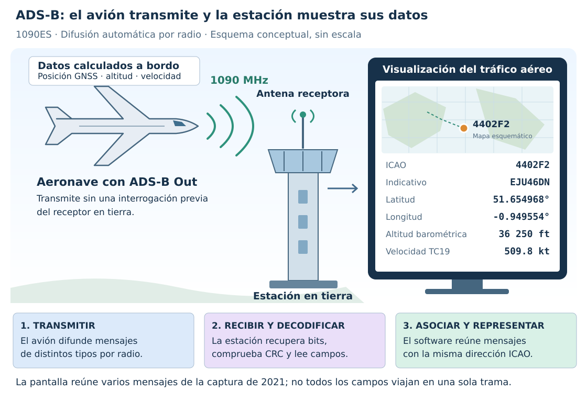
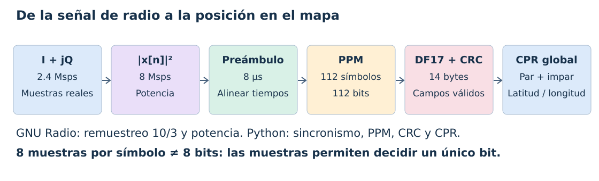
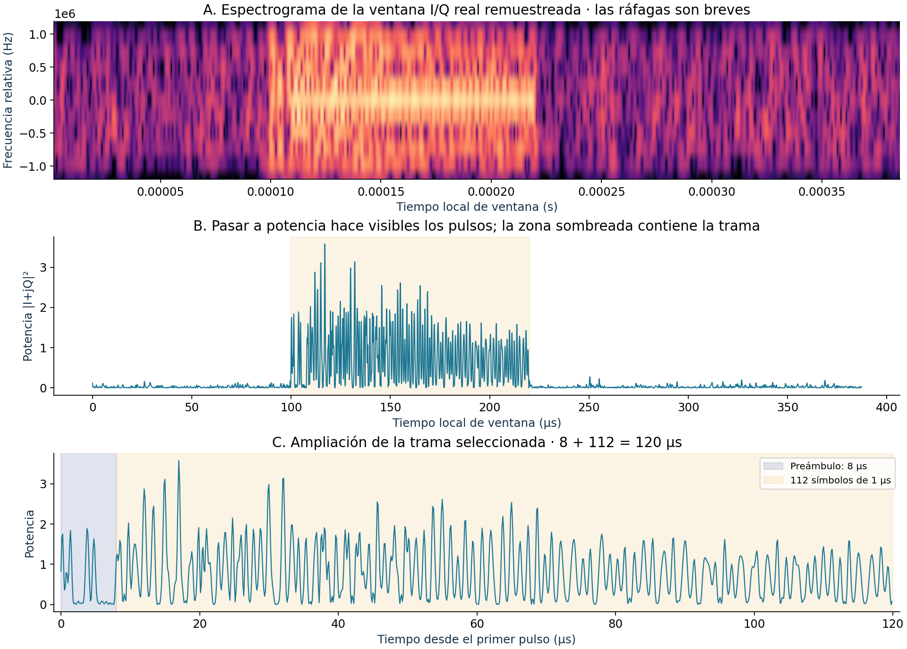
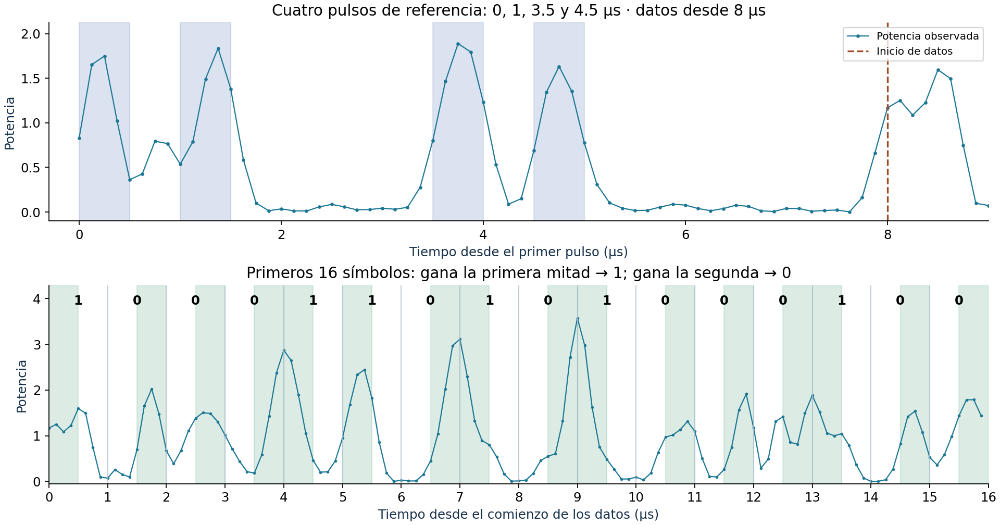
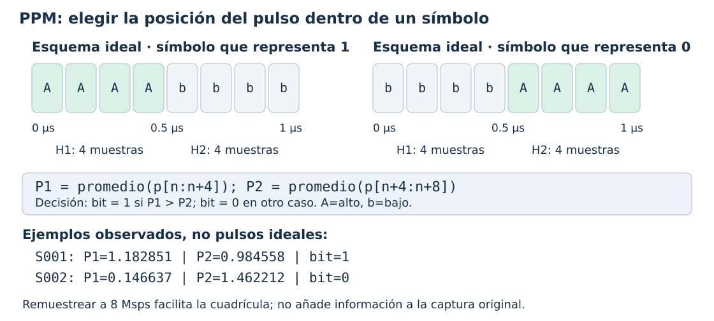
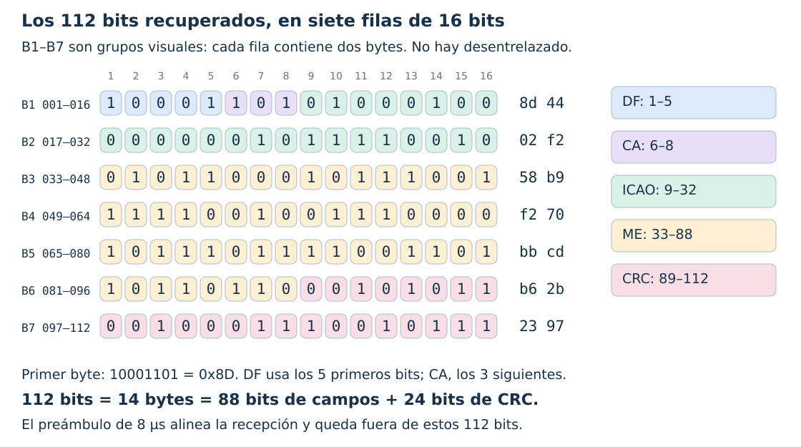
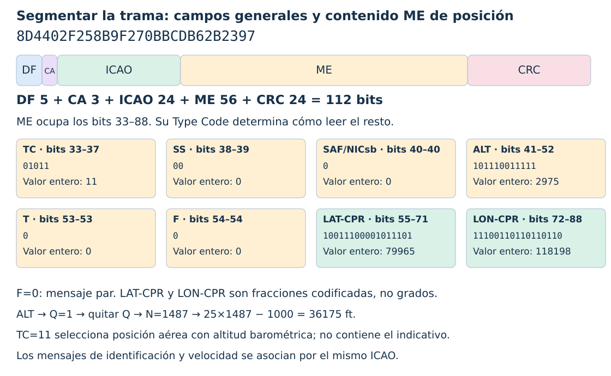
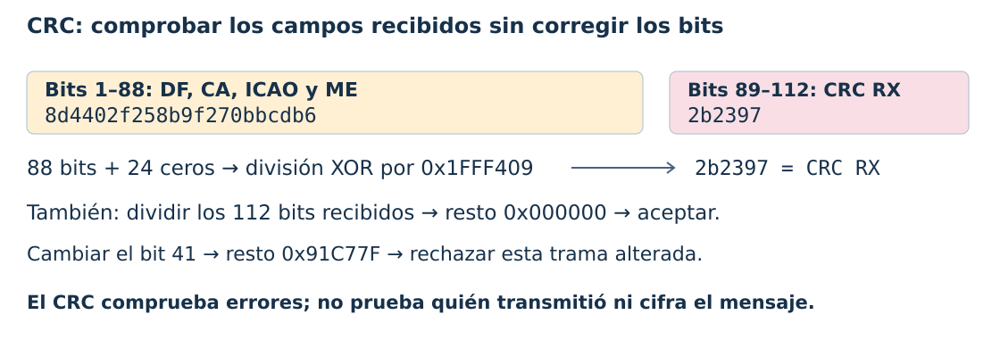
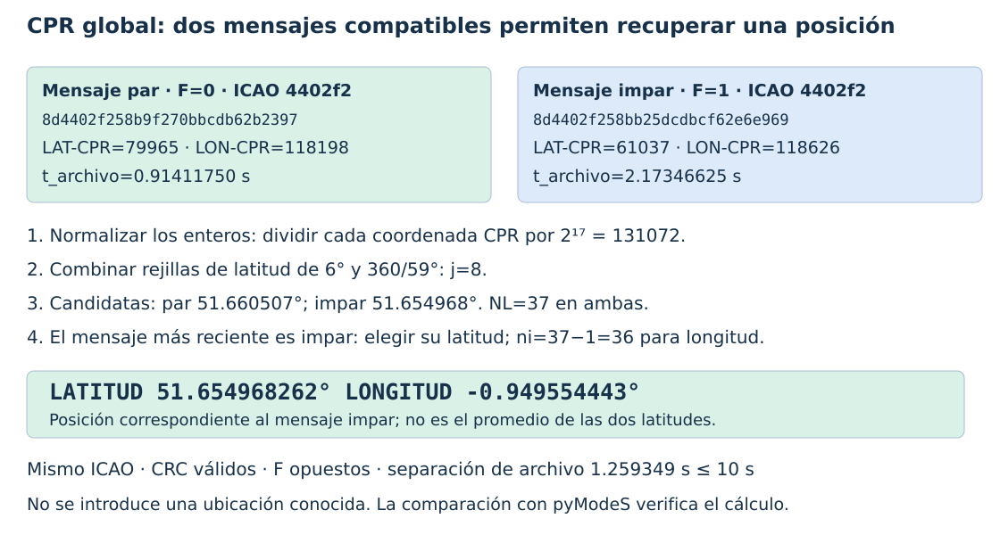

# Sesión 9 — Reverse Engineering a ADS-B

Una aeronave equipada con **ADS-B** difunde por radio datos obtenidos a bordo, como su **posición, altitud, velocidad e indicativo de vuelo**. Una estación en tierra recibe los mensajes y un sistema de visualización los reúne para mostrar dónde está la aeronave y qué información declara. ADS-B significa *Automatic Dependent Surveillance–Broadcast*. [Introducción de la FAA a ADS-B](https://www.faa.gov/air_traffic/technology/adsb/faq).


**Vista general.** El avión transmite sin una interrogación previa. La estación representa datos recibidos; no obtiene la posición midiendo el eco como un radar. La pantalla reúne mensajes de distintos tipos con el mismo ICAO. El **indicativo de vuelo** mostrado, `EJU46DN`, no es un nombre del modelo de avión ni una matrícula.

El objetivo es seguir una transmisión real de **1090 MHz** desde sus muestras complejas hasta las coordenadas de una aeronave. Primero observaremos los pulsos; después usaremos la descripción del protocolo para asignarles significado. Cada comando conserva los resultados intermedios para compararlos con las figuras.


**Figura 1.** Etapas del receptor. La detección del preámbulo alinea la cuadrícula que usaremos para demodular.

!!! note "Una captura real y un ejemplo que se conserva durante la explicación"

    Usamos muestras I/Q publicadas por [SDRangel](https://www.sdrangel.org/iq-files/), correspondientes a una grabación de noviembre de 2021. Se verificaron **134 tramas DF17 con CRC válido y 26 posiciones de nueve aeronaves**. Las figuras y los scripts siguen la misma trama de posición, `8d4402f258b9f270bbcdb62b2397`. El programa la selecciona entre los mensajes recuperados de las muestras; no la introduce como sustituto de la demodulación. El mapa muestra posiciones históricas.

## 1. Qué transmite ADS-B y qué intentamos descubrir

**ADS-B** significa *Automatic Dependent Surveillance–Broadcast*. La aeronave difunde información como su identificación, posición y velocidad. En esta sesión estudiaremos el enlace **1090ES**, *1090 MHz Extended Squitter*, y en particular el formato **DF17**. Existen otros formatos Mode S y otros enlaces ADS-B; la cadena preparada aquí selecciona DF17.

Los mensajes se reciben como ráfagas de pulsos. Un mensaje de identificación no tiene la misma estructura interna que uno de posición: habrá que leer su **Type Code**, o `TC`. La dirección **ICAO de 24 bits** permitirá relacionar mensajes de una misma aeronave. [Descripción de 1090ES y estructura de mensajes, Junzi Sun](https://mode-s.org/1090mhz/content/ads-b/1-basics.html).

| Pregunta del investigador | Evidencia que obtendremos |
|---|---|
| ¿Dónde empieza una transmisión? | Un patrón de cuatro pulsos que precede a los datos |
| ¿Qué magnitud representa el dato? | La posición temporal del pulso dentro de un intervalo |
| ¿Cuántos bits hay y en qué orden se leen? | 112 decisiones binarias, MSB primero, para DF17 |
| ¿Cómo se comprueba la recuperación? | CRC-24 y un control con un bit alterado |
| ¿Qué significan los campos? | Formato DF17, Type Code y estructura ME |
| ¿Se pueden obtener coordenadas? | Dos mensajes CPR compatibles, sin introducir una ubicación conocida |

No deducimos los nombres de los campos mirando únicamente el espectrograma: la señal permite medir y formular hipótesis; la documentación del protocolo permite interpretarlas; el CRC y otra implementación permiten contrastarlas.

## 2. Preparar la captura y explorar la señal en Inspectrum

### 2.1. Descargar y comprobar los datos

Todos los comandos parten de la raíz de `sdr`, donde está `mkdocs.yml`. Para los programas Python, usar **Radioconda activo** o sustituir `python` por `~/radioconda/bin/python` en Linux.

```bash
python scripts/sesion09_adsb/descargar_muestra.py
python scripts/sesion09_adsb/verificar_posiciones.py
```

El primer comando descarga un prefijo fijado por SHA-256 del archivo original y prepara muestras **`cf32_le`**, sin sintetizar ni remodular los mensajes. El segundo procesa esas muestras con GNU Radio y Python. No se necesitan `gr-adsb`, hardware SDR ni Throttle.

| Dato | Valor |
|---|---|
| I/Q | `gnuradio/samples/adsb-posiciones/adsb-sdrangel-posiciones.sigmf-data` |
| Metadatos | Mismo nombre, extensión `.sigmf-meta` |
| Frecuencia central | 1090 MHz |
| Tasa original | 2.4 millones de muestras complejas/s |
| Formato preparado | I y Q como float32 little-endian: ocho bytes por muestra compleja |
| Duración según muestras/tasa | Aproximadamente 13.981 s |
| Resultados | `output/adsb-posiciones/` |

El binario I/Q no se guarda en Git; por eso cada computadora debe ejecutar la descarga. La procedencia y los hashes se documentan en `gnuradio/samples/adsb-posiciones/origen.json`.

### 2.2. Del espectrograma a la envolvente de potencia


**Figura 2.** La misma señal en tres escalas. La potencia hace más visible la posición de los pulsos que el espectrograma.

La entrada contiene muestras $x[n]=I[n]+jQ[n]$. Calculamos:

$$
p[n]=|x[n]|^2=I[n]^2+Q[n]^2.
$$

Un pulso eleva la potencia. La fase compleja deja de ser necesaria para esta decisión: buscaremos **cuándo** aparece la energía. La gráfica representa potencia relativa de las muestras, sin calibración en vatios o dBm.

La cadena remuestrea primero de 2.4 a **8 Msps**, con interpolación 10 y decimación 3. A 8 Msps cada muestra está separada 0.125 µs; un intervalo de 0.5 µs corresponde a cuatro muestras y uno de 1 µs a ocho. Esto facilita la cuadrícula del receptor. **El remuestreo no añade información ni mejora por sí solo la resolución de la captura original.**

### 2.3. Abrir una ventana corta con la trama seleccionada

```bash
python scripts/sesion09_adsb/inspeccionar_adsb.py --etapa senal
```

El script recorta una ventana I/Q real, la remuestrea a 8 Msps y verifica otra vez la trama por PPM y CRC. Guarda juntos `ventana-8msps.sigmf-data` y sus metadatos en `output/adsb-posiciones/traza/`. La ventana es corta para poder ampliar los pulsos sin navegar por todo el archivo.

??? tip "Abrir la ventana en Inspectrum"

    En Linux, usar **Inspectrum del sistema**, como en la sesión 8. En una terminal nueva desde la raíz del repositorio:

    ```bash
    conda deactivate
    /usr/bin/inspectrum --rate 8000000 --format cf32 output/adsb-posiciones/traza/ventana-8msps.sigmf-data
    ```

    Si hay varios entornos Conda apilados, desactivarlos hasta salir de Conda. Esto evita la compilación de Inspectrum/libliquid de Radioconda que en esta máquina produjo `Instrucción ilegal`. Ver [instalación de Inspectrum](../../setup/instalacion.md#inspectrum-en-linux).

    En Windows, mantener Radioconda activo:

    ```bat
    inspectrum --rate 8000000 --format cf32 output/adsb-posiciones/traza/ventana-8msps.sigmf-data
    ```

    Añadir una gráfica **Amplitude** y, si está disponible, **Amplitude squared**. Activar escalas y cursores. Ampliar hasta distinguir intervalos de 0.5 y 1 µs. La amplitud y su cuadrado conservan la ubicación temporal de los pulsos, aunque sus alturas sean distintas. [Gráficas y cursores de Inspectrum](https://github.com/miek/inspectrum#features).

    En la ventana predeterminada, el primer pulso comienza aproximadamente en **100 µs** (`0.000100 s`); los datos, en **108 µs**; el mensaje termina en **220 µs**. Confirmar los valores que imprime el programa: los tiempos son locales a este recorte. En las figuras siguientes el primer pulso se toma como tiempo cero.

Para los siguientes comandos Python, volver a activar Radioconda en otra terminal. No usar el Python del sistema si no tiene GNU Radio.

## 3. Sincronismo: encontrar el inicio de la trama

### 3.1. Reconocer el preámbulo


**Figura 3.** Arriba: patrón que alinea la recepción. Abajo: decisiones sobre una cuadrícula de 1 µs. La franja verde indica la mitad con mayor potencia media.

El preámbulo tiene **cuatro pulsos nominales de 0.5 µs**. Sus comienzos, respecto al primer pulso, son:

| Pulso | Inicio | Fin nominal | Inicio a 8 Msps |
|---|---:|---:|---:|
| 1 | 0 µs | 0.5 µs | muestra 0 |
| 2 | 1 µs | 1.5 µs | muestra 8 |
| 3 | 3.5 µs | 4 µs | muestra 28 |
| 4 | 4.5 µs | 5 µs | muestra 36 |

Los datos comienzan **8 µs después del primer pulso**, no inmediatamente después del cuarto pulso. La forma física y las separaciones se describen en **FAA Order 6365.1A, apéndice 1, §§2.3.5.2.1–2.3.5.2.2**, [página 20 del PDF](https://www.faa.gov/documentLibrary/media/Order/6365.1A.pdf#page=20). Es una referencia del formato físico Mode S; la interpretación de los campos ADS-B se consulta por separado.

```bash
python scripts/sesion09_adsb/inspeccionar_adsb.py --etapa preambulo
```

### 3.2. Qué sincroniza el receptor

El programa prueba posiciones candidatas en la señal de potencia y compara los cuatro intervalos de pulso con intervalos donde espera menor energía. En esta captura exige potencia de pulso mayor que `0.0005` y contraste mínimo de `1.5` respecto a los huecos. Son parámetros del **detector implementado para esta muestra**, no valores normativos universales.

Si el primer pulso se ubica en la muestra $n_0$, el primer símbolo empieza en $n_0+64$. A partir de allí, cada ocho muestras comienza un símbolo nuevo. Así se adquiere la alineación temporal **antes de decidir sus bits**. El CRC descartará muchas detecciones falsas que podrían parecer un preámbulo.

No necesitamos un Costas Loop para recuperar fase de portadora: la decisión PPM usa potencia. Sí necesitamos sincronismo de trama y de la cuadrícula de símbolos. Este receptor de archivos prueba todas las fases de muestra y conserva solapamiento entre bloques; no implementa un lazo continuo de recuperación de reloj.

## 4. Demodulación PPM: de cada símbolo a un bit

### 4.1. Qué representa 0 y qué representa 1

**PPM**, *Pulse Position Modulation*, usa dos posiciones posibles de un pulso dentro de un símbolo de **1 µs**:

- Pulso en la **primera mitad**: bit **1**.
- Pulso en la **segunda mitad**: bit **0**.

Ambos valores llevan un pulso; la información está en su posición. La correspondencia está documentada en **FAA Order 6365.1A, apéndice 1, §3.1.2**, [página 22 del PDF](https://www.faa.gov/documentLibrary/media/Order/6365.1A.pdf#page=22).


**Figura 4.** El esquema superior es ideal; los valores inferiores se midieron en la captura.

Para cada símbolo, el receptor calcula las medias de sus dos mitades:

$$
P_1=\frac{1}{4}\sum_{k=0}^{3}p[n+k],\qquad
P_2=\frac{1}{4}\sum_{k=4}^{7}p[n+k].
$$

Decide `1` si $P_1>P_2$ y `0` en otro caso. Una igualdad exacta también produciría `0` en este prototipo, pero no garantiza una decisión fiable; el CRC valida después la trama completa. Los pulsos reales se deforman por el canal, los filtros y el muestreo: no hay que exigir que cada una de las ocho muestras sea exactamente alta o baja.

### 4.2. Ver las decisiones en columnas

```bash
python scripts/sesion09_adsb/inspeccionar_adsb.py --etapa ppm --bloque 1
```

Se muestran **S001–S016**, su muestra de inicio, el tiempo relativo, las dos medias, su diferencia y el bit elegido. Para consultar las 112 decisiones, quitar `--bloque 1`. Para el último grupo, usar `--bloque 7`.

En esta trama, S001 aporta `1` y S002 aporta `0`. La demodulación no interpreta aún si esos bits representan un identificador o una coordenada.

??? example "Recorrer gráficamente los 112 símbolos y sus decisiones"

    <iframe src="../animaciones/ppm.html" title="Decisiones PPM de los 112 símbolos ADS-B" width="100%" height="1060" style="border:0" loading="lazy"></iframe>

    [Abrir explorador PPM en otra pestaña](animaciones/ppm.html){ target="_blank" rel="noopener" }

    Cambiar de símbolo o pulsar un bit del bloque. Observar las medias H1/H2, el resultado de la comparación, el campo al que pertenece el bit y el byte que ayuda a formar. Las barras representan medias medidas, no una señal sintetizada.

## 5. Recuperar los 112 bits y agruparlos en bytes

### 5.1. Mantener las cuentas entre representaciones

Para DF17, después del preámbulo hay **112 símbolos de 1 µs**. Cada símbolo aporta **un bit**, por tanto:

$$
112\text{ símbolos}\times1\text{ bit/símbolo}=112\text{ bits}=14\text{ bytes}.
$$

La transmisión completa dura nominalmente **8 + 112 = 120 µs**. A 8 Msps representa 960 muestras de señal: 64 de preámbulo y 896 de datos. **896 muestras no son 896 bits.**

El preámbulo no informa por sí solo de la longitud. Mode S tiene mensajes de 56 y de 112 bits; un receptor general usa el formato `DF` para decidirla. Nuestro prototipo ensaya 112 bits y conserva solamente candidatos con **DF=17** y CRC válido.

```bash
python scripts/sesion09_adsb/inspeccionar_adsb.py --etapa bits
```


**Figura 5.** El bit de mayor peso se lee primero. B1–B7 son grupos para presentar resultados, no bloques definidos por el protocolo.

Los 14 bytes recuperados son:

```text
8d 44 02 f2 58 b9 f2 70 bb cd b6 2b 23 97
```

Por ejemplo, los primeros ocho bits `10001101` forman `0x8D`. Los siguientes ocho forman `0x44`. El archivo `output/adsb-posiciones/traza/112_bits.txt` conserva la secuencia completa en una línea, sin espacios.

### 5.2. Qué transformaciones necesita esta trama

La decisión PPM entrega directamente los bits que forman los bytes DF17. **En esta cadena no se aplica Gray, desentrelazado, desblanqueo ni decodificación Hamming.** El CRC es redundancia para comprobar errores; en la configuración elegida no se utiliza para corregirlos.

La diferencia con LoRa está en la codificación del enlace. No se debe trasladar automáticamente a ADS-B una transformación que fue necesaria en la sesión 8. Tampoco hay que invertir los bits de cada byte: las figuras y el programa trabajan **MSB primero**.

## 6. Leer los campos: formato, aeronave y contenido

### 6.1. Separar DF17 sin perder bits

```bash
python scripts/sesion09_adsb/inspeccionar_adsb.py --etapa campos
```


**Figura 6.** Se conservan los mismos 112 bits; ahora se separan según el formato del mensaje.

La documentación de [ADS-B Basics, apartado Message structure](https://mode-s.org/1090mhz/content/ads-b/1-basics.html#message-structure) describe esta partición. Numeramos los bits **desde 1**:

| Campo | Bits globales | Ancho | Valor en la muestra | Interpretación |
|---|---:|---:|---|---|
| DF | 1–5 | 5 | `10001` = 17 | Formato que seleccionamos |
| CA | 6–8 | 3 | `101` = 5 | Campo de capacidad del transpondedor |
| ICAO | 9–32 | 24 | `4402f2` | Dirección usada para asociar mensajes |
| ME | 33–88 | 56 | `58b9f270bbcdb6` | Contenido ADS-B, interpretado según TC |
| CRC | 89–112 | 24 | `2b2397` | Comprobación de los 88 bits anteriores |

**5 + 3 + 24 + 56 + 24 = 112.** El primer byte mezcla dos campos: `10001 | 101` es `DF | CA`. El límite de campo no siempre coincide con un límite de byte.

En Python, las posiciones empiezan en cero. Por eso el programa extrae TC con `campo(h, 32, 5)`, aunque en la tabla sus bits sean 33–37. `campo` desplaza y enmascara el entero de 112 bits; no reordena los bits.

### 6.2. Interpretar ME cuando TC=11

Los primeros cinco bits de ME son `01011`, es decir, **TC=11**. Ese tipo corresponde a posición aérea con altitud barométrica. Su estructura se explica en [Airborne position, tabla de campos ME](https://mode-s.org/1090mhz/content/ads-b/3-airborne-position.html).

| Campo | Bits globales | Ancho | Qué aporta |
|---|---:|---:|---|
| TC | 33–37 | 5 | Tipo de mensaje |
| SS | 38–39 | 2 | Estado de vigilancia |
| SAF/NICsb | 40 | 1 | Significado dependiente de la versión ADS-B; no se usa aquí para calcular la posición |
| ALT | 41–52 | 12 | Altitud codificada |
| T | 53 | 1 | Indicador temporal del protocolo; no contiene una fecha UTC completa |
| F | 54 | 1 | Formato CPR: 0 par, 1 impar |
| LAT-CPR | 55–71 | 17 | Fracción codificada para latitud |
| LON-CPR | 72–88 | 17 | Fracción codificada para longitud |

Los anchos suman **56 bits**. Para esta trama, `F=0`, `LAT-CPR=79965` y `LON-CPR=118198`. No son latitud y longitud en grados: todavía falta CPR.

En ALT, el indicador `Q=1` selecciona pasos de 25 ft. Se elimina ese indicador y se juntan los once bits restantes para obtener $N=1487$. La altitud de **esta trama par** es $25N-1000=36175$ ft. Esta fórmula no debe aplicarse al modo `Q=0`. [Altitud barométrica y bit Q](https://mode-s.org/1090mhz/content/ads-b/3-airborne-position.html#barometric-altitude).

??? example "Localizar Q y reconstruir el entero de altitud"

    Dentro de los doce bits de ALT, Q es el **quinto bit contado desde la derecha**:

    ```text
    ALT recibido:       1011100 | 1 | 1111
                         datos   Q   datos
    Sin Q, concatenar:  1011100     1111 = 10111001111
    Entero N:           1487
    Altitud:            25 × 1487 − 1000 = 36175 ft
    ```

    Se elimina únicamente Q. No se invierte el orden ni se descarta otro bit.

### 6.3. Identificar la aeronave con otros mensajes

Una trama de posición no contiene el nombre del vuelo. Para localizar los mensajes disponibles:

```bash
python scripts/sesion09_adsb/inspeccionar_adsb.py --listar
```

El mensaje `8d4402f22314a574d843a066668e`, presente en la captura, tiene el mismo ICAO y **TC=4**. Inspeccionarlo con:

```bash
python scripts/sesion09_adsb/inspeccionar_adsb.py --etapa campos --hex 8d4402f22314a574d843a066668e
```

El programa separa sus ocho códigos de seis bits y recupera **`EJU46DN`**. Estos códigos usan la tabla de caracteres ADS-B, no ASCII. El indicativo identifica el vuelo declarado; no se está consultando una base de matrículas ni autenticando al transmisor. [Aircraft identification](https://mode-s.org/1090mhz/content/ads-b/2-identification.html).

## 7. Comprobar integridad con CRC-24

### 7.1. Comparar el CRC calculado y el recibido


**Figura 7.** Dos formas equivalentes de verificar esta trama DF17.

El CRC usa el polinomio generador `0x1FFF409`, de grado 24. El bit superior representa $x^{24}$; el registro del programa tiene 24 posiciones y usa los términos restantes, `0xFFF409`, al realizar XOR.

1. Tomar los **primeros 88 bits**, añadir **24 ceros** y calcular el resto de la división binaria por el polinomio. Los ceros son parte del cálculo, no bits adicionales transmitidos.
2. Comparar el resultado con los **24 bits recibidos** al final de la trama. Aquí ambos son `0x2B2397`.
3. Como comprobación equivalente, dividir los **112 bits recibidos**: el resto debe ser cero.

La división usa XOR, sin llevadas ni préstamos. Este tratamiento corresponde a DF17; otros formatos Mode S pueden superponer información a la paridad. [Error control in ADS-B, polinomio y comprobación](https://mode-s.org/1090mhz/content/ads-b/8-error-control.html).

```bash
python scripts/sesion09_adsb/inspeccionar_adsb.py --etapa crc
```

### 7.2. Seguir el registro sin ocultar los pasos

La salida muestra, para cada uno de los 112 bits, el estado anterior del registro, el bit de entrada, si se aplica XOR con `0xFFF409` y el estado posterior. Se empieza con estado cero. Para leer solo los primeros 16 pasos:

```bash
python scripts/sesion09_adsb/inspeccionar_adsb.py --etapa crc --bloque 1
```

La operación de cada paso está en `pasos_crc`, dentro de `scripts/sesion09_adsb/inspeccionar_adsb.py`:

```python
alto = bool(estado & 0x800000)
estado = ((estado << 1) | bit) & 0xffffff
if alto:
    estado ^= 0xfff409
```

Primero se recuerda el bit que va a salir del registro; después se desplaza, entra el bit recibido y se aplica XOR cuando corresponde. La máscara conserva 24 posiciones. Tras el bit 112, el estado es `000000`.

El script también invierte **solo el bit 41**, manteniendo el CRC recibido. El resto pasa a `91c77f`: el mensaje alterado se rechaza. **CRC válido no equivale a autenticidad**: no hay una clave secreta en esta comprobación y no se cifra el contenido.

## 8. CPR: pasar de los campos binarios a coordenadas

### 8.1. Por qué un entero de 17 bits no es una coordenada directa

**CPR**, *Compact Position Reporting*, representa fracciones dentro de rejillas geográficas. El formato par e impar utiliza divisiones ligeramente distintas. Una sola fracción admite varias posiciones globales; una pareja compatible permite resolver la ambigüedad sin introducir una ubicación conocida del receptor. Esto es **CPR global**. Existe también CPR local con una referencia, que aquí no usamos.


**Figura 8.** Se combinan campos de dos mensajes, sin concatenar sus bits ni promediar sus latitudes.

```bash
python scripts/sesion09_adsb/inspeccionar_adsb.py --etapa cpr
```

| Mensaje | Paridad F | LAT-CPR | LON-CPR | Tiempo de archivo |
|---|---:|---:|---:|---:|
| `8d4402f258b9f270bbcdb62b2397` | 0 | 79965 | 118198 | 0.91411750 s |
| `8d4402f258bb25dcdbcf62e6e969` | 1 | 61037 | 118626 | 2.17346625 s |

El programa exige mismo ICAO, CRC válidos, paridades opuestas y separación de hasta 10 s. También comprueba que ambas latitudes correspondan al mismo número de zonas de longitud. [CPR global y condiciones de la pareja](https://mode-s.org/1090mhz/content/ads-b/3-airborne-position.html#globally-unambiguous-position-decoding).

### 8.2. Obtener la latitud, paso a paso

Normalizamos los campos dividiendo por $2^{17}=131072$:

$$
y_e=\frac{79965}{131072}=0.610084533691,\qquad
y_o=\frac{61037}{131072}=0.465675354004.
$$

Las rejillas par e impar tienen pasos de **360/60 = 6°** y **360/59°**, respectivamente. Calculamos el índice que relaciona ambas:

$$
j=\lfloor59y_e-60y_o+0.5\rfloor=8.
$$

Las latitudes candidatas son:

$$
\varphi_e=6\big((j\bmod60)+y_e\big)=51.660507202148^\circ,
$$

$$
\varphi_o=\frac{360}{59}\big((j\bmod59)+y_o\big)=51.654968261719^\circ.
$$

El mensaje más reciente es **impar**; elegimos $\varphi_o$. Las dos candidatas son posiciones asociadas a mensajes distintos, no dos medidas que se deban promediar. El algoritmo general también ajusta las soluciones al hemisferio correspondiente; en este ejemplo ambas ya quedan en latitudes norte válidas.

??? info "Qué significa NL y cómo se obtiene la longitud"

    `NL(latitud)` indica cuántas zonas longitudinales corresponden a esa latitud. Las zonas se adaptan a la geometría de la Tierra. El programa usa la fórmula y los casos polares descritos en [Core functions and parameters](https://mode-s.org/1090mhz/content/ads-b/3-airborne-position.html#core-functions-and-parameters); no elige el valor mirando el mapa.

    En las dos candidatas resulta `NL=37`. Normalizamos también la longitud:

    $$
    x_e=\frac{118198}{131072}=0.901779174805,\qquad
    x_o=\frac{118626}{131072}=0.905044555664.
    $$

    Como elegimos la trama impar, $n_i=\max(37-1,1)=36$. Entonces:

    $$
    m=\lfloor x_e(37-1)-x_o37+0.5\rfloor=-1,
    $$

    $$
    \lambda=\frac{360}{36}\big((m\bmod36)+x_o\big)=359.050445556641^\circ.
    $$

    Para expresarla entre −180° y 180°, restamos 360°: **−0.949554443359°**. El módulo usado aquí entrega un residuo no negativo: `-1 % 36 = 35`.

La posición final es **51.654968°, −0.949554°**, correspondiente a la trama impar. Su altitud es **36 250 ft**; la trama par anterior tenía **36 175 ft**. El programa imprime los valores de ambas para no atribuir al mensaje par los datos del impar.

### 8.3. Contrastar con una implementación independiente

La verificación inicial se contrastó con **pyModeS 2.22.0**: coinciden los 134 CRC y las 26 posiciones, con tolerancia de `1e-9` grados para las coordenadas. Puede repetirse sin instalar la dependencia globalmente:

```bash
python -m pip install --target tmp/adsb-posiciones/deps --no-deps 'pyModeS==2.22.0'
python scripts/sesion09_adsb/verificar_posiciones.py --pymodes-dir tmp/adsb-posiciones/deps
```

La comparación verifica nuestra implementación frente a [pyModeS](https://github.com/junzis/pyModeS/tree/v2.22.0). No es una comprobación externa contra radar o una trayectoria certificada.

## 9. Reunir las aeronaves y mostrarlas en un mapa

El programa de verificación guarda `posiciones.csv`, `posiciones.geojson` y `mapa.html` en `output/adsb-posiciones/`. Cada posición conserva **ICAO, latitud, longitud, tiempo relativo y los dos mensajes CPR de origen**. Los indicativos y la velocidad se incorporan cuando se reciben mensajes de esos tipos con el mismo ICAO.

```bash
python scripts/sesion09_adsb/inspeccionar_adsb.py --etapa mapa
python -m http.server 8012 --bind 127.0.0.1 --directory output/adsb-posiciones
```

Visitar [el mapa local](http://127.0.0.1:8012/mapa.html). Si el puerto 8012 ya está en uso por el mapa abierto anteriormente, usar ese servidor existente. El HTML también se puede abrir directamente con el navegador. El fondo de OpenStreetMap necesita Internet; las posiciones, los controles y Leaflet están incluidos en el archivo.

??? example "Mapa de referencia: nueve aeronaves con posiciones recuperadas"

    <iframe src="../animaciones/mapa-adsb.html" title="Mapa histórico de coordenadas ADS-B verificadas" width="100%" height="780" style="border:0" loading="lazy"></iframe>

    [Abrir mapa de referencia en otra pestaña](animaciones/mapa-adsb.html){ target="_blank" rel="noopener" } · [Coordenadas CSV](animaciones/posiciones.csv) · [GeoJSON](animaciones/posiciones.geojson) · [Informe completo](animaciones/verificacion.json)

    Esta copia permite revisar el resultado desde la página del curso. El mapa de `output/` corresponde a la ejecución local del alumno. Seleccionar una aeronave, mover el control temporal y pulsar un punto para consultar las tramas par/impar. Las líneas unen puntos observados; no generan posiciones intermedias.

!!! note "Cómo interpretar los tiempos y el mapa"

    La fecha original procede del nombre del archivo y no incluye zona horaria. Los tiempos mostrados se calculan por índice de muestra, incluyen el retardo del remuestreador y no son UTC original. No se ha validado la cadencia temporal entre ráfagas: desplazamiento dividido entre tiempo de archivo no concuerda suficientemente con la velocidad declarada en TC19. Por ello se muestran **posiciones observadas y velocidad TC19**, sin deducir velocidad o continuidad de vuelo a partir del mapa. El control temporal recorre el archivo, no reproduce un reloj de vuelo validado.

## 10. Seguir la cadena y revisar los resultados

### 10.1. Archivos y comandos por transición

| Etapa | Comando después de `python scripts/sesion09_adsb/inspeccionar_adsb.py` | Resultado que se inspecciona |
|---|---|---|
| Señal | `--etapa senal` | Ventana I/Q verificable en Inspectrum |
| Alineación | `--etapa preambulo` | Cuatro pulsos y comienzo de los datos |
| Demodulación | `--etapa ppm --bloque 1` | Muestras, medias y decisiones de 16 símbolos |
| Bits y bytes | `--etapa bits` | Siete grupos, 112 bits y 14 bytes |
| Interpretación | `--etapa campos` | Rangos, bits y valores de DF17 y ME |
| Integridad | `--etapa crc` | Registro por bit, CRC calculado y control negativo |
| Posición | `--etapa cpr` | Pareja real, normalización y coordenadas |
| Representación | `--etapa mapa` | Ubicación del mapa y cantidad de posiciones |

Para ejecutar todas las etapas sobre la trama predeterminada:

```bash
python scripts/sesion09_adsb/inspeccionar_adsb.py --etapa todas
```

Los resultados se guardan en **`output/adsb-posiciones/traza/`**: `traza.json`, `112_bits.txt` y un `.txt` por etapa. `--hex` selecciona otra trama **presente en el informe**; `--listar` permite encontrarla. La etapa CPR necesita que esa trama tenga una pareja compatible. Al cambiar de trama, los archivos de esa carpeta se actualizan; guardar una copia antes si se quieren comparar ejecuciones.

### 10.2. Comprobaciones para discutir en clase

- Medir los 8 µs del preámbulo y localizar el primer intervalo de datos; explicar por qué hacen falta ambos pasos.
- Elegir un símbolo que represente 0 y otro que represente 1; justificar cada decisión usando las dos medias.
- Reconstruir un byte de la Figura 5 y comprobar su valor hexadecimal sin invertir sus bits.
- Identificar los 88 bits protegidos por el CRC y los 24 que contienen la comprobación.
- Justificar por qué `79965` no es una latitud en grados y qué información aporta el segundo mensaje CPR.
- Elegir un punto del mapa y localizar sus dos mensajes de origen en el informe, sin mezclar ICAO distintos.

### 10.3. Código que produce los resultados y las figuras

Los programas se organizan en `scripts/sesion09_adsb/`: `receptor.py` implementa la cadena, `verificar_posiciones.py` guarda los resultados e `inspeccionar_adsb.py` presenta las transiciones. Las figuras y el explorador se regeneran desde esos resultados, no desde valores escritos manualmente:

```bash
python scripts/sesion09_adsb/inspeccionar_adsb.py --etapa todas
python scripts/sesion09_adsb/generar_figuras.py
```

El segundo comando requiere Matplotlib, además del entorno de recepción; actualiza las figuras y la copia del mapa que usa MkDocs. Las referencias físicas, las reglas de campos y los algoritmos CPR están enlazados junto a cada explicación para poder contrastar las hipótesis con la documentación.
