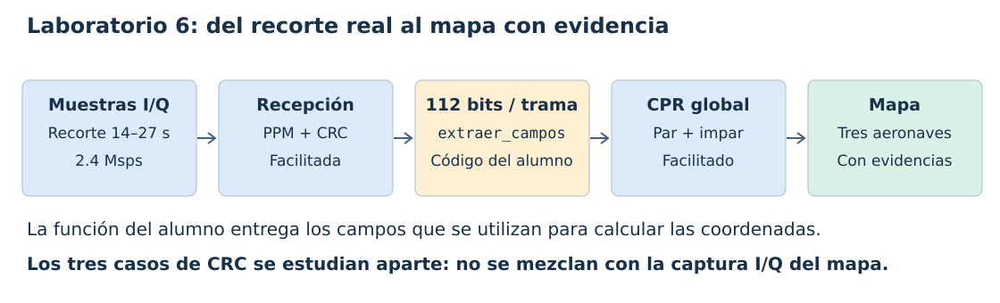

# Laboratorio #6 — Radar bajo sospecha: del archivo I/Q al mapa

**Trabajo en parejas · Nivel intermedio · Calificación sobre 20 puntos.** La fecha de entrega se comunicará en clase.

!!! question "La misión"

    El equipo recibe una grabación I/Q de 1090 MHz y debe convertirla en una pequeña estación de análisis. Cada avión que aparezca en el mapa tendrá una ficha y una cadena de evidencias: **pulsos → bits → campos → CRC → pareja CPR → coordenadas**. Al final deberá responder si una observación con CRC válido demuestra que el avión anunciado existe.

El nombre “radar” se refiere aquí al panel de visualización: el equipo reconstruye posiciones declaradas por ADS-B, no mide ecos. La [sesión 9](clase9.md) proporciona las explicaciones y los bloques de recepción que se pueden reutilizar.

## 1. Material de la misión y alcance del trabajo

La muestra del laboratorio es un **recorte real distinto del usado en la lección**: segundos 14–27 del WAV I/Q de SDRangel de 2021. No se solapa con la muestra de 0–13.981 s del ejemplo. Su formato y tasa están documentados; la tarea consiste en analizar el enlace, no en adivinar el tipo de archivo.

| Propiedad | Valor |
|---|---|
| Muestra | `gnuradio/samples/adsb-laboratorio/adsb-laboratorio-14s-27s.sigmf-data` |
| Formato | `cf32_le`: I y Q como float32 little-endian |
| Frecuencia central | 1090 MHz |
| Tasa y duración del recorte | 2.4 Msps; 13 s |
| Tamaño | 249 600 000 bytes |
| Metadatos y procedencia | `.sigmf-meta` y `origen.json` junto a la muestra |
| Fuente | [SDRangel, IQ Files](https://www.sdrangel.org/iq-files/) |

El equipo puede reutilizar el lector I/Q, el remuestreador, el receptor PPM, el comprobador CRC, CPR y la plantilla del mapa. **Debe programar su propia función `extraer_campos(bits)`**, que se utilizará realmente para calcular las coordenadas del mapa. La identificación de vuelo y la velocidad TC19 se facilitan como campos complementarios.


**Flujo de trabajo.** Los campos obtenidos por el equipo se utilizan para producir las coordenadas del mapa.

El análisis se ejecuta con archivos y software local. Los mensajes sintéticos del caso de integridad se estudian aparte de las muestras reales, sin generar ni emitir RF.

## 2. Preparar el entorno y los archivos

Desde la raíz del repositorio, con **Radioconda activo**, ejecutar:

```bash
python scripts/sesion09_adsb/descargar_muestra.py --muestra laboratorio
python scripts/sesion09_adsb/preparar_laboratorio.py
```

En Linux se puede sustituir `python` por `~/radioconda/bin/python`. La descarga y la preparación son independientes de la muestra de la lección. No se necesita SDR ni instalar otro módulo OOT.

La preparación verifica el SHA-256, ejecuta la recepción y crea:

```text
output/adsb-laboratorio/
├── mensajes.json              # Hexadecimal e índices de muestra recuperados
├── potencia8.f32              # Potencia a 8 Msps para inspeccionar símbolos
├── mi_analisis.py             # Copia de la plantilla: completar esta función
└── casos_integridad.json      # Tres mensajes del caso local, separados de I/Q
```

`mensajes.json` conserva el número de mensaje y la muestra de comienzo de su preámbulo. Los registros incluyen el hexadecimal recuperado, no una lista de coordenadas. Al repetir la preparación, **`mi_analisis.py` se conserva si ya existe**. El archivo original de la plantilla está en `scripts/sesion09_adsb/plantilla_analisis.py`.

Para regenerar la recepción por algún cambio de archivos, usar `--reprocesar`. La potencia intermedia ocupa unos 416 MB; no se incluye en la entrega.

## 3. Checkpoint 1 — Demostrar que los bits proceden de la señal — 4 puntos

Elegir un mensaje real y registrar su **número, hexadecimal e índice de comienzo**. Por ejemplo, estos comandos inspeccionan el número 1; el equipo puede elegir otro:

```bash
python scripts/sesion09_adsb/preparar_laboratorio.py --inspeccionar 1 --etapa preambulo
python scripts/sesion09_adsb/preparar_laboratorio.py --inspeccionar 1 --etapa ppm --bloque 1
python scripts/sesion09_adsb/preparar_laboratorio.py --inspeccionar 1 --etapa bits
```

Las tablas se guardan en `output/adsb-laboratorio/evidencias/`. `--bloque 1` muestra S001–S016; quitarlo muestra las 112 decisiones. B1–B7 son grupos visuales de dieciséis bits, no bloques FEC.

Cada inspección guarda también **`mensaje_001_potencia.svg`** —con el número elegido—, que se abre en el navegador: arriba muestra la potencia real del preámbulo y abajo los primeros dieciséis símbolos. Las franjas marcan los intervalos de referencia y las mitades seleccionadas; la curva procede de las muestras recibidas. Se genera sin instalar una biblioteca de gráficos adicional.

El equipo presenta:

1. La gráfica del preámbulo, su ubicación, sus cuatro pulsos nominales y el comienzo de datos en $n_0+64$ muestras a 8 Msps. El índice $n_0$ corresponde al recorte del laboratorio.
2. Una tabla de **16 símbolos consecutivos** con medias H1/H2 y decisiones. Explica al menos un 0 y un 1; puede usar otro grupo si hace falta.
3. El bloque completo de **112 bits**, agrupado en 14 bytes, y la correspondencia de uno de esos bytes con el hexadecimal recibido.

Los resultados se obtienen de la potencia de la muestra del laboratorio. Las figuras de la lección ayudan a interpretar la cuadrícula; sus tiempos y valores pertenecen a otra trama. [Sincronismo y PPM en la sesión](clase9.md#3-sincronismo-encontrar-el-inicio-de-la-trama).

## 4. Checkpoint 2 — Programar la extracción de campos — 4 puntos

Abrir **`output/adsb-laboratorio/mi_analisis.py`** y completar únicamente `extraer_campos(bits)` al comenzar. La función recibe una cadena de **112 caracteres**, MSB primero, y devuelve:

| Clave | Tipo y contenido |
|---|---|
| `df` | Entero: formato de mensaje |
| `ca` | Entero: capacidad |
| `icao` | Cadena hexadecimal de seis dígitos, conservando ceros iniciales |
| `tc` | Entero: Type Code |
| `cpr_impar` | Para TC9–18: entero 0 o 1, campo F |
| `cpr_lat` | Para TC9–18: entero de 17 bits |
| `cpr_lon` | Para TC9–18: entero de 17 bits |
| `altitud_ft` | Para TC9–18: entero en pies si Q=1; `None` si Q=0 |

Las claves generales se devuelven para todos los mensajes. Las cuatro últimas son necesarias cuando TC está entre 9 y 18. La [sección 6 de la sesión](clase9.md#6-leer-los-campos-formato-aeronave-y-contenido) define los rangos y el cálculo de altitud.

El código puede utilizar cortes de cadenas, conversión binaria o desplazamientos y máscaras. Se evalúan esos cálculos propios: llamar a `interpretar` o `campo` del curso dentro de `extraer_campos` no sustituye este trabajo. El soporte ya facilita los campos complementarios de indicativo y velocidad; el equipo puede ampliar su decodificación si lo desea.

La plantilla se detiene inicialmente con el mensaje **“Completar extraer_campos”**; es el punto de partida previsto. Una vez completada la función:

```bash
python output/adsb-laboratorio/mi_analisis.py
```

El soporte contrasta los campos devueltos con los bits de entrada. Si encuentra una diferencia, indica el campo y el mensaje que se debe revisar; no sustituye silenciosamente el resultado por el correcto.

El equipo contrasta en el informe **dos mensajes distintos**, incluyendo uno de posición: indica rangos de bits, bits extraídos y valores. La función debe procesar los mensajes de entrada; escribir valores constantes de una trama no resuelve la tarea.

## 5. Checkpoint 3 — Separar integridad de autenticidad — 4 puntos

El archivo `casos_integridad.json` contiene tres casos con procedencia declarada:

| Caso | Cómo se preparó |
|---|---|
| A | Mensaje recuperado de la captura real del laboratorio |
| B | Copia de A con el bit global 41 invertido, conservando el CRC recibido |
| C | Mensaje sintético local de identificación, TC4, indicativo `AULA06` y dirección de prueba `F0C006` |

**La procedencia declarada es contexto externo al mensaje.** El caso C es un vector binario preparado para esta comparación: no se ha convertido en muestras I/Q ni transmitido. Al ser de identificación, tampoco aporta por sí solo una posición CPR. Estos tres casos no se mezclan con el conjunto de mensajes reales que alimenta el mapa.

```bash
python scripts/sesion09_adsb/preparar_laboratorio.py --casos-crc
```

El programa guarda `resultado_casos_crc.json` con CRC recibido, CRC calculado, resto y decisión. Para ver la división por bit en un mensaje de la captura:

```bash
python scripts/sesion09_adsb/preparar_laboratorio.py --inspeccionar 1 --etapa crc
```

El equipo presenta una tabla comparativa de los tres casos y responde:

1. ¿Qué prueba la comparación del CRC en A y qué detecta en B?
2. ¿Qué permite observar C sobre la relación entre un mensaje sintético y un CRC válido?
3. Si se retiraran las etiquetas de procedencia, ¿el CRC permitiría identificar el origen? Justificar usando el cálculo observado, no solo una definición.

## 6. Checkpoint 4 — Construir el mapa y sus fichas de evidencia — 5 puntos

Con la función del alumno, el programa agrupa mensajes por ICAO y aplica CPR global a parejas compatibles. Guarda los resultados en `output/adsb-laboratorio/resultado/`:

```text
resultado/
├── mapa.html
├── posiciones.csv
├── posiciones.geojson
├── tramas.avr
└── verificacion.json
```

Para revisarlos en el navegador:

```bash
python -m http.server 8013 --bind 127.0.0.1 --directory output/adsb-laboratorio/resultado
```

Abrir [el mapa del laboratorio](http://127.0.0.1:8013/mapa.html). También puede abrirse el HTML directamente. Leaflet y los datos están incluidos; el fondo de OpenStreetMap requiere Internet.

El equipo selecciona **al menos tres aeronaves con posición** y, para una posición de cada una, documenta:

- Dirección ICAO y latitud/longitud obtenidas.
- Altitud barométrica y, cuando se hayan recibido, indicativo y velocidad TC19. Los campos ausentes se indican como **“no disponible”**.
- Los dos mensajes par/impar, sus CRC y los valores de `F`, `LAT-CPR` y `LON-CPR` que utilizó.
- Por qué esa pareja es compatible: mismo ICAO, paridades opuestas, separación de archivo de hasta 10 s y comprobación de zonas NL.

Cada punto del mapa permite consultar sus dos mensajes de origen. La ficha y la tabla del informe deben coincidir con esos mensajes y con el resultado de la función del alumno. Se puede reutilizar la interfaz del curso.

!!! note "Alcance de las observaciones"

    Las posiciones son históricas. Los tiempos son relativos al recorte e incluyen el retardo del remuestreador; no constituyen marcas UTC originales. **La velocidad se toma de TC19**, porque no se ha validado la cadencia original para deducirla por distancia/tiempo del archivo. Las líneas del mapa unen puntos observados, sin introducir posiciones intermedias. Se evalúan la evidencia y la corrección del proceso para las tres aeronaves seleccionadas.

## 7. Checkpoint 5 — Defender qué se puede confiar — 3 puntos

Revisar la [charla y demostración de RenderMan](clase9.md#sesion-9-reverse-engineering-a-ads-b), enlazadas al inicio de la sesión. El equipo cierra el informe con una explicación breve que conecte el caso local con estas preguntas:

- ¿En qué se diferencia detectar errores de autenticar la identidad del emisor?
- ¿Qué evidencia adicional permitiría contrastar una posición declarada? Proponer una fuente o mecanismo y explicar qué comprobaría y qué limitación tendría.
- ¿Qué mostró la demostración con un receptor ADS-B real y qué conclusión sobre un aeropuerto operativo no está acreditada por esas fuentes?

Puede discutirse, por ejemplo, una observación física independiente o una comparación con otro sistema de vigilancia, citando una fuente. Una sospecha o un dato repetido no constituyen por sí solos prueba de suplantación.

## 8. Entrega y rúbrica

Entregar **un ZIP por pareja**, con el nombre `lab06_codigoUNI1_codigoUNI2.zip`. El informe identifica integrantes y códigos.

```text
lab06_codigoUNI1_codigoUNI2/
├── informe.pdf                # Informe breve, orientativamente 2–3 páginas
├── mi_analisis.py             # Código completado por el equipo
├── mensajes.json              # Entrada realmente utilizada
├── resultado/                 # HTML, CSV, GeoJSON, AVR y JSON generados
├── evidencias/                # Tablas PPM, 112 bits y cálculo CRC
└── resultado_casos_crc.json
```

El informe incluye el comando para reproducir el análisis desde la raíz del repositorio y el SHA-256 de la captura, disponible en `origen.json`. Las tablas extensas pueden ir como archivos de evidencia. Los binarios I/Q y la potencia se recuperan con los comandos de preparación y no se incorporan al ZIP.

| Criterio | Evidencia evaluada | Puntos |
|---|---|---:|
| 1. Señal y demodulación | Alineación del preámbulo (1), 16 decisiones PPM justificadas (2), correspondencia 112 bits/14 bytes (1) | **4** |
| 2. Extracción propia | Campos generales en código y contraste (2), campos de posición y altitud con Q (2) | **4** |
| 3. Integridad | Comparación CRC de A/B/C (3), explicación del control de un bit alterado (1) | **4** |
| 4. Coordenadas y mapa | Parejas compatibles (1), tres aeronaves con coordenadas sustentadas (2), fichas y campos ausentes bien tratados (1), reproducción de resultados (1) | **5** |
| 5. Análisis de confianza | Integridad frente a autenticidad, conectada con los casos (1), contraste adicional con fuente y limitación (1), alcance correcto de la demo de RenderMan (1) | **3** |
| **Total** | | **20** |

Los resultados deben proceder del análisis ejecutado por el equipo. Se aceptan implementaciones alternativas que produzcan campos correctos y evidencias verificables. El recorte y los casos locales son comunes; cada equipo elige sus mensajes y las tres aeronaves que documenta.
